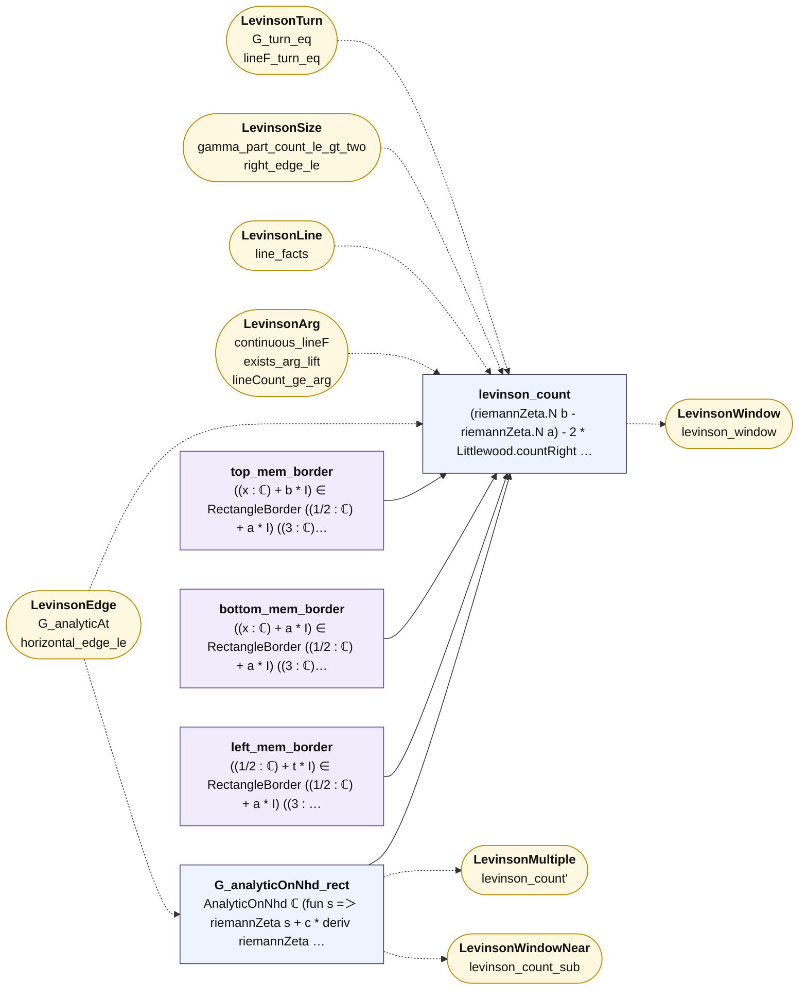

# `lean_stage3/Stage3/LevinsonCount.lean`

> **Read from the source text.** This file changed after the last `python3 utilities/lean_map.py --dump`, so the arrows on this page are names occurring in each proof and have not been confirmed by Lean.

LevinsonCount — block S11 of `lean_stage3/design/stencil.md`, step 1 assembled. 2026-11-24.

5 theorems, 0 definitions, 186 lines. 

**Imports:** [`LevinsonEdge`](../lean_stage3/LevinsonEdge.md)  
**Imported by:** [`Stage3`](../lean_stage3/Stage3.md), [`LevinsonRight`](../lean_stage3/LevinsonRight.md)

## The picture



An arrow A → B reads "A is used in the proof of B". Green: counting, integers only. Violet: shape, analysis with no ζ. Blue: reads ζ. A name ending in ■ is an end: nothing else uses it. Red: contains `sorry`. Yellow: theorems in another file, counted; a dotted arrow crosses files. Definitions are not drawn; they are listed below the diagram.

## Theorems

<a name="LevinsonCount-G_analyticOnNhd_rect"></a>
### `LevinsonCount.G_analyticOnNhd_rect`

line 44 · arrows read from text

**Reads ζ.** It, or something it rests on, uses the zeta function, its zeros or the Riemann hypothesis.

**Why.** `ζ + c ζ'` is analytic on the rectangle with corners `1/2 + a i`, `3 + b i`, `4 ≤ a ≤ b`: every point has imaginary part at least `4`, so it avoids the pole.

**Proves**

```lean
AnalyticOnNhd ℂ (fun s => riemannZeta s + c * deriv riemannZeta s) (Rectangle ((1/2 : ℂ) + a * I) ((3 : ℂ) + b * I))
```

**Needs** (its hypotheses)

  - `` c : ℝ ``
  - `` ha : 4 ≤ a ``
  - `` hab : a ≤ b ``

**Fed by** (1 theorem its proof uses)

  - [`LevinsonEdge.G_analyticAt`](../lean_stage3/LevinsonEdge.md#LevinsonEdge-G_analyticAt) (LevinsonEdge) — `` AnalyticAt ℂ (fun s => riemannZeta s + c * deriv riemannZeta s) w ``

**Feeds** (3 that use it)

  - [`LevinsonCount.levinson_count`](#LevinsonCount-levinson_count) — `` (riemannZeta.N b - riemannZeta.N a) - 2 * Littlewood.countRight (fun s => riemannZeta s + c * deriv riemannZeta s) ((1/2 : ℂ) + a * I) ((3 : ℂ) + b * … ``
  - [`LevinsonMultiple.levinson_count'`](../lean_stage3/LevinsonMultiple.md#LevinsonMultiple-levinson_count-) (LevinsonMultiple) — `` (riemannZeta.N b - riemannZeta.N a) - 2 * Littlewood.countRight (fun s => riemannZeta s + c * deriv riemannZeta s) ((1/2 : ℂ) + a * I) ((3 : ℂ) + b * … ``
  - [`LevinsonWindowNear.levinson_count_sub`](../lean_stage3/LevinsonWindowNear.md#LevinsonWindowNear-levinson_count_sub) (LevinsonWindowNear) — `` (riemannZeta.N b - riemannZeta.N a) - 2 * Littlewood.countRight (fun s => riemannZeta s + c * deriv riemannZeta s) ((1/2 : ℂ) + a * I) ((3 : ℂ) + b * … ``

<a name="LevinsonCount-left_mem_border"></a>
### `LevinsonCount.left_mem_border`

line 62 · arrows read from text

**Shape.** Uses real or complex analysis; nothing in it or beneath it reads ζ.

**Why.** The left edge lies on the border.

**Proves**

```lean
((1/2 : ℂ) + t * I) ∈ RectangleBorder ((1/2 : ℂ) + a * I) ((3 : ℂ) + b * I)
```

**Needs** (its hypotheses)

  - `` ht : t ∈ Set.Icc a b ``

**Fed by:** no theorem of this repo; it stands on Mathlib.

**Feeds** (1 that use it)

  - [`LevinsonCount.levinson_count`](#LevinsonCount-levinson_count) — `` (riemannZeta.N b - riemannZeta.N a) - 2 * Littlewood.countRight (fun s => riemannZeta s + c * deriv riemannZeta s) ((1/2 : ℂ) + a * I) ((3 : ℂ) + b * … ``

<a name="LevinsonCount-bottom_mem_border"></a>
### `LevinsonCount.bottom_mem_border`

line 75 · arrows read from text

**Shape.** Uses real or complex analysis; nothing in it or beneath it reads ζ.

**Why.** The bottom edge lies on the border.

**Proves**

```lean
((x : ℂ) + a * I) ∈ RectangleBorder ((1/2 : ℂ) + a * I) ((3 : ℂ) + b * I)
```

**Needs** (its hypotheses)

  - `` hx : x ∈ Set.Icc (1/2 : ℝ) 3 ``

**Fed by:** no theorem of this repo; it stands on Mathlib.

**Feeds** (1 that use it)

  - [`LevinsonCount.levinson_count`](#LevinsonCount-levinson_count) — `` (riemannZeta.N b - riemannZeta.N a) - 2 * Littlewood.countRight (fun s => riemannZeta s + c * deriv riemannZeta s) ((1/2 : ℂ) + a * I) ((3 : ℂ) + b * … ``

<a name="LevinsonCount-top_mem_border"></a>
### `LevinsonCount.top_mem_border`

line 87 · arrows read from text

**Shape.** Uses real or complex analysis; nothing in it or beneath it reads ζ.

**Why.** The top edge lies on the border.

**Proves**

```lean
((x : ℂ) + b * I) ∈ RectangleBorder ((1/2 : ℂ) + a * I) ((3 : ℂ) + b * I)
```

**Needs** (its hypotheses)

  - `` hx : x ∈ Set.Icc (1/2 : ℝ) 3 ``

**Fed by:** no theorem of this repo; it stands on Mathlib.

**Feeds** (1 that use it)

  - [`LevinsonCount.levinson_count`](#LevinsonCount-levinson_count) — `` (riemannZeta.N b - riemannZeta.N a) - 2 * Littlewood.countRight (fun s => riemannZeta s + c * deriv riemannZeta s) ((1/2 : ℂ) + a * I) ((3 : ℂ) + b * … ``

<a name="LevinsonCount-levinson_count"></a>
### `LevinsonCount.levinson_count`

line 104 · arrows read from text

**Reads ζ.** It, or something it rests on, uses the zeta function, its zeros or the Riemann hypothesis.

**Why.** S11 step 1, assembled: Levinson's count. For `0 ≤ c ≤ 1`, `4 ≤ a < b`, `G = ζ + c ζ'` nonzero on the border of the rectangle with corners `1/2 + a i` and `3 + b i`, and the real factor `1 − c · Re(Gammaℝ'/Gammaℝ)` nonzero along the segment `[1/2 + a i, 1/2 + b i]`: the zeros of `ζ` on the line up to height `b`, with order, number at least `(N b − N a) − 2 · (zeros of G in the rectangle, with order) − (72 log b + 418)`.

**Proves**

```lean
(riemannZeta.N b - riemannZeta.N a) - 2 * Littlewood.countRight (fun s => riemannZeta s + c * deriv riemannZeta s) ((1/2 : ℂ) + a * I) ((3 : ℂ) + b * I) (1/2) - (72 * Real.log b + 418) ≤ (lineCount b : ℝ)
```

**Needs** (its hypotheses)

  - `` hc0 : 0 ≤ c ``
  - `` hc1 : c ≤ 1 ``
  - `` ha : 4 ≤ a ``
  - `` hab : a < b ``
  - `` hB : ∀ p ∈ RectangleBorder ((1/2 : ℂ) + a * I) ((3 : ℂ) + b * I), riemannZeta p + c * deriv riemannZeta p ≠ 0 ``
  - `` hfac : ∀ t ∈ Set.Icc a b, 1 - c * (deriv Gammaℝ (1/2 + t * I) / Gammaℝ (1/2 + t * I)).re ≠ 0 ``

**Fed by** (13 theorems its proof uses)

  - [`LevinsonArg.continuous_lineF`](../lean_stage3/LevinsonArg.md#LevinsonArg-continuous_lineF) (LevinsonArg) — `` Continuous (lineF c) ``
  - [`LevinsonArg.exists_arg_lift`](../lean_stage3/LevinsonArg.md#LevinsonArg-exists_arg_lift) (LevinsonArg) — `` ∃ φ : ℝ → ℝ, ContinuousOn φ (Set.Icc a b) ∧ ∀ t ∈ Set.Icc a b, F t = ‖F t‖ * Complex.exp (φ t * Complex.I) ``
  - [`LevinsonArg.lineCount_ge_arg`](../lean_stage3/LevinsonArg.md#LevinsonArg-lineCount_ge_arg) (LevinsonArg) — `` (k : ℤ) ≤ lineCount T ``
  - [`LevinsonCount.G_analyticOnNhd_rect`](#LevinsonCount-G_analyticOnNhd_rect) — `` AnalyticOnNhd ℂ (fun s => riemannZeta s + c * deriv riemannZeta s) (Rectangle ((1/2 : ℂ) + a * I) ((3 : ℂ) + b * I)) ``
  - [`LevinsonCount.bottom_mem_border`](#LevinsonCount-bottom_mem_border) — `` ((x : ℂ) + a * I) ∈ RectangleBorder ((1/2 : ℂ) + a * I) ((3 : ℂ) + b * I) ``
  - [`LevinsonCount.left_mem_border`](#LevinsonCount-left_mem_border) — `` ((1/2 : ℂ) + t * I) ∈ RectangleBorder ((1/2 : ℂ) + a * I) ((3 : ℂ) + b * I) ``
  - [`LevinsonCount.top_mem_border`](#LevinsonCount-top_mem_border) — `` ((x : ℂ) + b * I) ∈ RectangleBorder ((1/2 : ℂ) + a * I) ((3 : ℂ) + b * I) ``
  - [`LevinsonEdge.horizontal_edge_le`](../lean_stage3/LevinsonEdge.md#LevinsonEdge-horizontal_edge_le) (LevinsonEdge) — `` |(∫ x in (1/2:ℝ)..3, logDeriv (fun s => riemannZeta s + c * deriv riemannZeta s) (↑x + ↑T * I)).im| ≤ 21 * Real.pi * Real.log T + 133 * Real.pi ``
  - [`LevinsonLine.line_facts`](../lean_stage3/LevinsonLine.md#LevinsonLine-line_facts) (LevinsonLine) — `` ((1/2 : ℂ) + t * I) ≠ 0 ∧ ((1/2 : ℂ) + t * I) ≠ 1 ∧ 0 < ((1/2 : ℂ) + t * I).re ``
  - [`LevinsonSize.gamma_part_count_le_gt_two`](../lean_stage3/LevinsonSize.md#LevinsonSize-gamma_part_count_le_gt_two) (LevinsonSize) — `` |(∫ t in a..b, logDeriv Gammaℝ (1/2 + t * I)).re - Real.pi * (riemannZeta.N b - riemannZeta.N a)| ≤ Real.pi * (30 * Real.log b + 150) ``
  - [`LevinsonSize.right_edge_le`](../lean_stage3/LevinsonSize.md#LevinsonSize-right_edge_le) (LevinsonSize) — `` |(∫ t in a..b, logDeriv (fun s => riemannZeta s + c * deriv riemannZeta s) (3 + t * I)).re| ≤ Real.pi ``
  - [`LevinsonTurn.G_turn_eq`](../lean_stage3/LevinsonTurn.md#LevinsonTurn-G_turn_eq) (LevinsonTurn) — `` (∫ t in a..b, logDeriv G (1/2 + t * I)).re = -(2 * Real.pi * Littlewood.countRight G ((1/2 : ℂ) + a * I) ((X : ℂ) + b * I) (1/2)) + (∫ x in (1/2 : ℝ).… ``
  - [`LevinsonTurn.lineF_turn_eq`](../lean_stage3/LevinsonTurn.md#LevinsonTurn-lineF_turn_eq) (LevinsonTurn) — `` φ b - φ a = (∫ t in a..b, logDeriv Gammaℝ (1/2 + t * I)).re + (∫ t in a..b, logDeriv (fun s => riemannZeta s + c * deriv riemannZeta s) (1/2 + t * I))… ``

**Definitions its proof touches:** [`LevinsonArg.lineF`](../lean_stage3/LevinsonArg.md#LevinsonArg-lineF), [`LineCount.lineCount`](../lean_stage3/LineCount.md#LineCount-lineCount), [`Littlewood.countRight`](../lean_stage3/Littlewood.md#Littlewood-countRight)

**Feeds** (1 that use it)

  - [`LevinsonWindow.levinson_window`](../lean_stage3/LevinsonWindow.md#LevinsonWindow-levinson_window) (LevinsonWindow) — `` (riemannZeta.N b - riemannZeta.N a) - (1 / (Real.pi * (1 / 2 - σ₀))) * ((b - a) / 2 * Real.log K + windowE M B X T a b) - (134 * Real.log T + 2918) ≤ … ``

