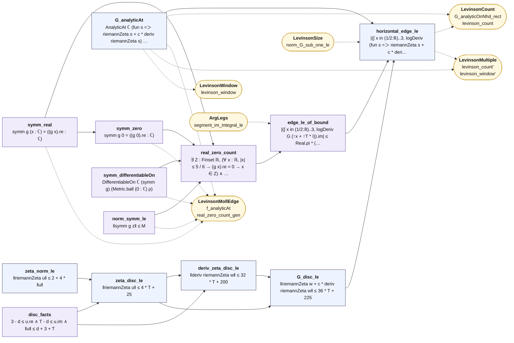

# `lean_stage3/Stage3/LevinsonEdge.lean`

> **Read from the source text.** This file changed after the last `python3 utilities/lean_map.py --dump`, so the arrows on this page are names occurring in each proof and have not been confirmed by Lean.

LevinsonEdge — block S11 of `lean_stage3/design/stencil.md`, step 1d (ii). 2026-11-24.

13 theorems, 2 definitions, 517 lines. 

**Imports:** [`LevinsonSize`](../lean_stage3/LevinsonSize.md)  
**Imported by:** [`Stage3`](../lean_stage3/Stage3.md), [`LevinsonCount`](../lean_stage3/LevinsonCount.md), [`LevinsonMollEdge`](../lean_stage3/LevinsonMollEdge.md)

## The picture



An arrow A → B reads "A is used in the proof of B". Green: counting, integers only. Violet: shape, analysis with no ζ. Blue: reads ζ. A name ending in ■ is an end: nothing else uses it. Red: contains `sorry`. Yellow: theorems in another file, counted; a dotted arrow crosses files. Definitions are not drawn; they are listed below the diagram.

## Definitions

<a name="LevinsonEdge-symm"></a>
### `LevinsonEdge.symm`

def · line 192

- **Is:** `` symm (g : ℂ → ℂ) (z : ℂ) : ℂ := (g z + (starRingEnd ℂ) (g ((starRingEnd ℂ) z))) / 2 noncomputable ``
- **Used by 7:** [`LevinsonEdge.model`](#LevinsonEdge-model), [`LevinsonEdge.norm_symm_le`](#LevinsonEdge-norm_symm_le), [`LevinsonEdge.real_zero_count`](#LevinsonEdge-real_zero_count), [`LevinsonEdge.symm_differentiableOn`](#LevinsonEdge-symm_differentiableOn), [`LevinsonEdge.symm_real`](#LevinsonEdge-symm_real), [`LevinsonEdge.symm_zero`](#LevinsonEdge-symm_zero), [`LevinsonMollEdge.real_zero_count_gen`](../lean_stage3/LevinsonMollEdge.md#LevinsonMollEdge-real_zero_count_gen)

<a name="LevinsonEdge-model"></a>
### `LevinsonEdge.model`

def · line 197

- **Is:** `` model (g : ℂ → ℂ) (z : ℂ) : ℂ := symm g z / symm g 0 ``
- **Built from:** [`LevinsonEdge.symm`](#LevinsonEdge-symm)
- **Used by 2:** [`LevinsonEdge.real_zero_count`](#LevinsonEdge-real_zero_count), [`LevinsonMollEdge.real_zero_count_gen`](../lean_stage3/LevinsonMollEdge.md#LevinsonMollEdge-real_zero_count_gen)

## Theorems

<a name="LevinsonEdge-zeta_norm_le"></a>
### `LevinsonEdge.zeta_norm_le`

line 60 · arrows read from text

**Reads ζ.** It, or something it rests on, uses the zeta function, its zeros or the Riemann hypothesis.

**Why.** `ζ` right of `Re = 1/4`, above `Im = 1`. `‖ζ u‖ ≤ 2 + 4‖u‖`, from upstream's `ZetaAltFormula`; the proof of `Stage3.zeta_disk_upper` with these margins.

**Proves**

```lean
‖riemannZeta u‖ ≤ 2 + 4 * ‖u‖
```

**Needs** (its hypotheses)

  - `` hre : 1 / 4 ≤ u.re ``
  - `` him : 1 ≤ u.im ``

**Fed by:** no theorem of this repo; it stands on Mathlib.

**Feeds** (1 that use it)

  - [`LevinsonEdge.zeta_disc_le`](#LevinsonEdge-zeta_disc_le) — `` ‖riemannZeta u‖ ≤ 4 * T + 25 ``

<a name="LevinsonEdge-disc_facts"></a>
### `LevinsonEdge.disc_facts`

line 108 · arrows read from text

**Shape.** Uses real or complex analysis; nothing in it or beneath it reads ζ.

**Why.** Coordinates on the disc about `3 + iT`.

**Proves**

```lean
3 - d ≤ u.re ∧ T - d ≤ u.im ∧ ‖u‖ ≤ d + 3 + T
```

**Needs** (its hypotheses)

  - `` hT : 0 ≤ T ``
  - `` hu : ‖u - (3 + (T : ℂ) * I)‖ ≤ d ``

**Fed by:** no theorem of this repo; it stands on Mathlib.

**Feeds** (2 that use it)

  - [`LevinsonEdge.deriv_zeta_disc_le`](#LevinsonEdge-deriv_zeta_disc_le) — `` ‖deriv riemannZeta w‖ ≤ 32 * T + 200 ``
  - [`LevinsonEdge.zeta_disc_le`](#LevinsonEdge-zeta_disc_le) — `` ‖riemannZeta u‖ ≤ 4 * T + 25 ``

<a name="LevinsonEdge-zeta_disc_le"></a>
### `LevinsonEdge.zeta_disc_le`

line 129 · arrows read from text

**Reads ζ.** It, or something it rests on, uses the zeta function, its zeros or the Riemann hypothesis.

**Why.** `ζ` on the `11/4` disc about `3 + iT`. `‖ζ u‖ ≤ 4T + 25` for `T ≥ 4`.

**Proves**

```lean
‖riemannZeta u‖ ≤ 4 * T + 25
```

**Needs** (its hypotheses)

  - `` hT : 4 ≤ T ``
  - `` hu : ‖u - (3 + (T : ℂ) * I)‖ ≤ 11 / 4 ``

**Fed by** (2 theorems its proof uses)

  - [`LevinsonEdge.disc_facts`](#LevinsonEdge-disc_facts) — `` 3 - d ≤ u.re ∧ T - d ≤ u.im ∧ ‖u‖ ≤ d + 3 + T ``
  - [`LevinsonEdge.zeta_norm_le`](#LevinsonEdge-zeta_norm_le) — `` ‖riemannZeta u‖ ≤ 2 + 4 * ‖u‖ ``

**Feeds** (2 that use it)

  - [`LevinsonEdge.G_disc_le`](#LevinsonEdge-G_disc_le) — `` ‖riemannZeta w + c * deriv riemannZeta w‖ ≤ 36 * T + 225 ``
  - [`LevinsonEdge.deriv_zeta_disc_le`](#LevinsonEdge-deriv_zeta_disc_le) — `` ‖deriv riemannZeta w‖ ≤ 32 * T + 200 ``

<a name="LevinsonEdge-deriv_zeta_disc_le"></a>
### `LevinsonEdge.deriv_zeta_disc_le`

line 137 · arrows read from text

**Reads ζ.** It, or something it rests on, uses the zeta function, its zeros or the Riemann hypothesis.

**Why.** `ζ'` on the `21/8` disc about `3 + iT`. Cauchy's estimate on the circle of radius `1/8`: `‖ζ' w‖ ≤ 8 (4T + 25) = 32T + 200`.

**Proves**

```lean
‖deriv riemannZeta w‖ ≤ 32 * T + 200
```

**Needs** (its hypotheses)

  - `` hT : 4 ≤ T ``
  - `` hw : ‖w - (3 + (T : ℂ) * I)‖ ≤ 21 / 8 ``

**Fed by** (2 theorems its proof uses)

  - [`LevinsonEdge.disc_facts`](#LevinsonEdge-disc_facts) — `` 3 - d ≤ u.re ∧ T - d ≤ u.im ∧ ‖u‖ ≤ d + 3 + T ``
  - [`LevinsonEdge.zeta_disc_le`](#LevinsonEdge-zeta_disc_le) — `` ‖riemannZeta u‖ ≤ 4 * T + 25 ``

**Feeds** (1 that use it)

  - [`LevinsonEdge.G_disc_le`](#LevinsonEdge-G_disc_le) — `` ‖riemannZeta w + c * deriv riemannZeta w‖ ≤ 36 * T + 225 ``

<a name="LevinsonEdge-G_analyticAt"></a>
### `LevinsonEdge.G_analyticAt`

line 166 · arrows read from text

**Reads ζ.** It, or something it rests on, uses the zeta function, its zeros or the Riemann hypothesis.

**Why.** `G = ζ + c ζ'` is analytic away from the pole.

**Proves**

```lean
AnalyticAt ℂ (fun s => riemannZeta s + c * deriv riemannZeta s) w
```

**Needs** (its hypotheses)

  - `` c : ℝ ``
  - `` hw : w ≠ 1 ``

**Fed by:** no theorem of this repo; it stands on Mathlib.

**Feeds** (5 that use it)

  - [`LevinsonCount.G_analyticOnNhd_rect`](../lean_stage3/LevinsonCount.md#LevinsonCount-G_analyticOnNhd_rect) (LevinsonCount) — `` AnalyticOnNhd ℂ (fun s => riemannZeta s + c * deriv riemannZeta s) (Rectangle ((1/2 : ℂ) + a * I) ((3 : ℂ) + b * I)) ``
  - [`LevinsonEdge.horizontal_edge_le`](#LevinsonEdge-horizontal_edge_le) — `` |(∫ x in (1/2:ℝ)..3, logDeriv (fun s => riemannZeta s + c * deriv riemannZeta s) (↑x + ↑T * I)).im| ≤ 21 * Real.pi * Real.log T + 133 * Real.pi ``
  - [`LevinsonMollEdge.f_analyticAt`](../lean_stage3/LevinsonMollEdge.md#LevinsonMollEdge-f_analyticAt) (LevinsonMollEdge) — `` AnalyticAt ℂ (fun s => (riemannZeta s + c * deriv riemannZeta s) * molli M β s) w ``
  - [`LevinsonMultiple.levinson_window'`](../lean_stage3/LevinsonMultiple.md#LevinsonMultiple-levinson_window-) (LevinsonMultiple) — `` (riemannZeta.N b - riemannZeta.N a) - (1 / (Real.pi * (1 / 2 - σ₀))) * ((b - a) / 2 * Real.log K + windowE M B X T a b) - (134 * Real.log T + 2918) ≤ … ``
  - [`LevinsonWindow.levinson_window`](../lean_stage3/LevinsonWindow.md#LevinsonWindow-levinson_window) (LevinsonWindow) — `` (riemannZeta.N b - riemannZeta.N a) - (1 / (Real.pi * (1 / 2 - σ₀))) * ((b - a) / 2 * Real.log K + windowE M B X T a b) - (134 * Real.log T + 2918) ≤ … ``

<a name="LevinsonEdge-G_disc_le"></a>
### `LevinsonEdge.G_disc_le`

line 175 · arrows read from text

**Reads ζ.** It, or something it rests on, uses the zeta function, its zeros or the Riemann hypothesis.

**Why.** `G` on the `21/8` disc about `3 + iT`. `‖ζ w + c ζ' w‖ ≤ 36T + 225`.

**Proves**

```lean
‖riemannZeta w + c * deriv riemannZeta w‖ ≤ 36 * T + 225
```

**Needs** (its hypotheses)

  - `` hc0 : 0 ≤ c ``
  - `` hc1 : c ≤ 1 ``
  - `` hT : 4 ≤ T ``
  - `` hw : ‖w - (3 + (T : ℂ) * I)‖ ≤ 21 / 8 ``

**Fed by** (2 theorems its proof uses)

  - [`LevinsonEdge.deriv_zeta_disc_le`](#LevinsonEdge-deriv_zeta_disc_le) — `` ‖deriv riemannZeta w‖ ≤ 32 * T + 200 ``
  - [`LevinsonEdge.zeta_disc_le`](#LevinsonEdge-zeta_disc_le) — `` ‖riemannZeta u‖ ≤ 4 * T + 25 ``

**Feeds** (1 that use it)

  - [`LevinsonEdge.horizontal_edge_le`](#LevinsonEdge-horizontal_edge_le) — `` |(∫ x in (1/2:ℝ)..3, logDeriv (fun s => riemannZeta s + c * deriv riemannZeta s) (↑x + ↑T * I)).im| ≤ 21 * Real.pi * Real.log T + 133 * Real.pi ``

<a name="LevinsonEdge-symm_real"></a>
### `LevinsonEdge.symm_real`

line 200 · arrows read from text

**Shape.** Uses real or complex analysis; nothing in it or beneath it reads ζ.

**Why.** On the real axis the symmetrisation is `Re g`.

**Proves**

```lean
symm g (x : ℂ) = ((g x).re : ℂ)
```

**Needs** (its hypotheses)

  - `` g : ℂ → ℂ ``
  - `` x : ℝ ``

**Fed by:** no theorem of this repo; it stands on Mathlib and the definitions below.

**Definitions its proof touches:** [`LevinsonEdge.symm`](#LevinsonEdge-symm)

**Feeds** (3 that use it)

  - [`LevinsonEdge.real_zero_count`](#LevinsonEdge-real_zero_count) — `` ∃ Z : Finset ℝ, (∀ x : ℝ, |x| ≤ 5 / 6 → (g x).re = 0 → x ∈ Z) ∧ (Z.card : ℝ) ≤ 21 * Real.log (M / m) ``
  - [`LevinsonEdge.symm_zero`](#LevinsonEdge-symm_zero) — `` symm g 0 = ((g 0).re : ℂ) ``
  - [`LevinsonMollEdge.real_zero_count_gen`](../lean_stage3/LevinsonMollEdge.md#LevinsonMollEdge-real_zero_count_gen) (LevinsonMollEdge) — `` ∃ Z : Finset ℝ, (∀ x : ℝ, |x| ≤ r → (g x).re = 0 → x ∈ Z) ∧ (Z.card : ℝ) ≤ 1 / Real.log (R / r) * Real.log (M / m) ``

<a name="LevinsonEdge-symm_zero"></a>
### `LevinsonEdge.symm_zero`

line 207 · arrows read from text

**Shape.** Uses real or complex analysis; nothing in it or beneath it reads ζ.

**Why.** At the centre the symmetrisation is `Re g 0`.

**Proves**

```lean
symm g 0 = ((g 0).re : ℂ)
```

**Needs** (its hypotheses)

  - `` g : ℂ → ℂ ``

**Fed by** (1 theorem its proof uses)

  - [`LevinsonEdge.symm_real`](#LevinsonEdge-symm_real) — `` symm g (x : ℂ) = ((g x).re : ℂ) ``

**Definitions its proof touches:** [`LevinsonEdge.symm`](#LevinsonEdge-symm)

**Feeds** (2 that use it)

  - [`LevinsonEdge.real_zero_count`](#LevinsonEdge-real_zero_count) — `` ∃ Z : Finset ℝ, (∀ x : ℝ, |x| ≤ 5 / 6 → (g x).re = 0 → x ∈ Z) ∧ (Z.card : ℝ) ≤ 21 * Real.log (M / m) ``
  - [`LevinsonMollEdge.real_zero_count_gen`](../lean_stage3/LevinsonMollEdge.md#LevinsonMollEdge-real_zero_count_gen) (LevinsonMollEdge) — `` ∃ Z : Finset ℝ, (∀ x : ℝ, |x| ≤ r → (g x).re = 0 → x ∈ Z) ∧ (Z.card : ℝ) ≤ 1 / Real.log (R / r) * Real.log (M / m) ``

<a name="LevinsonEdge-symm_differentiableOn"></a>
### `LevinsonEdge.symm_differentiableOn`

line 212 · arrows read from text

**Shape.** Uses real or complex analysis; nothing in it or beneath it reads ζ.

**Why.** The symmetrisation is holomorphic where `g` is, on a ball about `0`.

**Proves**

```lean
DifferentiableOn ℂ (symm g) (Metric.ball (0 : ℂ) ρ)
```

**Needs** (its hypotheses)

  - `` hd : DifferentiableOn ℂ g (Metric.ball (0 : ℂ) ρ) ``

**Fed by:** no theorem of this repo; it stands on Mathlib and the definitions below.

**Definitions its proof touches:** [`LevinsonEdge.symm`](#LevinsonEdge-symm)

**Feeds** (2 that use it)

  - [`LevinsonEdge.real_zero_count`](#LevinsonEdge-real_zero_count) — `` ∃ Z : Finset ℝ, (∀ x : ℝ, |x| ≤ 5 / 6 → (g x).re = 0 → x ∈ Z) ∧ (Z.card : ℝ) ≤ 21 * Real.log (M / m) ``
  - [`LevinsonMollEdge.real_zero_count_gen`](../lean_stage3/LevinsonMollEdge.md#LevinsonMollEdge-real_zero_count_gen) (LevinsonMollEdge) — `` ∃ Z : Finset ℝ, (∀ x : ℝ, |x| ≤ r → (g x).re = 0 → x ∈ Z) ∧ (Z.card : ℝ) ≤ 1 / Real.log (R / r) * Real.log (M / m) ``

<a name="LevinsonEdge-norm_symm_le"></a>
### `LevinsonEdge.norm_symm_le`

line 230 · arrows read from text

**Shape.** Uses real or complex analysis; nothing in it or beneath it reads ζ.

**Why.** The symmetrisation is bounded by `g` on a ball about `0`.

**Proves**

```lean
‖symm g z‖ ≤ M
```

**Needs** (its hypotheses)

  - `` hM : ∀ z : ℂ, ‖z‖ ≤ ρ → ‖g z‖ ≤ M ``
  - `` hz : ‖z‖ ≤ ρ ``

**Fed by:** no theorem of this repo; it stands on Mathlib and the definitions below.

**Definitions its proof touches:** [`LevinsonEdge.symm`](#LevinsonEdge-symm)

**Feeds** (2 that use it)

  - [`LevinsonEdge.real_zero_count`](#LevinsonEdge-real_zero_count) — `` ∃ Z : Finset ℝ, (∀ x : ℝ, |x| ≤ 5 / 6 → (g x).re = 0 → x ∈ Z) ∧ (Z.card : ℝ) ≤ 21 * Real.log (M / m) ``
  - [`LevinsonMollEdge.real_zero_count_gen`](../lean_stage3/LevinsonMollEdge.md#LevinsonMollEdge-real_zero_count_gen) (LevinsonMollEdge) — `` ∃ Z : Finset ℝ, (∀ x : ℝ, |x| ≤ r → (g x).re = 0 → x ∈ Z) ∧ (Z.card : ℝ) ≤ 1 / Real.log (R / r) * Real.log (M / m) ``

<a name="LevinsonEdge-real_zero_count"></a>
### `LevinsonEdge.real_zero_count`

line 245 · arrows read from text

**Shape.** Uses real or complex analysis; nothing in it or beneath it reads ζ.

**Why.** The Jensen count. If `g` is holomorphic on `‖z‖ < 11/10`, `0 < m ≤ Re g 0` and `‖g‖ ≤ M` on `‖z‖ ≤ 7/8`, then the real zeros of `Re g` in `[−5/6, 5/6]` lie in a `Finset` of size at most `21 log (M/m)`: upstream `ZerosBound` at `r = 5/6`, `R = 7/8` on `model g`.

**Proves**

```lean
∃ Z : Finset ℝ, (∀ x : ℝ, |x| ≤ 5 / 6 → (g x).re = 0 → x ∈ Z) ∧ (Z.card : ℝ) ≤ 21 * Real.log (M / m)
```

**Needs** (its hypotheses)

  - `` hd : DifferentiableOn ℂ g (Metric.ball (0 : ℂ) (11 / 10)) ``
  - `` hm : 0 < m ``
  - `` h0 : m ≤ (g 0).re ``
  - `` hM : ∀ z : ℂ, ‖z‖ ≤ 7 / 8 → ‖g z‖ ≤ M ``

**Fed by** (4 theorems its proof uses)

  - [`LevinsonEdge.norm_symm_le`](#LevinsonEdge-norm_symm_le) — `` ‖symm g z‖ ≤ M ``
  - [`LevinsonEdge.symm_differentiableOn`](#LevinsonEdge-symm_differentiableOn) — `` DifferentiableOn ℂ (symm g) (Metric.ball (0 : ℂ) ρ) ``
  - [`LevinsonEdge.symm_real`](#LevinsonEdge-symm_real) — `` symm g (x : ℂ) = ((g x).re : ℂ) ``
  - [`LevinsonEdge.symm_zero`](#LevinsonEdge-symm_zero) — `` symm g 0 = ((g 0).re : ℂ) ``

**Definitions its proof touches:** [`LevinsonEdge.model`](#LevinsonEdge-model), [`LevinsonEdge.symm`](#LevinsonEdge-symm)

**Feeds** (1 that use it)

  - [`LevinsonEdge.edge_le_of_bound`](#LevinsonEdge-edge_le_of_bound) — `` |(∫ x in (1/2:ℝ)..3, logDeriv G (↑x + ↑T * I)).im| ≤ Real.pi * (21 * Real.log (3 * M) + 1) ``

<a name="LevinsonEdge-edge_le_of_bound"></a>
### `LevinsonEdge.edge_le_of_bound`

line 369 · arrows read from text

**Shape.** Uses real or complex analysis; nothing in it or beneath it reads ζ.

**Why.** The edge, with the growth as a hypothesis. For `G` analytic off `1`, `T ≥ 4`, `Re G(3 + iT) ≥ 1/3`, `‖G‖ ≤ M` on `|w − (3 + iT)| ≤ 21/8`, and `G ≠ 0` on the segment `[1/2, 3] + iT`: `|Im ∫_{1/2}^{3} logDeriv G (x + iT) dx| ≤ π (21 log (3M) + 1)`.

**Proves**

```lean
|(∫ x in (1/2:ℝ)..3, logDeriv G (↑x + ↑T * I)).im| ≤ Real.pi * (21 * Real.log (3 * M) + 1)
```

**Needs** (its hypotheses)

  - `` hT : 4 ≤ T ``
  - `` hGa : ∀ w : ℂ, w ≠ 1 → AnalyticAt ℂ G w ``
  - `` h0 : 1 / 3 ≤ (G (3 + (T : ℂ) * I)).re ``
  - `` hM : ∀ w : ℂ, ‖w - (3 + (T : ℂ) * I)‖ ≤ 21 / 8 → ‖G w‖ ≤ M ``
  - `` hne : ∀ x ∈ Set.Icc (1/2:ℝ) 3, G (↑x + ↑T * I) ≠ 0 ``

**Fed by** (2 theorems its proof uses)

  - [`ArgLegs.segment_im_integral_le`](../lean_stage3/ArgLegs.md#ArgLegs-segment_im_integral_le) (ArgLegs) — `` |(∫ x in a..b, g' x / g x).im| ≤ Real.pi * ((Z.card : ℝ) + 1) ``
  - [`LevinsonEdge.real_zero_count`](#LevinsonEdge-real_zero_count) — `` ∃ Z : Finset ℝ, (∀ x : ℝ, |x| ≤ 5 / 6 → (g x).re = 0 → x ∈ Z) ∧ (Z.card : ℝ) ≤ 21 * Real.log (M / m) ``

**Feeds** (1 that use it)

  - [`LevinsonEdge.horizontal_edge_le`](#LevinsonEdge-horizontal_edge_le) — `` |(∫ x in (1/2:ℝ)..3, logDeriv (fun s => riemannZeta s + c * deriv riemannZeta s) (↑x + ↑T * I)).im| ≤ 21 * Real.pi * Real.log T + 133 * Real.pi ``

<a name="LevinsonEdge-horizontal_edge_le"></a>
### `LevinsonEdge.horizontal_edge_le`

line 455 · arrows read from text

**Reads ζ.** It, or something it rests on, uses the zeta function, its zeros or the Riemann hypothesis.

**Why.** S11 step 1d (ii), the horizontal edge. For `0 ≤ c ≤ 1`, `T ≥ 4`, and `G = ζ + c ζ'` nonzero on the segment `[1/2, 3] + iT`: `|Im ∫_{1/2}^{3} logDeriv G (x + iT) dx| ≤ 21π log T + 133π`.

**Proves**

```lean
|(∫ x in (1/2:ℝ)..3, logDeriv (fun s => riemannZeta s + c * deriv riemannZeta s) (↑x + ↑T * I)).im| ≤ 21 * Real.pi * Real.log T + 133 * Real.pi
```

**Needs** (its hypotheses)

  - `` hc0 : 0 ≤ c ``
  - `` hc1 : c ≤ 1 ``
  - `` hT : 4 ≤ T ``
  - `` hne : ∀ x ∈ Set.Icc (1/2:ℝ) 3, riemannZeta (↑x + ↑T * I) + c * deriv riemannZeta (↑x + ↑T * I) ≠ 0 ``

**Fed by** (4 theorems its proof uses)

  - [`LevinsonEdge.G_analyticAt`](#LevinsonEdge-G_analyticAt) — `` AnalyticAt ℂ (fun s => riemannZeta s + c * deriv riemannZeta s) w ``
  - [`LevinsonEdge.G_disc_le`](#LevinsonEdge-G_disc_le) — `` ‖riemannZeta w + c * deriv riemannZeta w‖ ≤ 36 * T + 225 ``
  - [`LevinsonEdge.edge_le_of_bound`](#LevinsonEdge-edge_le_of_bound) — `` |(∫ x in (1/2:ℝ)..3, logDeriv G (↑x + ↑T * I)).im| ≤ Real.pi * (21 * Real.log (3 * M) + 1) ``
  - [`LevinsonSize.norm_G_sub_one_le`](../lean_stage3/LevinsonSize.md#LevinsonSize-norm_G_sub_one_le) (LevinsonSize) — `` ‖riemannZeta s + c * deriv riemannZeta s - 1‖ ≤ Real.pi ^ 2 / 6 - 1 ``

**Feeds** (2 that use it)

  - [`LevinsonCount.levinson_count`](../lean_stage3/LevinsonCount.md#LevinsonCount-levinson_count) (LevinsonCount) — `` (riemannZeta.N b - riemannZeta.N a) - 2 * Littlewood.countRight (fun s => riemannZeta s + c * deriv riemannZeta s) ((1/2 : ℂ) + a * I) ((3 : ℂ) + b * … ``
  - [`LevinsonMultiple.levinson_count'`](../lean_stage3/LevinsonMultiple.md#LevinsonMultiple-levinson_count-) (LevinsonMultiple) — `` (riemannZeta.N b - riemannZeta.N a) - 2 * Littlewood.countRight (fun s => riemannZeta s + c * deriv riemannZeta s) ((1/2 : ℂ) + a * I) ((3 : ℂ) + b * … ``

