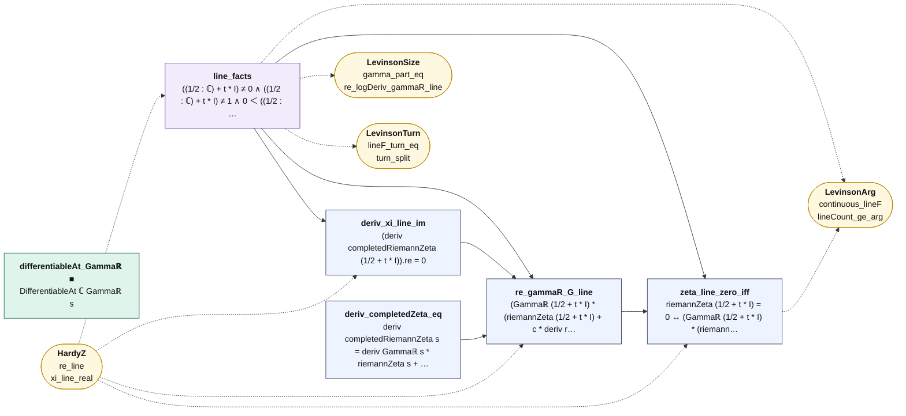

# `lean_stage3/Stage3/LevinsonLine.lean`

> **Read from the source text.** This file changed after the last `python3 utilities/lean_map.py --dump`, so the arrows on this page are names occurring in each proof and have not been confirmed by Lean.

LevinsonLine — block S11 of `lean_stage3/design/stencil.md`, step 1a. 2026-11-24.

6 theorems, 0 definitions, 161 lines. 

**Imports:** [`HardyZ`](../lean_stage3/HardyZ.md)  
**Imported by:** [`Stage3`](../lean_stage3/Stage3.md), [`LevinsonArg`](../lean_stage3/LevinsonArg.md)

## The picture



An arrow A → B reads "A is used in the proof of B". Green: counting, integers only. Violet: shape, analysis with no ζ. Blue: reads ζ. A name ending in ■ is an end: nothing else uses it. Red: contains `sorry`. Yellow: theorems in another file, counted; a dotted arrow crosses files. Definitions are not drawn; they are listed below the diagram.

## Theorems

<a name="LevinsonLine-line_facts"></a>
### `LevinsonLine.line_facts`

line 30 · arrows read from text

**Shape.** Uses real or complex analysis; nothing in it or beneath it reads ζ.

**Why.** A point of the critical line is neither `0` nor `1`, and has positive real part.

**Proves**

```lean
((1/2 : ℂ) + t * I) ≠ 0 ∧ ((1/2 : ℂ) + t * I) ≠ 1 ∧ 0 < ((1/2 : ℂ) + t * I).re
```

**Needs** (its hypotheses)

  - `` t : ℝ ``

**Fed by** (1 theorem its proof uses)

  - [`HardyZ.re_line`](../lean_stage3/HardyZ.md#HardyZ-re_line) (HardyZ) — `` ((1 / 2 : ℂ) + t * I).re = 1 / 2 ``

**Feeds** (8 that use it)

  - [`LevinsonArg.continuous_lineF`](../lean_stage3/LevinsonArg.md#LevinsonArg-continuous_lineF) (LevinsonArg) — `` Continuous (lineF c) ``
  - [`LevinsonLine.deriv_xi_line_im`](#LevinsonLine-deriv_xi_line_im) — `` (deriv completedRiemannZeta (1/2 + t * I)).re = 0 ``
  - [`LevinsonLine.re_gammaR_G_line`](#LevinsonLine-re_gammaR_G_line) — `` (Gammaℝ (1/2 + t * I) * (riemannZeta (1/2 + t * I) + c * deriv riemannZeta (1/2 + t * I))).re = (completedRiemannZeta (1/2 + t * I)).re * (1 - c * (de… ``
  - [`LevinsonLine.zeta_line_zero_iff`](#LevinsonLine-zeta_line_zero_iff) — `` riemannZeta (1/2 + t * I) = 0 ↔ (Gammaℝ (1/2 + t * I) * (riemannZeta (1/2 + t * I) + c * deriv riemannZeta (1/2 + t * I))).re = 0 ``
  - [`LevinsonSize.gamma_part_eq`](../lean_stage3/LevinsonSize.md#LevinsonSize-gamma_part_eq) (LevinsonSize) — `` (∫ t in a..b, logDeriv Gammaℝ (1/2 + t * I)).re = Stage3.phaseTheta b - Stage3.phaseTheta a ``
  - [`LevinsonSize.re_logDeriv_gammaR_line`](../lean_stage3/LevinsonSize.md#LevinsonSize-re_logDeriv_gammaR_line) (LevinsonSize) — `` (logDeriv Gammaℝ (1/2 + y * I)).re = -(Real.log Real.pi) / 2 + Stage3.phasePoint y / 2 ``
  - [`LevinsonTurn.lineF_turn_eq`](../lean_stage3/LevinsonTurn.md#LevinsonTurn-lineF_turn_eq) (LevinsonTurn) — `` φ b - φ a = (∫ t in a..b, logDeriv Gammaℝ (1/2 + t * I)).re + (∫ t in a..b, logDeriv (fun s => riemannZeta s + c * deriv riemannZeta s) (1/2 + t * I))… ``
  - [`LevinsonTurn.turn_split`](../lean_stage3/LevinsonTurn.md#LevinsonTurn-turn_split) (LevinsonTurn) — `` (∫ t in a..b, logDeriv (fun s => Gammaℝ s * G s) (1/2 + t * I)).re = (∫ t in a..b, logDeriv Gammaℝ (1/2 + t * I)).re + (∫ t in a..b, logDeriv G (1/2 +… ``

<a name="LevinsonLine-deriv_xi_line_im"></a>
### `LevinsonLine.deriv_xi_line_im`

line 44 · arrows read from text

**Reads ζ.** It, or something it rests on, uses the zeta function, its zeros or the Riemann hypothesis.

**Why.** Target 1. `Λ'` is purely imaginary on the critical line.

**Proves**

```lean
(deriv completedRiemannZeta (1/2 + t * I)).re = 0
```

**Needs** (its hypotheses)

  - `` t : ℝ ``

**Fed by** (2 theorems its proof uses)

  - [`HardyZ.xi_line_real`](../lean_stage3/HardyZ.md#HardyZ-xi_line_real) (HardyZ) — `` (completedRiemannZeta (1/2 + t * Complex.I)).im = 0 ``
  - [`LevinsonLine.line_facts`](#LevinsonLine-line_facts) — `` ((1/2 : ℂ) + t * I) ≠ 0 ∧ ((1/2 : ℂ) + t * I) ≠ 1 ∧ 0 < ((1/2 : ℂ) + t * I).re ``

**Feeds** (1 that use it)

  - [`LevinsonLine.re_gammaR_G_line`](#LevinsonLine-re_gammaR_G_line) — `` (Gammaℝ (1/2 + t * I) * (riemannZeta (1/2 + t * I) + c * deriv riemannZeta (1/2 + t * I))).re = (completedRiemannZeta (1/2 + t * I)).re * (1 - c * (de… ``

<a name="LevinsonLine-differentiableAt_Gamma-"></a>
### `LevinsonLine.differentiableAt_Gammaℝ`

line 74 · arrows read from text

**Counting.** Integers only: nothing in its statement or proof, or in anything it rests on, uses analysis or ζ.

**Why.** `Gammaℝ` is differentiable right of zero.

**Proves**

```lean
DifferentiableAt ℂ Gammaℝ s
```

**Needs** (its hypotheses)

  - `` hs : 0 < s.re ``

**Fed by:** no theorem of this repo; it stands on Mathlib.

**Feeds:** nothing. It connects to nothing.

<a name="LevinsonLine-deriv_completedZeta_eq"></a>
### `LevinsonLine.deriv_completedZeta_eq`

line 82 · arrows read from text

**Reads ζ.** It, or something it rests on, uses the zeta function, its zeros or the Riemann hypothesis.

**Why.** Right of zero, away from `1`, `Λ' = Gammaℝ' · ζ + Gammaℝ · ζ'`.

**Proves**

```lean
deriv completedRiemannZeta s = deriv Gammaℝ s * riemannZeta s + Gammaℝ s * deriv riemannZeta s
```

**Needs** (its hypotheses)

  - `` hs : 0 < s.re ``
  - `` h1 : s ≠ 1 ``

**Fed by:** no theorem of this repo; it stands on Mathlib.

**Feeds** (1 that use it)

  - [`LevinsonLine.re_gammaR_G_line`](#LevinsonLine-re_gammaR_G_line) — `` (Gammaℝ (1/2 + t * I) * (riemannZeta (1/2 + t * I) + c * deriv riemannZeta (1/2 + t * I))).re = (completedRiemannZeta (1/2 + t * I)).re * (1 - c * (de… ``

<a name="LevinsonLine-re_gammaR_G_line"></a>
### `LevinsonLine.re_gammaR_G_line`

line 97 · arrows read from text

**Reads ζ.** It, or something it rests on, uses the zeta function, its zeros or the Riemann hypothesis.

**Why.** Target 2. On the critical line, for real `c`, `Re(Gammaℝ · (ζ + c ζ')) = Λ · (1 − c · Re(Gammaℝ' / Gammaℝ))`.

**Proves**

```lean
(Gammaℝ (1/2 + t * I) * (riemannZeta (1/2 + t * I) + c * deriv riemannZeta (1/2 + t * I))).re = (completedRiemannZeta (1/2 + t * I)).re * (1 - c * (deriv Gammaℝ (1/2 + t * I) / Gammaℝ (1/2 + t * I)).re)
```

**Needs** (its hypotheses)

  - `` c t : ℝ ``

**Fed by** (4 theorems its proof uses)

  - [`HardyZ.xi_line_real`](../lean_stage3/HardyZ.md#HardyZ-xi_line_real) (HardyZ) — `` (completedRiemannZeta (1/2 + t * Complex.I)).im = 0 ``
  - [`LevinsonLine.deriv_completedZeta_eq`](#LevinsonLine-deriv_completedZeta_eq) — `` deriv completedRiemannZeta s = deriv Gammaℝ s * riemannZeta s + Gammaℝ s * deriv riemannZeta s ``
  - [`LevinsonLine.deriv_xi_line_im`](#LevinsonLine-deriv_xi_line_im) — `` (deriv completedRiemannZeta (1/2 + t * I)).re = 0 ``
  - [`LevinsonLine.line_facts`](#LevinsonLine-line_facts) — `` ((1/2 : ℂ) + t * I) ≠ 0 ∧ ((1/2 : ℂ) + t * I) ≠ 1 ∧ 0 < ((1/2 : ℂ) + t * I).re ``

**Feeds** (1 that use it)

  - [`LevinsonLine.zeta_line_zero_iff`](#LevinsonLine-zeta_line_zero_iff) — `` riemannZeta (1/2 + t * I) = 0 ↔ (Gammaℝ (1/2 + t * I) * (riemannZeta (1/2 + t * I) + c * deriv riemannZeta (1/2 + t * I))).re = 0 ``

<a name="LevinsonLine-zeta_line_zero_iff"></a>
### `LevinsonLine.zeta_line_zero_iff`

line 128 · arrows read from text

**Reads ζ.** It, or something it rests on, uses the zeta function, its zeros or the Riemann hypothesis.

**Why.** Target 3. Where `1 − c · Re(Gammaℝ' / Gammaℝ) ≠ 0`, the zeros of `ζ` on the line are exactly the zeros of `Re(Gammaℝ · (ζ + c ζ'))`.

**Proves**

```lean
riemannZeta (1/2 + t * I) = 0 ↔ (Gammaℝ (1/2 + t * I) * (riemannZeta (1/2 + t * I) + c * deriv riemannZeta (1/2 + t * I))).re = 0
```

**Needs** (its hypotheses)

  - `` c t : ℝ ``
  - `` hc : 1 - c * (deriv Gammaℝ (1/2 + t * I) / Gammaℝ (1/2 + t * I)).re ≠ 0 ``

**Fed by** (3 theorems its proof uses)

  - [`HardyZ.xi_line_real`](../lean_stage3/HardyZ.md#HardyZ-xi_line_real) (HardyZ) — `` (completedRiemannZeta (1/2 + t * Complex.I)).im = 0 ``
  - [`LevinsonLine.line_facts`](#LevinsonLine-line_facts) — `` ((1/2 : ℂ) + t * I) ≠ 0 ∧ ((1/2 : ℂ) + t * I) ≠ 1 ∧ 0 < ((1/2 : ℂ) + t * I).re ``
  - [`LevinsonLine.re_gammaR_G_line`](#LevinsonLine-re_gammaR_G_line) — `` (Gammaℝ (1/2 + t * I) * (riemannZeta (1/2 + t * I) + c * deriv riemannZeta (1/2 + t * I))).re = (completedRiemannZeta (1/2 + t * I)).re * (1 - c * (de… ``

**Feeds** (1 that use it)

  - [`LevinsonArg.lineCount_ge_arg`](../lean_stage3/LevinsonArg.md#LevinsonArg-lineCount_ge_arg) (LevinsonArg) — `` (k : ℤ) ≤ lineCount T ``

