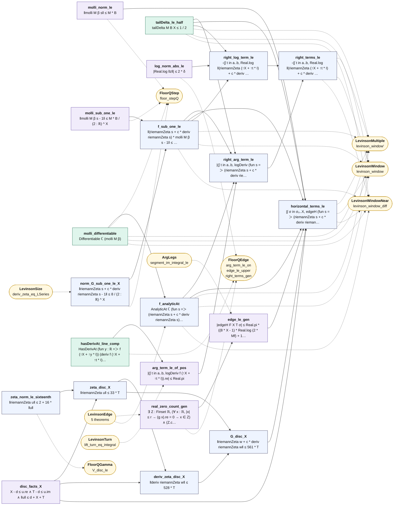

# `lean_stage3/Stage3/LevinsonMollEdge.lean`

> **Read from the source text.** This file changed after the last `python3 utilities/lean_map.py --dump`, so the arrows on this page are names occurring in each proof and have not been confirmed by Lean.

LevinsonMollEdge — block S11 of `lean_stage3/design/stencil.md`, the mollifier's edge terms. 2026-11-24.

21 theorems, 2 definitions, 907 lines. 

**Imports:** [`LevinsonEdge`](../lean_stage3/LevinsonEdge.md), [`LevinsonRight`](../lean_stage3/LevinsonRight.md)  
**Imported by:** [`Stage3`](../lean_stage3/Stage3.md), [`FloorQEdge`](../lean_stage3/FloorQEdge.md), [`FloorQGamma`](../lean_stage3/FloorQGamma.md), [`LevinsonWindow`](../lean_stage3/LevinsonWindow.md), [`Unsmooth`](../lean_stage3/Unsmooth.md)

## The picture



An arrow A → B reads "A is used in the proof of B". Green: counting, integers only. Violet: shape, analysis with no ζ. Blue: reads ζ. A name ending in ■ is an end: nothing else uses it. Red: contains `sorry`. Yellow: theorems in another file, counted; a dotted arrow crosses files. Definitions are not drawn; they are listed below the diagram.

## Definitions

<a name="LevinsonMollEdge-molli"></a>
### `LevinsonMollEdge.molli`

def · line 80

- **Is:** `` molli (M : ℕ) (β : ℕ → ℂ) (s : ℂ) : ℂ := ∑ h ∈ Finset.Icc 1 M, β h * (h : ℂ) ^ (-s) noncomputable ``
- **Used by 22:** [`FloorLong.unsmooth_near_levinson_long`](../lean_stage3/FloorLongMean.md#FloorLong-unsmooth_near_levinson_long), [`FloorQ.FintV`](../lean_stage3/FloorQCont.md#FloorQ-FintV), [`FloorQ.continuousOn_FintV`](../lean_stage3/FloorQCont.md#FloorQ-continuousOn_FintV), [`FloorQ.floor_stepQ`](../lean_stage3/FloorQStep.md#FloorQ-floor_stepQ), [`FloorStep.Fint`](../lean_stage3/FloorStepCont.md#FloorStep-Fint), [`FloorStep.continuousOn_Fint`](../lean_stage3/FloorStepCont.md#FloorStep-continuousOn_Fint), [`FloorStep.continuous_molli`](../lean_stage3/FloorStepCont.md#FloorStep-continuous_molli), [`FloorStep.molli_betaC`](../lean_stage3/FloorStepSize.md#FloorStep-molli_betaC), [`LevinsonMollEdge.f_analyticAt`](#LevinsonMollEdge-f_analyticAt), [`LevinsonMollEdge.f_sub_one_le`](#LevinsonMollEdge-f_sub_one_le), [`LevinsonMollEdge.horizontal_terms_le`](#LevinsonMollEdge-horizontal_terms_le), [`LevinsonMollEdge.molli_differentiable`](#LevinsonMollEdge-molli_differentiable), [`LevinsonMollEdge.molli_norm_le`](#LevinsonMollEdge-molli_norm_le), [`LevinsonMollEdge.molli_sub_one_le`](#LevinsonMollEdge-molli_sub_one_le), [`LevinsonMollEdge.right_arg_term_le`](#LevinsonMollEdge-right_arg_term_le), [`LevinsonMollEdge.right_log_term_le`](#LevinsonMollEdge-right_log_term_le), [`LevinsonMollEdge.right_terms_le`](#LevinsonMollEdge-right_terms_le), [`LevinsonMultiple.levinson_window'`](../lean_stage3/LevinsonMultiple.md#LevinsonMultiple-levinson_window-), [`LevinsonWindow.levinson_window`](../lean_stage3/LevinsonWindow.md#LevinsonWindow-levinson_window), [`LevinsonWindowNear.levinson_window_diff`](../lean_stage3/LevinsonWindowNear.md#LevinsonWindowNear-levinson_window_diff), [`LevinsonWindowNear.levinson_window_near`](../lean_stage3/LevinsonWindowNear.md#LevinsonWindowNear-levinson_window_near), [`Unsmooth.unsmooth_near_levinson`](../lean_stage3/Unsmooth.md#Unsmooth-unsmooth_near_levinson)

<a name="LevinsonMollEdge-tailDelta"></a>
### `LevinsonMollEdge.tailDelta`

def · line 85

- **Is:** `` tailDelta (M : ℕ) (B X : ℝ) : ℝ := 8 / (2 : ℝ) ^ X * (1 + M * B / (2 : ℝ) ^ X) + M * B / (2 : ℝ) ^ X ``
- **Used by 14:** [`FloorLong.floor_step_long`](../lean_stage3/FloorLongStep.md#FloorLong-floor_step_long), [`FloorQ.floor_stepQ`](../lean_stage3/FloorQStep.md#FloorQ-floor_stepQ), [`FloorStep.floor_step`](../lean_stage3/FloorStep.md#FloorStep-floor_step), [`FloorStep.tail_le`](../lean_stage3/FloorStepSize.md#FloorStep-tail_le), [`LevinsonMollEdge.f_sub_one_le`](#LevinsonMollEdge-f_sub_one_le), [`LevinsonMollEdge.right_log_term_le`](#LevinsonMollEdge-right_log_term_le), [`LevinsonMollEdge.right_terms_le`](#LevinsonMollEdge-right_terms_le), [`LevinsonMollEdge.tailDelta_le_half`](#LevinsonMollEdge-tailDelta_le_half), [`LevinsonMultiple.levinson_window'`](../lean_stage3/LevinsonMultiple.md#LevinsonMultiple-levinson_window-), [`LevinsonWindow.levinson_window`](../lean_stage3/LevinsonWindow.md#LevinsonWindow-levinson_window), [`LevinsonWindow.tailDelta_nonneg`](../lean_stage3/LevinsonWindow.md#LevinsonWindow-tailDelta_nonneg), [`LevinsonWindow.windowE`](../lean_stage3/LevinsonWindow.md#LevinsonWindow-windowE), [`LevinsonWindow.windowE_nonneg`](../lean_stage3/LevinsonWindow.md#LevinsonWindow-windowE_nonneg), [`LevinsonWindowNear.levinson_window_diff`](../lean_stage3/LevinsonWindowNear.md#LevinsonWindowNear-levinson_window_diff)

## Theorems

<a name="LevinsonMollEdge-molli_norm_le"></a>
### `LevinsonMollEdge.molli_norm_le`

line 89 · arrows read from text

**Shape.** Uses real or complex analysis; nothing in it or beneath it reads ζ.

**Why.** The mollifier right of `Re = 0`. `‖ψ s‖ ≤ M B`.

**Proves**

```lean
‖molli M β s‖ ≤ M * B
```

**Needs** (its hypotheses)

  - `` hβ : ∀ h, ‖β h‖ ≤ B ``
  - `` hs : 0 ≤ s.re ``

**Fed by:** no theorem of this repo; it stands on Mathlib and the definitions below.

**Definitions its proof touches:** [`LevinsonMollEdge.molli`](#LevinsonMollEdge-molli)

**Feeds** (2 that use it)

  - [`FloorQ.floor_stepQ`](../lean_stage3/FloorQStep.md#FloorQ-floor_stepQ) (FloorQStep) — `` ∀ ε : ℝ, 0 < ε → ∃ T₀ : ℝ, ∀ T : ℝ, T₀ ≤ T → (riemannZeta.N T - riemannZeta.N (T / 2)) - Real.log (max 1 ((MeanQ.DopQ Q (Real.log T) (cY P (Mof T θ) T… ``
  - [`LevinsonMollEdge.horizontal_terms_le`](#LevinsonMollEdge-horizontal_terms_le) — `` |∫ σ in σ₀..X, edgeH (fun s => (riemannZeta s + c * deriv riemannZeta s) * molli M β s) X T σ| ≤ (X - σ₀) * (Real.pi * ((8 * X - 1) * (Real.log T + Re… ``

<a name="LevinsonMollEdge-molli_sub_one_le"></a>
### `LevinsonMollEdge.molli_sub_one_le`

line 108 · arrows read from text

**Shape.** Uses real or complex analysis; nothing in it or beneath it reads ζ.

**Why.** The mollifier's tail on `Re = X`. `‖ψ s − 1‖ ≤ M B / 2^X`.

**Proves**

```lean
‖molli M β s - 1‖ ≤ M * B / (2 : ℝ) ^ X
```

**Needs** (its hypotheses)

  - `` hβ1 : β 1 = 1 ``
  - `` hβ : ∀ h, ‖β h‖ ≤ B ``
  - `` hM : 1 ≤ M ``
  - `` hs : s.re = X ``
  - `` hX : 0 ≤ X ``

**Fed by:** no theorem of this repo; it stands on Mathlib and the definitions below.

**Definitions its proof touches:** [`LevinsonMollEdge.molli`](#LevinsonMollEdge-molli)

**Feeds** (2 that use it)

  - [`FloorQ.floor_stepQ`](../lean_stage3/FloorQStep.md#FloorQ-floor_stepQ) (FloorQStep) — `` ∀ ε : ℝ, 0 < ε → ∃ T₀ : ℝ, ∀ T : ℝ, T₀ ≤ T → (riemannZeta.N T - riemannZeta.N (T / 2)) - Real.log (max 1 ((MeanQ.DopQ Q (Real.log T) (cY P (Mof T θ) T… ``
  - [`LevinsonMollEdge.f_sub_one_le`](#LevinsonMollEdge-f_sub_one_le) — `` ‖(riemannZeta s + c * deriv riemannZeta s) * molli M β s - 1‖ ≤ tailDelta M B X ``

<a name="LevinsonMollEdge-molli_differentiable"></a>
### `LevinsonMollEdge.molli_differentiable`

line 136 · arrows read from text

**Counting.** Integers only: nothing in its statement or proof, or in anything it rests on, uses analysis or ζ.

**Why.** The mollifier is entire.

**Proves**

```lean
Differentiable ℂ (molli M β)
```

**Needs** (its hypotheses)

  - `` M : ℕ ``
  - `` β : ℕ → ℂ ``

**Fed by:** no theorem of this repo; it stands on Mathlib and the definitions below.

**Definitions its proof touches:** [`LevinsonMollEdge.molli`](#LevinsonMollEdge-molli)

**Feeds** (5 that use it)

  - [`FloorQ.floor_stepQ`](../lean_stage3/FloorQStep.md#FloorQ-floor_stepQ) (FloorQStep) — `` ∀ ε : ℝ, 0 < ε → ∃ T₀ : ℝ, ∀ T : ℝ, T₀ ≤ T → (riemannZeta.N T - riemannZeta.N (T / 2)) - Real.log (max 1 ((MeanQ.DopQ Q (Real.log T) (cY P (Mof T θ) T… ``
  - [`LevinsonMollEdge.f_analyticAt`](#LevinsonMollEdge-f_analyticAt) — `` AnalyticAt ℂ (fun s => (riemannZeta s + c * deriv riemannZeta s) * molli M β s) w ``
  - [`LevinsonMultiple.levinson_window'`](../lean_stage3/LevinsonMultiple.md#LevinsonMultiple-levinson_window-) (LevinsonMultiple) — `` (riemannZeta.N b - riemannZeta.N a) - (1 / (Real.pi * (1 / 2 - σ₀))) * ((b - a) / 2 * Real.log K + windowE M B X T a b) - (134 * Real.log T + 2918) ≤ … ``
  - [`LevinsonWindow.levinson_window`](../lean_stage3/LevinsonWindow.md#LevinsonWindow-levinson_window) (LevinsonWindow) — `` (riemannZeta.N b - riemannZeta.N a) - (1 / (Real.pi * (1 / 2 - σ₀))) * ((b - a) / 2 * Real.log K + windowE M B X T a b) - (134 * Real.log T + 2918) ≤ … ``
  - [`LevinsonWindowNear.levinson_window_diff`](../lean_stage3/LevinsonWindowNear.md#LevinsonWindowNear-levinson_window_diff) (LevinsonWindowNear) — `` (riemannZeta.N b - riemannZeta.N a) - (1 / (Real.pi * (1 / 2 - σ₀))) * ((b - a) / 2 * Real.log K + windowE M B X T a b) - (134 * Real.log T + 2918) ≤ … ``

<a name="LevinsonMollEdge-norm_G_sub_one_le_X"></a>
### `LevinsonMollEdge.norm_G_sub_one_le_X`

line 148 · arrows read from text

**Reads ζ.** It, or something it rests on, uses the zeta function, its zeros or the Riemann hypothesis.

**Why.** The Dirichlet tail of `ζ + c ζ'` on `Re s = X ≥ 3`. `‖G(s) − 1‖ ≤ 8 / 2^X`.

**Proves**

```lean
‖riemannZeta s + c * deriv riemannZeta s - 1‖ ≤ 8 / (2 : ℝ) ^ X
```

**Needs** (its hypotheses)

  - `` hc0 : 0 ≤ c ``
  - `` hc1 : c ≤ 1 ``
  - `` hX : 3 ≤ X ``
  - `` hs : s.re = X ``

**Fed by** (1 theorem its proof uses)

  - [`LevinsonSize.deriv_zeta_eq_LSeries`](../lean_stage3/LevinsonSize.md#LevinsonSize-deriv_zeta_eq_LSeries) (LevinsonSize) — `` deriv riemannZeta s = -LSeries (LSeries.logMul 1) s ``

**Feeds** (2 that use it)

  - [`FloorQ.floor_stepQ`](../lean_stage3/FloorQStep.md#FloorQ-floor_stepQ) (FloorQStep) — `` ∀ ε : ℝ, 0 < ε → ∃ T₀ : ℝ, ∀ T : ℝ, T₀ ≤ T → (riemannZeta.N T - riemannZeta.N (T / 2)) - Real.log (max 1 ((MeanQ.DopQ Q (Real.log T) (cY P (Mof T θ) T… ``
  - [`LevinsonMollEdge.f_sub_one_le`](#LevinsonMollEdge-f_sub_one_le) — `` ‖(riemannZeta s + c * deriv riemannZeta s) * molli M β s - 1‖ ≤ tailDelta M B X ``

<a name="LevinsonMollEdge-f_sub_one_le"></a>
### `LevinsonMollEdge.f_sub_one_le`

line 226 · arrows read from text

**Reads ζ.** It, or something it rests on, uses the zeta function, its zeros or the Riemann hypothesis.

**Why.** `G ψ` on `Re = X`. `‖G s · ψ s − 1‖ ≤ tailDelta M B X`.

**Proves**

```lean
‖(riemannZeta s + c * deriv riemannZeta s) * molli M β s - 1‖ ≤ tailDelta M B X
```

**Needs** (its hypotheses)

  - `` hc0 : 0 ≤ c ``
  - `` hc1 : c ≤ 1 ``
  - `` hM : 1 ≤ M ``
  - `` hβ1 : β 1 = 1 ``
  - `` hβ : ∀ h, ‖β h‖ ≤ B ``
  - `` hX : 3 ≤ X ``
  - `` hs : s.re = X ``

**Fed by** (2 theorems its proof uses)

  - [`LevinsonMollEdge.molli_sub_one_le`](#LevinsonMollEdge-molli_sub_one_le) — `` ‖molli M β s - 1‖ ≤ M * B / (2 : ℝ) ^ X ``
  - [`LevinsonMollEdge.norm_G_sub_one_le_X`](#LevinsonMollEdge-norm_G_sub_one_le_X) — `` ‖riemannZeta s + c * deriv riemannZeta s - 1‖ ≤ 8 / (2 : ℝ) ^ X ``

**Definitions its proof touches:** [`LevinsonMollEdge.molli`](#LevinsonMollEdge-molli), [`LevinsonMollEdge.tailDelta`](#LevinsonMollEdge-tailDelta)

**Feeds** (6 that use it)

  - [`LevinsonMollEdge.horizontal_terms_le`](#LevinsonMollEdge-horizontal_terms_le) — `` |∫ σ in σ₀..X, edgeH (fun s => (riemannZeta s + c * deriv riemannZeta s) * molli M β s) X T σ| ≤ (X - σ₀) * (Real.pi * ((8 * X - 1) * (Real.log T + Re… ``
  - [`LevinsonMollEdge.right_arg_term_le`](#LevinsonMollEdge-right_arg_term_le) — `` |(∫ t in a..b, logDeriv (fun s => (riemannZeta s + c * deriv riemannZeta s) * molli M β s) (↑X + ↑t * I)).re| ≤ Real.pi ``
  - [`LevinsonMollEdge.right_log_term_le`](#LevinsonMollEdge-right_log_term_le) — `` -(∫ t in a..b, Real.log ‖(riemannZeta (↑X + ↑t * I) + c * deriv riemannZeta (↑X + ↑t * I)) * molli M β (↑X + ↑t * I)‖) ≤ (b - a) * (2 * tailDelta M B … ``
  - [`LevinsonMultiple.levinson_window'`](../lean_stage3/LevinsonMultiple.md#LevinsonMultiple-levinson_window-) (LevinsonMultiple) — `` (riemannZeta.N b - riemannZeta.N a) - (1 / (Real.pi * (1 / 2 - σ₀))) * ((b - a) / 2 * Real.log K + windowE M B X T a b) - (134 * Real.log T + 2918) ≤ … ``
  - [`LevinsonWindow.levinson_window`](../lean_stage3/LevinsonWindow.md#LevinsonWindow-levinson_window) (LevinsonWindow) — `` (riemannZeta.N b - riemannZeta.N a) - (1 / (Real.pi * (1 / 2 - σ₀))) * ((b - a) / 2 * Real.log K + windowE M B X T a b) - (134 * Real.log T + 2918) ≤ … ``
  - [`LevinsonWindowNear.levinson_window_diff`](../lean_stage3/LevinsonWindowNear.md#LevinsonWindowNear-levinson_window_diff) (LevinsonWindowNear) — `` (riemannZeta.N b - riemannZeta.N a) - (1 / (Real.pi * (1 / 2 - σ₀))) * ((b - a) / 2 * Real.log K + windowE M B X T a b) - (134 * Real.log T + 2918) ≤ … ``

<a name="LevinsonMollEdge-tailDelta_le_half"></a>
### `LevinsonMollEdge.tailDelta_le_half`

line 249 · arrows read from text

**Counting.** Integers only: nothing in its statement or proof, or in anything it rests on, uses analysis or ζ.

**Why.** `δ(X) ≤ 1/2` once `32 M B ≤ 2^X`.

**Proves**

```lean
tailDelta M B X ≤ 1 / 2
```

**Needs** (its hypotheses)

  - `` hM : 1 ≤ M ``
  - `` hB : 1 ≤ B ``
  - `` hXMB : 32 * M * B ≤ (2 : ℝ) ^ X ``

**Fed by:** no theorem of this repo; it stands on Mathlib and the definitions below.

**Definitions its proof touches:** [`LevinsonMollEdge.tailDelta`](#LevinsonMollEdge-tailDelta)

**Feeds** (6 that use it)

  - [`LevinsonMollEdge.horizontal_terms_le`](#LevinsonMollEdge-horizontal_terms_le) — `` |∫ σ in σ₀..X, edgeH (fun s => (riemannZeta s + c * deriv riemannZeta s) * molli M β s) X T σ| ≤ (X - σ₀) * (Real.pi * ((8 * X - 1) * (Real.log T + Re… ``
  - [`LevinsonMollEdge.right_arg_term_le`](#LevinsonMollEdge-right_arg_term_le) — `` |(∫ t in a..b, logDeriv (fun s => (riemannZeta s + c * deriv riemannZeta s) * molli M β s) (↑X + ↑t * I)).re| ≤ Real.pi ``
  - [`LevinsonMollEdge.right_log_term_le`](#LevinsonMollEdge-right_log_term_le) — `` -(∫ t in a..b, Real.log ‖(riemannZeta (↑X + ↑t * I) + c * deriv riemannZeta (↑X + ↑t * I)) * molli M β (↑X + ↑t * I)‖) ≤ (b - a) * (2 * tailDelta M B … ``
  - [`LevinsonMultiple.levinson_window'`](../lean_stage3/LevinsonMultiple.md#LevinsonMultiple-levinson_window-) (LevinsonMultiple) — `` (riemannZeta.N b - riemannZeta.N a) - (1 / (Real.pi * (1 / 2 - σ₀))) * ((b - a) / 2 * Real.log K + windowE M B X T a b) - (134 * Real.log T + 2918) ≤ … ``
  - [`LevinsonWindow.levinson_window`](../lean_stage3/LevinsonWindow.md#LevinsonWindow-levinson_window) (LevinsonWindow) — `` (riemannZeta.N b - riemannZeta.N a) - (1 / (Real.pi * (1 / 2 - σ₀))) * ((b - a) / 2 * Real.log K + windowE M B X T a b) - (134 * Real.log T + 2918) ≤ … ``
  - [`LevinsonWindowNear.levinson_window_diff`](../lean_stage3/LevinsonWindowNear.md#LevinsonWindowNear-levinson_window_diff) (LevinsonWindowNear) — `` (riemannZeta.N b - riemannZeta.N a) - (1 / (Real.pi * (1 / 2 - σ₀))) * ((b - a) / 2 * Real.log K + windowE M B X T a b) - (134 * Real.log T + 2918) ≤ … ``

<a name="LevinsonMollEdge-log_norm_abs_le"></a>
### `LevinsonMollEdge.log_norm_abs_le`

line 267 · arrows read from text

**Shape.** Uses real or complex analysis; nothing in it or beneath it reads ζ.

**Why.** `|log ‖z‖| ≤ 2δ` when `‖z − 1‖ ≤ δ ≤ 1/2`.

**Proves**

```lean
|Real.log ‖z‖| ≤ 2 * δ
```

**Needs** (its hypotheses)

  - `` hz : ‖z - 1‖ ≤ δ ``
  - `` hδ : δ ≤ 1 / 2 ``

**Fed by:** no theorem of this repo; it stands on Mathlib.

**Feeds** (2 that use it)

  - [`FloorQ.right_terms_gen`](../lean_stage3/FloorQEdge.md#FloorQ-right_terms_gen) (FloorQEdge) — `` -(∫ t in a..b, Real.log ‖f (↑X + ↑t * I)‖) + (X - σ₀) * (∫ t in a..b, logDeriv f (↑X + ↑t * I)).re ≤ (b - a) * (2 * δ) + (X - σ₀) * Real.pi ``
  - [`LevinsonMollEdge.right_log_term_le`](#LevinsonMollEdge-right_log_term_le) — `` -(∫ t in a..b, Real.log ‖(riemannZeta (↑X + ↑t * I) + c * deriv riemannZeta (↑X + ↑t * I)) * molli M β (↑X + ↑t * I)‖) ≤ (b - a) * (2 * tailDelta M B … ``

<a name="LevinsonMollEdge-hasDerivAt_line_comp"></a>
### `LevinsonMollEdge.hasDerivAt_line_comp`

line 291 · arrows read from text

**Counting.** Integers only: nothing in its statement or proof, or in anything it rests on, uses analysis or ζ.

**Why.** The line `Re s = X` as a path, and its derivative `i`.

**Proves**

```lean
HasDerivAt (fun y : ℝ => f (↑X + ↑y * I)) (deriv f (↑X + ↑t * I) * I) t
```

**Needs** (its hypotheses)

  - `` hf : DifferentiableAt ℂ f (↑X + ↑t * I) ``

**Fed by:** no theorem of this repo; it stands on Mathlib.

**Feeds** (2 that use it)

  - [`FloorQ.arg_term_le_on`](../lean_stage3/FloorQEdge.md#FloorQ-arg_term_le_on) (FloorQEdge) — `` |(∫ t in a..b, logDeriv f (↑X + ↑t * I)).re| ≤ Real.pi ``
  - [`LevinsonMollEdge.arg_term_le_of_pos`](#LevinsonMollEdge-arg_term_le_of_pos) — `` |(∫ t in a..b, logDeriv f (↑X + ↑t * I)).re| ≤ Real.pi ``

<a name="LevinsonMollEdge-f_analyticAt"></a>
### `LevinsonMollEdge.f_analyticAt`

line 304 · arrows read from text

**Reads ζ.** It, or something it rests on, uses the zeta function, its zeros or the Riemann hypothesis.

**Why.** `G ψ` is analytic away from the pole.

**Proves**

```lean
AnalyticAt ℂ (fun s => (riemannZeta s + c * deriv riemannZeta s) * molli M β s) w
```

**Needs** (its hypotheses)

  - `` c : ℝ ``
  - `` M : ℕ ``
  - `` β : ℕ → ℂ ``
  - `` hw : w ≠ 1 ``

**Fed by** (2 theorems its proof uses)

  - [`LevinsonEdge.G_analyticAt`](../lean_stage3/LevinsonEdge.md#LevinsonEdge-G_analyticAt) (LevinsonEdge) — `` AnalyticAt ℂ (fun s => riemannZeta s + c * deriv riemannZeta s) w ``
  - [`LevinsonMollEdge.molli_differentiable`](#LevinsonMollEdge-molli_differentiable) — `` Differentiable ℂ (molli M β) ``

**Definitions its proof touches:** [`LevinsonMollEdge.molli`](#LevinsonMollEdge-molli)

**Feeds** (5 that use it)

  - [`LevinsonMollEdge.horizontal_terms_le`](#LevinsonMollEdge-horizontal_terms_le) — `` |∫ σ in σ₀..X, edgeH (fun s => (riemannZeta s + c * deriv riemannZeta s) * molli M β s) X T σ| ≤ (X - σ₀) * (Real.pi * ((8 * X - 1) * (Real.log T + Re… ``
  - [`LevinsonMollEdge.right_arg_term_le`](#LevinsonMollEdge-right_arg_term_le) — `` |(∫ t in a..b, logDeriv (fun s => (riemannZeta s + c * deriv riemannZeta s) * molli M β s) (↑X + ↑t * I)).re| ≤ Real.pi ``
  - [`LevinsonMultiple.levinson_window'`](../lean_stage3/LevinsonMultiple.md#LevinsonMultiple-levinson_window-) (LevinsonMultiple) — `` (riemannZeta.N b - riemannZeta.N a) - (1 / (Real.pi * (1 / 2 - σ₀))) * ((b - a) / 2 * Real.log K + windowE M B X T a b) - (134 * Real.log T + 2918) ≤ … ``
  - [`LevinsonWindow.levinson_window`](../lean_stage3/LevinsonWindow.md#LevinsonWindow-levinson_window) (LevinsonWindow) — `` (riemannZeta.N b - riemannZeta.N a) - (1 / (Real.pi * (1 / 2 - σ₀))) * ((b - a) / 2 * Real.log K + windowE M B X T a b) - (134 * Real.log T + 2918) ≤ … ``
  - [`LevinsonWindowNear.levinson_window_diff`](../lean_stage3/LevinsonWindowNear.md#LevinsonWindowNear-levinson_window_diff) (LevinsonWindowNear) — `` (riemannZeta.N b - riemannZeta.N a) - (1 / (Real.pi * (1 / 2 - σ₀))) * ((b - a) / 2 * Real.log K + windowE M B X T a b) - (134 * Real.log T + 2918) ≤ … ``

<a name="LevinsonMollEdge-right_log_term_le"></a>
### `LevinsonMollEdge.right_log_term_le`

line 309 · arrows read from text

**Reads ζ.** It, or something it rests on, uses the zeta function, its zeros or the Riemann hypothesis.

**Why.** Term (a), the log term. `−∫_a^b log ‖f(X + it)‖ dt ≤ (b − a) · 2 δ(X)`.

**Proves**

```lean
-(∫ t in a..b, Real.log ‖(riemannZeta (↑X + ↑t * I) + c * deriv riemannZeta (↑X + ↑t * I)) * molli M β (↑X + ↑t * I)‖) ≤ (b - a) * (2 * tailDelta M B X)
```

**Needs** (its hypotheses)

  - `` hc0 : 0 ≤ c ``
  - `` hc1 : c ≤ 1 ``
  - `` hM : 1 ≤ M ``
  - `` hβ1 : β 1 = 1 ``
  - `` hβ : ∀ h, ‖β h‖ ≤ B ``
  - `` hX : 3 ≤ X ``
  - `` hXMB : 32 * M * B ≤ (2 : ℝ) ^ X ``
  - `` hab : a ≤ b ``

**Fed by** (3 theorems its proof uses)

  - [`LevinsonMollEdge.f_sub_one_le`](#LevinsonMollEdge-f_sub_one_le) — `` ‖(riemannZeta s + c * deriv riemannZeta s) * molli M β s - 1‖ ≤ tailDelta M B X ``
  - [`LevinsonMollEdge.log_norm_abs_le`](#LevinsonMollEdge-log_norm_abs_le) — `` |Real.log ‖z‖| ≤ 2 * δ ``
  - [`LevinsonMollEdge.tailDelta_le_half`](#LevinsonMollEdge-tailDelta_le_half) — `` tailDelta M B X ≤ 1 / 2 ``

**Definitions its proof touches:** [`LevinsonMollEdge.molli`](#LevinsonMollEdge-molli), [`LevinsonMollEdge.tailDelta`](#LevinsonMollEdge-tailDelta)

**Feeds** (1 that use it)

  - [`LevinsonMollEdge.right_terms_le`](#LevinsonMollEdge-right_terms_le) — `` -(∫ t in a..b, Real.log ‖(riemannZeta (↑X + ↑t * I) + c * deriv riemannZeta (↑X + ↑t * I)) * molli M β (↑X + ↑t * I)‖) + (X - σ₀) * (∫ t in a..b, logD… ``

<a name="LevinsonMollEdge-arg_term_le_of_pos"></a>
### `LevinsonMollEdge.arg_term_le_of_pos`

line 334 · arrows read from text

**Shape.** Uses real or complex analysis; nothing in it or beneath it reads ζ.

**Why.** The argument term, generic. For `f` analytic on `Re s = X` with `Re f > 0` there: `|Re ∫_a^b logDeriv f (X + it) dt| ≤ π`; the proof of `LevinsonSize.right_edge_le` at `X`.

**Proves**

```lean
|(∫ t in a..b, logDeriv f (↑X + ↑t * I)).re| ≤ Real.pi
```

**Needs** (its hypotheses)

  - `` hab : a ≤ b ``
  - `` hfa : ∀ t : ℝ, AnalyticAt ℂ f (↑X + ↑t * I) ``
  - `` hpos : ∀ t : ℝ, 0 < (f (↑X + ↑t * I)).re ``

**Fed by** (2 theorems its proof uses)

  - [`LevinsonMollEdge.hasDerivAt_line_comp`](#LevinsonMollEdge-hasDerivAt_line_comp) — `` HasDerivAt (fun y : ℝ => f (↑X + ↑y * I)) (deriv f (↑X + ↑t * I) * I) t ``
  - [`LevinsonTurn.lift_turn_eq_integral`](../lean_stage3/LevinsonTurn.md#LevinsonTurn-lift_turn_eq_integral) (LevinsonTurn) — `` φ b - φ a = (∫ t in a..b, F' t / F t).im ``

**Feeds** (1 that use it)

  - [`LevinsonMollEdge.right_arg_term_le`](#LevinsonMollEdge-right_arg_term_le) — `` |(∫ t in a..b, logDeriv (fun s => (riemannZeta s + c * deriv riemannZeta s) * molli M β s) (↑X + ↑t * I)).re| ≤ Real.pi ``

<a name="LevinsonMollEdge-right_arg_term_le"></a>
### `LevinsonMollEdge.right_arg_term_le`

line 383 · arrows read from text

**Reads ζ.** It, or something it rests on, uses the zeta function, its zeros or the Riemann hypothesis.

**Why.** Term (b), the argument term. `|Re ∫_a^b logDeriv f (X + it) dt| ≤ π`.

**Proves**

```lean
|(∫ t in a..b, logDeriv (fun s => (riemannZeta s + c * deriv riemannZeta s) * molli M β s) (↑X + ↑t * I)).re| ≤ Real.pi
```

**Needs** (its hypotheses)

  - `` hc0 : 0 ≤ c ``
  - `` hc1 : c ≤ 1 ``
  - `` hM : 1 ≤ M ``
  - `` hβ1 : β 1 = 1 ``
  - `` hβ : ∀ h, ‖β h‖ ≤ B ``
  - `` hX : 3 ≤ X ``
  - `` hXMB : 32 * M * B ≤ (2 : ℝ) ^ X ``
  - `` hab : a ≤ b ``

**Fed by** (4 theorems its proof uses)

  - [`LevinsonMollEdge.arg_term_le_of_pos`](#LevinsonMollEdge-arg_term_le_of_pos) — `` |(∫ t in a..b, logDeriv f (↑X + ↑t * I)).re| ≤ Real.pi ``
  - [`LevinsonMollEdge.f_analyticAt`](#LevinsonMollEdge-f_analyticAt) — `` AnalyticAt ℂ (fun s => (riemannZeta s + c * deriv riemannZeta s) * molli M β s) w ``
  - [`LevinsonMollEdge.f_sub_one_le`](#LevinsonMollEdge-f_sub_one_le) — `` ‖(riemannZeta s + c * deriv riemannZeta s) * molli M β s - 1‖ ≤ tailDelta M B X ``
  - [`LevinsonMollEdge.tailDelta_le_half`](#LevinsonMollEdge-tailDelta_le_half) — `` tailDelta M B X ≤ 1 / 2 ``

**Definitions its proof touches:** [`LevinsonMollEdge.molli`](#LevinsonMollEdge-molli)

**Feeds** (1 that use it)

  - [`LevinsonMollEdge.right_terms_le`](#LevinsonMollEdge-right_terms_le) — `` -(∫ t in a..b, Real.log ‖(riemannZeta (↑X + ↑t * I) + c * deriv riemannZeta (↑X + ↑t * I)) * molli M β (↑X + ↑t * I)‖) + (X - σ₀) * (∫ t in a..b, logD… ``

<a name="LevinsonMollEdge-right_terms_le"></a>
### `LevinsonMollEdge.right_terms_le`

line 410 · arrows read from text

**Reads ζ.** It, or something it rests on, uses the zeta function, its zeros or the Riemann hypothesis.

**Why.** Target 1, the two right-edge terms of `levinson_right`. For `X ≥ 3` with `2^X ≥ 32 M B`: the log term is at most `(b − a) · ε(X)`, `ε(X) = 2 tailDelta M B X → 0`, and the argument term at most `(X − σ₀) π`.

**Proves**

```lean
-(∫ t in a..b, Real.log ‖(riemannZeta (↑X + ↑t * I) + c * deriv riemannZeta (↑X + ↑t * I)) * molli M β (↑X + ↑t * I)‖) + (X - σ₀) * (∫ t in a..b, logDeriv (fun s => (riemannZeta s + c * deriv riemannZeta s) * molli M β s) (↑X + ↑t * I)).re ≤ (b - a) * (2 * tailDelta M B X) + (X - σ₀) * Real.pi
```

**Needs** (its hypotheses)

  - `` hc0 : 0 ≤ c ``
  - `` hc1 : c ≤ 1 ``
  - `` hM : 1 ≤ M ``
  - `` hβ1 : β 1 = 1 ``
  - `` hβ : ∀ h, ‖β h‖ ≤ B ``
  - `` hX : 3 ≤ X ``
  - `` hXMB : 32 * M * B ≤ (2 : ℝ) ^ X ``
  - `` hσX : σ₀ ≤ X ``
  - `` hab : a ≤ b ``

**Fed by** (2 theorems its proof uses)

  - [`LevinsonMollEdge.right_arg_term_le`](#LevinsonMollEdge-right_arg_term_le) — `` |(∫ t in a..b, logDeriv (fun s => (riemannZeta s + c * deriv riemannZeta s) * molli M β s) (↑X + ↑t * I)).re| ≤ Real.pi ``
  - [`LevinsonMollEdge.right_log_term_le`](#LevinsonMollEdge-right_log_term_le) — `` -(∫ t in a..b, Real.log ‖(riemannZeta (↑X + ↑t * I) + c * deriv riemannZeta (↑X + ↑t * I)) * molli M β (↑X + ↑t * I)‖) ≤ (b - a) * (2 * tailDelta M B … ``

**Definitions its proof touches:** [`LevinsonMollEdge.molli`](#LevinsonMollEdge-molli), [`LevinsonMollEdge.tailDelta`](#LevinsonMollEdge-tailDelta)

**Feeds** (3 that use it)

  - [`LevinsonMultiple.levinson_window'`](../lean_stage3/LevinsonMultiple.md#LevinsonMultiple-levinson_window-) (LevinsonMultiple) — `` (riemannZeta.N b - riemannZeta.N a) - (1 / (Real.pi * (1 / 2 - σ₀))) * ((b - a) / 2 * Real.log K + windowE M B X T a b) - (134 * Real.log T + 2918) ≤ … ``
  - [`LevinsonWindow.levinson_window`](../lean_stage3/LevinsonWindow.md#LevinsonWindow-levinson_window) (LevinsonWindow) — `` (riemannZeta.N b - riemannZeta.N a) - (1 / (Real.pi * (1 / 2 - σ₀))) * ((b - a) / 2 * Real.log K + windowE M B X T a b) - (134 * Real.log T + 2918) ≤ … ``
  - [`LevinsonWindowNear.levinson_window_diff`](../lean_stage3/LevinsonWindowNear.md#LevinsonWindowNear-levinson_window_diff) (LevinsonWindowNear) — `` (riemannZeta.N b - riemannZeta.N a) - (1 / (Real.pi * (1 / 2 - σ₀))) * ((b - a) / 2 * Real.log K + windowE M B X T a b) - (134 * Real.log T + 2918) ≤ … ``

<a name="LevinsonMollEdge-zeta_norm_le_sixteenth"></a>
### `LevinsonMollEdge.zeta_norm_le_sixteenth`

line 427 · arrows read from text

**Reads ζ.** It, or something it rests on, uses the zeta function, its zeros or the Riemann hypothesis.

**Why.** `ζ` right of `Re = 1/16`, above `Im = 1`. `‖ζ u‖ ≤ 2 + 16‖u‖`; the proof of `LevinsonEdge.zeta_norm_le` with the margin `1/16`.

**Proves**

```lean
‖riemannZeta u‖ ≤ 2 + 16 * ‖u‖
```

**Needs** (its hypotheses)

  - `` hre : 1 / 16 ≤ u.re ``
  - `` him : 1 ≤ u.im ``

**Fed by:** no theorem of this repo; it stands on Mathlib.

**Feeds** (2 that use it)

  - [`FloorQ.V_disc_le`](../lean_stage3/FloorQGamma.md#FloorQ-V_disc_le) (FloorQGamma) — `` ∃ C : ℝ, 0 ≤ C ∧ ∀ T : ℝ, 64 ≤ T → 16 ≤ Real.log T → ∀ w : ℂ, 1 / 8 ≤ w.re → w.re ≤ T / 128 → T / 4 + 1 ≤ w.im → w.im ≤ 2 * T - 1 → ‖ConreyCount.V Q (… ``
  - [`LevinsonMollEdge.zeta_disc_X`](#LevinsonMollEdge-zeta_disc_X) — `` ‖riemannZeta u‖ ≤ 33 * T ``

<a name="LevinsonMollEdge-disc_facts_X"></a>
### `LevinsonMollEdge.disc_facts_X`

line 475 · arrows read from text

**Shape.** Uses real or complex analysis; nothing in it or beneath it reads ζ.

**Why.** Coordinates on the disc about `X + iT`.

**Proves**

```lean
X - d ≤ u.re ∧ T - d ≤ u.im ∧ ‖u‖ ≤ d + X + T
```

**Needs** (its hypotheses)

  - `` hX : 0 ≤ X ``
  - `` hT : 0 ≤ T ``
  - `` hu : ‖u - (↑X + ↑T * I)‖ ≤ d ``

**Fed by:** no theorem of this repo; it stands on Mathlib.

**Feeds** (3 that use it)

  - [`LevinsonMollEdge.deriv_zeta_disc_X`](#LevinsonMollEdge-deriv_zeta_disc_X) — `` ‖deriv riemannZeta w‖ ≤ 528 * T ``
  - [`LevinsonMollEdge.horizontal_terms_le`](#LevinsonMollEdge-horizontal_terms_le) — `` |∫ σ in σ₀..X, edgeH (fun s => (riemannZeta s + c * deriv riemannZeta s) * molli M β s) X T σ| ≤ (X - σ₀) * (Real.pi * ((8 * X - 1) * (Real.log T + Re… ``
  - [`LevinsonMollEdge.zeta_disc_X`](#LevinsonMollEdge-zeta_disc_X) — `` ‖riemannZeta u‖ ≤ 33 * T ``

<a name="LevinsonMollEdge-zeta_disc_X"></a>
### `LevinsonMollEdge.zeta_disc_X`

line 497 · arrows read from text

**Reads ζ.** It, or something it rests on, uses the zeta function, its zeros or the Riemann hypothesis.

**Why.** `ζ` on the disc of radius `X − 1/16` about `X + iT`. `‖ζ u‖ ≤ 33 T` for `1 ≤ X`, `2X ≤ T`.

**Proves**

```lean
‖riemannZeta u‖ ≤ 33 * T
```

**Needs** (its hypotheses)

  - `` hX : 1 ≤ X ``
  - `` hXT : 2 * X ≤ T ``
  - `` hu : ‖u - (↑X + ↑T * I)‖ ≤ X - 1 / 16 ``

**Fed by** (2 theorems its proof uses)

  - [`LevinsonMollEdge.disc_facts_X`](#LevinsonMollEdge-disc_facts_X) — `` X - d ≤ u.re ∧ T - d ≤ u.im ∧ ‖u‖ ≤ d + X + T ``
  - [`LevinsonMollEdge.zeta_norm_le_sixteenth`](#LevinsonMollEdge-zeta_norm_le_sixteenth) — `` ‖riemannZeta u‖ ≤ 2 + 16 * ‖u‖ ``

**Feeds** (2 that use it)

  - [`LevinsonMollEdge.G_disc_X`](#LevinsonMollEdge-G_disc_X) — `` ‖riemannZeta w + c * deriv riemannZeta w‖ ≤ 561 * T ``
  - [`LevinsonMollEdge.deriv_zeta_disc_X`](#LevinsonMollEdge-deriv_zeta_disc_X) — `` ‖deriv riemannZeta w‖ ≤ 528 * T ``

<a name="LevinsonMollEdge-deriv_zeta_disc_X"></a>
### `LevinsonMollEdge.deriv_zeta_disc_X`

line 505 · arrows read from text

**Reads ζ.** It, or something it rests on, uses the zeta function, its zeros or the Riemann hypothesis.

**Why.** `ζ'` on the disc of radius `X − 1/8` about `X + iT`. Cauchy's estimate on the circle of radius `1/16`: `‖ζ' w‖ ≤ 16 · 33 T = 528 T`.

**Proves**

```lean
‖deriv riemannZeta w‖ ≤ 528 * T
```

**Needs** (its hypotheses)

  - `` hX : 1 ≤ X ``
  - `` hXT : 2 * X ≤ T ``
  - `` hw : ‖w - (↑X + ↑T * I)‖ ≤ X - 1 / 8 ``

**Fed by** (2 theorems its proof uses)

  - [`LevinsonMollEdge.disc_facts_X`](#LevinsonMollEdge-disc_facts_X) — `` X - d ≤ u.re ∧ T - d ≤ u.im ∧ ‖u‖ ≤ d + X + T ``
  - [`LevinsonMollEdge.zeta_disc_X`](#LevinsonMollEdge-zeta_disc_X) — `` ‖riemannZeta u‖ ≤ 33 * T ``

**Feeds** (1 that use it)

  - [`LevinsonMollEdge.G_disc_X`](#LevinsonMollEdge-G_disc_X) — `` ‖riemannZeta w + c * deriv riemannZeta w‖ ≤ 561 * T ``

<a name="LevinsonMollEdge-G_disc_X"></a>
### `LevinsonMollEdge.G_disc_X`

line 534 · arrows read from text

**Reads ζ.** It, or something it rests on, uses the zeta function, its zeros or the Riemann hypothesis.

**Why.** `G` on the disc of radius `X − 1/8` about `X + iT`. `‖ζ w + c ζ' w‖ ≤ 561 T`.

**Proves**

```lean
‖riemannZeta w + c * deriv riemannZeta w‖ ≤ 561 * T
```

**Needs** (its hypotheses)

  - `` hc0 : 0 ≤ c ``
  - `` hc1 : c ≤ 1 ``
  - `` hX : 1 ≤ X ``
  - `` hXT : 2 * X ≤ T ``
  - `` hw : ‖w - (↑X + ↑T * I)‖ ≤ X - 1 / 8 ``

**Fed by** (2 theorems its proof uses)

  - [`LevinsonMollEdge.deriv_zeta_disc_X`](#LevinsonMollEdge-deriv_zeta_disc_X) — `` ‖deriv riemannZeta w‖ ≤ 528 * T ``
  - [`LevinsonMollEdge.zeta_disc_X`](#LevinsonMollEdge-zeta_disc_X) — `` ‖riemannZeta u‖ ≤ 33 * T ``

**Feeds** (1 that use it)

  - [`LevinsonMollEdge.horizontal_terms_le`](#LevinsonMollEdge-horizontal_terms_le) — `` |∫ σ in σ₀..X, edgeH (fun s => (riemannZeta s + c * deriv riemannZeta s) * molli M β s) X T σ| ≤ (X - σ₀) * (Real.pi * ((8 * X - 1) * (Real.log T + Re… ``

<a name="LevinsonMollEdge-real_zero_count_gen"></a>
### `LevinsonMollEdge.real_zero_count_gen`

line 552 · arrows read from text

**Shape.** Uses real or complex analysis; nothing in it or beneath it reads ζ.

**Why.** The Jensen count, general radii. `LevinsonEdge.real_zero_count` with `5/6`, `7/8` replaced by any `0 < r < R < 1`: the real zeros of `Re g` in `[−r, r]` lie in a `Finset` of size at most `log (M/m) / log (R/r)`.

**Proves**

```lean
∃ Z : Finset ℝ, (∀ x : ℝ, |x| ≤ r → (g x).re = 0 → x ∈ Z) ∧ (Z.card : ℝ) ≤ 1 / Real.log (R / r) * Real.log (M / m)
```

**Needs** (its hypotheses)

  - `` hr0 : 0 < r ``
  - `` hrR : r < R ``
  - `` hR1 : R < 1 ``
  - `` hd : DifferentiableOn ℂ g (Metric.ball (0 : ℂ) (11 / 10)) ``
  - `` hm : 0 < m ``
  - `` h0 : m ≤ (g 0).re ``
  - `` hM : ∀ z : ℂ, ‖z‖ ≤ R → ‖g z‖ ≤ M ``

**Fed by** (4 theorems its proof uses)

  - [`LevinsonEdge.norm_symm_le`](../lean_stage3/LevinsonEdge.md#LevinsonEdge-norm_symm_le) (LevinsonEdge) — `` ‖symm g z‖ ≤ M ``
  - [`LevinsonEdge.symm_differentiableOn`](../lean_stage3/LevinsonEdge.md#LevinsonEdge-symm_differentiableOn) (LevinsonEdge) — `` DifferentiableOn ℂ (symm g) (Metric.ball (0 : ℂ) ρ) ``
  - [`LevinsonEdge.symm_real`](../lean_stage3/LevinsonEdge.md#LevinsonEdge-symm_real) (LevinsonEdge) — `` symm g (x : ℂ) = ((g x).re : ℂ) ``
  - [`LevinsonEdge.symm_zero`](../lean_stage3/LevinsonEdge.md#LevinsonEdge-symm_zero) (LevinsonEdge) — `` symm g 0 = ((g 0).re : ℂ) ``

**Definitions its proof touches:** [`LevinsonEdge.model`](../lean_stage3/LevinsonEdge.md#LevinsonEdge-model), [`LevinsonEdge.symm`](../lean_stage3/LevinsonEdge.md#LevinsonEdge-symm)

**Feeds** (2 that use it)

  - [`FloorQ.edge_le_upper`](../lean_stage3/FloorQEdge.md#FloorQ-edge_le_upper) (FloorQEdge) — `` |edgeH F X T σ| ≤ Real.pi * ((8 * X - 1) * Real.log (2 * Mf) + 1) ``
  - [`LevinsonMollEdge.edge_le_gen`](#LevinsonMollEdge-edge_le_gen) — `` |edgeH F X T σ| ≤ Real.pi * ((8 * X - 1) * Real.log (2 * Mf) + 1) ``

<a name="LevinsonMollEdge-edge_le_gen"></a>
### `LevinsonMollEdge.edge_le_gen`

line 661 · arrows read from text

**Shape.** Uses real or complex analysis; nothing in it or beneath it reads ζ.

**Why.** The edge, with the growth as a hypothesis. For `1 ≤ X`, `2X ≤ T`, `F` analytic off `1`, `Re F(X + iT) ≥ 1/2`, `‖F‖ ≤ Mf` on `‖w − (X + iT)‖ ≤ X − 1/8`, `1/4 ≤ σ ≤ X` and `F ≠ 0` on `[σ, X] + iT`: `|edgeH F X T σ| ≤ π ((8X − 1) log (2 Mf) + 1)`.

**Proves**

```lean
|edgeH F X T σ| ≤ Real.pi * ((8 * X - 1) * Real.log (2 * Mf) + 1)
```

**Needs** (its hypotheses)

  - `` hX : 1 ≤ X ``
  - `` hXT : 2 * X ≤ T ``
  - `` hFa : ∀ w : ℂ, w ≠ 1 → AnalyticAt ℂ F w ``
  - `` h0 : 1 / 2 ≤ (F (↑X + ↑T * I)).re ``
  - `` hM : ∀ w : ℂ, ‖w - (↑X + ↑T * I)‖ ≤ X - 1 / 8 → ‖F w‖ ≤ Mf ``
  - `` hσ : 1 / 4 ≤ σ ``
  - `` hσX : σ ≤ X ``
  - `` hne : ∀ x ∈ Set.Icc σ X, F (↑x + ↑T * I) ≠ 0 ``

**Fed by** (2 theorems its proof uses)

  - [`ArgLegs.segment_im_integral_le`](../lean_stage3/ArgLegs.md#ArgLegs-segment_im_integral_le) (ArgLegs) — `` |(∫ x in a..b, g' x / g x).im| ≤ Real.pi * ((Z.card : ℝ) + 1) ``
  - [`LevinsonMollEdge.real_zero_count_gen`](#LevinsonMollEdge-real_zero_count_gen) — `` ∃ Z : Finset ℝ, (∀ x : ℝ, |x| ≤ r → (g x).re = 0 → x ∈ Z) ∧ (Z.card : ℝ) ≤ 1 / Real.log (R / r) * Real.log (M / m) ``

**Definitions its proof touches:** [`Littlewood.edgeH`](../lean_stage3/Littlewood.md#Littlewood-edgeH)

**Feeds** (1 that use it)

  - [`LevinsonMollEdge.horizontal_terms_le`](#LevinsonMollEdge-horizontal_terms_le) — `` |∫ σ in σ₀..X, edgeH (fun s => (riemannZeta s + c * deriv riemannZeta s) * molli M β s) X T σ| ≤ (X - σ₀) * (Real.pi * ((8 * X - 1) * (Real.log T + Re… ``

<a name="LevinsonMollEdge-horizontal_terms_le"></a>
### `LevinsonMollEdge.horizontal_terms_le`

line 805 · arrows read from text

**Reads ζ.** It, or something it rests on, uses the zeta function, its zeros or the Riemann hypothesis.

**Why.** Target 2, the horizontal edge terms of `levinson_right`. For `X ≥ 3` with `2^X ≥ 32 M B`, `1/4 ≤ σ₀ ≤ X`, `2X ≤ T`, and `f = G ψ` nonzero on `[σ₀, X] + iT`: `|∫_{σ₀}^X edgeH f X T σ dσ| ≤ (X − σ₀) π ((8X − 1)(log T + log M + log B + 8) + 1)`.

**Proves**

```lean
|∫ σ in σ₀..X, edgeH (fun s => (riemannZeta s + c * deriv riemannZeta s) * molli M β s) X T σ| ≤ (X - σ₀) * (Real.pi * ((8 * X - 1) * (Real.log T + Real.log M + Real.log B + 8) + 1))
```

**Needs** (its hypotheses)

  - `` hc0 : 0 ≤ c ``
  - `` hc1 : c ≤ 1 ``
  - `` hM : 1 ≤ M ``
  - `` hβ1 : β 1 = 1 ``
  - `` hβ : ∀ h, ‖β h‖ ≤ B ``
  - `` hX : 3 ≤ X ``
  - `` hXMB : 32 * M * B ≤ (2 : ℝ) ^ X ``
  - `` hσ₀ : 1 / 4 ≤ σ₀ ``
  - `` hσX : σ₀ ≤ X ``
  - `` hXT : 2 * X ≤ T ``
  - `` hne : ∀ x ∈ Set.Icc σ₀ X, (riemannZeta (↑x + ↑T * I) + c * deriv riemannZeta (↑x + ↑T * I)) * molli M β (↑x + ↑T * I) ≠ 0 ``

**Fed by** (7 theorems its proof uses)

  - [`LevinsonMollEdge.G_disc_X`](#LevinsonMollEdge-G_disc_X) — `` ‖riemannZeta w + c * deriv riemannZeta w‖ ≤ 561 * T ``
  - [`LevinsonMollEdge.disc_facts_X`](#LevinsonMollEdge-disc_facts_X) — `` X - d ≤ u.re ∧ T - d ≤ u.im ∧ ‖u‖ ≤ d + X + T ``
  - [`LevinsonMollEdge.edge_le_gen`](#LevinsonMollEdge-edge_le_gen) — `` |edgeH F X T σ| ≤ Real.pi * ((8 * X - 1) * Real.log (2 * Mf) + 1) ``
  - [`LevinsonMollEdge.f_analyticAt`](#LevinsonMollEdge-f_analyticAt) — `` AnalyticAt ℂ (fun s => (riemannZeta s + c * deriv riemannZeta s) * molli M β s) w ``
  - [`LevinsonMollEdge.f_sub_one_le`](#LevinsonMollEdge-f_sub_one_le) — `` ‖(riemannZeta s + c * deriv riemannZeta s) * molli M β s - 1‖ ≤ tailDelta M B X ``
  - [`LevinsonMollEdge.molli_norm_le`](#LevinsonMollEdge-molli_norm_le) — `` ‖molli M β s‖ ≤ M * B ``
  - [`LevinsonMollEdge.tailDelta_le_half`](#LevinsonMollEdge-tailDelta_le_half) — `` tailDelta M B X ≤ 1 / 2 ``

**Definitions its proof touches:** [`LevinsonMollEdge.molli`](#LevinsonMollEdge-molli), [`Littlewood.edgeH`](../lean_stage3/Littlewood.md#Littlewood-edgeH)

**Feeds** (3 that use it)

  - [`LevinsonMultiple.levinson_window'`](../lean_stage3/LevinsonMultiple.md#LevinsonMultiple-levinson_window-) (LevinsonMultiple) — `` (riemannZeta.N b - riemannZeta.N a) - (1 / (Real.pi * (1 / 2 - σ₀))) * ((b - a) / 2 * Real.log K + windowE M B X T a b) - (134 * Real.log T + 2918) ≤ … ``
  - [`LevinsonWindow.levinson_window`](../lean_stage3/LevinsonWindow.md#LevinsonWindow-levinson_window) (LevinsonWindow) — `` (riemannZeta.N b - riemannZeta.N a) - (1 / (Real.pi * (1 / 2 - σ₀))) * ((b - a) / 2 * Real.log K + windowE M B X T a b) - (134 * Real.log T + 2918) ≤ … ``
  - [`LevinsonWindowNear.levinson_window_diff`](../lean_stage3/LevinsonWindowNear.md#LevinsonWindowNear-levinson_window_diff) (LevinsonWindowNear) — `` (riemannZeta.N b - riemannZeta.N a) - (1 / (Real.pi * (1 / 2 - σ₀))) * ((b - a) / 2 * Real.log K + windowE M B X T a b) - (134 * Real.log T + 2918) ≤ … ``

