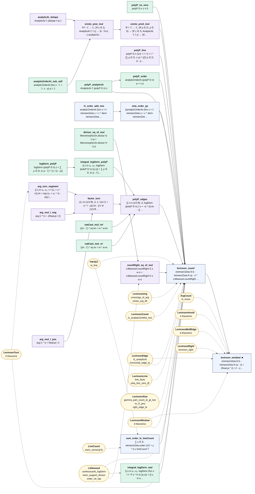

# `lean_stage3/Stage3/LevinsonMultiple.lean`

> **Read from the source text.** This file changed after the last `python3 utilities/lean_map.py --dump`, so the arrows on this page are names occurring in each proof and have not been confirmed by Lean.

LevinsonMultiple — block S11 of `lean_stage3/design/stencil.md`, removing `hsimple` by counting. 2026-11-25.

25 theorems, 1 definition, 1129 lines. 

**Imports:** [`LevinsonWindow`](../lean_stage3/LevinsonWindow.md)  
**Imported by:** [`Stage3`](../lean_stage3/Stage3.md), [`LevinsonWindowNear`](../lean_stage3/LevinsonWindowNear.md)

## The picture



An arrow A → B reads "A is used in the proof of B". Green: counting, integers only. Violet: shape, analysis with no ζ. Blue: reads ζ. A name ending in ■ is an end: nothing else uses it. Red: contains `sorry`. Yellow: theorems in another file, counted; a dotted arrow crosses files. Definitions are not drawn; they are listed below the diagram.

## Definitions

<a name="LevinsonMultiple-polyP"></a>
### `LevinsonMultiple.polyP`

def · line 147

- **Is:** `` polyP (D : Finset ℂ) (n : ℂ → ℕ) (z : ℂ) : ℂ := ∏ ρ ∈ D, (z - ρ) ^ n ρ ``
- **Used by 9:** [`LevinsonMultiple.exists_prod_mul`](#LevinsonMultiple-exists_prod_mul), [`LevinsonMultiple.integral_logDeriv_polyP`](#LevinsonMultiple-integral_logDeriv_polyP), [`LevinsonMultiple.levinson_count'`](#LevinsonMultiple-levinson_count-), [`LevinsonMultiple.logDeriv_polyP`](#LevinsonMultiple-logDeriv_polyP), [`LevinsonMultiple.polyP_analyticAt`](#LevinsonMultiple-polyP_analyticAt), [`LevinsonMultiple.polyP_edges`](#LevinsonMultiple-polyP_edges), [`LevinsonMultiple.polyP_line`](#LevinsonMultiple-polyP_line), [`LevinsonMultiple.polyP_ne_zero`](#LevinsonMultiple-polyP_ne_zero), [`LevinsonMultiple.polyP_order`](#LevinsonMultiple-polyP_order)

## Theorems

<a name="LevinsonMultiple-analyticAt_dslope"></a>
### `LevinsonMultiple.analyticAt_dslope`

line 83 · arrows read from text

**Shape.** Uses real or complex analysis; nothing in it or beneath it reads ζ.

**Why.** `dslope f a` is analytic wherever `f` is, given `f` analytic at `a`.

**Proves**

```lean
AnalyticAt ℂ (dslope f a) z
```

**Needs** (its hypotheses)

  - `` ha : AnalyticAt ℂ f a ``
  - `` hz : AnalyticAt ℂ f z ``

**Fed by:** no theorem of this repo; it stands on Mathlib.

**Feeds** (1 that use it)

  - [`LevinsonMultiple.exists_pow_mul`](#LevinsonMultiple-exists_pow_mul) — `` ∀ f : ℂ → ℂ, (∀ z ∈ S, AnalyticAt ℂ f z) → (k : ℕ∞) ≤ analyticOrderAt f ρ → ∃ g : ℂ → ℂ, (∀ z ∈ S, AnalyticAt ℂ g z) ∧ ∀ z, f z = (z - ρ) ^ k * g z ``

<a name="LevinsonMultiple-analyticOrderAt_sub_self"></a>
### `LevinsonMultiple.analyticOrderAt_sub_self`

line 100 · arrows read from text

**Counting.** Integers only: nothing in its statement or proof, or in anything it rests on, uses analysis or ζ.

**Why.** `s − ρ` has order one at `ρ`.

**Proves**

```lean
analyticOrderAt (fun z : ℂ => z - ρ) ρ = 1
```

**Needs** (its hypotheses)

  - `` ρ : ℂ ``

**Fed by:** no theorem of this repo; it stands on Mathlib.

**Feeds** (1 that use it)

  - [`LevinsonMultiple.exists_pow_mul`](#LevinsonMultiple-exists_pow_mul) — `` ∀ f : ℂ → ℂ, (∀ z ∈ S, AnalyticAt ℂ f z) → (k : ℕ∞) ≤ analyticOrderAt f ρ → ∃ g : ℂ → ℂ, (∀ z ∈ S, AnalyticAt ℂ g z) ∧ ∀ z, f z = (z - ρ) ^ k * g z ``

<a name="LevinsonMultiple-exists_pow_mul"></a>
### `LevinsonMultiple.exists_pow_mul`

line 106 · arrows read from text

**Shape.** Uses real or complex analysis; nothing in it or beneath it reads ζ.

**Why.** One factor. Order at least `k` at `ρ ∈ S` divides out `(s − ρ)^k`, by `dslope`.

**Proves**

```lean
∀ f : ℂ → ℂ, (∀ z ∈ S, AnalyticAt ℂ f z) → (k : ℕ∞) ≤ analyticOrderAt f ρ → ∃ g : ℂ → ℂ, (∀ z ∈ S, AnalyticAt ℂ g z) ∧ ∀ z, f z = (z - ρ) ^ k * g z
```

**Needs** (its hypotheses)

  - `` hρ : ρ ∈ S ``
  - `` k : ℕ ``

**Fed by** (2 theorems its proof uses)

  - [`LevinsonMultiple.analyticAt_dslope`](#LevinsonMultiple-analyticAt_dslope) — `` AnalyticAt ℂ (dslope f a) z ``
  - [`LevinsonMultiple.analyticOrderAt_sub_self`](#LevinsonMultiple-analyticOrderAt_sub_self) — `` analyticOrderAt (fun z : ℂ => z - ρ) ρ = 1 ``

**Feeds** (1 that use it)

  - [`LevinsonMultiple.exists_prod_mul`](#LevinsonMultiple-exists_prod_mul) — `` ∀ f : ℂ → ℂ, (∀ ρ ∈ D, ρ ∈ S) → (∀ z ∈ S, AnalyticAt ℂ f z) → (∀ ρ ∈ D, (n ρ : ℕ∞) ≤ analyticOrderAt f ρ) → ∃ g : ℂ → ℂ, (∀ z ∈ S, AnalyticAt ℂ g z) ∧… ``

<a name="LevinsonMultiple-polyP_analyticAt"></a>
### `LevinsonMultiple.polyP_analyticAt`

line 152 · arrows read from text

**Counting.** Integers only: nothing in its statement or proof, or in anything it rests on, uses analysis or ζ.

**Why.** `P` is analytic everywhere.

**Proves**

```lean
AnalyticAt ℂ (polyP D n) z
```

**Needs** (its hypotheses)

  - `` D : Finset ℂ ``
  - `` n : ℂ → ℕ ``
  - `` z : ℂ ``

**Fed by:** no theorem of this repo; it stands on Mathlib and the definitions below.

**Definitions its proof touches:** [`LevinsonMultiple.polyP`](#LevinsonMultiple-polyP)

**Feeds** (2 that use it)

  - [`LevinsonMultiple.levinson_count'`](#LevinsonMultiple-levinson_count-) — `` (riemannZeta.N b - riemannZeta.N a) - 2 * Littlewood.countRight (fun s => riemannZeta s + c * deriv riemannZeta s) ((1/2 : ℂ) + a * I) ((3 : ℂ) + b * … ``
  - [`LevinsonMultiple.polyP_order`](#LevinsonMultiple-polyP_order) — `` analyticOrderAt (polyP D n) ρ = n ρ ``

<a name="LevinsonMultiple-polyP_ne_zero"></a>
### `LevinsonMultiple.polyP_ne_zero`

line 157 · arrows read from text

**Counting.** Integers only: nothing in its statement or proof, or in anything it rests on, uses analysis or ζ.

**Why.** `P` is nonzero off `D`.

**Proves**

```lean
polyP D n z ≠ 0
```

**Needs** (its hypotheses)

  - `` n : ℂ → ℕ ``
  - `` hz : z ∉ D ``

**Fed by:** no theorem of this repo; it stands on Mathlib and the definitions below.

**Definitions its proof touches:** [`LevinsonMultiple.polyP`](#LevinsonMultiple-polyP)

**Feeds** (1 that use it)

  - [`LevinsonMultiple.levinson_count'`](#LevinsonMultiple-levinson_count-) — `` (riemannZeta.N b - riemannZeta.N a) - 2 * Littlewood.countRight (fun s => riemannZeta s + c * deriv riemannZeta s) ((1/2 : ℂ) + a * I) ((3 : ℂ) + b * … ``

<a name="LevinsonMultiple-polyP_order"></a>
### `LevinsonMultiple.polyP_order`

line 162 · arrows read from text

**Counting.** Integers only: nothing in its statement or proof, or in anything it rests on, uses analysis or ζ.

**Why.** `P` has order `n ρ` at `ρ ∈ D`.

**Proves**

```lean
analyticOrderAt (polyP D n) ρ = n ρ
```

**Needs** (its hypotheses)

  - `` n : ℂ → ℕ ``
  - `` hρ : ρ ∈ D ``

**Fed by** (1 theorem its proof uses)

  - [`LevinsonMultiple.polyP_analyticAt`](#LevinsonMultiple-polyP_analyticAt) — `` AnalyticAt ℂ (polyP D n) z ``

**Definitions its proof touches:** [`LevinsonMultiple.polyP`](#LevinsonMultiple-polyP)

**Feeds** (1 that use it)

  - [`LevinsonMultiple.levinson_count'`](#LevinsonMultiple-levinson_count-) — `` (riemannZeta.N b - riemannZeta.N a) - 2 * Littlewood.countRight (fun s => riemannZeta s + c * deriv riemannZeta s) ((1/2 : ℂ) + a * I) ((3 : ℂ) + b * … ``

<a name="LevinsonMultiple-logDeriv_polyP"></a>
### `LevinsonMultiple.logDeriv_polyP`

line 173 · arrows read from text

**Counting.** Integers only: nothing in its statement or proof, or in anything it rests on, uses analysis or ζ.

**Why.** The logarithmic derivative of `P` off `D`.

**Proves**

```lean
logDeriv (polyP D n) z = ∑ ρ ∈ D, (n ρ : ℂ) * (1 / (z - ρ))
```

**Needs** (its hypotheses)

  - `` n : ℂ → ℕ ``
  - `` hz : z ∉ D ``

**Fed by:** no theorem of this repo; it stands on Mathlib and the definitions below.

**Definitions its proof touches:** [`LevinsonMultiple.polyP`](#LevinsonMultiple-polyP)

**Feeds** (1 that use it)

  - [`LevinsonMultiple.integral_logDeriv_polyP`](#LevinsonMultiple-integral_logDeriv_polyP) — `` (∫ u in u₁..u₂, logDeriv (polyP D n) (q u)) = ∑ ρ ∈ D, (n ρ : ℂ) * ∫ u in u₁..u₂, 1 / (q u - ρ) ``

<a name="LevinsonMultiple-polyP_line"></a>
### `LevinsonMultiple.polyP_line`

line 186 · arrows read from text

**Shape.** Uses real or complex analysis; nothing in it or beneath it reads ζ.

**Why.** On the line, with `D` on the line, `P = i^K × real`.

**Proves**

```lean
polyP D n (1/2 + t * I) = I ^ (∑ ρ ∈ D, n ρ) * ((∏ ρ ∈ D, (t - ρ.im) ^ n ρ : ℝ) : ℂ)
```

**Needs** (its hypotheses)

  - `` n : ℂ → ℕ ``
  - `` hD : ∀ ρ ∈ D, ρ.re = 1/2 ``
  - `` t : ℝ ``

**Fed by:** no theorem of this repo; it stands on Mathlib and the definitions below.

**Definitions its proof touches:** [`LevinsonMultiple.polyP`](#LevinsonMultiple-polyP)

**Feeds** (1 that use it)

  - [`LevinsonMultiple.levinson_count'`](#LevinsonMultiple-levinson_count-) — `` (riemannZeta.N b - riemannZeta.N a) - 2 * Littlewood.countRight (fun s => riemannZeta s + c * deriv riemannZeta s) ((1/2 : ℂ) + a * I) ((3 : ℂ) + b * … ``

<a name="LevinsonMultiple-arg_turn_segment"></a>
### `LevinsonMultiple.arg_turn_segment`

line 197 · arrows read from text

**Shape.** Uses real or complex analysis; nothing in it or beneath it reads ζ.

**Why.** A segment in the slit plane. `Im ∫ v/(z₀ + u v)` is the change of `arg`.

**Proves**

```lean
(∫ u in u₁..u₂, v / (z₀ + u * v)).im = arg (z₀ + u₂ * v) - arg (z₀ + u₁ * v)
```

**Needs** (its hypotheses)

  - `` hu : u₁ ≤ u₂ ``
  - `` hS : ∀ u ∈ Icc u₁ u₂, z₀ + u * v ∈ slitPlane ``

**Fed by** (1 theorem its proof uses)

  - [`LevinsonTurn.lift_turn_eq_integral`](../lean_stage3/LevinsonTurn.md#LevinsonTurn-lift_turn_eq_integral) (LevinsonTurn) — `` φ b - φ a = (∫ t in a..b, F' t / F t).im ``

**Feeds** (1 that use it)

  - [`LevinsonMultiple.factor_turn`](#LevinsonMultiple-factor_turn) — `` (∫ x in (1/2:ℝ)..3, 1 / ((x:ℂ) + a * I - ρ)).im - (∫ x in (1/2:ℝ)..3, 1 / ((x:ℂ) + b * I - ρ)).im + (∫ t in a..b, 1 / ((3:ℂ) + t * I - ρ)).re = Real.p… ``

<a name="LevinsonMultiple-arg_mul_I_neg"></a>
### `LevinsonMultiple.arg_mul_I_neg`

line 218 · arrows read from text

**Shape.** Uses real or complex analysis; nothing in it or beneath it reads ζ.

**Why.** `arg (r i) = −π/2` for `r < 0`.

**Proves**

```lean
arg (r * I) = -(Real.pi / 2)
```

**Needs** (its hypotheses)

  - `` hr : r < 0 ``

**Fed by:** no theorem of this repo; it stands on Mathlib.

**Feeds** (1 that use it)

  - [`LevinsonMultiple.factor_turn`](#LevinsonMultiple-factor_turn) — `` (∫ x in (1/2:ℝ)..3, 1 / ((x:ℂ) + a * I - ρ)).im - (∫ x in (1/2:ℝ)..3, 1 / ((x:ℂ) + b * I - ρ)).im + (∫ t in a..b, 1 / ((3:ℂ) + t * I - ρ)).re = Real.p… ``

<a name="LevinsonMultiple-arg_mul_I_pos"></a>
### `LevinsonMultiple.arg_mul_I_pos`

line 223 · arrows read from text

**Shape.** Uses real or complex analysis; nothing in it or beneath it reads ζ.

**Why.** `arg (r i) = π/2` for `r > 0`.

**Proves**

```lean
arg (r * I) = Real.pi / 2
```

**Needs** (its hypotheses)

  - `` hr : 0 < r ``

**Fed by:** no theorem of this repo; it stands on Mathlib.

**Feeds** (1 that use it)

  - [`LevinsonMultiple.factor_turn`](#LevinsonMultiple-factor_turn) — `` (∫ x in (1/2:ℝ)..3, 1 / ((x:ℂ) + a * I - ρ)).im - (∫ x in (1/2:ℝ)..3, 1 / ((x:ℂ) + b * I - ρ)).im + (∫ t in a..b, 1 / ((3:ℂ) + t * I - ρ)).re = Real.p… ``

<a name="LevinsonMultiple-exists_prod_mul"></a>
### `LevinsonMultiple.exists_prod_mul`

line 228 · arrows read from text

**Shape.** Uses real or complex analysis; nothing in it or beneath it reads ζ.

**Why.** All factors. Orders at least `n ρ` on a finite `D ⊆ S` divide out `polyP D n`.

**Proves**

```lean
∀ f : ℂ → ℂ, (∀ ρ ∈ D, ρ ∈ S) → (∀ z ∈ S, AnalyticAt ℂ f z) → (∀ ρ ∈ D, (n ρ : ℕ∞) ≤ analyticOrderAt f ρ) → ∃ g : ℂ → ℂ, (∀ z ∈ S, AnalyticAt ℂ g z) ∧ ∀ z, f z = polyP D n z * g z
```

**Needs** (its hypotheses)

  - `` n : ℂ → ℕ ``
  - `` D : Finset ℂ ``

**Fed by** (1 theorem its proof uses)

  - [`LevinsonMultiple.exists_pow_mul`](#LevinsonMultiple-exists_pow_mul) — `` ∀ f : ℂ → ℂ, (∀ z ∈ S, AnalyticAt ℂ f z) → (k : ℕ∞) ≤ analyticOrderAt f ρ → ∃ g : ℂ → ℂ, (∀ z ∈ S, AnalyticAt ℂ g z) ∧ ∀ z, f z = (z - ρ) ^ k * g z ``

**Definitions its proof touches:** [`LevinsonMultiple.polyP`](#LevinsonMultiple-polyP)

**Feeds** (1 that use it)

  - [`LevinsonMultiple.levinson_count'`](#LevinsonMultiple-levinson_count-) — `` (riemannZeta.N b - riemannZeta.N a) - 2 * Littlewood.countRight (fun s => riemannZeta s + c * deriv riemannZeta s) ((1/2 : ℂ) + a * I) ((3 : ℂ) + b * … ``

<a name="LevinsonMultiple-G_order_add_one"></a>
### `LevinsonMultiple.G_order_add_one`

line 257 · arrows read from text

**Reads ζ.** It, or something it rests on, uses the zeta function, its zeros or the Riemann hypothesis.

**Why.** `ζ + c ζ'` has order one less than `ζ` at a zero of `ζ`, for `c ≠ 0`.

**Proves**

```lean
analyticOrderAt (fun s => riemannZeta s + c * deriv riemannZeta s) ρ + 1 = analyticOrderAt riemannZeta ρ
```

**Needs** (its hypotheses)

  - `` hc : c ≠ 0 ``
  - `` hρ1 : ρ ≠ 1 ``
  - `` hz : riemannZeta ρ = 0 ``
  - `` hfin : analyticOrderAt (fun s => riemannZeta s + c * deriv riemannZeta s) ρ ≠ ⊤ ``

**Fed by:** no theorem of this repo; it stands on Mathlib.

**Feeds** (1 that use it)

  - [`LevinsonMultiple.zeta_order_ge`](#LevinsonMultiple-zeta_order_ge) — `` ((analyticOrderAt (fun s => riemannZeta s + c * deriv riemannZeta s) ρ).toNat : ℤ) + 1 ≤ riemannZeta.order ρ ``

<a name="LevinsonMultiple-zeta_order_ge"></a>
### `LevinsonMultiple.zeta_order_ge`

line 294 · arrows read from text

**Reads ζ.** It, or something it rests on, uses the zeta function, its zeros or the Riemann hypothesis.

**Why.** The order of `ζ` at a zero of `ζ + c ζ'` on the line.

**Proves**

```lean
((analyticOrderAt (fun s => riemannZeta s + c * deriv riemannZeta s) ρ).toNat : ℤ) + 1 ≤ riemannZeta.order ρ
```

**Needs** (its hypotheses)

  - `` hc : c ≠ 0 ``
  - `` hρ1 : ρ ≠ 1 ``
  - `` hz : riemannZeta ρ = 0 ``
  - `` hfin : analyticOrderAt (fun s => riemannZeta s + c * deriv riemannZeta s) ρ ≠ ⊤ ``

**Fed by** (1 theorem its proof uses)

  - [`LevinsonMultiple.G_order_add_one`](#LevinsonMultiple-G_order_add_one) — `` analyticOrderAt (fun s => riemannZeta s + c * deriv riemannZeta s) ρ + 1 = analyticOrderAt riemannZeta ρ ``

**Feeds** (1 that use it)

  - [`LevinsonMultiple.levinson_count'`](#LevinsonMultiple-levinson_count-) — `` (riemannZeta.N b - riemannZeta.N a) - 2 * Littlewood.countRight (fun s => riemannZeta s + c * deriv riemannZeta s) ((1/2 : ℂ) + a * I) ((3 : ℂ) + b * … ``

<a name="LevinsonMultiple-sum_order_le_lineCount"></a>
### `LevinsonMultiple.sum_order_le_lineCount`

line 313 · arrows read from text

**Reads ζ.** It, or something it rests on, uses the zeta function, its zeros or the Riemann hypothesis.

**Why.** Distinct heights in `(0, T]` carrying zeros of `ζ` on the line, weighted by order.

**Proves**

```lean
∑ γ ∈ E, riemannZeta.order (1/2 + γ * I) ≤ lineCount T
```

**Needs** (its hypotheses)

  - `` E : Finset ℝ ``
  - `` hpos : ∀ γ ∈ E, 0 < γ ``
  - `` hT : ∀ γ ∈ E, γ ≤ T ``
  - `` hζ : ∀ γ ∈ E, riemannZeta (1/2 + γ * I) = 0 ``

**Fed by** (2 theorems its proof uses)

  - [`HardyZ.re_line`](../lean_stage3/HardyZ.md#HardyZ-re_line) (HardyZ) — `` ((1 / 2 : ℂ) + t * I).re = 1 / 2 ``
  - [`LineCount.mem_zerosUpTo`](../lean_stage3/LineCount.md#LineCount-mem_zerosUpTo) (LineCount) — `` ρ ∈ zerosUpTo T ↔ 0 < (ρ : ℂ).im ∧ (ρ : ℂ).im ≤ T ``

**Definitions its proof touches:** [`LineCount.lineCount`](../lean_stage3/LineCount.md#LineCount-lineCount), [`LineCount.zerosUpTo`](../lean_stage3/LineCount.md#LineCount-zerosUpTo)

**Feeds** (1 that use it)

  - [`LevinsonMultiple.levinson_count'`](#LevinsonMultiple-levinson_count-) — `` (riemannZeta.N b - riemannZeta.N a) - 2 * Littlewood.countRight (fun s => riemannZeta s + c * deriv riemannZeta s) ((1/2 : ℂ) + a * I) ((3 : ℂ) + b * … ``

<a name="LevinsonMultiple-divisor_eq_of_mul"></a>
### `LevinsonMultiple.divisor_eq_of_mul`

line 352 · arrows read from text

**Counting.** Integers only: nothing in its statement or proof, or in anything it rests on, uses analysis or ζ.

**Why.** Dividing by a factor nonzero at `p` leaves the divisor at `p` unchanged.

**Proves**

```lean
MeromorphicOn.divisor G U p = MeromorphicOn.divisor H U p
```

**Needs** (its hypotheses)

  - `` hGU : ∀ z ∈ U, AnalyticAt ℂ G z ``
  - `` hHU : ∀ z ∈ U, AnalyticAt ℂ H z ``
  - `` hP : AnalyticAt ℂ P p ``
  - `` hPp : P p ≠ 0 ``
  - `` heq : G = P * H ``
  - `` hp : p ∈ U ``

**Fed by:** no theorem of this repo; it stands on Mathlib.

**Feeds** (1 that use it)

  - [`LevinsonMultiple.countRight_eq_of_mul`](#LevinsonMultiple-countRight_eq_of_mul) — `` Littlewood.countRight G z w σ = Littlewood.countRight H z w σ ``

<a name="LevinsonMultiple-countRight_eq_of_mul"></a>
### `LevinsonMultiple.countRight_eq_of_mul`

line 362 · arrows read from text

**Shape.** Uses real or complex analysis; nothing in it or beneath it reads ζ.

**Why.** The count right of `σ` is unchanged by a factor with no zero right of `σ`.

**Proves**

```lean
Littlewood.countRight G z w σ = Littlewood.countRight H z w σ
```

**Needs** (its hypotheses)

  - `` hG : AnalyticOnNhd ℂ G (Rectangle z w) ``
  - `` hH : AnalyticOnNhd ℂ H (Rectangle z w) ``
  - `` hP : ∀ p, AnalyticAt ℂ P p ``
  - `` hPne : ∀ p ∈ Rectangle z w, σ < p.re → P p ≠ 0 ``
  - `` heq : G = P * H ``
  - `` hGz : G z ≠ 0 ``
  - `` hHz : H z ≠ 0 ``

**Fed by** (3 theorems its proof uses)

  - [`LevinsonMultiple.divisor_eq_of_mul`](#LevinsonMultiple-divisor_eq_of_mul) — `` MeromorphicOn.divisor G U p = MeromorphicOn.divisor H U p ``
  - [`Littlewood.mem_support_divisor`](../lean_stage3/Littlewood.md#Littlewood-mem_support_divisor) (Littlewood) — `` p ∈ (MeromorphicOn.divisor f U).support ↔ p ∈ U ∧ f p = 0 ``
  - [`Littlewood.order_ne_top`](../lean_stage3/Littlewood.md#Littlewood-order_ne_top) (Littlewood) — `` ∀ p ∈ Rectangle z w, meromorphicOrderAt f p ≠ ⊤ ``

**Definitions its proof touches:** [`Littlewood.countRight`](../lean_stage3/Littlewood.md#Littlewood-countRight)

**Feeds** (1 that use it)

  - [`LevinsonMultiple.levinson_count'`](#LevinsonMultiple-levinson_count-) — `` (riemannZeta.N b - riemannZeta.N a) - 2 * Littlewood.countRight (fun s => riemannZeta s + c * deriv riemannZeta s) ((1/2 : ℂ) + a * I) ((3 : ℂ) + b * … ``

<a name="LevinsonMultiple-integral_logDeriv_mul"></a>
### `LevinsonMultiple.integral_logDeriv_mul`

line 394 · arrows read from text

**Counting.** Integers only: nothing in its statement or proof, or in anything it rests on, uses analysis or ζ.

**Why.** The split of `∫ logDeriv (P · H)` along a path where both are analytic and nonzero.

**Proves**

```lean
(∫ u in u₁..u₂, logDeriv (fun s => P s * H s) (q u)) = (∫ u in u₁..u₂, logDeriv P (q u)) + ∫ u in u₁..u₂, logDeriv H (q u)
```

**Needs** (its hypotheses)

  - `` hu : u₁ ≤ u₂ ``
  - `` hq : Continuous q ``
  - `` hP : ∀ u ∈ Icc u₁ u₂, AnalyticAt ℂ P (q u) ``
  - `` hH : ∀ u ∈ Icc u₁ u₂, AnalyticAt ℂ H (q u) ``
  - `` hP0 : ∀ u ∈ Icc u₁ u₂, P (q u) ≠ 0 ``
  - `` hH0 : ∀ u ∈ Icc u₁ u₂, H (q u) ≠ 0 ``

**Fed by** (1 theorem its proof uses)

  - [`Littlewood.continuousAt_logDeriv`](../lean_stage3/Littlewood.md#Littlewood-continuousAt_logDeriv) (Littlewood) — `` ContinuousAt (logDeriv f) s ``

**Feeds** (1 that use it)

  - [`LevinsonMultiple.levinson_count'`](#LevinsonMultiple-levinson_count-) — `` (riemannZeta.N b - riemannZeta.N a) - 2 * Littlewood.countRight (fun s => riemannZeta s + c * deriv riemannZeta s) ((1/2 : ℂ) + a * I) ((3 : ℂ) + b * … ``

<a name="LevinsonMultiple-factor_turn"></a>
### `LevinsonMultiple.factor_turn`

line 419 · arrows read from text

**Shape.** Uses real or complex analysis; nothing in it or beneath it reads ζ.

**Why.** The turning of `s − ρ` around the bottom, the right side and the top of the rectangle `[1/2, 3] × [a, b]`, for `ρ` on the left edge strictly between `a` and `b`, is `π`.

**Proves**

```lean
(∫ x in (1/2:ℝ)..3, 1 / ((x:ℂ) + a * I - ρ)).im - (∫ x in (1/2:ℝ)..3, 1 / ((x:ℂ) + b * I - ρ)).im + (∫ t in a..b, 1 / ((3:ℂ) + t * I - ρ)).re = Real.pi
```

**Needs** (its hypotheses)

  - `` hre : ρ.re = 1/2 ``
  - `` ha : a < ρ.im ``
  - `` hb : ρ.im < b ``

**Fed by** (3 theorems its proof uses)

  - [`LevinsonMultiple.arg_mul_I_neg`](#LevinsonMultiple-arg_mul_I_neg) — `` arg (r * I) = -(Real.pi / 2) ``
  - [`LevinsonMultiple.arg_mul_I_pos`](#LevinsonMultiple-arg_mul_I_pos) — `` arg (r * I) = Real.pi / 2 ``
  - [`LevinsonMultiple.arg_turn_segment`](#LevinsonMultiple-arg_turn_segment) — `` (∫ u in u₁..u₂, v / (z₀ + u * v)).im = arg (z₀ + u₂ * v) - arg (z₀ + u₁ * v) ``

**Feeds** (1 that use it)

  - [`LevinsonMultiple.polyP_edges`](#LevinsonMultiple-polyP_edges) — `` (∫ x in (1/2:ℝ)..3, logDeriv (polyP D n) (↑x + ↑a * I)).im - (∫ x in (1/2:ℝ)..3, logDeriv (polyP D n) (↑x + ↑b * I)).im + (∫ t in a..b, logDeriv (poly… ``

<a name="LevinsonMultiple-integral_logDeriv_polyP"></a>
### `LevinsonMultiple.integral_logDeriv_polyP`

line 471 · arrows read from text

**Counting.** Integers only: nothing in its statement or proof, or in anything it rests on, uses analysis or ζ.

**Why.** Along a path missing `D`, `∫ logDeriv P` is the weighted sum of `∫ 1/(q − ρ)`.

**Proves**

```lean
(∫ u in u₁..u₂, logDeriv (polyP D n) (q u)) = ∑ ρ ∈ D, (n ρ : ℂ) * ∫ u in u₁..u₂, 1 / (q u - ρ)
```

**Needs** (its hypotheses)

  - `` n : ℂ → ℕ ``
  - `` hu : u₁ ≤ u₂ ``
  - `` hq : Continuous q ``
  - `` hD : ∀ u ∈ Icc u₁ u₂, q u ∉ D ``

**Fed by** (1 theorem its proof uses)

  - [`LevinsonMultiple.logDeriv_polyP`](#LevinsonMultiple-logDeriv_polyP) — `` logDeriv (polyP D n) z = ∑ ρ ∈ D, (n ρ : ℂ) * (1 / (z - ρ)) ``

**Definitions its proof touches:** [`LevinsonMultiple.polyP`](#LevinsonMultiple-polyP)

**Feeds** (1 that use it)

  - [`LevinsonMultiple.polyP_edges`](#LevinsonMultiple-polyP_edges) — `` (∫ x in (1/2:ℝ)..3, logDeriv (polyP D n) (↑x + ↑a * I)).im - (∫ x in (1/2:ℝ)..3, logDeriv (polyP D n) (↑x + ↑b * I)).im + (∫ t in a..b, logDeriv (poly… ``

<a name="LevinsonMultiple-natCast_mul_im-"></a>
### `LevinsonMultiple.natCast_mul_im'`

line 491 · arrows read from text

**Counting.** Integers only: nothing in its statement or proof, or in anything it rests on, uses analysis or ζ.

**Why.** `Im (m w) = m Im w`.

**Proves**

```lean
((m : ℂ) * w).im = m * w.im
```

**Needs** (its hypotheses)

  - `` m : ℕ ``
  - `` w : ℂ ``

**Fed by:** no theorem of this repo; it stands on Mathlib.

**Feeds** (1 that use it)

  - [`LevinsonMultiple.polyP_edges`](#LevinsonMultiple-polyP_edges) — `` (∫ x in (1/2:ℝ)..3, logDeriv (polyP D n) (↑x + ↑a * I)).im - (∫ x in (1/2:ℝ)..3, logDeriv (polyP D n) (↑x + ↑b * I)).im + (∫ t in a..b, logDeriv (poly… ``

<a name="LevinsonMultiple-natCast_mul_re-"></a>
### `LevinsonMultiple.natCast_mul_re'`

line 493 · arrows read from text

**Counting.** Integers only: nothing in its statement or proof, or in anything it rests on, uses analysis or ζ.

**Why.** `Re (m w) = m Re w`.

**Proves**

```lean
((m : ℂ) * w).re = m * w.re
```

**Needs** (its hypotheses)

  - `` m : ℕ ``
  - `` w : ℂ ``

**Fed by:** no theorem of this repo; it stands on Mathlib.

**Feeds** (1 that use it)

  - [`LevinsonMultiple.polyP_edges`](#LevinsonMultiple-polyP_edges) — `` (∫ x in (1/2:ℝ)..3, logDeriv (polyP D n) (↑x + ↑a * I)).im - (∫ x in (1/2:ℝ)..3, logDeriv (polyP D n) (↑x + ↑b * I)).im + (∫ t in a..b, logDeriv (poly… ``

<a name="LevinsonMultiple-polyP_edges"></a>
### `LevinsonMultiple.polyP_edges`

line 497 · arrows read from text

**Shape.** Uses real or complex analysis; nothing in it or beneath it reads ζ.

**Why.** The turning of `P` around the three edges. For `D` on the open left edge, the bottom, right and top terms of `∫ logDeriv P` add up to `π K`, `K = Σ n ρ`.

**Proves**

```lean
(∫ x in (1/2:ℝ)..3, logDeriv (polyP D n) (↑x + ↑a * I)).im - (∫ x in (1/2:ℝ)..3, logDeriv (polyP D n) (↑x + ↑b * I)).im + (∫ t in a..b, logDeriv (polyP D n) (3 + ↑t * I)).re = Real.pi * ∑ ρ ∈ D, (n ρ : ℝ)
```

**Needs** (its hypotheses)

  - `` hab : a ≤ b ``
  - `` n : ℂ → ℕ ``
  - `` hD : ∀ ρ ∈ D, ρ.re = 1/2 ∧ a < ρ.im ∧ ρ.im < b ``

**Fed by** (4 theorems its proof uses)

  - [`LevinsonMultiple.factor_turn`](#LevinsonMultiple-factor_turn) — `` (∫ x in (1/2:ℝ)..3, 1 / ((x:ℂ) + a * I - ρ)).im - (∫ x in (1/2:ℝ)..3, 1 / ((x:ℂ) + b * I - ρ)).im + (∫ t in a..b, 1 / ((3:ℂ) + t * I - ρ)).re = Real.p… ``
  - [`LevinsonMultiple.integral_logDeriv_polyP`](#LevinsonMultiple-integral_logDeriv_polyP) — `` (∫ u in u₁..u₂, logDeriv (polyP D n) (q u)) = ∑ ρ ∈ D, (n ρ : ℂ) * ∫ u in u₁..u₂, 1 / (q u - ρ) ``
  - [`LevinsonMultiple.natCast_mul_im'`](#LevinsonMultiple-natCast_mul_im-) — `` ((m : ℂ) * w).im = m * w.im ``
  - [`LevinsonMultiple.natCast_mul_re'`](#LevinsonMultiple-natCast_mul_re-) — `` ((m : ℂ) * w).re = m * w.re ``

**Definitions its proof touches:** [`LevinsonMultiple.polyP`](#LevinsonMultiple-polyP)

**Feeds** (1 that use it)

  - [`LevinsonMultiple.levinson_count'`](#LevinsonMultiple-levinson_count-) — `` (riemannZeta.N b - riemannZeta.N a) - 2 * Littlewood.countRight (fun s => riemannZeta s + c * deriv riemannZeta s) ((1/2 : ℂ) + a * I) ((3 : ℂ) + b * … ``

<a name="LevinsonMultiple-levinson_count-"></a>
### `LevinsonMultiple.levinson_count'`

line 532 · arrows read from text

**Reads ζ.** It, or something it rests on, uses the zeta function, its zeros or the Riemann hypothesis.

**Why.** S11, removing `hsimple`: Levinson's count. For `0 < c ≤ 1`, `4 ≤ a < b`, `G = ζ + c ζ'` nonzero on the bottom `[1/2, 3] + a i` and the top `[1/2, 3] + b i`, and the real factor `1 − c · Re(Gammaℝ'/Gammaℝ)` nonzero along `[1/2 + a i, 1/2 + b i]`: with no hypothesis on the left edge, the zeros of `ζ` on the line up to height `b`, with order, number at least `(N b − N a) − 2 · (zeros of G right of the line in the rectangle, with order) − (72 log b + 418)`.

**Proves**

```lean
(riemannZeta.N b - riemannZeta.N a) - 2 * Littlewood.countRight (fun s => riemannZeta s + c * deriv riemannZeta s) ((1/2 : ℂ) + a * I) ((3 : ℂ) + b * I) (1/2) - (72 * Real.log b + 418) ≤ (lineCount b : ℝ)
```

**Needs** (its hypotheses)

  - `` hc0 : 0 < c ``
  - `` hc1 : c ≤ 1 ``
  - `` ha : 4 ≤ a ``
  - `` hab : a < b ``
  - `` hBot : ∀ x ∈ Icc (1/2 : ℝ) 3, riemannZeta (↑x + ↑a * I) + c * deriv riemannZeta (↑x + ↑a * I) ≠ 0 ``
  - `` hTop : ∀ x ∈ Icc (1/2 : ℝ) 3, riemannZeta (↑x + ↑b * I) + c * deriv riemannZeta (↑x + ↑b * I) ≠ 0 ``
  - `` hfac : ∀ t ∈ Icc a b, 1 - c * (deriv Gammaℝ (1/2 + t * I) / Gammaℝ (1/2 + t * I)).re ≠ 0 ``

**Fed by** (26 theorems its proof uses)

  - [`HardyZ.re_line`](../lean_stage3/HardyZ.md#HardyZ-re_line) (HardyZ) — `` ((1 / 2 : ℂ) + t * I).re = 1 / 2 ``
  - [`LevinsonArg.crossings_of_arg`](../lean_stage3/LevinsonArg.md#LevinsonArg-crossings_of_arg) (LevinsonArg) — `` ∃ t : Fin k → ℝ, StrictMono t ∧ (∀ i, t i ∈ Set.Icc a b) ∧ ∀ i, Real.cos (φ (t i)) = 0 ``
  - [`LevinsonArg.exists_arg_lift`](../lean_stage3/LevinsonArg.md#LevinsonArg-exists_arg_lift) (LevinsonArg) — `` ∃ φ : ℝ → ℝ, ContinuousOn φ (Set.Icc a b) ∧ ∀ t ∈ Set.Icc a b, F t = ‖F t‖ * Complex.exp (φ t * Complex.I) ``
  - [`LevinsonCount.G_analyticOnNhd_rect`](../lean_stage3/LevinsonCount.md#LevinsonCount-G_analyticOnNhd_rect) (LevinsonCount) — `` AnalyticOnNhd ℂ (fun s => riemannZeta s + c * deriv riemannZeta s) (Rectangle ((1/2 : ℂ) + a * I) ((3 : ℂ) + b * I)) ``
  - [`LevinsonEdge.horizontal_edge_le`](../lean_stage3/LevinsonEdge.md#LevinsonEdge-horizontal_edge_le) (LevinsonEdge) — `` |(∫ x in (1/2:ℝ)..3, logDeriv (fun s => riemannZeta s + c * deriv riemannZeta s) (↑x + ↑T * I)).im| ≤ 21 * Real.pi * Real.log T + 133 * Real.pi ``
  - [`LevinsonLine.line_facts`](../lean_stage3/LevinsonLine.md#LevinsonLine-line_facts) (LevinsonLine) — `` ((1/2 : ℂ) + t * I) ≠ 0 ∧ ((1/2 : ℂ) + t * I) ≠ 1 ∧ 0 < ((1/2 : ℂ) + t * I).re ``
  - [`LevinsonLine.zeta_line_zero_iff`](../lean_stage3/LevinsonLine.md#LevinsonLine-zeta_line_zero_iff) (LevinsonLine) — `` riemannZeta (1/2 + t * I) = 0 ↔ (Gammaℝ (1/2 + t * I) * (riemannZeta (1/2 + t * I) + c * deriv riemannZeta (1/2 + t * I))).re = 0 ``
  - [`LevinsonMultiple.countRight_eq_of_mul`](#LevinsonMultiple-countRight_eq_of_mul) — `` Littlewood.countRight G z w σ = Littlewood.countRight H z w σ ``
  - [`LevinsonMultiple.exists_prod_mul`](#LevinsonMultiple-exists_prod_mul) — `` ∀ f : ℂ → ℂ, (∀ ρ ∈ D, ρ ∈ S) → (∀ z ∈ S, AnalyticAt ℂ f z) → (∀ ρ ∈ D, (n ρ : ℕ∞) ≤ analyticOrderAt f ρ) → ∃ g : ℂ → ℂ, (∀ z ∈ S, AnalyticAt ℂ g z) ∧… ``
  - [`LevinsonMultiple.integral_logDeriv_mul`](#LevinsonMultiple-integral_logDeriv_mul) — `` (∫ u in u₁..u₂, logDeriv (fun s => P s * H s) (q u)) = (∫ u in u₁..u₂, logDeriv P (q u)) + ∫ u in u₁..u₂, logDeriv H (q u) ``
  - [`LevinsonMultiple.polyP_analyticAt`](#LevinsonMultiple-polyP_analyticAt) — `` AnalyticAt ℂ (polyP D n) z ``
  - [`LevinsonMultiple.polyP_edges`](#LevinsonMultiple-polyP_edges) — `` (∫ x in (1/2:ℝ)..3, logDeriv (polyP D n) (↑x + ↑a * I)).im - (∫ x in (1/2:ℝ)..3, logDeriv (polyP D n) (↑x + ↑b * I)).im + (∫ t in a..b, logDeriv (poly… ``
  - [`LevinsonMultiple.polyP_line`](#LevinsonMultiple-polyP_line) — `` polyP D n (1/2 + t * I) = I ^ (∑ ρ ∈ D, n ρ) * ((∏ ρ ∈ D, (t - ρ.im) ^ n ρ : ℝ) : ℂ) ``
  - [`LevinsonMultiple.polyP_ne_zero`](#LevinsonMultiple-polyP_ne_zero) — `` polyP D n z ≠ 0 ``
  - [`LevinsonMultiple.polyP_order`](#LevinsonMultiple-polyP_order) — `` analyticOrderAt (polyP D n) ρ = n ρ ``
  - [`LevinsonMultiple.sum_order_le_lineCount`](#LevinsonMultiple-sum_order_le_lineCount) — `` ∑ γ ∈ E, riemannZeta.order (1/2 + γ * I) ≤ lineCount T ``
  - [`LevinsonMultiple.zeta_order_ge`](#LevinsonMultiple-zeta_order_ge) — `` ((analyticOrderAt (fun s => riemannZeta s + c * deriv riemannZeta s) ρ).toNat : ℤ) + 1 ≤ riemannZeta.order ρ ``
  - [`LevinsonSize.gamma_part_count_le_gt_two`](../lean_stage3/LevinsonSize.md#LevinsonSize-gamma_part_count_le_gt_two) (LevinsonSize) — `` |(∫ t in a..b, logDeriv Gammaℝ (1/2 + t * I)).re - Real.pi * (riemannZeta.N b - riemannZeta.N a)| ≤ Real.pi * (30 * Real.log b + 150) ``
  - [`LevinsonSize.re_G_pos`](../lean_stage3/LevinsonSize.md#LevinsonSize-re_G_pos) (LevinsonSize) — `` 0 < (riemannZeta (3 + t * I) + c * deriv riemannZeta (3 + t * I)).re ``
  - [`LevinsonSize.right_edge_le`](../lean_stage3/LevinsonSize.md#LevinsonSize-right_edge_le) (LevinsonSize) — `` |(∫ t in a..b, logDeriv (fun s => riemannZeta s + c * deriv riemannZeta s) (3 + t * I)).re| ≤ Real.pi ``
  - [`LevinsonTurn.G_turn_eq`](../lean_stage3/LevinsonTurn.md#LevinsonTurn-G_turn_eq) (LevinsonTurn) — `` (∫ t in a..b, logDeriv G (1/2 + t * I)).re = -(2 * Real.pi * Littlewood.countRight G ((1/2 : ℂ) + a * I) ((X : ℂ) + b * I) (1/2)) + (∫ x in (1/2 : ℝ).… ``
  - [`LevinsonTurn.line_turn_eq_integral`](../lean_stage3/LevinsonTurn.md#LevinsonTurn-line_turn_eq_integral) (LevinsonTurn) — `` φ b - φ a = (∫ t in a..b, logDeriv f (1/2 + t * I)).re ``
  - [`LevinsonTurn.turn_split`](../lean_stage3/LevinsonTurn.md#LevinsonTurn-turn_split) (LevinsonTurn) — `` (∫ t in a..b, logDeriv (fun s => Gammaℝ s * G s) (1/2 + t * I)).re = (∫ t in a..b, logDeriv Gammaℝ (1/2 + t * I)).re + (∫ t in a..b, logDeriv G (1/2 +… ``
  - [`LevinsonWindow.border_cases`](../lean_stage3/LevinsonWindow.md#LevinsonWindow-border_cases) (LevinsonWindow) — `` (p.im = z.im ∧ p.re ∈ Icc z.re w.re) ∨ (p.re = z.re ∧ p.im ∈ Icc z.im w.im) ∨ (p.im = w.im ∧ p.re ∈ Icc z.re w.re) ∨ (p.re = w.re ∧ p.im ∈ Icc z.im w.… ``
  - [`Littlewood.mem_support_divisor`](../lean_stage3/Littlewood.md#Littlewood-mem_support_divisor) (Littlewood) — `` p ∈ (MeromorphicOn.divisor f U).support ↔ p ∈ U ∧ f p = 0 ``
  - [`Littlewood.order_ne_top`](../lean_stage3/Littlewood.md#Littlewood-order_ne_top) (Littlewood) — `` ∀ p ∈ Rectangle z w, meromorphicOrderAt f p ≠ ⊤ ``

**Definitions its proof touches:** [`LevinsonMultiple.polyP`](#LevinsonMultiple-polyP), [`LineCount.lineCount`](../lean_stage3/LineCount.md#LineCount-lineCount), [`Littlewood.countRight`](../lean_stage3/Littlewood.md#Littlewood-countRight)

**Feeds** (1 that use it)

  - [`LevinsonMultiple.levinson_window'`](#LevinsonMultiple-levinson_window-) — `` (riemannZeta.N b - riemannZeta.N a) - (1 / (Real.pi * (1 / 2 - σ₀))) * ((b - a) / 2 * Real.log K + windowE M B X T a b) - (134 * Real.log T + 2918) ≤ … ``

<a name="LevinsonMultiple-levinson_window-"></a>
### `LevinsonMultiple.levinson_window'`

line 873 · arrows read from text

**Reads ζ.** It, or something it rests on, uses the zeta function, its zeros or the Riemann hypothesis.

**Why.** S11, the window theorem with no `hsimple`. `LevinsonWindow.levinson_window` with the hypothesis that every zero of `ζ` on `1/2 + [a, b] i` is simple removed: its step 4 is `levinson_count'`, which divides the zeros of `G` on the line out and counts them.

**Proves**

```lean
(riemannZeta.N b - riemannZeta.N a) - (1 / (Real.pi * (1 / 2 - σ₀))) * ((b - a) / 2 * Real.log K + windowE M B X T a b) - (134 * Real.log T + 2918) ≤ (lineCount b : ℝ)
```

**Needs** (its hypotheses)

  - `` hT : Real.exp 26 ≤ T ``
  - `` hc : c = 1 / Real.log T ``
  - `` hM : 1 ≤ M ``
  - `` hβ1 : β 1 = 1 ``
  - `` hβ : ∀ h, ‖β h‖ ≤ B ``
  - `` hσ₀ : σ₀ < 1 / 2 ``
  - `` hδ : 0 < δ ``
  - `` hσδ : 1 / 4 ≤ σ₀ - δ ``
  - `` hX : 3 ≤ X ``
  - `` hXMB : 32 * M * B ≤ (2 : ℝ) ^ X ``
  - `` hXa : 2 * X ≤ a ``
  - `` hab : a + 3 ≤ b ``
  - `` hbT : b ≤ T ``
  - `` hK1 : 1 ≤ K ``
  - `` hK : ∀ a' b' : ℝ, a ≤ a' → a' < b' → b' ≤ b → ∀ σ ∈ Icc (σ₀ - δ) σ₀, (1 / (b' - a')) * ∫ t in a'..b', ‖(riemannZeta (↑σ + ↑t * I) + c * deriv riemannZeta (↑σ + ↑t * I)) * LevinsonMollEdge.molli M β (↑σ + ↑t * I)‖ ^ 2 ≤ K ``

**Fed by** (22 theorems its proof uses)

  - [`ArgCount.N_mono`](../lean_stage3/ArgCount.md#ArgCount-N_mono) (ArgCount) — `` riemannZeta.N T ≤ riemannZeta.N T' ``
  - [`LevinsonAvoid.exists_good_abscissa`](../lean_stage3/LevinsonAvoid.md#LevinsonAvoid-exists_good_abscissa) (LevinsonAvoid) — `` ∃ σ ∈ Icc (σ₀ - δ) σ₀, ∀ y ∈ Icc a b, f ((σ : ℂ) + y * I) ≠ 0 ``
  - [`LevinsonAvoid.exists_good_height`](../lean_stage3/LevinsonAvoid.md#LevinsonAvoid-exists_good_height) (LevinsonAvoid) — `` ∃ t ∈ Icc t₀ (t₀ + 1), ∀ x ∈ Icc σ₀ X, f ((x : ℂ) + t * I) ≠ 0 ``
  - [`LevinsonAvoid.factor_pos`](../lean_stage3/LevinsonAvoid.md#LevinsonAvoid-factor_pos) (LevinsonAvoid) — `` 0 < 1 - (1 / Real.log T) * (deriv Gammaℝ (1/2 + t * I) / Gammaℝ (1/2 + t * I)).re ``
  - [`LevinsonAvoid.mem_rect_of`](../lean_stage3/LevinsonAvoid.md#LevinsonAvoid-mem_rect_of) (LevinsonAvoid) — `` ((x : ℂ) + y * I) ∈ Rectangle z w ``
  - [`LevinsonEdge.G_analyticAt`](../lean_stage3/LevinsonEdge.md#LevinsonEdge-G_analyticAt) (LevinsonEdge) — `` AnalyticAt ℂ (fun s => riemannZeta s + c * deriv riemannZeta s) w ``
  - [`LevinsonMollEdge.f_analyticAt`](../lean_stage3/LevinsonMollEdge.md#LevinsonMollEdge-f_analyticAt) (LevinsonMollEdge) — `` AnalyticAt ℂ (fun s => (riemannZeta s + c * deriv riemannZeta s) * molli M β s) w ``
  - [`LevinsonMollEdge.f_sub_one_le`](../lean_stage3/LevinsonMollEdge.md#LevinsonMollEdge-f_sub_one_le) (LevinsonMollEdge) — `` ‖(riemannZeta s + c * deriv riemannZeta s) * molli M β s - 1‖ ≤ tailDelta M B X ``
  - [`LevinsonMollEdge.horizontal_terms_le`](../lean_stage3/LevinsonMollEdge.md#LevinsonMollEdge-horizontal_terms_le) (LevinsonMollEdge) — `` |∫ σ in σ₀..X, edgeH (fun s => (riemannZeta s + c * deriv riemannZeta s) * molli M β s) X T σ| ≤ (X - σ₀) * (Real.pi * ((8 * X - 1) * (Real.log T + Re… ``
  - [`LevinsonMollEdge.molli_differentiable`](../lean_stage3/LevinsonMollEdge.md#LevinsonMollEdge-molli_differentiable) (LevinsonMollEdge) — `` Differentiable ℂ (molli M β) ``
  - [`LevinsonMollEdge.right_terms_le`](../lean_stage3/LevinsonMollEdge.md#LevinsonMollEdge-right_terms_le) (LevinsonMollEdge) — `` -(∫ t in a..b, Real.log ‖(riemannZeta (↑X + ↑t * I) + c * deriv riemannZeta (↑X + ↑t * I)) * molli M β (↑X + ↑t * I)‖) + (X - σ₀) * (∫ t in a..b, logD… ``
  - [`LevinsonMollEdge.tailDelta_le_half`](../lean_stage3/LevinsonMollEdge.md#LevinsonMollEdge-tailDelta_le_half) (LevinsonMollEdge) — `` tailDelta M B X ≤ 1 / 2 ``
  - [`LevinsonMultiple.levinson_count'`](#LevinsonMultiple-levinson_count-) — `` (riemannZeta.N b - riemannZeta.N a) - 2 * Littlewood.countRight (fun s => riemannZeta s + c * deriv riemannZeta s) ((1/2 : ℂ) + a * I) ((3 : ℂ) + b * … ``
  - [`LevinsonRight.levinson_right`](../lean_stage3/LevinsonRight.md#LevinsonRight-levinson_right) (LevinsonRight) — `` countRight G ((1 / 2 : ℂ) + a * I) ((X : ℂ) + b * I) (1 / 2) ≤ (1 / (2 * Real.pi * (1 / 2 - σ₀))) * ((b - a) / 2 * Real.log ((1 / (b - a)) * ∫ t in a.… ``
  - [`LevinsonWindow.N_step_le`](../lean_stage3/LevinsonWindow.md#LevinsonWindow-N_step_le) (LevinsonWindow) — `` riemannZeta.N u - riemannZeta.N t ≤ 31 * Real.log u + 1250 ``
  - [`LevinsonWindow.analyticOnNhd_rect_of_im`](../lean_stage3/LevinsonWindow.md#LevinsonWindow-analyticOnNhd_rect_of_im) (LevinsonWindow) — `` AnalyticOnNhd ℂ f (Rectangle z w) ``
  - [`LevinsonWindow.border_cases`](../lean_stage3/LevinsonWindow.md#LevinsonWindow-border_cases) (LevinsonWindow) — `` (p.im = z.im ∧ p.re ∈ Icc z.re w.re) ∨ (p.re = z.re ∧ p.im ∈ Icc z.im w.im) ∨ (p.im = w.im ∧ p.re ∈ Icc z.re w.re) ∨ (p.re = w.re ∧ p.im ∈ Icc z.im w.… ``
  - [`LevinsonWindow.countRight_right_le`](../lean_stage3/LevinsonWindow.md#LevinsonWindow-countRight_right_le) (LevinsonWindow) — `` countRight f z w' σ ≤ countRight f z w σ ``
  - [`LevinsonWindow.half_log_mean_le`](../lean_stage3/LevinsonWindow.md#LevinsonWindow-half_log_mean_le) (LevinsonWindow) — `` (b - a) / 2 * Real.log ((1 / (b - a)) * ∫ t in a..b, ‖F t‖ ^ 2) ≤ (b - a) / 2 * Real.log K ``
  - [`LevinsonWindow.lineCount_mono`](../lean_stage3/LevinsonWindow.md#LevinsonWindow-lineCount_mono) (LevinsonWindow) — `` lineCount T ≤ lineCount T' ``
  - [`LevinsonWindow.tailDelta_nonneg`](../lean_stage3/LevinsonWindow.md#LevinsonWindow-tailDelta_nonneg) (LevinsonWindow) — `` 0 ≤ LevinsonMollEdge.tailDelta M B X ``
  - [`LevinsonWindow.windowE_nonneg`](../lean_stage3/LevinsonWindow.md#LevinsonWindow-windowE_nonneg) (LevinsonWindow) — `` 0 ≤ windowE M B X T a b ``

**Definitions its proof touches:** [`LevinsonMollEdge.molli`](../lean_stage3/LevinsonMollEdge.md#LevinsonMollEdge-molli), [`LevinsonMollEdge.tailDelta`](../lean_stage3/LevinsonMollEdge.md#LevinsonMollEdge-tailDelta), [`LevinsonWindow.windowE`](../lean_stage3/LevinsonWindow.md#LevinsonWindow-windowE), [`LineCount.lineCount`](../lean_stage3/LineCount.md#LineCount-lineCount), [`Littlewood.countRight`](../lean_stage3/Littlewood.md#Littlewood-countRight)

**Feeds:** nothing. It is an end.

