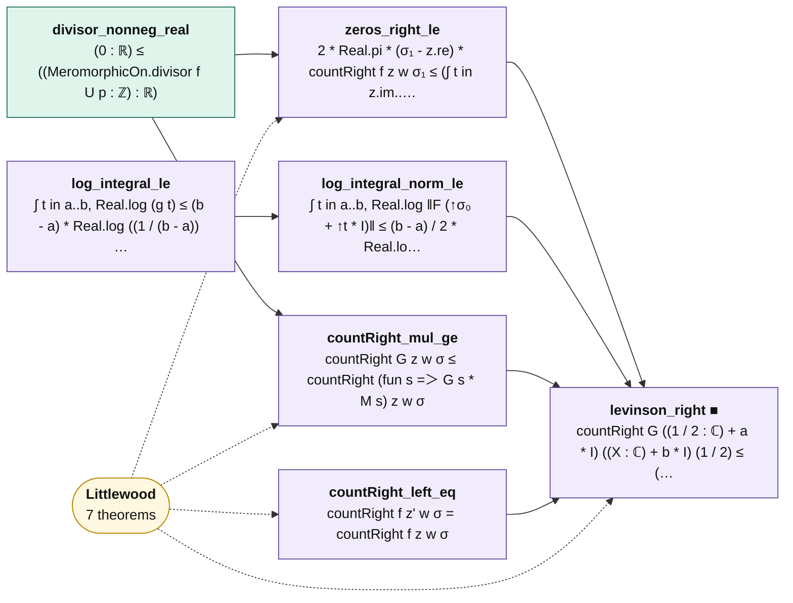

# `lean_stage3/Stage3/LevinsonRight.lean`

> **Read from the source text.** This file changed after the last `python3 utilities/lean_map.py --dump`, so the arrows on this page are names occurring in each proof and have not been confirmed by Lean.

LevinsonRight — block S11 of `lean_stage3/design/stencil.md`, steps 2–4. 2026-11-24.

7 theorems, 0 definitions, 331 lines. 

**Imports:** [`LevinsonCount`](../lean_stage3/LevinsonCount.md), [`Littlewood`](../lean_stage3/Littlewood.md)  
**Imported by:** [`Stage3`](../lean_stage3/Stage3.md), [`LevinsonMollEdge`](../lean_stage3/LevinsonMollEdge.md)

## The picture



An arrow A → B reads "A is used in the proof of B". Green: counting, integers only. Violet: shape, analysis with no ζ. Blue: reads ζ. A name ending in ■ is an end: nothing else uses it. Red: contains `sorry`. Yellow: theorems in another file, counted; a dotted arrow crosses files. Definitions are not drawn; they are listed below the diagram.

## Theorems

<a name="LevinsonRight-divisor_nonneg_real"></a>
### `LevinsonRight.divisor_nonneg_real`

line 59 · arrows read from text

**Counting.** Integers only: nothing in its statement or proof, or in anything it rests on, uses analysis or ζ.

**Why.** The divisor of an analytic function, read in `ℝ`, is nonnegative.

**Proves**

```lean
(0 : ℝ) ≤ ((MeromorphicOn.divisor f U p : ℤ) : ℝ)
```

**Needs** (its hypotheses)

  - `` hf : AnalyticOnNhd ℂ f U ``
  - `` p : ℂ ``

**Fed by:** no theorem of this repo; it stands on Mathlib.

**Feeds** (2 that use it)

  - [`LevinsonRight.countRight_mul_ge`](#LevinsonRight-countRight_mul_ge) — `` countRight G z w σ ≤ countRight (fun s => G s * M s) z w σ ``
  - [`LevinsonRight.zeros_right_le`](#LevinsonRight-zeros_right_le) — `` 2 * Real.pi * (σ₁ - z.re) * countRight f z w σ₁ ≤ (∫ t in z.im..w.im, Real.log ‖f (↑z.re + ↑t * I)‖) - (∫ t in z.im..w.im, Real.log ‖f (↑w.re + ↑t * I… ``

<a name="LevinsonRight-zeros_right_le"></a>
### `LevinsonRight.zeros_right_le`

line 66 · arrows read from text

**Shape.** Uses real or complex analysis; nothing in it or beneath it reads ζ.

**Why.** Step 2. Littlewood bounds the count right of `σ₁`.

**Proves**

```lean
2 * Real.pi * (σ₁ - z.re) * countRight f z w σ₁ ≤ (∫ t in z.im..w.im, Real.log ‖f (↑z.re + ↑t * I)‖) - (∫ t in z.im..w.im, Real.log ‖f (↑w.re + ↑t * I)‖) + (w.re - z.re) * (∫ t in z.im..w.im, logDeriv f (↑w.re + ↑t * I)).re + (∫ σ in z.re..w.re, edgeH f w.re z.im σ) - (∫ σ in z.re..w.re, edgeH f w.re w.im σ)
```

**Needs** (its hypotheses)

  - `` hre : z.re < w.re ``
  - `` him : z.im < w.im ``
  - `` hf : AnalyticOnNhd ℂ f (Rectangle z w) ``
  - `` hB : ∀ p ∈ RectangleBorder z w, f p ≠ 0 ``

**Fed by** (3 theorems its proof uses)

  - [`LevinsonRight.divisor_nonneg_real`](#LevinsonRight-divisor_nonneg_real) — `` (0 : ℝ) ≤ ((MeromorphicOn.divisor f U p : ℤ) : ℝ) ``
  - [`Littlewood.littlewood_rect`](../lean_stage3/Littlewood.md#Littlewood-littlewood_rect) (Littlewood) — `` 2 * Real.pi * ∑ ρ ∈ (divisor_support_rectangle_finite f z w).toFinset, ((MeromorphicOn.divisor f (Rectangle z w) ρ : ℤ) : ℝ) * (ρ.re - z.re) = (∫ t in… ``
  - [`Littlewood.support_interior`](../lean_stage3/Littlewood.md#Littlewood-support_interior) (Littlewood) — `` z.re < p.re ∧ p.re < w.re ∧ z.im < p.im ∧ p.im < w.im ``

**Definitions its proof touches:** [`Littlewood.countRight`](../lean_stage3/Littlewood.md#Littlewood-countRight), [`Littlewood.edgeH`](../lean_stage3/Littlewood.md#Littlewood-edgeH)

**Feeds** (1 that use it)

  - [`LevinsonRight.levinson_right`](#LevinsonRight-levinson_right) — `` countRight G ((1 / 2 : ℂ) + a * I) ((X : ℂ) + b * I) (1 / 2) ≤ (1 / (2 * Real.pi * (1 / 2 - σ₀))) * ((b - a) / 2 * Real.log ((1 / (b - a)) * ∫ t in a.… ``

<a name="LevinsonRight-log_integral_le"></a>
### `LevinsonRight.log_integral_le`

line 93 · arrows read from text

**Shape.** Uses real or complex analysis; nothing in it or beneath it reads ζ.

**Why.** Step 4, the concavity. The integral of `log g` is at most the length times the log of the mean, by the tangent line of `log` at the mean.

**Proves**

```lean
∫ t in a..b, Real.log (g t) ≤ (b - a) * Real.log ((1 / (b - a)) * ∫ t in a..b, g t)
```

**Needs** (its hypotheses)

  - `` hab : a < b ``
  - `` hg : IntervalIntegrable g volume a b ``
  - `` hlog : IntervalIntegrable (fun t => Real.log (g t)) volume a b ``
  - `` hpos : ∀ t ∈ Icc a b, 0 < g t ``

**Fed by:** no theorem of this repo; it stands on Mathlib.

**Feeds** (1 that use it)

  - [`LevinsonRight.log_integral_norm_le`](#LevinsonRight-log_integral_norm_le) — `` ∫ t in a..b, Real.log ‖F (↑σ₀ + ↑t * I)‖ ≤ (b - a) / 2 * Real.log ((1 / (b - a)) * ∫ t in a..b, ‖F (↑σ₀ + ↑t * I)‖ ^ 2) ``

<a name="LevinsonRight-log_integral_norm_le"></a>
### `LevinsonRight.log_integral_norm_le`

line 123 · arrows read from text

**Shape.** Uses real or complex analysis; nothing in it or beneath it reads ζ.

**Why.** Step 4, the form used. `∫ log ‖F‖ = (1/2) ∫ log ‖F‖²`.

**Proves**

```lean
∫ t in a..b, Real.log ‖F (↑σ₀ + ↑t * I)‖ ≤ (b - a) / 2 * Real.log ((1 / (b - a)) * ∫ t in a..b, ‖F (↑σ₀ + ↑t * I)‖ ^ 2)
```

**Needs** (its hypotheses)

  - `` hab : a < b ``
  - `` hc : ContinuousOn (fun t : ℝ => F (↑σ₀ + ↑t * I)) (Icc a b) ``
  - `` hnz : ∀ t ∈ Icc a b, F (↑σ₀ + ↑t * I) ≠ 0 ``

**Fed by** (1 theorem its proof uses)

  - [`LevinsonRight.log_integral_le`](#LevinsonRight-log_integral_le) — `` ∫ t in a..b, Real.log (g t) ≤ (b - a) * Real.log ((1 / (b - a)) * ∫ t in a..b, g t) ``

**Feeds** (1 that use it)

  - [`LevinsonRight.levinson_right`](#LevinsonRight-levinson_right) — `` countRight G ((1 / 2 : ℂ) + a * I) ((X : ℂ) + b * I) (1 / 2) ≤ (1 / (2 * Real.pi * (1 / 2 - σ₀))) * ((b - a) / 2 * Real.log ((1 / (b - a)) * ∫ t in a.… ``

<a name="LevinsonRight-countRight_mul_ge"></a>
### `LevinsonRight.countRight_mul_ge`

line 155 · arrows read from text

**Shape.** Uses real or complex analysis; nothing in it or beneath it reads ζ.

**Why.** Step 3. The zeros of `G` are zeros of `G · M`, with at least their order.

**Proves**

```lean
countRight G z w σ ≤ countRight (fun s => G s * M s) z w σ
```

**Needs** (its hypotheses)

  - `` σ : ℝ ``
  - `` hG : AnalyticOnNhd ℂ G (Rectangle z w) ``
  - `` hM : AnalyticOnNhd ℂ M (Rectangle z w) ``
  - `` hB : ∀ p ∈ RectangleBorder z w, G p * M p ≠ 0 ``

**Fed by** (4 theorems its proof uses)

  - [`LevinsonRight.divisor_nonneg_real`](#LevinsonRight-divisor_nonneg_real) — `` (0 : ℝ) ≤ ((MeromorphicOn.divisor f U p : ℤ) : ℝ) ``
  - [`Littlewood.corner_mem_border`](../lean_stage3/Littlewood.md#Littlewood-corner_mem_border) (Littlewood) — `` z ∈ RectangleBorder z w ``
  - [`Littlewood.mem_support_divisor`](../lean_stage3/Littlewood.md#Littlewood-mem_support_divisor) (Littlewood) — `` p ∈ (MeromorphicOn.divisor f U).support ↔ p ∈ U ∧ f p = 0 ``
  - [`Littlewood.order_ne_top`](../lean_stage3/Littlewood.md#Littlewood-order_ne_top) (Littlewood) — `` ∀ p ∈ Rectangle z w, meromorphicOrderAt f p ≠ ⊤ ``

**Definitions its proof touches:** [`Littlewood.countRight`](../lean_stage3/Littlewood.md#Littlewood-countRight)

**Feeds** (1 that use it)

  - [`LevinsonRight.levinson_right`](#LevinsonRight-levinson_right) — `` countRight G ((1 / 2 : ℂ) + a * I) ((X : ℂ) + b * I) (1 / 2) ≤ (1 / (2 * Real.pi * (1 / 2 - σ₀))) * ((b - a) / 2 * Real.log ((1 / (b - a)) * ∫ t in a.… ``

<a name="LevinsonRight-countRight_left_eq"></a>
### `LevinsonRight.countRight_left_eq`

line 196 · arrows read from text

**Shape.** Uses real or complex analysis; nothing in it or beneath it reads ζ.

**Why.** The count right of `σ` does not see the left side of the rectangle, as long as that side stays left of `σ`.

**Proves**

```lean
countRight f z' w σ = countRight f z w σ
```

**Needs** (its hypotheses)

  - `` hzz : z.re ≤ z'.re ``
  - `` hzσ : z'.re ≤ σ ``
  - `` hzw : z'.re ≤ w.re ``
  - `` him : z'.im = z.im ``
  - `` hf : AnalyticOnNhd ℂ f (Rectangle z w) ``
  - `` hz : f z ≠ 0 ``

**Fed by** (3 theorems its proof uses)

  - [`Littlewood.divisor_eq`](../lean_stage3/Littlewood.md#Littlewood-divisor_eq) (Littlewood) — `` MeromorphicOn.divisor f U p = MeromorphicOn.divisor f (Rectangle z w) p ``
  - [`Littlewood.mem_support_divisor`](../lean_stage3/Littlewood.md#Littlewood-mem_support_divisor) (Littlewood) — `` p ∈ (MeromorphicOn.divisor f U).support ↔ p ∈ U ∧ f p = 0 ``
  - [`Littlewood.order_ne_top`](../lean_stage3/Littlewood.md#Littlewood-order_ne_top) (Littlewood) — `` ∀ p ∈ Rectangle z w, meromorphicOrderAt f p ≠ ⊤ ``

**Definitions its proof touches:** [`Littlewood.countRight`](../lean_stage3/Littlewood.md#Littlewood-countRight)

**Feeds** (1 that use it)

  - [`LevinsonRight.levinson_right`](#LevinsonRight-levinson_right) — `` countRight G ((1 / 2 : ℂ) + a * I) ((X : ℂ) + b * I) (1 / 2) ≤ (1 / (2 * Real.pi * (1 / 2 - σ₀))) * ((b - a) / 2 * Real.log ((1 / (b - a)) * ∫ t in a.… ``

<a name="LevinsonRight-levinson_right"></a>
### `LevinsonRight.levinson_right`

line 241 · arrows read from text

**Shape.** Uses real or complex analysis; nothing in it or beneath it reads ζ.

**Why.** Steps 2–4 combined. Levinson's count of the zeros of `G` right of the line, through `G · M`, Littlewood on `[σ₀, X] × [a, b]`, and the concavity of the logarithm.

**Proves**

```lean
countRight G ((1 / 2 : ℂ) + a * I) ((X : ℂ) + b * I) (1 / 2) ≤ (1 / (2 * Real.pi * (1 / 2 - σ₀))) * ((b - a) / 2 * Real.log ((1 / (b - a)) * ∫ t in a..b, ‖G (↑σ₀ + ↑t * I) * M (↑σ₀ + ↑t * I)‖ ^ 2) - (∫ t in a..b, Real.log ‖G (↑X + ↑t * I) * M (↑X + ↑t * I)‖) + (X - σ₀) * (∫ t in a..b, logDeriv (fun s => G s * M s) (↑X + ↑t * I)).re + (∫ σ in σ₀..X, edgeH (fun s => G s * M s) X a σ) - (∫ σ in σ₀..X, edgeH (fun s => G s * M s) X b σ))
```

**Needs** (its hypotheses)

  - `` hσ₀ : σ₀ < 1 / 2 ``
  - `` hX : 1 / 2 ≤ X ``
  - `` hab : a < b ``
  - `` hG : AnalyticOnNhd ℂ G (Rectangle ((σ₀ : ℂ) + a * I) ((X : ℂ) + b * I)) ``
  - `` hM : AnalyticOnNhd ℂ M (Rectangle ((σ₀ : ℂ) + a * I) ((X : ℂ) + b * I)) ``
  - `` hB : ∀ p ∈ RectangleBorder ((σ₀ : ℂ) + a * I) ((X : ℂ) + b * I), G p * M p ≠ 0 ``

**Fed by** (6 theorems its proof uses)

  - [`LevinsonRight.countRight_left_eq`](#LevinsonRight-countRight_left_eq) — `` countRight f z' w σ = countRight f z w σ ``
  - [`LevinsonRight.countRight_mul_ge`](#LevinsonRight-countRight_mul_ge) — `` countRight G z w σ ≤ countRight (fun s => G s * M s) z w σ ``
  - [`LevinsonRight.log_integral_norm_le`](#LevinsonRight-log_integral_norm_le) — `` ∫ t in a..b, Real.log ‖F (↑σ₀ + ↑t * I)‖ ≤ (b - a) / 2 * Real.log ((1 / (b - a)) * ∫ t in a..b, ‖F (↑σ₀ + ↑t * I)‖ ^ 2) ``
  - [`LevinsonRight.zeros_right_le`](#LevinsonRight-zeros_right_le) — `` 2 * Real.pi * (σ₁ - z.re) * countRight f z w σ₁ ≤ (∫ t in z.im..w.im, Real.log ‖f (↑z.re + ↑t * I)‖) - (∫ t in z.im..w.im, Real.log ‖f (↑w.re + ↑t * I… ``
  - [`Littlewood.corner_mem_border`](../lean_stage3/Littlewood.md#Littlewood-corner_mem_border) (Littlewood) — `` z ∈ RectangleBorder z w ``
  - [`Littlewood.left_mem_border`](../lean_stage3/Littlewood.md#Littlewood-left_mem_border) (Littlewood) — `` (↑z.re + ↑t * I : ℂ) ∈ RectangleBorder z w ``

**Definitions its proof touches:** [`Littlewood.countRight`](../lean_stage3/Littlewood.md#Littlewood-countRight), [`Littlewood.edgeH`](../lean_stage3/Littlewood.md#Littlewood-edgeH)

**Feeds:** nothing. It is an end.

