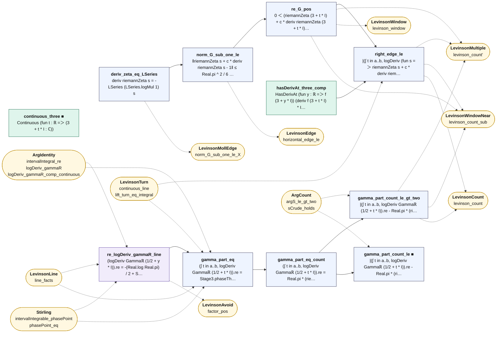

# `lean_stage3/Stage3/LevinsonSize.lean`

> **Read from the source text.** This file changed after the last `python3 utilities/lean_map.py --dump`, so the arrows on this page are names occurring in each proof and have not been confirmed by Lean.

LevinsonSize — block S11 of `lean_stage3/design/stencil.md`, step 1d (i), (iii). 2026-11-24.

11 theorems, 0 definitions, 310 lines. 

**Imports:** [`ArgCount`](../lean_stage3/ArgCount.md), [`LevinsonTurn`](../lean_stage3/LevinsonTurn.md)  
**Imported by:** [`Stage3`](../lean_stage3/Stage3.md), [`LevinsonAvoid`](../lean_stage3/LevinsonAvoid.md), [`LevinsonEdge`](../lean_stage3/LevinsonEdge.md)

## The picture



An arrow A → B reads "A is used in the proof of B". Green: counting, integers only. Violet: shape, analysis with no ζ. Blue: reads ζ. A name ending in ■ is an end: nothing else uses it. Red: contains `sorry`. Yellow: theorems in another file, counted; a dotted arrow crosses files. Definitions are not drawn; they are listed below the diagram.

## Theorems

<a name="LevinsonSize-deriv_zeta_eq_LSeries"></a>
### `LevinsonSize.deriv_zeta_eq_LSeries`

line 50 · arrows read from text

**Reads ζ.** It, or something it rests on, uses the zeta function, its zeros or the Riemann hypothesis.

**Why.** `ζ'` as an L-series on `re s > 1`.

**Proves**

```lean
deriv riemannZeta s = -LSeries (LSeries.logMul 1) s
```

**Needs** (its hypotheses)

  - `` hs : 1 < s.re ``

**Fed by:** no theorem of this repo; it stands on Mathlib.

**Feeds** (2 that use it)

  - [`LevinsonMollEdge.norm_G_sub_one_le_X`](../lean_stage3/LevinsonMollEdge.md#LevinsonMollEdge-norm_G_sub_one_le_X) (LevinsonMollEdge) — `` ‖riemannZeta s + c * deriv riemannZeta s - 1‖ ≤ 8 / (2 : ℝ) ^ X ``
  - [`LevinsonSize.norm_G_sub_one_le`](#LevinsonSize-norm_G_sub_one_le) — `` ‖riemannZeta s + c * deriv riemannZeta s - 1‖ ≤ Real.pi ^ 2 / 6 - 1 ``

<a name="LevinsonSize-norm_G_sub_one_le"></a>
### `LevinsonSize.norm_G_sub_one_le`

line 60 · arrows read from text

**Reads ζ.** It, or something it rests on, uses the zeta function, its zeros or the Riemann hypothesis.

**Why.** The Dirichlet tail of `ζ + c ζ'` on `Re s = 3`. `‖G(s) − 1‖ ≤ π²/6 − 1`.

**Proves**

```lean
‖riemannZeta s + c * deriv riemannZeta s - 1‖ ≤ Real.pi ^ 2 / 6 - 1
```

**Needs** (its hypotheses)

  - `` hc0 : 0 ≤ c ``
  - `` hc1 : c ≤ 1 ``
  - `` hs : s.re = 3 ``

**Fed by** (1 theorem its proof uses)

  - [`LevinsonSize.deriv_zeta_eq_LSeries`](#LevinsonSize-deriv_zeta_eq_LSeries) — `` deriv riemannZeta s = -LSeries (LSeries.logMul 1) s ``

**Feeds** (2 that use it)

  - [`LevinsonEdge.horizontal_edge_le`](../lean_stage3/LevinsonEdge.md#LevinsonEdge-horizontal_edge_le) (LevinsonEdge) — `` |(∫ x in (1/2:ℝ)..3, logDeriv (fun s => riemannZeta s + c * deriv riemannZeta s) (↑x + ↑T * I)).im| ≤ 21 * Real.pi * Real.log T + 133 * Real.pi ``
  - [`LevinsonSize.re_G_pos`](#LevinsonSize-re_G_pos) — `` 0 < (riemannZeta (3 + t * I) + c * deriv riemannZeta (3 + t * I)).re ``

<a name="LevinsonSize-re_G_pos"></a>
### `LevinsonSize.re_G_pos`

line 110 · arrows read from text

**Reads ζ.** It, or something it rests on, uses the zeta function, its zeros or the Riemann hypothesis.

**Why.** `ζ + c ζ'` lies in the right half-plane on `Re s = 3`.

**Proves**

```lean
0 < (riemannZeta (3 + t * I) + c * deriv riemannZeta (3 + t * I)).re
```

**Needs** (its hypotheses)

  - `` hc0 : 0 ≤ c ``
  - `` hc1 : c ≤ 1 ``
  - `` t : ℝ ``

**Fed by** (1 theorem its proof uses)

  - [`LevinsonSize.norm_G_sub_one_le`](#LevinsonSize-norm_G_sub_one_le) — `` ‖riemannZeta s + c * deriv riemannZeta s - 1‖ ≤ Real.pi ^ 2 / 6 - 1 ``

**Feeds** (4 that use it)

  - [`LevinsonMultiple.levinson_count'`](../lean_stage3/LevinsonMultiple.md#LevinsonMultiple-levinson_count-) (LevinsonMultiple) — `` (riemannZeta.N b - riemannZeta.N a) - 2 * Littlewood.countRight (fun s => riemannZeta s + c * deriv riemannZeta s) ((1/2 : ℂ) + a * I) ((3 : ℂ) + b * … ``
  - [`LevinsonSize.right_edge_le`](#LevinsonSize-right_edge_le) — `` |(∫ t in a..b, logDeriv (fun s => riemannZeta s + c * deriv riemannZeta s) (3 + t * I)).re| ≤ Real.pi ``
  - [`LevinsonWindow.levinson_window`](../lean_stage3/LevinsonWindow.md#LevinsonWindow-levinson_window) (LevinsonWindow) — `` (riemannZeta.N b - riemannZeta.N a) - (1 / (Real.pi * (1 / 2 - σ₀))) * ((b - a) / 2 * Real.log K + windowE M B X T a b) - (134 * Real.log T + 2918) ≤ … ``
  - [`LevinsonWindowNear.levinson_count_sub`](../lean_stage3/LevinsonWindowNear.md#LevinsonWindowNear-levinson_count_sub) (LevinsonWindowNear) — `` (riemannZeta.N b - riemannZeta.N a) - 2 * Littlewood.countRight (fun s => riemannZeta s + c * deriv riemannZeta s) ((1/2 : ℂ) + a * I) ((3 : ℂ) + b * … ``

<a name="LevinsonSize-hasDerivAt_three_comp"></a>
### `LevinsonSize.hasDerivAt_three_comp`

line 120 · arrows read from text

**Counting.** Integers only: nothing in its statement or proof, or in anything it rests on, uses analysis or ζ.

**Why.** The line `Re s = 3` as a path, and its derivative `i`.

**Proves**

```lean
HasDerivAt (fun y : ℝ => f (3 + y * I)) (deriv f (3 + t * I) * I) t
```

**Needs** (its hypotheses)

  - `` hf : DifferentiableAt ℂ f (3 + t * I) ``

**Fed by:** no theorem of this repo; it stands on Mathlib.

**Feeds** (1 that use it)

  - [`LevinsonSize.right_edge_le`](#LevinsonSize-right_edge_le) — `` |(∫ t in a..b, logDeriv (fun s => riemannZeta s + c * deriv riemannZeta s) (3 + t * I)).re| ≤ Real.pi ``

<a name="LevinsonSize-continuous_three"></a>
### `LevinsonSize.continuous_three`

line 132 · arrows read from text

**Counting.** Integers only: nothing in its statement or proof, or in anything it rests on, uses analysis or ζ.

**Proves**

```lean
Continuous (fun t : ℝ => (3 + t * I : ℂ))
```

**Fed by:** no theorem of this repo; it stands on Mathlib.

**Feeds:** nothing. It connects to nothing.

<a name="LevinsonSize-right_edge_le"></a>
### `LevinsonSize.right_edge_le`

line 136 · arrows read from text

**Reads ζ.** It, or something it rests on, uses the zeta function, its zeros or the Riemann hypothesis.

**Why.** (i) The right edge. For `0 ≤ c ≤ 1`, the right-edge term of `LevinsonTurn.G_turn_eq` at `X = 3` is at most `π` in size.

**Proves**

```lean
|(∫ t in a..b, logDeriv (fun s => riemannZeta s + c * deriv riemannZeta s) (3 + t * I)).re| ≤ Real.pi
```

**Needs** (its hypotheses)

  - `` hc0 : 0 ≤ c ``
  - `` hc1 : c ≤ 1 ``
  - `` hab : a ≤ b ``

**Fed by** (3 theorems its proof uses)

  - [`LevinsonSize.hasDerivAt_three_comp`](#LevinsonSize-hasDerivAt_three_comp) — `` HasDerivAt (fun y : ℝ => f (3 + y * I)) (deriv f (3 + t * I) * I) t ``
  - [`LevinsonSize.re_G_pos`](#LevinsonSize-re_G_pos) — `` 0 < (riemannZeta (3 + t * I) + c * deriv riemannZeta (3 + t * I)).re ``
  - [`LevinsonTurn.lift_turn_eq_integral`](../lean_stage3/LevinsonTurn.md#LevinsonTurn-lift_turn_eq_integral) (LevinsonTurn) — `` φ b - φ a = (∫ t in a..b, F' t / F t).im ``

**Feeds** (3 that use it)

  - [`LevinsonCount.levinson_count`](../lean_stage3/LevinsonCount.md#LevinsonCount-levinson_count) (LevinsonCount) — `` (riemannZeta.N b - riemannZeta.N a) - 2 * Littlewood.countRight (fun s => riemannZeta s + c * deriv riemannZeta s) ((1/2 : ℂ) + a * I) ((3 : ℂ) + b * … ``
  - [`LevinsonMultiple.levinson_count'`](../lean_stage3/LevinsonMultiple.md#LevinsonMultiple-levinson_count-) (LevinsonMultiple) — `` (riemannZeta.N b - riemannZeta.N a) - 2 * Littlewood.countRight (fun s => riemannZeta s + c * deriv riemannZeta s) ((1/2 : ℂ) + a * I) ((3 : ℂ) + b * … ``
  - [`LevinsonWindowNear.levinson_count_sub`](../lean_stage3/LevinsonWindowNear.md#LevinsonWindowNear-levinson_count_sub) (LevinsonWindowNear) — `` (riemannZeta.N b - riemannZeta.N a) - 2 * Littlewood.countRight (fun s => riemannZeta s + c * deriv riemannZeta s) ((1/2 : ℂ) + a * I) ((3 : ℂ) + b * … ``

<a name="LevinsonSize-re_logDeriv_gammaR_line"></a>
### `LevinsonSize.re_logDeriv_gammaR_line`

line 198 · arrows read from text

**Shape.** Uses real or complex analysis; nothing in it or beneath it reads ζ.

**Why.** On the line, `Re logDeriv Gammaℝ` is the tree's phase integrand.

**Proves**

```lean
(logDeriv Gammaℝ (1/2 + y * I)).re = -(Real.log Real.pi) / 2 + Stage3.phasePoint y / 2
```

**Needs** (its hypotheses)

  - `` y : ℝ ``

**Fed by** (3 theorems its proof uses)

  - [`Stage3.logDeriv_gammaR`](../lean_stage3/ArgIdentity.md#Stage3-logDeriv_gammaR) (ArgIdentity) — `` logDeriv Gammaℝ s = -(Real.log Real.pi : ℂ) / 2 + Complex.digamma (s / 2) / 2 ``
  - [`LevinsonLine.line_facts`](../lean_stage3/LevinsonLine.md#LevinsonLine-line_facts) (LevinsonLine) — `` ((1/2 : ℂ) + t * I) ≠ 0 ∧ ((1/2 : ℂ) + t * I) ≠ 1 ∧ 0 < ((1/2 : ℂ) + t * I).re ``
  - [`Stage3.phasePoint_eq`](../lean_stage3/Stirling.md#Stage3-phasePoint_eq) (Stirling) — `` phasePoint t = (Complex.digamma (zq t)).re ``

**Definitions its proof touches:** [`Stage3.phasePoint`](../lean_stage3/Stirling.md#Stage3-phasePoint), [`Stage3.zq`](../lean_stage3/Stirling.md#Stage3-zq)

**Feeds** (2 that use it)

  - [`LevinsonAvoid.factor_pos`](../lean_stage3/LevinsonAvoid.md#LevinsonAvoid-factor_pos) (LevinsonAvoid) — `` 0 < 1 - (1 / Real.log T) * (deriv Gammaℝ (1/2 + t * I) / Gammaℝ (1/2 + t * I)).re ``
  - [`LevinsonSize.gamma_part_eq`](#LevinsonSize-gamma_part_eq) — `` (∫ t in a..b, logDeriv Gammaℝ (1/2 + t * I)).re = Stage3.phaseTheta b - Stage3.phaseTheta a ``

<a name="LevinsonSize-gamma_part_eq"></a>
### `LevinsonSize.gamma_part_eq`

line 210 · arrows read from text

**Reads ζ.** It, or something it rests on, uses the zeta function, its zeros or the Riemann hypothesis.

**Why.** (iii) The `Gammaℝ` part is the tree's phase difference.

**Proves**

```lean
(∫ t in a..b, logDeriv Gammaℝ (1/2 + t * I)).re = Stage3.phaseTheta b - Stage3.phaseTheta a
```

**Needs** (its hypotheses)

  - `` a b : ℝ ``

**Fed by** (6 theorems its proof uses)

  - [`Stage3.intervalIntegral_re`](../lean_stage3/ArgIdentity.md#Stage3-intervalIntegral_re) (ArgIdentity) — `` (∫ t in a..b, f t).re = ∫ t in a..b, (f t).re ``
  - [`Stage3.logDeriv_gammaR_comp_continuous`](../lean_stage3/ArgIdentity.md#Stage3-logDeriv_gammaR_comp_continuous) (ArgIdentity) — `` Continuous fun x : ℝ => logDeriv Gammaℝ (g x) ``
  - [`LevinsonLine.line_facts`](../lean_stage3/LevinsonLine.md#LevinsonLine-line_facts) (LevinsonLine) — `` ((1/2 : ℂ) + t * I) ≠ 0 ∧ ((1/2 : ℂ) + t * I) ≠ 1 ∧ 0 < ((1/2 : ℂ) + t * I).re ``
  - [`LevinsonSize.re_logDeriv_gammaR_line`](#LevinsonSize-re_logDeriv_gammaR_line) — `` (logDeriv Gammaℝ (1/2 + y * I)).re = -(Real.log Real.pi) / 2 + Stage3.phasePoint y / 2 ``
  - [`LevinsonTurn.continuous_line`](../lean_stage3/LevinsonTurn.md#LevinsonTurn-continuous_line) (LevinsonTurn) — `` Continuous (fun t : ℝ => (1/2 + t * I : ℂ)) ``
  - [`Stage3.intervalIntegrable_phasePoint`](../lean_stage3/Stirling.md#Stage3-intervalIntegrable_phasePoint) (Stirling) — `` IntervalIntegrable phasePoint MeasureTheory.volume a b ``

**Definitions its proof touches:** [`Stage3.phasePoint`](../lean_stage3/Stirling.md#Stage3-phasePoint), [`Stage3.phaseTheta`](../lean_stage3/Stirling.md#Stage3-phaseTheta)

**Feeds** (1 that use it)

  - [`LevinsonSize.gamma_part_eq_count`](#LevinsonSize-gamma_part_eq_count) — `` (∫ t in a..b, logDeriv Gammaℝ (1/2 + t * I)).re = Real.pi * (riemannZeta.N b - riemannZeta.N a) - Real.pi * (Stage3.argS b - Stage3.argS a) ``

<a name="LevinsonSize-gamma_part_eq_count"></a>
### `LevinsonSize.gamma_part_eq_count`

line 231 · arrows read from text

**Reads ζ.** It, or something it rests on, uses the zeta function, its zeros or the Riemann hypothesis.

**Why.** (iii), with the tree's identity. The `Gammaℝ` part is `π (N b − N a)` minus `π (argS b − argS a)`.

**Proves**

```lean
(∫ t in a..b, logDeriv Gammaℝ (1/2 + t * I)).re = Real.pi * (riemannZeta.N b - riemannZeta.N a) - Real.pi * (Stage3.argS b - Stage3.argS a)
```

**Needs** (its hypotheses)

  - `` a b : ℝ ``

**Fed by** (1 theorem its proof uses)

  - [`LevinsonSize.gamma_part_eq`](#LevinsonSize-gamma_part_eq) — `` (∫ t in a..b, logDeriv Gammaℝ (1/2 + t * I)).re = Stage3.phaseTheta b - Stage3.phaseTheta a ``

**Definitions its proof touches:** [`Stage3.argS`](../lean_stage3/ArgIdentity.md#Stage3-argS)

**Feeds** (2 that use it)

  - [`LevinsonSize.gamma_part_count_le`](#LevinsonSize-gamma_part_count_le) — `` |(∫ t in a..b, logDeriv Gammaℝ (1/2 + t * I)).re - Real.pi * (riemannZeta.N b - riemannZeta.N a)| ≤ Real.pi * (30 * Real.log b + 1200) ``
  - [`LevinsonSize.gamma_part_count_le_gt_two`](#LevinsonSize-gamma_part_count_le_gt_two) — `` |(∫ t in a..b, logDeriv Gammaℝ (1/2 + t * I)).re - Real.pi * (riemannZeta.N b - riemannZeta.N a)| ≤ Real.pi * (30 * Real.log b + 150) ``

<a name="LevinsonSize-gamma_part_count_le"></a>
### `LevinsonSize.gamma_part_count_le`

line 243 · arrows read from text

**Reads ζ.** It, or something it rests on, uses the zeta function, its zeros or the Riemann hypothesis.

**Why.** (iii), with `ArgCount`'s bound. For `2 ≤ a ≤ b`, the `Gammaℝ` part is `π (N b − N a)` up to `π (30 log b + 1200)`.

**Proves**

```lean
|(∫ t in a..b, logDeriv Gammaℝ (1/2 + t * I)).re - Real.pi * (riemannZeta.N b - riemannZeta.N a)| ≤ Real.pi * (30 * Real.log b + 1200)
```

**Needs** (its hypotheses)

  - `` ha : 2 ≤ a ``
  - `` hab : a ≤ b ``

**Fed by** (2 theorems its proof uses)

  - [`ArgCount.sCrude_holds`](../lean_stage3/ArgCount.md#ArgCount-sCrude_holds) (ArgCount) — `` Stage3.StmtSCrude Stage3.argS 15 600 ``
  - [`LevinsonSize.gamma_part_eq_count`](#LevinsonSize-gamma_part_eq_count) — `` (∫ t in a..b, logDeriv Gammaℝ (1/2 + t * I)).re = Real.pi * (riemannZeta.N b - riemannZeta.N a) - Real.pi * (Stage3.argS b - Stage3.argS a) ``

**Definitions its proof touches:** [`Stage3.argS`](../lean_stage3/ArgIdentity.md#Stage3-argS)

**Feeds:** nothing. It is an end.

<a name="LevinsonSize-gamma_part_count_le_gt_two"></a>
### `LevinsonSize.gamma_part_count_le_gt_two`

line 263 · arrows read from text

**Reads ζ.** It, or something it rests on, uses the zeta function, its zeros or the Riemann hypothesis.

**Why.** (iii), above `2`. For `2 < a ≤ b`, with `ArgCount.argS_le_gt_two`, the constant is `π (30 log b + 150)`.

**Proves**

```lean
|(∫ t in a..b, logDeriv Gammaℝ (1/2 + t * I)).re - Real.pi * (riemannZeta.N b - riemannZeta.N a)| ≤ Real.pi * (30 * Real.log b + 150)
```

**Needs** (its hypotheses)

  - `` ha : 2 < a ``
  - `` hab : a ≤ b ``

**Fed by** (2 theorems its proof uses)

  - [`ArgCount.argS_le_gt_two`](../lean_stage3/ArgCount.md#ArgCount-argS_le_gt_two) (ArgCount) — `` |Stage3.argS T| ≤ 15 * Real.log T + 75 ``
  - [`LevinsonSize.gamma_part_eq_count`](#LevinsonSize-gamma_part_eq_count) — `` (∫ t in a..b, logDeriv Gammaℝ (1/2 + t * I)).re = Real.pi * (riemannZeta.N b - riemannZeta.N a) - Real.pi * (Stage3.argS b - Stage3.argS a) ``

**Definitions its proof touches:** [`Stage3.argS`](../lean_stage3/ArgIdentity.md#Stage3-argS)

**Feeds** (3 that use it)

  - [`LevinsonCount.levinson_count`](../lean_stage3/LevinsonCount.md#LevinsonCount-levinson_count) (LevinsonCount) — `` (riemannZeta.N b - riemannZeta.N a) - 2 * Littlewood.countRight (fun s => riemannZeta s + c * deriv riemannZeta s) ((1/2 : ℂ) + a * I) ((3 : ℂ) + b * … ``
  - [`LevinsonMultiple.levinson_count'`](../lean_stage3/LevinsonMultiple.md#LevinsonMultiple-levinson_count-) (LevinsonMultiple) — `` (riemannZeta.N b - riemannZeta.N a) - 2 * Littlewood.countRight (fun s => riemannZeta s + c * deriv riemannZeta s) ((1/2 : ℂ) + a * I) ((3 : ℂ) + b * … ``
  - [`LevinsonWindowNear.levinson_count_sub`](../lean_stage3/LevinsonWindowNear.md#LevinsonWindowNear-levinson_count_sub) (LevinsonWindowNear) — `` (riemannZeta.N b - riemannZeta.N a) - 2 * Littlewood.countRight (fun s => riemannZeta s + c * deriv riemannZeta s) ((1/2 : ℂ) + a * I) ((3 : ℂ) + b * … ``

