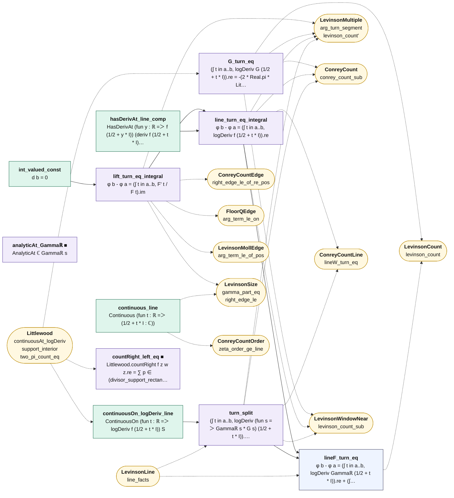

# `lean_stage3/Stage3/LevinsonTurn.lean`

> **Read from the source text.** This file changed after the last `python3 utilities/lean_map.py --dump`, so the arrows on this page are names occurring in each proof and have not been confirmed by Lean.

LevinsonTurn — block S11 of `lean_stage3/design/stencil.md`, step 1c. 2026-11-24.

11 theorems, 0 definitions, 362 lines. 

**Imports:** [`LevinsonArg`](../lean_stage3/LevinsonArg.md), [`Littlewood`](../lean_stage3/Littlewood.md)  
**Imported by:** [`Stage3`](../lean_stage3/Stage3.md), [`ConreyCountLine`](../lean_stage3/ConreyCountLine.md), [`LevinsonSize`](../lean_stage3/LevinsonSize.md)

## The picture



An arrow A → B reads "A is used in the proof of B". Green: counting, integers only. Violet: shape, analysis with no ζ. Blue: reads ζ. A name ending in ■ is an end: nothing else uses it. Red: contains `sorry`. Yellow: theorems in another file, counted; a dotted arrow crosses files. Definitions are not drawn; they are listed below the diagram.

## Theorems

<a name="LevinsonTurn-int_valued_const"></a>
### `LevinsonTurn.int_valued_const`

line 53 · arrows read from text

**Counting.** Integers only: nothing in its statement or proof, or in anything it rests on, uses analysis or ζ.

**Why.** A continuous function on `[a, b]` with integer values, zero at `a`, is zero at `b`.

**Proves**

```lean
d b = 0
```

**Needs** (its hypotheses)

  - `` hab : a ≤ b ``
  - `` hc : ContinuousOn d (Set.Icc a b) ``
  - `` hint : ∀ t ∈ Set.Icc a b, ∃ n : ℤ, d t = n ``
  - `` ha : d a = 0 ``

**Fed by:** no theorem of this repo; it stands on Mathlib.

**Feeds** (1 that use it)

  - [`LevinsonTurn.lift_turn_eq_integral`](#LevinsonTurn-lift_turn_eq_integral) — `` φ b - φ a = (∫ t in a..b, F' t / F t).im ``

<a name="LevinsonTurn-lift_turn_eq_integral"></a>
### `LevinsonTurn.lift_turn_eq_integral`

line 81 · arrows read from text

**Shape.** Uses real or complex analysis; nothing in it or beneath it reads ζ.

**Why.** Target 1. The turning of a continuous argument of a differentiable nonvanishing `F` on `[a, b]` is the imaginary part of `∫_a^b F'/F`.

**Proves**

```lean
φ b - φ a = (∫ t in a..b, F' t / F t).im
```

**Needs** (its hypotheses)

  - `` hab : a ≤ b ``
  - `` hFc : ContinuousOn F (Set.Icc a b) ``
  - `` hF : ∀ t ∈ Set.Ioo a b, HasDerivAt F (F' t) t ``
  - `` hF'c : ContinuousOn F' (Set.Icc a b) ``
  - `` hne : ∀ t ∈ Set.Icc a b, F t ≠ 0 ``
  - `` hφc : ContinuousOn φ (Set.Icc a b) ``
  - `` hφ : ∀ t ∈ Set.Icc a b, F t = ‖F t‖ * Complex.exp (φ t * Complex.I) ``

**Fed by** (1 theorem its proof uses)

  - [`LevinsonTurn.int_valued_const`](#LevinsonTurn-int_valued_const) — `` d b = 0 ``

**Feeds** (6 that use it)

  - [`ConreyCount.right_edge_le_of_re_pos`](../lean_stage3/ConreyCountEdge.md#ConreyCount-right_edge_le_of_re_pos) (ConreyCountEdge) — `` |(∫ t in a..b, logDeriv G (3 + t * I)).re| ≤ Real.pi ``
  - [`FloorQ.arg_term_le_on`](../lean_stage3/FloorQEdge.md#FloorQ-arg_term_le_on) (FloorQEdge) — `` |(∫ t in a..b, logDeriv f (↑X + ↑t * I)).re| ≤ Real.pi ``
  - [`LevinsonMollEdge.arg_term_le_of_pos`](../lean_stage3/LevinsonMollEdge.md#LevinsonMollEdge-arg_term_le_of_pos) (LevinsonMollEdge) — `` |(∫ t in a..b, logDeriv f (↑X + ↑t * I)).re| ≤ Real.pi ``
  - [`LevinsonMultiple.arg_turn_segment`](../lean_stage3/LevinsonMultiple.md#LevinsonMultiple-arg_turn_segment) (LevinsonMultiple) — `` (∫ u in u₁..u₂, v / (z₀ + u * v)).im = arg (z₀ + u₂ * v) - arg (z₀ + u₁ * v) ``
  - [`LevinsonSize.right_edge_le`](../lean_stage3/LevinsonSize.md#LevinsonSize-right_edge_le) (LevinsonSize) — `` |(∫ t in a..b, logDeriv (fun s => riemannZeta s + c * deriv riemannZeta s) (3 + t * I)).re| ≤ Real.pi ``
  - [`LevinsonTurn.line_turn_eq_integral`](#LevinsonTurn-line_turn_eq_integral) — `` φ b - φ a = (∫ t in a..b, logDeriv f (1/2 + t * I)).re ``

<a name="LevinsonTurn-hasDerivAt_line_comp"></a>
### `LevinsonTurn.hasDerivAt_line_comp`

line 167 · arrows read from text

**Counting.** Integers only: nothing in its statement or proof, or in anything it rests on, uses analysis or ζ.

**Why.** The critical line as a path, and its derivative `i`.

**Proves**

```lean
HasDerivAt (fun y : ℝ => f (1/2 + y * I)) (deriv f (1/2 + t * I) * I) t
```

**Needs** (its hypotheses)

  - `` hf : DifferentiableAt ℂ f (1/2 + t * I) ``

**Fed by:** no theorem of this repo; it stands on Mathlib.

**Feeds** (1 that use it)

  - [`LevinsonTurn.line_turn_eq_integral`](#LevinsonTurn-line_turn_eq_integral) — `` φ b - φ a = (∫ t in a..b, logDeriv f (1/2 + t * I)).re ``

<a name="LevinsonTurn-continuous_line"></a>
### `LevinsonTurn.continuous_line`

line 179 · arrows read from text

**Counting.** Integers only: nothing in its statement or proof, or in anything it rests on, uses analysis or ζ.

**Proves**

```lean
Continuous (fun t : ℝ => (1/2 + t * I : ℂ))
```

**Fed by:** no theorem of this repo; it stands on Mathlib.

**Feeds** (2 that use it)

  - [`ConreyCount.zeta_order_ge_line`](../lean_stage3/ConreyCountOrder.md#ConreyCount-zeta_order_ge_line) (ConreyCountOrder) — `` (n ρ : ℤ) ≤ riemannZeta.order ρ ∧ ((I ^ (∑ ρ' ∈ D, n ρ') * (Gammaℝ ρ * H ρ)).re = 0 → (n ρ : ℤ) + 1 ≤ riemannZeta.order ρ) ``
  - [`LevinsonSize.gamma_part_eq`](../lean_stage3/LevinsonSize.md#LevinsonSize-gamma_part_eq) (LevinsonSize) — `` (∫ t in a..b, logDeriv Gammaℝ (1/2 + t * I)).re = Stage3.phaseTheta b - Stage3.phaseTheta a ``

<a name="LevinsonTurn-line_turn_eq_integral"></a>
### `LevinsonTurn.line_turn_eq_integral`

line 183 · arrows read from text

**Shape.** Uses real or complex analysis; nothing in it or beneath it reads ζ.

**Why.** Target 1, on the line. For `f` analytic and nonvanishing along `[1/2 + a i, 1/2 + b i]`, a continuous argument turns by `Re ∫_a^b logDeriv f (1/2 + t i) dt`.

**Proves**

```lean
φ b - φ a = (∫ t in a..b, logDeriv f (1/2 + t * I)).re
```

**Needs** (its hypotheses)

  - `` hab : a ≤ b ``
  - `` hf : ∀ t ∈ Set.Icc a b, AnalyticAt ℂ f (1/2 + t * I) ``
  - `` hne : ∀ t ∈ Set.Icc a b, f (1/2 + t * I) ≠ 0 ``
  - `` hφc : ContinuousOn φ (Set.Icc a b) ``
  - `` hφ : ∀ t ∈ Set.Icc a b, f (1/2 + t * I) = ‖f (1/2 + t * I)‖ * Complex.exp (φ t * Complex.I) ``

**Fed by** (2 theorems its proof uses)

  - [`LevinsonTurn.hasDerivAt_line_comp`](#LevinsonTurn-hasDerivAt_line_comp) — `` HasDerivAt (fun y : ℝ => f (1/2 + y * I)) (deriv f (1/2 + t * I) * I) t ``
  - [`LevinsonTurn.lift_turn_eq_integral`](#LevinsonTurn-lift_turn_eq_integral) — `` φ b - φ a = (∫ t in a..b, F' t / F t).im ``

**Feeds** (5 that use it)

  - [`ConreyCount.conrey_count_sub`](../lean_stage3/ConreyCount.md#ConreyCount-conrey_count_sub) (ConreyCount) — `` (riemannZeta.N b - riemannZeta.N a) - 2 * Littlewood.countRight (V Q L) ((1/2 : ℂ) + a * I) ((3 : ℂ) + b * I) (1/2) - (30 * Real.log b + 42 * Real.log… ``
  - [`ConreyCount.lineW_turn_eq`](../lean_stage3/ConreyCountLine.md#ConreyCount-lineW_turn_eq) (ConreyCountLine) — `` φ b - φ a = (∫ t in a..b, logDeriv Gammaℝ (1/2 + t * I)).re + (∫ t in a..b, logDeriv (V Q L) (1/2 + t * I)).re ``
  - [`LevinsonMultiple.levinson_count'`](../lean_stage3/LevinsonMultiple.md#LevinsonMultiple-levinson_count-) (LevinsonMultiple) — `` (riemannZeta.N b - riemannZeta.N a) - 2 * Littlewood.countRight (fun s => riemannZeta s + c * deriv riemannZeta s) ((1/2 : ℂ) + a * I) ((3 : ℂ) + b * … ``
  - [`LevinsonTurn.lineF_turn_eq`](#LevinsonTurn-lineF_turn_eq) — `` φ b - φ a = (∫ t in a..b, logDeriv Gammaℝ (1/2 + t * I)).re + (∫ t in a..b, logDeriv (fun s => riemannZeta s + c * deriv riemannZeta s) (1/2 + t * I))… ``
  - [`LevinsonWindowNear.levinson_count_sub`](../lean_stage3/LevinsonWindowNear.md#LevinsonWindowNear-levinson_count_sub) (LevinsonWindowNear) — `` (riemannZeta.N b - riemannZeta.N a) - 2 * Littlewood.countRight (fun s => riemannZeta s + c * deriv riemannZeta s) ((1/2 : ℂ) + a * I) ((3 : ℂ) + b * … ``

<a name="LevinsonTurn-continuousOn_logDeriv_line"></a>
### `LevinsonTurn.continuousOn_logDeriv_line`

line 211 · arrows read from text

**Counting.** Integers only: nothing in its statement or proof, or in anything it rests on, uses analysis or ζ.

**Why.** Along the line, `logDeriv f` is continuous where `f` is analytic and nonzero.

**Proves**

```lean
ContinuousOn (fun t : ℝ => logDeriv f (1/2 + t * I)) S
```

**Needs** (its hypotheses)

  - `` hf : ∀ t ∈ S, AnalyticAt ℂ f (1/2 + t * I) ``
  - `` hne : ∀ t ∈ S, f (1/2 + t * I) ≠ 0 ``

**Fed by** (1 theorem its proof uses)

  - [`Littlewood.continuousAt_logDeriv`](../lean_stage3/Littlewood.md#Littlewood-continuousAt_logDeriv) (Littlewood) — `` ContinuousAt (logDeriv f) s ``

**Feeds** (1 that use it)

  - [`LevinsonTurn.turn_split`](#LevinsonTurn-turn_split) — `` (∫ t in a..b, logDeriv (fun s => Gammaℝ s * G s) (1/2 + t * I)).re = (∫ t in a..b, logDeriv Gammaℝ (1/2 + t * I)).re + (∫ t in a..b, logDeriv G (1/2 +… ``

<a name="LevinsonTurn-analyticAt_Gamma-"></a>
### `LevinsonTurn.analyticAt_Gammaℝ`

line 220 · arrows read from text

**Shape.** Uses real or complex analysis; nothing in it or beneath it reads ζ.

**Why.** `Gammaℝ` is analytic right of zero.

**Proves**

```lean
AnalyticAt ℂ Gammaℝ s
```

**Needs** (its hypotheses)

  - `` hs : 0 < s.re ``

**Fed by:** no theorem of this repo; it stands on Mathlib.

**Feeds:** nothing. It connects to nothing.

<a name="LevinsonTurn-turn_split"></a>
### `LevinsonTurn.turn_split`

line 228 · arrows read from text

**Shape.** Uses real or complex analysis; nothing in it or beneath it reads ζ.

**Why.** Target 2. The split: `Re ∫ logDeriv (Gammaℝ · G) = Re ∫ logDeriv Gammaℝ + Re ∫ logDeriv G` along the line, for `G` analytic and nonvanishing there.

**Proves**

```lean
(∫ t in a..b, logDeriv (fun s => Gammaℝ s * G s) (1/2 + t * I)).re = (∫ t in a..b, logDeriv Gammaℝ (1/2 + t * I)).re + (∫ t in a..b, logDeriv G (1/2 + t * I)).re
```

**Needs** (its hypotheses)

  - `` hab : a ≤ b ``
  - `` hG : ∀ t ∈ Set.Icc a b, AnalyticAt ℂ G (1/2 + t * I) ``
  - `` hne : ∀ t ∈ Set.Icc a b, G (1/2 + t * I) ≠ 0 ``

**Fed by** (2 theorems its proof uses)

  - [`LevinsonLine.line_facts`](../lean_stage3/LevinsonLine.md#LevinsonLine-line_facts) (LevinsonLine) — `` ((1/2 : ℂ) + t * I) ≠ 0 ∧ ((1/2 : ℂ) + t * I) ≠ 1 ∧ 0 < ((1/2 : ℂ) + t * I).re ``
  - [`LevinsonTurn.continuousOn_logDeriv_line`](#LevinsonTurn-continuousOn_logDeriv_line) — `` ContinuousOn (fun t : ℝ => logDeriv f (1/2 + t * I)) S ``

**Feeds** (5 that use it)

  - [`ConreyCount.conrey_count_sub`](../lean_stage3/ConreyCount.md#ConreyCount-conrey_count_sub) (ConreyCount) — `` (riemannZeta.N b - riemannZeta.N a) - 2 * Littlewood.countRight (V Q L) ((1/2 : ℂ) + a * I) ((3 : ℂ) + b * I) (1/2) - (30 * Real.log b + 42 * Real.log… ``
  - [`ConreyCount.lineW_turn_eq`](../lean_stage3/ConreyCountLine.md#ConreyCount-lineW_turn_eq) (ConreyCountLine) — `` φ b - φ a = (∫ t in a..b, logDeriv Gammaℝ (1/2 + t * I)).re + (∫ t in a..b, logDeriv (V Q L) (1/2 + t * I)).re ``
  - [`LevinsonMultiple.levinson_count'`](../lean_stage3/LevinsonMultiple.md#LevinsonMultiple-levinson_count-) (LevinsonMultiple) — `` (riemannZeta.N b - riemannZeta.N a) - 2 * Littlewood.countRight (fun s => riemannZeta s + c * deriv riemannZeta s) ((1/2 : ℂ) + a * I) ((3 : ℂ) + b * … ``
  - [`LevinsonTurn.lineF_turn_eq`](#LevinsonTurn-lineF_turn_eq) — `` φ b - φ a = (∫ t in a..b, logDeriv Gammaℝ (1/2 + t * I)).re + (∫ t in a..b, logDeriv (fun s => riemannZeta s + c * deriv riemannZeta s) (1/2 + t * I))… ``
  - [`LevinsonWindowNear.levinson_count_sub`](../lean_stage3/LevinsonWindowNear.md#LevinsonWindowNear-levinson_count_sub) (LevinsonWindowNear) — `` (riemannZeta.N b - riemannZeta.N a) - 2 * Littlewood.countRight (fun s => riemannZeta s + c * deriv riemannZeta s) ((1/2 : ℂ) + a * I) ((3 : ℂ) + b * … ``

<a name="LevinsonTurn-lineF_turn_eq"></a>
### `LevinsonTurn.lineF_turn_eq`

line 260 · arrows read from text

**Reads ζ.** It, or something it rests on, uses the zeta function, its zeros or the Riemann hypothesis.

**Why.** Target 2, for Levinson's function. A continuous argument of `LevinsonArg.lineF c = Gammaℝ · (ζ + c ζ')` along `[1/2 + a i, 1/2 + b i]`, where `ζ + c ζ'` does not vanish, turns by the `Gammaℝ` part plus the `G` part.

**Proves**

```lean
φ b - φ a = (∫ t in a..b, logDeriv Gammaℝ (1/2 + t * I)).re + (∫ t in a..b, logDeriv (fun s => riemannZeta s + c * deriv riemannZeta s) (1/2 + t * I)).re
```

**Needs** (its hypotheses)

  - `` hab : a ≤ b ``
  - `` hne : ∀ t ∈ Set.Icc a b, riemannZeta (1/2 + t * I) + c * deriv riemannZeta (1/2 + t * I) ≠ 0 ``
  - `` hφc : ContinuousOn φ (Set.Icc a b) ``
  - `` hφ : ∀ t ∈ Set.Icc a b, LevinsonArg.lineF c t = ‖LevinsonArg.lineF c t‖ * Complex.exp (φ t * Complex.I) ``

**Fed by** (3 theorems its proof uses)

  - [`LevinsonLine.line_facts`](../lean_stage3/LevinsonLine.md#LevinsonLine-line_facts) (LevinsonLine) — `` ((1/2 : ℂ) + t * I) ≠ 0 ∧ ((1/2 : ℂ) + t * I) ≠ 1 ∧ 0 < ((1/2 : ℂ) + t * I).re ``
  - [`LevinsonTurn.line_turn_eq_integral`](#LevinsonTurn-line_turn_eq_integral) — `` φ b - φ a = (∫ t in a..b, logDeriv f (1/2 + t * I)).re ``
  - [`LevinsonTurn.turn_split`](#LevinsonTurn-turn_split) — `` (∫ t in a..b, logDeriv (fun s => Gammaℝ s * G s) (1/2 + t * I)).re = (∫ t in a..b, logDeriv Gammaℝ (1/2 + t * I)).re + (∫ t in a..b, logDeriv G (1/2 +… ``

**Definitions its proof touches:** [`LevinsonArg.lineF`](../lean_stage3/LevinsonArg.md#LevinsonArg-lineF)

**Feeds** (1 that use it)

  - [`LevinsonCount.levinson_count`](../lean_stage3/LevinsonCount.md#LevinsonCount-levinson_count) (LevinsonCount) — `` (riemannZeta.N b - riemannZeta.N a) - 2 * Littlewood.countRight (fun s => riemannZeta s + c * deriv riemannZeta s) ((1/2 : ℂ) + a * I) ((3 : ℂ) + b * … ``

<a name="LevinsonTurn-countRight_left_eq"></a>
### `LevinsonTurn.countRight_left_eq`

line 293 · arrows read from text

**Shape.** Uses real or complex analysis; nothing in it or beneath it reads ζ.

**Why.** At `σ = z.re` the count right of `σ` is the count of every zero of the rectangle, with order.

**Proves**

```lean
Littlewood.countRight f z w z.re = ∑ p ∈ (divisor_support_rectangle_finite f z w).toFinset, ((MeromorphicOn.divisor f (Rectangle z w) p : ℤ) : ℝ)
```

**Needs** (its hypotheses)

  - `` hre : z.re < w.re ``
  - `` him : z.im < w.im ``
  - `` hf : AnalyticOnNhd ℂ f (Rectangle z w) ``
  - `` hB : ∀ p ∈ RectangleBorder z w, f p ≠ 0 ``

**Fed by** (1 theorem its proof uses)

  - [`Littlewood.support_interior`](../lean_stage3/Littlewood.md#Littlewood-support_interior) (Littlewood) — `` z.re < p.re ∧ p.re < w.re ∧ z.im < p.im ∧ p.im < w.im ``

**Definitions its proof touches:** [`Littlewood.countRight`](../lean_stage3/Littlewood.md#Littlewood-countRight)

**Feeds:** nothing. It is an end.

<a name="LevinsonTurn-G_turn_eq"></a>
### `LevinsonTurn.G_turn_eq`

line 308 · arrows read from text

**Shape.** Uses real or complex analysis; nothing in it or beneath it reads ζ.

**Why.** Target 3. The `G` part of the turning along `[1/2 + a i, 1/2 + b i]`: for `G` analytic on the rectangle with corners `1/2 + a i` and `X + b i` and nonzero on its border, `Re ∫_a^b logDeriv G (1/2 + t i) dt` is `−2π` times the zeros of `G` in the rectangle, with order, plus the right edge and the two horizontal terms.

**Proves**

```lean
(∫ t in a..b, logDeriv G (1/2 + t * I)).re = -(2 * Real.pi * Littlewood.countRight G ((1/2 : ℂ) + a * I) ((X : ℂ) + b * I) (1/2)) + (∫ x in (1/2 : ℝ)..X, logDeriv G (↑x + ↑a * I)).im - (∫ x in (1/2 : ℝ)..X, logDeriv G (↑x + ↑b * I)).im + (∫ t in a..b, logDeriv G (↑X + ↑t * I)).re
```

**Needs** (its hypotheses)

  - `` hX : 1/2 < X ``
  - `` hab : a < b ``
  - `` hG : AnalyticOnNhd ℂ G (Rectangle ((1/2 : ℂ) + a * I) ((X : ℂ) + b * I)) ``
  - `` hB : ∀ p ∈ RectangleBorder ((1/2 : ℂ) + a * I) ((X : ℂ) + b * I), G p ≠ 0 ``

**Fed by** (2 theorems its proof uses)

  - [`Littlewood.support_interior`](../lean_stage3/Littlewood.md#Littlewood-support_interior) (Littlewood) — `` z.re < p.re ∧ p.re < w.re ∧ z.im < p.im ∧ p.im < w.im ``
  - [`Littlewood.two_pi_count_eq`](../lean_stage3/Littlewood.md#Littlewood-two_pi_count_eq) (Littlewood) — `` 2 * Real.pi * countRight f z w σ = (∫ x in σ..w.re, logDeriv f (↑x + ↑z.im * I)).im - (∫ x in σ..w.re, logDeriv f (↑x + ↑w.im * I)).im + (∫ t in z.im.… ``

**Definitions its proof touches:** [`Littlewood.countRight`](../lean_stage3/Littlewood.md#Littlewood-countRight)

**Feeds** (4 that use it)

  - [`ConreyCount.conrey_count_sub`](../lean_stage3/ConreyCount.md#ConreyCount-conrey_count_sub) (ConreyCount) — `` (riemannZeta.N b - riemannZeta.N a) - 2 * Littlewood.countRight (V Q L) ((1/2 : ℂ) + a * I) ((3 : ℂ) + b * I) (1/2) - (30 * Real.log b + 42 * Real.log… ``
  - [`LevinsonCount.levinson_count`](../lean_stage3/LevinsonCount.md#LevinsonCount-levinson_count) (LevinsonCount) — `` (riemannZeta.N b - riemannZeta.N a) - 2 * Littlewood.countRight (fun s => riemannZeta s + c * deriv riemannZeta s) ((1/2 : ℂ) + a * I) ((3 : ℂ) + b * … ``
  - [`LevinsonMultiple.levinson_count'`](../lean_stage3/LevinsonMultiple.md#LevinsonMultiple-levinson_count-) (LevinsonMultiple) — `` (riemannZeta.N b - riemannZeta.N a) - 2 * Littlewood.countRight (fun s => riemannZeta s + c * deriv riemannZeta s) ((1/2 : ℂ) + a * I) ((3 : ℂ) + b * … ``
  - [`LevinsonWindowNear.levinson_count_sub`](../lean_stage3/LevinsonWindowNear.md#LevinsonWindowNear-levinson_count_sub) (LevinsonWindowNear) — `` (riemannZeta.N b - riemannZeta.N a) - 2 * Littlewood.countRight (fun s => riemannZeta s + c * deriv riemannZeta s) ((1/2 : ℂ) + a * I) ((3 : ℂ) + b * … ``

