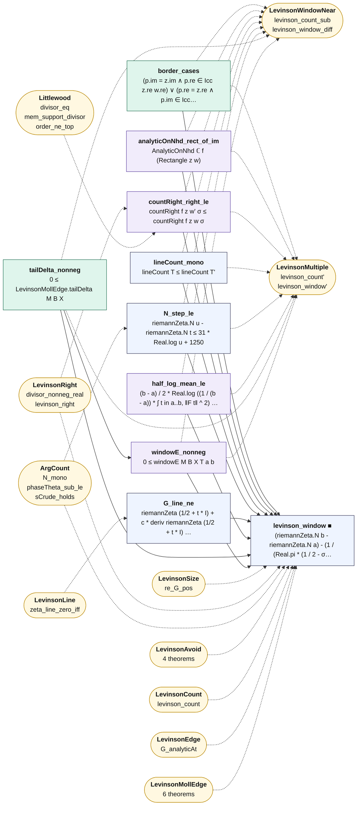

# `lean_stage3/Stage3/LevinsonWindow.lean`

> **Read from the source text.** This file changed after the last `python3 utilities/lean_map.py --dump`, so the arrows on this page are names occurring in each proof and have not been confirmed by Lean.

LevinsonWindow — block S11 of `lean_stage3/design/stencil.md`, the assembled window theorem. 2026-11-25.

10 theorems, 1 definition, 509 lines. 

**Imports:** [`LevinsonAvoid`](../lean_stage3/LevinsonAvoid.md), [`LevinsonMollEdge`](../lean_stage3/LevinsonMollEdge.md)  
**Imported by:** [`Stage3`](../lean_stage3/Stage3.md), [`LevinsonMultiple`](../lean_stage3/LevinsonMultiple.md)

## The picture



An arrow A → B reads "A is used in the proof of B". Green: counting, integers only. Violet: shape, analysis with no ζ. Blue: reads ζ. A name ending in ■ is an end: nothing else uses it. Red: contains `sorry`. Yellow: theorems in another file, counted; a dotted arrow crosses files. Definitions are not drawn; they are listed below the diagram.

## Definitions

<a name="LevinsonWindow-windowE"></a>
### `LevinsonWindow.windowE`

def · line 73

- **Is:** `` windowE (M : ℕ) (B X T a b : ℝ) : ℝ := (b - a) * (2 * LevinsonMollEdge.tailDelta M B X) + X * Real.pi + 2 * (X * (Real.pi * ((8 * X - 1) * (Real.log T + Real.log M + Real.log B + 8) + 1))) ``
- **Built from:** [`LevinsonMollEdge.tailDelta`](../lean_stage3/LevinsonMollEdge.md#LevinsonMollEdge-tailDelta)
- **Used by 7:** [`FloorLong.floor_step_long`](../lean_stage3/FloorLongStep.md#FloorLong-floor_step_long), [`FloorStep.floor_step`](../lean_stage3/FloorStep.md#FloorStep-floor_step), [`LevinsonMultiple.levinson_window'`](../lean_stage3/LevinsonMultiple.md#LevinsonMultiple-levinson_window-), [`LevinsonWindow.levinson_window`](#LevinsonWindow-levinson_window), [`LevinsonWindow.windowE_nonneg`](#LevinsonWindow-windowE_nonneg), [`LevinsonWindowNear.levinson_window_diff`](../lean_stage3/LevinsonWindowNear.md#LevinsonWindowNear-levinson_window_diff), [`LevinsonWindowNear.levinson_window_near`](../lean_stage3/LevinsonWindowNear.md#LevinsonWindowNear-levinson_window_near)

## Theorems

<a name="LevinsonWindow-border_cases"></a>
### `LevinsonWindow.border_cases`

line 79 · arrows read from text

**Counting.** Integers only: nothing in its statement or proof, or in anything it rests on, uses analysis or ζ.

**Why.** A border point lies on one of the four edges.

**Proves**

```lean
(p.im = z.im ∧ p.re ∈ Icc z.re w.re) ∨ (p.re = z.re ∧ p.im ∈ Icc z.im w.im) ∨ (p.im = w.im ∧ p.re ∈ Icc z.re w.re) ∨ (p.re = w.re ∧ p.im ∈ Icc z.im w.im)
```

**Needs** (its hypotheses)

  - `` hre : z.re ≤ w.re ``
  - `` him : z.im ≤ w.im ``
  - `` hp : p ∈ RectangleBorder z w ``

**Fed by:** no theorem of this repo; it stands on Mathlib.

**Feeds** (5 that use it)

  - [`LevinsonMultiple.levinson_count'`](../lean_stage3/LevinsonMultiple.md#LevinsonMultiple-levinson_count-) (LevinsonMultiple) — `` (riemannZeta.N b - riemannZeta.N a) - 2 * Littlewood.countRight (fun s => riemannZeta s + c * deriv riemannZeta s) ((1/2 : ℂ) + a * I) ((3 : ℂ) + b * … ``
  - [`LevinsonMultiple.levinson_window'`](../lean_stage3/LevinsonMultiple.md#LevinsonMultiple-levinson_window-) (LevinsonMultiple) — `` (riemannZeta.N b - riemannZeta.N a) - (1 / (Real.pi * (1 / 2 - σ₀))) * ((b - a) / 2 * Real.log K + windowE M B X T a b) - (134 * Real.log T + 2918) ≤ … ``
  - [`LevinsonWindow.levinson_window`](#LevinsonWindow-levinson_window) — `` (riemannZeta.N b - riemannZeta.N a) - (1 / (Real.pi * (1 / 2 - σ₀))) * ((b - a) / 2 * Real.log K + windowE M B X T a b) - (134 * Real.log T + 2918) ≤ … ``
  - [`LevinsonWindowNear.levinson_count_sub`](../lean_stage3/LevinsonWindowNear.md#LevinsonWindowNear-levinson_count_sub) (LevinsonWindowNear) — `` (riemannZeta.N b - riemannZeta.N a) - 2 * Littlewood.countRight (fun s => riemannZeta s + c * deriv riemannZeta s) ((1/2 : ℂ) + a * I) ((3 : ℂ) + b * … ``
  - [`LevinsonWindowNear.levinson_window_diff`](../lean_stage3/LevinsonWindowNear.md#LevinsonWindowNear-levinson_window_diff) (LevinsonWindowNear) — `` (riemannZeta.N b - riemannZeta.N a) - (1 / (Real.pi * (1 / 2 - σ₀))) * ((b - a) / 2 * Real.log K + windowE M B X T a b) - (134 * Real.log T + 2918) ≤ … ``

<a name="LevinsonWindow-analyticOnNhd_rect_of_im"></a>
### `LevinsonWindow.analyticOnNhd_rect_of_im`

line 92 · arrows read from text

**Shape.** Uses real or complex analysis; nothing in it or beneath it reads ζ.

**Why.** Analytic off the pole, a function is analytic near any rectangle above `Im = 1`.

**Proves**

```lean
AnalyticOnNhd ℂ f (Rectangle z w)
```

**Needs** (its hypotheses)

  - `` hf : ∀ w : ℂ, w ≠ 1 → AnalyticAt ℂ f w ``
  - `` hz : 1 ≤ z.im ``
  - `` hw : 1 ≤ w.im ``

**Fed by:** no theorem of this repo; it stands on Mathlib.

**Feeds** (3 that use it)

  - [`LevinsonMultiple.levinson_window'`](../lean_stage3/LevinsonMultiple.md#LevinsonMultiple-levinson_window-) (LevinsonMultiple) — `` (riemannZeta.N b - riemannZeta.N a) - (1 / (Real.pi * (1 / 2 - σ₀))) * ((b - a) / 2 * Real.log K + windowE M B X T a b) - (134 * Real.log T + 2918) ≤ … ``
  - [`LevinsonWindow.levinson_window`](#LevinsonWindow-levinson_window) — `` (riemannZeta.N b - riemannZeta.N a) - (1 / (Real.pi * (1 / 2 - σ₀))) * ((b - a) / 2 * Real.log K + windowE M B X T a b) - (134 * Real.log T + 2918) ≤ … ``
  - [`LevinsonWindowNear.levinson_window_diff`](../lean_stage3/LevinsonWindowNear.md#LevinsonWindowNear-levinson_window_diff) (LevinsonWindowNear) — `` (riemannZeta.N b - riemannZeta.N a) - (1 / (Real.pi * (1 / 2 - σ₀))) * ((b - a) / 2 * Real.log K + windowE M B X T a b) - (134 * Real.log T + 2918) ≤ … ``

<a name="LevinsonWindow-countRight_right_le"></a>
### `LevinsonWindow.countRight_right_le`

line 103 · arrows read from text

**Shape.** Uses real or complex analysis; nothing in it or beneath it reads ζ.

**Why.** The count right of `σ` grows with the rectangle.

**Proves**

```lean
countRight f z w' σ ≤ countRight f z w σ
```

**Needs** (its hypotheses)

  - `` hsub : Rectangle z w' ⊆ Rectangle z w ``
  - `` hf : AnalyticOnNhd ℂ f (Rectangle z w) ``
  - `` hz : f z ≠ 0 ``

**Fed by** (4 theorems its proof uses)

  - [`LevinsonRight.divisor_nonneg_real`](../lean_stage3/LevinsonRight.md#LevinsonRight-divisor_nonneg_real) (LevinsonRight) — `` (0 : ℝ) ≤ ((MeromorphicOn.divisor f U p : ℤ) : ℝ) ``
  - [`Littlewood.divisor_eq`](../lean_stage3/Littlewood.md#Littlewood-divisor_eq) (Littlewood) — `` MeromorphicOn.divisor f U p = MeromorphicOn.divisor f (Rectangle z w) p ``
  - [`Littlewood.mem_support_divisor`](../lean_stage3/Littlewood.md#Littlewood-mem_support_divisor) (Littlewood) — `` p ∈ (MeromorphicOn.divisor f U).support ↔ p ∈ U ∧ f p = 0 ``
  - [`Littlewood.order_ne_top`](../lean_stage3/Littlewood.md#Littlewood-order_ne_top) (Littlewood) — `` ∀ p ∈ Rectangle z w, meromorphicOrderAt f p ≠ ⊤ ``

**Definitions its proof touches:** [`Littlewood.countRight`](../lean_stage3/Littlewood.md#Littlewood-countRight)

**Feeds** (3 that use it)

  - [`LevinsonMultiple.levinson_window'`](../lean_stage3/LevinsonMultiple.md#LevinsonMultiple-levinson_window-) (LevinsonMultiple) — `` (riemannZeta.N b - riemannZeta.N a) - (1 / (Real.pi * (1 / 2 - σ₀))) * ((b - a) / 2 * Real.log K + windowE M B X T a b) - (134 * Real.log T + 2918) ≤ … ``
  - [`LevinsonWindow.levinson_window`](#LevinsonWindow-levinson_window) — `` (riemannZeta.N b - riemannZeta.N a) - (1 / (Real.pi * (1 / 2 - σ₀))) * ((b - a) / 2 * Real.log K + windowE M B X T a b) - (134 * Real.log T + 2918) ≤ … ``
  - [`LevinsonWindowNear.levinson_window_diff`](../lean_stage3/LevinsonWindowNear.md#LevinsonWindowNear-levinson_window_diff) (LevinsonWindowNear) — `` (riemannZeta.N b - riemannZeta.N a) - (1 / (Real.pi * (1 / 2 - σ₀))) * ((b - a) / 2 * Real.log K + windowE M B X T a b) - (134 * Real.log T + 2918) ≤ … ``

<a name="LevinsonWindow-lineCount_mono"></a>
### `LevinsonWindow.lineCount_mono`

line 131 · arrows read from text

**Reads ζ.** It, or something it rests on, uses the zeta function, its zeros or the Riemann hypothesis.

**Why.** The line count is monotone in the height.

**Proves**

```lean
lineCount T ≤ lineCount T'
```

**Needs** (its hypotheses)

  - `` h : T ≤ T' ``

**Fed by:** no theorem of this repo; it stands on Mathlib and the definitions below.

**Definitions its proof touches:** [`LineCount.lineCount`](../lean_stage3/LineCount.md#LineCount-lineCount)

**Feeds** (3 that use it)

  - [`LevinsonMultiple.levinson_window'`](../lean_stage3/LevinsonMultiple.md#LevinsonMultiple-levinson_window-) (LevinsonMultiple) — `` (riemannZeta.N b - riemannZeta.N a) - (1 / (Real.pi * (1 / 2 - σ₀))) * ((b - a) / 2 * Real.log K + windowE M B X T a b) - (134 * Real.log T + 2918) ≤ … ``
  - [`LevinsonWindow.levinson_window`](#LevinsonWindow-levinson_window) — `` (riemannZeta.N b - riemannZeta.N a) - (1 / (Real.pi * (1 / 2 - σ₀))) * ((b - a) / 2 * Real.log K + windowE M B X T a b) - (134 * Real.log T + 2918) ≤ … ``
  - [`LevinsonWindowNear.levinson_window_diff`](../lean_stage3/LevinsonWindowNear.md#LevinsonWindowNear-levinson_window_diff) (LevinsonWindowNear) — `` (riemannZeta.N b - riemannZeta.N a) - (1 / (Real.pi * (1 / 2 - σ₀))) * ((b - a) / 2 * Real.log K + windowE M B X T a b) - (134 * Real.log T + 2918) ≤ … ``

<a name="LevinsonWindow-N_step_le"></a>
### `LevinsonWindow.N_step_le`

line 142 · arrows read from text

**Reads ζ.** It, or something it rests on, uses the zeta function, its zeros or the Riemann hypothesis.

**Why.** `N` over a unit interval. For `4 ≤ t ≤ u ≤ t + 1`, `N u − N t ≤ 31 log u + 1250`.

**Proves**

```lean
riemannZeta.N u - riemannZeta.N t ≤ 31 * Real.log u + 1250
```

**Needs** (its hypotheses)

  - `` ht : 4 ≤ t ``
  - `` htu : t ≤ u ``
  - `` hu : u ≤ t + 1 ``

**Fed by** (2 theorems its proof uses)

  - [`ArgCount.phaseTheta_sub_le`](../lean_stage3/ArgCount.md#ArgCount-phaseTheta_sub_le) (ArgCount) — `` |Stage3.phaseTheta T₀ - Stage3.phaseTheta T| ≤ (T₀ - T) * (M / 2 + Real.log Real.pi / 2) ``
  - [`ArgCount.sCrude_holds`](../lean_stage3/ArgCount.md#ArgCount-sCrude_holds) (ArgCount) — `` Stage3.StmtSCrude Stage3.argS 15 600 ``

**Definitions its proof touches:** [`Stage3.argS`](../lean_stage3/ArgIdentity.md#Stage3-argS), [`Stage3.phasePoint`](../lean_stage3/Stirling.md#Stage3-phasePoint), [`Stage3.phaseTheta`](../lean_stage3/Stirling.md#Stage3-phaseTheta)

**Feeds** (3 that use it)

  - [`LevinsonMultiple.levinson_window'`](../lean_stage3/LevinsonMultiple.md#LevinsonMultiple-levinson_window-) (LevinsonMultiple) — `` (riemannZeta.N b - riemannZeta.N a) - (1 / (Real.pi * (1 / 2 - σ₀))) * ((b - a) / 2 * Real.log K + windowE M B X T a b) - (134 * Real.log T + 2918) ≤ … ``
  - [`LevinsonWindow.levinson_window`](#LevinsonWindow-levinson_window) — `` (riemannZeta.N b - riemannZeta.N a) - (1 / (Real.pi * (1 / 2 - σ₀))) * ((b - a) / 2 * Real.log K + windowE M B X T a b) - (134 * Real.log T + 2918) ≤ … ``
  - [`LevinsonWindowNear.levinson_window_diff`](../lean_stage3/LevinsonWindowNear.md#LevinsonWindowNear-levinson_window_diff) (LevinsonWindowNear) — `` (riemannZeta.N b - riemannZeta.N a) - (1 / (Real.pi * (1 / 2 - σ₀))) * ((b - a) / 2 * Real.log K + windowE M B X T a b) - (134 * Real.log T + 2918) ≤ … ``

<a name="LevinsonWindow-G_line_ne"></a>
### `LevinsonWindow.G_line_ne`

line 179 · arrows read from text

**Reads ζ.** It, or something it rests on, uses the zeta function, its zeros or the Riemann hypothesis.

**Why.** A zero of `G` on the line is a multiple zero of `ζ`. Where the real factor is nonzero and every zero of `ζ` at `1/2 + t i` is simple, `G = ζ + c ζ'` (`c ≠ 0`) is nonzero there.

**Proves**

```lean
riemannZeta (1/2 + t * I) + c * deriv riemannZeta (1/2 + t * I) ≠ 0
```

**Needs** (its hypotheses)

  - `` hc : c ≠ 0 ``
  - `` hfac : 1 - c * (deriv Gammaℝ (1/2 + t * I) / Gammaℝ (1/2 + t * I)).re ≠ 0 ``
  - `` hs : riemannZeta (1/2 + t * I) = 0 → deriv riemannZeta (1/2 + t * I) ≠ 0 ``

**Fed by** (1 theorem its proof uses)

  - [`LevinsonLine.zeta_line_zero_iff`](../lean_stage3/LevinsonLine.md#LevinsonLine-zeta_line_zero_iff) (LevinsonLine) — `` riemannZeta (1/2 + t * I) = 0 ↔ (Gammaℝ (1/2 + t * I) * (riemannZeta (1/2 + t * I) + c * deriv riemannZeta (1/2 + t * I))).re = 0 ``

**Feeds** (1 that use it)

  - [`LevinsonWindow.levinson_window`](#LevinsonWindow-levinson_window) — `` (riemannZeta.N b - riemannZeta.N a) - (1 / (Real.pi * (1 / 2 - σ₀))) * ((b - a) / 2 * Real.log K + windowE M B X T a b) - (134 * Real.log T + 2918) ≤ … ``

<a name="LevinsonWindow-half_log_mean_le"></a>
### `LevinsonWindow.half_log_mean_le`

line 191 · arrows read from text

**Shape.** Uses real or complex analysis; nothing in it or beneath it reads ζ.

**Why.** The half-length times the log of a mean square, against a bound `K ≥ 1` on the mean.

**Proves**

```lean
(b - a) / 2 * Real.log ((1 / (b - a)) * ∫ t in a..b, ‖F t‖ ^ 2) ≤ (b - a) / 2 * Real.log K
```

**Needs** (its hypotheses)

  - `` hab : a ≤ b ``
  - `` hK1 : 1 ≤ K ``
  - `` hm : (1 / (b - a)) * ∫ t in a..b, ‖F t‖ ^ 2 ≤ K ``

**Fed by:** no theorem of this repo; it stands on Mathlib.

**Feeds** (3 that use it)

  - [`LevinsonMultiple.levinson_window'`](../lean_stage3/LevinsonMultiple.md#LevinsonMultiple-levinson_window-) (LevinsonMultiple) — `` (riemannZeta.N b - riemannZeta.N a) - (1 / (Real.pi * (1 / 2 - σ₀))) * ((b - a) / 2 * Real.log K + windowE M B X T a b) - (134 * Real.log T + 2918) ≤ … ``
  - [`LevinsonWindow.levinson_window`](#LevinsonWindow-levinson_window) — `` (riemannZeta.N b - riemannZeta.N a) - (1 / (Real.pi * (1 / 2 - σ₀))) * ((b - a) / 2 * Real.log K + windowE M B X T a b) - (134 * Real.log T + 2918) ≤ … ``
  - [`LevinsonWindowNear.levinson_window_diff`](../lean_stage3/LevinsonWindowNear.md#LevinsonWindowNear-levinson_window_diff) (LevinsonWindowNear) — `` (riemannZeta.N b - riemannZeta.N a) - (1 / (Real.pi * (1 / 2 - σ₀))) * ((b - a) / 2 * Real.log K + windowE M B X T a b) - (134 * Real.log T + 2918) ≤ … ``

<a name="LevinsonWindow-tailDelta_nonneg"></a>
### `LevinsonWindow.tailDelta_nonneg`

line 205 · arrows read from text

**Counting.** Integers only: nothing in its statement or proof, or in anything it rests on, uses analysis or ζ.

**Why.** `tailDelta` is nonnegative.

**Proves**

```lean
0 ≤ LevinsonMollEdge.tailDelta M B X
```

**Needs** (its hypotheses)

  - `` hB : 0 ≤ B ``

**Fed by:** no theorem of this repo; it stands on Mathlib and the definitions below.

**Definitions its proof touches:** [`LevinsonMollEdge.tailDelta`](../lean_stage3/LevinsonMollEdge.md#LevinsonMollEdge-tailDelta)

**Feeds** (4 that use it)

  - [`LevinsonMultiple.levinson_window'`](../lean_stage3/LevinsonMultiple.md#LevinsonMultiple-levinson_window-) (LevinsonMultiple) — `` (riemannZeta.N b - riemannZeta.N a) - (1 / (Real.pi * (1 / 2 - σ₀))) * ((b - a) / 2 * Real.log K + windowE M B X T a b) - (134 * Real.log T + 2918) ≤ … ``
  - [`LevinsonWindow.levinson_window`](#LevinsonWindow-levinson_window) — `` (riemannZeta.N b - riemannZeta.N a) - (1 / (Real.pi * (1 / 2 - σ₀))) * ((b - a) / 2 * Real.log K + windowE M B X T a b) - (134 * Real.log T + 2918) ≤ … ``
  - [`LevinsonWindow.windowE_nonneg`](#LevinsonWindow-windowE_nonneg) — `` 0 ≤ windowE M B X T a b ``
  - [`LevinsonWindowNear.levinson_window_diff`](../lean_stage3/LevinsonWindowNear.md#LevinsonWindowNear-levinson_window_diff) (LevinsonWindowNear) — `` (riemannZeta.N b - riemannZeta.N a) - (1 / (Real.pi * (1 / 2 - σ₀))) * ((b - a) / 2 * Real.log K + windowE M B X T a b) - (134 * Real.log T + 2918) ≤ … ``

<a name="LevinsonWindow-windowE_nonneg"></a>
### `LevinsonWindow.windowE_nonneg`

line 216 · arrows read from text

**Shape.** Uses real or complex analysis; nothing in it or beneath it reads ζ.

**Why.** The edge terms are nonnegative.

**Proves**

```lean
0 ≤ windowE M B X T a b
```

**Needs** (its hypotheses)

  - `` hM : 1 ≤ M ``
  - `` hB : 1 ≤ B ``
  - `` hX : 3 ≤ X ``
  - `` hT : 1 ≤ T ``
  - `` hab : a ≤ b ``

**Fed by** (1 theorem its proof uses)

  - [`LevinsonWindow.tailDelta_nonneg`](#LevinsonWindow-tailDelta_nonneg) — `` 0 ≤ LevinsonMollEdge.tailDelta M B X ``

**Definitions its proof touches:** [`LevinsonMollEdge.tailDelta`](../lean_stage3/LevinsonMollEdge.md#LevinsonMollEdge-tailDelta), [`LevinsonWindow.windowE`](#LevinsonWindow-windowE)

**Feeds** (3 that use it)

  - [`LevinsonMultiple.levinson_window'`](../lean_stage3/LevinsonMultiple.md#LevinsonMultiple-levinson_window-) (LevinsonMultiple) — `` (riemannZeta.N b - riemannZeta.N a) - (1 / (Real.pi * (1 / 2 - σ₀))) * ((b - a) / 2 * Real.log K + windowE M B X T a b) - (134 * Real.log T + 2918) ≤ … ``
  - [`LevinsonWindow.levinson_window`](#LevinsonWindow-levinson_window) — `` (riemannZeta.N b - riemannZeta.N a) - (1 / (Real.pi * (1 / 2 - σ₀))) * ((b - a) / 2 * Real.log K + windowE M B X T a b) - (134 * Real.log T + 2918) ≤ … ``
  - [`LevinsonWindowNear.levinson_window_diff`](../lean_stage3/LevinsonWindowNear.md#LevinsonWindowNear-levinson_window_diff) (LevinsonWindowNear) — `` (riemannZeta.N b - riemannZeta.N a) - (1 / (Real.pi * (1 / 2 - σ₀))) * ((b - a) / 2 * Real.log K + windowE M B X T a b) - (134 * Real.log T + 2918) ≤ … ``

<a name="LevinsonWindow-levinson_window"></a>
### `LevinsonWindow.levinson_window`

line 245 · arrows read from text

**Reads ζ.** It, or something it rests on, uses the zeta function, its zeros or the Riemann hypothesis.

**Why.** S11, the assembled window theorem. For `T ≥ e^26`, `c = 1/log T`, the mollifier `ψ = molli M β` with `β 1 = 1`, `‖β h‖ ≤ B`, `σ₀ < 1/2` with a margin `δ > 0`, `1/4 ≤ σ₀ − δ`, `X ≥ 3` with `32 M B ≤ 2^X`, `2X ≤ a`, and a window `a + 3 ≤ b ≤ T`: if the mean square of `G ψ` over every subwindow of `[a, b]`, on every line `σ ∈ [σ₀ − δ, σ₀]`, is at most `K ≥ 1`, and every zero of `ζ` on the segment `1/2 + [a, b] i` is simple, then the zeros of `ζ` on the line up to height `b`, with order, number at least `(N b − N a) − (1/(π(1/2 − σ₀))) · ((b − a)/2 · log K + windowE) − (134 log T + 2918)`.

**Proves**

```lean
(riemannZeta.N b - riemannZeta.N a) - (1 / (Real.pi * (1 / 2 - σ₀))) * ((b - a) / 2 * Real.log K + windowE M B X T a b) - (134 * Real.log T + 2918) ≤ (lineCount b : ℝ)
```

**Needs** (its hypotheses)

  - `` hT : Real.exp 26 ≤ T ``
  - `` hc : c = 1 / Real.log T ``
  - `` hM : 1 ≤ M ``
  - `` hβ1 : β 1 = 1 ``
  - `` hβ : ∀ h, ‖β h‖ ≤ B ``
  - `` hσ₀ : σ₀ < 1 / 2 ``
  - `` hδ : 0 < δ ``
  - `` hσδ : 1 / 4 ≤ σ₀ - δ ``
  - `` hX : 3 ≤ X ``
  - `` hXMB : 32 * M * B ≤ (2 : ℝ) ^ X ``
  - `` hXa : 2 * X ≤ a ``
  - `` hab : a + 3 ≤ b ``
  - `` hbT : b ≤ T ``
  - `` hK1 : 1 ≤ K ``
  - `` hK : ∀ a' b' : ℝ, a ≤ a' → a' < b' → b' ≤ b → ∀ σ ∈ Icc (σ₀ - δ) σ₀, (1 / (b' - a')) * ∫ t in a'..b', ‖(riemannZeta (↑σ + ↑t * I) + c * deriv riemannZeta (↑σ + ↑t * I)) * LevinsonMollEdge.molli M β (↑σ + ↑t * I)‖ ^ 2 ≤ K ``
  - `` hsimple : ∀ t ∈ Icc a b, riemannZeta (1/2 + t * I) = 0 → deriv riemannZeta (1/2 + t * I) ≠ 0 ``

**Fed by** (24 theorems its proof uses)

  - [`ArgCount.N_mono`](../lean_stage3/ArgCount.md#ArgCount-N_mono) (ArgCount) — `` riemannZeta.N T ≤ riemannZeta.N T' ``
  - [`LevinsonAvoid.exists_good_abscissa`](../lean_stage3/LevinsonAvoid.md#LevinsonAvoid-exists_good_abscissa) (LevinsonAvoid) — `` ∃ σ ∈ Icc (σ₀ - δ) σ₀, ∀ y ∈ Icc a b, f ((σ : ℂ) + y * I) ≠ 0 ``
  - [`LevinsonAvoid.exists_good_height`](../lean_stage3/LevinsonAvoid.md#LevinsonAvoid-exists_good_height) (LevinsonAvoid) — `` ∃ t ∈ Icc t₀ (t₀ + 1), ∀ x ∈ Icc σ₀ X, f ((x : ℂ) + t * I) ≠ 0 ``
  - [`LevinsonAvoid.factor_pos`](../lean_stage3/LevinsonAvoid.md#LevinsonAvoid-factor_pos) (LevinsonAvoid) — `` 0 < 1 - (1 / Real.log T) * (deriv Gammaℝ (1/2 + t * I) / Gammaℝ (1/2 + t * I)).re ``
  - [`LevinsonAvoid.mem_rect_of`](../lean_stage3/LevinsonAvoid.md#LevinsonAvoid-mem_rect_of) (LevinsonAvoid) — `` ((x : ℂ) + y * I) ∈ Rectangle z w ``
  - [`LevinsonCount.levinson_count`](../lean_stage3/LevinsonCount.md#LevinsonCount-levinson_count) (LevinsonCount) — `` (riemannZeta.N b - riemannZeta.N a) - 2 * Littlewood.countRight (fun s => riemannZeta s + c * deriv riemannZeta s) ((1/2 : ℂ) + a * I) ((3 : ℂ) + b * … ``
  - [`LevinsonEdge.G_analyticAt`](../lean_stage3/LevinsonEdge.md#LevinsonEdge-G_analyticAt) (LevinsonEdge) — `` AnalyticAt ℂ (fun s => riemannZeta s + c * deriv riemannZeta s) w ``
  - [`LevinsonMollEdge.f_analyticAt`](../lean_stage3/LevinsonMollEdge.md#LevinsonMollEdge-f_analyticAt) (LevinsonMollEdge) — `` AnalyticAt ℂ (fun s => (riemannZeta s + c * deriv riemannZeta s) * molli M β s) w ``
  - [`LevinsonMollEdge.f_sub_one_le`](../lean_stage3/LevinsonMollEdge.md#LevinsonMollEdge-f_sub_one_le) (LevinsonMollEdge) — `` ‖(riemannZeta s + c * deriv riemannZeta s) * molli M β s - 1‖ ≤ tailDelta M B X ``
  - [`LevinsonMollEdge.horizontal_terms_le`](../lean_stage3/LevinsonMollEdge.md#LevinsonMollEdge-horizontal_terms_le) (LevinsonMollEdge) — `` |∫ σ in σ₀..X, edgeH (fun s => (riemannZeta s + c * deriv riemannZeta s) * molli M β s) X T σ| ≤ (X - σ₀) * (Real.pi * ((8 * X - 1) * (Real.log T + Re… ``
  - [`LevinsonMollEdge.molli_differentiable`](../lean_stage3/LevinsonMollEdge.md#LevinsonMollEdge-molli_differentiable) (LevinsonMollEdge) — `` Differentiable ℂ (molli M β) ``
  - [`LevinsonMollEdge.right_terms_le`](../lean_stage3/LevinsonMollEdge.md#LevinsonMollEdge-right_terms_le) (LevinsonMollEdge) — `` -(∫ t in a..b, Real.log ‖(riemannZeta (↑X + ↑t * I) + c * deriv riemannZeta (↑X + ↑t * I)) * molli M β (↑X + ↑t * I)‖) + (X - σ₀) * (∫ t in a..b, logD… ``
  - [`LevinsonMollEdge.tailDelta_le_half`](../lean_stage3/LevinsonMollEdge.md#LevinsonMollEdge-tailDelta_le_half) (LevinsonMollEdge) — `` tailDelta M B X ≤ 1 / 2 ``
  - [`LevinsonRight.levinson_right`](../lean_stage3/LevinsonRight.md#LevinsonRight-levinson_right) (LevinsonRight) — `` countRight G ((1 / 2 : ℂ) + a * I) ((X : ℂ) + b * I) (1 / 2) ≤ (1 / (2 * Real.pi * (1 / 2 - σ₀))) * ((b - a) / 2 * Real.log ((1 / (b - a)) * ∫ t in a.… ``
  - [`LevinsonSize.re_G_pos`](../lean_stage3/LevinsonSize.md#LevinsonSize-re_G_pos) (LevinsonSize) — `` 0 < (riemannZeta (3 + t * I) + c * deriv riemannZeta (3 + t * I)).re ``
  - [`LevinsonWindow.G_line_ne`](#LevinsonWindow-G_line_ne) — `` riemannZeta (1/2 + t * I) + c * deriv riemannZeta (1/2 + t * I) ≠ 0 ``
  - [`LevinsonWindow.N_step_le`](#LevinsonWindow-N_step_le) — `` riemannZeta.N u - riemannZeta.N t ≤ 31 * Real.log u + 1250 ``
  - [`LevinsonWindow.analyticOnNhd_rect_of_im`](#LevinsonWindow-analyticOnNhd_rect_of_im) — `` AnalyticOnNhd ℂ f (Rectangle z w) ``
  - [`LevinsonWindow.border_cases`](#LevinsonWindow-border_cases) — `` (p.im = z.im ∧ p.re ∈ Icc z.re w.re) ∨ (p.re = z.re ∧ p.im ∈ Icc z.im w.im) ∨ (p.im = w.im ∧ p.re ∈ Icc z.re w.re) ∨ (p.re = w.re ∧ p.im ∈ Icc z.im w.… ``
  - [`LevinsonWindow.countRight_right_le`](#LevinsonWindow-countRight_right_le) — `` countRight f z w' σ ≤ countRight f z w σ ``
  - [`LevinsonWindow.half_log_mean_le`](#LevinsonWindow-half_log_mean_le) — `` (b - a) / 2 * Real.log ((1 / (b - a)) * ∫ t in a..b, ‖F t‖ ^ 2) ≤ (b - a) / 2 * Real.log K ``
  - [`LevinsonWindow.lineCount_mono`](#LevinsonWindow-lineCount_mono) — `` lineCount T ≤ lineCount T' ``
  - [`LevinsonWindow.tailDelta_nonneg`](#LevinsonWindow-tailDelta_nonneg) — `` 0 ≤ LevinsonMollEdge.tailDelta M B X ``
  - [`LevinsonWindow.windowE_nonneg`](#LevinsonWindow-windowE_nonneg) — `` 0 ≤ windowE M B X T a b ``

**Definitions its proof touches:** [`LevinsonMollEdge.molli`](../lean_stage3/LevinsonMollEdge.md#LevinsonMollEdge-molli), [`LevinsonMollEdge.tailDelta`](../lean_stage3/LevinsonMollEdge.md#LevinsonMollEdge-tailDelta), [`LevinsonWindow.windowE`](#LevinsonWindow-windowE), [`LineCount.lineCount`](../lean_stage3/LineCount.md#LineCount-lineCount), [`Littlewood.countRight`](../lean_stage3/Littlewood.md#Littlewood-countRight)

**Feeds:** nothing. It is an end.

