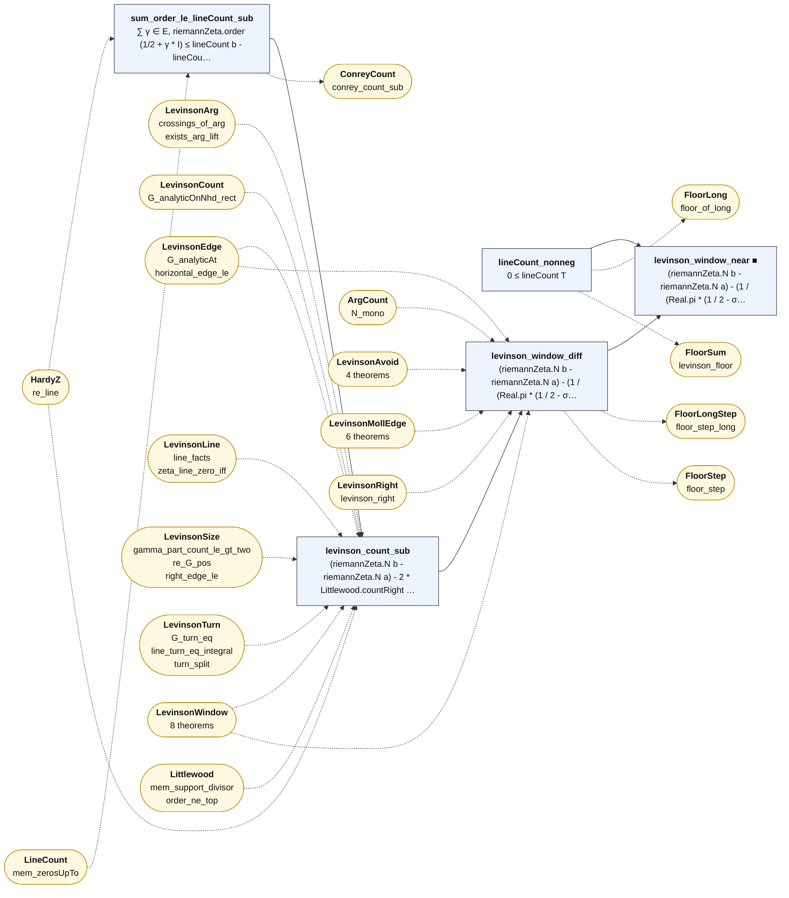

# `lean_stage3/Stage3/LevinsonWindowNear.lean`

> **Read from the source text.** This file changed after the last `python3 utilities/lean_map.py --dump`, so the arrows on this page are names occurring in each proof and have not been confirmed by Lean.

LevinsonWindowNear — block S12 of `lean_stage3/design/stencil.md`, the window restated. 2026-11-25.

5 theorems, 0 definitions, 738 lines. 

**Imports:** [`LevinsonMultiple`](../lean_stage3/LevinsonMultiple.md)  
**Imported by:** [`Stage3`](../lean_stage3/Stage3.md), [`ConreyCountOrder`](../lean_stage3/ConreyCountOrder.md), [`FloorStepCont`](../lean_stage3/FloorStepCont.md), [`FloorStepSize`](../lean_stage3/FloorStepSize.md)

## The picture



An arrow A → B reads "A is used in the proof of B". Green: counting, integers only. Violet: shape, analysis with no ζ. Blue: reads ζ. A name ending in ■ is an end: nothing else uses it. Red: contains `sorry`. Yellow: theorems in another file, counted; a dotted arrow crosses files. Definitions are not drawn; they are listed below the diagram.

## Theorems

<a name="LevinsonWindowNear-sum_order_le_lineCount_sub"></a>
### `LevinsonWindowNear.sum_order_le_lineCount_sub`

line 54 · arrows read from text

**Reads ζ.** It, or something it rests on, uses the zeta function, its zeros or the Riemann hypothesis.

**Why.** Distinct heights in `(a, b]` carrying zeros of `ζ` on the line, weighted by order, number at most `lineCount b − lineCount a`.

**Proves**

```lean
∑ γ ∈ E, riemannZeta.order (1/2 + γ * I) ≤ lineCount b - lineCount a
```

**Needs** (its hypotheses)

  - `` ha : 0 ≤ a ``
  - `` hab : a ≤ b ``
  - `` E : Finset ℝ ``
  - `` hgt : ∀ γ ∈ E, a < γ ``
  - `` hle : ∀ γ ∈ E, γ ≤ b ``
  - `` hζ : ∀ γ ∈ E, riemannZeta (1/2 + γ * I) = 0 ``

**Fed by** (2 theorems its proof uses)

  - [`HardyZ.re_line`](../lean_stage3/HardyZ.md#HardyZ-re_line) (HardyZ) — `` ((1 / 2 : ℂ) + t * I).re = 1 / 2 ``
  - [`LineCount.mem_zerosUpTo`](../lean_stage3/LineCount.md#LineCount-mem_zerosUpTo) (LineCount) — `` ρ ∈ zerosUpTo T ↔ 0 < (ρ : ℂ).im ∧ (ρ : ℂ).im ≤ T ``

**Definitions its proof touches:** [`LineCount.lineCount`](../lean_stage3/LineCount.md#LineCount-lineCount), [`LineCount.zerosUpTo`](../lean_stage3/LineCount.md#LineCount-zerosUpTo)

**Feeds** (2 that use it)

  - [`ConreyCount.conrey_count_sub`](../lean_stage3/ConreyCount.md#ConreyCount-conrey_count_sub) (ConreyCount) — `` (riemannZeta.N b - riemannZeta.N a) - 2 * Littlewood.countRight (V Q L) ((1/2 : ℂ) + a * I) ((3 : ℂ) + b * I) (1/2) - (30 * Real.log b + 42 * Real.log… ``
  - [`LevinsonWindowNear.levinson_count_sub`](#LevinsonWindowNear-levinson_count_sub) — `` (riemannZeta.N b - riemannZeta.N a) - 2 * Littlewood.countRight (fun s => riemannZeta s + c * deriv riemannZeta s) ((1/2 : ℂ) + a * I) ((3 : ℂ) + b * … ``

<a name="LevinsonWindowNear-lineCount_nonneg"></a>
### `LevinsonWindowNear.lineCount_nonneg`

line 104 · arrows read from text

**Reads ζ.** It, or something it rests on, uses the zeta function, its zeros or the Riemann hypothesis.

**Why.** The line count is nonnegative.

**Proves**

```lean
0 ≤ lineCount T
```

**Needs** (its hypotheses)

  - `` T : ℝ ``

**Fed by:** no theorem of this repo; it stands on Mathlib and the definitions below.

**Definitions its proof touches:** [`LineCount.lineCount`](../lean_stage3/LineCount.md#LineCount-lineCount)

**Feeds** (3 that use it)

  - [`FloorLong.floor_of_long`](../lean_stage3/FloorLong.md#FloorLong-floor_of_long) (FloorLong) — `` ∀ ε : ℝ, 0 < ε → ∃ T₀ : ℝ, ∀ T : ℝ, T₀ ≤ T → (1 - Real.log (max 1 (Kfl (Ar P) (Br P) (Cr P) θ R)) / R - ε) * riemannZeta.N T ≤ (LineCount.lineCount T … ``
  - [`FloorSum.levinson_floor`](../lean_stage3/FloorSum.md#FloorSum-levinson_floor) (FloorSum) — `` ∀ ε : ℝ, 0 < ε → ∃ T₀ : ℝ, ∀ T : ℝ, T₀ ≤ T → (1 / 3 - ε) * riemannZeta.N T ≤ (LineCount.lineCount T : ℝ) ``
  - [`LevinsonWindowNear.levinson_window_near`](#LevinsonWindowNear-levinson_window_near) — `` (riemannZeta.N b - riemannZeta.N a) - (1 / (Real.pi * (1 / 2 - σ₀))) * ((b - a) / 2 * Real.log K + windowE M B X T a b) - (134 * Real.log T + 2918) ≤ … ``

<a name="LevinsonWindowNear-levinson_count_sub"></a>
### `LevinsonWindowNear.levinson_count_sub`

line 112 · arrows read from text

**Reads ζ.** It, or something it rests on, uses the zeta function, its zeros or the Riemann hypothesis.

**Why.** The count, difference form. `LevinsonMultiple.levinson_count'` with `ζ(1/2 + a i) ≠ 0` added: every height its proof counts is then in `(a, b]`, so the count is in `lineCount b − lineCount a`. The proof is a copy, changed at the count of `E`.

**Proves**

```lean
(riemannZeta.N b - riemannZeta.N a) - 2 * Littlewood.countRight (fun s => riemannZeta s + c * deriv riemannZeta s) ((1/2 : ℂ) + a * I) ((3 : ℂ) + b * I) (1/2) - (72 * Real.log b + 418) ≤ (lineCount b : ℝ) - (lineCount a : ℝ)
```

**Needs** (its hypotheses)

  - `` hc0 : 0 < c ``
  - `` hc1 : c ≤ 1 ``
  - `` ha : 4 ≤ a ``
  - `` hab : a < b ``
  - `` hBot : ∀ x ∈ Icc (1/2 : ℝ) 3, riemannZeta (↑x + ↑a * I) + c * deriv riemannZeta (↑x + ↑a * I) ≠ 0 ``
  - `` hTop : ∀ x ∈ Icc (1/2 : ℝ) 3, riemannZeta (↑x + ↑b * I) + c * deriv riemannZeta (↑x + ↑b * I) ≠ 0 ``
  - `` hfac : ∀ t ∈ Icc a b, 1 - c * (deriv Gammaℝ (1/2 + t * I) / Gammaℝ (1/2 + t * I)).re ≠ 0 ``
  - `` hζa : riemannZeta (1/2 + a * I) ≠ 0 ``

**Fed by** (17 theorems its proof uses)

  - [`HardyZ.re_line`](../lean_stage3/HardyZ.md#HardyZ-re_line) (HardyZ) — `` ((1 / 2 : ℂ) + t * I).re = 1 / 2 ``
  - [`LevinsonArg.crossings_of_arg`](../lean_stage3/LevinsonArg.md#LevinsonArg-crossings_of_arg) (LevinsonArg) — `` ∃ t : Fin k → ℝ, StrictMono t ∧ (∀ i, t i ∈ Set.Icc a b) ∧ ∀ i, Real.cos (φ (t i)) = 0 ``
  - [`LevinsonArg.exists_arg_lift`](../lean_stage3/LevinsonArg.md#LevinsonArg-exists_arg_lift) (LevinsonArg) — `` ∃ φ : ℝ → ℝ, ContinuousOn φ (Set.Icc a b) ∧ ∀ t ∈ Set.Icc a b, F t = ‖F t‖ * Complex.exp (φ t * Complex.I) ``
  - [`LevinsonCount.G_analyticOnNhd_rect`](../lean_stage3/LevinsonCount.md#LevinsonCount-G_analyticOnNhd_rect) (LevinsonCount) — `` AnalyticOnNhd ℂ (fun s => riemannZeta s + c * deriv riemannZeta s) (Rectangle ((1/2 : ℂ) + a * I) ((3 : ℂ) + b * I)) ``
  - [`LevinsonEdge.horizontal_edge_le`](../lean_stage3/LevinsonEdge.md#LevinsonEdge-horizontal_edge_le) (LevinsonEdge) — `` |(∫ x in (1/2:ℝ)..3, logDeriv (fun s => riemannZeta s + c * deriv riemannZeta s) (↑x + ↑T * I)).im| ≤ 21 * Real.pi * Real.log T + 133 * Real.pi ``
  - [`LevinsonLine.line_facts`](../lean_stage3/LevinsonLine.md#LevinsonLine-line_facts) (LevinsonLine) — `` ((1/2 : ℂ) + t * I) ≠ 0 ∧ ((1/2 : ℂ) + t * I) ≠ 1 ∧ 0 < ((1/2 : ℂ) + t * I).re ``
  - [`LevinsonLine.zeta_line_zero_iff`](../lean_stage3/LevinsonLine.md#LevinsonLine-zeta_line_zero_iff) (LevinsonLine) — `` riemannZeta (1/2 + t * I) = 0 ↔ (Gammaℝ (1/2 + t * I) * (riemannZeta (1/2 + t * I) + c * deriv riemannZeta (1/2 + t * I))).re = 0 ``
  - [`LevinsonSize.gamma_part_count_le_gt_two`](../lean_stage3/LevinsonSize.md#LevinsonSize-gamma_part_count_le_gt_two) (LevinsonSize) — `` |(∫ t in a..b, logDeriv Gammaℝ (1/2 + t * I)).re - Real.pi * (riemannZeta.N b - riemannZeta.N a)| ≤ Real.pi * (30 * Real.log b + 150) ``
  - [`LevinsonSize.re_G_pos`](../lean_stage3/LevinsonSize.md#LevinsonSize-re_G_pos) (LevinsonSize) — `` 0 < (riemannZeta (3 + t * I) + c * deriv riemannZeta (3 + t * I)).re ``
  - [`LevinsonSize.right_edge_le`](../lean_stage3/LevinsonSize.md#LevinsonSize-right_edge_le) (LevinsonSize) — `` |(∫ t in a..b, logDeriv (fun s => riemannZeta s + c * deriv riemannZeta s) (3 + t * I)).re| ≤ Real.pi ``
  - [`LevinsonTurn.G_turn_eq`](../lean_stage3/LevinsonTurn.md#LevinsonTurn-G_turn_eq) (LevinsonTurn) — `` (∫ t in a..b, logDeriv G (1/2 + t * I)).re = -(2 * Real.pi * Littlewood.countRight G ((1/2 : ℂ) + a * I) ((X : ℂ) + b * I) (1/2)) + (∫ x in (1/2 : ℝ).… ``
  - [`LevinsonTurn.line_turn_eq_integral`](../lean_stage3/LevinsonTurn.md#LevinsonTurn-line_turn_eq_integral) (LevinsonTurn) — `` φ b - φ a = (∫ t in a..b, logDeriv f (1/2 + t * I)).re ``
  - [`LevinsonTurn.turn_split`](../lean_stage3/LevinsonTurn.md#LevinsonTurn-turn_split) (LevinsonTurn) — `` (∫ t in a..b, logDeriv (fun s => Gammaℝ s * G s) (1/2 + t * I)).re = (∫ t in a..b, logDeriv Gammaℝ (1/2 + t * I)).re + (∫ t in a..b, logDeriv G (1/2 +… ``
  - [`LevinsonWindow.border_cases`](../lean_stage3/LevinsonWindow.md#LevinsonWindow-border_cases) (LevinsonWindow) — `` (p.im = z.im ∧ p.re ∈ Icc z.re w.re) ∨ (p.re = z.re ∧ p.im ∈ Icc z.im w.im) ∨ (p.im = w.im ∧ p.re ∈ Icc z.re w.re) ∨ (p.re = w.re ∧ p.im ∈ Icc z.im w.… ``
  - [`LevinsonWindowNear.sum_order_le_lineCount_sub`](#LevinsonWindowNear-sum_order_le_lineCount_sub) — `` ∑ γ ∈ E, riemannZeta.order (1/2 + γ * I) ≤ lineCount b - lineCount a ``
  - [`Littlewood.mem_support_divisor`](../lean_stage3/Littlewood.md#Littlewood-mem_support_divisor) (Littlewood) — `` p ∈ (MeromorphicOn.divisor f U).support ↔ p ∈ U ∧ f p = 0 ``
  - [`Littlewood.order_ne_top`](../lean_stage3/Littlewood.md#Littlewood-order_ne_top) (Littlewood) — `` ∀ p ∈ Rectangle z w, meromorphicOrderAt f p ≠ ⊤ ``

**Definitions its proof touches:** [`LineCount.lineCount`](../lean_stage3/LineCount.md#LineCount-lineCount), [`Littlewood.countRight`](../lean_stage3/Littlewood.md#Littlewood-countRight)

**Feeds** (1 that use it)

  - [`LevinsonWindowNear.levinson_window_diff`](#LevinsonWindowNear-levinson_window_diff) — `` (riemannZeta.N b - riemannZeta.N a) - (1 / (Real.pi * (1 / 2 - σ₀))) * ((b - a) / 2 * Real.log K + windowE M B X T a b) - (134 * Real.log T + 2918) ≤ … ``

<a name="LevinsonWindowNear-levinson_window_diff"></a>
### `LevinsonWindowNear.levinson_window_diff`

line 457 · arrows read from text

**Reads ζ.** It, or something it rests on, uses the zeta function, its zeros or the Riemann hypothesis.

**Why.** S12, the window restated, difference form. `LevinsonMultiple.levinson_window'` with the mean hypothesis `hK` asked only for `a ≤ a' ≤ a + 1`, `b − 1 ≤ b' ≤ b`, the windows its proof uses, and the zeros on the line with height in `(a, b]` on the right. The proof is a copy: the bottom height avoids the zeros of `ζ` too, and step 4 is `levinson_count_sub`.

**Proves**

```lean
(riemannZeta.N b - riemannZeta.N a) - (1 / (Real.pi * (1 / 2 - σ₀))) * ((b - a) / 2 * Real.log K + windowE M B X T a b) - (134 * Real.log T + 2918) ≤ (lineCount b : ℝ) - (lineCount a : ℝ)
```

**Needs** (its hypotheses)

  - `` hT : Real.exp 26 ≤ T ``
  - `` hc : c = 1 / Real.log T ``
  - `` hM : 1 ≤ M ``
  - `` hβ1 : β 1 = 1 ``
  - `` hβ : ∀ h, ‖β h‖ ≤ B ``
  - `` hσ₀ : σ₀ < 1 / 2 ``
  - `` hδ : 0 < δ ``
  - `` hσδ : 1 / 4 ≤ σ₀ - δ ``
  - `` hX : 3 ≤ X ``
  - `` hXMB : 32 * M * B ≤ (2 : ℝ) ^ X ``
  - `` hXa : 2 * X ≤ a ``
  - `` hab : a + 3 ≤ b ``
  - `` hbT : b ≤ T ``
  - `` hK1 : 1 ≤ K ``
  - `` hK : ∀ a' b' : ℝ, a ≤ a' → a' ≤ a + 1 → b - 1 ≤ b' → b' ≤ b → a' < b' → ∀ σ ∈ Icc (σ₀ - δ) σ₀, (1 / (b' - a')) * ∫ t in a'..b', ‖(riemannZeta (↑σ + ↑t * I) + c * deriv riemannZeta (↑σ + ↑t * I)) * LevinsonMollEdge.molli M β (↑σ + ↑t * I)‖ ^ 2 ≤ K ``

**Fed by** (22 theorems its proof uses)

  - [`ArgCount.N_mono`](../lean_stage3/ArgCount.md#ArgCount-N_mono) (ArgCount) — `` riemannZeta.N T ≤ riemannZeta.N T' ``
  - [`LevinsonAvoid.exists_good_abscissa`](../lean_stage3/LevinsonAvoid.md#LevinsonAvoid-exists_good_abscissa) (LevinsonAvoid) — `` ∃ σ ∈ Icc (σ₀ - δ) σ₀, ∀ y ∈ Icc a b, f ((σ : ℂ) + y * I) ≠ 0 ``
  - [`LevinsonAvoid.exists_good_height`](../lean_stage3/LevinsonAvoid.md#LevinsonAvoid-exists_good_height) (LevinsonAvoid) — `` ∃ t ∈ Icc t₀ (t₀ + 1), ∀ x ∈ Icc σ₀ X, f ((x : ℂ) + t * I) ≠ 0 ``
  - [`LevinsonAvoid.factor_pos`](../lean_stage3/LevinsonAvoid.md#LevinsonAvoid-factor_pos) (LevinsonAvoid) — `` 0 < 1 - (1 / Real.log T) * (deriv Gammaℝ (1/2 + t * I) / Gammaℝ (1/2 + t * I)).re ``
  - [`LevinsonAvoid.mem_rect_of`](../lean_stage3/LevinsonAvoid.md#LevinsonAvoid-mem_rect_of) (LevinsonAvoid) — `` ((x : ℂ) + y * I) ∈ Rectangle z w ``
  - [`LevinsonEdge.G_analyticAt`](../lean_stage3/LevinsonEdge.md#LevinsonEdge-G_analyticAt) (LevinsonEdge) — `` AnalyticAt ℂ (fun s => riemannZeta s + c * deriv riemannZeta s) w ``
  - [`LevinsonMollEdge.f_analyticAt`](../lean_stage3/LevinsonMollEdge.md#LevinsonMollEdge-f_analyticAt) (LevinsonMollEdge) — `` AnalyticAt ℂ (fun s => (riemannZeta s + c * deriv riemannZeta s) * molli M β s) w ``
  - [`LevinsonMollEdge.f_sub_one_le`](../lean_stage3/LevinsonMollEdge.md#LevinsonMollEdge-f_sub_one_le) (LevinsonMollEdge) — `` ‖(riemannZeta s + c * deriv riemannZeta s) * molli M β s - 1‖ ≤ tailDelta M B X ``
  - [`LevinsonMollEdge.horizontal_terms_le`](../lean_stage3/LevinsonMollEdge.md#LevinsonMollEdge-horizontal_terms_le) (LevinsonMollEdge) — `` |∫ σ in σ₀..X, edgeH (fun s => (riemannZeta s + c * deriv riemannZeta s) * molli M β s) X T σ| ≤ (X - σ₀) * (Real.pi * ((8 * X - 1) * (Real.log T + Re… ``
  - [`LevinsonMollEdge.molli_differentiable`](../lean_stage3/LevinsonMollEdge.md#LevinsonMollEdge-molli_differentiable) (LevinsonMollEdge) — `` Differentiable ℂ (molli M β) ``
  - [`LevinsonMollEdge.right_terms_le`](../lean_stage3/LevinsonMollEdge.md#LevinsonMollEdge-right_terms_le) (LevinsonMollEdge) — `` -(∫ t in a..b, Real.log ‖(riemannZeta (↑X + ↑t * I) + c * deriv riemannZeta (↑X + ↑t * I)) * molli M β (↑X + ↑t * I)‖) + (X - σ₀) * (∫ t in a..b, logD… ``
  - [`LevinsonMollEdge.tailDelta_le_half`](../lean_stage3/LevinsonMollEdge.md#LevinsonMollEdge-tailDelta_le_half) (LevinsonMollEdge) — `` tailDelta M B X ≤ 1 / 2 ``
  - [`LevinsonRight.levinson_right`](../lean_stage3/LevinsonRight.md#LevinsonRight-levinson_right) (LevinsonRight) — `` countRight G ((1 / 2 : ℂ) + a * I) ((X : ℂ) + b * I) (1 / 2) ≤ (1 / (2 * Real.pi * (1 / 2 - σ₀))) * ((b - a) / 2 * Real.log ((1 / (b - a)) * ∫ t in a.… ``
  - [`LevinsonWindow.N_step_le`](../lean_stage3/LevinsonWindow.md#LevinsonWindow-N_step_le) (LevinsonWindow) — `` riemannZeta.N u - riemannZeta.N t ≤ 31 * Real.log u + 1250 ``
  - [`LevinsonWindow.analyticOnNhd_rect_of_im`](../lean_stage3/LevinsonWindow.md#LevinsonWindow-analyticOnNhd_rect_of_im) (LevinsonWindow) — `` AnalyticOnNhd ℂ f (Rectangle z w) ``
  - [`LevinsonWindow.border_cases`](../lean_stage3/LevinsonWindow.md#LevinsonWindow-border_cases) (LevinsonWindow) — `` (p.im = z.im ∧ p.re ∈ Icc z.re w.re) ∨ (p.re = z.re ∧ p.im ∈ Icc z.im w.im) ∨ (p.im = w.im ∧ p.re ∈ Icc z.re w.re) ∨ (p.re = w.re ∧ p.im ∈ Icc z.im w.… ``
  - [`LevinsonWindow.countRight_right_le`](../lean_stage3/LevinsonWindow.md#LevinsonWindow-countRight_right_le) (LevinsonWindow) — `` countRight f z w' σ ≤ countRight f z w σ ``
  - [`LevinsonWindow.half_log_mean_le`](../lean_stage3/LevinsonWindow.md#LevinsonWindow-half_log_mean_le) (LevinsonWindow) — `` (b - a) / 2 * Real.log ((1 / (b - a)) * ∫ t in a..b, ‖F t‖ ^ 2) ≤ (b - a) / 2 * Real.log K ``
  - [`LevinsonWindow.lineCount_mono`](../lean_stage3/LevinsonWindow.md#LevinsonWindow-lineCount_mono) (LevinsonWindow) — `` lineCount T ≤ lineCount T' ``
  - [`LevinsonWindow.tailDelta_nonneg`](../lean_stage3/LevinsonWindow.md#LevinsonWindow-tailDelta_nonneg) (LevinsonWindow) — `` 0 ≤ LevinsonMollEdge.tailDelta M B X ``
  - [`LevinsonWindow.windowE_nonneg`](../lean_stage3/LevinsonWindow.md#LevinsonWindow-windowE_nonneg) (LevinsonWindow) — `` 0 ≤ windowE M B X T a b ``
  - [`LevinsonWindowNear.levinson_count_sub`](#LevinsonWindowNear-levinson_count_sub) — `` (riemannZeta.N b - riemannZeta.N a) - 2 * Littlewood.countRight (fun s => riemannZeta s + c * deriv riemannZeta s) ((1/2 : ℂ) + a * I) ((3 : ℂ) + b * … ``

**Definitions its proof touches:** [`LevinsonMollEdge.molli`](../lean_stage3/LevinsonMollEdge.md#LevinsonMollEdge-molli), [`LevinsonMollEdge.tailDelta`](../lean_stage3/LevinsonMollEdge.md#LevinsonMollEdge-tailDelta), [`LevinsonWindow.windowE`](../lean_stage3/LevinsonWindow.md#LevinsonWindow-windowE), [`LineCount.lineCount`](../lean_stage3/LineCount.md#LineCount-lineCount), [`Littlewood.countRight`](../lean_stage3/Littlewood.md#Littlewood-countRight)

**Feeds** (3 that use it)

  - [`FloorLong.floor_step_long`](../lean_stage3/FloorLongStep.md#FloorLong-floor_step_long) (FloorLongStep) — `` ∀ ε : ℝ, 0 < ε → ∃ T₀ : ℝ, ∀ T : ℝ, T₀ ≤ T → (riemannZeta.N T - riemannZeta.N (T / 2)) - Real.log (max 1 ((Operator.Dop (Real.log T) (cY P (Mof T θ) T… ``
  - [`FloorStep.floor_step`](../lean_stage3/FloorStep.md#FloorStep-floor_step) (FloorStep) — `` ∀ ε : ℝ, 0 < ε → ∃ T₀ : ℝ, ∀ T : ℝ, T₀ ≤ T → (riemannZeta.N T - riemannZeta.N (T / 2)) - Real.log (max 1 ((Operator.Dop (Real.log T) (cY P (Mof T θ) T… ``
  - [`LevinsonWindowNear.levinson_window_near`](#LevinsonWindowNear-levinson_window_near) — `` (riemannZeta.N b - riemannZeta.N a) - (1 / (Real.pi * (1 / 2 - σ₀))) * ((b - a) / 2 * Real.log K + windowE M B X T a b) - (134 * Real.log T + 2918) ≤ … ``

<a name="LevinsonWindowNear-levinson_window_near"></a>
### `LevinsonWindowNear.levinson_window_near`

line 699 · arrows read from text

**Reads ζ.** It, or something it rests on, uses the zeta function, its zeros or the Riemann hypothesis.

**Why.** S12, the window restated. The conclusion of `LevinsonMultiple.levinson_window'` with the mean hypothesis `hK` asked only for `a ≤ a' ≤ a + 1`, `b − 1 ≤ b' ≤ b`.

**Proves**

```lean
(riemannZeta.N b - riemannZeta.N a) - (1 / (Real.pi * (1 / 2 - σ₀))) * ((b - a) / 2 * Real.log K + windowE M B X T a b) - (134 * Real.log T + 2918) ≤ (lineCount b : ℝ)
```

**Needs** (its hypotheses)

  - `` hT : Real.exp 26 ≤ T ``
  - `` hc : c = 1 / Real.log T ``
  - `` hM : 1 ≤ M ``
  - `` hβ1 : β 1 = 1 ``
  - `` hβ : ∀ h, ‖β h‖ ≤ B ``
  - `` hσ₀ : σ₀ < 1 / 2 ``
  - `` hδ : 0 < δ ``
  - `` hσδ : 1 / 4 ≤ σ₀ - δ ``
  - `` hX : 3 ≤ X ``
  - `` hXMB : 32 * M * B ≤ (2 : ℝ) ^ X ``
  - `` hXa : 2 * X ≤ a ``
  - `` hab : a + 3 ≤ b ``
  - `` hbT : b ≤ T ``
  - `` hK1 : 1 ≤ K ``
  - `` hK : ∀ a' b' : ℝ, a ≤ a' → a' ≤ a + 1 → b - 1 ≤ b' → b' ≤ b → a' < b' → ∀ σ ∈ Icc (σ₀ - δ) σ₀, (1 / (b' - a')) * ∫ t in a'..b', ‖(riemannZeta (↑σ + ↑t * I) + c * deriv riemannZeta (↑σ + ↑t * I)) * LevinsonMollEdge.molli M β (↑σ + ↑t * I)‖ ^ 2 ≤ K ``

**Fed by** (2 theorems its proof uses)

  - [`LevinsonWindowNear.levinson_window_diff`](#LevinsonWindowNear-levinson_window_diff) — `` (riemannZeta.N b - riemannZeta.N a) - (1 / (Real.pi * (1 / 2 - σ₀))) * ((b - a) / 2 * Real.log K + windowE M B X T a b) - (134 * Real.log T + 2918) ≤ … ``
  - [`LevinsonWindowNear.lineCount_nonneg`](#LevinsonWindowNear-lineCount_nonneg) — `` 0 ≤ lineCount T ``

**Definitions its proof touches:** [`LevinsonMollEdge.molli`](../lean_stage3/LevinsonMollEdge.md#LevinsonMollEdge-molli), [`LevinsonWindow.windowE`](../lean_stage3/LevinsonWindow.md#LevinsonWindow-windowE), [`LineCount.lineCount`](../lean_stage3/LineCount.md#LineCount-lineCount)

**Feeds:** nothing. It is an end.

