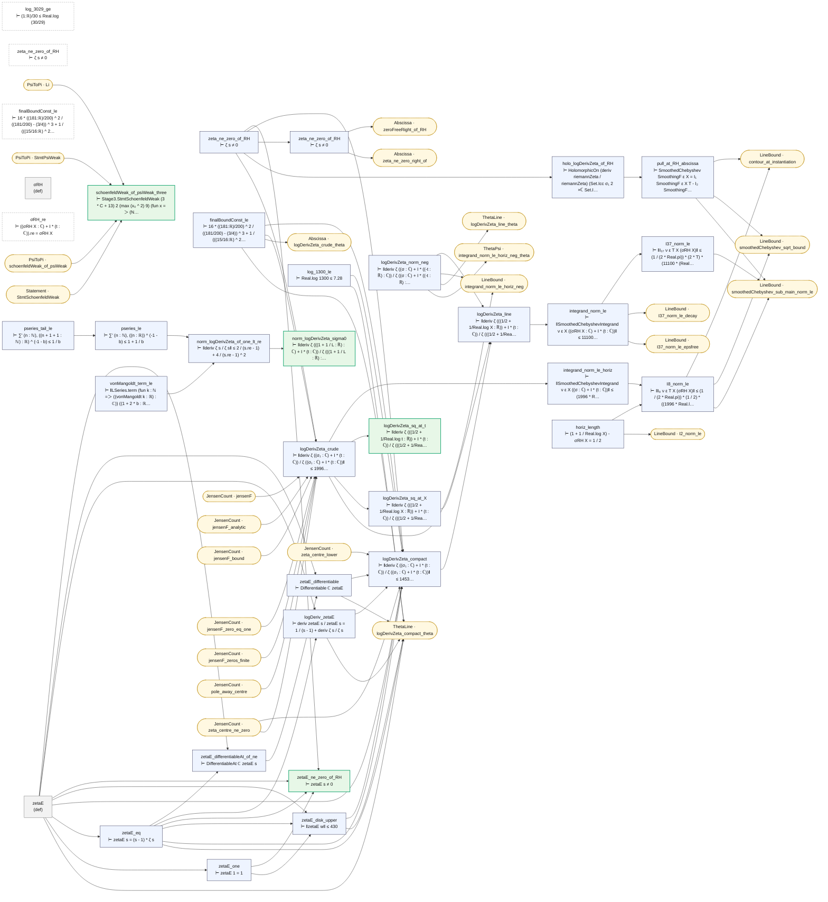
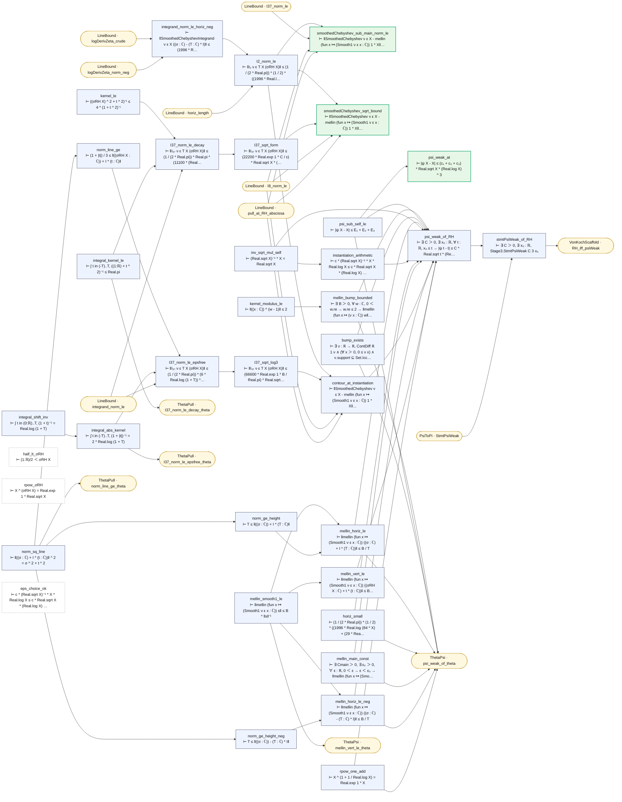

# `lean_stage3/Stage3/LineBound.lean`

**What it does** (its own header): no header.

**Imports:** [`Assembly`](../lean_stage3/Assembly.md), [`JensenCount`](../lean_stage3/JensenCount.md).
**Imported by:** [`Stage3`](../lean_stage3/Stage3.md), [`Abscissa`](../lean_stage3/Abscissa.md), [`VonKochScaffold`](../lean_stage3/VonKochScaffold.md).

### Diagram 1 of 2

### Diagram 2 of 2

Blue: theorem. Green: a theorem nothing else uses (an end). Dashed white: connects to nothing. Grey: definition. Red: contains `sorry`. Yellow: in another file. An arrow A → B reads "A is used by B".

## Every declaration

| declaration | proves (output) | needs (input) | why (its own docstring) | uses | used by |
|---|---|---|---|---|---|
| `Slice3.zeta_ne_zero_of_RH` theorem, line 23 | ζ s ≠ 0 | hRH : RiemannHypothesis; hs : 1/2 &lt; s.re; hs1 : s ≠ 1 | Under RH, ζ has no zero with `1/2 &lt; re s`, other than `s = 1`. | — | `RHPull.holo_logDerivZeta_of_RH`, `RHPull.zeta_ne_zero_of_RH`, `Slice3.logDerivZeta_crude`, `Slice4.logDerivZeta_compact`, `Slice4.zetaE_ne_zero_of_RH` |
| `Slice3.log_3029_ge` theorem, line 37 | (1:ℝ)/30 ≤ Real.log (30/29) | — | `log (30/29) ≥ 1/30`. | — | — |
| `Slice3.finalBoundConst_le` theorem, line 43 | 16 * ((181:ℝ)/200) ^ 2 / ((181/200) - (3/4)) ^ 3 + 1 / (((15/16:ℝ) ^ 2 / (29/32) - 29/32) * Real.log ((15/16)/(29/32))) ≤ 3991 | — | LEVER 2 — the FinalBound constant at `r' = 3/4, r = 181/200, R' = 29/32, R = 15/16`. | — | `Stage3.logDerivZeta_crude_theta`, `Slice3.logDerivZeta_crude`, `Slice4.logDerivZeta_compact`, `Stage3.logDerivZeta_compact_theta` |
| `Slice3.logDerivZeta_crude` theorem, line 74 | ‖deriv ζ ((σ₁ : ℂ) + I * (t : ℂ)) / ζ ((σ₁ : ℂ) + I * (t : ℂ))‖ ≤ 1996 * Real.log (84 * t) + (29 * Real.log t + 129) / (σ₁ - 1/2) | hRH : RiemannHypothesis; ht : 2 ≤ t; hlo : 1/2 &lt; σ₁; hhi : σ₁ ≤ 2 | Slice 3. Under RH, for `t ≥ 2` and `1/2 &lt; σ₁ ≤ 3/2`, `‖ζ'/ζ (σ₁ + it)‖ ≤ 1996 log(84 t) + (29 log t + 129)/(σ₁ - 1/2)`. | `Stage3.jensenF`, `Stage3.jensenF_analytic`, `Stage3.jensenF_bound`, `Stage3.jensenF_zero_eq_one`, `Stage3.jensenF_zeros_finite`, `Stage3.pole_away_centre`, `Stage3.zeta_centre_ne_zero`, `Slice3.finalBoundConst_le`, `Slice3.zeta_ne_zero_of_RH` | `RHPull.integrand_norm_le_horiz`, `RHPull.integrand_norm_le_horiz_neg`, `Slice3.logDerivZeta_sq_at_X`, `Slice3.logDerivZeta_sq_at_t` |
| `Slice3.logDerivZeta_sq_at_t` theorem, line 257 | ‖deriv ζ (((1/2 + 1/Real.log t : ℝ)) + I * (t : ℂ)) / ζ (((1/2 + 1/Real.log t : ℝ)) + I * (t : ℂ))‖ ≤ 21600 * (Real.log t) ^ 2 | hRH : RiemannHypothesis; ht : 2 ≤ t | Corollary A — the literal `log²\|t\|` shape, at a `t`-tied abscissa. `σ₁ = 1/2 + 1/log t` gives `‖ζ'/ζ‖ ≤ 21600 (log t)²`. The abscissa moves with `t`, so this is not a vertical line. | `Slice3.logDerivZeta_crude` | — |
| `Slice3.logDerivZeta_sq_at_X` theorem, line 295 | ‖deriv ζ (((1/2 + 1/Real.log X : ℝ)) + I * (t : ℂ)) / ζ (((1/2 + 1/Real.log X : ℝ)) + I * (t : ℂ))‖ ≤ 11100 * (Real.log X) ^ 2 | hRH : RiemannHypothesis; ht : 2 ≤ t; hLX : 1 ≤ Real.log X; htX : Real.log t ≤ Real.log X | Corollary B — the vertical-line shape the ψ-side actually consumes. `σ₁ = 1/2 + 1/log X` fixed, `2 ≤ t ≤ X`, `log X ≥ 1`: `‖ζ'/ζ‖ ≤ 11100 (log X)²`, uniformly in `t` on the truncation range. | `Slice3.logDerivZeta_crude` | `Slice4b.logDerivZeta_line` |
| `Slice4.zeta_ne_zero_of_RH` theorem, line 354 | ζ s ≠ 0 | hRH : RiemannHypothesis; hs : 1/2 &lt; s.re; hs1 : s ≠ 1 | Under RH, `ζ` has no zero with `1/2 &lt; re s`, other than `s = 1`. | — | — |
| `Slice4.zetaE` def, line 369 | ℂ → ℂ | — | The pole absorbed. `zetaE s = (s-1)·ζ s`, with the removable singularity at `s = 1` filled in with its residue `1`. Entire. | — | `Slice4.logDerivZeta_compact`, `Slice4.logDeriv_zetaE`, `Slice4.zetaE_differentiable`, `Slice4.zetaE_differentiableAt_of_ne`, `Slice4.zetaE_disk_upper`, `Slice4.zetaE_eq`, `Slice4.zetaE_ne_zero_of_RH`, `Slice4.zetaE_one`, `Stage3.logDerivZeta_compact_theta` |
| `Slice4.zetaE_eq` theorem, line 371 | zetaE s = (s - 1) * ζ s | hs : s ≠ 1 | — | `Slice4.zetaE` | `Slice4.logDerivZeta_compact`, `Slice4.logDeriv_zetaE`, `Slice4.zetaE_differentiableAt_of_ne`, `Slice4.zetaE_disk_upper`, `Slice4.zetaE_ne_zero_of_RH`, `Stage3.logDerivZeta_compact_theta` |
| `Slice4.zetaE_one` theorem, line 374 | zetaE 1 = 1 | — | — | `Slice4.zetaE` | `Slice4.zetaE_disk_upper`, `Slice4.zetaE_ne_zero_of_RH` |
| `Slice4.zetaE_differentiableAt_of_ne` theorem, line 376 | DifferentiableAt ℂ zetaE s | hs : s ≠ 1 | — | `Slice4.zetaE`, `Slice4.zetaE_eq` | `Slice4.zetaE_differentiable` |
| `Slice4.zetaE_differentiable` theorem, line 384 | Differentiable ℂ zetaE | — | — | `Slice4.zetaE`, `Slice4.zetaE_differentiableAt_of_ne` | `Slice4.logDerivZeta_compact`, `Stage3.logDerivZeta_compact_theta` |
| `Slice4.logDeriv_zetaE` theorem, line 394 | deriv zetaE s / zetaE s = 1 / (s - 1) + deriv ζ s / ζ s | hs : s ≠ 1; hz : ζ s ≠ 0 | The log-derivative shift. `zetaE'/zetaE = 1/(s-1) + ζ'/ζ`. | `Slice4.zetaE`, `Slice4.zetaE_eq` | `Slice4.logDerivZeta_compact`, `Stage3.logDerivZeta_compact_theta` |
| `Slice4.zetaE_ne_zero_of_RH` theorem, line 409 | zetaE s ≠ 0 | hRH : RiemannHypothesis; hs : 1/2 &lt; s.re | — | `Slice3.zeta_ne_zero_of_RH`, `Slice4.zetaE`, `Slice4.zetaE_eq`, `Slice4.zetaE_one` | — |
| `Slice4.zetaE_disk_upper` theorem, line 418 | ‖zetaE w‖ ≤ 430 | ht : \|t\| ≤ 2; hw : ‖w - (2 + Complex.I * (t : ℂ))‖ ≤ 15 / 8 | The majorant on the wide disk, pole included. `‖zetaE w‖ ≤ 430` for `\|t\| ≤ 2` and `‖w - (2 + it)‖ ≤ 15/8`. | `Slice4.zetaE`, `Slice4.zetaE_eq`, `Slice4.zetaE_one` | `Slice4.logDerivZeta_compact`, `Stage3.logDerivZeta_compact_theta` |
| `Slice4.log_1300_le` theorem, line 493 | Real.log 1300 ≤ 7.28 | — | `log 1300 ≤ 7.28`, from `1300² ≤ 2^21`. | — | `Slice4.logDerivZeta_compact`, `Stage3.logDerivZeta_compact_theta` |
| `Slice4.finalBoundConst_le` theorem, line 503 | 16 * ((181:ℝ)/200) ^ 2 / ((181/200) - (3/4)) ^ 3 + 1 / (((15/16:ℝ) ^ 2 / (29/32) - 29/32) * Real.log ((15/16)/(29/32))) ≤ 3991 | — | LEVER 2 — the FinalBound constant at `r' = 3/4, r = 181/200, R' = 29/32, R = 15/16` — the same radii as slice 3. | — | — |
| `Slice4.logDerivZeta_compact` theorem, line 531 | ‖deriv ζ ((σ₁ : ℂ) + I * (t : ℂ)) / ζ ((σ₁ : ℂ) + I * (t : ℂ))‖ ≤ 14535 + 212 / (σ₁ - 1/2) | hRH : RiemannHypothesis; ht : \|t\| ≤ 2; hlo : 1/2 &lt; σ₁; hhi : σ₁ ≤ 3/4 | Slice 4 — the compact patch. Under RH, for `\|t\| ≤ 2` and `1/2 &lt; σ₁ ≤ 3/4`, `‖ζ'/ζ (σ₁ + it)‖ ≤ 14535 + 212/(σ₁ - 1/2)`. | `Stage3.zeta_centre_lower`, `Stage3.zeta_centre_ne_zero`, `Slice3.finalBoundConst_le`, `Slice3.zeta_ne_zero_of_RH`, `Slice4.logDeriv_zetaE`, `Slice4.log_1300_le`, `Slice4.zetaE`, `Slice4.zetaE_differentiable`, `Slice4.zetaE_disk_upper`, `Slice4.zetaE_eq` | `Slice4b.logDerivZeta_line` |
| `Slice4b.logDerivZeta_norm_neg` theorem, line 789 | ‖deriv ζ ((σ : ℂ) + I * ((-t : ℝ) : ℂ)) / ζ ((σ : ℂ) + I * ((-t : ℝ) : ℂ))‖ = ‖deriv ζ ((σ : ℂ) + I * (t : ℂ)) / ζ ((σ : ℂ) + I * (t : ℂ))‖ | σ t : ℝ | Reflection: the log-derivative's norm is even in `t`. | — | `RHPull.integrand_norm_le_horiz_neg`, `Slice4b.logDerivZeta_line`, `Stage3.logDerivZeta_line_theta`, `Stage3.integrand_norm_le_horiz_neg_theta` |
| `Slice4b.logDerivZeta_line` theorem, line 801 | ‖deriv ζ (((1/2 + 1/Real.log X : ℝ)) + I * (t : ℂ)) / ζ (((1/2 + 1/Real.log X : ℝ)) + I * (t : ℂ))‖ ≤ 11100 * (Real.log X) ^ 2 | hRH : RiemannHypothesis; hLX : 4 ≤ Real.log X; htX : \|t\| ≤ X | Slice 4b — the vertical line, uniform in `t`. Under RH, on `σ₁ = 1/2 + 1/log X` with `log X ≥ 4` and `\|t\| ≤ X`: `‖ζ'/ζ‖ ≤ 11100 (log X)²`. | `Slice3.logDerivZeta_sq_at_X`, `Slice4.logDerivZeta_compact`, `Slice4b.logDerivZeta_norm_neg` | `RHPull.integrand_norm_le` |
| `Slice8.schoenfeldWeak_of_psiWeak_three` theorem, line 848 | Stage3.StmtSchoenfeldWeak (3 * C + 13) 2 (max (x₀ ^ 2) 9) (fun x =&gt; (Nat.primeCounting ⌊x⌋₊ : ℝ)) Stage3.Li | hx₀ : 2 ≤ x₀; hC : 0 ≤ C; h : Stage3.StmtPsiWeak C 3 x₀ | Slice 8 — PsiToPi at `k = 3`. A ψ-side weak bound at exponent `3` delivers `StmtSchoenfeldWeak (3C+13) 2` — the shape entry 231's census gate is stated against. | `Stage3.Li`, `Stage3.StmtPsiWeak`, `Stage3.schoenfeldWeak_of_psiWeak`, `Stage3.StmtSchoenfeldWeak` | — |
| `Slice5.pseries_tail_le` theorem, line 879 | ∑' (n : ℕ), ((n + 1 + 1 : ℕ) : ℝ) ^ (-1 - b) ≤ 1 / b | hb : 0 &lt; b | Integral test: for `b &gt; 0`, `∑_{n ≥ 2} n^{-1-b} ≤ 1/b`. | — | `Slice5.pseries_le` |
| `Slice5.pseries_le` theorem, line 902 | ∑' (n : ℕ), ((n : ℝ)) ^ (-1 - b) ≤ 1 + 1 / b | hb : 0 &lt; b | For `b &gt; 0`, `∑_{n ≥ 0} n^{-1-b} ≤ 1 + 1/b` (the `n = 0` term is `0`). | `Slice5.pseries_tail_le` | `Slice5.norm_logDerivZeta_of_one_lt_re` |
| `Slice5.vonMangoldt_term_le` theorem, line 918 | ‖LSeries.term (fun k : ℕ =&gt; ((vonMangoldt k : ℝ) : ℂ)) ((1 + 2 * b : ℝ) : ℂ) n‖ ≤ (1 / b) * ((n : ℝ)) ^ (-1 - b) | hb : 0 &lt; b; n : ℕ | `Λ n / n^σ ≤ (1/b) · n^{-1-b}` when `σ = 1 + 2b`, `b &gt; 0`. | — | `Slice5.norm_logDerivZeta_of_one_lt_re` |
| `Slice5.norm_logDerivZeta_of_one_lt_re` theorem, line 948 | ‖deriv ζ s / ζ s‖ ≤ 2 / (s.re - 1) + 4 / (s.re - 1) ^ 2 | hs : 1 &lt; s.re | Slice 5. For `Re s &gt; 1`, elementary and RH-free: `‖ζ'/ζ(s)‖ ≤ 2/(Re s - 1) + 4/(Re s - 1)²`. | `Slice5.pseries_le`, `Slice5.vonMangoldt_term_le` | `Slice5.norm_logDerivZeta_sigma0` |
| `Slice5.norm_logDerivZeta_sigma0` theorem, line 991 | ‖deriv ζ (((1 + 1 / L : ℝ) : ℂ) + I * (t : ℂ)) / ζ (((1 + 1 / L : ℝ) : ℂ) + I * (t : ℂ))‖ ≤ 2 * L + 4 * L ^ 2 | hL : 1 ≤ L | Corollary — the shape the `I₁`/`I₉` integrals consume. At the standard abscissa `σ₀ = 1 + 1/L` with `L ≥ 1`, uniformly in `t`: `‖ζ'/ζ(σ₀ + it)‖ ≤ 2 L + 4 L²`. | `Slice5.norm_logDerivZeta_of_one_lt_re` | — |
| `RHPull.zeta_ne_zero_of_RH` theorem, line 1031 | ζ s ≠ 0 | hRH : RiemannHypothesis; hs : 1/2 &lt; s.re; hs1 : s ≠ 1 | Under RH, `ζ` has no zero right of the critical line. | `Slice3.zeta_ne_zero_of_RH` | `Stage3.zeroFreeRight_of_RH`, `Stage3.zeta_ne_zero_right_of` |
| `RHPull.holo_logDerivZeta_of_RH` theorem, line 1036 | HolomorphicOn (deriv riemannZeta / riemannZeta) (Set.Icc σ₁ 2 ×ℂ Set.Icc (-T) T \ {1}) | hRH : RiemannHypothesis; hσ : 1/2 &lt; σ₁ | The holomorphy hypothesis is free under RH. | `Slice3.zeta_ne_zero_of_RH` | `RHPull.pull_at_RH_abscissa` |
| `RHPull.pull_at_RH_abscissa` theorem, line 1056 | SmoothedChebyshev SmoothingF ε X = I₁ SmoothingF ε X T - I₂ SmoothingF ε T X (1 / 2 + 1 / Real.log X) + I₃₇ SmoothingF ε T X (1 / 2 + 1 / Real.log X) + I₈ SmoothingF ε T X (1 / 2 + 1 / Real.log X) + I₉ SmoothingF ε X T + mellin (fun x ↦ (Smooth1 SmoothingF ε x : ℂ)) 1 * X | hRH : RiemannHypothesis; ε_pos : 0 &lt; ε; ε_lt_one : ε &lt; 1; X : ℝ; X_gt : 3 &lt; X; T_pos : 0 &lt; T; hLX : 4 ≤ Real.log X; suppSmoothingF : Function.support SmoothingF ⊆ Set.Icc (1 / 2) 2; SmoothingFnonneg : ∀ x &gt; 0, 0 ≤ SmoothingF x; mass_one : ∫ x in Set.Ioi 0, SmoothingF x / x = 1; ContDiffSmoothingF : ContDiff ℝ 1 SmoothingF | The pull, instantiated at the RH abscissa. `SmoothedChebyshevPull1` with `σ₁ = 1/2 + 1/log X`. Its holomorphy hypothesis is discharged by RH, so the contour lands exactly on the line `Slice4b.logDerivZeta_line` controls. | `RHPull.holo_logDerivZeta_of_RH` | `RHPull.contour_at_instantiation`, `RHPull.smoothedChebyshev_sqrt_bound`, `RHPull.smoothedChebyshev_sub_main_norm_le` |
| `RHPull.σRH` def, line 1091 | ℝ | X : ℝ | The abscissa. | — | — |
| `RHPull.σRH_re` theorem, line 1093 | ((σRH X : ℂ) + I * (t : ℂ)).re = σRH X | X t : ℝ | — | — | — |
| `RHPull.integrand_norm_le` theorem, line 1099 | ‖SmoothedChebyshevIntegrand ν ε X ((σRH X : ℂ) + I * (t : ℂ))‖ ≤ 11100 * (Real.log X) ^ 2 * M * X ^ (σRH X) | hRH : RiemannHypothesis; hX : 0 &lt; X; hLX : 4 ≤ Real.log X; htX : \|t\| ≤ X; hMel : ‖mellin (fun x ↦ (Smooth1 ν ε x : ℂ)) ((σRH X : ℂ) + I * (t : ℂ))‖ ≤ M | Pointwise bound on the pull integrand along the RH abscissa. `‖(-ζ'/ζ)·𝓜·X^s‖` with the line bound on the first factor, the Mellin bound on the second, and `‖X^s‖ = X^σ₁` on the third. | `Slice4b.logDerivZeta_line` | `RHPull.I37_norm_le`, `RHPull.I37_norm_le_decay`, `RHPull.I37_norm_le_epsfree` |
| `RHPull.I37_norm_le` theorem, line 1131 | ‖I₃₇ ν ε T X (σRH X)‖ ≤ (1 / (2 * Real.pi)) * (2 * T) * (11100 * (Real.log X) ^ 2 * M * X ^ (σRH X)) | hRH : RiemannHypothesis; hX : 0 &lt; X; hLX : 4 ≤ Real.log X; hT : 0 &lt; T; hTX : T ≤ X; hM : 0 ≤ M; hMel : ∀ t : ℝ, \|t\| ≤ T → ‖mellin (fun x ↦ (Smooth1 ν ε x : ℂ)) ((σRH X : ℂ) + I * (t : ℂ))‖ ≤ M | I₃₇ bounded at the RH abscissa. The vertical segment, with the line bound on `ζ'/ζ` and a uniform Mellin bound `M`. | `RHPull.integrand_norm_le` | `RHPull.smoothedChebyshev_sub_main_norm_le` |
| `RHPull.integrand_norm_le_horiz` theorem, line 1181 | ‖SmoothedChebyshevIntegrand ν ε X ((σ : ℂ) + I * (t : ℂ))‖ ≤ (1996 * Real.log (84 * t) + (29 * Real.log t + 129) * Real.log X) * M * X ^ σ | hRH : RiemannHypothesis; hX : 0 &lt; X; hLX : 4 ≤ Real.log X; ht : 2 ≤ t; hσlo : σRH X ≤ σ; hσhi : σ ≤ 1 + 1 / Real.log X; hMel : ‖mellin (fun x ↦ (Smooth1 ν ε x : ℂ)) ((σ : ℂ) + I * (t : ℂ))‖ ≤ M | Pointwise bound on the horizontal segments. For `σ` between the RH abscissa and `1 + 1/log X`, at height `t` with `2 ≤ \|t\|`, `Slice3.logDerivZeta_crude` applies and `1/(σ - 1/2) ≤ log X` on that range. | `Slice3.logDerivZeta_crude` | `RHPull.I8_norm_le` |
| `RHPull.horiz_length` theorem, line 1238 | (1 + 1 / Real.log X) - σRH X = 1 / 2 | X : ℝ | The horizontal segment has length exactly `1/2`. | — | `RHPull.I2_norm_le`, `RHPull.I8_norm_le` |
| `RHPull.I8_norm_le` theorem, line 1242 | ‖I₈ ν ε T X (σRH X)‖ ≤ (1 / (2 * Real.pi)) * (1 / 2) * ((1996 * Real.log (84 * T) + (29 * Real.log T + 129) * Real.log X) * M * X ^ (1 + 1 / Real.log X)) | hRH : RiemannHypothesis; hX : 0 &lt; X; hLX : 4 ≤ Real.log X; hT : 2 ≤ T; hMel : ∀ σ : ℝ, σRH X ≤ σ → σ ≤ 1 + 1 / Real.log X → ‖mellin (fun x ↦ (Smooth1 ν ε x : ℂ)) ((σ : ℂ) + I * (T : ℂ))‖ ≤ M | I₈ bounded at the RH abscissa — the upper horizontal segment. | `RHPull.horiz_length`, `RHPull.integrand_norm_le_horiz` | `RHPull.contour_at_instantiation`, `RHPull.smoothedChebyshev_sqrt_bound`, `RHPull.smoothedChebyshev_sub_main_norm_le` |
| `RHPull.integrand_norm_le_horiz_neg` theorem, line 1303 | ‖SmoothedChebyshevIntegrand ν ε X ((σ : ℂ) - (T : ℂ) * I)‖ ≤ (1996 * Real.log (84 * T) + (29 * Real.log T + 129) * Real.log X) * M * X ^ σ | hRH : RiemannHypothesis; hX : 0 &lt; X; hLX : 4 ≤ Real.log X; hT : 2 ≤ T; hσlo : σRH X ≤ σ; hσhi : σ ≤ 1 + 1 / Real.log X; hMel : ‖mellin (fun x ↦ (Smooth1 ν ε x : ℂ)) ((σ : ℂ) - (T : ℂ) * I)‖ ≤ M | Pointwise bound on the lower horizontal segment, through the conjugate symmetry `Slice4b.logDerivZeta_norm_neg`. | `Slice3.logDerivZeta_crude`, `Slice4b.logDerivZeta_norm_neg` | `RHPull.I2_norm_le` |
| `RHPull.I2_norm_le` theorem, line 1363 | ‖I₂ ν ε T X (σRH X)‖ ≤ (1 / (2 * Real.pi)) * (1 / 2) * ((1996 * Real.log (84 * T) + (29 * Real.log T + 129) * Real.log X) * M * X ^ (1 + 1 / Real.log X)) | hRH : RiemannHypothesis; hX : 0 &lt; X; hLX : 4 ≤ Real.log X; hT : 2 ≤ T; hMel : ∀ σ : ℝ, σRH X ≤ σ → σ ≤ 1 + 1 / Real.log X → ‖mellin (fun x ↦ (Smooth1 ν ε x : ℂ)) ((σ : ℂ) - (T : ℂ) * I)‖ ≤ M | I₂ bounded at the RH abscissa — the lower horizontal segment. | `RHPull.horiz_length`, `RHPull.integrand_norm_le_horiz_neg` | `RHPull.contour_at_instantiation`, `RHPull.smoothedChebyshev_sqrt_bound`, `RHPull.smoothedChebyshev_sub_main_norm_le` |
| `RHPull.smoothedChebyshev_sub_main_norm_le` theorem, line 1423 | ‖SmoothedChebyshev ν ε X - mellin (fun x ↦ (Smooth1 ν ε x : ℂ)) 1 * X‖ ≤ B₁ + B₉ + (1 / (2 * Real.pi)) * (2 * T) * (11100 * (Real.log X) ^ 2 * M₃₇ * X ^ (σRH X)) + (1 / (2 * Real.pi)) * (1 / 2) * ((1996 * Real.log (84 * T) + (29 * Real.log T + 129) * Real.log X) * M₈ * X ^ (1 + 1 / Real.log X)) + (1 / (2 * Real.pi)) * (1 / 2) * ((1996 * Real.log (84 * T) + (29 * Real.log T + 129) * Real.log X) * M₂ * X ^ (1 + 1 / Real.log X)) | hRH : RiemannHypothesis; ε_pos : 0 &lt; ε; ε_lt_one : ε &lt; 1; X_gt : 3 &lt; X; hX : 0 &lt; X; hLX : 4 ≤ Real.log X; hT2 : 2 ≤ T; hTX : T ≤ X; suppν : Function.support ν ⊆ Set.Icc (1 / 2) 2; νnonneg : ∀ x &gt; 0, 0 ≤ ν x; mass_one : ∫ x in Set.Ioi 0, ν x / x = 1; diffν : ContDiff ℝ 1 ν; hB1 : ‖I₁ ν ε X T‖ ≤ B₁; hB9 : ‖I₉ ν ε X T‖ ≤ B₉; hM37 : 0 ≤ M₃₇; hMel37 : ∀ t : ℝ, \|t\| ≤ T → ‖mellin (fun x ↦ (Smooth1 ν ε x : ℂ)) ((σRH X : ℂ) + I * (t : ℂ))‖ ≤ M₃₇; hMel8 : ∀ σ : ℝ, σRH X ≤ σ → σ ≤ 1 + 1 / Real.log X → ‖mellin (fun x ↦ (Smooth1 ν ε x : ℂ)) ((σ : ℂ) + I * (T : ℂ))‖ ≤ M₈; hMel2 : ∀ σ : ℝ, σRH X ≤ σ → σ ≤ 1 + 1 / Real.log X → ‖mellin (fun x ↦ (Smooth1 ν ε x : ℂ)) ((σ : ℂ) - (T : ℂ) * I)‖ ≤ M₂ | THE ASSEMBLY — every contour piece summed at the RH abscissa. `pull_at_RH_abscissa` splits the smoothed Chebyshev into five pieces plus the main term; the triangle inequality and the four bounds close it. `B₁` and `B₉` come from PNT+'s `I1Bound` / `I9Bound`, which are `σ₁`-independent. | `RHPull.I2_norm_le`, `RHPull.I37_norm_le`, `RHPull.I8_norm_le`, `RHPull.pull_at_RH_abscissa` | — |
| `RHPull.norm_sq_line` theorem, line 1484 | ‖((σ : ℂ) + I * (t : ℂ))‖ ^ 2 = σ ^ 2 + t ^ 2 | σ t : ℝ | `‖σ + it‖² = σ² + t²`. | — | `RHPull.norm_ge_height`, `RHPull.norm_ge_height_neg`, `RHPull.norm_line_ge`, `Stage3.norm_line_ge_theta` |
| `RHPull.half_lt_σRH` theorem, line 1490 | (1:ℝ)/2 &lt; σRH X | hLX : 4 ≤ Real.log X | `σRH X &gt; 1/2`. | — | — |
| `RHPull.kernel_le` theorem, line 1496 | ((σRH X) ^ 2 + t ^ 2)⁻¹ ≤ 4 * (1 + t ^ 2)⁻¹ | hLX : 4 ≤ Real.log X | The Cauchy kernel on the line is dominated by `4/(1+t²)`. | — | `RHPull.I37_norm_le_decay` |
| `RHPull.integral_kernel_le` theorem, line 1507 | ∫ t in (-T)..T, ((1:ℝ) + t ^ 2)⁻¹ ≤ Real.pi | T : ℝ | `∫_{-T}^{T} (1+t²)⁻¹ ≤ π`. | — | `RHPull.I37_norm_le_decay`, `Stage3.I37_norm_le_decay_theta` |
| `RHPull.I37_norm_le_decay` theorem, line 1523 | ‖I₃₇ ν ε T X (σRH X)‖ ≤ (1 / (2 * Real.pi)) * Real.pi * (11100 * (Real.log X) ^ 2 * (4 * C / ε) * X ^ (σRH X)) | hRH : RiemannHypothesis; hX : 0 &lt; X; hLX : 4 ≤ Real.log X; hT : 0 &lt; T; hTX : T ≤ X; hC : 0 &lt; C; hε : 0 &lt; ε; hMel : ∀ t : ℝ, ‖mellin (fun x ↦ (Smooth1 ν ε x : ℂ)) ((σRH X : ℂ) + I * (t : ℂ))‖ ≤ C * (ε * ((σRH X) ^ 2 + t ^ 2))⁻¹ | I₃₇, T-free. Integrating the Mellin factor's `1/‖s‖²` decay instead of taking a uniform sup removes `T` entirely, leaving `X^σ₁ = e·√X` times `log²X`. This is the bound that makes the whole route land at `√X log²X`. | `RHPull.integral_kernel_le`, `RHPull.integrand_norm_le`, `RHPull.kernel_le` | `RHPull.I37_sqrt_form` |
| `RHPull.rpow_σRH` theorem, line 1589 | X ^ (σRH X) = Real.exp 1 * Real.sqrt X | hX : 0 &lt; X; hLX : 4 ≤ Real.log X | Where the `√X` comes from. `X^(1/2 + 1/log X) = e·√X`. No zero sum, no explicit formula — the square root is the abscissa. | — | — |
| `RHPull.I37_sqrt_form` theorem, line 1601 | ‖I₃₇ ν ε T X (σRH X)‖ ≤ (22200 * Real.exp 1 * C / ε) * Real.sqrt X * (Real.log X) ^ 2 | hRH : RiemannHypothesis; hX : 0 &lt; X; hLX : 4 ≤ Real.log X; hT : 0 &lt; T; hTX : T ≤ X; hC : 0 &lt; C; hε : 0 &lt; ε; hMel : ∀ t : ℝ, ‖mellin (fun x ↦ (Smooth1 ν ε x : ℂ)) ((σRH X : ℂ) + I * (t : ℂ))‖ ≤ C * (ε * ((σRH X) ^ 2 + t ^ 2))⁻¹ | The vertical segment in `√X log²X` form. | `RHPull.I37_norm_le_decay` | `RHPull.smoothedChebyshev_sqrt_bound` |
| `RHPull.smoothedChebyshev_sqrt_bound` theorem, line 1629 | ‖SmoothedChebyshev ν ε X - mellin (fun x ↦ (Smooth1 ν ε x : ℂ)) 1 * X‖ ≤ B₁ + B₉ + (22200 * Real.exp 1 * C / ε) * Real.sqrt X * (Real.log X) ^ 2 + (1 / (2 * Real.pi)) * (1 / 2) * ((1996 * Real.log (84 * T) + (29 * Real.log T + 129) * Real.log X) * M₈ * X ^ (1 + 1 / Real.log X)) + (1 / (2 * Real.pi)) * (1 / 2) * ((1996 * Real.log (84 * T) + (29 * Real.log T + 129) * Real.log X) * M₂ * X ^ (1 + 1 / Real.log X)) | hRH : RiemannHypothesis; ε_pos : 0 &lt; ε; ε_lt_one : ε &lt; 1; X_gt : 3 &lt; X; hX : 0 &lt; X; hLX : 4 ≤ Real.log X; hT2 : 2 ≤ T; hTX : T ≤ X; hC : 0 &lt; C; suppν : Function.support ν ⊆ Set.Icc (1 / 2) 2; νnonneg : ∀ x &gt; 0, 0 ≤ ν x; mass_one : ∫ x in Set.Ioi 0, ν x / x = 1; diffν : ContDiff ℝ 1 ν; hB1 : ‖I₁ ν ε X T‖ ≤ B₁; hB9 : ‖I₉ ν ε X T‖ ≤ B₉; hMel37 : ∀ t : ℝ, ‖mellin (fun x ↦ (Smooth1 ν ε x : ℂ)) ((σRH X : ℂ) + I * (t : ℂ))‖ ≤ C * (ε * ((σRH X) ^ 2 + t ^ 2))⁻¹; hMel8 : ∀ σ : ℝ, σRH X ≤ σ → σ ≤ 1 + 1 / Real.log X → ‖mellin (fun x ↦ (Smooth1 ν ε x : ℂ)) ((σ : ℂ) + I * (T : ℂ))‖ ≤ M₈; hMel2 : ∀ σ : ℝ, σRH X ≤ σ → σ ≤ 1 + 1 / Real.log X → ‖mellin (fun x ↦ (Smooth1 ν ε x : ℂ)) ((σ : ℂ) - (T : ℂ) * I)‖ ≤ M₂ | THE CAPSTONE — the smoothed Chebyshev error in `√X log²X` form. Every contour piece bounded at the RH abscissa, with the vertical segment carrying the `√X` through `X^σ₁ = e·√X` and the horizontals killed by the Mellin factor's `T⁻²` once `T ≥ √X`. No explicit formula, no zero sum. | `RHPull.I2_norm_le`, `RHPull.I37_sqrt_form`, `RHPull.I8_norm_le`, `RHPull.pull_at_RH_abscissa` | — |
| `RHPull.kernel_modulus_le` theorem, line 1689 | ‖((x : ℂ)) ^ (w - 1)‖ ≤ 2 | hx : x ∈ Set.Icc (1/2 : ℝ) 2; hw0 : 0 &lt; w.re; hw2 : w.re ≤ 2 | On `[1/2, 2]` with `0 &lt; re w ≤ 2`, the kernel `x^(w-1)` has modulus at most 2. | — | `RHPull.mellin_bump_bounded` |
| `RHPull.mellin_bump_bounded` theorem, line 1723 | ∃ B &gt; 0, ∀ w : ℂ, 0 &lt; w.re → w.re ≤ 2 → ‖mellin (fun x ↦ (ν x : ℂ)) w‖ ≤ B | diffν : ContDiff ℝ 1 ν; suppν : ν.support ⊆ Set.Icc (1/2 : ℝ) 2 | The missing lemma: `𝓜ν` is UNIFORMLY bounded on the strip. `MellinOfPsi` gives `C/‖w‖`, which blows up at the origin where the true function tends to `∫ν(x)/x dx = 1`. That blow-up is what forces the `ε⁻¹` in `MellinOfSmooth1b`, and the `ε⁻¹` is what caps the hEF-free route at `X^{3/4}`. This bound is ε-free, so the route reaches `√X`. | `RHPull.kernel_modulus_le` | `RHPull.psi_weak_of_RH`, `Stage3.psi_weak_of_theta` |
| `RHPull.mellin_smooth1_le` theorem, line 1776 | ‖mellin (fun x ↦ (Smooth1 ν ε x : ℂ)) s‖ ≤ B * ‖s‖⁻¹ | diffν : ContDiff ℝ 1 ν; suppν : ν.support ⊆ Set.Icc (1/2 : ℝ) 2; hB : ∀ w : ℂ, 0 &lt; w.re → w.re ≤ 2 → ‖mellin (fun x ↦ (ν x : ℂ)) w‖ ≤ B; hε : 0 &lt; ε; hε1 : ε &lt; 1; hs : 0 &lt; s.re; hs2 : s.re ≤ 2 | The ε-free Mellin bound. `MellinOfSmooth1a` factors `𝓜(Smooth1 ν ε)(s) = s⁻¹ · 𝓜ν(εs)`; feeding it the UNIFORM bound on `𝓜ν` instead of `MellinOfPsi`'s decaying one gives `B/‖s‖` with no `ε` at all. This is what lets `ε = X^(-1/2)` be chosen freely, and it is the difference between `X^{3/4}` and `√X`. | — | `RHPull.mellin_horiz_le`, `RHPull.mellin_horiz_le_neg`, `RHPull.mellin_vert_le`, `Stage3.mellin_vert_le_theta` |
| `RHPull.norm_line_ge` theorem, line 1799 | (1 + \|t\|) / 3 ≤ ‖((σRH X : ℂ)) + I * (t : ℂ)‖ | hLX : 4 ≤ Real.log X | On the RH abscissa, `‖s‖ ≥ (1+\|t\|)/3`. | `RHPull.norm_sq_line` | `RHPull.I37_norm_le_epsfree` |
| `RHPull.integral_shift_inv` theorem, line 1809 | ∫ t in (0:ℝ)..T, (1 + t)⁻¹ = Real.log (1 + T) | hT : 0 ≤ T | `∫₀ᵀ (1+t)⁻¹ = log(1+T)`. | — | `RHPull.integral_abs_kernel` |
| `RHPull.integral_abs_kernel` theorem, line 1831 | ∫ t in (-T)..T, (1 + \|t\|)⁻¹ = 2 * Real.log (1 + T) | hT : 0 ≤ T | `∫₋ᵀᵀ (1+\|t\|)⁻¹ = 2 log(1+T)`. | `RHPull.integral_shift_inv` | `RHPull.I37_norm_le_epsfree`, `Stage3.I37_norm_le_epsfree_theta` |
| `RHPull.I37_norm_le_epsfree` theorem, line 1873 | ‖I₃₇ ν ε T X (σRH X)‖ ≤ (1 / (2 * Real.pi)) * (6 * Real.log (1 + T)) * (11100 * (Real.log X) ^ 2 * B * X ^ (σRH X)) | hRH : RiemannHypothesis; hX : 0 &lt; X; hLX : 4 ≤ Real.log X; hT : 0 &lt; T; hTX : T ≤ X; hB : 0 ≤ B; hMel : ∀ t : ℝ, ‖mellin (fun x ↦ (Smooth1 ν ε x : ℂ)) ((σRH X : ℂ) + I * (t : ℂ))‖ ≤ B * ‖((σRH X : ℂ)) + I * (t : ℂ)‖⁻¹ | I₃₇ with the ε-free Mellin bound. `‖𝓜‖ ≤ B/‖s‖` and `‖s‖ ≥ (1+\|t\|)/3` give a majorant `3B/(1+\|t\|)`, whose integral is `6B·log(1+T)`. No `ε` anywhere — this is the version that lets `ε = X^(-1/2)` be chosen freely. | `RHPull.integral_abs_kernel`, `RHPull.integrand_norm_le`, `RHPull.norm_line_ge` | `RHPull.I37_sqrt_log3` |
| `RHPull.I37_sqrt_log3` theorem, line 1935 | ‖I₃₇ ν ε T X (σRH X)‖ ≤ (66600 * Real.exp 1 * B / Real.pi) * Real.sqrt X * (Real.log X) ^ 3 | hRH : RiemannHypothesis; hX : 0 &lt; X; hLX : 4 ≤ Real.log X; hT : 0 &lt; T; hTX : T ≤ X; hB : 0 ≤ B; hMel : ∀ t : ℝ, ‖mellin (fun x ↦ (Smooth1 ν ε x : ℂ)) ((σRH X : ℂ) + I * (t : ℂ))‖ ≤ B * ‖((σRH X : ℂ)) + I * (t : ℂ)‖⁻¹ | The vertical segment at `√X log³X`, ε-free. | `RHPull.I37_norm_le_epsfree` | `RHPull.contour_at_instantiation` |
| `RHPull.psi_sub_self_le` theorem, line 1983 | \|ψ X - X\| ≤ E₁ + E₂ + E₃ | hclose : ‖SmoothedChebyshev ν ε X - ((ψ X : ℝ) : ℂ)‖ ≤ E₁; hcontour : ‖SmoothedChebyshev ν ε X - mellin (fun x ↦ (Smooth1 ν ε x : ℂ)) 1 * (X : ℂ)‖ ≤ E₂; hmain : ‖mellin (fun x ↦ (Smooth1 ν ε x : ℂ)) 1 * (X : ℂ) - (X : ℂ)‖ ≤ E₃ | The ψ triangle. `ψ X - X` split through the smoothed Chebyshev and the Mellin main term: closeness + contour + main-term correction. | — | `RHPull.psi_weak_at`, `RHPull.psi_weak_of_RH`, `Stage3.psi_weak_of_theta` |
| `RHPull.eps_choice_ok` theorem, line 2015 | c * (Real.sqrt X)⁻¹ * X * Real.log X ≤ c * Real.sqrt X * (Real.log X) ^ 3 | hX : 0 &lt; X; hLX : 4 ≤ Real.log X; hc : 0 ≤ c | The choice `ε = X^(-1/2)` closes the smoothing arithmetic. `ε·X·log X = √X·log X ≤ √X·log³X`, so the smoothing error is already in the target shape. This is the step the `ε⁻¹` used to forbid. | — | — |
| `RHPull.psi_weak_at` theorem, line 2035 | \|ψ X - X\| ≤ (c₁ + c₂ + c₃) * Real.sqrt X * (Real.log X) ^ 3 | ν : ℝ → ℝ; ε X c₁ c₂ c₃ : ℝ; hclose : ‖SmoothedChebyshev ν ε X - ((ψ X : ℝ) : ℂ)‖ ≤ c₁ * Real.sqrt X * (Real.log X) ^ 3; hcontour : ‖SmoothedChebyshev ν ε X - mellin (fun x ↦ (Smooth1 ν ε x : ℂ)) 1 * (X : ℂ)‖ ≤ c₂ * Real.sqrt X * (Real.log X) ^ 3; hmain : ‖mellin (fun x ↦ (Smooth1 ν ε x : ℂ)) 1 * (X : ℂ) - (X : ℂ)‖ ≤ c₃ * Real.sqrt X * (Real.log X) ^ 3 | StmtPsiWeak, in shape. Each error piece bounded by its constant times `√X·log³X` gives `\|ψ X - X\| ≤ (c₁+c₂+c₃)·√X·log³X`, which is exactly the `StmtPsiWeak _ 3 _` predicate at `X`. | `RHPull.psi_sub_self_le` | — |
| `RHPull.bump_exists` theorem, line 2058 | ∃ ν : ℝ → ℝ, ContDiff ℝ 1 ν ∧ (∀ x &gt; 0, 0 ≤ ν x) ∧ ν.support ⊆ Set.Icc (1/2 : ℝ) 2 ∧ ∫ x in Set.Ioi (0:ℝ), ν x / x = 1 | — | A concrete bump, with mass-one on `Ioi 0`. `SmoothExistence` states the mass condition over `Ici 0`; `{0}` is null, so it transfers. | — | `RHPull.psi_weak_of_RH`, `Stage3.psi_weak_of_theta` |
| `RHPull.norm_ge_height` theorem, line 2073 | T ≤ ‖((σ : ℂ)) + I * (T : ℂ)‖ | hT : 0 ≤ T | `‖σ + iT‖ ≥ T` for `T ≥ 0`. | `RHPull.norm_sq_line` | `RHPull.mellin_horiz_le` |
| `RHPull.mellin_horiz_le` theorem, line 2080 | ‖mellin (fun x ↦ (Smooth1 ν ε x : ℂ)) ((σ : ℂ) + I * (T : ℂ))‖ ≤ B / T | diffν : ContDiff ℝ 1 ν; suppν : ν.support ⊆ Set.Icc (1/2 : ℝ) 2; hB : ∀ w : ℂ, 0 &lt; w.re → w.re ≤ 2 → ‖mellin (fun x ↦ (ν x : ℂ)) w‖ ≤ B; hε : 0 &lt; ε; hε1 : ε &lt; 1; hT : 0 &lt; T; hσ0 : 0 &lt; σ; hσ2 : σ ≤ 2 | The Mellin factor on the horizontal segments decays like `1/T`. | `RHPull.mellin_smooth1_le`, `RHPull.norm_ge_height` | `RHPull.psi_weak_of_RH`, `Stage3.psi_weak_of_theta` |
| `RHPull.inv_sqrt_mul_self` theorem, line 2105 | (Real.sqrt X)⁻¹ * X = Real.sqrt X | hX : 0 &lt; X | `(√X)⁻¹ · X = √X`. | — | `RHPull.instantiation_arithmetic`, `RHPull.psi_weak_of_RH` |
| `RHPull.instantiation_arithmetic` theorem, line 2118 | c * (Real.sqrt X)⁻¹ * X * Real.log X ≤ c * Real.sqrt X * (Real.log X) ^ 3 ∧ c * X * Real.log X / Real.sqrt X ≤ c * Real.sqrt X * (Real.log X) ^ 3 ∧ c * ((Real.sqrt X)⁻¹ * X) ≤ c * Real.sqrt X * (Real.log X) ^ 3 | hX : 0 &lt; X; hLX : 4 ≤ Real.log X; hc : 0 ≤ c | The instantiation arithmetic. At `ε = X^(-1/2)` and `T = X` every error piece lands under `c·√X·log³X`: | `RHPull.inv_sqrt_mul_self` | `RHPull.psi_weak_of_RH` |
| `RHPull.horiz_small` theorem, line 2152 | (1 / (2 * Real.pi)) * (1 / 2) * ((1996 * Real.log (84 * X) + (29 * Real.log X + 129) * Real.log X) * (B / X) * (Real.exp 1 * X)) ≤ (900 * Real.exp 1 * B / Real.pi) * (Real.log X) ^ 2 | hX : 0 &lt; X; hLX : 5 ≤ Real.log X; hB : 0 ≤ B | Horizontal contribution at `T = X` is `O(log²X)`. With `M ≤ B/X` and `X^(1+1/log X) = e·X`, the `X` cancels outright. | — | `RHPull.psi_weak_of_RH`, `Stage3.psi_weak_of_theta` |
| `RHPull.mellin_main_const` theorem, line 2202 | ∃ Cmain &gt; 0, ∃ ε₀ &gt; 0, ∀ ε : ℝ, 0 &lt; ε → ε &lt; ε₀ → ‖mellin (fun x ↦ (Smooth1 ν ε x : ℂ)) 1 - 1‖ ≤ Cmain * ε | diffν : ContDiff ℝ 1 ν; suppν : ν.support ⊆ Set.Icc (1/2 : ℝ) 2; mass_one : ∫ x in Set.Ioi (0:ℝ), ν x / x = 1 | Unpacking `MellinOfSmooth1c`. It is stated as `(fun ε ↦ 𝓜(Smooth1 ν ε) 1 − 1) =O[𝓝[&gt;]0] id`; this extracts a constant and a threshold below which the main-term correction is linear in `ε`. | — | `RHPull.psi_weak_of_RH`, `Stage3.psi_weak_of_theta` |
| `RHPull.contour_at_instantiation` theorem, line 2232 | ‖SmoothedChebyshev ν ε X - mellin (fun x ↦ (Smooth1 ν ε x : ℂ)) 1 * X‖ ≤ B₁ + B₉ + (66600 * Real.exp 1 * B / Real.pi) * Real.sqrt X * (Real.log X) ^ 3 + (1 / (2 * Real.pi)) * (1 / 2) * ((1996 * Real.log (84 * T) + (29 * Real.log T + 129) * Real.log X) * M₈ * X ^ (1 + 1 / Real.log X)) + (1 / (2 * Real.pi)) * (1 / 2) * ((1996 * Real.log (84 * T) + (29 * Real.log T + 129) * Real.log X) * M₂ * X ^ (1 + 1 / Real.log X)) | hRH : RiemannHypothesis; ε_pos : 0 &lt; ε; ε_lt_one : ε &lt; 1; X_gt : 3 &lt; X; hX : 0 &lt; X; hLX : 4 ≤ Real.log X; hT2 : 2 ≤ T; hTX : T ≤ X; hB : 0 ≤ B; suppν : Function.support ν ⊆ Set.Icc (1 / 2) 2; νnonneg : ∀ x &gt; 0, 0 ≤ ν x; mass_one : ∫ x in Set.Ioi 0, ν x / x = 1; diffν : ContDiff ℝ 1 ν; hB1 : ‖I₁ ν ε X T‖ ≤ B₁; hB9 : ‖I₉ ν ε X T‖ ≤ B₉; hMel37 : ∀ t : ℝ, ‖mellin (fun x ↦ (Smooth1 ν ε x : ℂ)) ((σRH X : ℂ) + I * (t : ℂ))‖ ≤ B * ‖((σRH X : ℂ)) + I * (t : ℂ)‖⁻¹; hMel8 : ∀ σ : ℝ, σRH X ≤ σ → σ ≤ 1 + 1 / Real.log X → ‖mellin (fun x ↦ (Smooth1 ν ε x : ℂ)) ((σ : ℂ) + I * (T : ℂ))‖ ≤ M₈; hMel2 : ∀ σ : ℝ, σRH X ≤ σ → σ ≤ 1 + 1 / Real.log X → ‖mellin (fun x ↦ (Smooth1 ν ε x : ℂ)) ((σ : ℂ) - (T : ℂ) * I)‖ ≤ M₂ | The contour bound at the instantiation. `ε`-free vertical, `B/T` horizontals, `I₁`/`I₉` from PNT+ — all summed. | `RHPull.I2_norm_le`, `RHPull.I37_sqrt_log3`, `RHPull.I8_norm_le`, `RHPull.pull_at_RH_abscissa` | `RHPull.psi_weak_of_RH` |
| `RHPull.norm_ge_height_neg` theorem, line 2292 | T ≤ ‖((σ : ℂ)) - (T : ℂ) * I‖ | hT : 0 ≤ T | `‖σ - iT‖ ≥ T`. | `RHPull.norm_sq_line` | `RHPull.mellin_horiz_le_neg` |
| `RHPull.mellin_horiz_le_neg` theorem, line 2302 | ‖mellin (fun x ↦ (Smooth1 ν ε x : ℂ)) ((σ : ℂ) - (T : ℂ) * I)‖ ≤ B / T | diffν : ContDiff ℝ 1 ν; suppν : ν.support ⊆ Set.Icc (1/2 : ℝ) 2; hB : ∀ w : ℂ, 0 &lt; w.re → w.re ≤ 2 → ‖mellin (fun x ↦ (ν x : ℂ)) w‖ ≤ B; hε : 0 &lt; ε; hε1 : ε &lt; 1; hT : 0 &lt; T; hσ0 : 0 &lt; σ; hσ2 : σ ≤ 2 | The Mellin factor on the lower horizontal decays like `1/T`. | `RHPull.mellin_smooth1_le`, `RHPull.norm_ge_height_neg` | `RHPull.psi_weak_of_RH`, `Stage3.psi_weak_of_theta` |
| `RHPull.mellin_vert_le` theorem, line 2319 | ‖mellin (fun x ↦ (Smooth1 ν ε x : ℂ)) ((σRH X : ℂ) + I * (t : ℂ))‖ ≤ B * ‖((σRH X : ℂ)) + I * (t : ℂ)‖⁻¹ | diffν : ContDiff ℝ 1 ν; suppν : ν.support ⊆ Set.Icc (1/2 : ℝ) 2; hB : ∀ w : ℂ, 0 &lt; w.re → w.re ≤ 2 → ‖mellin (fun x ↦ (ν x : ℂ)) w‖ ≤ B; hε : 0 &lt; ε; hε1 : ε &lt; 1; hLX : 4 ≤ Real.log X; t : ℝ | The Mellin factor on the RH abscissa, in the ε-free `B/‖s‖` form. | `RHPull.mellin_smooth1_le` | `RHPull.psi_weak_of_RH` |
| `RHPull.rpow_one_add` theorem, line 2345 | X ^ (1 + 1 / Real.log X) = Real.exp 1 * X | hX : 0 &lt; X; hLX : 4 ≤ Real.log X | `X^(1 + 1/log X) = e·X`. | — | `RHPull.psi_weak_of_RH`, `Stage3.psi_weak_of_theta` |
| `RHPull.psi_weak_of_RH` theorem, line 2357 | ∃ C &gt; 0, ∃ x₀ : ℝ, ∀ t : ℝ, x₀ ≤ t → \|ψ t - t\| ≤ C * Real.sqrt t * (Real.log t) ^ 3 | hRH : RiemannHypothesis | StmtPsiWeak under RH, with no explicit formula. Every constant is obtained: `B` from `mellin_bump_bounded`, `Cclose` from `SmoothedChebyshevClose`, `C₁`/`C₉` from `I1Bound`/`I9Bound`, `Cmain` from `MellinOfSmooth1c`. The parameters are `ε = X^(-1/2)` and `T = X`. | `RHPull.bump_exists`, `RHPull.contour_at_instantiation`, `RHPull.horiz_small`, `RHPull.instantiation_arithmetic`, `RHPull.inv_sqrt_mul_self`, `RHPull.mellin_bump_bounded`, `RHPull.mellin_horiz_le`, `RHPull.mellin_horiz_le_neg`, `RHPull.mellin_main_const`, `RHPull.mellin_vert_le`, `RHPull.psi_sub_self_le`, `RHPull.rpow_one_add` | `RHPull.stmtPsiWeak_of_RH` |
| `RHPull.stmtPsiWeak_of_RH` theorem, line 2485 | ∃ C &gt; 0, ∃ x₀ : ℝ, Stage3.StmtPsiWeak C 3 x₀ | hRH : RiemannHypothesis | `StmtPsiWeak` under RH, with no explicit formula — the leaf's consumer, discharged. `Assembly.psiWeak_of_RH_EF_NT` reaches this from hRH + hEF + hNT; this reaches it from hRH alone. | `RHPull.psi_weak_of_RH`, `Stage3.StmtPsiWeak` | `VonKoch.RH_iff_psiWeak` |
