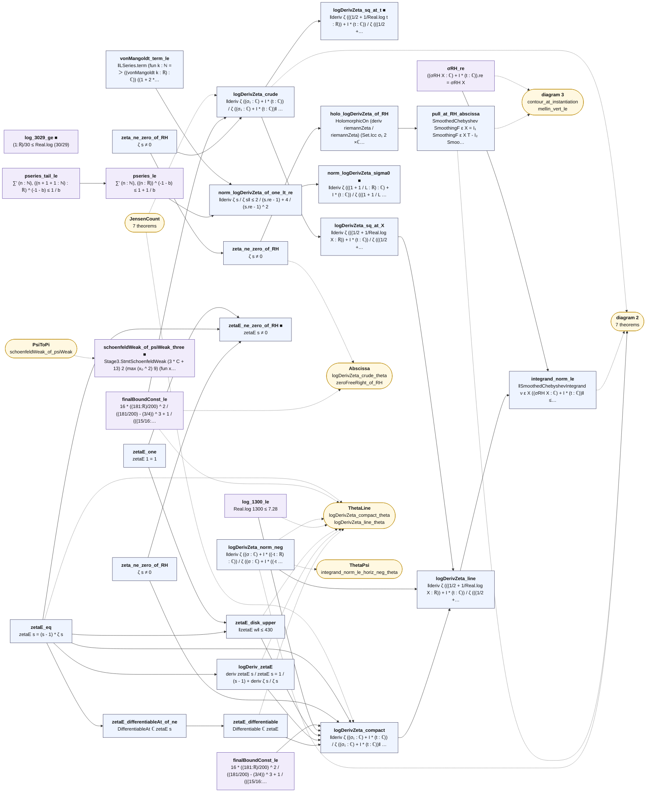
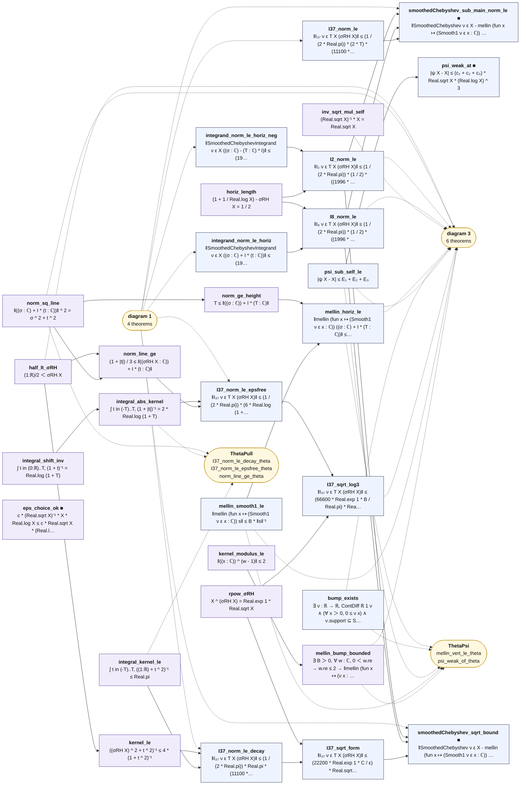
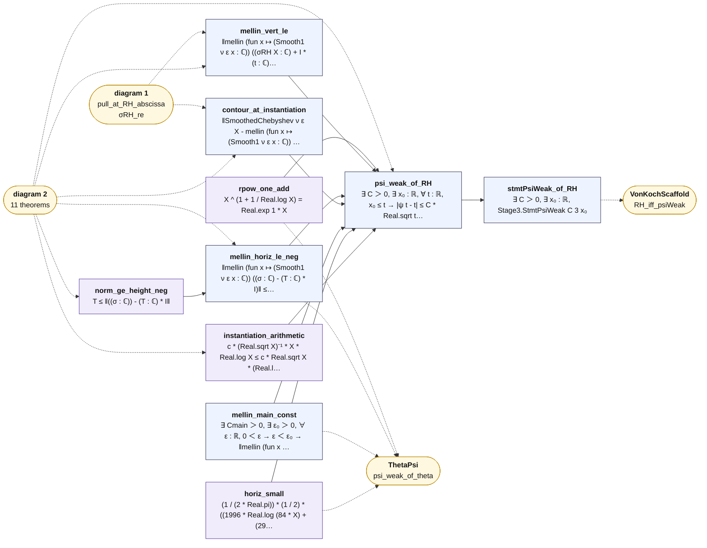

# `lean_stage3/Stage3/LineBound.lean`

This file has no header comment.

70 theorems, 2 definitions, 2494 lines. Arrows are Lean's own record of what each proof uses.

**Imports:** [`Assembly`](../lean_stage3/Assembly.md), [`JensenCount`](../lean_stage3/JensenCount.md)  
**Imported by:** [`Stage3`](../lean_stage3/Stage3.md), [`Abscissa`](../lean_stage3/Abscissa.md), [`VonKochScaffold`](../lean_stage3/VonKochScaffold.md)

## The picture

### Diagram 1 of 3: `zeta_ne_zero_of_RH` to `integrand_norm_le`



### Diagram 2 of 3: `I37_norm_le` to `inv_sqrt_mul_self`



### Diagram 3 of 3: `instantiation_arithmetic` to `stmtPsiWeak_of_RH`



An arrow A → B reads "A is used in the proof of B". Green: counting, integers only. Violet: shape, analysis with no ζ. Blue: reads ζ. A name ending in ■ is an end: nothing else uses it. Red: contains `sorry`. Yellow: theorems in another file, counted; a dotted arrow crosses files. Definitions are not drawn; they are listed below the diagram.

## Definitions

<a name="Slice4-zetaE"></a>
### `Slice4.zetaE`

def · line 369

The pole absorbed. `zetaE s = (s-1)·ζ s`, with the removable singularity at `s = 1` filled in with its residue `1`. Entire.

- **Is:** `` zetaE : ℂ → ℂ := Function.update (fun s => (s - 1) * ζ s) 1 1 ``
- **Used by 9:** [`Slice4.logDerivZeta_compact`](#Slice4-logDerivZeta_compact), [`Slice4.logDeriv_zetaE`](#Slice4-logDeriv_zetaE), [`Slice4.zetaE_differentiable`](#Slice4-zetaE_differentiable), [`Slice4.zetaE_differentiableAt_of_ne`](#Slice4-zetaE_differentiableAt_of_ne), [`Slice4.zetaE_disk_upper`](#Slice4-zetaE_disk_upper), [`Slice4.zetaE_eq`](#Slice4-zetaE_eq), [`Slice4.zetaE_ne_zero_of_RH`](#Slice4-zetaE_ne_zero_of_RH), [`Slice4.zetaE_one`](#Slice4-zetaE_one), [`Stage3.logDerivZeta_compact_theta`](../lean_stage3/ThetaLine.md#Stage3-logDerivZeta_compact_theta)

<a name="RHPull--RH"></a>
### `RHPull.σRH`

def · line 1091

The abscissa.

- **Is:** `` σRH (X : ℝ) : ℝ := 1 / 2 + 1 / Real.log X ``
- **Used by 23:** [`Stage3.σθ_half`](../lean_stage3/Abscissa.md#Stage3---_half), [`RHPull.I2_norm_le`](#RHPull-I2_norm_le), [`RHPull.I37_norm_le`](#RHPull-I37_norm_le), [`RHPull.I37_norm_le_decay`](#RHPull-I37_norm_le_decay), [`RHPull.I37_norm_le_epsfree`](#RHPull-I37_norm_le_epsfree), [`RHPull.I37_sqrt_form`](#RHPull-I37_sqrt_form), [`RHPull.I37_sqrt_log3`](#RHPull-I37_sqrt_log3), [`RHPull.I8_norm_le`](#RHPull-I8_norm_le), [`RHPull.contour_at_instantiation`](#RHPull-contour_at_instantiation), [`RHPull.half_lt_σRH`](#RHPull-half_lt_-RH), [`RHPull.horiz_length`](#RHPull-horiz_length), [`RHPull.integrand_norm_le`](#RHPull-integrand_norm_le), [`RHPull.integrand_norm_le_horiz`](#RHPull-integrand_norm_le_horiz), [`RHPull.integrand_norm_le_horiz_neg`](#RHPull-integrand_norm_le_horiz_neg), [`RHPull.kernel_le`](#RHPull-kernel_le), [`RHPull.mellin_vert_le`](#RHPull-mellin_vert_le), [`RHPull.norm_line_ge`](#RHPull-norm_line_ge), [`RHPull.psi_weak_of_RH`](#RHPull-psi_weak_of_RH), [`RHPull.rpow_σRH`](#RHPull-rpow_-RH), [`RHPull.smoothedChebyshev_sqrt_bound`](#RHPull-smoothedChebyshev_sqrt_bound), [`RHPull.smoothedChebyshev_sub_main_norm_le`](#RHPull-smoothedChebyshev_sub_main_norm_le), [`RHPull.σRH_re`](#RHPull--RH_re), [`Stage3.I37_sqrt_log3_half`](../lean_stage3/ThetaPull.md#Stage3-I37_sqrt_log3_half)

## Theorems

<a name="Slice3-zeta_ne_zero_of_RH"></a>
### `Slice3.zeta_ne_zero_of_RH`

line 23

**Reads ζ.** It, or something it rests on, uses the zeta function, its zeros or the Riemann hypothesis.

**Why.** Under RH, ζ has no zero with `1/2 < re s`, other than `s = 1`.

**Proves**

```lean
ζ s ≠ 0
```

**Needs** (its hypotheses)

  - `` hRH : RiemannHypothesis ``
  - `` hs : 1/2 < s.re ``
  - `` hs1 : s ≠ 1 ``

**Fed by:** no theorem of this repo; it stands on Mathlib.

**Feeds** (2 that use it)

  - [`RHPull.zeta_ne_zero_of_RH`](#RHPull-zeta_ne_zero_of_RH) — `` ζ s ≠ 0 ``
  - [`Slice3.logDerivZeta_crude`](#Slice3-logDerivZeta_crude) — `` ‖deriv ζ ((σ₁ : ℂ) + I * (t : ℂ)) / ζ ((σ₁ : ℂ) + I * (t : ℂ))‖ ≤ 1996 * Real.log (84 * t) + (29 * Real.log t + 129) / (σ₁ - 1/2) ``

<a name="Slice3-log_3029_ge"></a>
### `Slice3.log_3029_ge`

line 37

**Shape.** Uses real or complex analysis; nothing in it or beneath it reads ζ.

**Why.** `log (30/29) ≥ 1/30`.

**Proves**

```lean
(1:ℝ)/30 ≤ Real.log (30/29)
```

**Fed by:** no theorem of this repo; it stands on Mathlib.

**Feeds:** nothing. It connects to nothing.

<a name="Slice3-finalBoundConst_le"></a>
### `Slice3.finalBoundConst_le`

line 43

**Shape.** Uses real or complex analysis; nothing in it or beneath it reads ζ.

**Why.** LEVER 2 — the FinalBound constant at `r' = 3/4, r = 181/200, R' = 29/32, R = 15/16`.

**Proves**

```lean
16 * ((181:ℝ)/200) ^ 2 / ((181/200) - (3/4)) ^ 3 + 1 / (((15/16:ℝ) ^ 2 / (29/32) - 29/32) * Real.log ((15/16)/(29/32))) ≤ 3991
```

**Fed by:** no theorem of this repo; it stands on Mathlib.

**Feeds** (3 that use it)

  - [`Stage3.logDerivZeta_crude_theta`](../lean_stage3/Abscissa.md#Stage3-logDerivZeta_crude_theta) (Abscissa) — `` ‖deriv ζ ((σ₁ : ℂ) + I * (t : ℂ)) / ζ ((σ₁ : ℂ) + I * (t : ℂ))‖ ≤ 1996 * Real.log (84 * t) + (29 * Real.log t + 129) / (σ₁ - θ) ``
  - [`Slice3.logDerivZeta_crude`](#Slice3-logDerivZeta_crude) — `` ‖deriv ζ ((σ₁ : ℂ) + I * (t : ℂ)) / ζ ((σ₁ : ℂ) + I * (t : ℂ))‖ ≤ 1996 * Real.log (84 * t) + (29 * Real.log t + 129) / (σ₁ - 1/2) ``
  - [`Stage3.logDerivZeta_compact_theta`](../lean_stage3/ThetaLine.md#Stage3-logDerivZeta_compact_theta) (ThetaLine) — `` ‖deriv ζ ((σ₁ : ℂ) + I * (t : ℂ)) / ζ ((σ₁ : ℂ) + I * (t : ℂ))‖ ≤ 14530 + 2 / (1 - θ) + 212 / (σ₁ - θ) ``

<a name="Slice3-logDerivZeta_crude"></a>
### `Slice3.logDerivZeta_crude`

line 74

**Reads ζ.** It, or something it rests on, uses the zeta function, its zeros or the Riemann hypothesis.

**Why.** Slice 3. Under RH, for `t ≥ 2` and `1/2 < σ₁ ≤ 3/2`, `‖ζ'/ζ (σ₁ + it)‖ ≤ 1996 log(84 t) + (29 log t + 129)/(σ₁ - 1/2)`.

**Proves**

```lean
‖deriv ζ ((σ₁ : ℂ) + I * (t : ℂ)) / ζ ((σ₁ : ℂ) + I * (t : ℂ))‖ ≤ 1996 * Real.log (84 * t) + (29 * Real.log t + 129) / (σ₁ - 1/2)
```

**Needs** (its hypotheses)

  - `` hRH : RiemannHypothesis ``
  - `` ht : 2 ≤ t ``
  - `` hlo : 1/2 < σ₁ ``
  - `` hhi : σ₁ ≤ 2 ``

**Fed by** (8 theorems its proof uses)

  - [`Stage3.jensenF_analytic`](../lean_stage3/JensenCount.md#Stage3-jensenF_analytic) (JensenCount) — `` AnalyticOnNhd ℂ (jensenF T) (Metric.closedBall (0 : ℂ) 1) ``
  - [`Stage3.jensenF_bound`](../lean_stage3/JensenCount.md#Stage3-jensenF_bound) (JensenCount) — `` ‖jensenF T z‖ ≤ 84 * T ``
  - [`Stage3.jensenF_zero_eq_one`](../lean_stage3/JensenCount.md#Stage3-jensenF_zero_eq_one) (JensenCount) — `` jensenF T 0 = 1 ``
  - [`Stage3.jensenF_zeros_finite`](../lean_stage3/JensenCount.md#Stage3-jensenF_zeros_finite) (JensenCount) — `` (SetOfZeros 1 (jensenF T)).Finite ``
  - [`Stage3.pole_away_centre`](../lean_stage3/JensenCount.md#Stage3-pole_away_centre) (JensenCount) — `` v ≠ 1 ``
  - [`Stage3.zeta_centre_ne_zero`](../lean_stage3/JensenCount.md#Stage3-zeta_centre_ne_zero) (JensenCount) — `` ζ (2 + Complex.I * (T : ℂ)) ≠ 0 ``
  - [`Slice3.finalBoundConst_le`](#Slice3-finalBoundConst_le) — `` 16 * ((181:ℝ)/200) ^ 2 / ((181/200) - (3/4)) ^ 3 + 1 / (((15/16:ℝ) ^ 2 / (29/32) - 29/32) * Real.log ((15/16)/(29/32))) ≤ 3991 ``
  - [`Slice3.zeta_ne_zero_of_RH`](#Slice3-zeta_ne_zero_of_RH) — `` ζ s ≠ 0 ``

**Definitions its proof touches:** [`Stage3.jensenF`](../lean_stage3/JensenCount.md#Stage3-jensenF)

**Feeds** (4 that use it)

  - [`RHPull.integrand_norm_le_horiz`](#RHPull-integrand_norm_le_horiz) — `` ‖SmoothedChebyshevIntegrand ν ε X ((σ : ℂ) + I * (t : ℂ))‖ ≤ (1996 * Real.log (84 * t) + (29 * Real.log t + 129) * Real.log X) * M * X ^ σ ``
  - [`RHPull.integrand_norm_le_horiz_neg`](#RHPull-integrand_norm_le_horiz_neg) — `` ‖SmoothedChebyshevIntegrand ν ε X ((σ : ℂ) - (T : ℂ) * I)‖ ≤ (1996 * Real.log (84 * T) + (29 * Real.log T + 129) * Real.log X) * M * X ^ σ ``
  - [`Slice3.logDerivZeta_sq_at_X`](#Slice3-logDerivZeta_sq_at_X) — `` ‖deriv ζ (((1/2 + 1/Real.log X : ℝ)) + I * (t : ℂ)) / ζ (((1/2 + 1/Real.log X : ℝ)) + I * (t : ℂ))‖ ≤ 11100 * (Real.log X) ^ 2 ``
  - [`Slice3.logDerivZeta_sq_at_t`](#Slice3-logDerivZeta_sq_at_t) — `` ‖deriv ζ (((1/2 + 1/Real.log t : ℝ)) + I * (t : ℂ)) / ζ (((1/2 + 1/Real.log t : ℝ)) + I * (t : ℂ))‖ ≤ 21600 * (Real.log t) ^ 2 ``

<a name="Slice3-logDerivZeta_sq_at_t"></a>
### `Slice3.logDerivZeta_sq_at_t`

line 257

**Reads ζ.** It, or something it rests on, uses the zeta function, its zeros or the Riemann hypothesis.

**Why.** Corollary A — the literal `log²|t|` shape, at a `t`-tied abscissa. `σ₁ = 1/2 + 1/log t` gives `‖ζ'/ζ‖ ≤ 21600 (log t)²`. The abscissa moves with `t`, so this is not a vertical line.

**Proves**

```lean
‖deriv ζ (((1/2 + 1/Real.log t : ℝ)) + I * (t : ℂ)) / ζ (((1/2 + 1/Real.log t : ℝ)) + I * (t : ℂ))‖ ≤ 21600 * (Real.log t) ^ 2
```

**Needs** (its hypotheses)

  - `` hRH : RiemannHypothesis ``
  - `` ht : 2 ≤ t ``

**Fed by** (1 theorem its proof uses)

  - [`Slice3.logDerivZeta_crude`](#Slice3-logDerivZeta_crude) — `` ‖deriv ζ ((σ₁ : ℂ) + I * (t : ℂ)) / ζ ((σ₁ : ℂ) + I * (t : ℂ))‖ ≤ 1996 * Real.log (84 * t) + (29 * Real.log t + 129) / (σ₁ - 1/2) ``

**Feeds:** nothing. It is an end.

<a name="Slice3-logDerivZeta_sq_at_X"></a>
### `Slice3.logDerivZeta_sq_at_X`

line 295

**Reads ζ.** It, or something it rests on, uses the zeta function, its zeros or the Riemann hypothesis.

**Why.** Corollary B — the vertical-line shape the ψ-side actually consumes. `σ₁ = 1/2 + 1/log X` fixed, `2 ≤ t ≤ X`, `log X ≥ 1`: `‖ζ'/ζ‖ ≤ 11100 (log X)²`, uniformly in `t` on the truncation range.

**Proves**

```lean
‖deriv ζ (((1/2 + 1/Real.log X : ℝ)) + I * (t : ℂ)) / ζ (((1/2 + 1/Real.log X : ℝ)) + I * (t : ℂ))‖ ≤ 11100 * (Real.log X) ^ 2
```

**Needs** (its hypotheses)

  - `` hRH : RiemannHypothesis ``
  - `` ht : 2 ≤ t ``
  - `` hLX : 1 ≤ Real.log X ``
  - `` htX : Real.log t ≤ Real.log X ``

**Fed by** (1 theorem its proof uses)

  - [`Slice3.logDerivZeta_crude`](#Slice3-logDerivZeta_crude) — `` ‖deriv ζ ((σ₁ : ℂ) + I * (t : ℂ)) / ζ ((σ₁ : ℂ) + I * (t : ℂ))‖ ≤ 1996 * Real.log (84 * t) + (29 * Real.log t + 129) / (σ₁ - 1/2) ``

**Feeds** (1 that use it)

  - [`Slice4b.logDerivZeta_line`](#Slice4b-logDerivZeta_line) — `` ‖deriv ζ (((1/2 + 1/Real.log X : ℝ)) + I * (t : ℂ)) / ζ (((1/2 + 1/Real.log X : ℝ)) + I * (t : ℂ))‖ ≤ 11100 * (Real.log X) ^ 2 ``

<a name="Slice4-zeta_ne_zero_of_RH"></a>
### `Slice4.zeta_ne_zero_of_RH`

line 354

**Reads ζ.** It, or something it rests on, uses the zeta function, its zeros or the Riemann hypothesis.

**Why.** Under RH, `ζ` has no zero with `1/2 < re s`, other than `s = 1`.

**Proves**

```lean
ζ s ≠ 0
```

**Needs** (its hypotheses)

  - `` hRH : RiemannHypothesis ``
  - `` hs : 1/2 < s.re ``
  - `` hs1 : s ≠ 1 ``

**Fed by:** no theorem of this repo; it stands on Mathlib.

**Feeds** (2 that use it)

  - [`Slice4.logDerivZeta_compact`](#Slice4-logDerivZeta_compact) — `` ‖deriv ζ ((σ₁ : ℂ) + I * (t : ℂ)) / ζ ((σ₁ : ℂ) + I * (t : ℂ))‖ ≤ 14535 + 212 / (σ₁ - 1/2) ``
  - [`Slice4.zetaE_ne_zero_of_RH`](#Slice4-zetaE_ne_zero_of_RH) — `` zetaE s ≠ 0 ``

<a name="Slice4-zetaE_eq"></a>
### `Slice4.zetaE_eq`

line 371

**Reads ζ.** It, or something it rests on, uses the zeta function, its zeros or the Riemann hypothesis.

**Proves**

```lean
zetaE s = (s - 1) * ζ s
```

**Needs** (its hypotheses)

  - `` hs : s ≠ 1 ``

**Stated with:** [`Slice4.zetaE`](#Slice4-zetaE)

**Fed by:** no theorem of this repo; it stands on Mathlib and the definitions below.

**Feeds** (6 that use it)

  - [`Slice4.logDerivZeta_compact`](#Slice4-logDerivZeta_compact) — `` ‖deriv ζ ((σ₁ : ℂ) + I * (t : ℂ)) / ζ ((σ₁ : ℂ) + I * (t : ℂ))‖ ≤ 14535 + 212 / (σ₁ - 1/2) ``
  - [`Slice4.logDeriv_zetaE`](#Slice4-logDeriv_zetaE) — `` deriv zetaE s / zetaE s = 1 / (s - 1) + deriv ζ s / ζ s ``
  - [`Slice4.zetaE_differentiableAt_of_ne`](#Slice4-zetaE_differentiableAt_of_ne) — `` DifferentiableAt ℂ zetaE s ``
  - [`Slice4.zetaE_disk_upper`](#Slice4-zetaE_disk_upper) — `` ‖zetaE w‖ ≤ 430 ``
  - [`Slice4.zetaE_ne_zero_of_RH`](#Slice4-zetaE_ne_zero_of_RH) — `` zetaE s ≠ 0 ``
  - [`Stage3.logDerivZeta_compact_theta`](../lean_stage3/ThetaLine.md#Stage3-logDerivZeta_compact_theta) (ThetaLine) — `` ‖deriv ζ ((σ₁ : ℂ) + I * (t : ℂ)) / ζ ((σ₁ : ℂ) + I * (t : ℂ))‖ ≤ 14530 + 2 / (1 - θ) + 212 / (σ₁ - θ) ``

<a name="Slice4-zetaE_one"></a>
### `Slice4.zetaE_one`

line 374

**Reads ζ.** It, or something it rests on, uses the zeta function, its zeros or the Riemann hypothesis.

**Proves**

```lean
zetaE 1 = 1
```

**Stated with:** [`Slice4.zetaE`](#Slice4-zetaE)

**Fed by:** no theorem of this repo; it stands on Mathlib and the definitions below.

**Feeds** (2 that use it)

  - [`Slice4.zetaE_disk_upper`](#Slice4-zetaE_disk_upper) — `` ‖zetaE w‖ ≤ 430 ``
  - [`Slice4.zetaE_ne_zero_of_RH`](#Slice4-zetaE_ne_zero_of_RH) — `` zetaE s ≠ 0 ``

<a name="Slice4-zetaE_differentiableAt_of_ne"></a>
### `Slice4.zetaE_differentiableAt_of_ne`

line 376

**Reads ζ.** It, or something it rests on, uses the zeta function, its zeros or the Riemann hypothesis.

**Proves**

```lean
DifferentiableAt ℂ zetaE s
```

**Needs** (its hypotheses)

  - `` hs : s ≠ 1 ``

**Stated with:** [`Slice4.zetaE`](#Slice4-zetaE)

**Fed by** (1 theorem its proof uses)

  - [`Slice4.zetaE_eq`](#Slice4-zetaE_eq) — `` zetaE s = (s - 1) * ζ s ``

**Feeds** (1 that use it)

  - [`Slice4.zetaE_differentiable`](#Slice4-zetaE_differentiable) — `` Differentiable ℂ zetaE ``

<a name="Slice4-zetaE_differentiable"></a>
### `Slice4.zetaE_differentiable`

line 384

**Reads ζ.** It, or something it rests on, uses the zeta function, its zeros or the Riemann hypothesis.

**Proves**

```lean
Differentiable ℂ zetaE
```

**Stated with:** [`Slice4.zetaE`](#Slice4-zetaE)

**Fed by** (1 theorem its proof uses)

  - [`Slice4.zetaE_differentiableAt_of_ne`](#Slice4-zetaE_differentiableAt_of_ne) — `` DifferentiableAt ℂ zetaE s ``

**Feeds** (2 that use it)

  - [`Slice4.logDerivZeta_compact`](#Slice4-logDerivZeta_compact) — `` ‖deriv ζ ((σ₁ : ℂ) + I * (t : ℂ)) / ζ ((σ₁ : ℂ) + I * (t : ℂ))‖ ≤ 14535 + 212 / (σ₁ - 1/2) ``
  - [`Stage3.logDerivZeta_compact_theta`](../lean_stage3/ThetaLine.md#Stage3-logDerivZeta_compact_theta) (ThetaLine) — `` ‖deriv ζ ((σ₁ : ℂ) + I * (t : ℂ)) / ζ ((σ₁ : ℂ) + I * (t : ℂ))‖ ≤ 14530 + 2 / (1 - θ) + 212 / (σ₁ - θ) ``

<a name="Slice4-logDeriv_zetaE"></a>
### `Slice4.logDeriv_zetaE`

line 394

**Reads ζ.** It, or something it rests on, uses the zeta function, its zeros or the Riemann hypothesis.

**Why.** The log-derivative shift. `zetaE'/zetaE = 1/(s-1) + ζ'/ζ`.

**Proves**

```lean
deriv zetaE s / zetaE s = 1 / (s - 1) + deriv ζ s / ζ s
```

**Needs** (its hypotheses)

  - `` hs : s ≠ 1 ``
  - `` hz : ζ s ≠ 0 ``

**Stated with:** [`Slice4.zetaE`](#Slice4-zetaE)

**Fed by** (1 theorem its proof uses)

  - [`Slice4.zetaE_eq`](#Slice4-zetaE_eq) — `` zetaE s = (s - 1) * ζ s ``

**Feeds** (2 that use it)

  - [`Slice4.logDerivZeta_compact`](#Slice4-logDerivZeta_compact) — `` ‖deriv ζ ((σ₁ : ℂ) + I * (t : ℂ)) / ζ ((σ₁ : ℂ) + I * (t : ℂ))‖ ≤ 14535 + 212 / (σ₁ - 1/2) ``
  - [`Stage3.logDerivZeta_compact_theta`](../lean_stage3/ThetaLine.md#Stage3-logDerivZeta_compact_theta) (ThetaLine) — `` ‖deriv ζ ((σ₁ : ℂ) + I * (t : ℂ)) / ζ ((σ₁ : ℂ) + I * (t : ℂ))‖ ≤ 14530 + 2 / (1 - θ) + 212 / (σ₁ - θ) ``

<a name="Slice4-zetaE_ne_zero_of_RH"></a>
### `Slice4.zetaE_ne_zero_of_RH`

line 409

**Reads ζ.** It, or something it rests on, uses the zeta function, its zeros or the Riemann hypothesis.

**Proves**

```lean
zetaE s ≠ 0
```

**Needs** (its hypotheses)

  - `` hRH : RiemannHypothesis ``
  - `` hs : 1/2 < s.re ``

**Stated with:** [`Slice4.zetaE`](#Slice4-zetaE)

**Fed by** (3 theorems its proof uses)

  - [`Slice4.zetaE_eq`](#Slice4-zetaE_eq) — `` zetaE s = (s - 1) * ζ s ``
  - [`Slice4.zetaE_one`](#Slice4-zetaE_one) — `` zetaE 1 = 1 ``
  - [`Slice4.zeta_ne_zero_of_RH`](#Slice4-zeta_ne_zero_of_RH) — `` ζ s ≠ 0 ``

**Feeds:** nothing. It is an end.

<a name="Slice4-zetaE_disk_upper"></a>
### `Slice4.zetaE_disk_upper`

line 418

**Reads ζ.** It, or something it rests on, uses the zeta function, its zeros or the Riemann hypothesis.

**Why.** The majorant on the wide disk, pole included. `‖zetaE w‖ ≤ 430` for `|t| ≤ 2` and `‖w - (2 + it)‖ ≤ 15/8`.

**Proves**

```lean
‖zetaE w‖ ≤ 430
```

**Needs** (its hypotheses)

  - `` ht : |t| ≤ 2 ``
  - `` hw : ‖w - (2 + Complex.I * (t : ℂ))‖ ≤ 15 / 8 ``

**Stated with:** [`Slice4.zetaE`](#Slice4-zetaE)

**Fed by** (2 theorems its proof uses)

  - [`Slice4.zetaE_eq`](#Slice4-zetaE_eq) — `` zetaE s = (s - 1) * ζ s ``
  - [`Slice4.zetaE_one`](#Slice4-zetaE_one) — `` zetaE 1 = 1 ``

**Feeds** (2 that use it)

  - [`Slice4.logDerivZeta_compact`](#Slice4-logDerivZeta_compact) — `` ‖deriv ζ ((σ₁ : ℂ) + I * (t : ℂ)) / ζ ((σ₁ : ℂ) + I * (t : ℂ))‖ ≤ 14535 + 212 / (σ₁ - 1/2) ``
  - [`Stage3.logDerivZeta_compact_theta`](../lean_stage3/ThetaLine.md#Stage3-logDerivZeta_compact_theta) (ThetaLine) — `` ‖deriv ζ ((σ₁ : ℂ) + I * (t : ℂ)) / ζ ((σ₁ : ℂ) + I * (t : ℂ))‖ ≤ 14530 + 2 / (1 - θ) + 212 / (σ₁ - θ) ``

<a name="Slice4-log_1300_le"></a>
### `Slice4.log_1300_le`

line 493

**Shape.** Uses real or complex analysis; nothing in it or beneath it reads ζ.

**Why.** `log 1300 ≤ 7.28`, from `1300² ≤ 2^21`.

**Proves**

```lean
Real.log 1300 ≤ 7.28
```

**Fed by:** no theorem of this repo; it stands on Mathlib.

**Feeds** (2 that use it)

  - [`Slice4.logDerivZeta_compact`](#Slice4-logDerivZeta_compact) — `` ‖deriv ζ ((σ₁ : ℂ) + I * (t : ℂ)) / ζ ((σ₁ : ℂ) + I * (t : ℂ))‖ ≤ 14535 + 212 / (σ₁ - 1/2) ``
  - [`Stage3.logDerivZeta_compact_theta`](../lean_stage3/ThetaLine.md#Stage3-logDerivZeta_compact_theta) (ThetaLine) — `` ‖deriv ζ ((σ₁ : ℂ) + I * (t : ℂ)) / ζ ((σ₁ : ℂ) + I * (t : ℂ))‖ ≤ 14530 + 2 / (1 - θ) + 212 / (σ₁ - θ) ``

<a name="Slice4-finalBoundConst_le"></a>
### `Slice4.finalBoundConst_le`

line 503

**Shape.** Uses real or complex analysis; nothing in it or beneath it reads ζ.

**Why.** LEVER 2 — the FinalBound constant at `r' = 3/4, r = 181/200, R' = 29/32, R = 15/16` — the same radii as slice 3.

**Proves**

```lean
16 * ((181:ℝ)/200) ^ 2 / ((181/200) - (3/4)) ^ 3 + 1 / (((15/16:ℝ) ^ 2 / (29/32) - 29/32) * Real.log ((15/16)/(29/32))) ≤ 3991
```

**Fed by:** no theorem of this repo; it stands on Mathlib.

**Feeds** (1 that use it)

  - [`Slice4.logDerivZeta_compact`](#Slice4-logDerivZeta_compact) — `` ‖deriv ζ ((σ₁ : ℂ) + I * (t : ℂ)) / ζ ((σ₁ : ℂ) + I * (t : ℂ))‖ ≤ 14535 + 212 / (σ₁ - 1/2) ``

<a name="Slice4-logDerivZeta_compact"></a>
### `Slice4.logDerivZeta_compact`

line 531

**Reads ζ.** It, or something it rests on, uses the zeta function, its zeros or the Riemann hypothesis.

**Why.** Slice 4 — the compact patch. Under RH, for `|t| ≤ 2` and `1/2 < σ₁ ≤ 3/4`, `‖ζ'/ζ (σ₁ + it)‖ ≤ 14535 + 212/(σ₁ - 1/2)`.

**Proves**

```lean
‖deriv ζ ((σ₁ : ℂ) + I * (t : ℂ)) / ζ ((σ₁ : ℂ) + I * (t : ℂ))‖ ≤ 14535 + 212 / (σ₁ - 1/2)
```

**Needs** (its hypotheses)

  - `` hRH : RiemannHypothesis ``
  - `` ht : |t| ≤ 2 ``
  - `` hlo : 1/2 < σ₁ ``
  - `` hhi : σ₁ ≤ 3/4 ``

**Fed by** (9 theorems its proof uses)

  - [`Stage3.zeta_centre_lower`](../lean_stage3/JensenCount.md#Stage3-zeta_centre_lower) (JensenCount) — `` (1 : ℝ) / 3 ≤ ‖ζ (2 + Complex.I * T)‖ ``
  - [`Stage3.zeta_centre_ne_zero`](../lean_stage3/JensenCount.md#Stage3-zeta_centre_ne_zero) (JensenCount) — `` ζ (2 + Complex.I * (T : ℂ)) ≠ 0 ``
  - [`Slice4.finalBoundConst_le`](#Slice4-finalBoundConst_le) — `` 16 * ((181:ℝ)/200) ^ 2 / ((181/200) - (3/4)) ^ 3 + 1 / (((15/16:ℝ) ^ 2 / (29/32) - 29/32) * Real.log ((15/16)/(29/32))) ≤ 3991 ``
  - [`Slice4.logDeriv_zetaE`](#Slice4-logDeriv_zetaE) — `` deriv zetaE s / zetaE s = 1 / (s - 1) + deriv ζ s / ζ s ``
  - [`Slice4.log_1300_le`](#Slice4-log_1300_le) — `` Real.log 1300 ≤ 7.28 ``
  - [`Slice4.zetaE_differentiable`](#Slice4-zetaE_differentiable) — `` Differentiable ℂ zetaE ``
  - [`Slice4.zetaE_disk_upper`](#Slice4-zetaE_disk_upper) — `` ‖zetaE w‖ ≤ 430 ``
  - [`Slice4.zetaE_eq`](#Slice4-zetaE_eq) — `` zetaE s = (s - 1) * ζ s ``
  - [`Slice4.zeta_ne_zero_of_RH`](#Slice4-zeta_ne_zero_of_RH) — `` ζ s ≠ 0 ``

**Definitions its proof touches:** [`Slice4.zetaE`](#Slice4-zetaE)

**Feeds** (1 that use it)

  - [`Slice4b.logDerivZeta_line`](#Slice4b-logDerivZeta_line) — `` ‖deriv ζ (((1/2 + 1/Real.log X : ℝ)) + I * (t : ℂ)) / ζ (((1/2 + 1/Real.log X : ℝ)) + I * (t : ℂ))‖ ≤ 11100 * (Real.log X) ^ 2 ``

<a name="Slice4b-logDerivZeta_norm_neg"></a>
### `Slice4b.logDerivZeta_norm_neg`

line 789

**Reads ζ.** It, or something it rests on, uses the zeta function, its zeros or the Riemann hypothesis.

**Why.** Reflection: the log-derivative's norm is even in `t`.

**Proves**

```lean
‖deriv ζ ((σ : ℂ) + I * ((-t : ℝ) : ℂ)) / ζ ((σ : ℂ) + I * ((-t : ℝ) : ℂ))‖ = ‖deriv ζ ((σ : ℂ) + I * (t : ℂ)) / ζ ((σ : ℂ) + I * (t : ℂ))‖
```

**Needs** (its hypotheses)

  - `` σ t : ℝ ``

**Fed by:** no theorem of this repo; it stands on Mathlib.

**Feeds** (4 that use it)

  - [`RHPull.integrand_norm_le_horiz_neg`](#RHPull-integrand_norm_le_horiz_neg) — `` ‖SmoothedChebyshevIntegrand ν ε X ((σ : ℂ) - (T : ℂ) * I)‖ ≤ (1996 * Real.log (84 * T) + (29 * Real.log T + 129) * Real.log X) * M * X ^ σ ``
  - [`Slice4b.logDerivZeta_line`](#Slice4b-logDerivZeta_line) — `` ‖deriv ζ (((1/2 + 1/Real.log X : ℝ)) + I * (t : ℂ)) / ζ (((1/2 + 1/Real.log X : ℝ)) + I * (t : ℂ))‖ ≤ 11100 * (Real.log X) ^ 2 ``
  - [`Stage3.logDerivZeta_line_theta`](../lean_stage3/ThetaLine.md#Stage3-logDerivZeta_line_theta) (ThetaLine) — `` ‖deriv ζ (((θ + 1/Real.log X : ℝ)) + I * (t : ℂ)) / ζ (((θ + 1/Real.log X : ℝ)) + I * (t : ℂ))‖ ≤ 11100 * (Real.log X) ^ 2 ``
  - [`Stage3.integrand_norm_le_horiz_neg_theta`](../lean_stage3/ThetaPsi.md#Stage3-integrand_norm_le_horiz_neg_theta) (ThetaPsi) — `` ‖SmoothedChebyshevIntegrand ν ε X ((σ : ℂ) - (T : ℂ) * I)‖ ≤ (1996 * Real.log (84 * T) + (29 * Real.log T + 129) * Real.log X) * M * X ^ σ ``

<a name="Slice4b-logDerivZeta_line"></a>
### `Slice4b.logDerivZeta_line`

line 801

**Reads ζ.** It, or something it rests on, uses the zeta function, its zeros or the Riemann hypothesis.

**Why.** Slice 4b — the vertical line, uniform in `t`. Under RH, on `σ₁ = 1/2 + 1/log X` with `log X ≥ 4` and `|t| ≤ X`: `‖ζ'/ζ‖ ≤ 11100 (log X)²`.

**Proves**

```lean
‖deriv ζ (((1/2 + 1/Real.log X : ℝ)) + I * (t : ℂ)) / ζ (((1/2 + 1/Real.log X : ℝ)) + I * (t : ℂ))‖ ≤ 11100 * (Real.log X) ^ 2
```

**Needs** (its hypotheses)

  - `` hRH : RiemannHypothesis ``
  - `` hLX : 4 ≤ Real.log X ``
  - `` htX : |t| ≤ X ``

**Fed by** (3 theorems its proof uses)

  - [`Slice3.logDerivZeta_sq_at_X`](#Slice3-logDerivZeta_sq_at_X) — `` ‖deriv ζ (((1/2 + 1/Real.log X : ℝ)) + I * (t : ℂ)) / ζ (((1/2 + 1/Real.log X : ℝ)) + I * (t : ℂ))‖ ≤ 11100 * (Real.log X) ^ 2 ``
  - [`Slice4.logDerivZeta_compact`](#Slice4-logDerivZeta_compact) — `` ‖deriv ζ ((σ₁ : ℂ) + I * (t : ℂ)) / ζ ((σ₁ : ℂ) + I * (t : ℂ))‖ ≤ 14535 + 212 / (σ₁ - 1/2) ``
  - [`Slice4b.logDerivZeta_norm_neg`](#Slice4b-logDerivZeta_norm_neg) — `` ‖deriv ζ ((σ : ℂ) + I * ((-t : ℝ) : ℂ)) / ζ ((σ : ℂ) + I * ((-t : ℝ) : ℂ))‖ = ‖deriv ζ ((σ : ℂ) + I * (t : ℂ)) / ζ ((σ : ℂ) + I * (t : ℂ))‖ ``

**Feeds** (1 that use it)

  - [`RHPull.integrand_norm_le`](#RHPull-integrand_norm_le) — `` ‖SmoothedChebyshevIntegrand ν ε X ((σRH X : ℂ) + I * (t : ℂ))‖ ≤ 11100 * (Real.log X) ^ 2 * M * X ^ (σRH X) ``

<a name="Slice8-schoenfeldWeak_of_psiWeak_three"></a>
### `Slice8.schoenfeldWeak_of_psiWeak_three`

line 848

**Shape.** Uses real or complex analysis; nothing in it or beneath it reads ζ.

**Why.** Slice 8 — PsiToPi at `k = 3`. A ψ-side weak bound at exponent `3` delivers `StmtSchoenfeldWeak (3C+13) 2` — the shape entry 231's census gate is stated against.

**Proves**

```lean
Stage3.StmtSchoenfeldWeak (3 * C + 13) 2 (max (x₀ ^ 2) 9) (fun x => (Nat.primeCounting ⌊x⌋₊ : ℝ)) Stage3.Li
```

**Needs** (its hypotheses)

  - `` hx₀ : 2 ≤ x₀ ``
  - `` hC : 0 ≤ C ``
  - `` h : Stage3.StmtPsiWeak C 3 x₀ ``

**Stated with:** [`Stage3.Li`](../lean_stage3/PsiToPi.md#Stage3-Li), [`Stage3.StmtPsiWeak`](../lean_stage3/PsiToPi.md#Stage3-StmtPsiWeak), [`Stage3.StmtSchoenfeldWeak`](../lean_stage3/Statement.md#Stage3-StmtSchoenfeldWeak)

**Fed by** (1 theorem its proof uses)

  - [`Stage3.schoenfeldWeak_of_psiWeak`](../lean_stage3/PsiToPi.md#Stage3-schoenfeldWeak_of_psiWeak) (PsiToPi) — `` StmtSchoenfeldWeak (3 * C + 13) (k - 1) (max (x₀ ^ 2) 9) (fun x => (Nat.primeCounting ⌊x⌋₊ : ℝ)) Li ``

**Feeds:** nothing. It is an end.

<a name="Slice5-pseries_tail_le"></a>
### `Slice5.pseries_tail_le`

line 879

**Shape.** Uses real or complex analysis; nothing in it or beneath it reads ζ.

**Why.** Integral test: for `b > 0`, `∑_{n ≥ 2} n^{-1-b} ≤ 1/b`.

**Proves**

```lean
∑' (n : ℕ), ((n + 1 + 1 : ℕ) : ℝ) ^ (-1 - b) ≤ 1 / b
```

**Needs** (its hypotheses)

  - `` hb : 0 < b ``

**Fed by:** no theorem of this repo; it stands on Mathlib.

**Feeds** (1 that use it)

  - [`Slice5.pseries_le`](#Slice5-pseries_le) — `` ∑' (n : ℕ), ((n : ℝ)) ^ (-1 - b) ≤ 1 + 1 / b ``

<a name="Slice5-pseries_le"></a>
### `Slice5.pseries_le`

line 902

**Shape.** Uses real or complex analysis; nothing in it or beneath it reads ζ.

**Why.** For `b > 0`, `∑_{n ≥ 0} n^{-1-b} ≤ 1 + 1/b` (the `n = 0` term is `0`).

**Proves**

```lean
∑' (n : ℕ), ((n : ℝ)) ^ (-1 - b) ≤ 1 + 1 / b
```

**Needs** (its hypotheses)

  - `` hb : 0 < b ``

**Fed by** (1 theorem its proof uses)

  - [`Slice5.pseries_tail_le`](#Slice5-pseries_tail_le) — `` ∑' (n : ℕ), ((n + 1 + 1 : ℕ) : ℝ) ^ (-1 - b) ≤ 1 / b ``

**Feeds** (1 that use it)

  - [`Slice5.norm_logDerivZeta_of_one_lt_re`](#Slice5-norm_logDerivZeta_of_one_lt_re) — `` ‖deriv ζ s / ζ s‖ ≤ 2 / (s.re - 1) + 4 / (s.re - 1) ^ 2 ``

<a name="Slice5-vonMangoldt_term_le"></a>
### `Slice5.vonMangoldt_term_le`

line 918

**Reads ζ.** It, or something it rests on, uses the zeta function, its zeros or the Riemann hypothesis.

**Why.** `Λ n / n^σ ≤ (1/b) · n^{-1-b}` when `σ = 1 + 2b`, `b > 0`.

**Proves**

```lean
‖LSeries.term (fun k : ℕ => ((vonMangoldt k : ℝ) : ℂ)) ((1 + 2 * b : ℝ) : ℂ) n‖ ≤ (1 / b) * ((n : ℝ)) ^ (-1 - b)
```

**Needs** (its hypotheses)

  - `` hb : 0 < b ``
  - `` n : ℕ ``

**Fed by:** no theorem of this repo; it stands on Mathlib.

**Feeds** (1 that use it)

  - [`Slice5.norm_logDerivZeta_of_one_lt_re`](#Slice5-norm_logDerivZeta_of_one_lt_re) — `` ‖deriv ζ s / ζ s‖ ≤ 2 / (s.re - 1) + 4 / (s.re - 1) ^ 2 ``

<a name="Slice5-norm_logDerivZeta_of_one_lt_re"></a>
### `Slice5.norm_logDerivZeta_of_one_lt_re`

line 948

**Reads ζ.** It, or something it rests on, uses the zeta function, its zeros or the Riemann hypothesis.

**Why.** Slice 5. For `Re s > 1`, elementary and RH-free: `‖ζ'/ζ(s)‖ ≤ 2/(Re s - 1) + 4/(Re s - 1)²`.

**Proves**

```lean
‖deriv ζ s / ζ s‖ ≤ 2 / (s.re - 1) + 4 / (s.re - 1) ^ 2
```

**Needs** (its hypotheses)

  - `` hs : 1 < s.re ``

**Fed by** (2 theorems its proof uses)

  - [`Slice5.pseries_le`](#Slice5-pseries_le) — `` ∑' (n : ℕ), ((n : ℝ)) ^ (-1 - b) ≤ 1 + 1 / b ``
  - [`Slice5.vonMangoldt_term_le`](#Slice5-vonMangoldt_term_le) — `` ‖LSeries.term (fun k : ℕ => ((vonMangoldt k : ℝ) : ℂ)) ((1 + 2 * b : ℝ) : ℂ) n‖ ≤ (1 / b) * ((n : ℝ)) ^ (-1 - b) ``

**Feeds** (1 that use it)

  - [`Slice5.norm_logDerivZeta_sigma0`](#Slice5-norm_logDerivZeta_sigma0) — `` ‖deriv ζ (((1 + 1 / L : ℝ) : ℂ) + I * (t : ℂ)) / ζ (((1 + 1 / L : ℝ) : ℂ) + I * (t : ℂ))‖ ≤ 2 * L + 4 * L ^ 2 ``

<a name="Slice5-norm_logDerivZeta_sigma0"></a>
### `Slice5.norm_logDerivZeta_sigma0`

line 991

**Reads ζ.** It, or something it rests on, uses the zeta function, its zeros or the Riemann hypothesis.

**Why.** Corollary — the shape the `I₁`/`I₉` integrals consume. At the standard abscissa `σ₀ = 1 + 1/L` with `L ≥ 1`, uniformly in `t`: `‖ζ'/ζ(σ₀ + it)‖ ≤ 2 L + 4 L²`.

**Proves**

```lean
‖deriv ζ (((1 + 1 / L : ℝ) : ℂ) + I * (t : ℂ)) / ζ (((1 + 1 / L : ℝ) : ℂ) + I * (t : ℂ))‖ ≤ 2 * L + 4 * L ^ 2
```

**Needs** (its hypotheses)

  - `` hL : 1 ≤ L ``

**Fed by** (1 theorem its proof uses)

  - [`Slice5.norm_logDerivZeta_of_one_lt_re`](#Slice5-norm_logDerivZeta_of_one_lt_re) — `` ‖deriv ζ s / ζ s‖ ≤ 2 / (s.re - 1) + 4 / (s.re - 1) ^ 2 ``

**Feeds:** nothing. It is an end.

<a name="RHPull-zeta_ne_zero_of_RH"></a>
### `RHPull.zeta_ne_zero_of_RH`

line 1031

**Reads ζ.** It, or something it rests on, uses the zeta function, its zeros or the Riemann hypothesis.

**Why.** Under RH, `ζ` has no zero right of the critical line.

**Proves**

```lean
ζ s ≠ 0
```

**Needs** (its hypotheses)

  - `` hRH : RiemannHypothesis ``
  - `` hs : 1/2 < s.re ``
  - `` hs1 : s ≠ 1 ``

**Fed by** (1 theorem its proof uses)

  - [`Slice3.zeta_ne_zero_of_RH`](#Slice3-zeta_ne_zero_of_RH) — `` ζ s ≠ 0 ``

**Feeds** (2 that use it)

  - [`Stage3.zeroFreeRight_of_RH`](../lean_stage3/Abscissa.md#Stage3-zeroFreeRight_of_RH) (Abscissa) — `` StmtZeroFreeRight (1/2) ``
  - [`RHPull.holo_logDerivZeta_of_RH`](#RHPull-holo_logDerivZeta_of_RH) — `` HolomorphicOn (deriv riemannZeta / riemannZeta) (Set.Icc σ₁ 2 ×ℂ Set.Icc (-T) T \ {1}) ``

<a name="RHPull-holo_logDerivZeta_of_RH"></a>
### `RHPull.holo_logDerivZeta_of_RH`

line 1036

**Reads ζ.** It, or something it rests on, uses the zeta function, its zeros or the Riemann hypothesis.

**Why.** The holomorphy hypothesis is free under RH.

**Proves**

```lean
HolomorphicOn (deriv riemannZeta / riemannZeta) (Set.Icc σ₁ 2 ×ℂ Set.Icc (-T) T \ {1})
```

**Needs** (its hypotheses)

  - `` hRH : RiemannHypothesis ``
  - `` hσ : 1/2 < σ₁ ``

**Fed by** (1 theorem its proof uses)

  - [`RHPull.zeta_ne_zero_of_RH`](#RHPull-zeta_ne_zero_of_RH) — `` ζ s ≠ 0 ``

**Feeds** (1 that use it)

  - [`RHPull.pull_at_RH_abscissa`](#RHPull-pull_at_RH_abscissa) — `` SmoothedChebyshev SmoothingF ε X = I₁ SmoothingF ε X T - I₂ SmoothingF ε T X (1 / 2 + 1 / Real.log X) + I₃₇ SmoothingF ε T X (1 / 2 + 1 / Real.log X) … ``

<a name="RHPull-pull_at_RH_abscissa"></a>
### `RHPull.pull_at_RH_abscissa`

line 1056

**Reads ζ.** It, or something it rests on, uses the zeta function, its zeros or the Riemann hypothesis.

**Why.** The pull, instantiated at the RH abscissa. `SmoothedChebyshevPull1` with `σ₁ = 1/2 + 1/log X`. Its holomorphy hypothesis is discharged by RH, so the contour lands exactly on the line `Slice4b.logDerivZeta_line` controls.

**Proves**

```lean
SmoothedChebyshev SmoothingF ε X = I₁ SmoothingF ε X T - I₂ SmoothingF ε T X (1 / 2 + 1 / Real.log X) + I₃₇ SmoothingF ε T X (1 / 2 + 1 / Real.log X) + I₈ SmoothingF ε T X (1 / 2 + 1 / Real.log X) + I₉ SmoothingF ε X T + mellin (fun x ↦ (Smooth1 SmoothingF ε x : ℂ)) 1 * X
```

**Needs** (its hypotheses)

  - `` hRH : RiemannHypothesis ``
  - `` ε_pos : 0 < ε ``
  - `` ε_lt_one : ε < 1 ``
  - `` X : ℝ ``
  - `` X_gt : 3 < X ``
  - `` T_pos : 0 < T ``
  - `` hLX : 4 ≤ Real.log X ``
  - `` suppSmoothingF : Function.support SmoothingF ⊆ Set.Icc (1 / 2) 2 ``
  - `` SmoothingFnonneg : ∀ x > 0, 0 ≤ SmoothingF x ``
  - `` mass_one : ∫ x in Set.Ioi 0, SmoothingF x / x = 1 ``
  - `` ContDiffSmoothingF : ContDiff ℝ 1 SmoothingF ``

**Fed by** (1 theorem its proof uses)

  - [`RHPull.holo_logDerivZeta_of_RH`](#RHPull-holo_logDerivZeta_of_RH) — `` HolomorphicOn (deriv riemannZeta / riemannZeta) (Set.Icc σ₁ 2 ×ℂ Set.Icc (-T) T \ {1}) ``

**Feeds** (3 that use it)

  - [`RHPull.contour_at_instantiation`](#RHPull-contour_at_instantiation) — `` ‖SmoothedChebyshev ν ε X - mellin (fun x ↦ (Smooth1 ν ε x : ℂ)) 1 * X‖ ≤ B₁ + B₉ + (66600 * Real.exp 1 * B / Real.pi) * Real.sqrt X * (Real.log X) ^ 3… ``
  - [`RHPull.smoothedChebyshev_sqrt_bound`](#RHPull-smoothedChebyshev_sqrt_bound) — `` ‖SmoothedChebyshev ν ε X - mellin (fun x ↦ (Smooth1 ν ε x : ℂ)) 1 * X‖ ≤ B₁ + B₉ + (22200 * Real.exp 1 * C / ε) * Real.sqrt X * (Real.log X) ^ 2 + (1 … ``
  - [`RHPull.smoothedChebyshev_sub_main_norm_le`](#RHPull-smoothedChebyshev_sub_main_norm_le) — `` ‖SmoothedChebyshev ν ε X - mellin (fun x ↦ (Smooth1 ν ε x : ℂ)) 1 * X‖ ≤ B₁ + B₉ + (1 / (2 * Real.pi)) * (2 * T) * (11100 * (Real.log X) ^ 2 * M₃₇ * X… ``

<a name="RHPull--RH_re"></a>
### `RHPull.σRH_re`

line 1093

**Shape.** Uses real or complex analysis; nothing in it or beneath it reads ζ.

**Proves**

```lean
((σRH X : ℂ) + I * (t : ℂ)).re = σRH X
```

**Needs** (its hypotheses)

  - `` X t : ℝ ``

**Stated with:** [`RHPull.σRH`](#RHPull--RH)

**Fed by:** no theorem of this repo; it stands on Mathlib and the definitions below.

**Feeds** (2 that use it)

  - [`RHPull.integrand_norm_le`](#RHPull-integrand_norm_le) — `` ‖SmoothedChebyshevIntegrand ν ε X ((σRH X : ℂ) + I * (t : ℂ))‖ ≤ 11100 * (Real.log X) ^ 2 * M * X ^ (σRH X) ``
  - [`RHPull.mellin_vert_le`](#RHPull-mellin_vert_le) — `` ‖mellin (fun x ↦ (Smooth1 ν ε x : ℂ)) ((σRH X : ℂ) + I * (t : ℂ))‖ ≤ B * ‖((σRH X : ℂ)) + I * (t : ℂ)‖⁻¹ ``

<a name="RHPull-integrand_norm_le"></a>
### `RHPull.integrand_norm_le`

line 1099

**Reads ζ.** It, or something it rests on, uses the zeta function, its zeros or the Riemann hypothesis.

**Why.** Pointwise bound on the pull integrand along the RH abscissa. `‖(-ζ'/ζ)·𝓜·X^s‖` with the line bound on the first factor, the Mellin bound on the second, and `‖X^s‖ = X^σ₁` on the third.

**Proves**

```lean
‖SmoothedChebyshevIntegrand ν ε X ((σRH X : ℂ) + I * (t : ℂ))‖ ≤ 11100 * (Real.log X) ^ 2 * M * X ^ (σRH X)
```

**Needs** (its hypotheses)

  - `` hRH : RiemannHypothesis ``
  - `` hX : 0 < X ``
  - `` hLX : 4 ≤ Real.log X ``
  - `` htX : |t| ≤ X ``
  - `` hMel : ‖mellin (fun x ↦ (Smooth1 ν ε x : ℂ)) ((σRH X : ℂ) + I * (t : ℂ))‖ ≤ M ``

**Stated with:** [`RHPull.σRH`](#RHPull--RH)

**Fed by** (2 theorems its proof uses)

  - [`RHPull.σRH_re`](#RHPull--RH_re) — `` ((σRH X : ℂ) + I * (t : ℂ)).re = σRH X ``
  - [`Slice4b.logDerivZeta_line`](#Slice4b-logDerivZeta_line) — `` ‖deriv ζ (((1/2 + 1/Real.log X : ℝ)) + I * (t : ℂ)) / ζ (((1/2 + 1/Real.log X : ℝ)) + I * (t : ℂ))‖ ≤ 11100 * (Real.log X) ^ 2 ``

**Feeds** (3 that use it)

  - [`RHPull.I37_norm_le`](#RHPull-I37_norm_le) — `` ‖I₃₇ ν ε T X (σRH X)‖ ≤ (1 / (2 * Real.pi)) * (2 * T) * (11100 * (Real.log X) ^ 2 * M * X ^ (σRH X)) ``
  - [`RHPull.I37_norm_le_decay`](#RHPull-I37_norm_le_decay) — `` ‖I₃₇ ν ε T X (σRH X)‖ ≤ (1 / (2 * Real.pi)) * Real.pi * (11100 * (Real.log X) ^ 2 * (4 * C / ε) * X ^ (σRH X)) ``
  - [`RHPull.I37_norm_le_epsfree`](#RHPull-I37_norm_le_epsfree) — `` ‖I₃₇ ν ε T X (σRH X)‖ ≤ (1 / (2 * Real.pi)) * (6 * Real.log (1 + T)) * (11100 * (Real.log X) ^ 2 * B * X ^ (σRH X)) ``

<a name="RHPull-I37_norm_le"></a>
### `RHPull.I37_norm_le`

line 1131

**Reads ζ.** It, or something it rests on, uses the zeta function, its zeros or the Riemann hypothesis.

**Why.** I₃₇ bounded at the RH abscissa. The vertical segment, with the line bound on `ζ'/ζ` and a uniform Mellin bound `M`.

**Proves**

```lean
‖I₃₇ ν ε T X (σRH X)‖ ≤ (1 / (2 * Real.pi)) * (2 * T) * (11100 * (Real.log X) ^ 2 * M * X ^ (σRH X))
```

**Needs** (its hypotheses)

  - `` hRH : RiemannHypothesis ``
  - `` hX : 0 < X ``
  - `` hLX : 4 ≤ Real.log X ``
  - `` hT : 0 < T ``
  - `` hTX : T ≤ X ``
  - `` hM : 0 ≤ M ``
  - `` hMel : ∀ t : ℝ, |t| ≤ T → ‖mellin (fun x ↦ (Smooth1 ν ε x : ℂ)) ((σRH X : ℂ) + I * (t : ℂ))‖ ≤ M ``

**Stated with:** [`RHPull.σRH`](#RHPull--RH)

**Fed by** (1 theorem its proof uses)

  - [`RHPull.integrand_norm_le`](#RHPull-integrand_norm_le) — `` ‖SmoothedChebyshevIntegrand ν ε X ((σRH X : ℂ) + I * (t : ℂ))‖ ≤ 11100 * (Real.log X) ^ 2 * M * X ^ (σRH X) ``

**Feeds** (1 that use it)

  - [`RHPull.smoothedChebyshev_sub_main_norm_le`](#RHPull-smoothedChebyshev_sub_main_norm_le) — `` ‖SmoothedChebyshev ν ε X - mellin (fun x ↦ (Smooth1 ν ε x : ℂ)) 1 * X‖ ≤ B₁ + B₉ + (1 / (2 * Real.pi)) * (2 * T) * (11100 * (Real.log X) ^ 2 * M₃₇ * X… ``

<a name="RHPull-integrand_norm_le_horiz"></a>
### `RHPull.integrand_norm_le_horiz`

line 1181

**Reads ζ.** It, or something it rests on, uses the zeta function, its zeros or the Riemann hypothesis.

**Why.** Pointwise bound on the horizontal segments. For `σ` between the RH abscissa and `1 + 1/log X`, at height `t` with `2 ≤ |t|`, `Slice3.logDerivZeta_crude` applies and `1/(σ - 1/2) ≤ log X` on that range.

**Proves**

```lean
‖SmoothedChebyshevIntegrand ν ε X ((σ : ℂ) + I * (t : ℂ))‖ ≤ (1996 * Real.log (84 * t) + (29 * Real.log t + 129) * Real.log X) * M * X ^ σ
```

**Needs** (its hypotheses)

  - `` hRH : RiemannHypothesis ``
  - `` hX : 0 < X ``
  - `` hLX : 4 ≤ Real.log X ``
  - `` ht : 2 ≤ t ``
  - `` hσlo : σRH X ≤ σ ``
  - `` hσhi : σ ≤ 1 + 1 / Real.log X ``
  - `` hMel : ‖mellin (fun x ↦ (Smooth1 ν ε x : ℂ)) ((σ : ℂ) + I * (t : ℂ))‖ ≤ M ``

**Stated with:** [`RHPull.σRH`](#RHPull--RH)

**Fed by** (1 theorem its proof uses)

  - [`Slice3.logDerivZeta_crude`](#Slice3-logDerivZeta_crude) — `` ‖deriv ζ ((σ₁ : ℂ) + I * (t : ℂ)) / ζ ((σ₁ : ℂ) + I * (t : ℂ))‖ ≤ 1996 * Real.log (84 * t) + (29 * Real.log t + 129) / (σ₁ - 1/2) ``

**Feeds** (1 that use it)

  - [`RHPull.I8_norm_le`](#RHPull-I8_norm_le) — `` ‖I₈ ν ε T X (σRH X)‖ ≤ (1 / (2 * Real.pi)) * (1 / 2) * ((1996 * Real.log (84 * T) + (29 * Real.log T + 129) * Real.log X) * M * X ^ (1 + 1 / Real.log … ``

<a name="RHPull-horiz_length"></a>
### `RHPull.horiz_length`

line 1238

**Shape.** Uses real or complex analysis; nothing in it or beneath it reads ζ.

**Why.** The horizontal segment has length exactly `1/2`.

**Proves**

```lean
(1 + 1 / Real.log X) - σRH X = 1 / 2
```

**Needs** (its hypotheses)

  - `` X : ℝ ``

**Stated with:** [`RHPull.σRH`](#RHPull--RH)

**Fed by:** no theorem of this repo; it stands on Mathlib and the definitions below.

**Feeds** (2 that use it)

  - [`RHPull.I2_norm_le`](#RHPull-I2_norm_le) — `` ‖I₂ ν ε T X (σRH X)‖ ≤ (1 / (2 * Real.pi)) * (1 / 2) * ((1996 * Real.log (84 * T) + (29 * Real.log T + 129) * Real.log X) * M * X ^ (1 + 1 / Real.log … ``
  - [`RHPull.I8_norm_le`](#RHPull-I8_norm_le) — `` ‖I₈ ν ε T X (σRH X)‖ ≤ (1 / (2 * Real.pi)) * (1 / 2) * ((1996 * Real.log (84 * T) + (29 * Real.log T + 129) * Real.log X) * M * X ^ (1 + 1 / Real.log … ``

<a name="RHPull-I8_norm_le"></a>
### `RHPull.I8_norm_le`

line 1242

**Reads ζ.** It, or something it rests on, uses the zeta function, its zeros or the Riemann hypothesis.

**Why.** I₈ bounded at the RH abscissa — the upper horizontal segment.

**Proves**

```lean
‖I₈ ν ε T X (σRH X)‖ ≤ (1 / (2 * Real.pi)) * (1 / 2) * ((1996 * Real.log (84 * T) + (29 * Real.log T + 129) * Real.log X) * M * X ^ (1 + 1 / Real.log X))
```

**Needs** (its hypotheses)

  - `` hRH : RiemannHypothesis ``
  - `` hX : 0 < X ``
  - `` hLX : 4 ≤ Real.log X ``
  - `` hT : 2 ≤ T ``
  - `` hMel : ∀ σ : ℝ, σRH X ≤ σ → σ ≤ 1 + 1 / Real.log X → ‖mellin (fun x ↦ (Smooth1 ν ε x : ℂ)) ((σ : ℂ) + I * (T : ℂ))‖ ≤ M ``

**Stated with:** [`RHPull.σRH`](#RHPull--RH)

**Fed by** (2 theorems its proof uses)

  - [`RHPull.horiz_length`](#RHPull-horiz_length) — `` (1 + 1 / Real.log X) - σRH X = 1 / 2 ``
  - [`RHPull.integrand_norm_le_horiz`](#RHPull-integrand_norm_le_horiz) — `` ‖SmoothedChebyshevIntegrand ν ε X ((σ : ℂ) + I * (t : ℂ))‖ ≤ (1996 * Real.log (84 * t) + (29 * Real.log t + 129) * Real.log X) * M * X ^ σ ``

**Feeds** (3 that use it)

  - [`RHPull.contour_at_instantiation`](#RHPull-contour_at_instantiation) — `` ‖SmoothedChebyshev ν ε X - mellin (fun x ↦ (Smooth1 ν ε x : ℂ)) 1 * X‖ ≤ B₁ + B₉ + (66600 * Real.exp 1 * B / Real.pi) * Real.sqrt X * (Real.log X) ^ 3… ``
  - [`RHPull.smoothedChebyshev_sqrt_bound`](#RHPull-smoothedChebyshev_sqrt_bound) — `` ‖SmoothedChebyshev ν ε X - mellin (fun x ↦ (Smooth1 ν ε x : ℂ)) 1 * X‖ ≤ B₁ + B₉ + (22200 * Real.exp 1 * C / ε) * Real.sqrt X * (Real.log X) ^ 2 + (1 … ``
  - [`RHPull.smoothedChebyshev_sub_main_norm_le`](#RHPull-smoothedChebyshev_sub_main_norm_le) — `` ‖SmoothedChebyshev ν ε X - mellin (fun x ↦ (Smooth1 ν ε x : ℂ)) 1 * X‖ ≤ B₁ + B₉ + (1 / (2 * Real.pi)) * (2 * T) * (11100 * (Real.log X) ^ 2 * M₃₇ * X… ``

<a name="RHPull-integrand_norm_le_horiz_neg"></a>
### `RHPull.integrand_norm_le_horiz_neg`

line 1303

**Reads ζ.** It, or something it rests on, uses the zeta function, its zeros or the Riemann hypothesis.

**Why.** Pointwise bound on the lower horizontal segment, through the conjugate symmetry `Slice4b.logDerivZeta_norm_neg`.

**Proves**

```lean
‖SmoothedChebyshevIntegrand ν ε X ((σ : ℂ) - (T : ℂ) * I)‖ ≤ (1996 * Real.log (84 * T) + (29 * Real.log T + 129) * Real.log X) * M * X ^ σ
```

**Needs** (its hypotheses)

  - `` hRH : RiemannHypothesis ``
  - `` hX : 0 < X ``
  - `` hLX : 4 ≤ Real.log X ``
  - `` hT : 2 ≤ T ``
  - `` hσlo : σRH X ≤ σ ``
  - `` hσhi : σ ≤ 1 + 1 / Real.log X ``
  - `` hMel : ‖mellin (fun x ↦ (Smooth1 ν ε x : ℂ)) ((σ : ℂ) - (T : ℂ) * I)‖ ≤ M ``

**Stated with:** [`RHPull.σRH`](#RHPull--RH)

**Fed by** (2 theorems its proof uses)

  - [`Slice3.logDerivZeta_crude`](#Slice3-logDerivZeta_crude) — `` ‖deriv ζ ((σ₁ : ℂ) + I * (t : ℂ)) / ζ ((σ₁ : ℂ) + I * (t : ℂ))‖ ≤ 1996 * Real.log (84 * t) + (29 * Real.log t + 129) / (σ₁ - 1/2) ``
  - [`Slice4b.logDerivZeta_norm_neg`](#Slice4b-logDerivZeta_norm_neg) — `` ‖deriv ζ ((σ : ℂ) + I * ((-t : ℝ) : ℂ)) / ζ ((σ : ℂ) + I * ((-t : ℝ) : ℂ))‖ = ‖deriv ζ ((σ : ℂ) + I * (t : ℂ)) / ζ ((σ : ℂ) + I * (t : ℂ))‖ ``

**Feeds** (1 that use it)

  - [`RHPull.I2_norm_le`](#RHPull-I2_norm_le) — `` ‖I₂ ν ε T X (σRH X)‖ ≤ (1 / (2 * Real.pi)) * (1 / 2) * ((1996 * Real.log (84 * T) + (29 * Real.log T + 129) * Real.log X) * M * X ^ (1 + 1 / Real.log … ``

<a name="RHPull-I2_norm_le"></a>
### `RHPull.I2_norm_le`

line 1363

**Reads ζ.** It, or something it rests on, uses the zeta function, its zeros or the Riemann hypothesis.

**Why.** I₂ bounded at the RH abscissa — the lower horizontal segment.

**Proves**

```lean
‖I₂ ν ε T X (σRH X)‖ ≤ (1 / (2 * Real.pi)) * (1 / 2) * ((1996 * Real.log (84 * T) + (29 * Real.log T + 129) * Real.log X) * M * X ^ (1 + 1 / Real.log X))
```

**Needs** (its hypotheses)

  - `` hRH : RiemannHypothesis ``
  - `` hX : 0 < X ``
  - `` hLX : 4 ≤ Real.log X ``
  - `` hT : 2 ≤ T ``
  - `` hMel : ∀ σ : ℝ, σRH X ≤ σ → σ ≤ 1 + 1 / Real.log X → ‖mellin (fun x ↦ (Smooth1 ν ε x : ℂ)) ((σ : ℂ) - (T : ℂ) * I)‖ ≤ M ``

**Stated with:** [`RHPull.σRH`](#RHPull--RH)

**Fed by** (2 theorems its proof uses)

  - [`RHPull.horiz_length`](#RHPull-horiz_length) — `` (1 + 1 / Real.log X) - σRH X = 1 / 2 ``
  - [`RHPull.integrand_norm_le_horiz_neg`](#RHPull-integrand_norm_le_horiz_neg) — `` ‖SmoothedChebyshevIntegrand ν ε X ((σ : ℂ) - (T : ℂ) * I)‖ ≤ (1996 * Real.log (84 * T) + (29 * Real.log T + 129) * Real.log X) * M * X ^ σ ``

**Feeds** (3 that use it)

  - [`RHPull.contour_at_instantiation`](#RHPull-contour_at_instantiation) — `` ‖SmoothedChebyshev ν ε X - mellin (fun x ↦ (Smooth1 ν ε x : ℂ)) 1 * X‖ ≤ B₁ + B₉ + (66600 * Real.exp 1 * B / Real.pi) * Real.sqrt X * (Real.log X) ^ 3… ``
  - [`RHPull.smoothedChebyshev_sqrt_bound`](#RHPull-smoothedChebyshev_sqrt_bound) — `` ‖SmoothedChebyshev ν ε X - mellin (fun x ↦ (Smooth1 ν ε x : ℂ)) 1 * X‖ ≤ B₁ + B₉ + (22200 * Real.exp 1 * C / ε) * Real.sqrt X * (Real.log X) ^ 2 + (1 … ``
  - [`RHPull.smoothedChebyshev_sub_main_norm_le`](#RHPull-smoothedChebyshev_sub_main_norm_le) — `` ‖SmoothedChebyshev ν ε X - mellin (fun x ↦ (Smooth1 ν ε x : ℂ)) 1 * X‖ ≤ B₁ + B₉ + (1 / (2 * Real.pi)) * (2 * T) * (11100 * (Real.log X) ^ 2 * M₃₇ * X… ``

<a name="RHPull-smoothedChebyshev_sub_main_norm_le"></a>
### `RHPull.smoothedChebyshev_sub_main_norm_le`

line 1423

**Reads ζ.** It, or something it rests on, uses the zeta function, its zeros or the Riemann hypothesis.

**Why.** THE ASSEMBLY — every contour piece summed at the RH abscissa. `pull_at_RH_abscissa` splits the smoothed Chebyshev into five pieces plus the main term; the triangle inequality and the four bounds close it. `B₁` and `B₉` come from PNT+'s `I1Bound` / `I9Bound`, which are `σ₁`-independent.

**Proves**

```lean
‖SmoothedChebyshev ν ε X - mellin (fun x ↦ (Smooth1 ν ε x : ℂ)) 1 * X‖ ≤ B₁ + B₉ + (1 / (2 * Real.pi)) * (2 * T) * (11100 * (Real.log X) ^ 2 * M₃₇ * X ^ (σRH X)) + (1 / (2 * Real.pi)) * (1 / 2) * ((1996 * Real.log (84 * T) + (29 * Real.log T + 129) * Real.log X) * M₈ * X ^ (1 + 1 / Real.log X)) + (1 / (2 * Real.pi)) * (1 / 2) * ((1996 * Real.log (84 * T) + (29 * Real.log T + 129) * Real.log X) * M₂ * X ^ (1 + 1 / Real.log X))
```

**Needs** (its hypotheses)

  - `` hRH : RiemannHypothesis ``
  - `` ε_pos : 0 < ε ``
  - `` ε_lt_one : ε < 1 ``
  - `` X_gt : 3 < X ``
  - `` hX : 0 < X ``
  - `` hLX : 4 ≤ Real.log X ``
  - `` hT2 : 2 ≤ T ``
  - `` hTX : T ≤ X ``
  - `` suppν : Function.support ν ⊆ Set.Icc (1 / 2) 2 ``
  - `` νnonneg : ∀ x > 0, 0 ≤ ν x ``
  - `` mass_one : ∫ x in Set.Ioi 0, ν x / x = 1 ``
  - `` diffν : ContDiff ℝ 1 ν ``
  - `` hB1 : ‖I₁ ν ε X T‖ ≤ B₁ ``
  - `` hB9 : ‖I₉ ν ε X T‖ ≤ B₉ ``
  - `` hM37 : 0 ≤ M₃₇ ``
  - `` hMel37 : ∀ t : ℝ, |t| ≤ T → ‖mellin (fun x ↦ (Smooth1 ν ε x : ℂ)) ((σRH X : ℂ) + I * (t : ℂ))‖ ≤ M₃₇ ``
  - `` hMel8 : ∀ σ : ℝ, σRH X ≤ σ → σ ≤ 1 + 1 / Real.log X → ‖mellin (fun x ↦ (Smooth1 ν ε x : ℂ)) ((σ : ℂ) + I * (T : ℂ))‖ ≤ M₈ ``
  - `` hMel2 : ∀ σ : ℝ, σRH X ≤ σ → σ ≤ 1 + 1 / Real.log X → ‖mellin (fun x ↦ (Smooth1 ν ε x : ℂ)) ((σ : ℂ) - (T : ℂ) * I)‖ ≤ M₂ ``

**Stated with:** [`RHPull.σRH`](#RHPull--RH)

**Fed by** (4 theorems its proof uses)

  - [`RHPull.I2_norm_le`](#RHPull-I2_norm_le) — `` ‖I₂ ν ε T X (σRH X)‖ ≤ (1 / (2 * Real.pi)) * (1 / 2) * ((1996 * Real.log (84 * T) + (29 * Real.log T + 129) * Real.log X) * M * X ^ (1 + 1 / Real.log … ``
  - [`RHPull.I37_norm_le`](#RHPull-I37_norm_le) — `` ‖I₃₇ ν ε T X (σRH X)‖ ≤ (1 / (2 * Real.pi)) * (2 * T) * (11100 * (Real.log X) ^ 2 * M * X ^ (σRH X)) ``
  - [`RHPull.I8_norm_le`](#RHPull-I8_norm_le) — `` ‖I₈ ν ε T X (σRH X)‖ ≤ (1 / (2 * Real.pi)) * (1 / 2) * ((1996 * Real.log (84 * T) + (29 * Real.log T + 129) * Real.log X) * M * X ^ (1 + 1 / Real.log … ``
  - [`RHPull.pull_at_RH_abscissa`](#RHPull-pull_at_RH_abscissa) — `` SmoothedChebyshev SmoothingF ε X = I₁ SmoothingF ε X T - I₂ SmoothingF ε T X (1 / 2 + 1 / Real.log X) + I₃₇ SmoothingF ε T X (1 / 2 + 1 / Real.log X) … ``

**Feeds:** nothing. It is an end.

<a name="RHPull-norm_sq_line"></a>
### `RHPull.norm_sq_line`

line 1484

**Shape.** Uses real or complex analysis; nothing in it or beneath it reads ζ.

**Why.** `‖σ + it‖² = σ² + t²`.

**Proves**

```lean
‖((σ : ℂ) + I * (t : ℂ))‖ ^ 2 = σ ^ 2 + t ^ 2
```

**Needs** (its hypotheses)

  - `` σ t : ℝ ``

**Fed by:** no theorem of this repo; it stands on Mathlib.

**Feeds** (4 that use it)

  - [`RHPull.norm_ge_height`](#RHPull-norm_ge_height) — `` T ≤ ‖((σ : ℂ)) + I * (T : ℂ)‖ ``
  - [`RHPull.norm_ge_height_neg`](#RHPull-norm_ge_height_neg) — `` T ≤ ‖((σ : ℂ)) - (T : ℂ) * I‖ ``
  - [`RHPull.norm_line_ge`](#RHPull-norm_line_ge) — `` (1 + |t|) / 3 ≤ ‖((σRH X : ℂ)) + I * (t : ℂ)‖ ``
  - [`Stage3.norm_line_ge_theta`](../lean_stage3/ThetaPull.md#Stage3-norm_line_ge_theta) (ThetaPull) — `` (1 + |t|) / 3 ≤ ‖((σθ θ X : ℂ)) + I * (t : ℂ)‖ ``

<a name="RHPull-half_lt_-RH"></a>
### `RHPull.half_lt_σRH`

line 1490

**Shape.** Uses real or complex analysis; nothing in it or beneath it reads ζ.

**Why.** `σRH X > 1/2`.

**Proves**

```lean
(1:ℝ)/2 < σRH X
```

**Needs** (its hypotheses)

  - `` hLX : 4 ≤ Real.log X ``

**Stated with:** [`RHPull.σRH`](#RHPull--RH)

**Fed by:** no theorem of this repo; it stands on Mathlib and the definitions below.

**Feeds** (4 that use it)

  - [`RHPull.kernel_le`](#RHPull-kernel_le) — `` ((σRH X) ^ 2 + t ^ 2)⁻¹ ≤ 4 * (1 + t ^ 2)⁻¹ ``
  - [`RHPull.mellin_vert_le`](#RHPull-mellin_vert_le) — `` ‖mellin (fun x ↦ (Smooth1 ν ε x : ℂ)) ((σRH X : ℂ) + I * (t : ℂ))‖ ≤ B * ‖((σRH X : ℂ)) + I * (t : ℂ)‖⁻¹ ``
  - [`RHPull.norm_line_ge`](#RHPull-norm_line_ge) — `` (1 + |t|) / 3 ≤ ‖((σRH X : ℂ)) + I * (t : ℂ)‖ ``
  - [`RHPull.psi_weak_of_RH`](#RHPull-psi_weak_of_RH) — `` ∃ C > 0, ∃ x₀ : ℝ, ∀ t : ℝ, x₀ ≤ t → |ψ t - t| ≤ C * Real.sqrt t * (Real.log t) ^ 3 ``

<a name="RHPull-kernel_le"></a>
### `RHPull.kernel_le`

line 1496

**Shape.** Uses real or complex analysis; nothing in it or beneath it reads ζ.

**Why.** The Cauchy kernel on the line is dominated by `4/(1+t²)`.

**Proves**

```lean
((σRH X) ^ 2 + t ^ 2)⁻¹ ≤ 4 * (1 + t ^ 2)⁻¹
```

**Needs** (its hypotheses)

  - `` hLX : 4 ≤ Real.log X ``

**Stated with:** [`RHPull.σRH`](#RHPull--RH)

**Fed by** (1 theorem its proof uses)

  - [`RHPull.half_lt_σRH`](#RHPull-half_lt_-RH) — `` (1:ℝ)/2 < σRH X ``

**Feeds** (1 that use it)

  - [`RHPull.I37_norm_le_decay`](#RHPull-I37_norm_le_decay) — `` ‖I₃₇ ν ε T X (σRH X)‖ ≤ (1 / (2 * Real.pi)) * Real.pi * (11100 * (Real.log X) ^ 2 * (4 * C / ε) * X ^ (σRH X)) ``

<a name="RHPull-integral_kernel_le"></a>
### `RHPull.integral_kernel_le`

line 1507

**Shape.** Uses real or complex analysis; nothing in it or beneath it reads ζ.

**Why.** `∫_{-T}^{T} (1+t²)⁻¹ ≤ π`.

**Proves**

```lean
∫ t in (-T)..T, ((1:ℝ) + t ^ 2)⁻¹ ≤ Real.pi
```

**Needs** (its hypotheses)

  - `` T : ℝ ``

**Fed by:** no theorem of this repo; it stands on Mathlib.

**Feeds** (2 that use it)

  - [`RHPull.I37_norm_le_decay`](#RHPull-I37_norm_le_decay) — `` ‖I₃₇ ν ε T X (σRH X)‖ ≤ (1 / (2 * Real.pi)) * Real.pi * (11100 * (Real.log X) ^ 2 * (4 * C / ε) * X ^ (σRH X)) ``
  - [`Stage3.I37_norm_le_decay_theta`](../lean_stage3/ThetaPull.md#Stage3-I37_norm_le_decay_theta) (ThetaPull) — `` ‖I₃₇ ν ε T X (σθ θ X)‖ ≤ (1 / (2 * Real.pi)) * Real.pi * (11100 * (Real.log X) ^ 2 * (4 * C / ε) * X ^ (σθ θ X)) ``

<a name="RHPull-I37_norm_le_decay"></a>
### `RHPull.I37_norm_le_decay`

line 1523

**Reads ζ.** It, or something it rests on, uses the zeta function, its zeros or the Riemann hypothesis.

**Why.** I₃₇, T-free. Integrating the Mellin factor's `1/‖s‖²` decay instead of taking a uniform sup removes `T` entirely, leaving `X^σ₁ = e·√X` times `log²X`. This is the bound that makes the whole route land at `√X log²X`.

**Proves**

```lean
‖I₃₇ ν ε T X (σRH X)‖ ≤ (1 / (2 * Real.pi)) * Real.pi * (11100 * (Real.log X) ^ 2 * (4 * C / ε) * X ^ (σRH X))
```

**Needs** (its hypotheses)

  - `` hRH : RiemannHypothesis ``
  - `` hX : 0 < X ``
  - `` hLX : 4 ≤ Real.log X ``
  - `` hT : 0 < T ``
  - `` hTX : T ≤ X ``
  - `` hC : 0 < C ``
  - `` hε : 0 < ε ``
  - `` hMel : ∀ t : ℝ, ‖mellin (fun x ↦ (Smooth1 ν ε x : ℂ)) ((σRH X : ℂ) + I * (t : ℂ))‖ ≤ C * (ε * ((σRH X) ^ 2 + t ^ 2))⁻¹ ``

**Stated with:** [`RHPull.σRH`](#RHPull--RH)

**Fed by** (3 theorems its proof uses)

  - [`RHPull.integral_kernel_le`](#RHPull-integral_kernel_le) — `` ∫ t in (-T)..T, ((1:ℝ) + t ^ 2)⁻¹ ≤ Real.pi ``
  - [`RHPull.integrand_norm_le`](#RHPull-integrand_norm_le) — `` ‖SmoothedChebyshevIntegrand ν ε X ((σRH X : ℂ) + I * (t : ℂ))‖ ≤ 11100 * (Real.log X) ^ 2 * M * X ^ (σRH X) ``
  - [`RHPull.kernel_le`](#RHPull-kernel_le) — `` ((σRH X) ^ 2 + t ^ 2)⁻¹ ≤ 4 * (1 + t ^ 2)⁻¹ ``

**Feeds** (1 that use it)

  - [`RHPull.I37_sqrt_form`](#RHPull-I37_sqrt_form) — `` ‖I₃₇ ν ε T X (σRH X)‖ ≤ (22200 * Real.exp 1 * C / ε) * Real.sqrt X * (Real.log X) ^ 2 ``

<a name="RHPull-rpow_-RH"></a>
### `RHPull.rpow_σRH`

line 1589

**Shape.** Uses real or complex analysis; nothing in it or beneath it reads ζ.

**Why.** Where the `√X` comes from. `X^(1/2 + 1/log X) = e·√X`. No zero sum, no explicit formula — the square root is the abscissa.

**Proves**

```lean
X ^ (σRH X) = Real.exp 1 * Real.sqrt X
```

**Needs** (its hypotheses)

  - `` hX : 0 < X ``
  - `` hLX : 4 ≤ Real.log X ``

**Stated with:** [`RHPull.σRH`](#RHPull--RH)

**Fed by:** no theorem of this repo; it stands on Mathlib and the definitions below.

**Feeds** (2 that use it)

  - [`RHPull.I37_sqrt_form`](#RHPull-I37_sqrt_form) — `` ‖I₃₇ ν ε T X (σRH X)‖ ≤ (22200 * Real.exp 1 * C / ε) * Real.sqrt X * (Real.log X) ^ 2 ``
  - [`RHPull.I37_sqrt_log3`](#RHPull-I37_sqrt_log3) — `` ‖I₃₇ ν ε T X (σRH X)‖ ≤ (66600 * Real.exp 1 * B / Real.pi) * Real.sqrt X * (Real.log X) ^ 3 ``

<a name="RHPull-I37_sqrt_form"></a>
### `RHPull.I37_sqrt_form`

line 1601

**Reads ζ.** It, or something it rests on, uses the zeta function, its zeros or the Riemann hypothesis.

**Why.** The vertical segment in `√X log²X` form.

**Proves**

```lean
‖I₃₇ ν ε T X (σRH X)‖ ≤ (22200 * Real.exp 1 * C / ε) * Real.sqrt X * (Real.log X) ^ 2
```

**Needs** (its hypotheses)

  - `` hRH : RiemannHypothesis ``
  - `` hX : 0 < X ``
  - `` hLX : 4 ≤ Real.log X ``
  - `` hT : 0 < T ``
  - `` hTX : T ≤ X ``
  - `` hC : 0 < C ``
  - `` hε : 0 < ε ``
  - `` hMel : ∀ t : ℝ, ‖mellin (fun x ↦ (Smooth1 ν ε x : ℂ)) ((σRH X : ℂ) + I * (t : ℂ))‖ ≤ C * (ε * ((σRH X) ^ 2 + t ^ 2))⁻¹ ``

**Stated with:** [`RHPull.σRH`](#RHPull--RH)

**Fed by** (2 theorems its proof uses)

  - [`RHPull.I37_norm_le_decay`](#RHPull-I37_norm_le_decay) — `` ‖I₃₇ ν ε T X (σRH X)‖ ≤ (1 / (2 * Real.pi)) * Real.pi * (11100 * (Real.log X) ^ 2 * (4 * C / ε) * X ^ (σRH X)) ``
  - [`RHPull.rpow_σRH`](#RHPull-rpow_-RH) — `` X ^ (σRH X) = Real.exp 1 * Real.sqrt X ``

**Feeds** (1 that use it)

  - [`RHPull.smoothedChebyshev_sqrt_bound`](#RHPull-smoothedChebyshev_sqrt_bound) — `` ‖SmoothedChebyshev ν ε X - mellin (fun x ↦ (Smooth1 ν ε x : ℂ)) 1 * X‖ ≤ B₁ + B₉ + (22200 * Real.exp 1 * C / ε) * Real.sqrt X * (Real.log X) ^ 2 + (1 … ``

<a name="RHPull-smoothedChebyshev_sqrt_bound"></a>
### `RHPull.smoothedChebyshev_sqrt_bound`

line 1629

**Reads ζ.** It, or something it rests on, uses the zeta function, its zeros or the Riemann hypothesis.

**Why.** THE CAPSTONE — the smoothed Chebyshev error in `√X log²X` form. Every contour piece bounded at the RH abscissa, with the vertical segment carrying the `√X` through `X^σ₁ = e·√X` and the horizontals killed by the Mellin factor's `T⁻²` once `T ≥ √X`. No explicit formula, no zero sum.

**Proves**

```lean
‖SmoothedChebyshev ν ε X - mellin (fun x ↦ (Smooth1 ν ε x : ℂ)) 1 * X‖ ≤ B₁ + B₉ + (22200 * Real.exp 1 * C / ε) * Real.sqrt X * (Real.log X) ^ 2 + (1 / (2 * Real.pi)) * (1 / 2) * ((1996 * Real.log (84 * T) + (29 * Real.log T + 129) * Real.log X) * M₈ * X ^ (1 + 1 / Real.log X)) + (1 / (2 * Real.pi)) * (1 / 2) * ((1996 * Real.log (84 * T) + (29 * Real.log T + 129) * Real.log X) * M₂ * X ^ (1 + 1 / Real.log X))
```

**Needs** (its hypotheses)

  - `` hRH : RiemannHypothesis ``
  - `` ε_pos : 0 < ε ``
  - `` ε_lt_one : ε < 1 ``
  - `` X_gt : 3 < X ``
  - `` hX : 0 < X ``
  - `` hLX : 4 ≤ Real.log X ``
  - `` hT2 : 2 ≤ T ``
  - `` hTX : T ≤ X ``
  - `` hC : 0 < C ``
  - `` suppν : Function.support ν ⊆ Set.Icc (1 / 2) 2 ``
  - `` νnonneg : ∀ x > 0, 0 ≤ ν x ``
  - `` mass_one : ∫ x in Set.Ioi 0, ν x / x = 1 ``
  - `` diffν : ContDiff ℝ 1 ν ``
  - `` hB1 : ‖I₁ ν ε X T‖ ≤ B₁ ``
  - `` hB9 : ‖I₉ ν ε X T‖ ≤ B₉ ``
  - `` hMel37 : ∀ t : ℝ, ‖mellin (fun x ↦ (Smooth1 ν ε x : ℂ)) ((σRH X : ℂ) + I * (t : ℂ))‖ ≤ C * (ε * ((σRH X) ^ 2 + t ^ 2))⁻¹ ``
  - `` hMel8 : ∀ σ : ℝ, σRH X ≤ σ → σ ≤ 1 + 1 / Real.log X → ‖mellin (fun x ↦ (Smooth1 ν ε x : ℂ)) ((σ : ℂ) + I * (T : ℂ))‖ ≤ M₈ ``
  - `` hMel2 : ∀ σ : ℝ, σRH X ≤ σ → σ ≤ 1 + 1 / Real.log X → ‖mellin (fun x ↦ (Smooth1 ν ε x : ℂ)) ((σ : ℂ) - (T : ℂ) * I)‖ ≤ M₂ ``

**Stated with:** [`RHPull.σRH`](#RHPull--RH)

**Fed by** (4 theorems its proof uses)

  - [`RHPull.I2_norm_le`](#RHPull-I2_norm_le) — `` ‖I₂ ν ε T X (σRH X)‖ ≤ (1 / (2 * Real.pi)) * (1 / 2) * ((1996 * Real.log (84 * T) + (29 * Real.log T + 129) * Real.log X) * M * X ^ (1 + 1 / Real.log … ``
  - [`RHPull.I37_sqrt_form`](#RHPull-I37_sqrt_form) — `` ‖I₃₇ ν ε T X (σRH X)‖ ≤ (22200 * Real.exp 1 * C / ε) * Real.sqrt X * (Real.log X) ^ 2 ``
  - [`RHPull.I8_norm_le`](#RHPull-I8_norm_le) — `` ‖I₈ ν ε T X (σRH X)‖ ≤ (1 / (2 * Real.pi)) * (1 / 2) * ((1996 * Real.log (84 * T) + (29 * Real.log T + 129) * Real.log X) * M * X ^ (1 + 1 / Real.log … ``
  - [`RHPull.pull_at_RH_abscissa`](#RHPull-pull_at_RH_abscissa) — `` SmoothedChebyshev SmoothingF ε X = I₁ SmoothingF ε X T - I₂ SmoothingF ε T X (1 / 2 + 1 / Real.log X) + I₃₇ SmoothingF ε T X (1 / 2 + 1 / Real.log X) … ``

**Feeds:** nothing. It is an end.

<a name="RHPull-kernel_modulus_le"></a>
### `RHPull.kernel_modulus_le`

line 1689

**Shape.** Uses real or complex analysis; nothing in it or beneath it reads ζ.

**Why.** On `[1/2, 2]` with `0 < re w ≤ 2`, the kernel `x^(w-1)` has modulus at most 2.

**Proves**

```lean
‖((x : ℂ)) ^ (w - 1)‖ ≤ 2
```

**Needs** (its hypotheses)

  - `` hx : x ∈ Set.Icc (1/2 : ℝ) 2 ``
  - `` hw0 : 0 < w.re ``
  - `` hw2 : w.re ≤ 2 ``

**Fed by:** no theorem of this repo; it stands on Mathlib.

**Feeds** (1 that use it)

  - [`RHPull.mellin_bump_bounded`](#RHPull-mellin_bump_bounded) — `` ∃ B > 0, ∀ w : ℂ, 0 < w.re → w.re ≤ 2 → ‖mellin (fun x ↦ (ν x : ℂ)) w‖ ≤ B ``

<a name="RHPull-mellin_bump_bounded"></a>
### `RHPull.mellin_bump_bounded`

line 1723

**Shape.** Uses real or complex analysis; nothing in it or beneath it reads ζ.

**Why.** The missing lemma: `𝓜ν` is UNIFORMLY bounded on the strip. `MellinOfPsi` gives `C/‖w‖`, which blows up at the origin where the true function tends to `∫ν(x)/x dx = 1`. That blow-up is what forces the `ε⁻¹` in `MellinOfSmooth1b`, and the `ε⁻¹` is what caps the hEF-free route at `X^{3/4}`. This bound is ε-free, so the route reaches `√X`.

**Proves**

```lean
∃ B > 0, ∀ w : ℂ, 0 < w.re → w.re ≤ 2 → ‖mellin (fun x ↦ (ν x : ℂ)) w‖ ≤ B
```

**Needs** (its hypotheses)

  - `` diffν : ContDiff ℝ 1 ν ``
  - `` suppν : ν.support ⊆ Set.Icc (1/2 : ℝ) 2 ``

**Fed by** (1 theorem its proof uses)

  - [`RHPull.kernel_modulus_le`](#RHPull-kernel_modulus_le) — `` ‖((x : ℂ)) ^ (w - 1)‖ ≤ 2 ``

**Feeds** (2 that use it)

  - [`RHPull.psi_weak_of_RH`](#RHPull-psi_weak_of_RH) — `` ∃ C > 0, ∃ x₀ : ℝ, ∀ t : ℝ, x₀ ≤ t → |ψ t - t| ≤ C * Real.sqrt t * (Real.log t) ^ 3 ``
  - [`Stage3.psi_weak_of_theta`](../lean_stage3/ThetaPsi.md#Stage3-psi_weak_of_theta) (ThetaPsi) — `` ∃ C > 0, ∃ x₀ : ℝ, ∀ t : ℝ, x₀ ≤ t → |ψ t - t| ≤ C * t ^ θ * (Real.log t) ^ 3 ``

<a name="RHPull-mellin_smooth1_le"></a>
### `RHPull.mellin_smooth1_le`

line 1776

**Reads ζ.** It, or something it rests on, uses the zeta function, its zeros or the Riemann hypothesis.

**Why.** The ε-free Mellin bound. `MellinOfSmooth1a` factors `𝓜(Smooth1 ν ε)(s) = s⁻¹ · 𝓜ν(εs)`; feeding it the UNIFORM bound on `𝓜ν` instead of `MellinOfPsi`'s decaying one gives `B/‖s‖` with no `ε` at all. This is what lets `ε = X^(-1/2)` be chosen freely, and it is the difference between `X^{3/4}` and `√X`.

**Proves**

```lean
‖mellin (fun x ↦ (Smooth1 ν ε x : ℂ)) s‖ ≤ B * ‖s‖⁻¹
```

**Needs** (its hypotheses)

  - `` diffν : ContDiff ℝ 1 ν ``
  - `` suppν : ν.support ⊆ Set.Icc (1/2 : ℝ) 2 ``
  - `` hB : ∀ w : ℂ, 0 < w.re → w.re ≤ 2 → ‖mellin (fun x ↦ (ν x : ℂ)) w‖ ≤ B ``
  - `` hε : 0 < ε ``
  - `` hε1 : ε < 1 ``
  - `` hs : 0 < s.re ``
  - `` hs2 : s.re ≤ 2 ``

**Fed by:** no theorem of this repo; it stands on Mathlib.

**Feeds** (4 that use it)

  - [`RHPull.mellin_horiz_le`](#RHPull-mellin_horiz_le) — `` ‖mellin (fun x ↦ (Smooth1 ν ε x : ℂ)) ((σ : ℂ) + I * (T : ℂ))‖ ≤ B / T ``
  - [`RHPull.mellin_horiz_le_neg`](#RHPull-mellin_horiz_le_neg) — `` ‖mellin (fun x ↦ (Smooth1 ν ε x : ℂ)) ((σ : ℂ) - (T : ℂ) * I)‖ ≤ B / T ``
  - [`RHPull.mellin_vert_le`](#RHPull-mellin_vert_le) — `` ‖mellin (fun x ↦ (Smooth1 ν ε x : ℂ)) ((σRH X : ℂ) + I * (t : ℂ))‖ ≤ B * ‖((σRH X : ℂ)) + I * (t : ℂ)‖⁻¹ ``
  - [`Stage3.mellin_vert_le_theta`](../lean_stage3/ThetaPsi.md#Stage3-mellin_vert_le_theta) (ThetaPsi) — `` ‖mellin (fun x ↦ (Smooth1 ν ε x : ℂ)) ((σθ θ X : ℂ) + I * (t : ℂ))‖ ≤ B * ‖((σθ θ X : ℂ)) + I * (t : ℂ)‖⁻¹ ``

<a name="RHPull-norm_line_ge"></a>
### `RHPull.norm_line_ge`

line 1799

**Shape.** Uses real or complex analysis; nothing in it or beneath it reads ζ.

**Why.** On the RH abscissa, `‖s‖ ≥ (1+|t|)/3`.

**Proves**

```lean
(1 + |t|) / 3 ≤ ‖((σRH X : ℂ)) + I * (t : ℂ)‖
```

**Needs** (its hypotheses)

  - `` hLX : 4 ≤ Real.log X ``

**Stated with:** [`RHPull.σRH`](#RHPull--RH)

**Fed by** (2 theorems its proof uses)

  - [`RHPull.half_lt_σRH`](#RHPull-half_lt_-RH) — `` (1:ℝ)/2 < σRH X ``
  - [`RHPull.norm_sq_line`](#RHPull-norm_sq_line) — `` ‖((σ : ℂ) + I * (t : ℂ))‖ ^ 2 = σ ^ 2 + t ^ 2 ``

**Feeds** (1 that use it)

  - [`RHPull.I37_norm_le_epsfree`](#RHPull-I37_norm_le_epsfree) — `` ‖I₃₇ ν ε T X (σRH X)‖ ≤ (1 / (2 * Real.pi)) * (6 * Real.log (1 + T)) * (11100 * (Real.log X) ^ 2 * B * X ^ (σRH X)) ``

<a name="RHPull-integral_shift_inv"></a>
### `RHPull.integral_shift_inv`

line 1809

**Shape.** Uses real or complex analysis; nothing in it or beneath it reads ζ.

**Why.** `∫₀ᵀ (1+t)⁻¹ = log(1+T)`.

**Proves**

```lean
∫ t in (0:ℝ)..T, (1 + t)⁻¹ = Real.log (1 + T)
```

**Needs** (its hypotheses)

  - `` hT : 0 ≤ T ``

**Fed by:** no theorem of this repo; it stands on Mathlib.

**Feeds** (1 that use it)

  - [`RHPull.integral_abs_kernel`](#RHPull-integral_abs_kernel) — `` ∫ t in (-T)..T, (1 + |t|)⁻¹ = 2 * Real.log (1 + T) ``

<a name="RHPull-integral_abs_kernel"></a>
### `RHPull.integral_abs_kernel`

line 1831

**Shape.** Uses real or complex analysis; nothing in it or beneath it reads ζ.

**Why.** `∫₋ᵀᵀ (1+|t|)⁻¹ = 2 log(1+T)`.

**Proves**

```lean
∫ t in (-T)..T, (1 + |t|)⁻¹ = 2 * Real.log (1 + T)
```

**Needs** (its hypotheses)

  - `` hT : 0 ≤ T ``

**Fed by** (1 theorem its proof uses)

  - [`RHPull.integral_shift_inv`](#RHPull-integral_shift_inv) — `` ∫ t in (0:ℝ)..T, (1 + t)⁻¹ = Real.log (1 + T) ``

**Feeds** (2 that use it)

  - [`RHPull.I37_norm_le_epsfree`](#RHPull-I37_norm_le_epsfree) — `` ‖I₃₇ ν ε T X (σRH X)‖ ≤ (1 / (2 * Real.pi)) * (6 * Real.log (1 + T)) * (11100 * (Real.log X) ^ 2 * B * X ^ (σRH X)) ``
  - [`Stage3.I37_norm_le_epsfree_theta`](../lean_stage3/ThetaPull.md#Stage3-I37_norm_le_epsfree_theta) (ThetaPull) — `` ‖I₃₇ ν ε T X (σθ θ X)‖ ≤ (1 / (2 * Real.pi)) * (6 * Real.log (1 + T)) * (11100 * (Real.log X) ^ 2 * B * X ^ (σθ θ X)) ``

<a name="RHPull-I37_norm_le_epsfree"></a>
### `RHPull.I37_norm_le_epsfree`

line 1873

**Reads ζ.** It, or something it rests on, uses the zeta function, its zeros or the Riemann hypothesis.

**Why.** I₃₇ with the ε-free Mellin bound. `‖𝓜‖ ≤ B/‖s‖` and `‖s‖ ≥ (1+|t|)/3` give a majorant `3B/(1+|t|)`, whose integral is `6B·log(1+T)`. No `ε` anywhere — this is the version that lets `ε = X^(-1/2)` be chosen freely.

**Proves**

```lean
‖I₃₇ ν ε T X (σRH X)‖ ≤ (1 / (2 * Real.pi)) * (6 * Real.log (1 + T)) * (11100 * (Real.log X) ^ 2 * B * X ^ (σRH X))
```

**Needs** (its hypotheses)

  - `` hRH : RiemannHypothesis ``
  - `` hX : 0 < X ``
  - `` hLX : 4 ≤ Real.log X ``
  - `` hT : 0 < T ``
  - `` hTX : T ≤ X ``
  - `` hB : 0 ≤ B ``
  - `` hMel : ∀ t : ℝ, ‖mellin (fun x ↦ (Smooth1 ν ε x : ℂ)) ((σRH X : ℂ) + I * (t : ℂ))‖ ≤ B * ‖((σRH X : ℂ)) + I * (t : ℂ)‖⁻¹ ``

**Stated with:** [`RHPull.σRH`](#RHPull--RH)

**Fed by** (3 theorems its proof uses)

  - [`RHPull.integral_abs_kernel`](#RHPull-integral_abs_kernel) — `` ∫ t in (-T)..T, (1 + |t|)⁻¹ = 2 * Real.log (1 + T) ``
  - [`RHPull.integrand_norm_le`](#RHPull-integrand_norm_le) — `` ‖SmoothedChebyshevIntegrand ν ε X ((σRH X : ℂ) + I * (t : ℂ))‖ ≤ 11100 * (Real.log X) ^ 2 * M * X ^ (σRH X) ``
  - [`RHPull.norm_line_ge`](#RHPull-norm_line_ge) — `` (1 + |t|) / 3 ≤ ‖((σRH X : ℂ)) + I * (t : ℂ)‖ ``

**Feeds** (1 that use it)

  - [`RHPull.I37_sqrt_log3`](#RHPull-I37_sqrt_log3) — `` ‖I₃₇ ν ε T X (σRH X)‖ ≤ (66600 * Real.exp 1 * B / Real.pi) * Real.sqrt X * (Real.log X) ^ 3 ``

<a name="RHPull-I37_sqrt_log3"></a>
### `RHPull.I37_sqrt_log3`

line 1935

**Reads ζ.** It, or something it rests on, uses the zeta function, its zeros or the Riemann hypothesis.

**Why.** The vertical segment at `√X log³X`, ε-free.

**Proves**

```lean
‖I₃₇ ν ε T X (σRH X)‖ ≤ (66600 * Real.exp 1 * B / Real.pi) * Real.sqrt X * (Real.log X) ^ 3
```

**Needs** (its hypotheses)

  - `` hRH : RiemannHypothesis ``
  - `` hX : 0 < X ``
  - `` hLX : 4 ≤ Real.log X ``
  - `` hT : 0 < T ``
  - `` hTX : T ≤ X ``
  - `` hB : 0 ≤ B ``
  - `` hMel : ∀ t : ℝ, ‖mellin (fun x ↦ (Smooth1 ν ε x : ℂ)) ((σRH X : ℂ) + I * (t : ℂ))‖ ≤ B * ‖((σRH X : ℂ)) + I * (t : ℂ)‖⁻¹ ``

**Stated with:** [`RHPull.σRH`](#RHPull--RH)

**Fed by** (2 theorems its proof uses)

  - [`RHPull.I37_norm_le_epsfree`](#RHPull-I37_norm_le_epsfree) — `` ‖I₃₇ ν ε T X (σRH X)‖ ≤ (1 / (2 * Real.pi)) * (6 * Real.log (1 + T)) * (11100 * (Real.log X) ^ 2 * B * X ^ (σRH X)) ``
  - [`RHPull.rpow_σRH`](#RHPull-rpow_-RH) — `` X ^ (σRH X) = Real.exp 1 * Real.sqrt X ``

**Feeds** (1 that use it)

  - [`RHPull.contour_at_instantiation`](#RHPull-contour_at_instantiation) — `` ‖SmoothedChebyshev ν ε X - mellin (fun x ↦ (Smooth1 ν ε x : ℂ)) 1 * X‖ ≤ B₁ + B₉ + (66600 * Real.exp 1 * B / Real.pi) * Real.sqrt X * (Real.log X) ^ 3… ``

<a name="RHPull-psi_sub_self_le"></a>
### `RHPull.psi_sub_self_le`

line 1983

**Reads ζ.** It, or something it rests on, uses the zeta function, its zeros or the Riemann hypothesis.

**Why.** The ψ triangle. `ψ X - X` split through the smoothed Chebyshev and the Mellin main term: closeness + contour + main-term correction.

**Proves**

```lean
|ψ X - X| ≤ E₁ + E₂ + E₃
```

**Needs** (its hypotheses)

  - `` hclose : ‖SmoothedChebyshev ν ε X - ((ψ X : ℝ) : ℂ)‖ ≤ E₁ ``
  - `` hcontour : ‖SmoothedChebyshev ν ε X - mellin (fun x ↦ (Smooth1 ν ε x : ℂ)) 1 * (X : ℂ)‖ ≤ E₂ ``
  - `` hmain : ‖mellin (fun x ↦ (Smooth1 ν ε x : ℂ)) 1 * (X : ℂ) - (X : ℂ)‖ ≤ E₃ ``

**Fed by:** no theorem of this repo; it stands on Mathlib.

**Feeds** (3 that use it)

  - [`RHPull.psi_weak_at`](#RHPull-psi_weak_at) — `` |ψ X - X| ≤ (c₁ + c₂ + c₃) * Real.sqrt X * (Real.log X) ^ 3 ``
  - [`RHPull.psi_weak_of_RH`](#RHPull-psi_weak_of_RH) — `` ∃ C > 0, ∃ x₀ : ℝ, ∀ t : ℝ, x₀ ≤ t → |ψ t - t| ≤ C * Real.sqrt t * (Real.log t) ^ 3 ``
  - [`Stage3.psi_weak_of_theta`](../lean_stage3/ThetaPsi.md#Stage3-psi_weak_of_theta) (ThetaPsi) — `` ∃ C > 0, ∃ x₀ : ℝ, ∀ t : ℝ, x₀ ≤ t → |ψ t - t| ≤ C * t ^ θ * (Real.log t) ^ 3 ``

<a name="RHPull-eps_choice_ok"></a>
### `RHPull.eps_choice_ok`

line 2015

**Shape.** Uses real or complex analysis; nothing in it or beneath it reads ζ.

**Why.** The choice `ε = X^(-1/2)` closes the smoothing arithmetic. `ε·X·log X = √X·log X ≤ √X·log³X`, so the smoothing error is already in the target shape. This is the step the `ε⁻¹` used to forbid.

**Proves**

```lean
c * (Real.sqrt X)⁻¹ * X * Real.log X ≤ c * Real.sqrt X * (Real.log X) ^ 3
```

**Needs** (its hypotheses)

  - `` hX : 0 < X ``
  - `` hLX : 4 ≤ Real.log X ``
  - `` hc : 0 ≤ c ``

**Fed by:** no theorem of this repo; it stands on Mathlib.

**Feeds:** nothing. It connects to nothing.

<a name="RHPull-psi_weak_at"></a>
### `RHPull.psi_weak_at`

line 2035

**Reads ζ.** It, or something it rests on, uses the zeta function, its zeros or the Riemann hypothesis.

**Why.** StmtPsiWeak, in shape. Each error piece bounded by its constant times `√X·log³X` gives `|ψ X - X| ≤ (c₁+c₂+c₃)·√X·log³X`, which is exactly the `StmtPsiWeak _ 3 _` predicate at `X`.

**Proves**

```lean
|ψ X - X| ≤ (c₁ + c₂ + c₃) * Real.sqrt X * (Real.log X) ^ 3
```

**Needs** (its hypotheses)

  - `` ν : ℝ → ℝ ``
  - `` ε X c₁ c₂ c₃ : ℝ ``
  - `` hclose : ‖SmoothedChebyshev ν ε X - ((ψ X : ℝ) : ℂ)‖ ≤ c₁ * Real.sqrt X * (Real.log X) ^ 3 ``
  - `` hcontour : ‖SmoothedChebyshev ν ε X - mellin (fun x ↦ (Smooth1 ν ε x : ℂ)) 1 * (X : ℂ)‖ ≤ c₂ * Real.sqrt X * (Real.log X) ^ 3 ``
  - `` hmain : ‖mellin (fun x ↦ (Smooth1 ν ε x : ℂ)) 1 * (X : ℂ) - (X : ℂ)‖ ≤ c₃ * Real.sqrt X * (Real.log X) ^ 3 ``

**Fed by** (1 theorem its proof uses)

  - [`RHPull.psi_sub_self_le`](#RHPull-psi_sub_self_le) — `` |ψ X - X| ≤ E₁ + E₂ + E₃ ``

**Feeds:** nothing. It is an end.

<a name="RHPull-bump_exists"></a>
### `RHPull.bump_exists`

line 2058

**Reads ζ.** It, or something it rests on, uses the zeta function, its zeros or the Riemann hypothesis.

**Why.** A concrete bump, with mass-one on `Ioi 0`. `SmoothExistence` states the mass condition over `Ici 0`; `{0}` is null, so it transfers.

**Proves**

```lean
∃ ν : ℝ → ℝ, ContDiff ℝ 1 ν ∧ (∀ x > 0, 0 ≤ ν x) ∧ ν.support ⊆ Set.Icc (1/2 : ℝ) 2 ∧ ∫ x in Set.Ioi (0:ℝ), ν x / x = 1
```

**Fed by:** no theorem of this repo; it stands on Mathlib.

**Feeds** (2 that use it)

  - [`RHPull.psi_weak_of_RH`](#RHPull-psi_weak_of_RH) — `` ∃ C > 0, ∃ x₀ : ℝ, ∀ t : ℝ, x₀ ≤ t → |ψ t - t| ≤ C * Real.sqrt t * (Real.log t) ^ 3 ``
  - [`Stage3.psi_weak_of_theta`](../lean_stage3/ThetaPsi.md#Stage3-psi_weak_of_theta) (ThetaPsi) — `` ∃ C > 0, ∃ x₀ : ℝ, ∀ t : ℝ, x₀ ≤ t → |ψ t - t| ≤ C * t ^ θ * (Real.log t) ^ 3 ``

<a name="RHPull-norm_ge_height"></a>
### `RHPull.norm_ge_height`

line 2073

**Shape.** Uses real or complex analysis; nothing in it or beneath it reads ζ.

**Why.** `‖σ + iT‖ ≥ T` for `T ≥ 0`.

**Proves**

```lean
T ≤ ‖((σ : ℂ)) + I * (T : ℂ)‖
```

**Needs** (its hypotheses)

  - `` hT : 0 ≤ T ``

**Fed by** (1 theorem its proof uses)

  - [`RHPull.norm_sq_line`](#RHPull-norm_sq_line) — `` ‖((σ : ℂ) + I * (t : ℂ))‖ ^ 2 = σ ^ 2 + t ^ 2 ``

**Feeds** (1 that use it)

  - [`RHPull.mellin_horiz_le`](#RHPull-mellin_horiz_le) — `` ‖mellin (fun x ↦ (Smooth1 ν ε x : ℂ)) ((σ : ℂ) + I * (T : ℂ))‖ ≤ B / T ``

<a name="RHPull-mellin_horiz_le"></a>
### `RHPull.mellin_horiz_le`

line 2080

**Reads ζ.** It, or something it rests on, uses the zeta function, its zeros or the Riemann hypothesis.

**Why.** The Mellin factor on the horizontal segments decays like `1/T`.

**Proves**

```lean
‖mellin (fun x ↦ (Smooth1 ν ε x : ℂ)) ((σ : ℂ) + I * (T : ℂ))‖ ≤ B / T
```

**Needs** (its hypotheses)

  - `` diffν : ContDiff ℝ 1 ν ``
  - `` suppν : ν.support ⊆ Set.Icc (1/2 : ℝ) 2 ``
  - `` hB : ∀ w : ℂ, 0 < w.re → w.re ≤ 2 → ‖mellin (fun x ↦ (ν x : ℂ)) w‖ ≤ B ``
  - `` hε : 0 < ε ``
  - `` hε1 : ε < 1 ``
  - `` hT : 0 < T ``
  - `` hσ0 : 0 < σ ``
  - `` hσ2 : σ ≤ 2 ``

**Fed by** (2 theorems its proof uses)

  - [`RHPull.mellin_smooth1_le`](#RHPull-mellin_smooth1_le) — `` ‖mellin (fun x ↦ (Smooth1 ν ε x : ℂ)) s‖ ≤ B * ‖s‖⁻¹ ``
  - [`RHPull.norm_ge_height`](#RHPull-norm_ge_height) — `` T ≤ ‖((σ : ℂ)) + I * (T : ℂ)‖ ``

**Feeds** (2 that use it)

  - [`RHPull.psi_weak_of_RH`](#RHPull-psi_weak_of_RH) — `` ∃ C > 0, ∃ x₀ : ℝ, ∀ t : ℝ, x₀ ≤ t → |ψ t - t| ≤ C * Real.sqrt t * (Real.log t) ^ 3 ``
  - [`Stage3.psi_weak_of_theta`](../lean_stage3/ThetaPsi.md#Stage3-psi_weak_of_theta) (ThetaPsi) — `` ∃ C > 0, ∃ x₀ : ℝ, ∀ t : ℝ, x₀ ≤ t → |ψ t - t| ≤ C * t ^ θ * (Real.log t) ^ 3 ``

<a name="RHPull-inv_sqrt_mul_self"></a>
### `RHPull.inv_sqrt_mul_self`

line 2105

**Shape.** Uses real or complex analysis; nothing in it or beneath it reads ζ.

**Why.** `(√X)⁻¹ · X = √X`.

**Proves**

```lean
(Real.sqrt X)⁻¹ * X = Real.sqrt X
```

**Needs** (its hypotheses)

  - `` hX : 0 < X ``

**Fed by:** no theorem of this repo; it stands on Mathlib.

**Feeds** (2 that use it)

  - [`RHPull.instantiation_arithmetic`](#RHPull-instantiation_arithmetic) — `` c * (Real.sqrt X)⁻¹ * X * Real.log X ≤ c * Real.sqrt X * (Real.log X) ^ 3 ∧ c * X * Real.log X / Real.sqrt X ≤ c * Real.sqrt X * (Real.log X) ^ 3 ∧ c … ``
  - [`RHPull.psi_weak_of_RH`](#RHPull-psi_weak_of_RH) — `` ∃ C > 0, ∃ x₀ : ℝ, ∀ t : ℝ, x₀ ≤ t → |ψ t - t| ≤ C * Real.sqrt t * (Real.log t) ^ 3 ``

<a name="RHPull-instantiation_arithmetic"></a>
### `RHPull.instantiation_arithmetic`

line 2118

**Shape.** Uses real or complex analysis; nothing in it or beneath it reads ζ.

**Why.** The instantiation arithmetic. At `ε = X^(-1/2)` and `T = X` every error piece lands under `c·√X·log³X`:

**Proves**

```lean
c * (Real.sqrt X)⁻¹ * X * Real.log X ≤ c * Real.sqrt X * (Real.log X) ^ 3 ∧ c * X * Real.log X / Real.sqrt X ≤ c * Real.sqrt X * (Real.log X) ^ 3 ∧ c * ((Real.sqrt X)⁻¹ * X) ≤ c * Real.sqrt X * (Real.log X) ^ 3
```

**Needs** (its hypotheses)

  - `` hX : 0 < X ``
  - `` hLX : 4 ≤ Real.log X ``
  - `` hc : 0 ≤ c ``

**Fed by** (1 theorem its proof uses)

  - [`RHPull.inv_sqrt_mul_self`](#RHPull-inv_sqrt_mul_self) — `` (Real.sqrt X)⁻¹ * X = Real.sqrt X ``

**Feeds** (1 that use it)

  - [`RHPull.psi_weak_of_RH`](#RHPull-psi_weak_of_RH) — `` ∃ C > 0, ∃ x₀ : ℝ, ∀ t : ℝ, x₀ ≤ t → |ψ t - t| ≤ C * Real.sqrt t * (Real.log t) ^ 3 ``

<a name="RHPull-horiz_small"></a>
### `RHPull.horiz_small`

line 2152

**Shape.** Uses real or complex analysis; nothing in it or beneath it reads ζ.

**Why.** Horizontal contribution at `T = X` is `O(log²X)`. With `M ≤ B/X` and `X^(1+1/log X) = e·X`, the `X` cancels outright.

**Proves**

```lean
(1 / (2 * Real.pi)) * (1 / 2) * ((1996 * Real.log (84 * X) + (29 * Real.log X + 129) * Real.log X) * (B / X) * (Real.exp 1 * X)) ≤ (900 * Real.exp 1 * B / Real.pi) * (Real.log X) ^ 2
```

**Needs** (its hypotheses)

  - `` hX : 0 < X ``
  - `` hLX : 5 ≤ Real.log X ``
  - `` hB : 0 ≤ B ``

**Fed by:** no theorem of this repo; it stands on Mathlib.

**Feeds** (2 that use it)

  - [`RHPull.psi_weak_of_RH`](#RHPull-psi_weak_of_RH) — `` ∃ C > 0, ∃ x₀ : ℝ, ∀ t : ℝ, x₀ ≤ t → |ψ t - t| ≤ C * Real.sqrt t * (Real.log t) ^ 3 ``
  - [`Stage3.psi_weak_of_theta`](../lean_stage3/ThetaPsi.md#Stage3-psi_weak_of_theta) (ThetaPsi) — `` ∃ C > 0, ∃ x₀ : ℝ, ∀ t : ℝ, x₀ ≤ t → |ψ t - t| ≤ C * t ^ θ * (Real.log t) ^ 3 ``

<a name="RHPull-mellin_main_const"></a>
### `RHPull.mellin_main_const`

line 2202

**Reads ζ.** It, or something it rests on, uses the zeta function, its zeros or the Riemann hypothesis.

**Why.** Unpacking `MellinOfSmooth1c`. It is stated as `(fun ε ↦ 𝓜(Smooth1 ν ε) 1 − 1) =O[𝓝[>]0] id`; this extracts a constant and a threshold below which the main-term correction is linear in `ε`.

**Proves**

```lean
∃ Cmain > 0, ∃ ε₀ > 0, ∀ ε : ℝ, 0 < ε → ε < ε₀ → ‖mellin (fun x ↦ (Smooth1 ν ε x : ℂ)) 1 - 1‖ ≤ Cmain * ε
```

**Needs** (its hypotheses)

  - `` diffν : ContDiff ℝ 1 ν ``
  - `` suppν : ν.support ⊆ Set.Icc (1/2 : ℝ) 2 ``
  - `` mass_one : ∫ x in Set.Ioi (0:ℝ), ν x / x = 1 ``

**Fed by:** no theorem of this repo; it stands on Mathlib.

**Feeds** (2 that use it)

  - [`RHPull.psi_weak_of_RH`](#RHPull-psi_weak_of_RH) — `` ∃ C > 0, ∃ x₀ : ℝ, ∀ t : ℝ, x₀ ≤ t → |ψ t - t| ≤ C * Real.sqrt t * (Real.log t) ^ 3 ``
  - [`Stage3.psi_weak_of_theta`](../lean_stage3/ThetaPsi.md#Stage3-psi_weak_of_theta) (ThetaPsi) — `` ∃ C > 0, ∃ x₀ : ℝ, ∀ t : ℝ, x₀ ≤ t → |ψ t - t| ≤ C * t ^ θ * (Real.log t) ^ 3 ``

<a name="RHPull-contour_at_instantiation"></a>
### `RHPull.contour_at_instantiation`

line 2232

**Reads ζ.** It, or something it rests on, uses the zeta function, its zeros or the Riemann hypothesis.

**Why.** The contour bound at the instantiation. `ε`-free vertical, `B/T` horizontals, `I₁`/`I₉` from PNT+ — all summed.

**Proves**

```lean
‖SmoothedChebyshev ν ε X - mellin (fun x ↦ (Smooth1 ν ε x : ℂ)) 1 * X‖ ≤ B₁ + B₉ + (66600 * Real.exp 1 * B / Real.pi) * Real.sqrt X * (Real.log X) ^ 3 + (1 / (2 * Real.pi)) * (1 / 2) * ((1996 * Real.log (84 * T) + (29 * Real.log T + 129) * Real.log X) * M₈ * X ^ (1 + 1 / Real.log X)) + (1 / (2 * Real.pi)) * (1 / 2) * ((1996 * Real.log (84 * T) + (29 * Real.log T + 129) * Real.log X) * M₂ * X ^ (1 + 1 / Real.log X))
```

**Needs** (its hypotheses)

  - `` hRH : RiemannHypothesis ``
  - `` ε_pos : 0 < ε ``
  - `` ε_lt_one : ε < 1 ``
  - `` X_gt : 3 < X ``
  - `` hX : 0 < X ``
  - `` hLX : 4 ≤ Real.log X ``
  - `` hT2 : 2 ≤ T ``
  - `` hTX : T ≤ X ``
  - `` hB : 0 ≤ B ``
  - `` suppν : Function.support ν ⊆ Set.Icc (1 / 2) 2 ``
  - `` νnonneg : ∀ x > 0, 0 ≤ ν x ``
  - `` mass_one : ∫ x in Set.Ioi 0, ν x / x = 1 ``
  - `` diffν : ContDiff ℝ 1 ν ``
  - `` hB1 : ‖I₁ ν ε X T‖ ≤ B₁ ``
  - `` hB9 : ‖I₉ ν ε X T‖ ≤ B₉ ``
  - `` hMel37 : ∀ t : ℝ, ‖mellin (fun x ↦ (Smooth1 ν ε x : ℂ)) ((σRH X : ℂ) + I * (t : ℂ))‖ ≤ B * ‖((σRH X : ℂ)) + I * (t : ℂ)‖⁻¹ ``
  - `` hMel8 : ∀ σ : ℝ, σRH X ≤ σ → σ ≤ 1 + 1 / Real.log X → ‖mellin (fun x ↦ (Smooth1 ν ε x : ℂ)) ((σ : ℂ) + I * (T : ℂ))‖ ≤ M₈ ``
  - `` hMel2 : ∀ σ : ℝ, σRH X ≤ σ → σ ≤ 1 + 1 / Real.log X → ‖mellin (fun x ↦ (Smooth1 ν ε x : ℂ)) ((σ : ℂ) - (T : ℂ) * I)‖ ≤ M₂ ``

**Stated with:** [`RHPull.σRH`](#RHPull--RH)

**Fed by** (4 theorems its proof uses)

  - [`RHPull.I2_norm_le`](#RHPull-I2_norm_le) — `` ‖I₂ ν ε T X (σRH X)‖ ≤ (1 / (2 * Real.pi)) * (1 / 2) * ((1996 * Real.log (84 * T) + (29 * Real.log T + 129) * Real.log X) * M * X ^ (1 + 1 / Real.log … ``
  - [`RHPull.I37_sqrt_log3`](#RHPull-I37_sqrt_log3) — `` ‖I₃₇ ν ε T X (σRH X)‖ ≤ (66600 * Real.exp 1 * B / Real.pi) * Real.sqrt X * (Real.log X) ^ 3 ``
  - [`RHPull.I8_norm_le`](#RHPull-I8_norm_le) — `` ‖I₈ ν ε T X (σRH X)‖ ≤ (1 / (2 * Real.pi)) * (1 / 2) * ((1996 * Real.log (84 * T) + (29 * Real.log T + 129) * Real.log X) * M * X ^ (1 + 1 / Real.log … ``
  - [`RHPull.pull_at_RH_abscissa`](#RHPull-pull_at_RH_abscissa) — `` SmoothedChebyshev SmoothingF ε X = I₁ SmoothingF ε X T - I₂ SmoothingF ε T X (1 / 2 + 1 / Real.log X) + I₃₇ SmoothingF ε T X (1 / 2 + 1 / Real.log X) … ``

**Feeds** (1 that use it)

  - [`RHPull.psi_weak_of_RH`](#RHPull-psi_weak_of_RH) — `` ∃ C > 0, ∃ x₀ : ℝ, ∀ t : ℝ, x₀ ≤ t → |ψ t - t| ≤ C * Real.sqrt t * (Real.log t) ^ 3 ``

<a name="RHPull-norm_ge_height_neg"></a>
### `RHPull.norm_ge_height_neg`

line 2292

**Shape.** Uses real or complex analysis; nothing in it or beneath it reads ζ.

**Why.** `‖σ - iT‖ ≥ T`.

**Proves**

```lean
T ≤ ‖((σ : ℂ)) - (T : ℂ) * I‖
```

**Needs** (its hypotheses)

  - `` hT : 0 ≤ T ``

**Fed by** (1 theorem its proof uses)

  - [`RHPull.norm_sq_line`](#RHPull-norm_sq_line) — `` ‖((σ : ℂ) + I * (t : ℂ))‖ ^ 2 = σ ^ 2 + t ^ 2 ``

**Feeds** (1 that use it)

  - [`RHPull.mellin_horiz_le_neg`](#RHPull-mellin_horiz_le_neg) — `` ‖mellin (fun x ↦ (Smooth1 ν ε x : ℂ)) ((σ : ℂ) - (T : ℂ) * I)‖ ≤ B / T ``

<a name="RHPull-mellin_horiz_le_neg"></a>
### `RHPull.mellin_horiz_le_neg`

line 2302

**Reads ζ.** It, or something it rests on, uses the zeta function, its zeros or the Riemann hypothesis.

**Why.** The Mellin factor on the lower horizontal decays like `1/T`.

**Proves**

```lean
‖mellin (fun x ↦ (Smooth1 ν ε x : ℂ)) ((σ : ℂ) - (T : ℂ) * I)‖ ≤ B / T
```

**Needs** (its hypotheses)

  - `` diffν : ContDiff ℝ 1 ν ``
  - `` suppν : ν.support ⊆ Set.Icc (1/2 : ℝ) 2 ``
  - `` hB : ∀ w : ℂ, 0 < w.re → w.re ≤ 2 → ‖mellin (fun x ↦ (ν x : ℂ)) w‖ ≤ B ``
  - `` hε : 0 < ε ``
  - `` hε1 : ε < 1 ``
  - `` hT : 0 < T ``
  - `` hσ0 : 0 < σ ``
  - `` hσ2 : σ ≤ 2 ``

**Fed by** (2 theorems its proof uses)

  - [`RHPull.mellin_smooth1_le`](#RHPull-mellin_smooth1_le) — `` ‖mellin (fun x ↦ (Smooth1 ν ε x : ℂ)) s‖ ≤ B * ‖s‖⁻¹ ``
  - [`RHPull.norm_ge_height_neg`](#RHPull-norm_ge_height_neg) — `` T ≤ ‖((σ : ℂ)) - (T : ℂ) * I‖ ``

**Feeds** (2 that use it)

  - [`RHPull.psi_weak_of_RH`](#RHPull-psi_weak_of_RH) — `` ∃ C > 0, ∃ x₀ : ℝ, ∀ t : ℝ, x₀ ≤ t → |ψ t - t| ≤ C * Real.sqrt t * (Real.log t) ^ 3 ``
  - [`Stage3.psi_weak_of_theta`](../lean_stage3/ThetaPsi.md#Stage3-psi_weak_of_theta) (ThetaPsi) — `` ∃ C > 0, ∃ x₀ : ℝ, ∀ t : ℝ, x₀ ≤ t → |ψ t - t| ≤ C * t ^ θ * (Real.log t) ^ 3 ``

<a name="RHPull-mellin_vert_le"></a>
### `RHPull.mellin_vert_le`

line 2319

**Reads ζ.** It, or something it rests on, uses the zeta function, its zeros or the Riemann hypothesis.

**Why.** The Mellin factor on the RH abscissa, in the ε-free `B/‖s‖` form.

**Proves**

```lean
‖mellin (fun x ↦ (Smooth1 ν ε x : ℂ)) ((σRH X : ℂ) + I * (t : ℂ))‖ ≤ B * ‖((σRH X : ℂ)) + I * (t : ℂ)‖⁻¹
```

**Needs** (its hypotheses)

  - `` diffν : ContDiff ℝ 1 ν ``
  - `` suppν : ν.support ⊆ Set.Icc (1/2 : ℝ) 2 ``
  - `` hB : ∀ w : ℂ, 0 < w.re → w.re ≤ 2 → ‖mellin (fun x ↦ (ν x : ℂ)) w‖ ≤ B ``
  - `` hε : 0 < ε ``
  - `` hε1 : ε < 1 ``
  - `` hLX : 4 ≤ Real.log X ``
  - `` t : ℝ ``

**Stated with:** [`RHPull.σRH`](#RHPull--RH)

**Fed by** (3 theorems its proof uses)

  - [`RHPull.half_lt_σRH`](#RHPull-half_lt_-RH) — `` (1:ℝ)/2 < σRH X ``
  - [`RHPull.mellin_smooth1_le`](#RHPull-mellin_smooth1_le) — `` ‖mellin (fun x ↦ (Smooth1 ν ε x : ℂ)) s‖ ≤ B * ‖s‖⁻¹ ``
  - [`RHPull.σRH_re`](#RHPull--RH_re) — `` ((σRH X : ℂ) + I * (t : ℂ)).re = σRH X ``

**Feeds** (1 that use it)

  - [`RHPull.psi_weak_of_RH`](#RHPull-psi_weak_of_RH) — `` ∃ C > 0, ∃ x₀ : ℝ, ∀ t : ℝ, x₀ ≤ t → |ψ t - t| ≤ C * Real.sqrt t * (Real.log t) ^ 3 ``

<a name="RHPull-rpow_one_add"></a>
### `RHPull.rpow_one_add`

line 2345

**Shape.** Uses real or complex analysis; nothing in it or beneath it reads ζ.

**Why.** `X^(1 + 1/log X) = e·X`.

**Proves**

```lean
X ^ (1 + 1 / Real.log X) = Real.exp 1 * X
```

**Needs** (its hypotheses)

  - `` hX : 0 < X ``
  - `` hLX : 4 ≤ Real.log X ``

**Fed by:** no theorem of this repo; it stands on Mathlib.

**Feeds** (2 that use it)

  - [`RHPull.psi_weak_of_RH`](#RHPull-psi_weak_of_RH) — `` ∃ C > 0, ∃ x₀ : ℝ, ∀ t : ℝ, x₀ ≤ t → |ψ t - t| ≤ C * Real.sqrt t * (Real.log t) ^ 3 ``
  - [`Stage3.psi_weak_of_theta`](../lean_stage3/ThetaPsi.md#Stage3-psi_weak_of_theta) (ThetaPsi) — `` ∃ C > 0, ∃ x₀ : ℝ, ∀ t : ℝ, x₀ ≤ t → |ψ t - t| ≤ C * t ^ θ * (Real.log t) ^ 3 ``

<a name="RHPull-psi_weak_of_RH"></a>
### `RHPull.psi_weak_of_RH`

line 2357

**Reads ζ.** It, or something it rests on, uses the zeta function, its zeros or the Riemann hypothesis.

**Why.** StmtPsiWeak under RH, with no explicit formula. Every constant is obtained: `B` from `mellin_bump_bounded`, `Cclose` from `SmoothedChebyshevClose`, `C₁`/`C₉` from `I1Bound`/`I9Bound`, `Cmain` from `MellinOfSmooth1c`. The parameters are `ε = X^(-1/2)` and `T = X`.

**Proves**

```lean
∃ C > 0, ∃ x₀ : ℝ, ∀ t : ℝ, x₀ ≤ t → |ψ t - t| ≤ C * Real.sqrt t * (Real.log t) ^ 3
```

**Needs** (its hypotheses)

  - `` hRH : RiemannHypothesis ``

**Fed by** (13 theorems its proof uses)

  - [`RHPull.bump_exists`](#RHPull-bump_exists) — `` ∃ ν : ℝ → ℝ, ContDiff ℝ 1 ν ∧ (∀ x > 0, 0 ≤ ν x) ∧ ν.support ⊆ Set.Icc (1/2 : ℝ) 2 ∧ ∫ x in Set.Ioi (0:ℝ), ν x / x = 1 ``
  - [`RHPull.contour_at_instantiation`](#RHPull-contour_at_instantiation) — `` ‖SmoothedChebyshev ν ε X - mellin (fun x ↦ (Smooth1 ν ε x : ℂ)) 1 * X‖ ≤ B₁ + B₉ + (66600 * Real.exp 1 * B / Real.pi) * Real.sqrt X * (Real.log X) ^ 3… ``
  - [`RHPull.half_lt_σRH`](#RHPull-half_lt_-RH) — `` (1:ℝ)/2 < σRH X ``
  - [`RHPull.horiz_small`](#RHPull-horiz_small) — `` (1 / (2 * Real.pi)) * (1 / 2) * ((1996 * Real.log (84 * X) + (29 * Real.log X + 129) * Real.log X) * (B / X) * (Real.exp 1 * X)) ≤ (900 * Real.exp 1 *… ``
  - [`RHPull.instantiation_arithmetic`](#RHPull-instantiation_arithmetic) — `` c * (Real.sqrt X)⁻¹ * X * Real.log X ≤ c * Real.sqrt X * (Real.log X) ^ 3 ∧ c * X * Real.log X / Real.sqrt X ≤ c * Real.sqrt X * (Real.log X) ^ 3 ∧ c … ``
  - [`RHPull.inv_sqrt_mul_self`](#RHPull-inv_sqrt_mul_self) — `` (Real.sqrt X)⁻¹ * X = Real.sqrt X ``
  - [`RHPull.mellin_bump_bounded`](#RHPull-mellin_bump_bounded) — `` ∃ B > 0, ∀ w : ℂ, 0 < w.re → w.re ≤ 2 → ‖mellin (fun x ↦ (ν x : ℂ)) w‖ ≤ B ``
  - [`RHPull.mellin_horiz_le`](#RHPull-mellin_horiz_le) — `` ‖mellin (fun x ↦ (Smooth1 ν ε x : ℂ)) ((σ : ℂ) + I * (T : ℂ))‖ ≤ B / T ``
  - [`RHPull.mellin_horiz_le_neg`](#RHPull-mellin_horiz_le_neg) — `` ‖mellin (fun x ↦ (Smooth1 ν ε x : ℂ)) ((σ : ℂ) - (T : ℂ) * I)‖ ≤ B / T ``
  - [`RHPull.mellin_main_const`](#RHPull-mellin_main_const) — `` ∃ Cmain > 0, ∃ ε₀ > 0, ∀ ε : ℝ, 0 < ε → ε < ε₀ → ‖mellin (fun x ↦ (Smooth1 ν ε x : ℂ)) 1 - 1‖ ≤ Cmain * ε ``
  - [`RHPull.mellin_vert_le`](#RHPull-mellin_vert_le) — `` ‖mellin (fun x ↦ (Smooth1 ν ε x : ℂ)) ((σRH X : ℂ) + I * (t : ℂ))‖ ≤ B * ‖((σRH X : ℂ)) + I * (t : ℂ)‖⁻¹ ``
  - [`RHPull.psi_sub_self_le`](#RHPull-psi_sub_self_le) — `` |ψ X - X| ≤ E₁ + E₂ + E₃ ``
  - [`RHPull.rpow_one_add`](#RHPull-rpow_one_add) — `` X ^ (1 + 1 / Real.log X) = Real.exp 1 * X ``

**Definitions its proof touches:** [`RHPull.σRH`](#RHPull--RH)

**Feeds** (1 that use it)

  - [`RHPull.stmtPsiWeak_of_RH`](#RHPull-stmtPsiWeak_of_RH) — `` ∃ C > 0, ∃ x₀ : ℝ, Stage3.StmtPsiWeak C 3 x₀ ``

<a name="RHPull-stmtPsiWeak_of_RH"></a>
### `RHPull.stmtPsiWeak_of_RH`

line 2485

**Reads ζ.** It, or something it rests on, uses the zeta function, its zeros or the Riemann hypothesis.

**Why.** `StmtPsiWeak` under RH, with no explicit formula — the leaf's consumer, discharged. `Assembly.psiWeak_of_RH_EF_NT` reaches this from hRH + hEF + hNT; this reaches it from hRH alone.

**Proves**

```lean
∃ C > 0, ∃ x₀ : ℝ, Stage3.StmtPsiWeak C 3 x₀
```

**Needs** (its hypotheses)

  - `` hRH : RiemannHypothesis ``

**Stated with:** [`Stage3.StmtPsiWeak`](../lean_stage3/PsiToPi.md#Stage3-StmtPsiWeak)

**Fed by** (1 theorem its proof uses)

  - [`RHPull.psi_weak_of_RH`](#RHPull-psi_weak_of_RH) — `` ∃ C > 0, ∃ x₀ : ℝ, ∀ t : ℝ, x₀ ≤ t → |ψ t - t| ≤ C * Real.sqrt t * (Real.log t) ^ 3 ``

**Feeds** (1 that use it)

  - [`VonKoch.RH_iff_psiWeak`](../lean_stage3/VonKochScaffold.md#VonKoch-RH_iff_psiWeak) (VonKochScaffold) — `` RiemannHypothesis ↔ ∃ C > 0, ∃ x₀ : ℝ, Stage3.StmtPsiWeak C 3 x₀ ``

