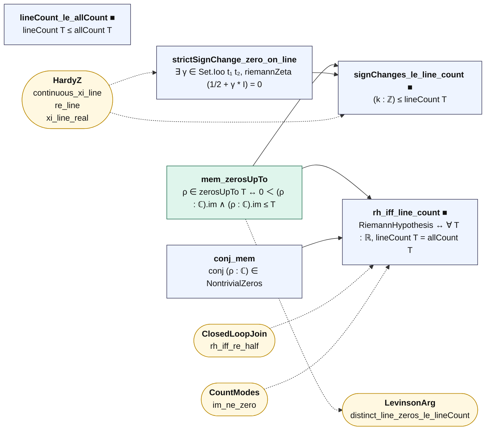

# `lean_stage3/Stage3/LineCount.lean`

> **Read from the source text.** This file changed after the last `python3 utilities/lean_map.py --dump`, so the arrows on this page are names occurring in each proof and have not been confirmed by Lean.

LineCount — block S10 of `lean_stage3/design/stencil.md`, step 3. 2026-11-24. The count up to height `T` is a finite sum of `riemannZeta.order` over the nontrivial zeros with `0 < Im ρ ≤ T` (the set is finite by `Kadiri.nontrivialZeros_abs_im_lt_finite`); the line count is the same sum over the zeros with `Re ρ = 1/2`. No continuous phase `θ` and no `S(T)` are defined.

6 theorems, 3 definitions, 224 lines. 

**Imports:** [`ClosedLoopJoin`](../lean_stage3/ClosedLoopJoin.md), [`CountModes`](../lean_stage3/CountModes.md), [`HardyZ`](../lean_stage3/HardyZ.md)  
**Imported by:** [`Stage3`](../lean_stage3/Stage3.md), [`LevinsonArg`](../lean_stage3/LevinsonArg.md)

## The picture



An arrow A → B reads "A is used in the proof of B". Green: counting, integers only. Violet: shape, analysis with no ζ. Blue: reads ζ. A name ending in ■ is an end: nothing else uses it. Red: contains `sorry`. Yellow: theorems in another file, counted; a dotted arrow crosses files. Definitions are not drawn; they are listed below the diagram.

## Definitions

<a name="LineCount-zerosUpTo"></a>
### `LineCount.zerosUpTo`

def · line 50

- **Is:** `` zerosUpTo (T : ℝ) : Finset NontrivialZeros := (nontrivialZeros_abs_im_lt_finite (T + 1)).toFinset.filter (fun ρ => 0 < (ρ : ℂ).im ∧ (ρ : ℂ).im ≤ T) noncomputable ``
- **Used by 6:** [`LevinsonArg.distinct_line_zeros_le_lineCount`](../lean_stage3/LevinsonArg.md#LevinsonArg-distinct_line_zeros_le_lineCount), [`LineCount.allCount`](#LineCount-allCount), [`LineCount.lineCount`](#LineCount-lineCount), [`LineCount.mem_zerosUpTo`](#LineCount-mem_zerosUpTo), [`LineCount.rh_iff_line_count`](#LineCount-rh_iff_line_count), [`LineCount.signChanges_le_line_count`](#LineCount-signChanges_le_line_count)

<a name="LineCount-allCount"></a>
### `LineCount.allCount`

def · line 56

- **Is:** `` allCount (T : ℝ) : ℤ := ∑ ρ ∈ zerosUpTo T, riemannZeta.order (ρ : ℂ) noncomputable ``
- **Built from:** [`LineCount.zerosUpTo`](#LineCount-zerosUpTo)
- **Used by 2:** [`LineCount.lineCount_le_allCount`](#LineCount-lineCount_le_allCount), [`LineCount.rh_iff_line_count`](#LineCount-rh_iff_line_count)

<a name="LineCount-lineCount"></a>
### `LineCount.lineCount`

def · line 61

- **Is:** `` lineCount (T : ℝ) : ℤ := ∑ ρ ∈ (zerosUpTo T).filter (fun ρ : NontrivialZeros => (ρ : ℂ).re = 1 / 2), riemannZeta.order (ρ : ℂ) ``
- **Built from:** [`LineCount.zerosUpTo`](#LineCount-zerosUpTo)
- **Used by 5:** [`LevinsonArg.distinct_line_zeros_le_lineCount`](../lean_stage3/LevinsonArg.md#LevinsonArg-distinct_line_zeros_le_lineCount), [`LevinsonArg.lineCount_ge_arg`](../lean_stage3/LevinsonArg.md#LevinsonArg-lineCount_ge_arg), [`LineCount.lineCount_le_allCount`](#LineCount-lineCount_le_allCount), [`LineCount.rh_iff_line_count`](#LineCount-rh_iff_line_count), [`LineCount.signChanges_le_line_count`](#LineCount-signChanges_le_line_count)

## Theorems

<a name="LineCount-mem_zerosUpTo"></a>
### `LineCount.mem_zerosUpTo`

line 67 · arrows read from text

**Counting.** Integers only: nothing in its statement or proof, or in anything it rests on, uses analysis or ζ.

**Proves**

```lean
ρ ∈ zerosUpTo T ↔ 0 < (ρ : ℂ).im ∧ (ρ : ℂ).im ≤ T
```

**Fed by:** no theorem of this repo; it stands on Mathlib and the definitions below.

**Definitions its proof touches:** [`LineCount.zerosUpTo`](#LineCount-zerosUpTo)

**Feeds** (3 that use it)

  - [`LevinsonArg.distinct_line_zeros_le_lineCount`](../lean_stage3/LevinsonArg.md#LevinsonArg-distinct_line_zeros_le_lineCount) (LevinsonArg) — `` (k : ℤ) ≤ lineCount T ``
  - [`LineCount.rh_iff_line_count`](#LineCount-rh_iff_line_count) — `` RiemannHypothesis ↔ ∀ T : ℝ, lineCount T = allCount T ``
  - [`LineCount.signChanges_le_line_count`](#LineCount-signChanges_le_line_count) — `` (k : ℤ) ≤ lineCount T ``

<a name="LineCount-strictSignChange_zero_on_line"></a>
### `LineCount.strictSignChange_zero_on_line`

line 80 · arrows read from text

**Reads ζ.** It, or something it rests on, uses the zeta function, its zeros or the Riemann hypothesis.

**Why.** A strict sign change of `t ↦ Λ(1/2 + t i)` on `[t₁, t₂]` gives a zero of `ζ` on the line at height in the open interval `(t₁, t₂)`.

**Proves**

```lean
∃ γ ∈ Set.Ioo t₁ t₂, riemannZeta (1/2 + γ * I) = 0
```

**Needs** (its hypotheses)

  - `` h : t₁ < t₂ ``
  - `` hs : (completedRiemannZeta (1/2 + t₁ * I)).re * (completedRiemannZeta (1/2 + t₂ * I)).re < 0 ``

**Fed by** (3 theorems its proof uses)

  - [`HardyZ.continuous_xi_line`](../lean_stage3/HardyZ.md#HardyZ-continuous_xi_line) (HardyZ) — `` Continuous (fun t : ℝ => completedRiemannZeta (1/2 + t * Complex.I)) ``
  - [`HardyZ.re_line`](../lean_stage3/HardyZ.md#HardyZ-re_line) (HardyZ) — `` ((1 / 2 : ℂ) + t * I).re = 1 / 2 ``
  - [`HardyZ.xi_line_real`](../lean_stage3/HardyZ.md#HardyZ-xi_line_real) (HardyZ) — `` (completedRiemannZeta (1/2 + t * Complex.I)).im = 0 ``

**Feeds** (1 that use it)

  - [`LineCount.signChanges_le_line_count`](#LineCount-signChanges_le_line_count) — `` (k : ℤ) ≤ lineCount T ``

<a name="LineCount-conj_mem"></a>
### `LineCount.conj_mem`

line 103 · arrows read from text

**Reads ζ.** It, or something it rests on, uses the zeta function, its zeros or the Riemann hypothesis.

**Why.** The conjugate of a nontrivial zero is a nontrivial zero.

**Proves**

```lean
conj (ρ : ℂ) ∈ NontrivialZeros
```

**Needs** (its hypotheses)

  - `` ρ : NontrivialZeros ``

**Fed by:** no theorem of this repo; it stands on Mathlib.

**Feeds** (1 that use it)

  - [`LineCount.rh_iff_line_count`](#LineCount-rh_iff_line_count) — `` RiemannHypothesis ↔ ∀ T : ℝ, lineCount T = allCount T ``

<a name="LineCount-lineCount_le_allCount"></a>
### `LineCount.lineCount_le_allCount`

line 110 · arrows read from text

**Reads ζ.** It, or something it rests on, uses the zeta function, its zeros or the Riemann hypothesis.

**Why.** Line count below the count.

**Proves**

```lean
lineCount T ≤ allCount T
```

**Needs** (its hypotheses)

  - `` T : ℝ ``

**Fed by:** no theorem of this repo; it stands on Mathlib and the definitions below.

**Definitions its proof touches:** [`LineCount.allCount`](#LineCount-allCount), [`LineCount.lineCount`](#LineCount-lineCount)

**Feeds:** nothing. It is an end.

<a name="LineCount-rh_iff_line_count"></a>
### `LineCount.rh_iff_line_count`

line 117 · arrows read from text

**Reads ζ.** It, or something it rests on, uses the zeta function, its zeros or the Riemann hypothesis.

**Why.** RH is the line count. RH holds exactly when, at every height, the zeros on the line with multiplicity number all the nontrivial zeros.

**Proves**

```lean
RiemannHypothesis ↔ ∀ T : ℝ, lineCount T = allCount T
```

**Fed by** (4 theorems its proof uses)

  - [`ClosedLoopJoin.rh_iff_re_half`](../lean_stage3/ClosedLoopJoin.md#ClosedLoopJoin-rh_iff_re_half) (ClosedLoopJoin) — `` RiemannHypothesis ↔ ∀ ρ : NontrivialZeros, (ρ : ℂ).re = 1 / 2 ``
  - [`CountModes.im_ne_zero`](../lean_stage3/CountModes.md#CountModes-im_ne_zero) (CountModes) — `` (ρ : ℂ).im ≠ 0 ``
  - [`LineCount.conj_mem`](#LineCount-conj_mem) — `` conj (ρ : ℂ) ∈ NontrivialZeros ``
  - [`LineCount.mem_zerosUpTo`](#LineCount-mem_zerosUpTo) — `` ρ ∈ zerosUpTo T ↔ 0 < (ρ : ℂ).im ∧ (ρ : ℂ).im ≤ T ``

**Definitions its proof touches:** [`LineCount.allCount`](#LineCount-allCount), [`LineCount.lineCount`](#LineCount-lineCount), [`LineCount.zerosUpTo`](#LineCount-zerosUpTo)

**Feeds:** nothing. It is an end.

<a name="LineCount-signChanges_le_line_count"></a>
### `LineCount.signChanges_le_line_count`

line 155 · arrows read from text

**Reads ζ.** It, or something it rests on, uses the zeta function, its zeros or the Riemann hypothesis.

**Why.** Sign changes give zeros on the line. `k` strict sign changes of `t ↦ Λ(1/2 + t i)` on consecutive intervals of a strictly increasing sequence in `(0, T]` give at least `k` zeros on the line up to height `T`, with multiplicity.

**Proves**

```lean
(k : ℤ) ≤ lineCount T
```

**Needs** (its hypotheses)

  - `` t : Fin (k + 1) → ℝ ``
  - `` hmono : StrictMono t ``
  - `` h0 : 0 < t 0 ``
  - `` hT : t (Fin.last k) ≤ T ``
  - `` hs : ∀ i : Fin k, (completedRiemannZeta (1/2 + t i.castSucc * I)).re * (completedRiemannZeta (1/2 + t i.succ * I)).re < 0 ``

**Fed by** (3 theorems its proof uses)

  - [`HardyZ.re_line`](../lean_stage3/HardyZ.md#HardyZ-re_line) (HardyZ) — `` ((1 / 2 : ℂ) + t * I).re = 1 / 2 ``
  - [`LineCount.mem_zerosUpTo`](#LineCount-mem_zerosUpTo) — `` ρ ∈ zerosUpTo T ↔ 0 < (ρ : ℂ).im ∧ (ρ : ℂ).im ≤ T ``
  - [`LineCount.strictSignChange_zero_on_line`](#LineCount-strictSignChange_zero_on_line) — `` ∃ γ ∈ Set.Ioo t₁ t₂, riemannZeta (1/2 + γ * I) = 0 ``

**Definitions its proof touches:** [`LineCount.lineCount`](#LineCount-lineCount), [`LineCount.zerosUpTo`](#LineCount-zerosUpTo)

**Feeds:** nothing. It is an end.

