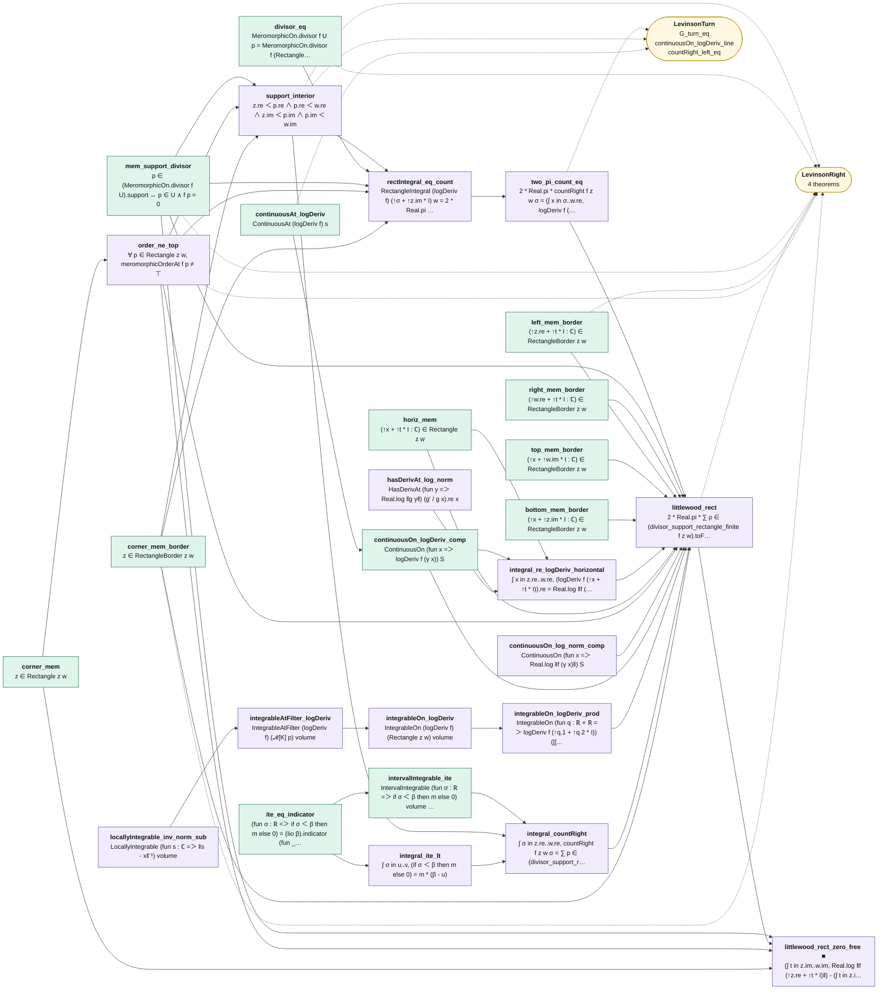

# `lean_stage3/Stage3/Littlewood.lean`

> **Read from the source text.** This file changed after the last `python3 utilities/lean_map.py --dump`, so the arrows on this page are names occurring in each proof and have not been confirmed by Lean.

Littlewood — block S10 of `lean_stage3/design/stencil.md`, step 4a. 2026-11-24. Littlewood's lemma on a rectangle, with no branch of arg anywhere. The argument principle (PNT+ `rectangleIntegral_logDeriv_eq_sum_meromorphicOrderAt`) is applied on `[σ, b] × [c, d]` for every `σ` whose vertical line misses the zeros, its imaginary part is integrated over `σ ∈ [a, b]`, and the order of integration on the left edge's term is swapped by Fubini. Along a horizontal line the real part of `logDeriv f` is the `x`-derivative o…

28 theorems, 2 definitions, 628 lines. 

**Imports:** nothing in this tree  
**Imported by:** [`Stage3`](../lean_stage3/Stage3.md), [`LevinsonRight`](../lean_stage3/LevinsonRight.md), [`LevinsonTurn`](../lean_stage3/LevinsonTurn.md)

## The picture



An arrow A → B reads "A is used in the proof of B". Green: counting, integers only. Violet: shape, analysis with no ζ. Blue: reads ζ. A name ending in ■ is an end: nothing else uses it. Red: contains `sorry`. Yellow: theorems in another file, counted; a dotted arrow crosses files. Definitions are not drawn; they are listed below the diagram.

## Definitions

<a name="Littlewood-countRight"></a>
### `Littlewood.countRight`

def · line 137

- **Is:** `` countRight (f : ℂ → ℂ) (z w : ℂ) (σ : ℝ) : ℝ := ∑ p ∈ (divisor_support_rectangle_finite f z w).toFinset, if σ < p.re then ((MeromorphicOn.divisor f (Rectangle z w) p : ℤ) : ℝ) else 0 ``
- **Used by 11:** [`LevinsonCount.levinson_count`](../lean_stage3/LevinsonCount.md#LevinsonCount-levinson_count), [`LevinsonRight.countRight_left_eq`](../lean_stage3/LevinsonRight.md#LevinsonRight-countRight_left_eq), [`LevinsonRight.countRight_mul_ge`](../lean_stage3/LevinsonRight.md#LevinsonRight-countRight_mul_ge), [`LevinsonRight.levinson_right`](../lean_stage3/LevinsonRight.md#LevinsonRight-levinson_right), [`LevinsonRight.zeros_right_le`](../lean_stage3/LevinsonRight.md#LevinsonRight-zeros_right_le), [`LevinsonTurn.G_turn_eq`](../lean_stage3/LevinsonTurn.md#LevinsonTurn-G_turn_eq), [`LevinsonTurn.countRight_left_eq`](../lean_stage3/LevinsonTurn.md#LevinsonTurn-countRight_left_eq), [`Littlewood.integral_countRight`](#Littlewood-integral_countRight), [`Littlewood.littlewood_rect`](#Littlewood-littlewood_rect), [`Littlewood.rectIntegral_eq_count`](#Littlewood-rectIntegral_eq_count), [`Littlewood.two_pi_count_eq`](#Littlewood-two_pi_count_eq)

<a name="Littlewood-edgeH"></a>
### `Littlewood.edgeH`

def · line 445

- **Is:** `` edgeH (f : ℂ → ℂ) (b y σ : ℝ) : ℝ := (∫ x in σ..b, logDeriv f (↑x + ↑y * I)).im ``
- **Used by 4:** [`LevinsonRight.levinson_right`](../lean_stage3/LevinsonRight.md#LevinsonRight-levinson_right), [`LevinsonRight.zeros_right_le`](../lean_stage3/LevinsonRight.md#LevinsonRight-zeros_right_le), [`Littlewood.littlewood_rect`](#Littlewood-littlewood_rect), [`Littlewood.littlewood_rect_zero_free`](#Littlewood-littlewood_rect_zero_free)

## Theorems

<a name="Littlewood-corner_mem"></a>
### `Littlewood.corner_mem`

line 55 · arrows read from text

**Counting.** Integers only: nothing in its statement or proof, or in anything it rests on, uses analysis or ζ.

**Proves**

```lean
z ∈ Rectangle z w
```

**Needs** (its hypotheses)

  - `` z w : ℂ ``

**Fed by:** no theorem of this repo; it stands on Mathlib.

**Feeds** (2 that use it)

  - [`Littlewood.littlewood_rect_zero_free`](#Littlewood-littlewood_rect_zero_free) — `` (∫ t in z.im..w.im, Real.log ‖f (↑z.re + ↑t * I)‖) - (∫ t in z.im..w.im, Real.log ‖f (↑w.re + ↑t * I)‖) + (w.re - z.re) * (∫ t in z.im..w.im, logDeriv… ``
  - [`Littlewood.order_ne_top`](#Littlewood-order_ne_top) — `` ∀ p ∈ Rectangle z w, meromorphicOrderAt f p ≠ ⊤ ``

<a name="Littlewood-corner_mem_border"></a>
### `Littlewood.corner_mem_border`

line 59 · arrows read from text

**Counting.** Integers only: nothing in its statement or proof, or in anything it rests on, uses analysis or ζ.

**Proves**

```lean
z ∈ RectangleBorder z w
```

**Needs** (its hypotheses)

  - `` z w : ℂ ``

**Fed by:** no theorem of this repo; it stands on Mathlib.

**Feeds** (5 that use it)

  - [`LevinsonRight.countRight_mul_ge`](../lean_stage3/LevinsonRight.md#LevinsonRight-countRight_mul_ge) (LevinsonRight) — `` countRight G z w σ ≤ countRight (fun s => G s * M s) z w σ ``
  - [`LevinsonRight.levinson_right`](../lean_stage3/LevinsonRight.md#LevinsonRight-levinson_right) (LevinsonRight) — `` countRight G ((1 / 2 : ℂ) + a * I) ((X : ℂ) + b * I) (1 / 2) ≤ (1 / (2 * Real.pi * (1 / 2 - σ₀))) * ((b - a) / 2 * Real.log ((1 / (b - a)) * ∫ t in a.… ``
  - [`Littlewood.littlewood_rect`](#Littlewood-littlewood_rect) — `` 2 * Real.pi * ∑ ρ ∈ (divisor_support_rectangle_finite f z w).toFinset, ((MeromorphicOn.divisor f (Rectangle z w) ρ : ℤ) : ℝ) * (ρ.re - z.re) = (∫ t in… ``
  - [`Littlewood.rectIntegral_eq_count`](#Littlewood-rectIntegral_eq_count) — `` RectangleIntegral (logDeriv f) (↑σ + ↑z.im * I) w = 2 * Real.pi * I * (countRight f z w σ : ℂ) ``
  - [`Littlewood.support_interior`](#Littlewood-support_interior) — `` z.re < p.re ∧ p.re < w.re ∧ z.im < p.im ∧ p.im < w.im ``

<a name="Littlewood-order_ne_top"></a>
### `Littlewood.order_ne_top`

line 64 · arrows read from text

**Shape.** Uses real or complex analysis; nothing in it or beneath it reads ζ.

**Proves**

```lean
∀ p ∈ Rectangle z w, meromorphicOrderAt f p ≠ ⊤
```

**Needs** (its hypotheses)

  - `` hf : AnalyticOnNhd ℂ f (Rectangle z w) ``
  - `` hz : f z ≠ 0 ``

**Fed by** (1 theorem its proof uses)

  - [`Littlewood.corner_mem`](#Littlewood-corner_mem) — `` z ∈ Rectangle z w ``

**Feeds** (6 that use it)

  - [`LevinsonRight.countRight_left_eq`](../lean_stage3/LevinsonRight.md#LevinsonRight-countRight_left_eq) (LevinsonRight) — `` countRight f z' w σ = countRight f z w σ ``
  - [`LevinsonRight.countRight_mul_ge`](../lean_stage3/LevinsonRight.md#LevinsonRight-countRight_mul_ge) (LevinsonRight) — `` countRight G z w σ ≤ countRight (fun s => G s * M s) z w σ ``
  - [`Littlewood.littlewood_rect`](#Littlewood-littlewood_rect) — `` 2 * Real.pi * ∑ ρ ∈ (divisor_support_rectangle_finite f z w).toFinset, ((MeromorphicOn.divisor f (Rectangle z w) ρ : ℤ) : ℝ) * (ρ.re - z.re) = (∫ t in… ``
  - [`Littlewood.littlewood_rect_zero_free`](#Littlewood-littlewood_rect_zero_free) — `` (∫ t in z.im..w.im, Real.log ‖f (↑z.re + ↑t * I)‖) - (∫ t in z.im..w.im, Real.log ‖f (↑w.re + ↑t * I)‖) + (w.re - z.re) * (∫ t in z.im..w.im, logDeriv… ``
  - [`Littlewood.rectIntegral_eq_count`](#Littlewood-rectIntegral_eq_count) — `` RectangleIntegral (logDeriv f) (↑σ + ↑z.im * I) w = 2 * Real.pi * I * (countRight f z w σ : ℂ) ``
  - [`Littlewood.support_interior`](#Littlewood-support_interior) — `` z.re < p.re ∧ p.re < w.re ∧ z.im < p.im ∧ p.im < w.im ``

<a name="Littlewood-mem_support_divisor"></a>
### `Littlewood.mem_support_divisor`

line 78 · arrows read from text

**Counting.** Integers only: nothing in its statement or proof, or in anything it rests on, uses analysis or ζ.

**Proves**

```lean
p ∈ (MeromorphicOn.divisor f U).support ↔ p ∈ U ∧ f p = 0
```

**Needs** (its hypotheses)

  - `` hU : U ⊆ Rectangle z w ``
  - `` hf : AnalyticOnNhd ℂ f (Rectangle z w) ``
  - `` hfin : ∀ p ∈ Rectangle z w, meromorphicOrderAt f p ≠ ⊤ ``
  - `` p : ℂ ``

**Fed by:** no theorem of this repo; it stands on Mathlib.

**Feeds** (6 that use it)

  - [`LevinsonRight.countRight_left_eq`](../lean_stage3/LevinsonRight.md#LevinsonRight-countRight_left_eq) (LevinsonRight) — `` countRight f z' w σ = countRight f z w σ ``
  - [`LevinsonRight.countRight_mul_ge`](../lean_stage3/LevinsonRight.md#LevinsonRight-countRight_mul_ge) (LevinsonRight) — `` countRight G z w σ ≤ countRight (fun s => G s * M s) z w σ ``
  - [`Littlewood.littlewood_rect`](#Littlewood-littlewood_rect) — `` 2 * Real.pi * ∑ ρ ∈ (divisor_support_rectangle_finite f z w).toFinset, ((MeromorphicOn.divisor f (Rectangle z w) ρ : ℤ) : ℝ) * (ρ.re - z.re) = (∫ t in… ``
  - [`Littlewood.littlewood_rect_zero_free`](#Littlewood-littlewood_rect_zero_free) — `` (∫ t in z.im..w.im, Real.log ‖f (↑z.re + ↑t * I)‖) - (∫ t in z.im..w.im, Real.log ‖f (↑w.re + ↑t * I)‖) + (w.re - z.re) * (∫ t in z.im..w.im, logDeriv… ``
  - [`Littlewood.rectIntegral_eq_count`](#Littlewood-rectIntegral_eq_count) — `` RectangleIntegral (logDeriv f) (↑σ + ↑z.im * I) w = 2 * Real.pi * I * (countRight f z w σ : ℂ) ``
  - [`Littlewood.support_interior`](#Littlewood-support_interior) — `` z.re < p.re ∧ p.re < w.re ∧ z.im < p.im ∧ p.im < w.im ``

<a name="Littlewood-divisor_eq"></a>
### `Littlewood.divisor_eq`

line 108 · arrows read from text

**Counting.** Integers only: nothing in its statement or proof, or in anything it rests on, uses analysis or ζ.

**Proves**

```lean
MeromorphicOn.divisor f U p = MeromorphicOn.divisor f (Rectangle z w) p
```

**Needs** (its hypotheses)

  - `` hU : U ⊆ Rectangle z w ``
  - `` hf : AnalyticOnNhd ℂ f (Rectangle z w) ``
  - `` hp : p ∈ U ``

**Fed by:** no theorem of this repo; it stands on Mathlib.

**Feeds** (2 that use it)

  - [`LevinsonRight.countRight_left_eq`](../lean_stage3/LevinsonRight.md#LevinsonRight-countRight_left_eq) (LevinsonRight) — `` countRight f z' w σ = countRight f z w σ ``
  - [`Littlewood.rectIntegral_eq_count`](#Littlewood-rectIntegral_eq_count) — `` RectangleIntegral (logDeriv f) (↑σ + ↑z.im * I) w = 2 * Real.pi * I * (countRight f z w σ : ℂ) ``

<a name="Littlewood-support_interior"></a>
### `Littlewood.support_interior`

line 115 · arrows read from text

**Shape.** Uses real or complex analysis; nothing in it or beneath it reads ζ.

**Why.** A zero of the support lies strictly inside.

**Proves**

```lean
z.re < p.re ∧ p.re < w.re ∧ z.im < p.im ∧ p.im < w.im
```

**Needs** (its hypotheses)

  - `` hre : z.re < w.re ``
  - `` him : z.im < w.im ``
  - `` hf : AnalyticOnNhd ℂ f (Rectangle z w) ``
  - `` hB : ∀ p ∈ RectangleBorder z w, f p ≠ 0 ``
  - `` hp : p ∈ (MeromorphicOn.divisor f (Rectangle z w)).support ``

**Fed by** (3 theorems its proof uses)

  - [`Littlewood.corner_mem_border`](#Littlewood-corner_mem_border) — `` z ∈ RectangleBorder z w ``
  - [`Littlewood.mem_support_divisor`](#Littlewood-mem_support_divisor) — `` p ∈ (MeromorphicOn.divisor f U).support ↔ p ∈ U ∧ f p = 0 ``
  - [`Littlewood.order_ne_top`](#Littlewood-order_ne_top) — `` ∀ p ∈ Rectangle z w, meromorphicOrderAt f p ≠ ⊤ ``

**Feeds** (5 that use it)

  - [`LevinsonRight.zeros_right_le`](../lean_stage3/LevinsonRight.md#LevinsonRight-zeros_right_le) (LevinsonRight) — `` 2 * Real.pi * (σ₁ - z.re) * countRight f z w σ₁ ≤ (∫ t in z.im..w.im, Real.log ‖f (↑z.re + ↑t * I)‖) - (∫ t in z.im..w.im, Real.log ‖f (↑w.re + ↑t * I… ``
  - [`LevinsonTurn.G_turn_eq`](../lean_stage3/LevinsonTurn.md#LevinsonTurn-G_turn_eq) (LevinsonTurn) — `` (∫ t in a..b, logDeriv G (1/2 + t * I)).re = -(2 * Real.pi * Littlewood.countRight G ((1/2 : ℂ) + a * I) ((X : ℂ) + b * I) (1/2)) + (∫ x in (1/2 : ℝ).… ``
  - [`LevinsonTurn.countRight_left_eq`](../lean_stage3/LevinsonTurn.md#LevinsonTurn-countRight_left_eq) (LevinsonTurn) — `` Littlewood.countRight f z w z.re = ∑ p ∈ (divisor_support_rectangle_finite f z w).toFinset, ((MeromorphicOn.divisor f (Rectangle z w) p : ℤ) : ℝ) ``
  - [`Littlewood.integral_countRight`](#Littlewood-integral_countRight) — `` ∫ σ in z.re..w.re, countRight f z w σ = ∑ p ∈ (divisor_support_rectangle_finite f z w).toFinset, ((MeromorphicOn.divisor f (Rectangle z w) p : ℤ) : ℝ)… ``
  - [`Littlewood.rectIntegral_eq_count`](#Littlewood-rectIntegral_eq_count) — `` RectangleIntegral (logDeriv f) (↑σ + ↑z.im * I) w = 2 * Real.pi * I * (countRight f z w σ : ℂ) ``

<a name="Littlewood-rectIntegral_eq_count"></a>
### `Littlewood.rectIntegral_eq_count`

line 141 · arrows read from text

**Shape.** Uses real or complex analysis; nothing in it or beneath it reads ζ.

**Proves**

```lean
RectangleIntegral (logDeriv f) (↑σ + ↑z.im * I) w = 2 * Real.pi * I * (countRight f z w σ : ℂ)
```

**Needs** (its hypotheses)

  - `` hre : z.re < w.re ``
  - `` him : z.im < w.im ``
  - `` hf : AnalyticOnNhd ℂ f (Rectangle z w) ``
  - `` hB : ∀ p ∈ RectangleBorder z w, f p ≠ 0 ``
  - `` hσ : σ ∈ Icc z.re w.re ``
  - `` hgood : ∀ p ∈ (divisor_support_rectangle_finite f z w).toFinset, p.re ≠ σ ``

**Fed by** (5 theorems its proof uses)

  - [`Littlewood.corner_mem_border`](#Littlewood-corner_mem_border) — `` z ∈ RectangleBorder z w ``
  - [`Littlewood.divisor_eq`](#Littlewood-divisor_eq) — `` MeromorphicOn.divisor f U p = MeromorphicOn.divisor f (Rectangle z w) p ``
  - [`Littlewood.mem_support_divisor`](#Littlewood-mem_support_divisor) — `` p ∈ (MeromorphicOn.divisor f U).support ↔ p ∈ U ∧ f p = 0 ``
  - [`Littlewood.order_ne_top`](#Littlewood-order_ne_top) — `` ∀ p ∈ Rectangle z w, meromorphicOrderAt f p ≠ ⊤ ``
  - [`Littlewood.support_interior`](#Littlewood-support_interior) — `` z.re < p.re ∧ p.re < w.re ∧ z.im < p.im ∧ p.im < w.im ``

**Definitions its proof touches:** [`Littlewood.countRight`](#Littlewood-countRight)

**Feeds** (1 that use it)

  - [`Littlewood.two_pi_count_eq`](#Littlewood-two_pi_count_eq) — `` 2 * Real.pi * countRight f z w σ = (∫ x in σ..w.re, logDeriv f (↑x + ↑z.im * I)).im - (∫ x in σ..w.re, logDeriv f (↑x + ↑w.im * I)).im + (∫ t in z.im.… ``

<a name="Littlewood-two_pi_count_eq"></a>
### `Littlewood.two_pi_count_eq`

line 221 · arrows read from text

**Shape.** Uses real or complex analysis; nothing in it or beneath it reads ζ.

**Proves**

```lean
2 * Real.pi * countRight f z w σ = (∫ x in σ..w.re, logDeriv f (↑x + ↑z.im * I)).im - (∫ x in σ..w.re, logDeriv f (↑x + ↑w.im * I)).im + (∫ t in z.im..w.im, logDeriv f (↑w.re + ↑t * I)).re - (∫ t in z.im..w.im, logDeriv f (↑σ + ↑t * I)).re
```

**Needs** (its hypotheses)

  - `` hre : z.re < w.re ``
  - `` him : z.im < w.im ``
  - `` hf : AnalyticOnNhd ℂ f (Rectangle z w) ``
  - `` hB : ∀ p ∈ RectangleBorder z w, f p ≠ 0 ``
  - `` hσ : σ ∈ Icc z.re w.re ``
  - `` hgood : ∀ p ∈ (divisor_support_rectangle_finite f z w).toFinset, p.re ≠ σ ``

**Fed by** (1 theorem its proof uses)

  - [`Littlewood.rectIntegral_eq_count`](#Littlewood-rectIntegral_eq_count) — `` RectangleIntegral (logDeriv f) (↑σ + ↑z.im * I) w = 2 * Real.pi * I * (countRight f z w σ : ℂ) ``

**Definitions its proof touches:** [`Littlewood.countRight`](#Littlewood-countRight)

**Feeds** (2 that use it)

  - [`LevinsonTurn.G_turn_eq`](../lean_stage3/LevinsonTurn.md#LevinsonTurn-G_turn_eq) (LevinsonTurn) — `` (∫ t in a..b, logDeriv G (1/2 + t * I)).re = -(2 * Real.pi * Littlewood.countRight G ((1/2 : ℂ) + a * I) ((X : ℂ) + b * I) (1/2)) + (∫ x in (1/2 : ℝ).… ``
  - [`Littlewood.littlewood_rect`](#Littlewood-littlewood_rect) — `` 2 * Real.pi * ∑ ρ ∈ (divisor_support_rectangle_finite f z w).toFinset, ((MeromorphicOn.divisor f (Rectangle z w) ρ : ℤ) : ℝ) * (ρ.re - z.re) = (∫ t in… ``

<a name="Littlewood-ite_eq_indicator"></a>
### `Littlewood.ite_eq_indicator`

line 238 · arrows read from text

**Counting.** Integers only: nothing in its statement or proof, or in anything it rests on, uses analysis or ζ.

**Proves**

```lean
(fun σ : ℝ => if σ < β then m else 0) = (Iio β).indicator (fun _ => m)
```

**Needs** (its hypotheses)

  - `` β m : ℝ ``

**Fed by:** no theorem of this repo; it stands on Mathlib.

**Feeds** (2 that use it)

  - [`Littlewood.integral_ite_lt`](#Littlewood-integral_ite_lt) — `` ∫ σ in u..v, (if σ < β then m else 0) = m * (β - u) ``
  - [`Littlewood.intervalIntegrable_ite`](#Littlewood-intervalIntegrable_ite) — `` IntervalIntegrable (fun σ : ℝ => if σ < β then m else 0) volume u v ``

<a name="Littlewood-intervalIntegrable_ite"></a>
### `Littlewood.intervalIntegrable_ite`

line 243 · arrows read from text

**Counting.** Integers only: nothing in its statement or proof, or in anything it rests on, uses analysis or ζ.

**Proves**

```lean
IntervalIntegrable (fun σ : ℝ => if σ < β then m else 0) volume u v
```

**Needs** (its hypotheses)

  - `` β m u v : ℝ ``

**Fed by** (1 theorem its proof uses)

  - [`Littlewood.ite_eq_indicator`](#Littlewood-ite_eq_indicator) — `` (fun σ : ℝ => if σ < β then m else 0) = (Iio β).indicator (fun _ => m) ``

**Feeds** (1 that use it)

  - [`Littlewood.integral_countRight`](#Littlewood-integral_countRight) — `` ∫ σ in z.re..w.re, countRight f z w σ = ∑ p ∈ (divisor_support_rectangle_finite f z w).toFinset, ((MeromorphicOn.divisor f (Rectangle z w) p : ℤ) : ℝ)… ``

<a name="Littlewood-integral_ite_lt"></a>
### `Littlewood.integral_ite_lt`

line 253 · arrows read from text

**Shape.** Uses real or complex analysis; nothing in it or beneath it reads ζ.

**Proves**

```lean
∫ σ in u..v, (if σ < β then m else 0) = m * (β - u)
```

**Needs** (its hypotheses)

  - `` hu : u < β ``
  - `` hv : β < v ``

**Fed by** (1 theorem its proof uses)

  - [`Littlewood.ite_eq_indicator`](#Littlewood-ite_eq_indicator) — `` (fun σ : ℝ => if σ < β then m else 0) = (Iio β).indicator (fun _ => m) ``

**Feeds** (1 that use it)

  - [`Littlewood.integral_countRight`](#Littlewood-integral_countRight) — `` ∫ σ in z.re..w.re, countRight f z w σ = ∑ p ∈ (divisor_support_rectangle_finite f z w).toFinset, ((MeromorphicOn.divisor f (Rectangle z w) p : ℤ) : ℝ)… ``

<a name="Littlewood-integral_countRight"></a>
### `Littlewood.integral_countRight`

line 268 · arrows read from text

**Shape.** Uses real or complex analysis; nothing in it or beneath it reads ζ.

**Why.** The σ-integrated count.

**Proves**

```lean
∫ σ in z.re..w.re, countRight f z w σ = ∑ p ∈ (divisor_support_rectangle_finite f z w).toFinset, ((MeromorphicOn.divisor f (Rectangle z w) p : ℤ) : ℝ) * (p.re - z.re)
```

**Needs** (its hypotheses)

  - `` hre : z.re < w.re ``
  - `` him : z.im < w.im ``
  - `` hf : AnalyticOnNhd ℂ f (Rectangle z w) ``
  - `` hB : ∀ p ∈ RectangleBorder z w, f p ≠ 0 ``

**Fed by** (3 theorems its proof uses)

  - [`Littlewood.integral_ite_lt`](#Littlewood-integral_ite_lt) — `` ∫ σ in u..v, (if σ < β then m else 0) = m * (β - u) ``
  - [`Littlewood.intervalIntegrable_ite`](#Littlewood-intervalIntegrable_ite) — `` IntervalIntegrable (fun σ : ℝ => if σ < β then m else 0) volume u v ``
  - [`Littlewood.support_interior`](#Littlewood-support_interior) — `` z.re < p.re ∧ p.re < w.re ∧ z.im < p.im ∧ p.im < w.im ``

**Definitions its proof touches:** [`Littlewood.countRight`](#Littlewood-countRight)

**Feeds** (1 that use it)

  - [`Littlewood.littlewood_rect`](#Littlewood-littlewood_rect) — `` 2 * Real.pi * ∑ ρ ∈ (divisor_support_rectangle_finite f z w).toFinset, ((MeromorphicOn.divisor f (Rectangle z w) ρ : ℤ) : ℝ) * (ρ.re - z.re) = (∫ t in… ``

<a name="Littlewood-locallyIntegrable_inv_norm_sub"></a>
### `Littlewood.locallyIntegrable_inv_norm_sub`

line 282 · arrows read from text

**Shape.** Uses real or complex analysis; nothing in it or beneath it reads ζ.

**Proves**

```lean
LocallyIntegrable (fun s : ℂ => ‖s - x‖⁻¹) volume
```

**Needs** (its hypotheses)

  - `` x : ℂ ``

**Fed by:** no theorem of this repo; it stands on Mathlib.

**Feeds** (1 that use it)

  - [`Littlewood.integrableAtFilter_logDeriv`](#Littlewood-integrableAtFilter_logDeriv) — `` IntegrableAtFilter (logDeriv f) (𝓝[K] p) volume ``

<a name="Littlewood-integrableAtFilter_logDeriv"></a>
### `Littlewood.integrableAtFilter_logDeriv`

line 298 · arrows read from text

**Shape.** Uses real or complex analysis; nothing in it or beneath it reads ζ.

**Proves**

```lean
IntegrableAtFilter (logDeriv f) (𝓝[K] p) volume
```

**Needs** (its hypotheses)

  - `` hp : AnalyticAt ℂ f p ``
  - `` hord : meromorphicOrderAt f p ≠ ⊤ ``
  - `` hK : IsCompact K ``
  - `` hKm : MeasurableSet K ``
  - `` hmeas : AEStronglyMeasurable (logDeriv f) (volume.restrict K) ``

**Fed by** (1 theorem its proof uses)

  - [`Littlewood.locallyIntegrable_inv_norm_sub`](#Littlewood-locallyIntegrable_inv_norm_sub) — `` LocallyIntegrable (fun s : ℂ => ‖s - x‖⁻¹) volume ``

**Feeds** (1 that use it)

  - [`Littlewood.integrableOn_logDeriv`](#Littlewood-integrableOn_logDeriv) — `` IntegrableOn (logDeriv f) (Rectangle z w) volume ``

<a name="Littlewood-integrableOn_logDeriv"></a>
### `Littlewood.integrableOn_logDeriv`

line 330 · arrows read from text

**Shape.** Uses real or complex analysis; nothing in it or beneath it reads ζ.

**Proves**

```lean
IntegrableOn (logDeriv f) (Rectangle z w) volume
```

**Needs** (its hypotheses)

  - `` hf : AnalyticOnNhd ℂ f (Rectangle z w) ``
  - `` hfin : ∀ p ∈ Rectangle z w, meromorphicOrderAt f p ≠ ⊤ ``

**Fed by** (1 theorem its proof uses)

  - [`Littlewood.integrableAtFilter_logDeriv`](#Littlewood-integrableAtFilter_logDeriv) — `` IntegrableAtFilter (logDeriv f) (𝓝[K] p) volume ``

**Feeds** (1 that use it)

  - [`Littlewood.integrableOn_logDeriv_prod`](#Littlewood-integrableOn_logDeriv_prod) — `` IntegrableOn (fun q : ℝ × ℝ => logDeriv f (↑q.1 + ↑q.2 * I)) ([[z.re, w.re]] ×ˢ [[z.im, w.im]]) volume ``

<a name="Littlewood-integrableOn_logDeriv_prod"></a>
### `Littlewood.integrableOn_logDeriv_prod`

line 344 · arrows read from text

**Shape.** Uses real or complex analysis; nothing in it or beneath it reads ζ.

**Proves**

```lean
IntegrableOn (fun q : ℝ × ℝ => logDeriv f (↑q.1 + ↑q.2 * I)) ([[z.re, w.re]] ×ˢ [[z.im, w.im]]) volume
```

**Needs** (its hypotheses)

  - `` hf : AnalyticOnNhd ℂ f (Rectangle z w) ``
  - `` hfin : ∀ p ∈ Rectangle z w, meromorphicOrderAt f p ≠ ⊤ ``

**Fed by** (1 theorem its proof uses)

  - [`Littlewood.integrableOn_logDeriv`](#Littlewood-integrableOn_logDeriv) — `` IntegrableOn (logDeriv f) (Rectangle z w) volume ``

**Feeds** (1 that use it)

  - [`Littlewood.littlewood_rect`](#Littlewood-littlewood_rect) — `` 2 * Real.pi * ∑ ρ ∈ (divisor_support_rectangle_finite f z w).toFinset, ((MeromorphicOn.divisor f (Rectangle z w) ρ : ℤ) : ℝ) * (ρ.re - z.re) = (∫ t in… ``

<a name="Littlewood-hasDerivAt_log_norm"></a>
### `Littlewood.hasDerivAt_log_norm`

line 366 · arrows read from text

**Shape.** Uses real or complex analysis; nothing in it or beneath it reads ζ.

**Proves**

```lean
HasDerivAt (fun y => Real.log ‖g y‖) (g' / g x).re x
```

**Needs** (its hypotheses)

  - `` hg : HasDerivAt g g' x ``
  - `` h0 : g x ≠ 0 ``

**Fed by:** no theorem of this repo; it stands on Mathlib.

**Feeds** (1 that use it)

  - [`Littlewood.integral_re_logDeriv_horizontal`](#Littlewood-integral_re_logDeriv_horizontal) — `` ∫ x in z.re..w.re, (logDeriv f (↑x + ↑t * I)).re = Real.log ‖f (↑w.re + ↑t * I)‖ - Real.log ‖f (↑z.re + ↑t * I)‖ ``

<a name="Littlewood-continuousAt_logDeriv"></a>
### `Littlewood.continuousAt_logDeriv`

line 383 · arrows read from text

**Counting.** Integers only: nothing in its statement or proof, or in anything it rests on, uses analysis or ζ.

**Proves**

```lean
ContinuousAt (logDeriv f) s
```

**Needs** (its hypotheses)

  - `` hs : AnalyticAt ℂ f s ``
  - `` hds : AnalyticAt ℂ (deriv f) s ``
  - `` h0 : f s ≠ 0 ``

**Fed by:** no theorem of this repo; it stands on Mathlib.

**Feeds** (2 that use it)

  - [`LevinsonTurn.continuousOn_logDeriv_line`](../lean_stage3/LevinsonTurn.md#LevinsonTurn-continuousOn_logDeriv_line) (LevinsonTurn) — `` ContinuousOn (fun t : ℝ => logDeriv f (1/2 + t * I)) S ``
  - [`Littlewood.continuousOn_logDeriv_comp`](#Littlewood-continuousOn_logDeriv_comp) — `` ContinuousOn (fun x => logDeriv f (γ x)) S ``

<a name="Littlewood-continuousOn_logDeriv_comp"></a>
### `Littlewood.continuousOn_logDeriv_comp`

line 388 · arrows read from text

**Counting.** Integers only: nothing in its statement or proof, or in anything it rests on, uses analysis or ζ.

**Proves**

```lean
ContinuousOn (fun x => logDeriv f (γ x)) S
```

**Needs** (its hypotheses)

  - `` hf : AnalyticOnNhd ℂ f (Rectangle z w) ``
  - `` hγ : Continuous γ ``
  - `` hS : ∀ x ∈ S, γ x ∈ Rectangle z w ``
  - `` hnz : ∀ x ∈ S, f (γ x) ≠ 0 ``

**Fed by** (1 theorem its proof uses)

  - [`Littlewood.continuousAt_logDeriv`](#Littlewood-continuousAt_logDeriv) — `` ContinuousAt (logDeriv f) s ``

**Feeds** (2 that use it)

  - [`Littlewood.integral_re_logDeriv_horizontal`](#Littlewood-integral_re_logDeriv_horizontal) — `` ∫ x in z.re..w.re, (logDeriv f (↑x + ↑t * I)).re = Real.log ‖f (↑w.re + ↑t * I)‖ - Real.log ‖f (↑z.re + ↑t * I)‖ ``
  - [`Littlewood.littlewood_rect`](#Littlewood-littlewood_rect) — `` 2 * Real.pi * ∑ ρ ∈ (divisor_support_rectangle_finite f z w).toFinset, ((MeromorphicOn.divisor f (Rectangle z w) ρ : ℤ) : ℝ) * (ρ.re - z.re) = (∫ t in… ``

<a name="Littlewood-continuousOn_log_norm_comp"></a>
### `Littlewood.continuousOn_log_norm_comp`

line 395 · arrows read from text

**Shape.** Uses real or complex analysis; nothing in it or beneath it reads ζ.

**Proves**

```lean
ContinuousOn (fun x => Real.log ‖f (γ x)‖) S
```

**Needs** (its hypotheses)

  - `` hf : AnalyticOnNhd ℂ f (Rectangle z w) ``
  - `` hγ : Continuous γ ``
  - `` hS : ∀ x ∈ S, γ x ∈ Rectangle z w ``
  - `` hnz : ∀ x ∈ S, f (γ x) ≠ 0 ``

**Fed by:** no theorem of this repo; it stands on Mathlib.

**Feeds** (1 that use it)

  - [`Littlewood.littlewood_rect`](#Littlewood-littlewood_rect) — `` 2 * Real.pi * ∑ ρ ∈ (divisor_support_rectangle_finite f z w).toFinset, ((MeromorphicOn.divisor f (Rectangle z w) ρ : ℤ) : ℝ) * (ρ.re - z.re) = (∫ t in… ``

<a name="Littlewood-horiz_mem"></a>
### `Littlewood.horiz_mem`

line 402 · arrows read from text

**Counting.** Integers only: nothing in its statement or proof, or in anything it rests on, uses analysis or ζ.

**Proves**

```lean
(↑x + ↑t * I : ℂ) ∈ Rectangle z w
```

**Needs** (its hypotheses)

  - `` hx : x ∈ [[z.re, w.re]] ``
  - `` ht : t ∈ [[z.im, w.im]] ``

**Fed by:** no theorem of this repo; it stands on Mathlib.

**Feeds** (2 that use it)

  - [`Littlewood.integral_re_logDeriv_horizontal`](#Littlewood-integral_re_logDeriv_horizontal) — `` ∫ x in z.re..w.re, (logDeriv f (↑x + ↑t * I)).re = Real.log ‖f (↑w.re + ↑t * I)‖ - Real.log ‖f (↑z.re + ↑t * I)‖ ``
  - [`Littlewood.littlewood_rect`](#Littlewood-littlewood_rect) — `` 2 * Real.pi * ∑ ρ ∈ (divisor_support_rectangle_finite f z w).toFinset, ((MeromorphicOn.divisor f (Rectangle z w) ρ : ℤ) : ℝ) * (ρ.re - z.re) = (∫ t in… ``

<a name="Littlewood-integral_re_logDeriv_horizontal"></a>
### `Littlewood.integral_re_logDeriv_horizontal`

line 407 · arrows read from text

**Shape.** Uses real or complex analysis; nothing in it or beneath it reads ζ.

**Why.** The real part along a horizontal line is a difference of `log ‖f‖`. No branch.

**Proves**

```lean
∫ x in z.re..w.re, (logDeriv f (↑x + ↑t * I)).re = Real.log ‖f (↑w.re + ↑t * I)‖ - Real.log ‖f (↑z.re + ↑t * I)‖
```

**Needs** (its hypotheses)

  - `` hf : AnalyticOnNhd ℂ f (Rectangle z w) ``
  - `` ht : t ∈ [[z.im, w.im]] ``
  - `` hnz : ∀ x ∈ [[z.re, w.re]], f (↑x + ↑t * I) ≠ 0 ``

**Fed by** (3 theorems its proof uses)

  - [`Littlewood.continuousOn_logDeriv_comp`](#Littlewood-continuousOn_logDeriv_comp) — `` ContinuousOn (fun x => logDeriv f (γ x)) S ``
  - [`Littlewood.hasDerivAt_log_norm`](#Littlewood-hasDerivAt_log_norm) — `` HasDerivAt (fun y => Real.log ‖g y‖) (g' / g x).re x ``
  - [`Littlewood.horiz_mem`](#Littlewood-horiz_mem) — `` (↑x + ↑t * I : ℂ) ∈ Rectangle z w ``

**Feeds** (1 that use it)

  - [`Littlewood.littlewood_rect`](#Littlewood-littlewood_rect) — `` 2 * Real.pi * ∑ ρ ∈ (divisor_support_rectangle_finite f z w).toFinset, ((MeromorphicOn.divisor f (Rectangle z w) ρ : ℤ) : ℝ) * (ρ.re - z.re) = (∫ t in… ``

<a name="Littlewood-bottom_mem_border"></a>
### `Littlewood.bottom_mem_border`

line 423 · arrows read from text

**Counting.** Integers only: nothing in its statement or proof, or in anything it rests on, uses analysis or ζ.

**Proves**

```lean
(↑x + ↑z.im * I : ℂ) ∈ RectangleBorder z w
```

**Needs** (its hypotheses)

  - `` hx : x ∈ [[z.re, w.re]] ``

**Fed by:** no theorem of this repo; it stands on Mathlib.

**Feeds** (1 that use it)

  - [`Littlewood.littlewood_rect`](#Littlewood-littlewood_rect) — `` 2 * Real.pi * ∑ ρ ∈ (divisor_support_rectangle_finite f z w).toFinset, ((MeromorphicOn.divisor f (Rectangle z w) ρ : ℤ) : ℝ) * (ρ.re - z.re) = (∫ t in… ``

<a name="Littlewood-top_mem_border"></a>
### `Littlewood.top_mem_border`

line 428 · arrows read from text

**Counting.** Integers only: nothing in its statement or proof, or in anything it rests on, uses analysis or ζ.

**Proves**

```lean
(↑x + ↑w.im * I : ℂ) ∈ RectangleBorder z w
```

**Needs** (its hypotheses)

  - `` hx : x ∈ [[z.re, w.re]] ``

**Fed by:** no theorem of this repo; it stands on Mathlib.

**Feeds** (1 that use it)

  - [`Littlewood.littlewood_rect`](#Littlewood-littlewood_rect) — `` 2 * Real.pi * ∑ ρ ∈ (divisor_support_rectangle_finite f z w).toFinset, ((MeromorphicOn.divisor f (Rectangle z w) ρ : ℤ) : ℝ) * (ρ.re - z.re) = (∫ t in… ``

<a name="Littlewood-left_mem_border"></a>
### `Littlewood.left_mem_border`

line 433 · arrows read from text

**Counting.** Integers only: nothing in its statement or proof, or in anything it rests on, uses analysis or ζ.

**Proves**

```lean
(↑z.re + ↑t * I : ℂ) ∈ RectangleBorder z w
```

**Needs** (its hypotheses)

  - `` ht : t ∈ [[z.im, w.im]] ``

**Fed by:** no theorem of this repo; it stands on Mathlib.

**Feeds** (2 that use it)

  - [`LevinsonRight.levinson_right`](../lean_stage3/LevinsonRight.md#LevinsonRight-levinson_right) (LevinsonRight) — `` countRight G ((1 / 2 : ℂ) + a * I) ((X : ℂ) + b * I) (1 / 2) ≤ (1 / (2 * Real.pi * (1 / 2 - σ₀))) * ((b - a) / 2 * Real.log ((1 / (b - a)) * ∫ t in a.… ``
  - [`Littlewood.littlewood_rect`](#Littlewood-littlewood_rect) — `` 2 * Real.pi * ∑ ρ ∈ (divisor_support_rectangle_finite f z w).toFinset, ((MeromorphicOn.divisor f (Rectangle z w) ρ : ℤ) : ℝ) * (ρ.re - z.re) = (∫ t in… ``

<a name="Littlewood-right_mem_border"></a>
### `Littlewood.right_mem_border`

line 438 · arrows read from text

**Counting.** Integers only: nothing in its statement or proof, or in anything it rests on, uses analysis or ζ.

**Proves**

```lean
(↑w.re + ↑t * I : ℂ) ∈ RectangleBorder z w
```

**Needs** (its hypotheses)

  - `` ht : t ∈ [[z.im, w.im]] ``

**Fed by:** no theorem of this repo; it stands on Mathlib.

**Feeds** (1 that use it)

  - [`Littlewood.littlewood_rect`](#Littlewood-littlewood_rect) — `` 2 * Real.pi * ∑ ρ ∈ (divisor_support_rectangle_finite f z w).toFinset, ((MeromorphicOn.divisor f (Rectangle z w) ρ : ℤ) : ℝ) * (ρ.re - z.re) = (∫ t in… ``

<a name="Littlewood-littlewood_rect"></a>
### `Littlewood.littlewood_rect`

line 448 · arrows read from text

**Shape.** Uses real or complex analysis; nothing in it or beneath it reads ζ.

**Proves**

```lean
2 * Real.pi * ∑ ρ ∈ (divisor_support_rectangle_finite f z w).toFinset, ((MeromorphicOn.divisor f (Rectangle z w) ρ : ℤ) : ℝ) * (ρ.re - z.re) = (∫ t in z.im..w.im, Real.log ‖f (↑z.re + ↑t * I)‖) - (∫ t in z.im..w.im, Real.log ‖f (↑w.re + ↑t * I)‖) + (w.re - z.re) * (∫ t in z.im..w.im, logDeriv f (↑w.re + ↑t * I)).re + (∫ σ in z.re..w.re, edgeH f w.re z.im σ) - (∫ σ in z.re..w.re, edgeH f w.re w.im σ)
```

**Needs** (its hypotheses)

  - `` hre : z.re < w.re ``
  - `` him : z.im < w.im ``
  - `` hf : AnalyticOnNhd ℂ f (Rectangle z w) ``
  - `` hB : ∀ p ∈ RectangleBorder z w, f p ≠ 0 ``

**Fed by** (14 theorems its proof uses)

  - [`Littlewood.bottom_mem_border`](#Littlewood-bottom_mem_border) — `` (↑x + ↑z.im * I : ℂ) ∈ RectangleBorder z w ``
  - [`Littlewood.continuousOn_logDeriv_comp`](#Littlewood-continuousOn_logDeriv_comp) — `` ContinuousOn (fun x => logDeriv f (γ x)) S ``
  - [`Littlewood.continuousOn_log_norm_comp`](#Littlewood-continuousOn_log_norm_comp) — `` ContinuousOn (fun x => Real.log ‖f (γ x)‖) S ``
  - [`Littlewood.corner_mem_border`](#Littlewood-corner_mem_border) — `` z ∈ RectangleBorder z w ``
  - [`Littlewood.horiz_mem`](#Littlewood-horiz_mem) — `` (↑x + ↑t * I : ℂ) ∈ Rectangle z w ``
  - [`Littlewood.integrableOn_logDeriv_prod`](#Littlewood-integrableOn_logDeriv_prod) — `` IntegrableOn (fun q : ℝ × ℝ => logDeriv f (↑q.1 + ↑q.2 * I)) ([[z.re, w.re]] ×ˢ [[z.im, w.im]]) volume ``
  - [`Littlewood.integral_countRight`](#Littlewood-integral_countRight) — `` ∫ σ in z.re..w.re, countRight f z w σ = ∑ p ∈ (divisor_support_rectangle_finite f z w).toFinset, ((MeromorphicOn.divisor f (Rectangle z w) p : ℤ) : ℝ)… ``
  - [`Littlewood.integral_re_logDeriv_horizontal`](#Littlewood-integral_re_logDeriv_horizontal) — `` ∫ x in z.re..w.re, (logDeriv f (↑x + ↑t * I)).re = Real.log ‖f (↑w.re + ↑t * I)‖ - Real.log ‖f (↑z.re + ↑t * I)‖ ``
  - [`Littlewood.left_mem_border`](#Littlewood-left_mem_border) — `` (↑z.re + ↑t * I : ℂ) ∈ RectangleBorder z w ``
  - [`Littlewood.mem_support_divisor`](#Littlewood-mem_support_divisor) — `` p ∈ (MeromorphicOn.divisor f U).support ↔ p ∈ U ∧ f p = 0 ``
  - [`Littlewood.order_ne_top`](#Littlewood-order_ne_top) — `` ∀ p ∈ Rectangle z w, meromorphicOrderAt f p ≠ ⊤ ``
  - [`Littlewood.right_mem_border`](#Littlewood-right_mem_border) — `` (↑w.re + ↑t * I : ℂ) ∈ RectangleBorder z w ``
  - [`Littlewood.top_mem_border`](#Littlewood-top_mem_border) — `` (↑x + ↑w.im * I : ℂ) ∈ RectangleBorder z w ``
  - [`Littlewood.two_pi_count_eq`](#Littlewood-two_pi_count_eq) — `` 2 * Real.pi * countRight f z w σ = (∫ x in σ..w.re, logDeriv f (↑x + ↑z.im * I)).im - (∫ x in σ..w.re, logDeriv f (↑x + ↑w.im * I)).im + (∫ t in z.im.… ``

**Definitions its proof touches:** [`Littlewood.countRight`](#Littlewood-countRight), [`Littlewood.edgeH`](#Littlewood-edgeH)

**Feeds** (2 that use it)

  - [`LevinsonRight.zeros_right_le`](../lean_stage3/LevinsonRight.md#LevinsonRight-zeros_right_le) (LevinsonRight) — `` 2 * Real.pi * (σ₁ - z.re) * countRight f z w σ₁ ≤ (∫ t in z.im..w.im, Real.log ‖f (↑z.re + ↑t * I)‖) - (∫ t in z.im..w.im, Real.log ‖f (↑w.re + ↑t * I… ``
  - [`Littlewood.littlewood_rect_zero_free`](#Littlewood-littlewood_rect_zero_free) — `` (∫ t in z.im..w.im, Real.log ‖f (↑z.re + ↑t * I)‖) - (∫ t in z.im..w.im, Real.log ‖f (↑w.re + ↑t * I)‖) + (w.re - z.re) * (∫ t in z.im..w.im, logDeriv… ``

<a name="Littlewood-littlewood_rect_zero_free"></a>
### `Littlewood.littlewood_rect_zero_free`

line 570 · arrows read from text

**Shape.** Uses real or complex analysis; nothing in it or beneath it reads ζ.

**Why.** The zero-free case. With no zero in the closed rectangle the right side of Littlewood's identity vanishes.

**Proves**

```lean
(∫ t in z.im..w.im, Real.log ‖f (↑z.re + ↑t * I)‖) - (∫ t in z.im..w.im, Real.log ‖f (↑w.re + ↑t * I)‖) + (w.re - z.re) * (∫ t in z.im..w.im, logDeriv f (↑w.re + ↑t * I)).re + (∫ σ in z.re..w.re, edgeH f w.re z.im σ) - (∫ σ in z.re..w.re, edgeH f w.re w.im σ) = 0
```

**Needs** (its hypotheses)

  - `` hre : z.re < w.re ``
  - `` him : z.im < w.im ``
  - `` hf : AnalyticOnNhd ℂ f (Rectangle z w) ``
  - `` hnz : ∀ p ∈ Rectangle z w, f p ≠ 0 ``

**Fed by** (4 theorems its proof uses)

  - [`Littlewood.corner_mem`](#Littlewood-corner_mem) — `` z ∈ Rectangle z w ``
  - [`Littlewood.littlewood_rect`](#Littlewood-littlewood_rect) — `` 2 * Real.pi * ∑ ρ ∈ (divisor_support_rectangle_finite f z w).toFinset, ((MeromorphicOn.divisor f (Rectangle z w) ρ : ℤ) : ℝ) * (ρ.re - z.re) = (∫ t in… ``
  - [`Littlewood.mem_support_divisor`](#Littlewood-mem_support_divisor) — `` p ∈ (MeromorphicOn.divisor f U).support ↔ p ∈ U ∧ f p = 0 ``
  - [`Littlewood.order_ne_top`](#Littlewood-order_ne_top) — `` ∀ p ∈ Rectangle z w, meromorphicOrderAt f p ≠ ⊤ ``

**Definitions its proof touches:** [`Littlewood.edgeH`](#Littlewood-edgeH)

**Feeds:** nothing. It is an end.

