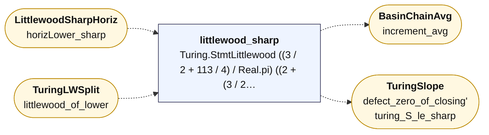

# `lean_stage3/Stage3/LittlewoodSharp.lean`

> **Read from the source text.** This file changed after the last `python3 utilities/lean_map.py --dump`, so the arrows on this page are names occurring in each proof and have not been confirmed by Lean.

# LittlewoodSharp — block S14 of `lean_stage3/design/stencil.md`, Turing at scale: sharper constants in Littlewood's bound. 2026-11-25.

1 theorem, 0 definitions, 60 lines. 

**Imports:** [`LittlewoodSharpHoriz`](../lean_stage3/LittlewoodSharpHoriz.md), [`TuringLWSplit`](../lean_stage3/TuringLWSplit.md)  
**Imported by:** [`Stage3`](../lean_stage3/Stage3.md), [`BasinChainAvg`](../lean_stage3/BasinChainAvg.md), [`TuringSlope`](../lean_stage3/TuringSlope.md)

## The picture



An arrow A → B reads "A is used in the proof of B". Green: counting, integers only. Violet: shape, analysis with no ζ. Blue: reads ζ. A name ending in ■ is an end: nothing else uses it. Red: contains `sorry`. Yellow: theorems in another file, counted; a dotted arrow crosses files. Definitions are not drawn; they are listed below the diagram.

## Theorems

<a name="LittlewoodSharp-littlewood_sharp"></a>
### `LittlewoodSharp.littlewood_sharp`

line 46 · arrows read from text

**Reads ζ.** It, or something it rests on, uses the zeta function, its zeros or the Riemann hypothesis.

**Why.** Littlewood's bound on `∫ S`, sharper constants, unconditional.

**Proves**

```lean
Turing.StmtLittlewood ((3 / 2 + 113 / 4) / Real.pi) ((2 + (3 / 2) * Real.log 9 + 128) / Real.pi) 2
```

**Fed by** (2 theorems its proof uses)

  - [`LittlewoodSharp.horizLower_sharp`](../lean_stage3/LittlewoodSharpHoriz.md#LittlewoodSharp-horizLower_sharp) (LittlewoodSharpHoriz) — `` Turing.StmtHorizLower (113 / 4) 128 ``
  - [`TuringLW.littlewood_of_lower`](../lean_stage3/TuringLWSplit.md#TuringLW-littlewood_of_lower) (TuringLWSplit) — `` Turing.StmtLittlewood ((3 / 2 + a₂) / Real.pi) ((2 + (3 / 2) * Real.log 9 + b₂) / Real.pi) 2 ``

**Definitions its proof touches:** [`Turing.StmtLittlewood`](../lean_stage3/TuringS.md#Turing-StmtLittlewood)

**Feeds** (3 that use it)

  - [`BasinChain.increment_avg`](../lean_stage3/BasinChainAvg.md#BasinChain-increment_avg) (BasinChainAvg) — `` ∃ A T₁ : ℝ, 0 < A ∧ 200 ≤ T₁ ∧ ∀ T : ℝ, T₁ ≤ T → ((Defect.defect T : ℝ) - (Defect.defect (3 * T / 4) : ℝ)) ≤ 4 * ((2 * ((3 / 2 + 113 / 4) / Real.pi) +… ``
  - [`TuringSlope.defect_zero_of_closing'`](../lean_stage3/TuringSlope.md#TuringSlope-defect_zero_of_closing-) (TuringSlope) — `` ∀ T ≤ T₁, Defect.defect T = 0 ``
  - [`TuringSlope.turing_S_le_sharp`](../lean_stage3/TuringSlope.md#TuringSlope-turing_S_le_sharp) (TuringSlope) — `` S t ≤ ((3 / 2 + 113 / 4) / Real.pi * Real.log (t + h) + (2 + (3 / 2) * Real.log 9 + 128) / Real.pi) / h + h * (Real.log ((t + h) / (2 * Real.pi)) / 2 … ``

