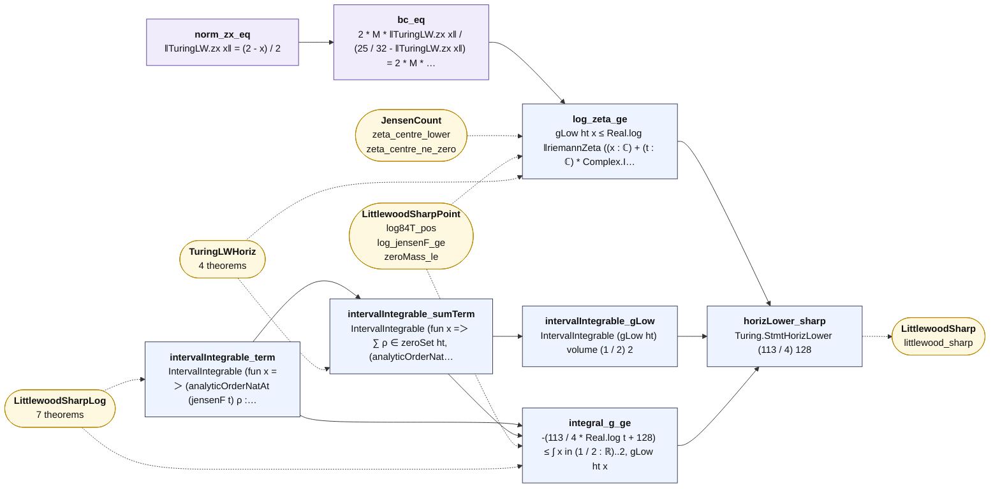

# `lean_stage3/Stage3/LittlewoodSharpHoriz.lean`

> **Read from the source text.** This file changed after the last `python3 utilities/lean_map.py --dump`, so the arrows on this page are names occurring in each proof and have not been confirmed by Lean.

LittlewoodSharpHoriz — block S14 of `lean_stage3/design/stencil.md`, Turing at scale: sharper Littlewood constants, part 3, the lower side `Turing.StmtHorizLower (113/4) 128`. 2026-11-25.

8 theorems, 1 definition, 214 lines. 

**Imports:** [`LittlewoodSharpPoint`](../lean_stage3/LittlewoodSharpPoint.md), [`TuringLWHoriz`](../lean_stage3/TuringLWHoriz.md)  
**Imported by:** [`LittlewoodSharp`](../lean_stage3/LittlewoodSharp.md)

## The picture



An arrow A → B reads "A is used in the proof of B". Green: counting, integers only. Violet: shape, analysis with no ζ. Blue: reads ζ. A name ending in ■ is an end: nothing else uses it. Red: contains `sorry`. Yellow: theorems in another file, counted; a dotted arrow crosses files. Definitions are not drawn; they are listed below the diagram.

## Definitions

<a name="LittlewoodSharp-gLow"></a>
### `LittlewoodSharp.gLow`

def · line 49

The lower function, sharper radii.

- **Is:** `` gLow {t : ℝ} (ht : 2 ≤ t) (x : ℝ) : ℝ := (-(zeroMass ht * Real.log (25 / 16)) - Real.log 3) + (-(2 * Real.log (84 * t))) * bcw x + ∑ ρ ∈ zeroSet ht, (analyticOrderNatAt (jensenF t) ρ : ℝ) * (Real.log (x - TuringLW.beta ρ) - Real.log 2) ``
- **Built from:** [`Stage3.jensenF`](../lean_stage3/JensenCount.md#Stage3-jensenF), [`LittlewoodSharp.bcw`](../lean_stage3/LittlewoodSharpLog.md#LittlewoodSharp-bcw), [`LittlewoodSharp.zeroMass`](../lean_stage3/LittlewoodSharpPoint.md#LittlewoodSharp-zeroMass), [`LittlewoodSharp.zeroSet`](../lean_stage3/LittlewoodSharpPoint.md#LittlewoodSharp-zeroSet), [`TuringLW.beta`](../lean_stage3/TuringLWHoriz.md#TuringLW-beta)
- **Used by 4:** [`LittlewoodSharp.horizLower_sharp`](#LittlewoodSharp-horizLower_sharp), [`LittlewoodSharp.integral_g_ge`](#LittlewoodSharp-integral_g_ge), [`LittlewoodSharp.intervalIntegrable_gLow`](#LittlewoodSharp-intervalIntegrable_gLow), [`LittlewoodSharp.log_zeta_ge`](#LittlewoodSharp-log_zeta_ge)

## Theorems

<a name="LittlewoodSharp-norm_zx_eq"></a>
### `LittlewoodSharp.norm_zx_eq`

line 55 · arrows read from text

**Shape.** Uses real or complex analysis; nothing in it or beneath it reads ζ.

**Proves**

```lean
‖TuringLW.zx x‖ = (2 - x) / 2
```

**Needs** (its hypotheses)

  - `` hx2 : x ≤ 2 ``

**Fed by:** no theorem of this repo; it stands on Mathlib and the definitions below.

**Definitions its proof touches:** [`TuringLW.zx`](../lean_stage3/TuringLWHoriz.md#TuringLW-zx)

**Feeds** (1 that use it)

  - [`LittlewoodSharp.bc_eq`](#LittlewoodSharp-bc_eq) — `` 2 * M * ‖TuringLW.zx x‖ / (25 / 32 - ‖TuringLW.zx x‖) = 2 * M * bcw x ``

<a name="LittlewoodSharp-bc_eq"></a>
### `LittlewoodSharp.bc_eq`

line 61 · arrows read from text

**Shape.** Uses real or complex analysis; nothing in it or beneath it reads ζ.

**Why.** The pointwise Borel–Carathéodory term on the segment is `2M · bcw x`.

**Proves**

```lean
2 * M * ‖TuringLW.zx x‖ / (25 / 32 - ‖TuringLW.zx x‖) = 2 * M * bcw x
```

**Needs** (its hypotheses)

  - `` hx1 : 1 / 2 ≤ x ``
  - `` hx2 : x ≤ 2 ``

**Fed by** (1 theorem its proof uses)

  - [`LittlewoodSharp.norm_zx_eq`](#LittlewoodSharp-norm_zx_eq) — `` ‖TuringLW.zx x‖ = (2 - x) / 2 ``

**Definitions its proof touches:** [`LittlewoodSharp.bcw`](../lean_stage3/LittlewoodSharpLog.md#LittlewoodSharp-bcw), [`TuringLW.zx`](../lean_stage3/TuringLWHoriz.md#TuringLW-zx)

**Feeds** (1 that use it)

  - [`LittlewoodSharp.log_zeta_ge`](#LittlewoodSharp-log_zeta_ge) — `` gLow ht x ≤ Real.log ‖riemannZeta ((x : ℂ) + (t : ℂ) * Complex.I)‖ ``

<a name="LittlewoodSharp-log_zeta_ge"></a>
### `LittlewoodSharp.log_zeta_ge`

line 69 · arrows read from text

**Reads ζ.** It, or something it rests on, uses the zeta function, its zeros or the Riemann hypothesis.

**Why.** The pointwise lower bound on the segment.

**Proves**

```lean
gLow ht x ≤ Real.log ‖riemannZeta ((x : ℂ) + (t : ℂ) * Complex.I)‖
```

**Needs** (its hypotheses)

  - `` ht : 2 ≤ t ``
  - `` hx1 : 1 / 2 ≤ x ``
  - `` hx2 : x ≤ 2 ``
  - `` hxE : x ∉ (zeroSet ht).image TuringLW.beta ``

**Fed by** (7 theorems its proof uses)

  - [`Stage3.zeta_centre_lower`](../lean_stage3/JensenCount.md#Stage3-zeta_centre_lower) (JensenCount) — `` (1 : ℝ) / 3 ≤ ‖ζ (2 + Complex.I * T)‖ ``
  - [`Stage3.zeta_centre_ne_zero`](../lean_stage3/JensenCount.md#Stage3-zeta_centre_ne_zero) (JensenCount) — `` ζ (2 + Complex.I * (T : ℂ)) ≠ 0 ``
  - [`LittlewoodSharp.bc_eq`](#LittlewoodSharp-bc_eq) — `` 2 * M * ‖TuringLW.zx x‖ / (25 / 32 - ‖TuringLW.zx x‖) = 2 * M * bcw x ``
  - [`LittlewoodSharp.log_jensenF_ge`](../lean_stage3/LittlewoodSharpPoint.md#LittlewoodSharp-log_jensenF_ge) (LittlewoodSharpPoint) — `` -(2 * Real.log (84 * T) * ‖z‖ / (25 / 32 - ‖z‖)) - zeroMass hT * Real.log (25 / 16) + ∑ ρ ∈ zeroSet hT, (analyticOrderNatAt (jensenF T) ρ : ℝ) * Real.… ``
  - [`TuringLW.log_sub_le`](../lean_stage3/TuringLWHoriz.md#TuringLW-log_sub_le) (TuringLWHoriz) — `` Real.log (x - beta ρ) - Real.log 2 ≤ Real.log ‖zx x - ρ‖ ``
  - [`TuringLW.norm_zx`](../lean_stage3/TuringLWHoriz.md#TuringLW-norm_zx) (TuringLWHoriz) — `` ‖zx x‖ ≤ 3 / 4 ``
  - [`TuringLW.zx_arg`](../lean_stage3/TuringLWHoriz.md#TuringLW-zx_arg) (TuringLWHoriz) — `` 2 * zx x + (2 + Complex.I * (t : ℂ)) = (x : ℂ) + (t : ℂ) * Complex.I ``

**Definitions its proof touches:** [`Stage3.jensenF`](../lean_stage3/JensenCount.md#Stage3-jensenF), [`LittlewoodSharp.gLow`](#LittlewoodSharp-gLow), [`LittlewoodSharp.zeroSet`](../lean_stage3/LittlewoodSharpPoint.md#LittlewoodSharp-zeroSet), [`TuringLW.beta`](../lean_stage3/TuringLWHoriz.md#TuringLW-beta), [`TuringLW.zx`](../lean_stage3/TuringLWHoriz.md#TuringLW-zx)

**Feeds** (1 that use it)

  - [`LittlewoodSharp.horizLower_sharp`](#LittlewoodSharp-horizLower_sharp) — `` Turing.StmtHorizLower (113 / 4) 128 ``

<a name="LittlewoodSharp-intervalIntegrable_term"></a>
### `LittlewoodSharp.intervalIntegrable_term`

line 112 · arrows read from text

**Reads ζ.** It, or something it rests on, uses the zeta function, its zeros or the Riemann hypothesis.

**Why.** The per-zero terms are integrable.

**Proves**

```lean
IntervalIntegrable (fun x => (analyticOrderNatAt (jensenF t) ρ : ℝ) * (Real.log (x - TuringLW.beta ρ) - Real.log 2)) volume (1 / 2) 2
```

**Needs** (its hypotheses)

  - `` t : ℝ ``
  - `` ρ : ℂ ``

**Fed by** (1 theorem its proof uses)

  - [`LittlewoodSharp.intervalIntegrable_log_sub`](../lean_stage3/LittlewoodSharpLog.md#LittlewoodSharp-intervalIntegrable_log_sub) (LittlewoodSharpLog) — `` IntervalIntegrable (fun x : ℝ => Real.log (x - β)) volume (1 / 2) 2 ``

**Definitions its proof touches:** [`Stage3.jensenF`](../lean_stage3/JensenCount.md#Stage3-jensenF), [`TuringLW.beta`](../lean_stage3/TuringLWHoriz.md#TuringLW-beta)

**Feeds** (2 that use it)

  - [`LittlewoodSharp.integral_g_ge`](#LittlewoodSharp-integral_g_ge) — `` -(113 / 4 * Real.log t + 128) ≤ ∫ x in (1 / 2 : ℝ)..2, gLow ht x ``
  - [`LittlewoodSharp.intervalIntegrable_sumTerm`](#LittlewoodSharp-intervalIntegrable_sumTerm) — `` IntervalIntegrable (fun x => ∑ ρ ∈ zeroSet ht, (analyticOrderNatAt (jensenF t) ρ : ℝ) * (Real.log (x - TuringLW.beta ρ) - Real.log 2)) volume (1 / 2) … ``

<a name="LittlewoodSharp-intervalIntegrable_sumTerm"></a>
### `LittlewoodSharp.intervalIntegrable_sumTerm`

line 117 · arrows read from text

**Reads ζ.** It, or something it rests on, uses the zeta function, its zeros or the Riemann hypothesis.

**Proves**

```lean
IntervalIntegrable (fun x => ∑ ρ ∈ zeroSet ht, (analyticOrderNatAt (jensenF t) ρ : ℝ) * (Real.log (x - TuringLW.beta ρ) - Real.log 2)) volume (1 / 2) 2
```

**Needs** (its hypotheses)

  - `` ht : 2 ≤ t ``

**Fed by** (2 theorems its proof uses)

  - [`LittlewoodSharp.intervalIntegrable_term`](#LittlewoodSharp-intervalIntegrable_term) — `` IntervalIntegrable (fun x => (analyticOrderNatAt (jensenF t) ρ : ℝ) * (Real.log (x - TuringLW.beta ρ) - Real.log 2)) volume (1 / 2) 2 ``
  - [`TuringLW.intervalIntegrable_sum'`](../lean_stage3/TuringLWHoriz.md#TuringLW-intervalIntegrable_sum-) (TuringLWHoriz) — `` IntervalIntegrable (fun x => ∑ i ∈ s, f i x) volume a b ``

**Definitions its proof touches:** [`Stage3.jensenF`](../lean_stage3/JensenCount.md#Stage3-jensenF), [`LittlewoodSharp.zeroSet`](../lean_stage3/LittlewoodSharpPoint.md#LittlewoodSharp-zeroSet), [`TuringLW.beta`](../lean_stage3/TuringLWHoriz.md#TuringLW-beta)

**Feeds** (2 that use it)

  - [`LittlewoodSharp.integral_g_ge`](#LittlewoodSharp-integral_g_ge) — `` -(113 / 4 * Real.log t + 128) ≤ ∫ x in (1 / 2 : ℝ)..2, gLow ht x ``
  - [`LittlewoodSharp.intervalIntegrable_gLow`](#LittlewoodSharp-intervalIntegrable_gLow) — `` IntervalIntegrable (gLow ht) volume (1 / 2) 2 ``

<a name="LittlewoodSharp-intervalIntegrable_gLow"></a>
### `LittlewoodSharp.intervalIntegrable_gLow`

line 123 · arrows read from text

**Reads ζ.** It, or something it rests on, uses the zeta function, its zeros or the Riemann hypothesis.

**Why.** The lower function is integrable on the segment.

**Proves**

```lean
IntervalIntegrable (gLow ht) volume (1 / 2) 2
```

**Needs** (its hypotheses)

  - `` ht : 2 ≤ t ``

**Fed by** (1 theorem its proof uses)

  - [`LittlewoodSharp.intervalIntegrable_sumTerm`](#LittlewoodSharp-intervalIntegrable_sumTerm) — `` IntervalIntegrable (fun x => ∑ ρ ∈ zeroSet ht, (analyticOrderNatAt (jensenF t) ρ : ℝ) * (Real.log (x - TuringLW.beta ρ) - Real.log 2)) volume (1 / 2) … ``

**Definitions its proof touches:** [`LittlewoodSharp.gLow`](#LittlewoodSharp-gLow)

**Feeds** (1 that use it)

  - [`LittlewoodSharp.horizLower_sharp`](#LittlewoodSharp-horizLower_sharp) — `` Turing.StmtHorizLower (113 / 4) 128 ``

<a name="LittlewoodSharp-integral_g_ge"></a>
### `LittlewoodSharp.integral_g_ge`

line 129 · arrows read from text

**Reads ζ.** It, or something it rests on, uses the zeta function, its zeros or the Riemann hypothesis.

**Why.** The integral of the lower function.

**Proves**

```lean
-(113 / 4 * Real.log t + 128) ≤ ∫ x in (1 / 2 : ℝ)..2, gLow ht x
```

**Needs** (its hypotheses)

  - `` ht : 2 ≤ t ``

**Fed by** (11 theorems its proof uses)

  - [`LittlewoodSharp.intervalIntegrable_sumTerm`](#LittlewoodSharp-intervalIntegrable_sumTerm) — `` IntervalIntegrable (fun x => ∑ ρ ∈ zeroSet ht, (analyticOrderNatAt (jensenF t) ρ : ℝ) * (Real.log (x - TuringLW.beta ρ) - Real.log 2)) volume (1 / 2) … ``
  - [`LittlewoodSharp.intervalIntegrable_term`](#LittlewoodSharp-intervalIntegrable_term) — `` IntervalIntegrable (fun x => (analyticOrderNatAt (jensenF t) ρ : ℝ) * (Real.log (x - TuringLW.beta ρ) - Real.log 2)) volume (1 / 2) 2 ``
  - [`LittlewoodSharp.integral_bcw`](../lean_stage3/LittlewoodSharpLog.md#LittlewoodSharp-integral_bcw) (LittlewoodSharpLog) — `` ∫ x in (1 / 2 : ℝ)..2, bcw x = (25 / 16) * Real.log 25 - 3 / 2 ``
  - [`LittlewoodSharp.integral_log_sub_ge_two`](../lean_stage3/LittlewoodSharpLog.md#LittlewoodSharp-integral_log_sub_ge_two) (LittlewoodSharpLog) — `` -2 ≤ ∫ x in (1 / 2 : ℝ)..2, Real.log (x - β) ``
  - [`LittlewoodSharp.intervalIntegrable_log_sub`](../lean_stage3/LittlewoodSharpLog.md#LittlewoodSharp-intervalIntegrable_log_sub) (LittlewoodSharpLog) — `` IntervalIntegrable (fun x : ℝ => Real.log (x - β)) volume (1 / 2) 2 ``
  - [`LittlewoodSharp.log2516_le`](../lean_stage3/LittlewoodSharpLog.md#LittlewoodSharp-log2516_le) (LittlewoodSharpLog) — `` Real.log (25 / 16) ≤ 1 / 2 ``
  - [`LittlewoodSharp.log25_le`](../lean_stage3/LittlewoodSharpLog.md#LittlewoodSharp-log25_le) (LittlewoodSharpLog) — `` Real.log 25 ≤ 13 / 4 ``
  - [`LittlewoodSharp.log3_le'`](../lean_stage3/LittlewoodSharpLog.md#LittlewoodSharp-log3_le-) (LittlewoodSharpLog) — `` Real.log 3 ≤ 11 / 10 ``
  - [`LittlewoodSharp.log84_le'`](../lean_stage3/LittlewoodSharpLog.md#LittlewoodSharp-log84_le-) (LittlewoodSharpLog) — `` Real.log 84 ≤ 89 / 20 ``
  - [`LittlewoodSharp.log84T_pos`](../lean_stage3/LittlewoodSharpPoint.md#LittlewoodSharp-log84T_pos) (LittlewoodSharpPoint) — `` 0 < Real.log (84 * T) ``
  - [`LittlewoodSharp.zeroMass_le`](../lean_stage3/LittlewoodSharpPoint.md#LittlewoodSharp-zeroMass_le) (LittlewoodSharpPoint) — `` zeroMass hT ≤ 50 / 9 * Real.log (84 * T) ``

**Definitions its proof touches:** [`Stage3.jensenF`](../lean_stage3/JensenCount.md#Stage3-jensenF), [`LittlewoodSharp.gLow`](#LittlewoodSharp-gLow), [`LittlewoodSharp.zeroMass`](../lean_stage3/LittlewoodSharpPoint.md#LittlewoodSharp-zeroMass), [`LittlewoodSharp.zeroSet`](../lean_stage3/LittlewoodSharpPoint.md#LittlewoodSharp-zeroSet), [`TuringLW.beta`](../lean_stage3/TuringLWHoriz.md#TuringLW-beta)

**Feeds** (1 that use it)

  - [`LittlewoodSharp.horizLower_sharp`](#LittlewoodSharp-horizLower_sharp) — `` Turing.StmtHorizLower (113 / 4) 128 ``

<a name="LittlewoodSharp-horizLower_sharp"></a>
### `LittlewoodSharp.horizLower_sharp`

line 181 · arrows read from text

**Reads ζ.** It, or something it rests on, uses the zeta function, its zeros or the Riemann hypothesis.

**Why.** The lower side, sharper. `StmtHorizLower (113/4) 128`.

**Proves**

```lean
Turing.StmtHorizLower (113 / 4) 128
```

**Fed by** (3 theorems its proof uses)

  - [`LittlewoodSharp.integral_g_ge`](#LittlewoodSharp-integral_g_ge) — `` -(113 / 4 * Real.log t + 128) ≤ ∫ x in (1 / 2 : ℝ)..2, gLow ht x ``
  - [`LittlewoodSharp.intervalIntegrable_gLow`](#LittlewoodSharp-intervalIntegrable_gLow) — `` IntervalIntegrable (gLow ht) volume (1 / 2) 2 ``
  - [`LittlewoodSharp.log_zeta_ge`](#LittlewoodSharp-log_zeta_ge) — `` gLow ht x ≤ Real.log ‖riemannZeta ((x : ℂ) + (t : ℂ) * Complex.I)‖ ``

**Definitions its proof touches:** [`LittlewoodSharp.gLow`](#LittlewoodSharp-gLow), [`LittlewoodSharp.zeroSet`](../lean_stage3/LittlewoodSharpPoint.md#LittlewoodSharp-zeroSet), [`TuringLW.beta`](../lean_stage3/TuringLWHoriz.md#TuringLW-beta), [`Turing.StmtHorizLower`](../lean_stage3/TuringS.md#Turing-StmtHorizLower)

**Feeds** (1 that use it)

  - [`LittlewoodSharp.littlewood_sharp`](../lean_stage3/LittlewoodSharp.md#LittlewoodSharp-littlewood_sharp) (LittlewoodSharp) — `` Turing.StmtLittlewood ((3 / 2 + 113 / 4) / Real.pi) ((2 + (3 / 2) * Real.log 9 + 128) / Real.pi) 2 ``

