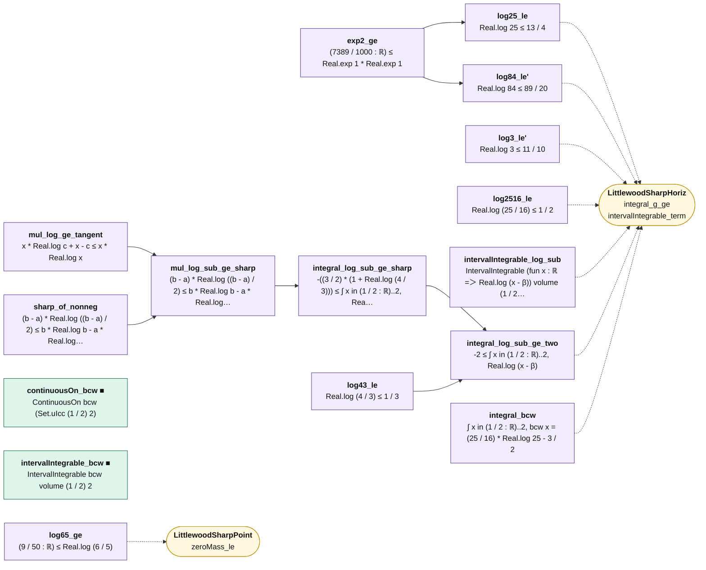

# `lean_stage3/Stage3/LittlewoodSharpLog.lean`

> **Read from the source text.** This file changed after the last `python3 utilities/lean_map.py --dump`, so the arrows on this page are names occurring in each proof and have not been confirmed by Lean.

LittlewoodSharpLog — block S14 of `lean_stage3/design/stencil.md`, Turing at scale: sharper Littlewood constants, part 1, the one-variable integrals and the numerals. 2026-11-25.

16 theorems, 1 definition, 222 lines. 

**Imports:** nothing in this tree  
**Imported by:** [`LittlewoodSharpPoint`](../lean_stage3/LittlewoodSharpPoint.md)

## The picture



An arrow A → B reads "A is used in the proof of B". Green: counting, integers only. Violet: shape, analysis with no ζ. Blue: reads ζ. A name ending in ■ is an end: nothing else uses it. Red: contains `sorry`. Yellow: theorems in another file, counted; a dotted arrow crosses files. Definitions are not drawn; they are listed below the diagram.

## Definitions

<a name="LittlewoodSharp-bcw"></a>
### `LittlewoodSharp.bcw`

def · line 113

The pointwise Borel–Carathéodory weight on the segment, outer radius `25/32`.

- **Is:** `` bcw (x : ℝ) : ℝ := (2 - x) / (x - 7 / 16) ``
- **Used by 5:** [`LittlewoodSharp.bc_eq`](../lean_stage3/LittlewoodSharpHoriz.md#LittlewoodSharp-bc_eq), [`LittlewoodSharp.gLow`](../lean_stage3/LittlewoodSharpHoriz.md#LittlewoodSharp-gLow), [`LittlewoodSharp.continuousOn_bcw`](#LittlewoodSharp-continuousOn_bcw), [`LittlewoodSharp.integral_bcw`](#LittlewoodSharp-integral_bcw), [`LittlewoodSharp.intervalIntegrable_bcw`](#LittlewoodSharp-intervalIntegrable_bcw)

## Theorems

<a name="LittlewoodSharp-mul_log_ge_tangent"></a>
### `LittlewoodSharp.mul_log_ge_tangent`

line 45 · arrows read from text

**Shape.** Uses real or complex analysis; nothing in it or beneath it reads ζ.

**Why.** `x log x − x log c ≥ x − c` for `x, c > 0`.

**Proves**

```lean
x * Real.log c + x - c ≤ x * Real.log x
```

**Needs** (its hypotheses)

  - `` hx : 0 < x ``
  - `` hc : 0 < c ``

**Fed by:** no theorem of this repo; it stands on Mathlib.

**Feeds** (1 that use it)

  - [`LittlewoodSharp.mul_log_sub_ge_sharp`](#LittlewoodSharp-mul_log_sub_ge_sharp) — `` (b - a) * Real.log ((b - a) / 2) ≤ b * Real.log b - a * Real.log a ``

<a name="LittlewoodSharp-sharp_of_nonneg"></a>
### `LittlewoodSharp.sharp_of_nonneg`

line 54 · arrows read from text

**Shape.** Uses real or complex analysis; nothing in it or beneath it reads ζ.

**Why.** The case `0 ≤ a ≤ b`: superadditivity, then `log(b − a) ≥ log((b − a)/2)`.

**Proves**

```lean
(b - a) * Real.log ((b - a) / 2) ≤ b * Real.log b - a * Real.log a
```

**Needs** (its hypotheses)

  - `` ha : 0 ≤ a ``
  - `` hab : a ≤ b ``

**Fed by:** no theorem of this repo; it stands on Mathlib.

**Feeds** (1 that use it)

  - [`LittlewoodSharp.mul_log_sub_ge_sharp`](#LittlewoodSharp-mul_log_sub_ge_sharp) — `` (b - a) * Real.log ((b - a) / 2) ≤ b * Real.log b - a * Real.log a ``

<a name="LittlewoodSharp-mul_log_sub_ge_sharp"></a>
### `LittlewoodSharp.mul_log_sub_ge_sharp`

line 69 · arrows read from text

**Shape.** Uses real or complex analysis; nothing in it or beneath it reads ζ.

**Why.** The sharp two-point bound. `(b − a) log((b − a)/2) ≤ b log b − a log a` for `a ≤ b`.

**Proves**

```lean
(b - a) * Real.log ((b - a) / 2) ≤ b * Real.log b - a * Real.log a
```

**Needs** (its hypotheses)

  - `` hab : a ≤ b ``

**Fed by** (2 theorems its proof uses)

  - [`LittlewoodSharp.mul_log_ge_tangent`](#LittlewoodSharp-mul_log_ge_tangent) — `` x * Real.log c + x - c ≤ x * Real.log x ``
  - [`LittlewoodSharp.sharp_of_nonneg`](#LittlewoodSharp-sharp_of_nonneg) — `` (b - a) * Real.log ((b - a) / 2) ≤ b * Real.log b - a * Real.log a ``

**Feeds** (1 that use it)

  - [`LittlewoodSharp.integral_log_sub_ge_sharp`](#LittlewoodSharp-integral_log_sub_ge_sharp) — `` -((3 / 2) * (1 + Real.log (4 / 3))) ≤ ∫ x in (1 / 2 : ℝ)..2, Real.log (x - β) ``

<a name="LittlewoodSharp-intervalIntegrable_log_sub"></a>
### `LittlewoodSharp.intervalIntegrable_log_sub`

line 84 · arrows read from text

**Shape.** Uses real or complex analysis; nothing in it or beneath it reads ζ.

**Why.** `x ↦ log(x − β)` is integrable on `[1/2, 2]`.

**Proves**

```lean
IntervalIntegrable (fun x : ℝ => Real.log (x - β)) volume (1 / 2) 2
```

**Needs** (its hypotheses)

  - `` β : ℝ ``

**Fed by:** no theorem of this repo; it stands on Mathlib.

**Feeds** (2 that use it)

  - [`LittlewoodSharp.integral_g_ge`](../lean_stage3/LittlewoodSharpHoriz.md#LittlewoodSharp-integral_g_ge) (LittlewoodSharpHoriz) — `` -(113 / 4 * Real.log t + 128) ≤ ∫ x in (1 / 2 : ℝ)..2, gLow ht x ``
  - [`LittlewoodSharp.intervalIntegrable_term`](../lean_stage3/LittlewoodSharpHoriz.md#LittlewoodSharp-intervalIntegrable_term) (LittlewoodSharpHoriz) — `` IntervalIntegrable (fun x => (analyticOrderNatAt (jensenF t) ρ : ℝ) * (Real.log (x - TuringLW.beta ρ) - Real.log 2)) volume (1 / 2) 2 ``

<a name="LittlewoodSharp-integral_log_sub_ge_sharp"></a>
### `LittlewoodSharp.integral_log_sub_ge_sharp`

line 90 · arrows read from text

**Shape.** Uses real or complex analysis; nothing in it or beneath it reads ζ.

**Why.** One zero's singularity, sharp.

**Proves**

```lean
-((3 / 2) * (1 + Real.log (4 / 3))) ≤ ∫ x in (1 / 2 : ℝ)..2, Real.log (x - β)
```

**Needs** (its hypotheses)

  - `` β : ℝ ``

**Fed by** (1 theorem its proof uses)

  - [`LittlewoodSharp.mul_log_sub_ge_sharp`](#LittlewoodSharp-mul_log_sub_ge_sharp) — `` (b - a) * Real.log ((b - a) / 2) ≤ b * Real.log b - a * Real.log a ``

**Feeds** (1 that use it)

  - [`LittlewoodSharp.integral_log_sub_ge_two`](#LittlewoodSharp-integral_log_sub_ge_two) — `` -2 ≤ ∫ x in (1 / 2 : ℝ)..2, Real.log (x - β) ``

<a name="LittlewoodSharp-log43_le"></a>
### `LittlewoodSharp.log43_le`

line 101 · arrows read from text

**Shape.** Uses real or complex analysis; nothing in it or beneath it reads ζ.

**Why.** `log(4/3) ≤ 1/3`.

**Proves**

```lean
Real.log (4 / 3) ≤ 1 / 3
```

**Fed by:** no theorem of this repo; it stands on Mathlib.

**Feeds** (1 that use it)

  - [`LittlewoodSharp.integral_log_sub_ge_two`](#LittlewoodSharp-integral_log_sub_ge_two) — `` -2 ≤ ∫ x in (1 / 2 : ℝ)..2, Real.log (x - β) ``

<a name="LittlewoodSharp-integral_log_sub_ge_two"></a>
### `LittlewoodSharp.integral_log_sub_ge_two`

line 106 · arrows read from text

**Shape.** Uses real or complex analysis; nothing in it or beneath it reads ζ.

**Why.** `−2 ≤ ∫_{1/2}^{2} log(x − β)`.

**Proves**

```lean
-2 ≤ ∫ x in (1 / 2 : ℝ)..2, Real.log (x - β)
```

**Needs** (its hypotheses)

  - `` β : ℝ ``

**Fed by** (2 theorems its proof uses)

  - [`LittlewoodSharp.integral_log_sub_ge_sharp`](#LittlewoodSharp-integral_log_sub_ge_sharp) — `` -((3 / 2) * (1 + Real.log (4 / 3))) ≤ ∫ x in (1 / 2 : ℝ)..2, Real.log (x - β) ``
  - [`LittlewoodSharp.log43_le`](#LittlewoodSharp-log43_le) — `` Real.log (4 / 3) ≤ 1 / 3 ``

**Feeds** (1 that use it)

  - [`LittlewoodSharp.integral_g_ge`](../lean_stage3/LittlewoodSharpHoriz.md#LittlewoodSharp-integral_g_ge) (LittlewoodSharpHoriz) — `` -(113 / 4 * Real.log t + 128) ≤ ∫ x in (1 / 2 : ℝ)..2, gLow ht x ``

<a name="LittlewoodSharp-continuousOn_bcw"></a>
### `LittlewoodSharp.continuousOn_bcw`

line 115 · arrows read from text

**Counting.** Integers only: nothing in its statement or proof, or in anything it rests on, uses analysis or ζ.

**Proves**

```lean
ContinuousOn bcw (Set.uIcc (1 / 2) 2)
```

**Fed by:** no theorem of this repo; it stands on Mathlib and the definitions below.

**Definitions its proof touches:** [`LittlewoodSharp.bcw`](#LittlewoodSharp-bcw)

**Feeds:** nothing. It is an end.

<a name="LittlewoodSharp-intervalIntegrable_bcw"></a>
### `LittlewoodSharp.intervalIntegrable_bcw`

line 123 · arrows read from text

**Counting.** Integers only: nothing in its statement or proof, or in anything it rests on, uses analysis or ζ.

**Proves**

```lean
IntervalIntegrable bcw volume (1 / 2) 2
```

**Fed by:** no theorem of this repo; it stands on Mathlib and the definitions below.

**Definitions its proof touches:** [`LittlewoodSharp.bcw`](#LittlewoodSharp-bcw)

**Feeds:** nothing. It is an end.

<a name="LittlewoodSharp-integral_bcw"></a>
### `LittlewoodSharp.integral_bcw`

line 127 · arrows read from text

**Shape.** Uses real or complex analysis; nothing in it or beneath it reads ζ.

**Why.** The weight integrated. `∫_{1/2}^{2} (2 − x)/(x − 7/16) dx = (25/16) log 25 − 3/2`.

**Proves**

```lean
∫ x in (1 / 2 : ℝ)..2, bcw x = (25 / 16) * Real.log 25 - 3 / 2
```

**Fed by:** no theorem of this repo; it stands on Mathlib and the definitions below.

**Definitions its proof touches:** [`LittlewoodSharp.bcw`](#LittlewoodSharp-bcw)

**Feeds** (1 that use it)

  - [`LittlewoodSharp.integral_g_ge`](../lean_stage3/LittlewoodSharpHoriz.md#LittlewoodSharp-integral_g_ge) (LittlewoodSharpHoriz) — `` -(113 / 4 * Real.log t + 128) ≤ ∫ x in (1 / 2 : ℝ)..2, gLow ht x ``

<a name="LittlewoodSharp-exp2_ge"></a>
### `LittlewoodSharp.exp2_ge`

line 148 · arrows read from text

**Shape.** Uses real or complex analysis; nothing in it or beneath it reads ζ.

**Why.** `exp 1 ^ 2 ≥ 7.389`.

**Proves**

```lean
(7389 / 1000 : ℝ) ≤ Real.exp 1 * Real.exp 1
```

**Fed by:** no theorem of this repo; it stands on Mathlib.

**Feeds** (2 that use it)

  - [`LittlewoodSharp.log25_le`](#LittlewoodSharp-log25_le) — `` Real.log 25 ≤ 13 / 4 ``
  - [`LittlewoodSharp.log84_le'`](#LittlewoodSharp-log84_le-) — `` Real.log 84 ≤ 89 / 20 ``

<a name="LittlewoodSharp-log25_le"></a>
### `LittlewoodSharp.log25_le`

line 153 · arrows read from text

**Shape.** Uses real or complex analysis; nothing in it or beneath it reads ζ.

**Why.** `log 25 ≤ 13/4`.

**Proves**

```lean
Real.log 25 ≤ 13 / 4
```

**Fed by** (1 theorem its proof uses)

  - [`LittlewoodSharp.exp2_ge`](#LittlewoodSharp-exp2_ge) — `` (7389 / 1000 : ℝ) ≤ Real.exp 1 * Real.exp 1 ``

**Feeds** (1 that use it)

  - [`LittlewoodSharp.integral_g_ge`](../lean_stage3/LittlewoodSharpHoriz.md#LittlewoodSharp-integral_g_ge) (LittlewoodSharpHoriz) — `` -(113 / 4 * Real.log t + 128) ≤ ∫ x in (1 / 2 : ℝ)..2, gLow ht x ``

<a name="LittlewoodSharp-log84_le-"></a>
### `LittlewoodSharp.log84_le'`

line 165 · arrows read from text

**Shape.** Uses real or complex analysis; nothing in it or beneath it reads ζ.

**Why.** `log 84 ≤ 89/20`.

**Proves**

```lean
Real.log 84 ≤ 89 / 20
```

**Fed by** (1 theorem its proof uses)

  - [`LittlewoodSharp.exp2_ge`](#LittlewoodSharp-exp2_ge) — `` (7389 / 1000 : ℝ) ≤ Real.exp 1 * Real.exp 1 ``

**Feeds** (1 that use it)

  - [`LittlewoodSharp.integral_g_ge`](../lean_stage3/LittlewoodSharpHoriz.md#LittlewoodSharp-integral_g_ge) (LittlewoodSharpHoriz) — `` -(113 / 4 * Real.log t + 128) ≤ ∫ x in (1 / 2 : ℝ)..2, gLow ht x ``

<a name="LittlewoodSharp-log3_le-"></a>
### `LittlewoodSharp.log3_le'`

line 177 · arrows read from text

**Shape.** Uses real or complex analysis; nothing in it or beneath it reads ζ.

**Why.** `log 3 ≤ 11/10`.

**Proves**

```lean
Real.log 3 ≤ 11 / 10
```

**Fed by:** no theorem of this repo; it stands on Mathlib.

**Feeds** (1 that use it)

  - [`LittlewoodSharp.integral_g_ge`](../lean_stage3/LittlewoodSharpHoriz.md#LittlewoodSharp-integral_g_ge) (LittlewoodSharpHoriz) — `` -(113 / 4 * Real.log t + 128) ≤ ∫ x in (1 / 2 : ℝ)..2, gLow ht x ``

<a name="LittlewoodSharp-log2516_le"></a>
### `LittlewoodSharp.log2516_le`

line 187 · arrows read from text

**Shape.** Uses real or complex analysis; nothing in it or beneath it reads ζ.

**Why.** `log(25/16) ≤ 1/2`.

**Proves**

```lean
Real.log (25 / 16) ≤ 1 / 2
```

**Fed by:** no theorem of this repo; it stands on Mathlib.

**Feeds** (1 that use it)

  - [`LittlewoodSharp.integral_g_ge`](../lean_stage3/LittlewoodSharpHoriz.md#LittlewoodSharp-integral_g_ge) (LittlewoodSharpHoriz) — `` -(113 / 4 * Real.log t + 128) ≤ ∫ x in (1 / 2 : ℝ)..2, gLow ht x ``

<a name="LittlewoodSharp-log65_ge"></a>
### `LittlewoodSharp.log65_ge`

line 194 · arrows read from text

**Shape.** Uses real or complex analysis; nothing in it or beneath it reads ζ.

**Why.** `9/50 ≤ log(6/5)`.

**Proves**

```lean
(9 / 50 : ℝ) ≤ Real.log (6 / 5)
```

**Fed by:** no theorem of this repo; it stands on Mathlib.

**Feeds** (1 that use it)

  - [`LittlewoodSharp.zeroMass_le`](../lean_stage3/LittlewoodSharpPoint.md#LittlewoodSharp-zeroMass_le) (LittlewoodSharpPoint) — `` zeroMass hT ≤ 50 / 9 * Real.log (84 * T) ``

