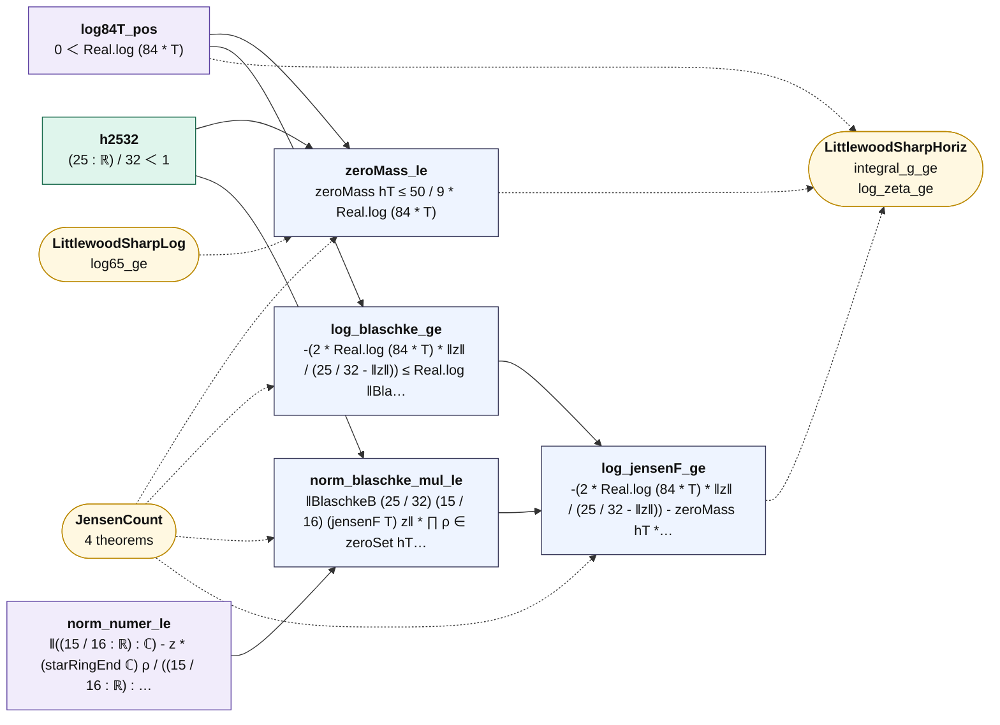

# `lean_stage3/Stage3/LittlewoodSharpPoint.lean`

> **Read from the source text.** This file changed after the last `python3 utilities/lean_map.py --dump`, so the arrows on this page are names occurring in each proof and have not been confirmed by Lean.

LittlewoodSharpPoint — block S14 of `lean_stage3/design/stencil.md`, Turing at scale: sharper Littlewood constants, part 2, the pointwise lower bound for `log|ζ|` with optimized radii. 2026-11-25.

7 theorems, 2 definitions, 224 lines. 

**Imports:** [`JensenCount`](../lean_stage3/JensenCount.md), [`LittlewoodSharpLog`](../lean_stage3/LittlewoodSharpLog.md)  
**Imported by:** [`LittlewoodSharpHoriz`](../lean_stage3/LittlewoodSharpHoriz.md)

## The picture



An arrow A → B reads "A is used in the proof of B". Green: counting, integers only. Violet: shape, analysis with no ζ. Blue: reads ζ. A name ending in ■ is an end: nothing else uses it. Red: contains `sorry`. Yellow: theorems in another file, counted; a dotted arrow crosses files. Definitions are not drawn; they are listed below the diagram.

## Definitions

<a name="LittlewoodSharp-zeroSet"></a>
### `LittlewoodSharp.zeroSet`

def · line 54

The zeros of `jensenF T` in `‖z‖ ≤ 25/32`.

- **Is:** `` zeroSet {T : ℝ} (hT : 2 ≤ T) : Finset ℂ := (finiteSetOfZeros_mono h2532 (jensenF_zeros_finite hT)).toFinset ``
- **Built from:** [`Stage3.jensenF_zeros_finite`](../lean_stage3/JensenCount.md#Stage3-jensenF_zeros_finite), [`LittlewoodSharp.h2532`](#LittlewoodSharp-h2532)
- **Used by 9:** [`LittlewoodSharp.gLow`](../lean_stage3/LittlewoodSharpHoriz.md#LittlewoodSharp-gLow), [`LittlewoodSharp.horizLower_sharp`](../lean_stage3/LittlewoodSharpHoriz.md#LittlewoodSharp-horizLower_sharp), [`LittlewoodSharp.integral_g_ge`](../lean_stage3/LittlewoodSharpHoriz.md#LittlewoodSharp-integral_g_ge), [`LittlewoodSharp.intervalIntegrable_sumTerm`](../lean_stage3/LittlewoodSharpHoriz.md#LittlewoodSharp-intervalIntegrable_sumTerm), [`LittlewoodSharp.log_zeta_ge`](../lean_stage3/LittlewoodSharpHoriz.md#LittlewoodSharp-log_zeta_ge), [`LittlewoodSharp.log_jensenF_ge`](#LittlewoodSharp-log_jensenF_ge), [`LittlewoodSharp.norm_blaschke_mul_le`](#LittlewoodSharp-norm_blaschke_mul_le), [`LittlewoodSharp.zeroMass`](#LittlewoodSharp-zeroMass), [`LittlewoodSharp.zeroMass_le`](#LittlewoodSharp-zeroMass_le)

<a name="LittlewoodSharp-zeroMass"></a>
### `LittlewoodSharp.zeroMass`

def · line 58

Their total order.

- **Is:** `` zeroMass {T : ℝ} (hT : 2 ≤ T) : ℝ := ∑ ρ ∈ zeroSet hT, (analyticOrderNatAt (jensenF T) ρ : ℝ) ``
- **Built from:** [`Stage3.jensenF`](../lean_stage3/JensenCount.md#Stage3-jensenF), [`LittlewoodSharp.zeroSet`](#LittlewoodSharp-zeroSet)
- **Used by 4:** [`LittlewoodSharp.gLow`](../lean_stage3/LittlewoodSharpHoriz.md#LittlewoodSharp-gLow), [`LittlewoodSharp.integral_g_ge`](../lean_stage3/LittlewoodSharpHoriz.md#LittlewoodSharp-integral_g_ge), [`LittlewoodSharp.log_jensenF_ge`](#LittlewoodSharp-log_jensenF_ge), [`LittlewoodSharp.zeroMass_le`](#LittlewoodSharp-zeroMass_le)

## Theorems

<a name="LittlewoodSharp-h2532"></a>
### `LittlewoodSharp.h2532`

line 51 · arrows read from text

**Counting.** Integers only: nothing in its statement or proof, or in anything it rests on, uses analysis or ζ.

**Proves**

```lean
(25 : ℝ) / 32 < 1
```

**Fed by:** no theorem of this repo; it stands on Mathlib.

**Feeds** (3 that use it)

  - [`LittlewoodSharp.norm_blaschke_mul_le`](#LittlewoodSharp-norm_blaschke_mul_le) — `` ‖BlaschkeB (25 / 32) (15 / 16) (jensenF T) z‖ * ∏ ρ ∈ zeroSet hT, ‖z - ρ‖ ^ analyticOrderNatAt (jensenF T) ρ ≤ ‖jensenF T z‖ * (25 / 16) ^ (∑ ρ ∈ zero… ``
  - [`LittlewoodSharp.zeroMass_le`](#LittlewoodSharp-zeroMass_le) — `` zeroMass hT ≤ 50 / 9 * Real.log (84 * T) ``
  - [`LittlewoodSharp.zeroSet`](#LittlewoodSharp-zeroSet) — def

<a name="LittlewoodSharp-log84T_pos"></a>
### `LittlewoodSharp.log84T_pos`

line 61 · arrows read from text

**Shape.** Uses real or complex analysis; nothing in it or beneath it reads ζ.

**Proves**

```lean
0 < Real.log (84 * T)
```

**Needs** (its hypotheses)

  - `` hT : 2 ≤ T ``

**Fed by:** no theorem of this repo; it stands on Mathlib.

**Feeds** (3 that use it)

  - [`LittlewoodSharp.integral_g_ge`](../lean_stage3/LittlewoodSharpHoriz.md#LittlewoodSharp-integral_g_ge) (LittlewoodSharpHoriz) — `` -(113 / 4 * Real.log t + 128) ≤ ∫ x in (1 / 2 : ℝ)..2, gLow ht x ``
  - [`LittlewoodSharp.log_blaschke_ge`](#LittlewoodSharp-log_blaschke_ge) — `` -(2 * Real.log (84 * T) * ‖z‖ / (25 / 32 - ‖z‖)) ≤ Real.log ‖BlaschkeB (25 / 32) (15 / 16) (jensenF T) z‖ ``
  - [`LittlewoodSharp.zeroMass_le`](#LittlewoodSharp-zeroMass_le) — `` zeroMass hT ≤ 50 / 9 * Real.log (84 * T) ``

<a name="LittlewoodSharp-zeroMass_le"></a>
### `LittlewoodSharp.zeroMass_le`

line 65 · arrows read from text

**Reads ζ.** It, or something it rests on, uses the zeta function, its zeros or the Riemann hypothesis.

**Why.** The zero count at the radii `25/32 < 15/16`.

**Proves**

```lean
zeroMass hT ≤ 50 / 9 * Real.log (84 * T)
```

**Needs** (its hypotheses)

  - `` hT : 2 ≤ T ``

**Fed by** (7 theorems its proof uses)

  - [`Stage3.jensenF_analytic`](../lean_stage3/JensenCount.md#Stage3-jensenF_analytic) (JensenCount) — `` AnalyticOnNhd ℂ (jensenF T) (Metric.closedBall (0 : ℂ) 1) ``
  - [`Stage3.jensenF_bound`](../lean_stage3/JensenCount.md#Stage3-jensenF_bound) (JensenCount) — `` ‖jensenF T z‖ ≤ 84 * T ``
  - [`Stage3.jensenF_zero_eq_one`](../lean_stage3/JensenCount.md#Stage3-jensenF_zero_eq_one) (JensenCount) — `` jensenF T 0 = 1 ``
  - [`Stage3.jensenF_zeros_finite`](../lean_stage3/JensenCount.md#Stage3-jensenF_zeros_finite) (JensenCount) — `` (SetOfZeros 1 (jensenF T)).Finite ``
  - [`LittlewoodSharp.log65_ge`](../lean_stage3/LittlewoodSharpLog.md#LittlewoodSharp-log65_ge) (LittlewoodSharpLog) — `` (9 / 50 : ℝ) ≤ Real.log (6 / 5) ``
  - [`LittlewoodSharp.h2532`](#LittlewoodSharp-h2532) — `` (25 : ℝ) / 32 < 1 ``
  - [`LittlewoodSharp.log84T_pos`](#LittlewoodSharp-log84T_pos) — `` 0 < Real.log (84 * T) ``

**Definitions its proof touches:** [`Stage3.jensenF`](../lean_stage3/JensenCount.md#Stage3-jensenF), [`LittlewoodSharp.zeroMass`](#LittlewoodSharp-zeroMass), [`LittlewoodSharp.zeroSet`](#LittlewoodSharp-zeroSet)

**Feeds** (1 that use it)

  - [`LittlewoodSharp.integral_g_ge`](../lean_stage3/LittlewoodSharpHoriz.md#LittlewoodSharp-integral_g_ge) (LittlewoodSharpHoriz) — `` -(113 / 4 * Real.log t + 128) ≤ ∫ x in (1 / 2 : ℝ)..2, gLow ht x ``

<a name="LittlewoodSharp-log_blaschke_ge"></a>
### `LittlewoodSharp.log_blaschke_ge`

line 82 · arrows read from text

**Reads ζ.** It, or something it rests on, uses the zeta function, its zeros or the Riemann hypothesis.

**Why.** Borel–Carathéodory at the point, on the Blaschke quotient.

**Proves**

```lean
-(2 * Real.log (84 * T) * ‖z‖ / (25 / 32 - ‖z‖)) ≤ Real.log ‖BlaschkeB (25 / 32) (15 / 16) (jensenF T) z‖
```

**Needs** (its hypotheses)

  - `` hT : 2 ≤ T ``
  - `` hz : ‖z‖ ≤ 3 / 4 ``

**Fed by** (5 theorems its proof uses)

  - [`Stage3.jensenF_analytic`](../lean_stage3/JensenCount.md#Stage3-jensenF_analytic) (JensenCount) — `` AnalyticOnNhd ℂ (jensenF T) (Metric.closedBall (0 : ℂ) 1) ``
  - [`Stage3.jensenF_bound`](../lean_stage3/JensenCount.md#Stage3-jensenF_bound) (JensenCount) — `` ‖jensenF T z‖ ≤ 84 * T ``
  - [`Stage3.jensenF_zero_eq_one`](../lean_stage3/JensenCount.md#Stage3-jensenF_zero_eq_one) (JensenCount) — `` jensenF T 0 = 1 ``
  - [`Stage3.jensenF_zeros_finite`](../lean_stage3/JensenCount.md#Stage3-jensenF_zeros_finite) (JensenCount) — `` (SetOfZeros 1 (jensenF T)).Finite ``
  - [`LittlewoodSharp.log84T_pos`](#LittlewoodSharp-log84T_pos) — `` 0 < Real.log (84 * T) ``

**Definitions its proof touches:** [`Stage3.jensenF`](../lean_stage3/JensenCount.md#Stage3-jensenF)

**Feeds** (1 that use it)

  - [`LittlewoodSharp.log_jensenF_ge`](#LittlewoodSharp-log_jensenF_ge) — `` -(2 * Real.log (84 * T) * ‖z‖ / (25 / 32 - ‖z‖)) - zeroMass hT * Real.log (25 / 16) + ∑ ρ ∈ zeroSet hT, (analyticOrderNatAt (jensenF T) ρ : ℝ) * Real.… ``

<a name="LittlewoodSharp-norm_numer_le"></a>
### `LittlewoodSharp.norm_numer_le`

line 127 · arrows read from text

**Shape.** Uses real or complex analysis; nothing in it or beneath it reads ζ.

**Why.** Each Blaschke numerator factor is at most `25/16` on `‖z‖ ≤ 3/4`.

**Proves**

```lean
‖((15 / 16 : ℝ) : ℂ) - z * (starRingEnd ℂ) ρ / ((15 / 16 : ℝ) : ℂ)‖ ≤ 25 / 16
```

**Needs** (its hypotheses)

  - `` hz : ‖z‖ ≤ 3 / 4 ``
  - `` hρ : ‖ρ‖ ≤ 25 / 32 ``

**Fed by:** no theorem of this repo; it stands on Mathlib.

**Feeds** (1 that use it)

  - [`LittlewoodSharp.norm_blaschke_mul_le`](#LittlewoodSharp-norm_blaschke_mul_le) — `` ‖BlaschkeB (25 / 32) (15 / 16) (jensenF T) z‖ * ∏ ρ ∈ zeroSet hT, ‖z - ρ‖ ^ analyticOrderNatAt (jensenF T) ρ ≤ ‖jensenF T z‖ * (25 / 16) ^ (∑ ρ ∈ zero… ``

<a name="LittlewoodSharp-norm_blaschke_mul_le"></a>
### `LittlewoodSharp.norm_blaschke_mul_le`

line 143 · arrows read from text

**Reads ζ.** It, or something it rests on, uses the zeta function, its zeros or the Riemann hypothesis.

**Why.** Unfolding the Blaschke quotient off the zeros.

**Proves**

```lean
‖BlaschkeB (25 / 32) (15 / 16) (jensenF T) z‖ * ∏ ρ ∈ zeroSet hT, ‖z - ρ‖ ^ analyticOrderNatAt (jensenF T) ρ ≤ ‖jensenF T z‖ * (25 / 16) ^ (∑ ρ ∈ zeroSet hT, analyticOrderNatAt (jensenF T) ρ)
```

**Needs** (its hypotheses)

  - `` hT : 2 ≤ T ``
  - `` hz : ‖z‖ ≤ 3 / 4 ``
  - `` hfz : jensenF T z ≠ 0 ``

**Fed by** (3 theorems its proof uses)

  - [`Stage3.jensenF_zeros_finite`](../lean_stage3/JensenCount.md#Stage3-jensenF_zeros_finite) (JensenCount) — `` (SetOfZeros 1 (jensenF T)).Finite ``
  - [`LittlewoodSharp.h2532`](#LittlewoodSharp-h2532) — `` (25 : ℝ) / 32 < 1 ``
  - [`LittlewoodSharp.norm_numer_le`](#LittlewoodSharp-norm_numer_le) — `` ‖((15 / 16 : ℝ) : ℂ) - z * (starRingEnd ℂ) ρ / ((15 / 16 : ℝ) : ℂ)‖ ≤ 25 / 16 ``

**Definitions its proof touches:** [`Stage3.jensenF`](../lean_stage3/JensenCount.md#Stage3-jensenF), [`LittlewoodSharp.zeroSet`](#LittlewoodSharp-zeroSet)

**Feeds** (1 that use it)

  - [`LittlewoodSharp.log_jensenF_ge`](#LittlewoodSharp-log_jensenF_ge) — `` -(2 * Real.log (84 * T) * ‖z‖ / (25 / 32 - ‖z‖)) - zeroMass hT * Real.log (25 / 16) + ∑ ρ ∈ zeroSet hT, (analyticOrderNatAt (jensenF T) ρ : ℝ) * Real.… ``

<a name="LittlewoodSharp-log_jensenF_ge"></a>
### `LittlewoodSharp.log_jensenF_ge`

line 178 · arrows read from text

**Reads ζ.** It, or something it rests on, uses the zeta function, its zeros or the Riemann hypothesis.

**Why.** The pointwise lower bound in the model's coordinates, sharper radii.

**Proves**

```lean
-(2 * Real.log (84 * T) * ‖z‖ / (25 / 32 - ‖z‖)) - zeroMass hT * Real.log (25 / 16) + ∑ ρ ∈ zeroSet hT, (analyticOrderNatAt (jensenF T) ρ : ℝ) * Real.log ‖z - ρ‖ ≤ Real.log ‖jensenF T z‖
```

**Needs** (its hypotheses)

  - `` hT : 2 ≤ T ``
  - `` hz : ‖z‖ ≤ 3 / 4 ``
  - `` hfz : jensenF T z ≠ 0 ``

**Fed by** (5 theorems its proof uses)

  - [`Stage3.jensenF_analytic`](../lean_stage3/JensenCount.md#Stage3-jensenF_analytic) (JensenCount) — `` AnalyticOnNhd ℂ (jensenF T) (Metric.closedBall (0 : ℂ) 1) ``
  - [`Stage3.jensenF_zero_eq_one`](../lean_stage3/JensenCount.md#Stage3-jensenF_zero_eq_one) (JensenCount) — `` jensenF T 0 = 1 ``
  - [`Stage3.jensenF_zeros_finite`](../lean_stage3/JensenCount.md#Stage3-jensenF_zeros_finite) (JensenCount) — `` (SetOfZeros 1 (jensenF T)).Finite ``
  - [`LittlewoodSharp.log_blaschke_ge`](#LittlewoodSharp-log_blaschke_ge) — `` -(2 * Real.log (84 * T) * ‖z‖ / (25 / 32 - ‖z‖)) ≤ Real.log ‖BlaschkeB (25 / 32) (15 / 16) (jensenF T) z‖ ``
  - [`LittlewoodSharp.norm_blaschke_mul_le`](#LittlewoodSharp-norm_blaschke_mul_le) — `` ‖BlaschkeB (25 / 32) (15 / 16) (jensenF T) z‖ * ∏ ρ ∈ zeroSet hT, ‖z - ρ‖ ^ analyticOrderNatAt (jensenF T) ρ ≤ ‖jensenF T z‖ * (25 / 16) ^ (∑ ρ ∈ zero… ``

**Definitions its proof touches:** [`Stage3.jensenF`](../lean_stage3/JensenCount.md#Stage3-jensenF), [`LittlewoodSharp.zeroMass`](#LittlewoodSharp-zeroMass), [`LittlewoodSharp.zeroSet`](#LittlewoodSharp-zeroSet)

**Feeds** (1 that use it)

  - [`LittlewoodSharp.log_zeta_ge`](../lean_stage3/LittlewoodSharpHoriz.md#LittlewoodSharp-log_zeta_ge) (LittlewoodSharpHoriz) — `` gLow ht x ≤ Real.log ‖riemannZeta ((x : ℂ) + (t : ℂ) * Complex.I)‖ ``

