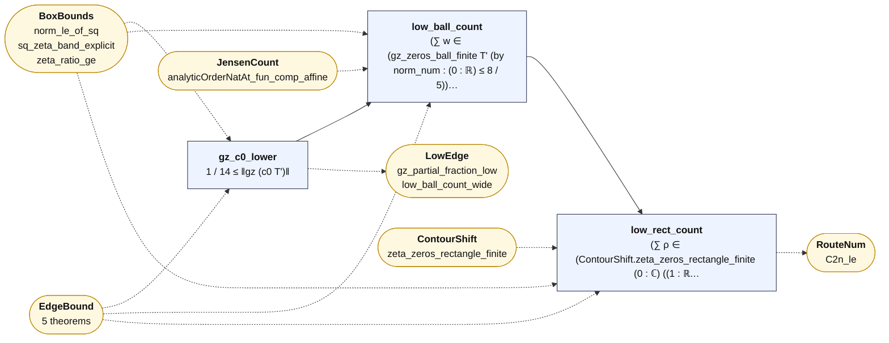

# `lean_stage3/Stage3/LowCount.lean`

LowCount — block E7c of `lean_stage3/design/joints.md`. 2026-11-22. The zeros of ζ below height six, counted. `EdgeBound.ball_order_sum_le` takes their number `M0` as a finite sum with no numeral; here it is bounded by Jensen's count (upstream `ZerosBound`) on six discs about `3/2 + i(j + 1/2)`, `j = 0, …, 5`, each of radius `8/5`, with the pole cleared (`gz`).

3 theorems, 0 definitions, 312 lines. Arrows are Lean's own record of what each proof uses.

**Imports:** [`BoxBounds`](../lean_stage3/BoxBounds.md), [`EdgeBound`](../lean_stage3/EdgeBound.md)  
**Imported by:** [`Stage3`](../lean_stage3/Stage3.md), [`LowEdge`](../lean_stage3/LowEdge.md)

## The picture



An arrow A → B reads "A is used in the proof of B". Green: counting, integers only. Violet: shape, analysis with no ζ. Blue: reads ζ. A name ending in ■ is an end: nothing else uses it. Red: contains `sorry`. Yellow: theorems in another file, counted; a dotted arrow crosses files. Definitions are not drawn; they are listed below the diagram.

## Theorems

<a name="EdgeBound-gz_c0_lower"></a>
### `EdgeBound.gz_c0_lower`

line 29

**Reads ζ.** It, or something it rests on, uses the zeta function, its zeros or the Riemann hypothesis.

**Why.** The centre is bounded below at every height.

**Proves**

```lean
1 / 14 ≤ ‖gz (c0 T')‖
```

**Needs** (its hypotheses)

  - `` T' : ℝ ``

**Stated with:** [`EdgeBound.c0`](../lean_stage3/EdgeBound.md#EdgeBound-c0), [`EdgeBound.gz`](../lean_stage3/EdgeBound.md#EdgeBound-gz)

**Fed by** (2 theorems its proof uses)

  - [`BoxBounds.zeta_ratio_ge`](../lean_stage3/BoxBounds.md#BoxBounds-zeta_ratio_ge) (BoxBounds) — `` 2 / 7 ≤ ‖riemannZeta 3 / riemannZeta (3 / 2)‖ ``
  - [`EdgeBound.c0_re`](../lean_stage3/EdgeBound.md#EdgeBound-c0_re) (EdgeBound) — `` (c0 T').re = 3/2 ``

**Feeds** (3 that use it)

  - [`EdgeBound.low_ball_count`](#EdgeBound-low_ball_count) — `` (∑ w ∈ (gz_zeros_ball_finite T' (by norm_num : (0 : ℝ) ≤ 8 / 5)).toFinset, (analyticOrderNatAt gz w : ℝ)) ≤ 119 ``
  - [`EdgeBound.gz_partial_fraction_low`](../lean_stage3/LowEdge.md#EdgeBound-gz_partial_fraction_low) (LowEdge) — `` ‖deriv gz u / gz u - ∑ w ∈ (gz_zeros_ball_finite T' (by norm_num : (0:ℝ) ≤ 46/25)).toFinset, (analyticOrderNatAt gz w : ℂ) / (u - w)‖ ≤ 1617537 ``
  - [`EdgeBound.low_ball_count_wide`](../lean_stage3/LowEdge.md#EdgeBound-low_ball_count_wide) (LowEdge) — `` (∑ w ∈ (gz_zeros_ball_finite T' (by norm_num : (0 : ℝ) ≤ 46 / 25)).toFinset, (analyticOrderNatAt gz w : ℝ)) ≤ 250 ``

<a name="EdgeBound-low_ball_count"></a>
### `EdgeBound.low_ball_count`

line 51

**Reads ζ.** It, or something it rests on, uses the zeta function, its zeros or the Riemann hypothesis.

**Why.** Jensen's count at a low height.

**Proves**

```lean
(∑ w ∈ (gz_zeros_ball_finite T' (by norm_num : (0 : ℝ) ≤ 8 / 5)).toFinset, (analyticOrderNatAt gz w : ℝ)) ≤ 119
```

**Needs** (its hypotheses)

  - `` h0 : 0 ≤ T' ``
  - `` h6 : T' ≤ 6 ``

**Stated with:** [`EdgeBound.c0`](../lean_stage3/EdgeBound.md#EdgeBound-c0), [`EdgeBound.gz`](../lean_stage3/EdgeBound.md#EdgeBound-gz), [`EdgeBound.gz_zeros_ball_finite`](../lean_stage3/EdgeBound.md#EdgeBound-gz_zeros_ball_finite)

**Fed by** (6 theorems its proof uses)

  - [`BoxBounds.sq_zeta_band_explicit`](../lean_stage3/BoxBounds.md#BoxBounds-sq_zeta_band_explicit) (BoxBounds) — `` ‖(s - 1) ^ 2 * riemannZeta s‖ ≤ 135 * (2 + |s.im|) ^ 4 ``
  - [`EdgeBound.c0_im`](../lean_stage3/EdgeBound.md#EdgeBound-c0_im) (EdgeBound) — `` (c0 T').im = T' ``
  - [`EdgeBound.c0_re`](../lean_stage3/EdgeBound.md#EdgeBound-c0_re) (EdgeBound) — `` (c0 T').re = 3/2 ``
  - [`EdgeBound.gz_analytic`](../lean_stage3/EdgeBound.md#EdgeBound-gz_analytic) (EdgeBound) — `` AnalyticAt ℂ gz s ``
  - [`Stage3.analyticOrderNatAt_fun_comp_affine`](../lean_stage3/JensenCount.md#Stage3-analyticOrderNatAt_fun_comp_affine) (JensenCount) — `` analyticOrderNatAt (fun w : ℂ => g (a * w + b)) z = analyticOrderNatAt g (a * z + b) ``
  - [`EdgeBound.gz_c0_lower`](#EdgeBound-gz_c0_lower) — `` 1 / 14 ≤ ‖gz (c0 T')‖ ``

**Feeds** (1 that use it)

  - [`EdgeBound.low_rect_count`](#EdgeBound-low_rect_count) — `` (∑ ρ ∈ (ContourShift.zeta_zeros_rectangle_finite (0 : ℂ) ((1 : ℝ) + Complex.I * (6 : ℝ))).toFinset, (analyticOrderNatAt riemannZeta ρ : ℝ)) ≤ 714 ``

<a name="EdgeBound-low_rect_count"></a>
### `EdgeBound.low_rect_count`

line 189

**Reads ζ.** It, or something it rests on, uses the zeta function, its zeros or the Riemann hypothesis.

**Why.** `M0`, bounded by a numeral.

**Proves**

```lean
(∑ ρ ∈ (ContourShift.zeta_zeros_rectangle_finite (0 : ℂ) ((1 : ℝ) + Complex.I * (6 : ℝ))).toFinset, (analyticOrderNatAt riemannZeta ρ : ℝ)) ≤ 714
```

**Stated with:** [`ContourShift.zeta_zeros_rectangle_finite`](../lean_stage3/ContourShift.md#ContourShift-zeta_zeros_rectangle_finite)

**Fed by** (6 theorems its proof uses)

  - [`BoxBounds.norm_le_of_sq`](../lean_stage3/BoxBounds.md#BoxBounds-norm_le_of_sq) (BoxBounds) — `` ‖z‖ ≤ c ``
  - [`EdgeBound.c0_im`](../lean_stage3/EdgeBound.md#EdgeBound-c0_im) (EdgeBound) — `` (c0 T').im = T' ``
  - [`EdgeBound.c0_re`](../lean_stage3/EdgeBound.md#EdgeBound-c0_re) (EdgeBound) — `` (c0 T').re = 3/2 ``
  - [`EdgeBound.gz_order_eq`](../lean_stage3/EdgeBound.md#EdgeBound-gz_order_eq) (EdgeBound) — `` analyticOrderNatAt gz w = analyticOrderNatAt riemannZeta w ``
  - [`EdgeBound.gz_zeros_ball_finite`](../lean_stage3/EdgeBound.md#EdgeBound-gz_zeros_ball_finite) (EdgeBound) — `` {w : ℂ | gz w = 0 ∧ ‖w - c0 T'‖ ≤ ρ}.Finite ``
  - [`EdgeBound.low_ball_count`](#EdgeBound-low_ball_count) — `` (∑ w ∈ (gz_zeros_ball_finite T' (by norm_num : (0 : ℝ) ≤ 8 / 5)).toFinset, (analyticOrderNatAt gz w : ℝ)) ≤ 119 ``

**Definitions its proof touches:** [`EdgeBound.c0`](../lean_stage3/EdgeBound.md#EdgeBound-c0), [`EdgeBound.gz`](../lean_stage3/EdgeBound.md#EdgeBound-gz)

**Feeds** (1 that use it)

  - [`RouteNum.C2n_le`](../lean_stage3/RouteNum.md#RouteNum-C2n_le) (RouteNum) — `` EdgeBound.C2n ≤ 2167 ``

