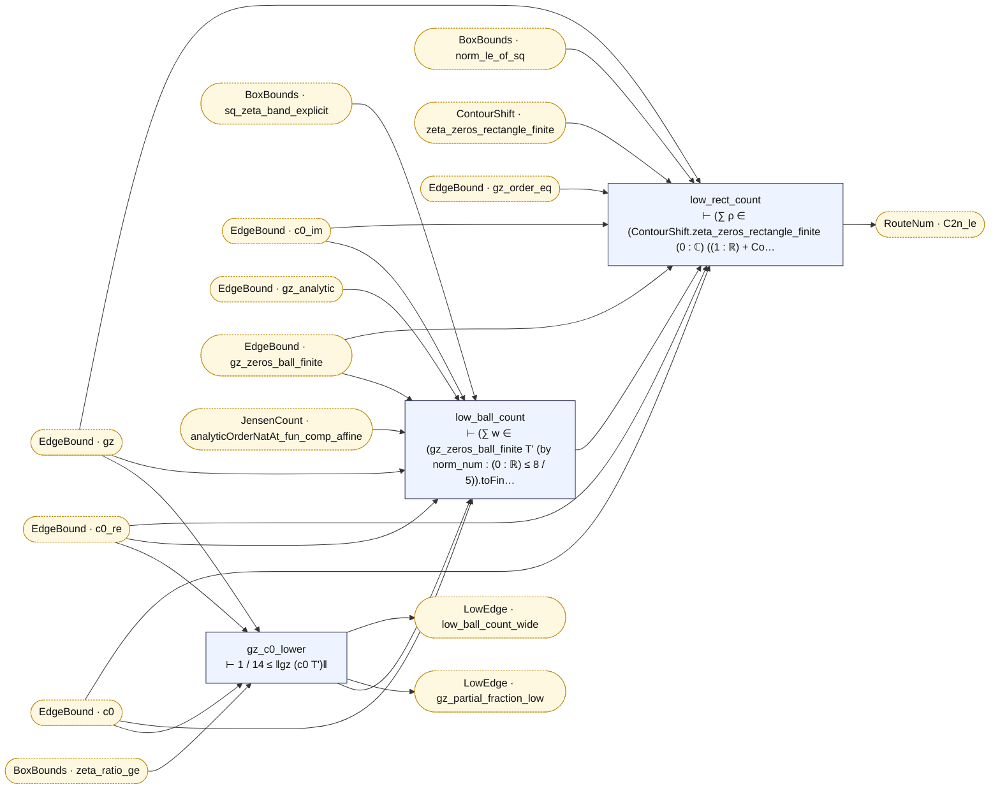

# `lean_stage3/Stage3/LowCount.lean`

**What it does** (its own header): LowCount — block E7c of `lean_stage3/design/joints.md`. 2026-11-22. The zeros of ζ below height six, counted. `EdgeBound.ball_order_sum_le` takes their number `M0` as a finite sum with no numeral; here it is bounded by Jensen's count (upstream `ZerosBound`) on six discs about `3/2 + i(j + 1/2)`, `j = 0, …, 5`, each of radius `8/5`, with the pole cleared (`gz`).

**Imports:** [`BoxBounds`](../lean_stage3/BoxBounds.md), [`EdgeBound`](../lean_stage3/EdgeBound.md).
**Imported by:** [`Stage3`](../lean_stage3/Stage3.md), [`LowEdge`](../lean_stage3/LowEdge.md).

Blue: theorem. Green: a theorem nothing else uses (an end). Dashed white: connects to nothing. Grey: definition. Red: contains `sorry`. Yellow: in another file. An arrow A → B reads "A is used by B".

## Every declaration

| declaration | proves (output) | needs (input) | why (its own docstring) | uses | used by |
|---|---|---|---|---|---|
| `EdgeBound.gz_c0_lower` theorem, line 29 | 1 / 14 ≤ ‖gz (c0 T')‖ | T' : ℝ | The centre is bounded below at every height. | `BoxBounds.zeta_ratio_ge`, `EdgeBound.c0`, `EdgeBound.c0_re`, `EdgeBound.gz` | `EdgeBound.low_ball_count`, `EdgeBound.gz_partial_fraction_low`, `EdgeBound.low_ball_count_wide` |
| `EdgeBound.low_ball_count` theorem, line 51 | (∑ w ∈ (gz_zeros_ball_finite T' (by norm_num : (0 : ℝ) ≤ 8 / 5)).toFinset, (analyticOrderNatAt gz w : ℝ)) ≤ 119 | h0 : 0 ≤ T'; h6 : T' ≤ 6 | Jensen's count at a low height. | `BoxBounds.sq_zeta_band_explicit`, `EdgeBound.c0`, `EdgeBound.c0_im`, `EdgeBound.c0_re`, `EdgeBound.gz`, `EdgeBound.gz_analytic`, `EdgeBound.gz_zeros_ball_finite`, `Stage3.analyticOrderNatAt_fun_comp_affine`, `EdgeBound.gz_c0_lower` | `EdgeBound.low_rect_count` |
| `EdgeBound.low_rect_count` theorem, line 189 | (∑ ρ ∈ (ContourShift.zeta_zeros_rectangle_finite (0 : ℂ) ((1 : ℝ) + Complex.I * (6 : ℝ))).toFinset, (analyticOrderNatAt riemannZeta ρ : ℝ)) ≤ 714 | — | `M0`, bounded by a numeral. | `BoxBounds.norm_le_of_sq`, `ContourShift.zeta_zeros_rectangle_finite`, `EdgeBound.c0`, `EdgeBound.c0_im`, `EdgeBound.c0_re`, `EdgeBound.gz`, `EdgeBound.gz_order_eq`, `EdgeBound.gz_zeros_ball_finite`, `EdgeBound.low_ball_count` | `RouteNum.C2n_le` |
