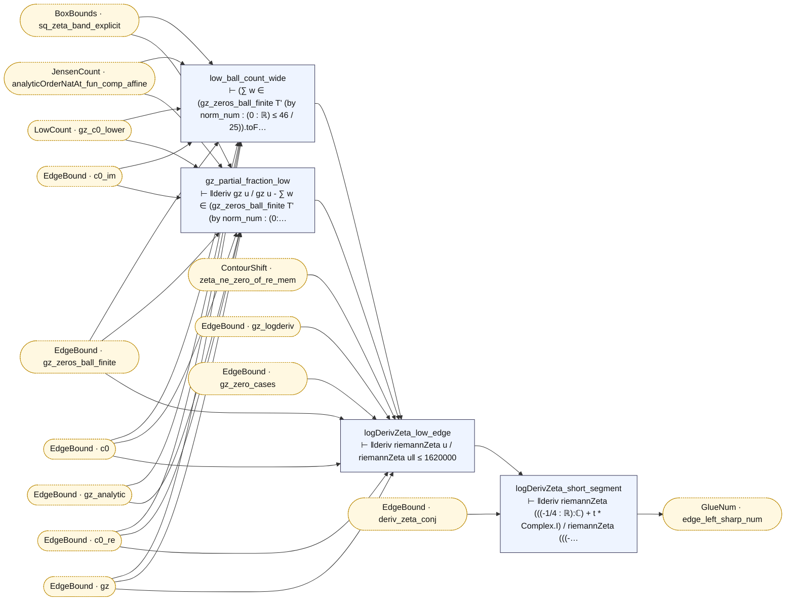

# `lean_stage3/Stage3/LowEdge.lean`

**What it does** (its own header): LowEdge — block E7d of `lean_stage3/design/joints.md`. 2026-11-22. The logarithmic derivative of ζ on the short segment `Re s = −1/4`, `|t| ≤ 2`, bounded by a numeral. `Glue.edge_left_bound` takes that supremum `Mc` from compactness. `EdgeBound.gz_partial_fraction` gives the bound at heights `≥ 2` because its right side is `C·log T′`; at heights in `[0, 2]` the same proof, with `BoxBounds.sq_zeta_band_explicit` above and `gz_c0_lower` below, gives a constant.

**Imports:** [`LowCount`](../lean_stage3/LowCount.md).
**Imported by:** [`Stage3`](../lean_stage3/Stage3.md), [`EdgeNum`](../lean_stage3/EdgeNum.md).

Blue: theorem. Green: a theorem nothing else uses (an end). Dashed white: connects to nothing. Grey: definition. Red: contains `sorry`. Yellow: in another file. An arrow A → B reads "A is used by B".

## Every declaration

| declaration | proves (output) | needs (input) | why (its own docstring) | uses | used by |
|---|---|---|---|---|---|
| `EdgeBound.low_ball_count_wide` theorem, line 35 | (∑ w ∈ (gz_zeros_ball_finite T' (by norm_num : (0 : ℝ) ≤ 46 / 25)).toFinset, (analyticOrderNatAt gz w : ℝ)) ≤ 250 | h0 : 0 ≤ T'; h6 : T' ≤ 2 | Jensen's count at a low height, on the partial fraction's ball. | `BoxBounds.sq_zeta_band_explicit`, `EdgeBound.c0`, `EdgeBound.c0_im`, `EdgeBound.c0_re`, `EdgeBound.gz`, `EdgeBound.gz_analytic`, `EdgeBound.gz_zeros_ball_finite`, `Stage3.analyticOrderNatAt_fun_comp_affine`, `EdgeBound.gz_c0_lower` | `EdgeBound.logDerivZeta_low_edge` |
| `EdgeBound.gz_partial_fraction_low` theorem, line 173 | ‖deriv gz u / gz u - ∑ w ∈ (gz_zeros_ball_finite T' (by norm_num : (0:ℝ) ≤ 46/25)).toFinset, (analyticOrderNatAt gz w : ℂ) / (u - w)‖ ≤ 1617537 | h0T : 0 ≤ T'; h2T : T' ≤ 2; u : ℂ; him : u.im = T'; hre1 : -1/4 ≤ u.re; hre2 : u.re ≤ 2; hune : gz u ≠ 0 | The partial fraction at a low height, with a numeral. | `BoxBounds.sq_zeta_band_explicit`, `EdgeBound.c0`, `EdgeBound.c0_im`, `EdgeBound.c0_re`, `EdgeBound.gz`, `EdgeBound.gz_analytic`, `EdgeBound.gz_zeros_ball_finite`, `Stage3.analyticOrderNatAt_fun_comp_affine`, `EdgeBound.gz_c0_lower` | `EdgeBound.logDerivZeta_low_edge` |
| `EdgeBound.logDerivZeta_low_edge` theorem, line 382 | ‖deriv riemannZeta u / riemannZeta u‖ ≤ 1620000 | h0 : 0 ≤ t; h2 : t ≤ 2; hre : u.re = -1/4; him : u.im = t | The short segment, upper half. | `ContourShift.zeta_ne_zero_of_re_mem`, `EdgeBound.c0`, `EdgeBound.c0_re`, `EdgeBound.gz`, `EdgeBound.gz_logderiv`, `EdgeBound.gz_zero_cases`, `EdgeBound.gz_zeros_ball_finite`, `EdgeBound.gz_partial_fraction_low`, `EdgeBound.low_ball_count_wide` | `EdgeBound.logDerivZeta_short_segment` |
| `EdgeBound.logDerivZeta_short_segment` theorem, line 459 | ‖deriv riemannZeta (((-1/4 : ℝ):ℂ) + t * Complex.I) / riemannZeta (((-1/4 : ℝ):ℂ) + t * Complex.I)‖ ≤ 1620000 | ht : \|t\| ≤ 2 | `Mc`, bounded by a numeral: the short segment, both signs. | `EdgeBound.deriv_zeta_conj`, `EdgeBound.logDerivZeta_low_edge` | `Glue.edge_left_sharp_num` |
