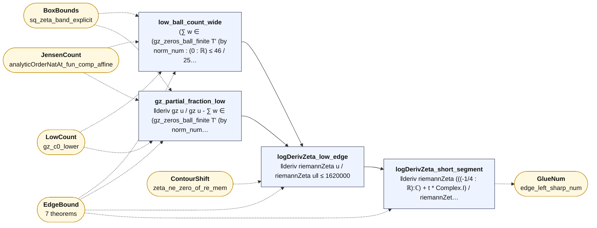

# `lean_stage3/Stage3/LowEdge.lean`

LowEdge — block E7d of `lean_stage3/design/joints.md`. 2026-11-22. The logarithmic derivative of ζ on the short segment `Re s = −1/4`, `|t| ≤ 2`, bounded by a numeral. `Glue.edge_left_bound` takes that supremum `Mc` from compactness. `EdgeBound.gz_partial_fraction` gives the bound at heights `≥ 2` because its right side is `C·log T′`; at heights in `[0, 2]` the same proof, with `BoxBounds.sq_zeta_band_explicit` above and `gz_c0_lower` below, gives a constant.

4 theorems, 0 definitions, 500 lines. Arrows are Lean's own record of what each proof uses.

**Imports:** [`LowCount`](../lean_stage3/LowCount.md)  
**Imported by:** [`Stage3`](../lean_stage3/Stage3.md), [`EdgeNum`](../lean_stage3/EdgeNum.md)

## The picture



An arrow A → B reads "A is used in the proof of B". Green: counting, integers only. Violet: shape, analysis with no ζ. Blue: reads ζ. A name ending in ■ is an end: nothing else uses it. Red: contains `sorry`. Yellow: theorems in another file, counted; a dotted arrow crosses files. Definitions are not drawn; they are listed below the diagram.

## Theorems

<a name="EdgeBound-low_ball_count_wide"></a>
### `EdgeBound.low_ball_count_wide`

line 35

**Reads ζ.** It, or something it rests on, uses the zeta function, its zeros or the Riemann hypothesis.

**Why.** Jensen's count at a low height, on the partial fraction's ball.

**Proves**

```lean
(∑ w ∈ (gz_zeros_ball_finite T' (by norm_num : (0 : ℝ) ≤ 46 / 25)).toFinset, (analyticOrderNatAt gz w : ℝ)) ≤ 250
```

**Needs** (its hypotheses)

  - `` h0 : 0 ≤ T' ``
  - `` h6 : T' ≤ 2 ``

**Stated with:** [`EdgeBound.c0`](../lean_stage3/EdgeBound.md#EdgeBound-c0), [`EdgeBound.gz`](../lean_stage3/EdgeBound.md#EdgeBound-gz), [`EdgeBound.gz_zeros_ball_finite`](../lean_stage3/EdgeBound.md#EdgeBound-gz_zeros_ball_finite)

**Fed by** (6 theorems its proof uses)

  - [`BoxBounds.sq_zeta_band_explicit`](../lean_stage3/BoxBounds.md#BoxBounds-sq_zeta_band_explicit) (BoxBounds) — `` ‖(s - 1) ^ 2 * riemannZeta s‖ ≤ 135 * (2 + |s.im|) ^ 4 ``
  - [`EdgeBound.c0_im`](../lean_stage3/EdgeBound.md#EdgeBound-c0_im) (EdgeBound) — `` (c0 T').im = T' ``
  - [`EdgeBound.c0_re`](../lean_stage3/EdgeBound.md#EdgeBound-c0_re) (EdgeBound) — `` (c0 T').re = 3/2 ``
  - [`EdgeBound.gz_analytic`](../lean_stage3/EdgeBound.md#EdgeBound-gz_analytic) (EdgeBound) — `` AnalyticAt ℂ gz s ``
  - [`Stage3.analyticOrderNatAt_fun_comp_affine`](../lean_stage3/JensenCount.md#Stage3-analyticOrderNatAt_fun_comp_affine) (JensenCount) — `` analyticOrderNatAt (fun w : ℂ => g (a * w + b)) z = analyticOrderNatAt g (a * z + b) ``
  - [`EdgeBound.gz_c0_lower`](../lean_stage3/LowCount.md#EdgeBound-gz_c0_lower) (LowCount) — `` 1 / 14 ≤ ‖gz (c0 T')‖ ``

**Feeds** (1 that use it)

  - [`EdgeBound.logDerivZeta_low_edge`](#EdgeBound-logDerivZeta_low_edge) — `` ‖deriv riemannZeta u / riemannZeta u‖ ≤ 1620000 ``

<a name="EdgeBound-gz_partial_fraction_low"></a>
### `EdgeBound.gz_partial_fraction_low`

line 173

**Reads ζ.** It, or something it rests on, uses the zeta function, its zeros or the Riemann hypothesis.

**Why.** The partial fraction at a low height, with a numeral.

**Proves**

```lean
‖deriv gz u / gz u - ∑ w ∈ (gz_zeros_ball_finite T' (by norm_num : (0:ℝ) ≤ 46/25)).toFinset, (analyticOrderNatAt gz w : ℂ) / (u - w)‖ ≤ 1617537
```

**Needs** (its hypotheses)

  - `` h0T : 0 ≤ T' ``
  - `` h2T : T' ≤ 2 ``
  - `` u : ℂ ``
  - `` him : u.im = T' ``
  - `` hre1 : -1/4 ≤ u.re ``
  - `` hre2 : u.re ≤ 2 ``
  - `` hune : gz u ≠ 0 ``

**Stated with:** [`EdgeBound.c0`](../lean_stage3/EdgeBound.md#EdgeBound-c0), [`EdgeBound.gz`](../lean_stage3/EdgeBound.md#EdgeBound-gz), [`EdgeBound.gz_zeros_ball_finite`](../lean_stage3/EdgeBound.md#EdgeBound-gz_zeros_ball_finite)

**Fed by** (6 theorems its proof uses)

  - [`BoxBounds.sq_zeta_band_explicit`](../lean_stage3/BoxBounds.md#BoxBounds-sq_zeta_band_explicit) (BoxBounds) — `` ‖(s - 1) ^ 2 * riemannZeta s‖ ≤ 135 * (2 + |s.im|) ^ 4 ``
  - [`EdgeBound.c0_im`](../lean_stage3/EdgeBound.md#EdgeBound-c0_im) (EdgeBound) — `` (c0 T').im = T' ``
  - [`EdgeBound.c0_re`](../lean_stage3/EdgeBound.md#EdgeBound-c0_re) (EdgeBound) — `` (c0 T').re = 3/2 ``
  - [`EdgeBound.gz_analytic`](../lean_stage3/EdgeBound.md#EdgeBound-gz_analytic) (EdgeBound) — `` AnalyticAt ℂ gz s ``
  - [`Stage3.analyticOrderNatAt_fun_comp_affine`](../lean_stage3/JensenCount.md#Stage3-analyticOrderNatAt_fun_comp_affine) (JensenCount) — `` analyticOrderNatAt (fun w : ℂ => g (a * w + b)) z = analyticOrderNatAt g (a * z + b) ``
  - [`EdgeBound.gz_c0_lower`](../lean_stage3/LowCount.md#EdgeBound-gz_c0_lower) (LowCount) — `` 1 / 14 ≤ ‖gz (c0 T')‖ ``

**Feeds** (1 that use it)

  - [`EdgeBound.logDerivZeta_low_edge`](#EdgeBound-logDerivZeta_low_edge) — `` ‖deriv riemannZeta u / riemannZeta u‖ ≤ 1620000 ``

<a name="EdgeBound-logDerivZeta_low_edge"></a>
### `EdgeBound.logDerivZeta_low_edge`

line 382

**Reads ζ.** It, or something it rests on, uses the zeta function, its zeros or the Riemann hypothesis.

**Why.** The short segment, upper half.

**Proves**

```lean
‖deriv riemannZeta u / riemannZeta u‖ ≤ 1620000
```

**Needs** (its hypotheses)

  - `` h0 : 0 ≤ t ``
  - `` h2 : t ≤ 2 ``
  - `` hre : u.re = -1/4 ``
  - `` him : u.im = t ``

**Fed by** (7 theorems its proof uses)

  - [`ContourShift.zeta_ne_zero_of_re_mem`](../lean_stage3/ContourShift.md#ContourShift-zeta_ne_zero_of_re_mem) (ContourShift) — `` riemannZeta w ≠ 0 ``
  - [`EdgeBound.c0_re`](../lean_stage3/EdgeBound.md#EdgeBound-c0_re) (EdgeBound) — `` (c0 T').re = 3/2 ``
  - [`EdgeBound.gz_logderiv`](../lean_stage3/EdgeBound.md#EdgeBound-gz_logderiv) (EdgeBound) — `` deriv gz u / gz u = 2/(u - 1) + deriv riemannZeta u / riemannZeta u ``
  - [`EdgeBound.gz_zero_cases`](../lean_stage3/EdgeBound.md#EdgeBound-gz_zero_cases) (EdgeBound) — `` w = 1 ∨ riemannZeta w = 0 ``
  - [`EdgeBound.gz_zeros_ball_finite`](../lean_stage3/EdgeBound.md#EdgeBound-gz_zeros_ball_finite) (EdgeBound) — `` {w : ℂ | gz w = 0 ∧ ‖w - c0 T'‖ ≤ ρ}.Finite ``
  - [`EdgeBound.gz_partial_fraction_low`](#EdgeBound-gz_partial_fraction_low) — `` ‖deriv gz u / gz u - ∑ w ∈ (gz_zeros_ball_finite T' (by norm_num : (0:ℝ) ≤ 46/25)).toFinset, (analyticOrderNatAt gz w : ℂ) / (u - w)‖ ≤ 1617537 ``
  - [`EdgeBound.low_ball_count_wide`](#EdgeBound-low_ball_count_wide) — `` (∑ w ∈ (gz_zeros_ball_finite T' (by norm_num : (0 : ℝ) ≤ 46 / 25)).toFinset, (analyticOrderNatAt gz w : ℝ)) ≤ 250 ``

**Definitions its proof touches:** [`EdgeBound.c0`](../lean_stage3/EdgeBound.md#EdgeBound-c0), [`EdgeBound.gz`](../lean_stage3/EdgeBound.md#EdgeBound-gz)

**Feeds** (1 that use it)

  - [`EdgeBound.logDerivZeta_short_segment`](#EdgeBound-logDerivZeta_short_segment) — `` ‖deriv riemannZeta (((-1/4 : ℝ):ℂ) + t * Complex.I) / riemannZeta (((-1/4 : ℝ):ℂ) + t * Complex.I)‖ ≤ 1620000 ``

<a name="EdgeBound-logDerivZeta_short_segment"></a>
### `EdgeBound.logDerivZeta_short_segment`

line 459

**Reads ζ.** It, or something it rests on, uses the zeta function, its zeros or the Riemann hypothesis.

**Why.** `Mc`, bounded by a numeral: the short segment, both signs.

**Proves**

```lean
‖deriv riemannZeta (((-1/4 : ℝ):ℂ) + t * Complex.I) / riemannZeta (((-1/4 : ℝ):ℂ) + t * Complex.I)‖ ≤ 1620000
```

**Needs** (its hypotheses)

  - `` ht : |t| ≤ 2 ``

**Fed by** (2 theorems its proof uses)

  - [`EdgeBound.deriv_zeta_conj`](../lean_stage3/EdgeBound.md#EdgeBound-deriv_zeta_conj) (EdgeBound) — `` deriv riemannZeta ((starRingEnd ℂ) s) = (starRingEnd ℂ) (deriv riemannZeta s) ``
  - [`EdgeBound.logDerivZeta_low_edge`](#EdgeBound-logDerivZeta_low_edge) — `` ‖deriv riemannZeta u / riemannZeta u‖ ≤ 1620000 ``

**Feeds** (1 that use it)

  - [`Glue.edge_left_sharp_num`](../lean_stage3/GlueNum.md#Glue-edge_left_sharp_num) (GlueNum) — `` ∀ x T' : ℝ, 16 ≤ x → 2 ≤ T' → T' ≤ 2*x^2 → ‖VIntegral (Gf x) (-1/4) (-T') T'‖ ≤ 72 * Dln * ((Real.log x)^2 * x ^ (-(1:ℝ)/4)) ``

