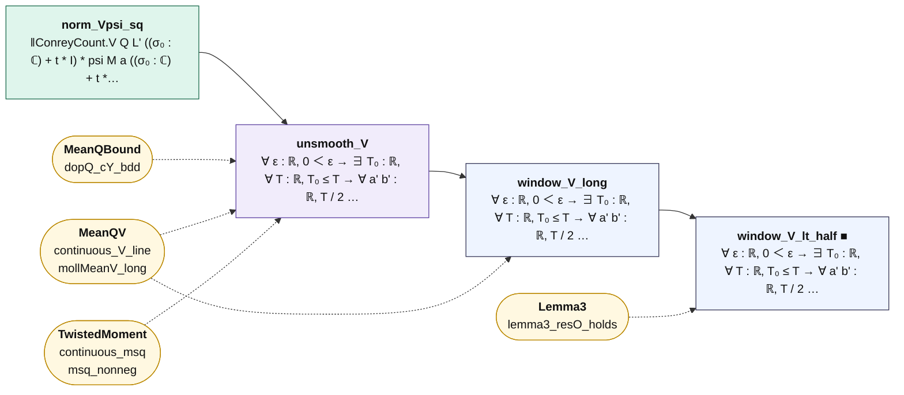

# `lean_stage3/Stage3/MeanQ.lean`

> **Read from the source text.** This file changed after the last `python3 utilities/lean_map.py --dump`, so the arrows on this page are names occurring in each proof and have not been confirmed by Lean.

MeanQ — block S13 of `lean_stage3/design/stencil.md`, B4 step 3, the mean value with a general Q. 2026-11-25.

4 theorems, 0 definitions, 235 lines. 

**Imports:** [`MeanQV`](../lean_stage3/MeanQV.md)  
**Imported by:** [`Stage3`](../lean_stage3/Stage3.md)

## The picture



An arrow A → B reads "A is used in the proof of B". Green: counting, integers only. Violet: shape, analysis with no ζ. Blue: reads ζ. A name ending in ■ is an end: nothing else uses it. Red: contains `sorry`. Yellow: theorems in another file, counted; a dotted arrow crosses files. Definitions are not drawn; they are listed below the diagram.

## Theorems

<a name="MeanQ-norm_Vpsi_sq"></a>
### `MeanQ.norm_Vpsi_sq`

line 62 · arrows read from text

**Counting.** Integers only: nothing in its statement or proof, or in anything it rests on, uses analysis or ζ.

**Why.** `|V ψ|² = |V|² |ψ|²`.

**Proves**

```lean
‖ConreyCount.V Q L' ((σ₀ : ℂ) + t * I) * psi M a ((σ₀ : ℂ) + t * I)‖ ^ 2 = ‖ConreyCount.V Q L' ((σ₀ : ℂ) + t * I)‖ ^ 2 * msq M a σ₀ t
```

**Needs** (its hypotheses)

  - `` Q : ℝ[X] ``
  - `` L' : ℝ ``
  - `` M : ℕ ``
  - `` a : ℕ → ℂ ``
  - `` σ₀ t : ℝ ``

**Fed by:** no theorem of this repo; it stands on Mathlib and the definitions below.

**Definitions its proof touches:** [`ConreyCount.V`](../lean_stage3/ConreyCountLine.md#ConreyCount-V), [`TwistedMoment.msq`](../lean_stage3/TwistedMoment.md#TwistedMoment-msq), [`TwistedMoment.psi`](../lean_stage3/TwistedMoment.md#TwistedMoment-psi)

**Feeds** (1 that use it)

  - [`MeanQ.unsmooth_V`](#MeanQ-unsmooth_V) — `` ∀ ε : ℝ, 0 < ε → ∃ T₀ : ℝ, ∀ T : ℝ, T₀ ≤ T → ∀ a' b' : ℝ, T / 2 ≤ a' → a' ≤ T / 2 + 1 → T - 1 ≤ b' → b' ≤ T → (1 / (b' - a')) * ∫ t in a'..b', ‖Conrey… ``

<a name="MeanQ-unsmooth_V"></a>
### `MeanQ.unsmooth_V`

line 70 · arrows read from text

**Shape.** Uses real or complex analysis; nothing in it or beneath it reads ζ.

**Why.** The sharp one-sided mean of `Vψ` from the mollified mean, every length: `FloorLong.unsmooth_near_long` with `G` replaced by `V` and `Dop` by `DopQ`.

**Proves**

```lean
∀ ε : ℝ, 0 < ε → ∃ T₀ : ℝ, ∀ T : ℝ, T₀ ≤ T → ∀ a' b' : ℝ, T / 2 ≤ a' → a' ≤ T / 2 + 1 → T - 1 ≤ b' → b' ≤ T → (1 / (b' - a')) * ∫ t in a'..b', ‖ConreyCount.V Q (Real.log T) ((sig0 T R : ℂ) + t * I) * psi (Mof T θ) (aY P T θ R) ((sig0 T R : ℂ) + t * I)‖ ^ 2 ≤ (DopQ Q (Real.log T) (cY P (Mof T θ) T) ((-(R / Real.log T) : ℝ) : ℂ) ((-(R / Real.log T) : ℝ) : ℂ)).re + ε
```

**Needs** (its hypotheses)

  - `` Q P : ℝ[X] ``
  - `` hθ0 : 0 < θ ``
  - `` hR : 0 < R ``
  - `` hMV : StmtMollMeanV Q P θ R ``

**Fed by** (5 theorems its proof uses)

  - [`MeanQ.norm_Vpsi_sq`](#MeanQ-norm_Vpsi_sq) — `` ‖ConreyCount.V Q L' ((σ₀ : ℂ) + t * I) * psi M a ((σ₀ : ℂ) + t * I)‖ ^ 2 = ‖ConreyCount.V Q L' ((σ₀ : ℂ) + t * I)‖ ^ 2 * msq M a σ₀ t ``
  - [`MeanQ.dopQ_cY_bdd`](../lean_stage3/MeanQBound.md#MeanQ-dopQ_cY_bdd) (MeanQBound) — `` ∃ K : ℝ, 0 ≤ K ∧ ∃ T₀ : ℝ, ∀ T : ℝ, T₀ ≤ T → ‖DopQ Q (Real.log T) (cY P (Mof T θ) T) ((-(R / Real.log T) : ℝ) : ℂ) ((-(R / Real.log T) : ℝ) : ℂ)‖ ≤ K ``
  - [`MeanQ.continuous_V_line`](../lean_stage3/MeanQV.md#MeanQ-continuous_V_line) (MeanQV) — `` Continuous fun t : ℝ => ConreyCount.V Q L ((σ₀ : ℂ) + t * I) ``
  - [`TwistedMoment.continuous_msq`](../lean_stage3/TwistedMoment.md#TwistedMoment-continuous_msq) (TwistedMoment) — `` Continuous (msq M a σ₀) ``
  - [`TwistedMoment.msq_nonneg`](../lean_stage3/TwistedMoment.md#TwistedMoment-msq_nonneg) (TwistedMoment) — `` 0 ≤ msq M a σ₀ t ``

**Definitions its proof touches:** [`ConreyCount.V`](../lean_stage3/ConreyCountLine.md#ConreyCount-V), [`MeanQ.DopQ`](../lean_stage3/MeanQCauchy.md#MeanQ-DopQ), [`MeanQ.StmtMollMeanV`](../lean_stage3/MeanQV.md#MeanQ-StmtMollMeanV), [`MeanQ.mollMeanV`](../lean_stage3/MeanQV.md#MeanQ-mollMeanV), [`TwistedMoment.Mof`](../lean_stage3/TwistedMoment.md#TwistedMoment-Mof), [`TwistedMoment.aY`](../lean_stage3/TwistedMoment.md#TwistedMoment-aY), [`TwistedMoment.cY`](../lean_stage3/TwistedMoment.md#TwistedMoment-cY), [`TwistedMoment.msq`](../lean_stage3/TwistedMoment.md#TwistedMoment-msq), [`TwistedMoment.psi`](../lean_stage3/TwistedMoment.md#TwistedMoment-psi), [`TwistedMoment.sig0`](../lean_stage3/TwistedMoment.md#TwistedMoment-sig0), [`TwistedMoment.what0`](../lean_stage3/TwistedMoment.md#TwistedMoment-what0)

**Feeds** (1 that use it)

  - [`MeanQ.window_V_long`](#MeanQ-window_V_long) — `` ∀ ε : ℝ, 0 < ε → ∃ T₀ : ℝ, ∀ T : ℝ, T₀ ≤ T → ∀ a' b' : ℝ, T / 2 ≤ a' → a' ≤ T / 2 + 1 → T - 1 ≤ b' → b' ≤ T → (1 / (b' - a')) * ∫ t in a'..b', ‖Conrey… ``

<a name="MeanQ-window_V_long"></a>
### `MeanQ.window_V_long`

line 197 · arrows read from text

**Reads ζ.** It, or something it rests on, uses the zeta function, its zeros or the Riemann hypothesis.

**Why.** The window bound for Conrey's `V`, every length, from Lemma 3 at `κ = 2R + 1 + 1/R` and the `Gammaℝ` ratio.

**Proves**

```lean
∀ ε : ℝ, 0 < ε → ∃ T₀ : ℝ, ∀ T : ℝ, T₀ ≤ T → ∀ a' b' : ℝ, T / 2 ≤ a' → a' ≤ T / 2 + 1 → T - 1 ≤ b' → b' ≤ T → (1 / (b' - a')) * ∫ t in a'..b', ‖ConreyCount.V Q (Real.log T) ((sig0 T R : ℂ) + t * I) * psi (Mof T θ) (aY P T θ R) ((sig0 T R : ℂ) + t * I)‖ ^ 2 ≤ (DopQ Q (Real.log T) (cY P (Mof T θ) T) ((-(R / Real.log T) : ℝ) : ℂ) ((-(R / Real.log T) : ℝ) : ℂ)).re + ε
```

**Needs** (its hypotheses)

  - `` Q P : ℝ[X] ``
  - `` hθ0 : 0 < θ ``
  - `` hR : 0 < R ``
  - `` hL3 : StmtLemma3resO P θ R (2 * R + 1 + 1 / R) ``
  - `` hG : StmtGrRatio Q.natDegree ``

**Fed by** (2 theorems its proof uses)

  - [`MeanQ.unsmooth_V`](#MeanQ-unsmooth_V) — `` ∀ ε : ℝ, 0 < ε → ∃ T₀ : ℝ, ∀ T : ℝ, T₀ ≤ T → ∀ a' b' : ℝ, T / 2 ≤ a' → a' ≤ T / 2 + 1 → T - 1 ≤ b' → b' ≤ T → (1 / (b' - a')) * ∫ t in a'..b', ‖Conrey… ``
  - [`MeanQ.mollMeanV_long`](../lean_stage3/MeanQV.md#MeanQ-mollMeanV_long) (MeanQV) — `` StmtMollMeanV Q P θ R ``

**Definitions its proof touches:** [`ConreyCount.V`](../lean_stage3/ConreyCountLine.md#ConreyCount-V), [`MeanQ.DopQ`](../lean_stage3/MeanQCauchy.md#MeanQ-DopQ), [`MeanQ.StmtGrRatio`](../lean_stage3/MeanQRed.md#MeanQ-StmtGrRatio), [`TwistedMoment.Mof`](../lean_stage3/TwistedMoment.md#TwistedMoment-Mof), [`TwistedMoment.aY`](../lean_stage3/TwistedMoment.md#TwistedMoment-aY), [`TwistedMoment.cY`](../lean_stage3/TwistedMoment.md#TwistedMoment-cY), [`TwistedMoment.psi`](../lean_stage3/TwistedMoment.md#TwistedMoment-psi), [`TwistedMoment.sig0`](../lean_stage3/TwistedMoment.md#TwistedMoment-sig0)

**Feeds** (1 that use it)

  - [`MeanQ.window_V_lt_half`](#MeanQ-window_V_lt_half) — `` ∀ ε : ℝ, 0 < ε → ∃ T₀ : ℝ, ∀ T : ℝ, T₀ ≤ T → ∀ a' b' : ℝ, T / 2 ≤ a' → a' ≤ T / 2 + 1 → T - 1 ≤ b' → b' ≤ T → (1 / (b' - a')) * ∫ t in a'..b', ‖Conrey… ``

<a name="MeanQ-window_V_lt_half"></a>
### `MeanQ.window_V_lt_half`

line 209 · arrows read from text

**Reads ζ.** It, or something it rests on, uses the zeta function, its zeros or the Riemann hypothesis.

**Why.** The window bound for Conrey's `V`, `θ < 1/2`: unconditional but for the `Gammaℝ` ratio.

**Proves**

```lean
∀ ε : ℝ, 0 < ε → ∃ T₀ : ℝ, ∀ T : ℝ, T₀ ≤ T → ∀ a' b' : ℝ, T / 2 ≤ a' → a' ≤ T / 2 + 1 → T - 1 ≤ b' → b' ≤ T → (1 / (b' - a')) * ∫ t in a'..b', ‖ConreyCount.V Q (Real.log T) ((sig0 T R : ℂ) + t * I) * psi (Mof T θ) (aY P T θ R) ((sig0 T R : ℂ) + t * I)‖ ^ 2 ≤ (DopQ Q (Real.log T) (cY P (Mof T θ) T) ((-(R / Real.log T) : ℝ) : ℂ) ((-(R / Real.log T) : ℝ) : ℂ)).re + ε
```

**Needs** (its hypotheses)

  - `` Q P : ℝ[X] ``
  - `` hP0 : P.eval 0 = 0 ``
  - `` hθ0 : 0 < θ ``
  - `` hθ : θ < 1 / 2 ``
  - `` hR : 0 < R ``
  - `` hG : StmtGrRatio Q.natDegree ``

**Fed by** (2 theorems its proof uses)

  - [`Lemma3.lemma3_resO_holds`](../lean_stage3/Lemma3.md#Lemma3-lemma3_resO_holds) (Lemma3) — `` StmtLemma3resO P θ R κ ``
  - [`MeanQ.window_V_long`](#MeanQ-window_V_long) — `` ∀ ε : ℝ, 0 < ε → ∃ T₀ : ℝ, ∀ T : ℝ, T₀ ≤ T → ∀ a' b' : ℝ, T / 2 ≤ a' → a' ≤ T / 2 + 1 → T - 1 ≤ b' → b' ≤ T → (1 / (b' - a')) * ∫ t in a'..b', ‖Conrey… ``

**Definitions its proof touches:** [`ConreyCount.V`](../lean_stage3/ConreyCountLine.md#ConreyCount-V), [`MeanQ.DopQ`](../lean_stage3/MeanQCauchy.md#MeanQ-DopQ), [`MeanQ.StmtGrRatio`](../lean_stage3/MeanQRed.md#MeanQ-StmtGrRatio), [`TwistedMoment.Mof`](../lean_stage3/TwistedMoment.md#TwistedMoment-Mof), [`TwistedMoment.aY`](../lean_stage3/TwistedMoment.md#TwistedMoment-aY), [`TwistedMoment.cY`](../lean_stage3/TwistedMoment.md#TwistedMoment-cY), [`TwistedMoment.psi`](../lean_stage3/TwistedMoment.md#TwistedMoment-psi), [`TwistedMoment.sig0`](../lean_stage3/TwistedMoment.md#TwistedMoment-sig0)

**Feeds:** nothing. It is an end.

