# `lean_stage3/Stage3/MeanQBound.lean`

> **Read from the source text.** This file changed after the last `python3 utilities/lean_map.py --dump`, so the arrows on this page are names occurring in each proof and have not been confirmed by Lean.

MeanQBound — block S13 of `lean_stage3/design/stencil.md`, B4 step 3, the mean value with a general Q: the sizes the V-version and unsmoothing use. 2026-11-25.

7 theorems, 0 definitions, 285 lines. 

**Imports:** [`MeanQMean`](../lean_stage3/MeanQMean.md), [`UnsmoothCY`](../lean_stage3/UnsmoothCY.md)  
**Imported by:** [`MeanQV`](../lean_stage3/MeanQV.md)

## The picture

```mermaid
flowchart LR
  n0["<b>cY_sup_bound</b><br/>∃ K : ℝ, 0 ≤ K ∧ ∃ T₀ : ℝ, ∀ T : ℝ, T₀ ≤ T → ∀ x ∈ closedBall ((…"]:::shp
  n1["<b>cY_cauchy_hyps</b><br/>(∀ y ∈ closedBall (((-(R / Real.log T) : ℝ) : ℂ)) (R / 2 / Real.…"]:::shp
  n2["<b>dopQ_cY_bdd</b><br/>∃ K : ℝ, 0 ≤ K ∧ ∃ T₀ : ℝ, ∀ T : ℝ, T₀ ≤ T → ‖DopQ Q (Real.log T…"]:::shp
  n3["<b>Imom_sup</b><br/>∃ K : ℝ, 0 ≤ K ∧ ∃ T₀ : ℝ, ∀ T : ℝ, T₀ ≤ T → ∀ W : WeightAll T (…"]:::thm
  n4["<b>VQ_X_pow</b><br/>VQ (X ^ j) L s = (((-1 / L) ^ j : ℝ) : ℂ) * iteratedDeriv j riem…"]:::thm
  n5["<b>Kq_X_pow</b><br/>Kq (X ^ j) r = j.factorial / r ^ j"]:::cnt
  n6["<b>meanJ_bound</b><br/>∃ K : ℝ, 0 ≤ K ∧ ∃ T₀ : ℝ, ∀ T : ℝ, T₀ ≤ T → ∀ W : WeightAll T (…"]:::thm
  x0(["<b>DiagMain</b><br/>logM_ge<br/>logM_le"]):::ext
  x1(["<b>MeanQMean</b><br/>polydisc"]):::ext
  x2(["<b>OperatorCY</b><br/>c1Y_eq"]):::ext
  x3(["<b>UnsmoothCY</b><br/>Tpow_norm_le<br/>c1form_norm_le"]):::ext
  x4(["<b>MeanQInt</b><br/>DopQ_Imom<br/>Imom_slices<br/>cY_slices"]):::ext
  x5(["<b>MeanQCauchy</b><br/>DopQ_norm_le"]):::ext
  x6(["<b>MeanQ</b><br/>unsmooth_V"]):::ext
  x7(["<b>MeanQV</b><br/>mollMeanV_long<br/>norm_VQ_X_pow"]):::ext
  x8(["<b>FloorLongMean</b><br/>Ires_o_long"]):::ext
  n0 --> n2
  n0 --> n3
  n1 --> n2
  n3 --> n6
  n5 --> n6
  n2 -.-> x6
  n2 -.-> x7
  n4 -.-> x7
  n6 -.-> x7
  x0 -.-> n0
  x1 -.-> n0
  x1 -.-> n1
  x1 -.-> n3
  x1 -.-> n6
  x2 -.-> n0
  x3 -.-> n0
  x4 -.-> n1
  x4 -.-> n6
  x5 -.-> n2
  x5 -.-> n6
  x8 -.-> n3
  classDef cnt fill:#dff5ec,stroke:#17694a,color:#111
  classDef shp fill:#f1ecfb,stroke:#5b3fa0,color:#111
  classDef rh fill:#ffe5e5,stroke:#c22,color:#111,stroke-width:2px
  classDef thm fill:#eef4ff,stroke:#335,color:#111
  classDef end_ fill:#e7f7e7,stroke:#2a7,color:#111,stroke-width:2px
  classDef lone fill:#fff,stroke:#999,color:#111,stroke-dasharray:4 3
  classDef bad fill:#ffe5e5,stroke:#c22,color:#111,stroke-width:2px
  classDef ext fill:#fff8e1,stroke:#b80,color:#111
```



An arrow A → B reads "A is used in the proof of B". Green: counting, integers only. Violet: shape, analysis with no ζ. Blue: reads ζ. A name ending in ■ is an end: nothing else uses it. Red: contains `sorry`. Yellow: theorems in another file, counted; a dotted arrow crosses files. Definitions are not drawn; they are listed below the diagram.

## Theorems

<a name="MeanQ-cY_sup_bound"></a>
### `MeanQ.cY_sup_bound`

line 38 · arrows read from text

**Shape.** Uses real or complex analysis; nothing in it or beneath it reads ζ.

**Why.** `c(α,β)` is bounded on the polydisc, uniformly in `T`, for every `θ > 0`.

**Proves**

```lean
∃ K : ℝ, 0 ≤ K ∧ ∃ T₀ : ℝ, ∀ T : ℝ, T₀ ≤ T → ∀ x ∈ closedBall (((-(R / Real.log T) : ℝ) : ℂ)) (R / 2 / Real.log T), ∀ y ∈ closedBall (((-(R / Real.log T) : ℝ) : ℂ)) (R / 2 / Real.log T), ‖cY P (Mof T θ) T x y‖ ≤ K
```

**Needs** (its hypotheses)

  - `` P : ℝ[X] ``
  - `` hθ0 : 0 < θ ``
  - `` hR : 0 < R ``

**Fed by** (6 theorems its proof uses)

  - [`DiagMain.logM_ge`](../lean_stage3/DiagMain.md#DiagMain-logM_ge) (DiagMain) — `` θ * Real.log T / 2 ≤ Real.log (Mof T θ) ``
  - [`DiagMain.logM_le`](../lean_stage3/DiagMain.md#DiagMain-logM_le) (DiagMain) — `` Real.log (Mof T θ) ≤ θ * Real.log T ``
  - [`MeanQ.polydisc`](../lean_stage3/MeanQMean.md#MeanQ-polydisc) (MeanQMean) — `` (∀ x ∈ closedBall (((-(R / Real.log T) : ℝ) : ℂ)) (R / 2 / Real.log T), ‖x‖ < 1 / 2) ∧ (∀ x ∈ closedBall (((-(R / Real.log T) : ℝ) : ℂ)) (R / 2 / Real… ``
  - [`Operator.c1Y_eq`](../lean_stage3/OperatorCY.md#Operator-c1Y_eq) (OperatorCY) — `` c1Y P M α β = c1form P M α β ``
  - [`Unsmooth.Tpow_norm_le`](../lean_stage3/UnsmoothCY.md#Unsmooth-Tpow_norm_le) (UnsmoothCY) — `` ‖(T : ℂ) ^ (-(x + y))‖ ≤ Real.exp (3 * R) ``
  - [`Unsmooth.c1form_norm_le`](../lean_stage3/UnsmoothCY.md#Unsmooth-c1form_norm_le) (UnsmoothCY) — `` ‖c1form P M x y‖ ≤ ‖Aq P‖ / (‖x + y‖ * Real.log M) + ‖Bq P‖ + ‖x‖ * ‖y‖ * Real.log M * ‖Cq P‖ / ‖x + y‖ ``

**Definitions its proof touches:** [`Operator.Aq`](../lean_stage3/OperatorCY.md#Operator-Aq), [`Operator.Bq`](../lean_stage3/OperatorCY.md#Operator-Bq), [`Operator.Cq`](../lean_stage3/OperatorCY.md#Operator-Cq), [`TwistedMoment.Mof`](../lean_stage3/TwistedMoment.md#TwistedMoment-Mof), [`TwistedMoment.c1Y`](../lean_stage3/TwistedMoment.md#TwistedMoment-c1Y), [`TwistedMoment.cY`](../lean_stage3/TwistedMoment.md#TwistedMoment-cY)

**Feeds** (2 that use it)

  - [`MeanQ.Imom_sup`](#MeanQ-Imom_sup) — `` ∃ K : ℝ, 0 ≤ K ∧ ∃ T₀ : ℝ, ∀ T : ℝ, T₀ ≤ T → ∀ W : WeightAll T (Real.log T), (∀ j, W.Cj j ≤ Cs j) → ∀ x ∈ closedBall (((-(R / Real.log T) : ℝ) : ℂ)) (… ``
  - [`MeanQ.dopQ_cY_bdd`](#MeanQ-dopQ_cY_bdd) — `` ∃ K : ℝ, 0 ≤ K ∧ ∃ T₀ : ℝ, ∀ T : ℝ, T₀ ≤ T → ‖DopQ Q (Real.log T) (cY P (Mof T θ) T) ((-(R / Real.log T) : ℝ) : ℂ) ((-(R / Real.log T) : ℝ) : ℂ)‖ ≤ K ``

<a name="MeanQ-cY_cauchy_hyps"></a>
### `MeanQ.cY_cauchy_hyps`

line 122 · arrows read from text

**Shape.** Uses real or complex analysis; nothing in it or beneath it reads ζ.

**Why.** The slices of `cY` on the polydisc, in the form `DopQ_norm_le` asks.

**Proves**

```lean
(∀ y ∈ closedBall (((-(R / Real.log T) : ℝ) : ℂ)) (R / 2 / Real.log T), ∀ x ∈ closedBall (((-(R / Real.log T) : ℝ) : ℂ)) (R / 2 / Real.log T), DifferentiableAt ℂ (fun x => cY P M T x y) x) ∧ (∀ k, ∀ y ∈ closedBall (((-(R / Real.log T) : ℝ) : ℂ)) (R / 2 / Real.log T), DifferentiableAt ℂ (fun y => iteratedDeriv k (fun x => cY P M T x y) (((-(R / Real.log T) : ℝ) : ℂ))) y)
```

**Needs** (its hypotheses)

  - `` P : ℝ[X] ``
  - `` M : ℕ ``
  - `` hR : 0 < R ``
  - `` hT1 : 1 < T ``
  - `` hL3 : 3 * R + 1 ≤ Real.log T ``

**Fed by** (2 theorems its proof uses)

  - [`MeanQ.cY_slices`](../lean_stage3/MeanQInt.md#MeanQ-cY_slices) (MeanQInt) — `` (∀ᶠ y' in 𝓝 y, AnalyticAt ℂ (fun x => cY P M T x y') x) ∧ ∀ k, AnalyticAt ℂ (fun y => iteratedDeriv k (fun x => cY P M T x y) x) y ``
  - [`MeanQ.polydisc`](../lean_stage3/MeanQMean.md#MeanQ-polydisc) (MeanQMean) — `` (∀ x ∈ closedBall (((-(R / Real.log T) : ℝ) : ℂ)) (R / 2 / Real.log T), ‖x‖ < 1 / 2) ∧ (∀ x ∈ closedBall (((-(R / Real.log T) : ℝ) : ℂ)) (R / 2 / Real… ``

**Definitions its proof touches:** [`TwistedMoment.cY`](../lean_stage3/TwistedMoment.md#TwistedMoment-cY)

**Feeds** (1 that use it)

  - [`MeanQ.dopQ_cY_bdd`](#MeanQ-dopQ_cY_bdd) — `` ∃ K : ℝ, 0 ≤ K ∧ ∃ T₀ : ℝ, ∀ T : ℝ, T₀ ≤ T → ‖DopQ Q (Real.log T) (cY P (Mof T θ) T) ((-(R / Real.log T) : ℝ) : ℂ) ((-(R / Real.log T) : ℝ) : ℂ)‖ ≤ K ``

<a name="MeanQ-dopQ_cY_bdd"></a>
### `MeanQ.dopQ_cY_bdd`

line 147 · arrows read from text

**Shape.** Uses real or complex analysis; nothing in it or beneath it reads ζ.

**Why.** `DopQ[c]` at the centre is bounded, uniformly in `T`, every `θ > 0`.

**Proves**

```lean
∃ K : ℝ, 0 ≤ K ∧ ∃ T₀ : ℝ, ∀ T : ℝ, T₀ ≤ T → ‖DopQ Q (Real.log T) (cY P (Mof T θ) T) ((-(R / Real.log T) : ℝ) : ℂ) ((-(R / Real.log T) : ℝ) : ℂ)‖ ≤ K
```

**Needs** (its hypotheses)

  - `` Q P : ℝ[X] ``
  - `` hθ0 : 0 < θ ``
  - `` hR : 0 < R ``

**Fed by** (3 theorems its proof uses)

  - [`MeanQ.cY_cauchy_hyps`](#MeanQ-cY_cauchy_hyps) — `` (∀ y ∈ closedBall (((-(R / Real.log T) : ℝ) : ℂ)) (R / 2 / Real.log T), ∀ x ∈ closedBall (((-(R / Real.log T) : ℝ) : ℂ)) (R / 2 / Real.log T), Differe… ``
  - [`MeanQ.cY_sup_bound`](#MeanQ-cY_sup_bound) — `` ∃ K : ℝ, 0 ≤ K ∧ ∃ T₀ : ℝ, ∀ T : ℝ, T₀ ≤ T → ∀ x ∈ closedBall (((-(R / Real.log T) : ℝ) : ℂ)) (R / 2 / Real.log T), ∀ y ∈ closedBall (((-(R / Real.log… ``
  - [`MeanQ.DopQ_norm_le`](../lean_stage3/MeanQCauchy.md#MeanQ-DopQ_norm_le) (MeanQCauchy) — `` ‖DopQ Q L F α₀ β₀‖ ≤ S * Kq Q r ^ 2 ``

**Definitions its proof touches:** [`MeanQ.DopQ`](../lean_stage3/MeanQCauchy.md#MeanQ-DopQ), [`MeanQ.Kq`](../lean_stage3/MeanQCauchy.md#MeanQ-Kq), [`TwistedMoment.Mof`](../lean_stage3/TwistedMoment.md#TwistedMoment-Mof), [`TwistedMoment.cY`](../lean_stage3/TwistedMoment.md#TwistedMoment-cY)

**Feeds** (2 that use it)

  - [`MeanQ.unsmooth_V`](../lean_stage3/MeanQ.md#MeanQ-unsmooth_V) (MeanQ) — `` ∀ ε : ℝ, 0 < ε → ∃ T₀ : ℝ, ∀ T : ℝ, T₀ ≤ T → ∀ a' b' : ℝ, T / 2 ≤ a' → a' ≤ T / 2 + 1 → T - 1 ≤ b' → b' ≤ T → (1 / (b' - a')) * ∫ t in a'..b', ‖Conrey… ``
  - [`MeanQ.mollMeanV_long`](../lean_stage3/MeanQV.md#MeanQ-mollMeanV_long) (MeanQV) — `` StmtMollMeanV Q P θ R ``

<a name="MeanQ-Imom_sup"></a>
### `MeanQ.Imom_sup`

line 163 · arrows read from text

**Reads ζ.** It, or something it rests on, uses the zeta function, its zeros or the Riemann hypothesis.

**Why.** The moment is `O(errO)` on the polydisc, from Lemma 3 at `κ = 2R + 1 + 1/R`.

**Proves**

```lean
∃ K : ℝ, 0 ≤ K ∧ ∃ T₀ : ℝ, ∀ T : ℝ, T₀ ≤ T → ∀ W : WeightAll T (Real.log T), (∀ j, W.Cj j ≤ Cs j) → ∀ x ∈ closedBall (((-(R / Real.log T) : ℝ) : ℂ)) (R / 2 / Real.log T), ∀ y ∈ closedBall (((-(R / Real.log T) : ℝ) : ℂ)) (R / 2 / Real.log T), ‖Imom W.toWeight (Mof T θ) (aY P T θ R) (sig0 T R) x y‖ ≤ K * errO W.toWeight
```

**Needs** (its hypotheses)

  - `` P : ℝ[X] ``
  - `` hθ0 : 0 < θ ``
  - `` hR : 0 < R ``
  - `` hL3 : StmtLemma3resO P θ R (2 * R + 1 + 1 / R) ``
  - `` Cs : ℕ → ℝ ``

**Fed by** (3 theorems its proof uses)

  - [`FloorLong.Ires_o_long`](../lean_stage3/FloorLongMean.md#FloorLong-Ires_o_long) (FloorLongMean) — `` ∀ ε : ℝ, 0 < ε → ∃ T₀ : ℝ, ∀ T : ℝ, T₀ ≤ T → ∀ W : Weight T (Real.log T), ∀ α β : ℂ, Regime κ T α β → ‖Ires W (Mof T θ) (aY P T θ R) (sig0 T R) α β‖ ≤… ``
  - [`MeanQ.cY_sup_bound`](#MeanQ-cY_sup_bound) — `` ∃ K : ℝ, 0 ≤ K ∧ ∃ T₀ : ℝ, ∀ T : ℝ, T₀ ≤ T → ∀ x ∈ closedBall (((-(R / Real.log T) : ℝ) : ℂ)) (R / 2 / Real.log T), ∀ y ∈ closedBall (((-(R / Real.log… ``
  - [`MeanQ.polydisc`](../lean_stage3/MeanQMean.md#MeanQ-polydisc) (MeanQMean) — `` (∀ x ∈ closedBall (((-(R / Real.log T) : ℝ) : ℂ)) (R / 2 / Real.log T), ‖x‖ < 1 / 2) ∧ (∀ x ∈ closedBall (((-(R / Real.log T) : ℝ) : ℂ)) (R / 2 / Real… ``

**Definitions its proof touches:** [`TwistedMoment.Imom`](../lean_stage3/TwistedMoment.md#TwistedMoment-Imom), [`TwistedMoment.Mof`](../lean_stage3/TwistedMoment.md#TwistedMoment-Mof), [`TwistedMoment.aY`](../lean_stage3/TwistedMoment.md#TwistedMoment-aY), [`TwistedMoment.cY`](../lean_stage3/TwistedMoment.md#TwistedMoment-cY), [`TwistedMoment.sig0`](../lean_stage3/TwistedMoment.md#TwistedMoment-sig0), [`TwistedMoment.what0`](../lean_stage3/TwistedMoment.md#TwistedMoment-what0)

**Feeds** (1 that use it)

  - [`MeanQ.meanJ_bound`](#MeanQ-meanJ_bound) — `` ∃ K : ℝ, 0 ≤ K ∧ ∃ T₀ : ℝ, ∀ T : ℝ, T₀ ≤ T → ∀ W : WeightAll T (Real.log T), (∀ j, W.Cj j ≤ Cs j) → ∀ j : ℕ, ‖mollMeanQ W.toWeight (Mof T θ) (aY P T θ… ``

<a name="MeanQ-VQ_X_pow"></a>
### `MeanQ.VQ_X_pow`

line 199 · arrows read from text

**Reads ζ.** It, or something it rests on, uses the zeta function, its zeros or the Riemann hypothesis.

**Why.** `Q = X^j`: `VQ (X^j) L = (−1/L)^j ζ^{(j)}`.

**Proves**

```lean
VQ (X ^ j) L s = (((-1 / L) ^ j : ℝ) : ℂ) * iteratedDeriv j riemannZeta s
```

**Needs** (its hypotheses)

  - `` j : ℕ ``
  - `` L : ℝ ``
  - `` s : ℂ ``

**Fed by:** no theorem of this repo; it stands on Mathlib and the definitions below.

**Definitions its proof touches:** [`MeanQ.VQ`](../lean_stage3/MeanQRed.md#MeanQ-VQ)

**Feeds** (1 that use it)

  - [`MeanQ.norm_VQ_X_pow`](../lean_stage3/MeanQV.md#MeanQ-norm_VQ_X_pow) (MeanQV) — `` ‖VQ (X ^ j) L s‖ = ‖iteratedDeriv j riemannZeta s‖ / L ^ j ``

<a name="MeanQ-Kq_X_pow"></a>
### `MeanQ.Kq_X_pow`

line 211 · arrows read from text

**Counting.** Integers only: nothing in its statement or proof, or in anything it rests on, uses analysis or ζ.

**Proves**

```lean
Kq (X ^ j) r = j.factorial / r ^ j
```

**Needs** (its hypotheses)

  - `` j : ℕ ``
  - `` r : ℝ ``

**Fed by:** no theorem of this repo; it stands on Mathlib and the definitions below.

**Definitions its proof touches:** [`MeanQ.Kq`](../lean_stage3/MeanQCauchy.md#MeanQ-Kq)

**Feeds** (1 that use it)

  - [`MeanQ.meanJ_bound`](#MeanQ-meanJ_bound) — `` ∃ K : ℝ, 0 ≤ K ∧ ∃ T₀ : ℝ, ∀ T : ℝ, T₀ ≤ T → ∀ W : WeightAll T (Real.log T), (∀ j, W.Cj j ≤ Cs j) → ∀ j : ℕ, ‖mollMeanQ W.toWeight (Mof T θ) (aY P T θ… ``

<a name="MeanQ-meanJ_bound"></a>
### `MeanQ.meanJ_bound`

line 224 · arrows read from text

**Reads ζ.** It, or something it rests on, uses the zeta function, its zeros or the Riemann hypothesis.

**Why.** The mean square of `ζ^{(j)}ψ/L^j` is `O(errO)`, from Lemma 3, with constant `(j!/r^j)²`, `r = R/2`: `mollMeanQ (X^j) = DopQ (X^j) Imom` and Cauchy.

**Proves**

```lean
∃ K : ℝ, 0 ≤ K ∧ ∃ T₀ : ℝ, ∀ T : ℝ, T₀ ≤ T → ∀ W : WeightAll T (Real.log T), (∀ j, W.Cj j ≤ Cs j) → ∀ j : ℕ, ‖mollMeanQ W.toWeight (Mof T θ) (aY P T θ R) (sig0 T R) (X ^ j) (Real.log T)‖ ≤ K * (j.factorial / (R / 2) ^ j) ^ 2 * errO W.toWeight
```

**Needs** (its hypotheses)

  - `` P : ℝ[X] ``
  - `` hθ0 : 0 < θ ``
  - `` hR : 0 < R ``
  - `` hL3 : StmtLemma3resO P θ R (2 * R + 1 + 1 / R) ``
  - `` Cs : ℕ → ℝ ``

**Fed by** (6 theorems its proof uses)

  - [`MeanQ.Imom_sup`](#MeanQ-Imom_sup) — `` ∃ K : ℝ, 0 ≤ K ∧ ∃ T₀ : ℝ, ∀ T : ℝ, T₀ ≤ T → ∀ W : WeightAll T (Real.log T), (∀ j, W.Cj j ≤ Cs j) → ∀ x ∈ closedBall (((-(R / Real.log T) : ℝ) : ℂ)) (… ``
  - [`MeanQ.Kq_X_pow`](#MeanQ-Kq_X_pow) — `` Kq (X ^ j) r = j.factorial / r ^ j ``
  - [`MeanQ.DopQ_norm_le`](../lean_stage3/MeanQCauchy.md#MeanQ-DopQ_norm_le) (MeanQCauchy) — `` ‖DopQ Q L F α₀ β₀‖ ≤ S * Kq Q r ^ 2 ``
  - [`MeanQ.DopQ_Imom`](../lean_stage3/MeanQInt.md#MeanQ-DopQ_Imom) (MeanQInt) — `` DopQ Q L' (Imom W M a σ₀) ((σ₀ - 1 / 2 : ℝ) : ℂ) ((σ₀ - 1 / 2 : ℝ) : ℂ) = mollMeanQ W M a σ₀ Q L' ``
  - [`MeanQ.Imom_slices`](../lean_stage3/MeanQInt.md#MeanQ-Imom_slices) (MeanQInt) — `` AnalyticAt ℂ (fun x => Imom W M a σ₀ x y) x ∧ ∀ k, AnalyticAt ℂ (fun y => iteratedDeriv k (fun x => Imom W M a σ₀ x y) x) y ``
  - [`MeanQ.polydisc`](../lean_stage3/MeanQMean.md#MeanQ-polydisc) (MeanQMean) — `` (∀ x ∈ closedBall (((-(R / Real.log T) : ℝ) : ℂ)) (R / 2 / Real.log T), ‖x‖ < 1 / 2) ∧ (∀ x ∈ closedBall (((-(R / Real.log T) : ℝ) : ℂ)) (R / 2 / Real… ``

**Definitions its proof touches:** [`MeanQ.DopQ`](../lean_stage3/MeanQCauchy.md#MeanQ-DopQ), [`MeanQ.mollMeanQ`](../lean_stage3/MeanQInt.md#MeanQ-mollMeanQ), [`TwistedMoment.Imom`](../lean_stage3/TwistedMoment.md#TwistedMoment-Imom), [`TwistedMoment.Mof`](../lean_stage3/TwistedMoment.md#TwistedMoment-Mof), [`TwistedMoment.aY`](../lean_stage3/TwistedMoment.md#TwistedMoment-aY), [`TwistedMoment.sig0`](../lean_stage3/TwistedMoment.md#TwistedMoment-sig0)

**Feeds** (1 that use it)

  - [`MeanQ.mollMeanV_long`](../lean_stage3/MeanQV.md#MeanQ-mollMeanV_long) (MeanQV) — `` StmtMollMeanV Q P θ R ``

