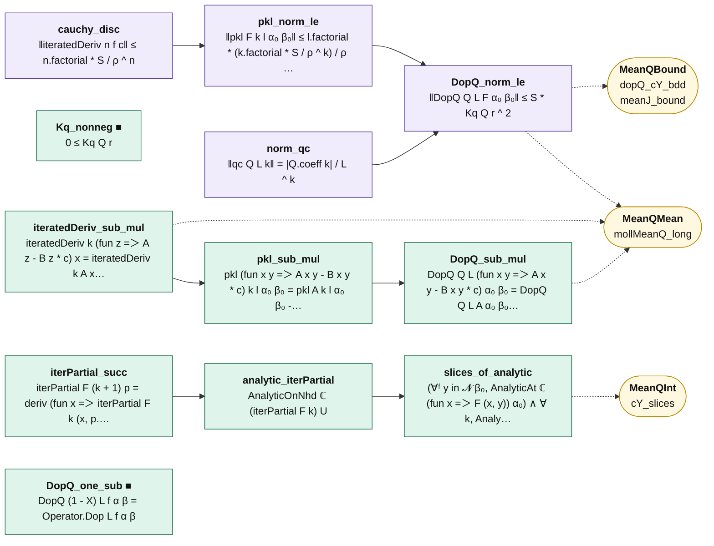

# `lean_stage3/Stage3/MeanQCauchy.lean`

> **Read from the source text.** This file changed after the last `python3 utilities/lean_map.py --dump`, so the arrows on this page are names occurring in each proof and have not been confirmed by Lean.

MeanQCauchy — block S13 of `lean_stage3/design/stencil.md`, B4 step 3, the mean value with a general Q: the operator `Q(−∂α/L) Q(−∂β/L)` and Cauchy's estimate for it. 2026-11-25.

12 theorems, 5 definitions, 243 lines. 

**Imports:** [`OperatorCauchy`](../lean_stage3/OperatorCauchy.md)  
**Imported by:** [`FloorConstQDeriv`](../lean_stage3/FloorConstQDeriv.md), [`MeanQInt`](../lean_stage3/MeanQInt.md)

## The picture



An arrow A → B reads "A is used in the proof of B". Green: counting, integers only. Violet: shape, analysis with no ζ. Blue: reads ζ. A name ending in ■ is an end: nothing else uses it. Red: contains `sorry`. Yellow: theorems in another file, counted; a dotted arrow crosses files. Definitions are not drawn; they are listed below the diagram.

## Definitions

<a name="MeanQ-pkl"></a>
### `MeanQ.pkl`

def · line 34

`∂β^l ∂α^k f (α, β)`: `k` derivatives in the first variable at `α`, then `l` in the second.

- **Is:** `` pkl (f : ℂ → ℂ → ℂ) (k l : ℕ) (α β : ℂ) : ℂ := iteratedDeriv l (fun y => iteratedDeriv k (fun x => f x y) α) β ``
- **Used by 9:** [`FloorConstQ.pkl_scale`](../lean_stage3/FloorConstQDeriv.md#FloorConstQ-pkl_scale), [`FloorConstQ.pkl_sum`](../lean_stage3/FloorConstQDeriv.md#FloorConstQ-pkl_sum), [`FloorConstQ.pkl_FF`](../lean_stage3/FloorConstQLimit.md#FloorConstQ-pkl_FF), [`MeanQ.DopQ`](#MeanQ-DopQ), [`MeanQ.DopQ_norm_le`](#MeanQ-DopQ_norm_le), [`MeanQ.DopQ_one_sub`](#MeanQ-DopQ_one_sub), [`MeanQ.pkl_norm_le`](#MeanQ-pkl_norm_le), [`MeanQ.pkl_sub_mul`](#MeanQ-pkl_sub_mul), [`MeanQ.pkl_Imom`](../lean_stage3/MeanQInt.md#MeanQ-pkl_Imom)

<a name="MeanQ-qc"></a>
### `MeanQ.qc`

def · line 38

`q_k (−1/L)^k`, `q_k = Q.coeff k`.

- **Is:** `` qc (Q : ℝ[X]) (L : ℝ) (k : ℕ) : ℂ := ((Q.coeff k * (-1 / L) ^ k : ℝ) : ℂ) ``
- **Used by 5:** [`FloorConstQ.dopQ_cY_eq`](../lean_stage3/FloorConstQLimit.md#FloorConstQ-dopQ_cY_eq), [`MeanQ.DopQ`](#MeanQ-DopQ), [`MeanQ.DopQ_one_sub`](#MeanQ-DopQ_one_sub), [`MeanQ.norm_qc`](#MeanQ-norm_qc), [`MeanQ.mollMeanQ_eq`](../lean_stage3/MeanQInt.md#MeanQ-mollMeanQ_eq)

<a name="MeanQ-DopQ"></a>
### `MeanQ.DopQ`

def · line 41

The operator `Q(−∂α/L) Q(−∂β/L)`: `Σ_{k,l ≤ d} q_k q_l (−1/L)^{k+l} ∂β^l ∂α^k f`.

- **Is:** `` DopQ (Q : ℝ[X]) (L : ℝ) (f : ℂ → ℂ → ℂ) (α β : ℂ) : ℂ := ∑ k ∈ Finset.range (Q.natDegree + 1), ∑ l ∈ Finset.range (Q.natDegree + 1), qc Q L k * qc Q L l * pkl f k l α β ``
- **Built from:** [`MeanQ.pkl`](#MeanQ-pkl), [`MeanQ.qc`](#MeanQ-qc)
- **Used by 19:** [`FloorConstQ.floor_constQ`](../lean_stage3/FloorConstQ.md#FloorConstQ-floor_constQ), [`FloorConstQ.dopQ_cY_eq`](../lean_stage3/FloorConstQLimit.md#FloorConstQ-dopQ_cY_eq), [`FloorConstQ.re_dopQ_tendsto`](../lean_stage3/FloorConstQLimit.md#FloorConstQ-re_dopQ_tendsto), [`FloorQ.stepQ`](../lean_stage3/FloorQ.md#FloorQ-stepQ), [`FloorQ.floor_stepQ`](../lean_stage3/FloorQStep.md#FloorQ-floor_stepQ), [`GrRatio.window_V_lt_half'`](../lean_stage3/GrRatio.md#GrRatio-window_V_lt_half-), [`MeanQ.unsmooth_V`](../lean_stage3/MeanQ.md#MeanQ-unsmooth_V), [`MeanQ.window_V_long`](../lean_stage3/MeanQ.md#MeanQ-window_V_long), [`MeanQ.window_V_lt_half`](../lean_stage3/MeanQ.md#MeanQ-window_V_lt_half), [`MeanQ.dopQ_cY_bdd`](../lean_stage3/MeanQBound.md#MeanQ-dopQ_cY_bdd), [`MeanQ.meanJ_bound`](../lean_stage3/MeanQBound.md#MeanQ-meanJ_bound), [`MeanQ.DopQ_norm_le`](#MeanQ-DopQ_norm_le), [`MeanQ.DopQ_one_sub`](#MeanQ-DopQ_one_sub), [`MeanQ.DopQ_sub_mul`](#MeanQ-DopQ_sub_mul), [`MeanQ.DopQ_Imom`](../lean_stage3/MeanQInt.md#MeanQ-DopQ_Imom), [`MeanQ.StmtMollMeanQ`](../lean_stage3/MeanQMean.md#MeanQ-StmtMollMeanQ), [`MeanQ.mollMeanQ_long`](../lean_stage3/MeanQMean.md#MeanQ-mollMeanQ_long), [`MeanQ.StmtMollMeanV`](../lean_stage3/MeanQV.md#MeanQ-StmtMollMeanV), [`MeanQ.mollMeanV_long`](../lean_stage3/MeanQV.md#MeanQ-mollMeanV_long)

<a name="MeanQ-Kq"></a>
### `MeanQ.Kq`

def · line 74

The constant of `DopQ`'s bound: `Σ_k |q_k| k!/r^k`.

- **Is:** `` Kq (Q : ℝ[X]) (r : ℝ) : ℝ := ∑ k ∈ Finset.range (Q.natDegree + 1), |Q.coeff k| * k.factorial / r ^ k ``
- **Used by 5:** [`MeanQ.Kq_X_pow`](../lean_stage3/MeanQBound.md#MeanQ-Kq_X_pow), [`MeanQ.dopQ_cY_bdd`](../lean_stage3/MeanQBound.md#MeanQ-dopQ_cY_bdd), [`MeanQ.DopQ_norm_le`](#MeanQ-DopQ_norm_le), [`MeanQ.Kq_nonneg`](#MeanQ-Kq_nonneg), [`MeanQ.mollMeanQ_long`](../lean_stage3/MeanQMean.md#MeanQ-mollMeanQ_long)

<a name="MeanQ-iterPartial"></a>
### `MeanQ.iterPartial`

def · line 156

The `k`-th partial in the first variable of a function on `ℂ × ℂ`.

- **Is:** `` iterPartial (F : ℂ × ℂ → ℂ) (k : ℕ) (p : ℂ × ℂ) : ℂ := iteratedDeriv k (fun x => F (x, p.2)) p.1 ``
- **Used by 2:** [`MeanQ.analytic_iterPartial`](#MeanQ-analytic_iterPartial), [`MeanQ.iterPartial_succ`](#MeanQ-iterPartial_succ)

## Theorems

<a name="MeanQ-cauchy_disc"></a>
### `MeanQ.cauchy_disc`

line 46 · arrows read from text

**Shape.** Uses real or complex analysis; nothing in it or beneath it reads ζ.

**Why.** Cauchy's estimate on a closed disc, from differentiability on it.

**Proves**

```lean
‖iteratedDeriv n f c‖ ≤ n.factorial * S / ρ ^ n
```

**Needs** (its hypotheses)

  - `` hρ : 0 < ρ ``
  - `` n : ℕ ``
  - `` hf : ∀ z ∈ closedBall c ρ, DifferentiableAt ℂ f z ``
  - `` hS : ∀ z ∈ closedBall c ρ, ‖f z‖ ≤ S ``

**Fed by:** no theorem of this repo; it stands on Mathlib.

**Feeds** (1 that use it)

  - [`MeanQ.pkl_norm_le`](#MeanQ-pkl_norm_le) — `` ‖pkl F k l α₀ β₀‖ ≤ l.factorial * (k.factorial * S / ρ ^ k) / ρ ^ l ``

<a name="MeanQ-pkl_norm_le"></a>
### `MeanQ.pkl_norm_le`

line 57 · arrows read from text

**Shape.** Uses real or complex analysis; nothing in it or beneath it reads ζ.

**Why.** Cauchy's estimate for `pkl`, one variable at a time, on the closed polydisc of radius `ρ`.

**Proves**

```lean
‖pkl F k l α₀ β₀‖ ≤ l.factorial * (k.factorial * S / ρ ^ k) / ρ ^ l
```

**Needs** (its hypotheses)

  - `` hρ : 0 < ρ ``
  - `` k l : ℕ ``
  - `` hFa : ∀ y ∈ closedBall β₀ ρ, ∀ x ∈ closedBall α₀ ρ, DifferentiableAt ℂ (fun x => F x y) x ``
  - `` hFb : ∀ y ∈ closedBall β₀ ρ, DifferentiableAt ℂ (fun y => iteratedDeriv k (fun x => F x y) α₀) y ``
  - `` hS : ∀ x ∈ closedBall α₀ ρ, ∀ y ∈ closedBall β₀ ρ, ‖F x y‖ ≤ S ``

**Fed by** (1 theorem its proof uses)

  - [`MeanQ.cauchy_disc`](#MeanQ-cauchy_disc) — `` ‖iteratedDeriv n f c‖ ≤ n.factorial * S / ρ ^ n ``

**Definitions its proof touches:** [`MeanQ.pkl`](#MeanQ-pkl)

**Feeds** (1 that use it)

  - [`MeanQ.DopQ_norm_le`](#MeanQ-DopQ_norm_le) — `` ‖DopQ Q L F α₀ β₀‖ ≤ S * Kq Q r ^ 2 ``

<a name="MeanQ-norm_qc"></a>
### `MeanQ.norm_qc`

line 68 · arrows read from text

**Shape.** Uses real or complex analysis; nothing in it or beneath it reads ζ.

**Proves**

```lean
‖qc Q L k‖ = |Q.coeff k| / L ^ k
```

**Needs** (its hypotheses)

  - `` Q : ℝ[X] ``
  - `` hL : 0 < L ``
  - `` k : ℕ ``

**Fed by:** no theorem of this repo; it stands on Mathlib and the definitions below.

**Definitions its proof touches:** [`MeanQ.qc`](#MeanQ-qc)

**Feeds** (1 that use it)

  - [`MeanQ.DopQ_norm_le`](#MeanQ-DopQ_norm_le) — `` ‖DopQ Q L F α₀ β₀‖ ≤ S * Kq Q r ^ 2 ``

<a name="MeanQ-Kq_nonneg"></a>
### `MeanQ.Kq_nonneg`

line 77 · arrows read from text

**Counting.** Integers only: nothing in its statement or proof, or in anything it rests on, uses analysis or ζ.

**Proves**

```lean
0 ≤ Kq Q r
```

**Needs** (its hypotheses)

  - `` Q : ℝ[X] ``
  - `` hr : 0 < r ``

**Fed by:** no theorem of this repo; it stands on Mathlib and the definitions below.

**Definitions its proof touches:** [`MeanQ.Kq`](#MeanQ-Kq)

**Feeds:** nothing. It is an end.

<a name="MeanQ-DopQ_norm_le"></a>
### `MeanQ.DopQ_norm_le`

line 81 · arrows read from text

**Shape.** Uses real or complex analysis; nothing in it or beneath it reads ζ.

**Why.** The size of `DopQ f` at the radius `ρ = r/L`: `‖DopQ f‖ ≤ S (Σ_k |q_k| k!/r^k)²`.

**Proves**

```lean
‖DopQ Q L F α₀ β₀‖ ≤ S * Kq Q r ^ 2
```

**Needs** (its hypotheses)

  - `` Q : ℝ[X] ``
  - `` hL : 0 < L ``
  - `` hr : 0 < r ``
  - `` hFa : ∀ y ∈ closedBall β₀ (r / L), ∀ x ∈ closedBall α₀ (r / L), DifferentiableAt ℂ (fun x => F x y) x ``
  - `` hFb : ∀ k, ∀ y ∈ closedBall β₀ (r / L), DifferentiableAt ℂ (fun y => iteratedDeriv k (fun x => F x y) α₀) y ``
  - `` hS : ∀ x ∈ closedBall α₀ (r / L), ∀ y ∈ closedBall β₀ (r / L), ‖F x y‖ ≤ S ``

**Fed by** (2 theorems its proof uses)

  - [`MeanQ.norm_qc`](#MeanQ-norm_qc) — `` ‖qc Q L k‖ = |Q.coeff k| / L ^ k ``
  - [`MeanQ.pkl_norm_le`](#MeanQ-pkl_norm_le) — `` ‖pkl F k l α₀ β₀‖ ≤ l.factorial * (k.factorial * S / ρ ^ k) / ρ ^ l ``

**Definitions its proof touches:** [`MeanQ.DopQ`](#MeanQ-DopQ), [`MeanQ.Kq`](#MeanQ-Kq), [`MeanQ.pkl`](#MeanQ-pkl)

**Feeds** (3 that use it)

  - [`MeanQ.dopQ_cY_bdd`](../lean_stage3/MeanQBound.md#MeanQ-dopQ_cY_bdd) (MeanQBound) — `` ∃ K : ℝ, 0 ≤ K ∧ ∃ T₀ : ℝ, ∀ T : ℝ, T₀ ≤ T → ‖DopQ Q (Real.log T) (cY P (Mof T θ) T) ((-(R / Real.log T) : ℝ) : ℂ) ((-(R / Real.log T) : ℝ) : ℂ)‖ ≤ K ``
  - [`MeanQ.meanJ_bound`](../lean_stage3/MeanQBound.md#MeanQ-meanJ_bound) (MeanQBound) — `` ∃ K : ℝ, 0 ≤ K ∧ ∃ T₀ : ℝ, ∀ T : ℝ, T₀ ≤ T → ∀ W : WeightAll T (Real.log T), (∀ j, W.Cj j ≤ Cs j) → ∀ j : ℕ, ‖mollMeanQ W.toWeight (Mof T θ) (aY P T θ… ``
  - [`MeanQ.mollMeanQ_long`](../lean_stage3/MeanQMean.md#MeanQ-mollMeanQ_long) (MeanQMean) — `` StmtMollMeanQ Q P θ R ``

<a name="MeanQ-iteratedDeriv_sub_mul"></a>
### `MeanQ.iteratedDeriv_sub_mul`

line 116 · arrows read from text

**Counting.** Integers only: nothing in its statement or proof, or in anything it rests on, uses analysis or ζ.

**Why.** `∂α^k (A − B·c) = ∂α^k A − ∂α^k B · c` at a point where both are analytic.

**Proves**

```lean
iteratedDeriv k (fun z => A z - B z * c) x = iteratedDeriv k A x - iteratedDeriv k B x * c
```

**Needs** (its hypotheses)

  - `` k : ℕ ``
  - `` hA : AnalyticAt ℂ A x ``
  - `` hB : AnalyticAt ℂ B x ``

**Fed by:** no theorem of this repo; it stands on Mathlib.

**Feeds** (2 that use it)

  - [`MeanQ.pkl_sub_mul`](#MeanQ-pkl_sub_mul) — `` pkl (fun x y => A x y - B x y * c) k l α₀ β₀ = pkl A k l α₀ β₀ - pkl B k l α₀ β₀ * c ``
  - [`MeanQ.mollMeanQ_long`](../lean_stage3/MeanQMean.md#MeanQ-mollMeanQ_long) (MeanQMean) — `` StmtMollMeanQ Q P θ R ``

<a name="MeanQ-pkl_sub_mul"></a>
### `MeanQ.pkl_sub_mul`

line 124 · arrows read from text

**Counting.** Integers only: nothing in its statement or proof, or in anything it rests on, uses analysis or ζ.

**Why.** `pkl` is linear under analyticity of the slices and of the `α`-derivatives in `β`.

**Proves**

```lean
pkl (fun x y => A x y - B x y * c) k l α₀ β₀ = pkl A k l α₀ β₀ - pkl B k l α₀ β₀ * c
```

**Needs** (its hypotheses)

  - `` k l : ℕ ``
  - `` hAa : ∀ᶠ y in 𝓝 β₀, AnalyticAt ℂ (fun x => A x y) α₀ ``
  - `` hBa : ∀ᶠ y in 𝓝 β₀, AnalyticAt ℂ (fun x => B x y) α₀ ``
  - `` hAb : AnalyticAt ℂ (fun y => iteratedDeriv k (fun x => A x y) α₀) β₀ ``
  - `` hBb : AnalyticAt ℂ (fun y => iteratedDeriv k (fun x => B x y) α₀) β₀ ``

**Fed by** (1 theorem its proof uses)

  - [`MeanQ.iteratedDeriv_sub_mul`](#MeanQ-iteratedDeriv_sub_mul) — `` iteratedDeriv k (fun z => A z - B z * c) x = iteratedDeriv k A x - iteratedDeriv k B x * c ``

**Definitions its proof touches:** [`MeanQ.pkl`](#MeanQ-pkl)

**Feeds** (1 that use it)

  - [`MeanQ.DopQ_sub_mul`](#MeanQ-DopQ_sub_mul) — `` DopQ Q L (fun x y => A x y - B x y * c) α₀ β₀ = DopQ Q L A α₀ β₀ - DopQ Q L B α₀ β₀ * c ``

<a name="MeanQ-DopQ_sub_mul"></a>
### `MeanQ.DopQ_sub_mul`

line 139 · arrows read from text

**Counting.** Integers only: nothing in its statement or proof, or in anything it rests on, uses analysis or ζ.

**Why.** `DopQ` is linear: `DopQ (A − B·c) = DopQ A − DopQ B · c`.

**Proves**

```lean
DopQ Q L (fun x y => A x y - B x y * c) α₀ β₀ = DopQ Q L A α₀ β₀ - DopQ Q L B α₀ β₀ * c
```

**Needs** (its hypotheses)

  - `` Q : ℝ[X] ``
  - `` L : ℝ ``
  - `` hAa : ∀ᶠ y in 𝓝 β₀, AnalyticAt ℂ (fun x => A x y) α₀ ``
  - `` hBa : ∀ᶠ y in 𝓝 β₀, AnalyticAt ℂ (fun x => B x y) α₀ ``
  - `` hAb : ∀ k, AnalyticAt ℂ (fun y => iteratedDeriv k (fun x => A x y) α₀) β₀ ``
  - `` hBb : ∀ k, AnalyticAt ℂ (fun y => iteratedDeriv k (fun x => B x y) α₀) β₀ ``

**Fed by** (1 theorem its proof uses)

  - [`MeanQ.pkl_sub_mul`](#MeanQ-pkl_sub_mul) — `` pkl (fun x y => A x y - B x y * c) k l α₀ β₀ = pkl A k l α₀ β₀ - pkl B k l α₀ β₀ * c ``

**Definitions its proof touches:** [`MeanQ.DopQ`](#MeanQ-DopQ)

**Feeds** (1 that use it)

  - [`MeanQ.mollMeanQ_long`](../lean_stage3/MeanQMean.md#MeanQ-mollMeanQ_long) (MeanQMean) — `` StmtMollMeanQ Q P θ R ``

<a name="MeanQ-iterPartial_succ"></a>
### `MeanQ.iterPartial_succ`

line 159 · arrows read from text

**Counting.** Integers only: nothing in its statement or proof, or in anything it rests on, uses analysis or ζ.

**Proves**

```lean
iterPartial F (k + 1) p = deriv (fun x => iterPartial F k (x, p.2)) p.1
```

**Needs** (its hypotheses)

  - `` F : ℂ × ℂ → ℂ ``
  - `` k : ℕ ``
  - `` p : ℂ × ℂ ``

**Fed by:** no theorem of this repo; it stands on Mathlib and the definitions below.

**Definitions its proof touches:** [`MeanQ.iterPartial`](#MeanQ-iterPartial)

**Feeds** (1 that use it)

  - [`MeanQ.analytic_iterPartial`](#MeanQ-analytic_iterPartial) — `` AnalyticOnNhd ℂ (iterPartial F k) U ``

<a name="MeanQ-analytic_iterPartial"></a>
### `MeanQ.analytic_iterPartial`

line 165 · arrows read from text

**Counting.** Integers only: nothing in its statement or proof, or in anything it rests on, uses analysis or ζ.

**Why.** `∂α^k F` is analytic where `F` is, on an open `U ⊆ ℂ × ℂ`.

**Proves**

```lean
AnalyticOnNhd ℂ (iterPartial F k) U
```

**Needs** (its hypotheses)

  - `` hU : IsOpen U ``
  - `` hF : AnalyticOnNhd ℂ F U ``
  - `` k : ℕ ``

**Fed by** (1 theorem its proof uses)

  - [`MeanQ.iterPartial_succ`](#MeanQ-iterPartial_succ) — `` iterPartial F (k + 1) p = deriv (fun x => iterPartial F k (x, p.2)) p.1 ``

**Definitions its proof touches:** [`MeanQ.iterPartial`](#MeanQ-iterPartial)

**Feeds** (1 that use it)

  - [`MeanQ.slices_of_analytic`](#MeanQ-slices_of_analytic) — `` (∀ᶠ y in 𝓝 β₀, AnalyticAt ℂ (fun x => F (x, y)) α₀) ∧ ∀ k, AnalyticAt ℂ (fun y => iteratedDeriv k (fun x => F (x, y)) α₀) β₀ ``

<a name="MeanQ-slices_of_analytic"></a>
### `MeanQ.slices_of_analytic`

line 187 · arrows read from text

**Counting.** Integers only: nothing in its statement or proof, or in anything it rests on, uses analysis or ζ.

**Why.** The slices of a two-variable analytic function: for `(α₀, β₀) ∈ U` open, the `α`-slices are analytic at `α₀` for `β` near `β₀`, and every `∂α^k` is analytic in `β` at `β₀`.

**Proves**

```lean
(∀ᶠ y in 𝓝 β₀, AnalyticAt ℂ (fun x => F (x, y)) α₀) ∧ ∀ k, AnalyticAt ℂ (fun y => iteratedDeriv k (fun x => F (x, y)) α₀) β₀
```

**Needs** (its hypotheses)

  - `` hU : IsOpen U ``
  - `` hF : AnalyticOnNhd ℂ F U ``
  - `` h0 : (α₀, β₀) ∈ U ``

**Fed by** (1 theorem its proof uses)

  - [`MeanQ.analytic_iterPartial`](#MeanQ-analytic_iterPartial) — `` AnalyticOnNhd ℂ (iterPartial F k) U ``

**Feeds** (1 that use it)

  - [`MeanQ.cY_slices`](../lean_stage3/MeanQInt.md#MeanQ-cY_slices) (MeanQInt) — `` (∀ᶠ y' in 𝓝 y, AnalyticAt ℂ (fun x => cY P M T x y') x) ∧ ∀ k, AnalyticAt ℂ (fun y => iteratedDeriv k (fun x => cY P M T x y) x) y ``

<a name="MeanQ-DopQ_one_sub"></a>
### `MeanQ.DopQ_one_sub`

line 204 · arrows read from text

**Counting.** Integers only: nothing in its statement or proof, or in anything it rests on, uses analysis or ζ.

**Why.** `DopQ` at `Q = 1 − X` is `Dop`.

**Proves**

```lean
DopQ (1 - X) L f α β = Operator.Dop L f α β
```

**Needs** (its hypotheses)

  - `` L : ℝ ``
  - `` f : ℂ → ℂ → ℂ ``
  - `` α β : ℂ ``

**Fed by:** no theorem of this repo; it stands on Mathlib and the definitions below.

**Definitions its proof touches:** [`MeanQ.DopQ`](#MeanQ-DopQ), [`MeanQ.pkl`](#MeanQ-pkl), [`MeanQ.qc`](#MeanQ-qc), [`Operator.Dop`](../lean_stage3/OperatorCauchy.md#Operator-Dop), [`Operator.pa`](../lean_stage3/OperatorCauchy.md#Operator-pa), [`Operator.pab`](../lean_stage3/OperatorCauchy.md#Operator-pab), [`Operator.pb`](../lean_stage3/OperatorCauchy.md#Operator-pb)

**Feeds:** nothing. It is an end.

