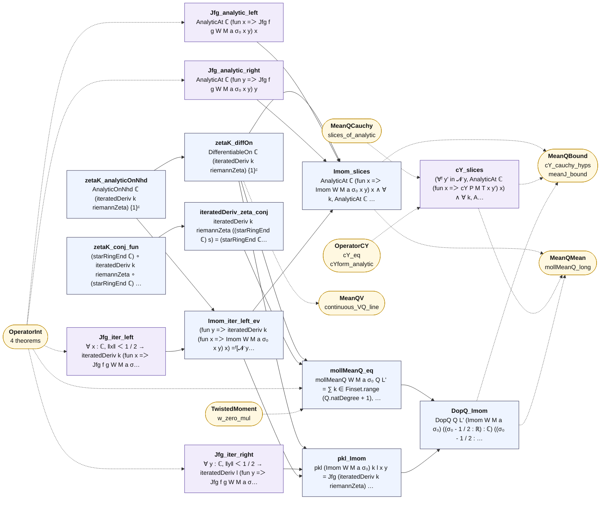

# `lean_stage3/Stage3/MeanQInt.lean`

> **Read from the source text.** This file changed after the last `python3 utilities/lean_map.py --dump`, so the arrows on this page are names occurring in each proof and have not been confirmed by Lean.

MeanQInt — block S13 of `lean_stage3/design/stencil.md`, B4 step 3, the mean value with a general Q: the mean of `|Q(−D/L)ζ·ψ|²` as `DopQ` of the twisted moment. 2026-11-25.

14 theorems, 1 definition, 304 lines. 

**Imports:** [`MeanQCauchy`](../lean_stage3/MeanQCauchy.md), [`MeanQRed`](../lean_stage3/MeanQRed.md), [`OperatorCY`](../lean_stage3/OperatorCY.md), [`OperatorInt`](../lean_stage3/OperatorInt.md)  
**Imported by:** [`MeanQMean`](../lean_stage3/MeanQMean.md)

## The picture



An arrow A → B reads "A is used in the proof of B". Green: counting, integers only. Violet: shape, analysis with no ζ. Blue: reads ζ. A name ending in ■ is an end: nothing else uses it. Red: contains `sorry`. Yellow: theorems in another file, counted; a dotted arrow crosses files. Definitions are not drawn; they are listed below the diagram.

## Definitions

<a name="MeanQ-mollMeanQ"></a>
### `MeanQ.mollMeanQ`

def · line 193

The mollified mean `∫ w(t) |Q(−D/L)ζ(σ₀+it)|² |ψ(σ₀+it)|² dt`.

- **Is:** `` mollMeanQ {T L : ℝ} (W : Weight T L) (M : ℕ) (a : ℕ → ℂ) (σ₀ : ℝ) (Q : ℝ[X]) (L' : ℝ) : ℂ := ∫ t, (W.w t : ℂ) * ((‖VQ Q L' ((σ₀ : ℂ) + t * I)‖ ^ 2 : ℝ) : ℂ) * (msq M a σ₀ t : ℂ) ``
- **Built from:** [`MeanQ.VQ`](../lean_stage3/MeanQRed.md#MeanQ-VQ), [`TwistedMoment.Weight`](../lean_stage3/TwistedMoment.md#TwistedMoment-Weight), [`TwistedMoment.msq`](../lean_stage3/TwistedMoment.md#TwistedMoment-msq)
- **Used by 7:** [`MeanQ.meanJ_bound`](../lean_stage3/MeanQBound.md#MeanQ-meanJ_bound), [`MeanQ.DopQ_Imom`](#MeanQ-DopQ_Imom), [`MeanQ.mollMeanQ_eq`](#MeanQ-mollMeanQ_eq), [`MeanQ.StmtMollMeanQ`](../lean_stage3/MeanQMean.md#MeanQ-StmtMollMeanQ), [`MeanQ.mollMeanQ_long`](../lean_stage3/MeanQMean.md#MeanQ-mollMeanQ_long), [`MeanQ.mollMeanQ_re`](../lean_stage3/MeanQV.md#MeanQ-mollMeanQ_re), [`MeanQ.mollMeanV_long`](../lean_stage3/MeanQV.md#MeanQ-mollMeanV_long)

## Theorems

<a name="MeanQ-zetaK_analyticOnNhd"></a>
### `MeanQ.zetaK_analyticOnNhd`

line 38 · arrows read from text

**Reads ζ.** It, or something it rests on, uses the zeta function, its zeros or the Riemann hypothesis.

**Proves**

```lean
AnalyticOnNhd ℂ (iteratedDeriv k riemannZeta) {1}ᶜ
```

**Needs** (its hypotheses)

  - `` k : ℕ ``

**Fed by:** no theorem of this repo; it stands on Mathlib.

**Feeds** (2 that use it)

  - [`MeanQ.Imom_iter_left_ev`](#MeanQ-Imom_iter_left_ev) — `` (fun y => iteratedDeriv k (fun x => Imom W M a σ₀ x y) x) =ᶠ[𝓝 y] fun y => Jfg (iteratedDeriv k riemannZeta) riemannZeta W M a σ₀ x y ``
  - [`MeanQ.zetaK_diffOn`](#MeanQ-zetaK_diffOn) — `` DifferentiableOn ℂ (iteratedDeriv k riemannZeta) {1}ᶜ ``

<a name="MeanQ-zetaK_diffOn"></a>
### `MeanQ.zetaK_diffOn`

line 42 · arrows read from text

**Reads ζ.** It, or something it rests on, uses the zeta function, its zeros or the Riemann hypothesis.

**Proves**

```lean
DifferentiableOn ℂ (iteratedDeriv k riemannZeta) {1}ᶜ
```

**Needs** (its hypotheses)

  - `` k : ℕ ``

**Fed by** (1 theorem its proof uses)

  - [`MeanQ.zetaK_analyticOnNhd`](#MeanQ-zetaK_analyticOnNhd) — `` AnalyticOnNhd ℂ (iteratedDeriv k riemannZeta) {1}ᶜ ``

**Feeds** (4 that use it)

  - [`MeanQ.Imom_slices`](#MeanQ-Imom_slices) — `` AnalyticAt ℂ (fun x => Imom W M a σ₀ x y) x ∧ ∀ k, AnalyticAt ℂ (fun y => iteratedDeriv k (fun x => Imom W M a σ₀ x y) x) y ``
  - [`MeanQ.mollMeanQ_eq`](#MeanQ-mollMeanQ_eq) — `` mollMeanQ W M a σ₀ Q L' = ∑ k ∈ Finset.range (Q.natDegree + 1), ∑ l ∈ Finset.range (Q.natDegree + 1), qc Q L' k * qc Q L' l * Jfg (iteratedDeriv k rie… ``
  - [`MeanQ.pkl_Imom`](#MeanQ-pkl_Imom) — `` pkl (Imom W M a σ₀) k l x y = Jfg (iteratedDeriv k riemannZeta) (iteratedDeriv l riemannZeta) W M a σ₀ x y ``
  - [`MeanQ.continuous_VQ_line`](../lean_stage3/MeanQV.md#MeanQ-continuous_VQ_line) (MeanQV) — `` Continuous fun t : ℝ => VQ Q L ((σ₀ : ℂ) + t * I) ``

<a name="MeanQ-zetaK_conj_fun"></a>
### `MeanQ.zetaK_conj_fun`

line 46 · arrows read from text

**Reads ζ.** It, or something it rests on, uses the zeta function, its zeros or the Riemann hypothesis.

**Why.** `ζ^{(k)}(s̄) = conj ζ^{(k)}(s)`, as functions.

**Proves**

```lean
(starRingEnd ℂ) ∘ iteratedDeriv k riemannZeta ∘ (starRingEnd ℂ) = iteratedDeriv k riemannZeta
```

**Needs** (its hypotheses)

  - `` k : ℕ ``

**Fed by:** no theorem of this repo; it stands on Mathlib.

**Feeds** (1 that use it)

  - [`MeanQ.iteratedDeriv_zeta_conj`](#MeanQ-iteratedDeriv_zeta_conj) — `` iteratedDeriv k riemannZeta ((starRingEnd ℂ) s) = (starRingEnd ℂ) (iteratedDeriv k riemannZeta s) ``

<a name="MeanQ-iteratedDeriv_zeta_conj"></a>
### `MeanQ.iteratedDeriv_zeta_conj`

line 64 · arrows read from text

**Reads ζ.** It, or something it rests on, uses the zeta function, its zeros or the Riemann hypothesis.

**Why.** `ζ^{(k)}(s̄) = conj ζ^{(k)}(s)`.

**Proves**

```lean
iteratedDeriv k riemannZeta ((starRingEnd ℂ) s) = (starRingEnd ℂ) (iteratedDeriv k riemannZeta s)
```

**Needs** (its hypotheses)

  - `` k : ℕ ``
  - `` s : ℂ ``

**Fed by** (1 theorem its proof uses)

  - [`MeanQ.zetaK_conj_fun`](#MeanQ-zetaK_conj_fun) — `` (starRingEnd ℂ) ∘ iteratedDeriv k riemannZeta ∘ (starRingEnd ℂ) = iteratedDeriv k riemannZeta ``

**Feeds** (1 that use it)

  - [`MeanQ.mollMeanQ_eq`](#MeanQ-mollMeanQ_eq) — `` mollMeanQ W M a σ₀ Q L' = ∑ k ∈ Finset.range (Q.natDegree + 1), ∑ l ∈ Finset.range (Q.natDegree + 1), qc Q L' k * qc Q L' l * Jfg (iteratedDeriv k rie… ``

<a name="MeanQ-Jfg_iter_left"></a>
### `MeanQ.Jfg_iter_left`

line 78 · arrows read from text

**Shape.** Uses real or complex analysis; nothing in it or beneath it reads ζ.

**Why.** `∂α^k J_{f,g} = J_{f^{(k)},g}` on `‖x‖ < 1/2`, `‖y‖ < 1`.

**Proves**

```lean
∀ x : ℂ, ‖x‖ < 1 / 2 → iteratedDeriv k (fun x => Jfg f g W M a σ₀ x y) x = Jfg (iteratedDeriv k f) g W M a σ₀ x y
```

**Needs** (its hypotheses)

  - `` hf : AnalyticOnNhd ℂ f {1}ᶜ ``
  - `` hg : ContinuousOn g {1}ᶜ ``
  - `` hT : 4 ≤ T ``
  - `` hy : ‖y‖ < 1 ``
  - `` k : ℕ ``

**Fed by** (1 theorem its proof uses)

  - [`Operator.Jfg_hasDerivAt_left`](../lean_stage3/OperatorInt.md#Operator-Jfg_hasDerivAt_left) (OperatorInt) — `` HasDerivAt (fun x => Jfg f g W M a σ₀ x β) (Jfg (deriv f) g W M a σ₀ x₀ β) x₀ ``

**Definitions its proof touches:** [`Operator.Jfg`](../lean_stage3/OperatorInt.md#Operator-Jfg)

**Feeds** (1 that use it)

  - [`MeanQ.Imom_iter_left_ev`](#MeanQ-Imom_iter_left_ev) — `` (fun y => iteratedDeriv k (fun x => Imom W M a σ₀ x y) x) =ᶠ[𝓝 y] fun y => Jfg (iteratedDeriv k riemannZeta) riemannZeta W M a σ₀ x y ``

<a name="MeanQ-Jfg_iter_right"></a>
### `MeanQ.Jfg_iter_right`

line 99 · arrows read from text

**Shape.** Uses real or complex analysis; nothing in it or beneath it reads ζ.

**Why.** `∂β^l J_{f,g} = J_{f,g^{(l)}}` on `‖x‖ < 1`, `‖y‖ < 1/2`.

**Proves**

```lean
∀ y : ℂ, ‖y‖ < 1 / 2 → iteratedDeriv l (fun y => Jfg f g W M a σ₀ x y) y = Jfg f (iteratedDeriv l g) W M a σ₀ x y
```

**Needs** (its hypotheses)

  - `` hf : ContinuousOn f {1}ᶜ ``
  - `` hg : AnalyticOnNhd ℂ g {1}ᶜ ``
  - `` hT : 4 ≤ T ``
  - `` hx : ‖x‖ < 1 ``
  - `` l : ℕ ``

**Fed by** (1 theorem its proof uses)

  - [`Operator.Jfg_hasDerivAt_right`](../lean_stage3/OperatorInt.md#Operator-Jfg_hasDerivAt_right) (OperatorInt) — `` HasDerivAt (fun y => Jfg f g W M a σ₀ α y) (Jfg f (deriv g) W M a σ₀ α y₀) y₀ ``

**Definitions its proof touches:** [`Operator.Jfg`](../lean_stage3/OperatorInt.md#Operator-Jfg)

**Feeds** (1 that use it)

  - [`MeanQ.pkl_Imom`](#MeanQ-pkl_Imom) — `` pkl (Imom W M a σ₀) k l x y = Jfg (iteratedDeriv k riemannZeta) (iteratedDeriv l riemannZeta) W M a σ₀ x y ``

<a name="MeanQ-Jfg_analytic_left"></a>
### `MeanQ.Jfg_analytic_left`

line 120 · arrows read from text

**Shape.** Uses real or complex analysis; nothing in it or beneath it reads ζ.

**Why.** `x ↦ J_{f,g}(x, y)` is analytic on `‖x‖ < 1/2`.

**Proves**

```lean
AnalyticAt ℂ (fun x => Jfg f g W M a σ₀ x y) x
```

**Needs** (its hypotheses)

  - `` hf : AnalyticOnNhd ℂ f {1}ᶜ ``
  - `` hg : ContinuousOn g {1}ᶜ ``
  - `` hT : 4 ≤ T ``
  - `` hx : ‖x‖ < 1 / 2 ``
  - `` hy : ‖y‖ < 1 ``

**Fed by** (1 theorem its proof uses)

  - [`Operator.Jfg_hasDerivAt_left`](../lean_stage3/OperatorInt.md#Operator-Jfg_hasDerivAt_left) (OperatorInt) — `` HasDerivAt (fun x => Jfg f g W M a σ₀ x β) (Jfg (deriv f) g W M a σ₀ x₀ β) x₀ ``

**Definitions its proof touches:** [`Operator.Jfg`](../lean_stage3/OperatorInt.md#Operator-Jfg)

**Feeds** (1 that use it)

  - [`MeanQ.Imom_slices`](#MeanQ-Imom_slices) — `` AnalyticAt ℂ (fun x => Imom W M a σ₀ x y) x ∧ ∀ k, AnalyticAt ℂ (fun y => iteratedDeriv k (fun x => Imom W M a σ₀ x y) x) y ``

<a name="MeanQ-Jfg_analytic_right"></a>
### `MeanQ.Jfg_analytic_right`

line 132 · arrows read from text

**Shape.** Uses real or complex analysis; nothing in it or beneath it reads ζ.

**Why.** `y ↦ J_{f,g}(x, y)` is analytic on `‖y‖ < 1/2`.

**Proves**

```lean
AnalyticAt ℂ (fun y => Jfg f g W M a σ₀ x y) y
```

**Needs** (its hypotheses)

  - `` hf : ContinuousOn f {1}ᶜ ``
  - `` hg : AnalyticOnNhd ℂ g {1}ᶜ ``
  - `` hT : 4 ≤ T ``
  - `` hx : ‖x‖ < 1 ``
  - `` hy : ‖y‖ < 1 / 2 ``

**Fed by** (1 theorem its proof uses)

  - [`Operator.Jfg_hasDerivAt_right`](../lean_stage3/OperatorInt.md#Operator-Jfg_hasDerivAt_right) (OperatorInt) — `` HasDerivAt (fun y => Jfg f g W M a σ₀ α y) (Jfg f (deriv g) W M a σ₀ α y₀) y₀ ``

**Definitions its proof touches:** [`Operator.Jfg`](../lean_stage3/OperatorInt.md#Operator-Jfg)

**Feeds** (1 that use it)

  - [`MeanQ.Imom_slices`](#MeanQ-Imom_slices) — `` AnalyticAt ℂ (fun x => Imom W M a σ₀ x y) x ∧ ∀ k, AnalyticAt ℂ (fun y => iteratedDeriv k (fun x => Imom W M a σ₀ x y) x) y ``

<a name="MeanQ-Imom_iter_left_ev"></a>
### `MeanQ.Imom_iter_left_ev`

line 144 · arrows read from text

**Reads ζ.** It, or something it rests on, uses the zeta function, its zeros or the Riemann hypothesis.

**Why.** `∂α^k Imom(x, ·) = J_{ζ^{(k)}, ζ}(x, ·)` near `y`.

**Proves**

```lean
(fun y => iteratedDeriv k (fun x => Imom W M a σ₀ x y) x) =ᶠ[𝓝 y] fun y => Jfg (iteratedDeriv k riemannZeta) riemannZeta W M a σ₀ x y
```

**Needs** (its hypotheses)

  - `` hT : 4 ≤ T ``
  - `` k : ℕ ``
  - `` hx : ‖x‖ < 1 / 2 ``
  - `` hy : ‖y‖ < 1 / 2 ``

**Fed by** (2 theorems its proof uses)

  - [`MeanQ.Jfg_iter_left`](#MeanQ-Jfg_iter_left) — `` ∀ x : ℂ, ‖x‖ < 1 / 2 → iteratedDeriv k (fun x => Jfg f g W M a σ₀ x y) x = Jfg (iteratedDeriv k f) g W M a σ₀ x y ``
  - [`MeanQ.zetaK_analyticOnNhd`](#MeanQ-zetaK_analyticOnNhd) — `` AnalyticOnNhd ℂ (iteratedDeriv k riemannZeta) {1}ᶜ ``

**Definitions its proof touches:** [`Operator.Jfg`](../lean_stage3/OperatorInt.md#Operator-Jfg), [`TwistedMoment.Imom`](../lean_stage3/TwistedMoment.md#TwistedMoment-Imom)

**Feeds** (2 that use it)

  - [`MeanQ.Imom_slices`](#MeanQ-Imom_slices) — `` AnalyticAt ℂ (fun x => Imom W M a σ₀ x y) x ∧ ∀ k, AnalyticAt ℂ (fun y => iteratedDeriv k (fun x => Imom W M a σ₀ x y) x) y ``
  - [`MeanQ.pkl_Imom`](#MeanQ-pkl_Imom) — `` pkl (Imom W M a σ₀) k l x y = Jfg (iteratedDeriv k riemannZeta) (iteratedDeriv l riemannZeta) W M a σ₀ x y ``

<a name="MeanQ-pkl_Imom"></a>
### `MeanQ.pkl_Imom`

line 156 · arrows read from text

**Reads ζ.** It, or something it rests on, uses the zeta function, its zeros or the Riemann hypothesis.

**Why.** The partials of the moment, every order: `pkl Imom k l = J_{ζ^{(k)}, ζ^{(l)}}`.

**Proves**

```lean
pkl (Imom W M a σ₀) k l x y = Jfg (iteratedDeriv k riemannZeta) (iteratedDeriv l riemannZeta) W M a σ₀ x y
```

**Needs** (its hypotheses)

  - `` hT : 4 ≤ T ``
  - `` k l : ℕ ``
  - `` hx : ‖x‖ < 1 / 2 ``
  - `` hy : ‖y‖ < 1 / 2 ``

**Fed by** (3 theorems its proof uses)

  - [`MeanQ.Imom_iter_left_ev`](#MeanQ-Imom_iter_left_ev) — `` (fun y => iteratedDeriv k (fun x => Imom W M a σ₀ x y) x) =ᶠ[𝓝 y] fun y => Jfg (iteratedDeriv k riemannZeta) riemannZeta W M a σ₀ x y ``
  - [`MeanQ.Jfg_iter_right`](#MeanQ-Jfg_iter_right) — `` ∀ y : ℂ, ‖y‖ < 1 / 2 → iteratedDeriv l (fun y => Jfg f g W M a σ₀ x y) y = Jfg f (iteratedDeriv l g) W M a σ₀ x y ``
  - [`MeanQ.zetaK_diffOn`](#MeanQ-zetaK_diffOn) — `` DifferentiableOn ℂ (iteratedDeriv k riemannZeta) {1}ᶜ ``

**Definitions its proof touches:** [`MeanQ.pkl`](../lean_stage3/MeanQCauchy.md#MeanQ-pkl), [`Operator.Jfg`](../lean_stage3/OperatorInt.md#Operator-Jfg), [`TwistedMoment.Imom`](../lean_stage3/TwistedMoment.md#TwistedMoment-Imom)

**Feeds** (1 that use it)

  - [`MeanQ.DopQ_Imom`](#MeanQ-DopQ_Imom) — `` DopQ Q L' (Imom W M a σ₀) ((σ₀ - 1 / 2 : ℝ) : ℂ) ((σ₀ - 1 / 2 : ℝ) : ℂ) = mollMeanQ W M a σ₀ Q L' ``

<a name="MeanQ-Imom_slices"></a>
### `MeanQ.Imom_slices`

line 166 · arrows read from text

**Reads ζ.** It, or something it rests on, uses the zeta function, its zeros or the Riemann hypothesis.

**Why.** The slices of the moment are analytic, on `‖x‖, ‖y‖ < 1/2`.

**Proves**

```lean
AnalyticAt ℂ (fun x => Imom W M a σ₀ x y) x ∧ ∀ k, AnalyticAt ℂ (fun y => iteratedDeriv k (fun x => Imom W M a σ₀ x y) x) y
```

**Needs** (its hypotheses)

  - `` hT : 4 ≤ T ``
  - `` hx : ‖x‖ < 1 / 2 ``
  - `` hy : ‖y‖ < 1 / 2 ``

**Fed by** (4 theorems its proof uses)

  - [`MeanQ.Imom_iter_left_ev`](#MeanQ-Imom_iter_left_ev) — `` (fun y => iteratedDeriv k (fun x => Imom W M a σ₀ x y) x) =ᶠ[𝓝 y] fun y => Jfg (iteratedDeriv k riemannZeta) riemannZeta W M a σ₀ x y ``
  - [`MeanQ.Jfg_analytic_left`](#MeanQ-Jfg_analytic_left) — `` AnalyticAt ℂ (fun x => Jfg f g W M a σ₀ x y) x ``
  - [`MeanQ.Jfg_analytic_right`](#MeanQ-Jfg_analytic_right) — `` AnalyticAt ℂ (fun y => Jfg f g W M a σ₀ x y) y ``
  - [`MeanQ.zetaK_diffOn`](#MeanQ-zetaK_diffOn) — `` DifferentiableOn ℂ (iteratedDeriv k riemannZeta) {1}ᶜ ``

**Definitions its proof touches:** [`TwistedMoment.Imom`](../lean_stage3/TwistedMoment.md#TwistedMoment-Imom)

**Feeds** (2 that use it)

  - [`MeanQ.meanJ_bound`](../lean_stage3/MeanQBound.md#MeanQ-meanJ_bound) (MeanQBound) — `` ∃ K : ℝ, 0 ≤ K ∧ ∃ T₀ : ℝ, ∀ T : ℝ, T₀ ≤ T → ∀ W : WeightAll T (Real.log T), (∀ j, W.Cj j ≤ Cs j) → ∀ j : ℕ, ‖mollMeanQ W.toWeight (Mof T θ) (aY P T θ… ``
  - [`MeanQ.mollMeanQ_long`](../lean_stage3/MeanQMean.md#MeanQ-mollMeanQ_long) (MeanQMean) — `` StmtMollMeanQ Q P θ R ``

<a name="MeanQ-cY_slices"></a>
### `MeanQ.cY_slices`

line 179 · arrows read from text

**Shape.** Uses real or complex analysis; nothing in it or beneath it reads ζ.

**Why.** The slices of `c(α,β)` are analytic, at `α + β ≠ 0`.

**Proves**

```lean
(∀ᶠ y' in 𝓝 y, AnalyticAt ℂ (fun x => cY P M T x y') x) ∧ ∀ k, AnalyticAt ℂ (fun y => iteratedDeriv k (fun x => cY P M T x y) x) y
```

**Needs** (its hypotheses)

  - `` P : ℝ[X] ``
  - `` M : ℕ ``
  - `` hT : T ≠ 0 ``
  - `` hxy : x + y ≠ 0 ``

**Fed by** (3 theorems its proof uses)

  - [`MeanQ.slices_of_analytic`](../lean_stage3/MeanQCauchy.md#MeanQ-slices_of_analytic) (MeanQCauchy) — `` (∀ᶠ y in 𝓝 β₀, AnalyticAt ℂ (fun x => F (x, y)) α₀) ∧ ∀ k, AnalyticAt ℂ (fun y => iteratedDeriv k (fun x => F (x, y)) α₀) β₀ ``
  - [`Operator.cY_eq`](../lean_stage3/OperatorCY.md#Operator-cY_eq) (OperatorCY) — `` cY P M T α β = cYform P M T (α, β) ``
  - [`Operator.cYform_analytic`](../lean_stage3/OperatorCY.md#Operator-cYform_analytic) (OperatorCY) — `` AnalyticOnNhd ℂ (cYform P M T) {q : ℂ × ℂ | q.1 + q.2 ≠ 0} ``

**Definitions its proof touches:** [`Operator.cYform`](../lean_stage3/OperatorCY.md#Operator-cYform), [`TwistedMoment.cY`](../lean_stage3/TwistedMoment.md#TwistedMoment-cY)

**Feeds** (2 that use it)

  - [`MeanQ.cY_cauchy_hyps`](../lean_stage3/MeanQBound.md#MeanQ-cY_cauchy_hyps) (MeanQBound) — `` (∀ y ∈ closedBall (((-(R / Real.log T) : ℝ) : ℂ)) (R / 2 / Real.log T), ∀ x ∈ closedBall (((-(R / Real.log T) : ℝ) : ℂ)) (R / 2 / Real.log T), Differe… ``
  - [`MeanQ.mollMeanQ_long`](../lean_stage3/MeanQMean.md#MeanQ-mollMeanQ_long) (MeanQMean) — `` StmtMollMeanQ Q P θ R ``

<a name="MeanQ-mollMeanQ_eq"></a>
### `MeanQ.mollMeanQ_eq`

line 202 · arrows read from text

**Reads ζ.** It, or something it rests on, uses the zeta function, its zeros or the Riemann hypothesis.

**Why.** The mean, expanded: at `α₀ = σ₀ − 1/2`, `∫ w |VQ|² |ψ|² = Σ_{k,l} q_k q_l (−1/L)^{k+l} J_{ζ^{(k)}, ζ^{(l)}}(α₀, α₀)`.

**Proves**

```lean
mollMeanQ W M a σ₀ Q L' = ∑ k ∈ Finset.range (Q.natDegree + 1), ∑ l ∈ Finset.range (Q.natDegree + 1), qc Q L' k * qc Q L' l * Jfg (iteratedDeriv k riemannZeta) (iteratedDeriv l riemannZeta) W M a σ₀ ((σ₀ - 1 / 2 : ℝ) : ℂ) ((σ₀ - 1 / 2 : ℝ) : ℂ)
```

**Needs** (its hypotheses)

  - `` Q : ℝ[X] ``
  - `` L' : ℝ ``
  - `` hT : 4 ≤ T ``
  - `` hσ : ‖(((σ₀ - 1 / 2 : ℝ)) : ℂ)‖ < 1 ``

**Fed by** (5 theorems its proof uses)

  - [`MeanQ.iteratedDeriv_zeta_conj`](#MeanQ-iteratedDeriv_zeta_conj) — `` iteratedDeriv k riemannZeta ((starRingEnd ℂ) s) = (starRingEnd ℂ) (iteratedDeriv k riemannZeta s) ``
  - [`MeanQ.zetaK_diffOn`](#MeanQ-zetaK_diffOn) — `` DifferentiableOn ℂ (iteratedDeriv k riemannZeta) {1}ᶜ ``
  - [`Operator.Jfg_intOn`](../lean_stage3/OperatorInt.md#Operator-Jfg_intOn) (OperatorInt) — `` IntegrableOn (fun t => (W.w t : ℂ) * (f (uA α t) * g (vB β t)) * (msq M a σ₀ t : ℂ)) (Set.Icc (T / 4) (2 * T)) ``
  - [`Operator.Jfg_set`](../lean_stage3/OperatorInt.md#Operator-Jfg_set) (OperatorInt) — `` Jfg f g W M a σ₀ α β = ∫ t in Set.Icc (T / 4) (2 * T), (W.w t : ℂ) * (f (uA α t) * g (vB β t)) * (msq M a σ₀ t : ℂ) ``
  - [`TwistedMoment.w_zero_mul`](../lean_stage3/TwistedMoment.md#TwistedMoment-w_zero_mul) (TwistedMoment) — `` (W.w t : ℂ) * F * G = 0 ``

**Definitions its proof touches:** [`ApproxFE.uA`](../lean_stage3/ApproxFE.md#ApproxFE-uA), [`ApproxFE.vB`](../lean_stage3/ApproxFE.md#ApproxFE-vB), [`MeanQ.qc`](../lean_stage3/MeanQCauchy.md#MeanQ-qc), [`MeanQ.mollMeanQ`](#MeanQ-mollMeanQ), [`MeanQ.VQ`](../lean_stage3/MeanQRed.md#MeanQ-VQ), [`Operator.Jfg`](../lean_stage3/OperatorInt.md#Operator-Jfg), [`TwistedMoment.msq`](../lean_stage3/TwistedMoment.md#TwistedMoment-msq)

**Feeds** (1 that use it)

  - [`MeanQ.DopQ_Imom`](#MeanQ-DopQ_Imom) — `` DopQ Q L' (Imom W M a σ₀) ((σ₀ - 1 / 2 : ℝ) : ℂ) ((σ₀ - 1 / 2 : ℝ) : ℂ) = mollMeanQ W M a σ₀ Q L' ``

<a name="MeanQ-DopQ_Imom"></a>
### `MeanQ.DopQ_Imom`

line 267 · arrows read from text

**Reads ζ.** It, or something it rests on, uses the zeta function, its zeros or the Riemann hypothesis.

**Why.** `DopQ` of the moment is the mean: at `α₀ = σ₀ − 1/2`, `‖α₀‖ < 1/2`, `DopQ Imom (α₀, α₀) = ∫ w |Q(−D/L)ζ(σ₀+it)|² |ψ(σ₀+it)|²`.

**Proves**

```lean
DopQ Q L' (Imom W M a σ₀) ((σ₀ - 1 / 2 : ℝ) : ℂ) ((σ₀ - 1 / 2 : ℝ) : ℂ) = mollMeanQ W M a σ₀ Q L'
```

**Needs** (its hypotheses)

  - `` Q : ℝ[X] ``
  - `` L' : ℝ ``
  - `` hT : 4 ≤ T ``
  - `` hσ : ‖(((σ₀ - 1 / 2 : ℝ)) : ℂ)‖ < 1 / 2 ``

**Fed by** (2 theorems its proof uses)

  - [`MeanQ.mollMeanQ_eq`](#MeanQ-mollMeanQ_eq) — `` mollMeanQ W M a σ₀ Q L' = ∑ k ∈ Finset.range (Q.natDegree + 1), ∑ l ∈ Finset.range (Q.natDegree + 1), qc Q L' k * qc Q L' l * Jfg (iteratedDeriv k rie… ``
  - [`MeanQ.pkl_Imom`](#MeanQ-pkl_Imom) — `` pkl (Imom W M a σ₀) k l x y = Jfg (iteratedDeriv k riemannZeta) (iteratedDeriv l riemannZeta) W M a σ₀ x y ``

**Definitions its proof touches:** [`MeanQ.DopQ`](../lean_stage3/MeanQCauchy.md#MeanQ-DopQ), [`MeanQ.mollMeanQ`](#MeanQ-mollMeanQ), [`TwistedMoment.Imom`](../lean_stage3/TwistedMoment.md#TwistedMoment-Imom)

**Feeds** (2 that use it)

  - [`MeanQ.meanJ_bound`](../lean_stage3/MeanQBound.md#MeanQ-meanJ_bound) (MeanQBound) — `` ∃ K : ℝ, 0 ≤ K ∧ ∃ T₀ : ℝ, ∀ T : ℝ, T₀ ≤ T → ∀ W : WeightAll T (Real.log T), (∀ j, W.Cj j ≤ Cs j) → ∀ j : ℕ, ‖mollMeanQ W.toWeight (Mof T θ) (aY P T θ… ``
  - [`MeanQ.mollMeanQ_long`](../lean_stage3/MeanQMean.md#MeanQ-mollMeanQ_long) (MeanQMean) — `` StmtMollMeanQ Q P θ R ``

