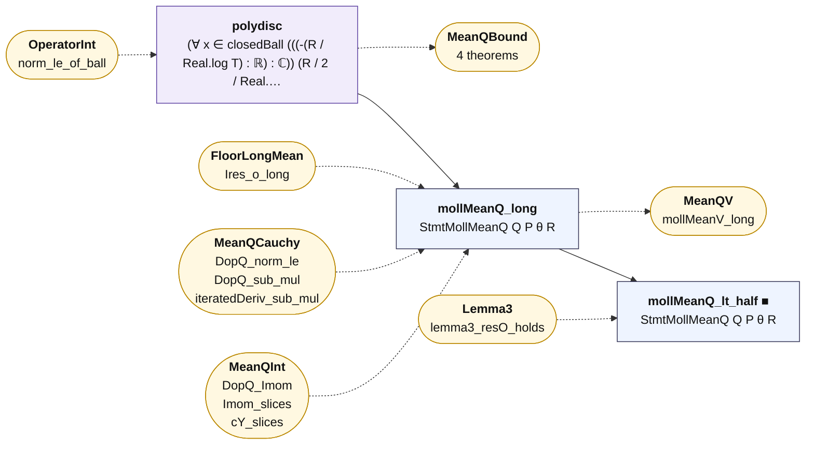

# `lean_stage3/Stage3/MeanQMean.lean`

> **Read from the source text.** This file changed after the last `python3 utilities/lean_map.py --dump`, so the arrows on this page are names occurring in each proof and have not been confirmed by Lean.

MeanQMean — block S13 of `lean_stage3/design/stencil.md`, B4 step 3, the mean value with a general Q: the mean of `|Q(−D/L)ζ·ψ|²` from Lemma 3. 2026-11-25.

3 theorems, 1 definition, 222 lines. 

**Imports:** [`FloorLongMean`](../lean_stage3/FloorLongMean.md), [`MeanQInt`](../lean_stage3/MeanQInt.md)  
**Imported by:** [`MeanQBound`](../lean_stage3/MeanQBound.md)

## The picture



An arrow A → B reads "A is used in the proof of B". Green: counting, integers only. Violet: shape, analysis with no ζ. Blue: reads ζ. A name ending in ■ is an end: nothing else uses it. Red: contains `sorry`. Yellow: theorems in another file, counted; a dotted arrow crosses files. Definitions are not drawn; they are listed below the diagram.

## Definitions

<a name="MeanQ-StmtMollMeanQ"></a>
### `MeanQ.StmtMollMeanQ`

def · line 98

The mollified mean of `Q(−D/L)ζ` at `o(T)`: for every family `Cs` and `ε > 0`, from some height on, uniformly over `WeightAll T (log T)` with `C_j ≤ Cs j`, `‖∫ w |VQ(σ₀+it)|² |ψ(σ₀+it)|² − DopQ[c](−R/L, −R/L) ŵ(0)‖ ≤ ε·errO W`.

- **Is:** `` StmtMollMeanQ (Q P : ℝ[X]) (θ R : ℝ) : Prop := ∀ Cs : ℕ → ℝ, ∀ ε : ℝ, 0 < ε → ∃ T₀ : ℝ, ∀ T : ℝ, T₀ ≤ T → ∀ W : WeightAll T (Real.log T), (∀ j, W.Cj j ≤ Cs j) → ‖mollMeanQ W.toWeight (Mof T θ) (aY P T θ R) (sig0 T R) Q (Real.log T) - DopQ Q (Real.log T) (cY P (Mof T θ) T) ((-(R / Real.log T) : ℝ) : ℂ) ((-(R / Real.log T) : ℝ) : ℂ) * (what0 W.toWeight : ℂ)‖ ≤ ε * errO W.toWeight ``
- **Built from:** [`MeanQ.DopQ`](../lean_stage3/MeanQCauchy.md#MeanQ-DopQ), [`MeanQ.mollMeanQ`](../lean_stage3/MeanQInt.md#MeanQ-mollMeanQ), [`TwistedMoment.Mof`](../lean_stage3/TwistedMoment.md#TwistedMoment-Mof), [`TwistedMoment.aY`](../lean_stage3/TwistedMoment.md#TwistedMoment-aY), [`TwistedMoment.cY`](../lean_stage3/TwistedMoment.md#TwistedMoment-cY), [`TwistedMoment.sig0`](../lean_stage3/TwistedMoment.md#TwistedMoment-sig0), [`TwistedMoment.what0`](../lean_stage3/TwistedMoment.md#TwistedMoment-what0)
- **Used by 2:** [`MeanQ.mollMeanQ_long`](#MeanQ-mollMeanQ_long), [`MeanQ.mollMeanQ_lt_half`](#MeanQ-mollMeanQ_lt_half)

## Theorems

<a name="MeanQ-polydisc"></a>
### `MeanQ.polydisc`

line 35 · arrows read from text

**Shape.** Uses real or complex analysis; nothing in it or beneath it reads ζ.

**Why.** The polydisc: radius `R/(2L)` about `−R/L`, for `3R + 1 ≤ L = log T`.

**Proves**

```lean
(∀ x ∈ closedBall (((-(R / Real.log T) : ℝ) : ℂ)) (R / 2 / Real.log T), ‖x‖ < 1 / 2) ∧ (∀ x ∈ closedBall (((-(R / Real.log T) : ℝ) : ℂ)) (R / 2 / Real.log T), ∀ y ∈ closedBall (((-(R / Real.log T) : ℝ) : ℂ)) (R / 2 / Real.log T), R / Real.log T ≤ ‖x + y‖) ∧ (∀ x ∈ closedBall (((-(R / Real.log T) : ℝ) : ℂ)) (R / 2 / Real.log T), ∀ y ∈ closedBall (((-(R / Real.log T) : ℝ) : ℂ)) (R / 2 / Real.log T), Regime (2 * R + 1 + 1 / R) T x y)
```

**Needs** (its hypotheses)

  - `` hR : 0 < R ``
  - `` hL : 3 * R + 1 ≤ Real.log T ``

**Fed by** (1 theorem its proof uses)

  - [`Operator.norm_le_of_ball`](../lean_stage3/OperatorInt.md#Operator-norm_le_of_ball) (OperatorInt) — `` ‖x‖ ≤ ‖x₀‖ + δ ``

**Definitions its proof touches:** [`TwistedMoment.Regime`](../lean_stage3/TwistedMoment.md#TwistedMoment-Regime)

**Feeds** (5 that use it)

  - [`MeanQ.Imom_sup`](../lean_stage3/MeanQBound.md#MeanQ-Imom_sup) (MeanQBound) — `` ∃ K : ℝ, 0 ≤ K ∧ ∃ T₀ : ℝ, ∀ T : ℝ, T₀ ≤ T → ∀ W : WeightAll T (Real.log T), (∀ j, W.Cj j ≤ Cs j) → ∀ x ∈ closedBall (((-(R / Real.log T) : ℝ) : ℂ)) (… ``
  - [`MeanQ.cY_cauchy_hyps`](../lean_stage3/MeanQBound.md#MeanQ-cY_cauchy_hyps) (MeanQBound) — `` (∀ y ∈ closedBall (((-(R / Real.log T) : ℝ) : ℂ)) (R / 2 / Real.log T), ∀ x ∈ closedBall (((-(R / Real.log T) : ℝ) : ℂ)) (R / 2 / Real.log T), Differe… ``
  - [`MeanQ.cY_sup_bound`](../lean_stage3/MeanQBound.md#MeanQ-cY_sup_bound) (MeanQBound) — `` ∃ K : ℝ, 0 ≤ K ∧ ∃ T₀ : ℝ, ∀ T : ℝ, T₀ ≤ T → ∀ x ∈ closedBall (((-(R / Real.log T) : ℝ) : ℂ)) (R / 2 / Real.log T), ∀ y ∈ closedBall (((-(R / Real.log… ``
  - [`MeanQ.meanJ_bound`](../lean_stage3/MeanQBound.md#MeanQ-meanJ_bound) (MeanQBound) — `` ∃ K : ℝ, 0 ≤ K ∧ ∃ T₀ : ℝ, ∀ T : ℝ, T₀ ≤ T → ∀ W : WeightAll T (Real.log T), (∀ j, W.Cj j ≤ Cs j) → ∀ j : ℕ, ‖mollMeanQ W.toWeight (Mof T θ) (aY P T θ… ``
  - [`MeanQ.mollMeanQ_long`](#MeanQ-mollMeanQ_long) — `` StmtMollMeanQ Q P θ R ``

<a name="MeanQ-mollMeanQ_long"></a>
### `MeanQ.mollMeanQ_long`

line 108 · arrows read from text

**Reads ζ.** It, or something it rests on, uses the zeta function, its zeros or the Riemann hypothesis.

**Why.** The general-Q mean from Lemma 3, every length: `FloorLong.mollMean_long` with `Dop` replaced by `DopQ` and Cauchy's estimate taken to order `deg Q` in each variable.

**Proves**

```lean
StmtMollMeanQ Q P θ R
```

**Needs** (its hypotheses)

  - `` Q P : ℝ[X] ``
  - `` hR : 0 < R ``
  - `` hL3 : StmtLemma3resO P θ R (2 * R + 1 + 1 / R) ``

**Fed by** (8 theorems its proof uses)

  - [`FloorLong.Ires_o_long`](../lean_stage3/FloorLongMean.md#FloorLong-Ires_o_long) (FloorLongMean) — `` ∀ ε : ℝ, 0 < ε → ∃ T₀ : ℝ, ∀ T : ℝ, T₀ ≤ T → ∀ W : Weight T (Real.log T), ∀ α β : ℂ, Regime κ T α β → ‖Ires W (Mof T θ) (aY P T θ R) (sig0 T R) α β‖ ≤… ``
  - [`MeanQ.DopQ_norm_le`](../lean_stage3/MeanQCauchy.md#MeanQ-DopQ_norm_le) (MeanQCauchy) — `` ‖DopQ Q L F α₀ β₀‖ ≤ S * Kq Q r ^ 2 ``
  - [`MeanQ.DopQ_sub_mul`](../lean_stage3/MeanQCauchy.md#MeanQ-DopQ_sub_mul) (MeanQCauchy) — `` DopQ Q L (fun x y => A x y - B x y * c) α₀ β₀ = DopQ Q L A α₀ β₀ - DopQ Q L B α₀ β₀ * c ``
  - [`MeanQ.iteratedDeriv_sub_mul`](../lean_stage3/MeanQCauchy.md#MeanQ-iteratedDeriv_sub_mul) (MeanQCauchy) — `` iteratedDeriv k (fun z => A z - B z * c) x = iteratedDeriv k A x - iteratedDeriv k B x * c ``
  - [`MeanQ.DopQ_Imom`](../lean_stage3/MeanQInt.md#MeanQ-DopQ_Imom) (MeanQInt) — `` DopQ Q L' (Imom W M a σ₀) ((σ₀ - 1 / 2 : ℝ) : ℂ) ((σ₀ - 1 / 2 : ℝ) : ℂ) = mollMeanQ W M a σ₀ Q L' ``
  - [`MeanQ.Imom_slices`](../lean_stage3/MeanQInt.md#MeanQ-Imom_slices) (MeanQInt) — `` AnalyticAt ℂ (fun x => Imom W M a σ₀ x y) x ∧ ∀ k, AnalyticAt ℂ (fun y => iteratedDeriv k (fun x => Imom W M a σ₀ x y) x) y ``
  - [`MeanQ.cY_slices`](../lean_stage3/MeanQInt.md#MeanQ-cY_slices) (MeanQInt) — `` (∀ᶠ y' in 𝓝 y, AnalyticAt ℂ (fun x => cY P M T x y') x) ∧ ∀ k, AnalyticAt ℂ (fun y => iteratedDeriv k (fun x => cY P M T x y) x) y ``
  - [`MeanQ.polydisc`](#MeanQ-polydisc) — `` (∀ x ∈ closedBall (((-(R / Real.log T) : ℝ) : ℂ)) (R / 2 / Real.log T), ‖x‖ < 1 / 2) ∧ (∀ x ∈ closedBall (((-(R / Real.log T) : ℝ) : ℂ)) (R / 2 / Real… ``

**Definitions its proof touches:** [`MeanQ.DopQ`](../lean_stage3/MeanQCauchy.md#MeanQ-DopQ), [`MeanQ.Kq`](../lean_stage3/MeanQCauchy.md#MeanQ-Kq), [`MeanQ.mollMeanQ`](../lean_stage3/MeanQInt.md#MeanQ-mollMeanQ), [`MeanQ.StmtMollMeanQ`](#MeanQ-StmtMollMeanQ), [`TwistedMoment.Imom`](../lean_stage3/TwistedMoment.md#TwistedMoment-Imom), [`TwistedMoment.Mof`](../lean_stage3/TwistedMoment.md#TwistedMoment-Mof), [`TwistedMoment.aY`](../lean_stage3/TwistedMoment.md#TwistedMoment-aY), [`TwistedMoment.cY`](../lean_stage3/TwistedMoment.md#TwistedMoment-cY), [`TwistedMoment.sig0`](../lean_stage3/TwistedMoment.md#TwistedMoment-sig0), [`TwistedMoment.what0`](../lean_stage3/TwistedMoment.md#TwistedMoment-what0)

**Feeds** (2 that use it)

  - [`MeanQ.mollMeanQ_lt_half`](#MeanQ-mollMeanQ_lt_half) — `` StmtMollMeanQ Q P θ R ``
  - [`MeanQ.mollMeanV_long`](../lean_stage3/MeanQV.md#MeanQ-mollMeanV_long) (MeanQV) — `` StmtMollMeanV Q P θ R ``

<a name="MeanQ-mollMeanQ_lt_half"></a>
### `MeanQ.mollMeanQ_lt_half`

line 203 · arrows read from text

**Reads ζ.** It, or something it rests on, uses the zeta function, its zeros or the Riemann hypothesis.

**Why.** The general-Q mean, unconditional for `θ < 1/2`.

**Proves**

```lean
StmtMollMeanQ Q P θ R
```

**Needs** (its hypotheses)

  - `` Q P : ℝ[X] ``
  - `` hP0 : P.eval 0 = 0 ``
  - `` hθ0 : 0 < θ ``
  - `` hθ : θ < 1 / 2 ``
  - `` hR : 0 < R ``

**Fed by** (2 theorems its proof uses)

  - [`Lemma3.lemma3_resO_holds`](../lean_stage3/Lemma3.md#Lemma3-lemma3_resO_holds) (Lemma3) — `` StmtLemma3resO P θ R κ ``
  - [`MeanQ.mollMeanQ_long`](#MeanQ-mollMeanQ_long) — `` StmtMollMeanQ Q P θ R ``

**Definitions its proof touches:** [`MeanQ.StmtMollMeanQ`](#MeanQ-StmtMollMeanQ)

**Feeds:** nothing. It is an end.

