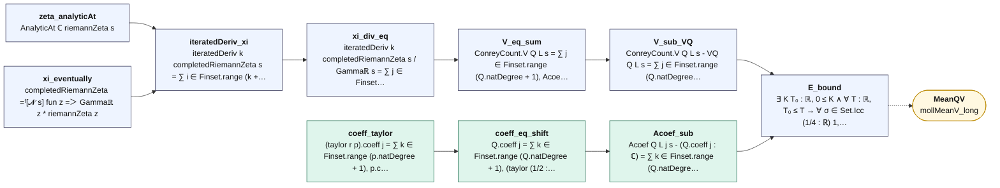

# `lean_stage3/Stage3/MeanQRed.lean`

> **Read from the source text.** This file changed after the last `python3 utilities/lean_map.py --dump`, so the arrows on this page are names occurring in each proof and have not been confirmed by Lean.

MeanQRed — block S13 of `lean_stage3/design/stencil.md`, B4 step 3, the mean value with a general Q: the reduction `V = Q(−D/L) ζ + E`. 2026-11-25.

10 theorems, 4 definitions, 280 lines. 

**Imports:** [`ConreyCountLine`](../lean_stage3/ConreyCountLine.md)  
**Imported by:** [`MeanQInt`](../lean_stage3/MeanQInt.md)

## The picture



An arrow A → B reads "A is used in the proof of B". Green: counting, integers only. Violet: shape, analysis with no ζ. Blue: reads ζ. A name ending in ■ is an end: nothing else uses it. Red: contains `sorry`. Yellow: theorems in another file, counted; a dotted arrow crosses files. Definitions are not drawn; they are listed below the diagram.

## Definitions

<a name="MeanQ-grR"></a>
### `MeanQ.grR`

def · line 100

`Gammaℝ^{(i)}/Gammaℝ`.

- **Is:** `` grR (i : ℕ) (s : ℂ) : ℂ := iteratedDeriv i Gammaℝ s / Gammaℝ s ``
- **Used by 8:** [`GrRatio.grR_eq`](../lean_stage3/GrRatio.md#GrRatio-grR_eq), [`GrRatio.grR_sub`](../lean_stage3/GrRatio.md#GrRatio-grR_sub), [`MeanQ.Acoef`](#MeanQ-Acoef), [`MeanQ.Acoef_sub`](#MeanQ-Acoef_sub), [`MeanQ.E_bound`](#MeanQ-E_bound), [`MeanQ.StmtGrRatio`](#MeanQ-StmtGrRatio), [`MeanQ.V_eq_sum`](#MeanQ-V_eq_sum), [`MeanQ.xi_div_eq`](#MeanQ-xi_div_eq)

<a name="MeanQ-Acoef"></a>
### `MeanQ.Acoef`

def · line 103

`A_j = Σ_k b_k C(k,j) (−1/L)^{k−j} Gammaℝ^{(k−j)}/Gammaℝ`.

- **Is:** `` Acoef (Q : ℝ[X]) (L : ℝ) (j : ℕ) (s : ℂ) : ℂ := ∑ k ∈ Finset.range (Q.natDegree + 1), (((taylor (1/2 : ℝ) Q).coeff k * (k.choose j : ℝ) * (-1 / L) ^ (k - j) : ℝ) : ℂ) * grR (k - j) s ``
- **Built from:** [`MeanQ.grR`](#MeanQ-grR)
- **Used by 4:** [`MeanQ.Acoef_sub`](#MeanQ-Acoef_sub), [`MeanQ.E_bound`](#MeanQ-E_bound), [`MeanQ.V_eq_sum`](#MeanQ-V_eq_sum), [`MeanQ.V_sub_VQ`](#MeanQ-V_sub_VQ)

<a name="MeanQ-VQ"></a>
### `MeanQ.VQ`

def · line 109

`Q(−(1/L) d/ds) ζ = Σ_j q_j (−1/L)^j ζ^{(j)}`, `q_j = Q.coeff j`.

- **Is:** `` VQ (Q : ℝ[X]) (L : ℝ) (s : ℂ) : ℂ := ∑ j ∈ Finset.range (Q.natDegree + 1), ((Q.coeff j * (-1 / L) ^ j : ℝ) : ℂ) * iteratedDeriv j riemannZeta s ``
- **Used by 9:** [`MeanQ.VQ_X_pow`](../lean_stage3/MeanQBound.md#MeanQ-VQ_X_pow), [`MeanQ.mollMeanQ`](../lean_stage3/MeanQInt.md#MeanQ-mollMeanQ), [`MeanQ.mollMeanQ_eq`](../lean_stage3/MeanQInt.md#MeanQ-mollMeanQ_eq), [`MeanQ.E_bound`](#MeanQ-E_bound), [`MeanQ.V_sub_VQ`](#MeanQ-V_sub_VQ), [`MeanQ.continuous_VQ_line`](../lean_stage3/MeanQV.md#MeanQ-continuous_VQ_line), [`MeanQ.mollMeanQ_re`](../lean_stage3/MeanQV.md#MeanQ-mollMeanQ_re), [`MeanQ.mollMeanV_long`](../lean_stage3/MeanQV.md#MeanQ-mollMeanV_long), [`MeanQ.norm_VQ_X_pow`](../lean_stage3/MeanQV.md#MeanQ-norm_VQ_X_pow)

<a name="MeanQ-StmtGrRatio"></a>
### `MeanQ.StmtGrRatio`

def · line 190

OPEN, the `Gammaℝ` ratio: for `i ≤ n`, uniformly on `σ ∈ [1/4, 1]`, `t ∈ [T/4, 2T]`, `‖(−1/L)^i Gammaℝ^{(i)}(σ+it)/Gammaℝ(σ+it) − (−1/2)^i‖ ≤ C/L`, `L = log T`. Budget: any `C`, any `T₀`. Route: `Gammaℝ^{(i)}/Gammaℝ` is the complete Bell polynomial in `g, g′, …, g^{(i−1)}`, `g = Gammaℝ′/Gammaℝ = −(1/2) log π + (1/2) ψ(s/2)`; with `|ψ(z) − log z| ≤ C/|z|` and `|ψ^{(m)}(z)| ≤ C_m/|z|^m` (the digamma worker, `Stage3/DigammaBound*.lean`), `g = L/2 + O(1)` and `g^{(m)} = O(1/t^m)` on the window, so the Bell polynomial is `g^i + O(L^{i−2}/t)` and `(−g/L)^i = (−1/2)^i + O(1/L)`.

- **Is:** `` StmtGrRatio (n : ℕ) : Prop := ∃ C T₀ : ℝ, 0 ≤ C ∧ ∀ T : ℝ, T₀ ≤ T → ∀ i ≤ n, ∀ σ ∈ Set.Icc (1/4 : ℝ) 1, ∀ t ∈ Set.Icc (T / 4) (2 * T), ‖(((-1 / Real.log T) ^ i : ℝ) : ℂ) * grR i ((σ : ℂ) + t * I) - (((-1/2 : ℝ) ^ i : ℝ) : ℂ)‖ ≤ C / Real.log T ``
- **Built from:** [`MeanQ.grR`](#MeanQ-grR)
- **Used by 5:** [`GrRatio.stmtGrRatio_holds`](../lean_stage3/GrRatio.md#GrRatio-stmtGrRatio_holds), [`MeanQ.window_V_long`](../lean_stage3/MeanQ.md#MeanQ-window_V_long), [`MeanQ.window_V_lt_half`](../lean_stage3/MeanQ.md#MeanQ-window_V_lt_half), [`MeanQ.E_bound`](#MeanQ-E_bound), [`MeanQ.mollMeanV_long`](../lean_stage3/MeanQV.md#MeanQ-mollMeanV_long)

## Theorems

<a name="MeanQ-coeff_taylor"></a>
### `MeanQ.coeff_taylor`

line 49 · arrows read from text

**Counting.** Integers only: nothing in its statement or proof, or in anything it rests on, uses analysis or ζ.

**Why.** The coefficients of a Taylor shift: `(taylor r p).coeff j = Σ_k p_k C(k,j) r^{k−j}`.

**Proves**

```lean
(taylor r p).coeff j = ∑ k ∈ Finset.range (p.natDegree + 1), p.coeff k * (k.choose j : ℝ) * r ^ (k - j)
```

**Needs** (its hypotheses)

  - `` p : ℝ[X] ``
  - `` r : ℝ ``
  - `` j : ℕ ``

**Fed by:** no theorem of this repo; it stands on Mathlib.

**Feeds** (1 that use it)

  - [`MeanQ.coeff_eq_shift`](#MeanQ-coeff_eq_shift) — `` Q.coeff j = ∑ k ∈ Finset.range (Q.natDegree + 1), (taylor (1/2 : ℝ) Q).coeff k * (k.choose j : ℝ) * (-1/2 : ℝ) ^ (k - j) ``

<a name="MeanQ-coeff_eq_shift"></a>
### `MeanQ.coeff_eq_shift`

line 60 · arrows read from text

**Counting.** Integers only: nothing in its statement or proof, or in anything it rests on, uses analysis or ζ.

**Why.** The shift back to `0`: `Q.coeff j = Σ_k b_k C(k,j) (−1/2)^{k−j}`, `b = taylor (1/2) Q`.

**Proves**

```lean
Q.coeff j = ∑ k ∈ Finset.range (Q.natDegree + 1), (taylor (1/2 : ℝ) Q).coeff k * (k.choose j : ℝ) * (-1/2 : ℝ) ^ (k - j)
```

**Needs** (its hypotheses)

  - `` Q : ℝ[X] ``
  - `` j : ℕ ``

**Fed by** (1 theorem its proof uses)

  - [`MeanQ.coeff_taylor`](#MeanQ-coeff_taylor) — `` (taylor r p).coeff j = ∑ k ∈ Finset.range (p.natDegree + 1), p.coeff k * (k.choose j : ℝ) * r ^ (k - j) ``

**Feeds** (1 that use it)

  - [`MeanQ.Acoef_sub`](#MeanQ-Acoef_sub) — `` Acoef Q L j s - (Q.coeff j : ℂ) = ∑ k ∈ Finset.range (Q.natDegree + 1), (((taylor (1/2 : ℝ) Q).coeff k * (k.choose j : ℝ) : ℝ) : ℂ) * ((((-1 / L) ^ (k… ``

<a name="MeanQ-zeta_analyticAt"></a>
### `MeanQ.zeta_analyticAt`

line 72 · arrows read from text

**Reads ζ.** It, or something it rests on, uses the zeta function, its zeros or the Riemann hypothesis.

**Proves**

```lean
AnalyticAt ℂ riemannZeta s
```

**Needs** (its hypotheses)

  - `` hs1 : s ≠ 1 ``

**Fed by:** no theorem of this repo; it stands on Mathlib.

**Feeds** (1 that use it)

  - [`MeanQ.iteratedDeriv_xi`](#MeanQ-iteratedDeriv_xi) — `` iteratedDeriv k completedRiemannZeta s = ∑ i ∈ Finset.range (k + 1), (k.choose i : ℂ) * iteratedDeriv i Gammaℝ s * iteratedDeriv (k - i) riemannZeta s ``

<a name="MeanQ-xi_eventually"></a>
### `MeanQ.xi_eventually`

line 78 · arrows read from text

**Reads ζ.** It, or something it rests on, uses the zeta function, its zeros or the Riemann hypothesis.

**Why.** `Λ = Gammaℝ · ζ` near a point with `Re s > 0`.

**Proves**

```lean
completedRiemannZeta =ᶠ[𝓝 s] fun z => Gammaℝ z * riemannZeta z
```

**Needs** (its hypotheses)

  - `` hs : 0 < s.re ``

**Fed by:** no theorem of this repo; it stands on Mathlib.

**Feeds** (1 that use it)

  - [`MeanQ.iteratedDeriv_xi`](#MeanQ-iteratedDeriv_xi) — `` iteratedDeriv k completedRiemannZeta s = ∑ i ∈ Finset.range (k + 1), (k.choose i : ℂ) * iteratedDeriv i Gammaℝ s * iteratedDeriv (k - i) riemannZeta s ``

<a name="MeanQ-iteratedDeriv_xi"></a>
### `MeanQ.iteratedDeriv_xi`

line 89 · arrows read from text

**Reads ζ.** It, or something it rests on, uses the zeta function, its zeros or the Riemann hypothesis.

**Why.** Leibniz for `Λ`: `Λ^{(k)}(s) = Σ_i C(k,i) Gammaℝ^{(i)}(s) ζ^{(k−i)}(s)`.

**Proves**

```lean
iteratedDeriv k completedRiemannZeta s = ∑ i ∈ Finset.range (k + 1), (k.choose i : ℂ) * iteratedDeriv i Gammaℝ s * iteratedDeriv (k - i) riemannZeta s
```

**Needs** (its hypotheses)

  - `` k : ℕ ``
  - `` hs : 0 < s.re ``
  - `` hs1 : s ≠ 1 ``

**Fed by** (2 theorems its proof uses)

  - [`MeanQ.xi_eventually`](#MeanQ-xi_eventually) — `` completedRiemannZeta =ᶠ[𝓝 s] fun z => Gammaℝ z * riemannZeta z ``
  - [`MeanQ.zeta_analyticAt`](#MeanQ-zeta_analyticAt) — `` AnalyticAt ℂ riemannZeta s ``

**Feeds** (1 that use it)

  - [`MeanQ.xi_div_eq`](#MeanQ-xi_div_eq) — `` iteratedDeriv k completedRiemannZeta s / Gammaℝ s = ∑ j ∈ Finset.range (d + 1), (k.choose j : ℂ) * grR (k - j) s * iteratedDeriv j riemannZeta s ``

<a name="MeanQ-xi_div_eq"></a>
### `MeanQ.xi_div_eq`

line 114 · arrows read from text

**Reads ζ.** It, or something it rests on, uses the zeta function, its zeros or the Riemann hypothesis.

**Why.** One `Λ^{(k)}/Gammaℝ`, reindexed by the order of `ζ` and extended to `range (d+1)`.

**Proves**

```lean
iteratedDeriv k completedRiemannZeta s / Gammaℝ s = ∑ j ∈ Finset.range (d + 1), (k.choose j : ℂ) * grR (k - j) s * iteratedDeriv j riemannZeta s
```

**Needs** (its hypotheses)

  - `` hk : k ≤ d ``
  - `` hs : 0 < s.re ``
  - `` hs1 : s ≠ 1 ``

**Fed by** (1 theorem its proof uses)

  - [`MeanQ.iteratedDeriv_xi`](#MeanQ-iteratedDeriv_xi) — `` iteratedDeriv k completedRiemannZeta s = ∑ i ∈ Finset.range (k + 1), (k.choose i : ℂ) * iteratedDeriv i Gammaℝ s * iteratedDeriv (k - i) riemannZeta s ``

**Definitions its proof touches:** [`MeanQ.grR`](#MeanQ-grR)

**Feeds** (1 that use it)

  - [`MeanQ.V_eq_sum`](#MeanQ-V_eq_sum) — `` ConreyCount.V Q L s = ∑ j ∈ Finset.range (Q.natDegree + 1), Acoef Q L j s * (((-1 / L) ^ j : ℝ) : ℂ) * iteratedDeriv j riemannZeta s ``

<a name="MeanQ-V_eq_sum"></a>
### `MeanQ.V_eq_sum`

line 134 · arrows read from text

**Reads ζ.** It, or something it rests on, uses the zeta function, its zeros or the Riemann hypothesis.

**Why.** The exact reduction: `V = Σ_j A_j (−1/L)^j ζ^{(j)}` on `Re s > 0`, `s ≠ 1`.

**Proves**

```lean
ConreyCount.V Q L s = ∑ j ∈ Finset.range (Q.natDegree + 1), Acoef Q L j s * (((-1 / L) ^ j : ℝ) : ℂ) * iteratedDeriv j riemannZeta s
```

**Needs** (its hypotheses)

  - `` Q : ℝ[X] ``
  - `` L : ℝ ``
  - `` hs : 0 < s.re ``
  - `` hs1 : s ≠ 1 ``

**Fed by** (1 theorem its proof uses)

  - [`MeanQ.xi_div_eq`](#MeanQ-xi_div_eq) — `` iteratedDeriv k completedRiemannZeta s / Gammaℝ s = ∑ j ∈ Finset.range (d + 1), (k.choose j : ℂ) * grR (k - j) s * iteratedDeriv j riemannZeta s ``

**Definitions its proof touches:** [`ConreyCount.V`](../lean_stage3/ConreyCountLine.md#ConreyCount-V), [`MeanQ.Acoef`](#MeanQ-Acoef), [`MeanQ.grR`](#MeanQ-grR), [`OperatorQ.W`](../lean_stage3/OperatorQ.md#OperatorQ-W)

**Feeds** (1 that use it)

  - [`MeanQ.V_sub_VQ`](#MeanQ-V_sub_VQ) — `` ConreyCount.V Q L s - VQ Q L s = ∑ j ∈ Finset.range (Q.natDegree + 1), (Acoef Q L j s - (Q.coeff j : ℂ)) * (((-1 / L) ^ j : ℝ) : ℂ) * iteratedDeriv j … ``

<a name="MeanQ-V_sub_VQ"></a>
### `MeanQ.V_sub_VQ`

line 163 · arrows read from text

**Reads ζ.** It, or something it rests on, uses the zeta function, its zeros or the Riemann hypothesis.

**Why.** The error: `V − Q(−D/L)ζ = Σ_j (A_j − q_j)(−1/L)^j ζ^{(j)}`.

**Proves**

```lean
ConreyCount.V Q L s - VQ Q L s = ∑ j ∈ Finset.range (Q.natDegree + 1), (Acoef Q L j s - (Q.coeff j : ℂ)) * (((-1 / L) ^ j : ℝ) : ℂ) * iteratedDeriv j riemannZeta s
```

**Needs** (its hypotheses)

  - `` Q : ℝ[X] ``
  - `` L : ℝ ``
  - `` hs : 0 < s.re ``
  - `` hs1 : s ≠ 1 ``

**Fed by** (1 theorem its proof uses)

  - [`MeanQ.V_eq_sum`](#MeanQ-V_eq_sum) — `` ConreyCount.V Q L s = ∑ j ∈ Finset.range (Q.natDegree + 1), Acoef Q L j s * (((-1 / L) ^ j : ℝ) : ℂ) * iteratedDeriv j riemannZeta s ``

**Definitions its proof touches:** [`ConreyCount.V`](../lean_stage3/ConreyCountLine.md#ConreyCount-V), [`MeanQ.Acoef`](#MeanQ-Acoef), [`MeanQ.VQ`](#MeanQ-VQ)

**Feeds** (1 that use it)

  - [`MeanQ.E_bound`](#MeanQ-E_bound) — `` ∃ K T₀ : ℝ, 0 ≤ K ∧ ∀ T : ℝ, T₀ ≤ T → ∀ σ ∈ Set.Icc (1/4 : ℝ) 1, ∀ t ∈ Set.Icc (T / 4) (2 * T), ‖ConreyCount.V Q (Real.log T) ((σ : ℂ) + t * I) - VQ Q… ``

<a name="MeanQ-Acoef_sub"></a>
### `MeanQ.Acoef_sub`

line 173 · arrows read from text

**Counting.** Integers only: nothing in its statement or proof, or in anything it rests on, uses analysis or ζ.

**Why.** The coefficient error: `A_j − q_j = Σ_k b_k C(k,j) ((−1/L)^i grR i − (−1/2)^i)`, `i = k − j`.

**Proves**

```lean
Acoef Q L j s - (Q.coeff j : ℂ) = ∑ k ∈ Finset.range (Q.natDegree + 1), (((taylor (1/2 : ℝ) Q).coeff k * (k.choose j : ℝ) : ℝ) : ℂ) * ((((-1 / L) ^ (k - j) : ℝ) : ℂ) * grR (k - j) s - (((-1/2 : ℝ) ^ (k - j) : ℝ) : ℂ))
```

**Needs** (its hypotheses)

  - `` Q : ℝ[X] ``
  - `` L : ℝ ``
  - `` j : ℕ ``
  - `` s : ℂ ``

**Fed by** (1 theorem its proof uses)

  - [`MeanQ.coeff_eq_shift`](#MeanQ-coeff_eq_shift) — `` Q.coeff j = ∑ k ∈ Finset.range (Q.natDegree + 1), (taylor (1/2 : ℝ) Q).coeff k * (k.choose j : ℝ) * (-1/2 : ℝ) ^ (k - j) ``

**Definitions its proof touches:** [`MeanQ.Acoef`](#MeanQ-Acoef), [`MeanQ.grR`](#MeanQ-grR)

**Feeds** (1 that use it)

  - [`MeanQ.E_bound`](#MeanQ-E_bound) — `` ∃ K T₀ : ℝ, 0 ≤ K ∧ ∀ T : ℝ, T₀ ≤ T → ∀ σ ∈ Set.Icc (1/4 : ℝ) 1, ∀ t ∈ Set.Icc (T / 4) (2 * T), ‖ConreyCount.V Q (Real.log T) ((σ : ℂ) + t * I) - VQ Q… ``

<a name="MeanQ-E_bound"></a>
### `MeanQ.E_bound`

line 198 · arrows read from text

**Reads ζ.** It, or something it rests on, uses the zeta function, its zeros or the Riemann hypothesis.

**Why.** The size of `E`: from `StmtGrRatio`, on `σ ∈ [1/4, 1]`, `t ∈ [T/4, 2T]`, `‖V − Q(−D/L)ζ‖ ≤ (K/L) Σ_j ‖ζ^{(j)}‖/L^j`, `L = log T`.

**Proves**

```lean
∃ K T₀ : ℝ, 0 ≤ K ∧ ∀ T : ℝ, T₀ ≤ T → ∀ σ ∈ Set.Icc (1/4 : ℝ) 1, ∀ t ∈ Set.Icc (T / 4) (2 * T), ‖ConreyCount.V Q (Real.log T) ((σ : ℂ) + t * I) - VQ Q (Real.log T) ((σ : ℂ) + t * I)‖ ≤ K / Real.log T * ∑ j ∈ Finset.range (Q.natDegree + 1), ‖iteratedDeriv j riemannZeta ((σ : ℂ) + t * I)‖ / Real.log T ^ j
```

**Needs** (its hypotheses)

  - `` Q : ℝ[X] ``
  - `` hG : StmtGrRatio Q.natDegree ``

**Fed by** (2 theorems its proof uses)

  - [`MeanQ.Acoef_sub`](#MeanQ-Acoef_sub) — `` Acoef Q L j s - (Q.coeff j : ℂ) = ∑ k ∈ Finset.range (Q.natDegree + 1), (((taylor (1/2 : ℝ) Q).coeff k * (k.choose j : ℝ) : ℝ) : ℂ) * ((((-1 / L) ^ (k… ``
  - [`MeanQ.V_sub_VQ`](#MeanQ-V_sub_VQ) — `` ConreyCount.V Q L s - VQ Q L s = ∑ j ∈ Finset.range (Q.natDegree + 1), (Acoef Q L j s - (Q.coeff j : ℂ)) * (((-1 / L) ^ j : ℝ) : ℂ) * iteratedDeriv j … ``

**Definitions its proof touches:** [`ConreyCount.V`](../lean_stage3/ConreyCountLine.md#ConreyCount-V), [`MeanQ.Acoef`](#MeanQ-Acoef), [`MeanQ.StmtGrRatio`](#MeanQ-StmtGrRatio), [`MeanQ.VQ`](#MeanQ-VQ), [`MeanQ.grR`](#MeanQ-grR)

**Feeds** (1 that use it)

  - [`MeanQ.mollMeanV_long`](../lean_stage3/MeanQV.md#MeanQ-mollMeanV_long) (MeanQV) — `` StmtMollMeanV Q P θ R ``

