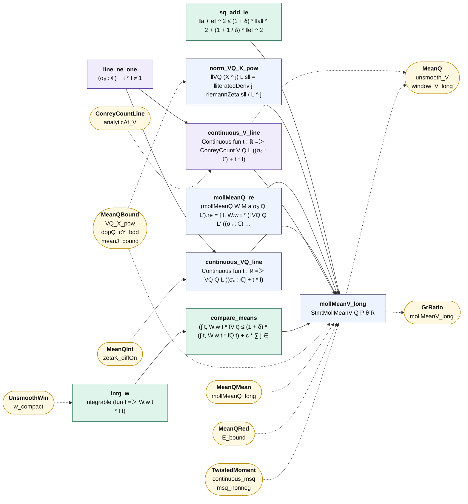

# `lean_stage3/Stage3/MeanQV.lean`

> **Read from the source text.** This file changed after the last `python3 utilities/lean_map.py --dump`, so the arrows on this page are names occurring in each proof and have not been confirmed by Lean.

MeanQV — block S13 of `lean_stage3/design/stencil.md`, B4 step 3, the mean value with a general Q: the mean of `|Vψ|²` for Conrey's `V = W/Gammaℝ`. 2026-11-25.

9 theorems, 2 definitions, 392 lines. 

**Imports:** [`MeanQBound`](../lean_stage3/MeanQBound.md)  
**Imported by:** [`MeanQ`](../lean_stage3/MeanQ.md)

## The picture



An arrow A → B reads "A is used in the proof of B". Green: counting, integers only. Violet: shape, analysis with no ζ. Blue: reads ζ. A name ending in ■ is an end: nothing else uses it. Red: contains `sorry`. Yellow: theorems in another file, counted; a dotted arrow crosses files. Definitions are not drawn; they are listed below the diagram.

## Definitions

<a name="MeanQ-mollMeanV"></a>
### `MeanQ.mollMeanV`

def · line 100

The mollified mean of Conrey's `V`: `∫ w(t) |V(σ₀+it)|² |ψ(σ₀+it)|² dt`, real.

- **Is:** `` mollMeanV {T L : ℝ} (W : Weight T L) (M : ℕ) (a : ℕ → ℂ) (σ₀ : ℝ) (Q : ℝ[X]) (L' : ℝ) : ℝ := ∫ t, W.w t * (‖ConreyCount.V Q L' ((σ₀ : ℂ) + t * I)‖ ^ 2 * msq M a σ₀ t) ``
- **Built from:** [`ConreyCount.V`](../lean_stage3/ConreyCountLine.md#ConreyCount-V), [`TwistedMoment.Weight`](../lean_stage3/TwistedMoment.md#TwistedMoment-Weight), [`TwistedMoment.msq`](../lean_stage3/TwistedMoment.md#TwistedMoment-msq)
- **Used by 3:** [`MeanQ.unsmooth_V`](../lean_stage3/MeanQ.md#MeanQ-unsmooth_V), [`MeanQ.StmtMollMeanV`](#MeanQ-StmtMollMeanV), [`MeanQ.mollMeanV_long`](#MeanQ-mollMeanV_long)

<a name="MeanQ-StmtMollMeanV"></a>
### `MeanQ.StmtMollMeanV`

def · line 106

The mollified mean of `V` at `o(T)`: for every `Cs` and `ε > 0`, from some height on, uniformly over `WeightAll T (log T)` with `C_j ≤ Cs j`, `|∫ w |V(σ₀+it)|² |ψ(σ₀+it)|² − Re DopQ[c](−R/L, −R/L)·ŵ(0)| ≤ ε·errO W`.

- **Is:** `` StmtMollMeanV (Q P : ℝ[X]) (θ R : ℝ) : Prop := ∀ Cs : ℕ → ℝ, ∀ ε : ℝ, 0 < ε → ∃ T₀ : ℝ, ∀ T : ℝ, T₀ ≤ T → ∀ W : WeightAll T (Real.log T), (∀ j, W.Cj j ≤ Cs j) → |mollMeanV W.toWeight (Mof T θ) (aY P T θ R) (sig0 T R) Q (Real.log T) - (DopQ Q (Real.log T) (cY P (Mof T θ) T) ((-(R / Real.log T) : ℝ) : ℂ) ((-(R / Real.log T) : ℝ) : ℂ)).re * what0 W.toWeight| ≤ ε * errO W.toWeight ``
- **Built from:** [`MeanQ.DopQ`](../lean_stage3/MeanQCauchy.md#MeanQ-DopQ), [`MeanQ.mollMeanV`](#MeanQ-mollMeanV), [`TwistedMoment.Mof`](../lean_stage3/TwistedMoment.md#TwistedMoment-Mof), [`TwistedMoment.aY`](../lean_stage3/TwistedMoment.md#TwistedMoment-aY), [`TwistedMoment.cY`](../lean_stage3/TwistedMoment.md#TwistedMoment-cY), [`TwistedMoment.sig0`](../lean_stage3/TwistedMoment.md#TwistedMoment-sig0), [`TwistedMoment.what0`](../lean_stage3/TwistedMoment.md#TwistedMoment-what0)
- **Used by 3:** [`GrRatio.mollMeanV_long'`](../lean_stage3/GrRatio.md#GrRatio-mollMeanV_long-), [`MeanQ.unsmooth_V`](../lean_stage3/MeanQ.md#MeanQ-unsmooth_V), [`MeanQ.mollMeanV_long`](#MeanQ-mollMeanV_long)

## Theorems

<a name="MeanQ-sq_add_le"></a>
### `MeanQ.sq_add_le`

line 38 · arrows read from text

**Counting.** Integers only: nothing in its statement or proof, or in anything it rests on, uses analysis or ζ.

**Why.** `‖a + e‖² ≤ (1 + δ)‖a‖² + (1 + 1/δ)‖e‖²`, `δ > 0`.

**Proves**

```lean
‖a + e‖ ^ 2 ≤ (1 + δ) * ‖a‖ ^ 2 + (1 + 1 / δ) * ‖e‖ ^ 2
```

**Needs** (its hypotheses)

  - `` a e : ℂ ``
  - `` hδ : 0 < δ ``

**Fed by:** no theorem of this repo; it stands on Mathlib.

**Feeds** (1 that use it)

  - [`MeanQ.mollMeanV_long`](#MeanQ-mollMeanV_long) — `` StmtMollMeanV Q P θ R ``

<a name="MeanQ-norm_VQ_X_pow"></a>
### `MeanQ.norm_VQ_X_pow`

line 50 · arrows read from text

**Reads ζ.** It, or something it rests on, uses the zeta function, its zeros or the Riemann hypothesis.

**Why.** `‖VQ (X^j)‖ = ‖ζ^{(j)}‖/L^j`.

**Proves**

```lean
‖VQ (X ^ j) L s‖ = ‖iteratedDeriv j riemannZeta s‖ / L ^ j
```

**Needs** (its hypotheses)

  - `` j : ℕ ``
  - `` hL : 0 < L ``
  - `` s : ℂ ``

**Fed by** (1 theorem its proof uses)

  - [`MeanQ.VQ_X_pow`](../lean_stage3/MeanQBound.md#MeanQ-VQ_X_pow) (MeanQBound) — `` VQ (X ^ j) L s = (((-1 / L) ^ j : ℝ) : ℂ) * iteratedDeriv j riemannZeta s ``

**Definitions its proof touches:** [`MeanQ.VQ`](../lean_stage3/MeanQRed.md#MeanQ-VQ)

**Feeds** (1 that use it)

  - [`MeanQ.mollMeanV_long`](#MeanQ-mollMeanV_long) — `` StmtMollMeanV Q P θ R ``

<a name="MeanQ-mollMeanQ_re"></a>
### `MeanQ.mollMeanQ_re`

line 57 · arrows read from text

**Reads ζ.** It, or something it rests on, uses the zeta function, its zeros or the Riemann hypothesis.

**Why.** `Re mollMeanQ = ∫ w |VQ|² |ψ|²`.

**Proves**

```lean
(mollMeanQ W M a σ₀ Q L').re = ∫ t, W.w t * (‖VQ Q L' ((σ₀ : ℂ) + t * I)‖ ^ 2 * msq M a σ₀ t)
```

**Needs** (its hypotheses)

  - `` W : Weight T L ``
  - `` M : ℕ ``
  - `` a : ℕ → ℂ ``
  - `` σ₀ : ℝ ``
  - `` Q : ℝ[X] ``
  - `` L' : ℝ ``

**Fed by:** no theorem of this repo; it stands on Mathlib and the definitions below.

**Definitions its proof touches:** [`MeanQ.mollMeanQ`](../lean_stage3/MeanQInt.md#MeanQ-mollMeanQ), [`MeanQ.VQ`](../lean_stage3/MeanQRed.md#MeanQ-VQ), [`TwistedMoment.Weight`](../lean_stage3/TwistedMoment.md#TwistedMoment-Weight), [`TwistedMoment.msq`](../lean_stage3/TwistedMoment.md#TwistedMoment-msq)

**Feeds** (1 that use it)

  - [`MeanQ.mollMeanV_long`](#MeanQ-mollMeanV_long) — `` StmtMollMeanV Q P θ R ``

<a name="MeanQ-line_ne_one"></a>
### `MeanQ.line_ne_one`

line 69 · arrows read from text

**Shape.** Uses real or complex analysis; nothing in it or beneath it reads ζ.

**Proves**

```lean
(σ₀ : ℂ) + t * I ≠ 1
```

**Needs** (its hypotheses)

  - `` hσ : σ₀ ≠ 1 ``
  - `` t : ℝ ``

**Fed by:** no theorem of this repo; it stands on Mathlib.

**Feeds** (2 that use it)

  - [`MeanQ.continuous_VQ_line`](#MeanQ-continuous_VQ_line) — `` Continuous fun t : ℝ => VQ Q L ((σ₀ : ℂ) + t * I) ``
  - [`MeanQ.continuous_V_line`](#MeanQ-continuous_V_line) — `` Continuous fun t : ℝ => ConreyCount.V Q L ((σ₀ : ℂ) + t * I) ``

<a name="MeanQ-continuous_VQ_line"></a>
### `MeanQ.continuous_VQ_line`

line 76 · arrows read from text

**Reads ζ.** It, or something it rests on, uses the zeta function, its zeros or the Riemann hypothesis.

**Why.** `t ↦ VQ(σ₀+it)` is continuous for `σ₀ ≠ 1`.

**Proves**

```lean
Continuous fun t : ℝ => VQ Q L ((σ₀ : ℂ) + t * I)
```

**Needs** (its hypotheses)

  - `` Q : ℝ[X] ``
  - `` L : ℝ ``
  - `` hσ : σ₀ ≠ 1 ``

**Fed by** (2 theorems its proof uses)

  - [`MeanQ.zetaK_diffOn`](../lean_stage3/MeanQInt.md#MeanQ-zetaK_diffOn) (MeanQInt) — `` DifferentiableOn ℂ (iteratedDeriv k riemannZeta) {1}ᶜ ``
  - [`MeanQ.line_ne_one`](#MeanQ-line_ne_one) — `` (σ₀ : ℂ) + t * I ≠ 1 ``

**Definitions its proof touches:** [`MeanQ.VQ`](../lean_stage3/MeanQRed.md#MeanQ-VQ)

**Feeds** (1 that use it)

  - [`MeanQ.mollMeanV_long`](#MeanQ-mollMeanV_long) — `` StmtMollMeanV Q P θ R ``

<a name="MeanQ-continuous_V_line"></a>
### `MeanQ.continuous_V_line`

line 85 · arrows read from text

**Shape.** Uses real or complex analysis; nothing in it or beneath it reads ζ.

**Why.** `t ↦ V(σ₀+it)` is continuous for `0 < σ₀ < 1`.

**Proves**

```lean
Continuous fun t : ℝ => ConreyCount.V Q L ((σ₀ : ℂ) + t * I)
```

**Needs** (its hypotheses)

  - `` Q : ℝ[X] ``
  - `` L : ℝ ``
  - `` h0 : 0 < σ₀ ``
  - `` h1 : σ₀ < 1 ``

**Fed by** (2 theorems its proof uses)

  - [`ConreyCount.analyticAt_V`](../lean_stage3/ConreyCountLine.md#ConreyCount-analyticAt_V) (ConreyCountLine) — `` AnalyticAt ℂ (V Q L) s ``
  - [`MeanQ.line_ne_one`](#MeanQ-line_ne_one) — `` (σ₀ : ℂ) + t * I ≠ 1 ``

**Definitions its proof touches:** [`ConreyCount.V`](../lean_stage3/ConreyCountLine.md#ConreyCount-V)

**Feeds** (2 that use it)

  - [`MeanQ.unsmooth_V`](../lean_stage3/MeanQ.md#MeanQ-unsmooth_V) (MeanQ) — `` ∀ ε : ℝ, 0 < ε → ∃ T₀ : ℝ, ∀ T : ℝ, T₀ ≤ T → ∀ a' b' : ℝ, T / 2 ≤ a' → a' ≤ T / 2 + 1 → T - 1 ≤ b' → b' ≤ T → (1 / (b' - a')) * ∫ t in a'..b', ‖Conrey… ``
  - [`MeanQ.mollMeanV_long`](#MeanQ-mollMeanV_long) — `` StmtMollMeanV Q P θ R ``

<a name="MeanQ-intg_w"></a>
### `MeanQ.intg_w`

line 115 · arrows read from text

**Counting.** Integers only: nothing in its statement or proof, or in anything it rests on, uses analysis or ζ.

**Why.** Integrability of `w·f` for continuous `f`.

**Proves**

```lean
Integrable (fun t => W.w t * f t)
```

**Needs** (its hypotheses)

  - `` W : Weight T L ``
  - `` hf : Continuous f ``

**Fed by** (1 theorem its proof uses)

  - [`Unsmooth.w_compact`](../lean_stage3/UnsmoothWin.md#Unsmooth-w_compact) (UnsmoothWin) — `` HasCompactSupport W.w ``

**Definitions its proof touches:** [`TwistedMoment.Weight`](../lean_stage3/TwistedMoment.md#TwistedMoment-Weight)

**Feeds** (1 that use it)

  - [`MeanQ.compare_means`](#MeanQ-compare_means) — `` (∫ t, W.w t * fV t) ≤ (1 + δ) * (∫ t, W.w t * fQ t) + c * ∑ j ∈ Finset.range n, ∫ t, W.w t * fJ j t ∧ (∫ t, W.w t * fQ t) ≤ (1 + δ) * (∫ t, W.w t * fV… ``

<a name="MeanQ-compare_means"></a>
### `MeanQ.compare_means`

line 120 · arrows read from text

**Counting.** Integers only: nothing in its statement or proof, or in anything it rests on, uses analysis or ζ.

**Why.** The two integrated comparisons, from a pointwise `E` bound on the support of `w`.

**Proves**

```lean
(∫ t, W.w t * fV t) ≤ (1 + δ) * (∫ t, W.w t * fQ t) + c * ∑ j ∈ Finset.range n, ∫ t, W.w t * fJ j t ∧ (∫ t, W.w t * fQ t) ≤ (1 + δ) * (∫ t, W.w t * fV t) + c * ∑ j ∈ Finset.range n, ∫ t, W.w t * fJ j t
```

**Needs** (its hypotheses)

  - `` W : Weight T L ``
  - `` hV : Continuous fV ``
  - `` hQ : Continuous fQ ``
  - `` hJ : ∀ j, Continuous (fJ j) ``
  - `` hle1 : ∀ t ∈ Set.Icc (T / 4) (2 * T), fV t ≤ (1 + δ) * fQ t + c * ∑ j ∈ Finset.range n, fJ j t ``
  - `` hle2 : ∀ t ∈ Set.Icc (T / 4) (2 * T), fQ t ≤ (1 + δ) * fV t + c * ∑ j ∈ Finset.range n, fJ j t ``

**Fed by** (1 theorem its proof uses)

  - [`MeanQ.intg_w`](#MeanQ-intg_w) — `` Integrable (fun t => W.w t * f t) ``

**Definitions its proof touches:** [`TwistedMoment.Weight`](../lean_stage3/TwistedMoment.md#TwistedMoment-Weight)

**Feeds** (1 that use it)

  - [`MeanQ.mollMeanV_long`](#MeanQ-mollMeanV_long) — `` StmtMollMeanV Q P θ R ``

<a name="MeanQ-mollMeanV_long"></a>
### `MeanQ.mollMeanV_long`

line 167 · arrows read from text

**Reads ζ.** It, or something it rests on, uses the zeta function, its zeros or the Riemann hypothesis.

**Why.** The mean of Conrey's `V` from Lemma 3, every length, with the `Gammaℝ` ratio as the one open input: `V = Q(−D/L)ζ + E`, `E` paid as `O(T/L)` at `δ = 1/L`.

**Proves**

```lean
StmtMollMeanV Q P θ R
```

**Needs** (its hypotheses)

  - `` Q P : ℝ[X] ``
  - `` hθ0 : 0 < θ ``
  - `` hR : 0 < R ``
  - `` hL3 : StmtLemma3resO P θ R (2 * R + 1 + 1 / R) ``
  - `` hG : StmtGrRatio Q.natDegree ``

**Fed by** (12 theorems its proof uses)

  - [`MeanQ.dopQ_cY_bdd`](../lean_stage3/MeanQBound.md#MeanQ-dopQ_cY_bdd) (MeanQBound) — `` ∃ K : ℝ, 0 ≤ K ∧ ∃ T₀ : ℝ, ∀ T : ℝ, T₀ ≤ T → ‖DopQ Q (Real.log T) (cY P (Mof T θ) T) ((-(R / Real.log T) : ℝ) : ℂ) ((-(R / Real.log T) : ℝ) : ℂ)‖ ≤ K ``
  - [`MeanQ.meanJ_bound`](../lean_stage3/MeanQBound.md#MeanQ-meanJ_bound) (MeanQBound) — `` ∃ K : ℝ, 0 ≤ K ∧ ∃ T₀ : ℝ, ∀ T : ℝ, T₀ ≤ T → ∀ W : WeightAll T (Real.log T), (∀ j, W.Cj j ≤ Cs j) → ∀ j : ℕ, ‖mollMeanQ W.toWeight (Mof T θ) (aY P T θ… ``
  - [`MeanQ.mollMeanQ_long`](../lean_stage3/MeanQMean.md#MeanQ-mollMeanQ_long) (MeanQMean) — `` StmtMollMeanQ Q P θ R ``
  - [`MeanQ.E_bound`](../lean_stage3/MeanQRed.md#MeanQ-E_bound) (MeanQRed) — `` ∃ K T₀ : ℝ, 0 ≤ K ∧ ∀ T : ℝ, T₀ ≤ T → ∀ σ ∈ Set.Icc (1/4 : ℝ) 1, ∀ t ∈ Set.Icc (T / 4) (2 * T), ‖ConreyCount.V Q (Real.log T) ((σ : ℂ) + t * I) - VQ Q… ``
  - [`MeanQ.compare_means`](#MeanQ-compare_means) — `` (∫ t, W.w t * fV t) ≤ (1 + δ) * (∫ t, W.w t * fQ t) + c * ∑ j ∈ Finset.range n, ∫ t, W.w t * fJ j t ∧ (∫ t, W.w t * fQ t) ≤ (1 + δ) * (∫ t, W.w t * fV… ``
  - [`MeanQ.continuous_VQ_line`](#MeanQ-continuous_VQ_line) — `` Continuous fun t : ℝ => VQ Q L ((σ₀ : ℂ) + t * I) ``
  - [`MeanQ.continuous_V_line`](#MeanQ-continuous_V_line) — `` Continuous fun t : ℝ => ConreyCount.V Q L ((σ₀ : ℂ) + t * I) ``
  - [`MeanQ.mollMeanQ_re`](#MeanQ-mollMeanQ_re) — `` (mollMeanQ W M a σ₀ Q L').re = ∫ t, W.w t * (‖VQ Q L' ((σ₀ : ℂ) + t * I)‖ ^ 2 * msq M a σ₀ t) ``
  - [`MeanQ.norm_VQ_X_pow`](#MeanQ-norm_VQ_X_pow) — `` ‖VQ (X ^ j) L s‖ = ‖iteratedDeriv j riemannZeta s‖ / L ^ j ``
  - [`MeanQ.sq_add_le`](#MeanQ-sq_add_le) — `` ‖a + e‖ ^ 2 ≤ (1 + δ) * ‖a‖ ^ 2 + (1 + 1 / δ) * ‖e‖ ^ 2 ``
  - [`TwistedMoment.continuous_msq`](../lean_stage3/TwistedMoment.md#TwistedMoment-continuous_msq) (TwistedMoment) — `` Continuous (msq M a σ₀) ``
  - [`TwistedMoment.msq_nonneg`](../lean_stage3/TwistedMoment.md#TwistedMoment-msq_nonneg) (TwistedMoment) — `` 0 ≤ msq M a σ₀ t ``

**Definitions its proof touches:** [`ConreyCount.V`](../lean_stage3/ConreyCountLine.md#ConreyCount-V), [`MeanQ.DopQ`](../lean_stage3/MeanQCauchy.md#MeanQ-DopQ), [`MeanQ.mollMeanQ`](../lean_stage3/MeanQInt.md#MeanQ-mollMeanQ), [`MeanQ.StmtGrRatio`](../lean_stage3/MeanQRed.md#MeanQ-StmtGrRatio), [`MeanQ.VQ`](../lean_stage3/MeanQRed.md#MeanQ-VQ), [`MeanQ.StmtMollMeanV`](#MeanQ-StmtMollMeanV), [`MeanQ.mollMeanV`](#MeanQ-mollMeanV), [`TwistedMoment.Mof`](../lean_stage3/TwistedMoment.md#TwistedMoment-Mof), [`TwistedMoment.aY`](../lean_stage3/TwistedMoment.md#TwistedMoment-aY), [`TwistedMoment.cY`](../lean_stage3/TwistedMoment.md#TwistedMoment-cY), [`TwistedMoment.msq`](../lean_stage3/TwistedMoment.md#TwistedMoment-msq), [`TwistedMoment.sig0`](../lean_stage3/TwistedMoment.md#TwistedMoment-sig0), [`TwistedMoment.what0`](../lean_stage3/TwistedMoment.md#TwistedMoment-what0)

**Feeds** (2 that use it)

  - [`GrRatio.mollMeanV_long'`](../lean_stage3/GrRatio.md#GrRatio-mollMeanV_long-) (GrRatio) — `` StmtMollMeanV Q P θ R ``
  - [`MeanQ.window_V_long`](../lean_stage3/MeanQ.md#MeanQ-window_V_long) (MeanQ) — `` ∀ ε : ℝ, 0 < ε → ∃ T₀ : ℝ, ∀ T : ℝ, T₀ ≤ T → ∀ a' b' : ℝ, T / 2 ≤ a' → a' ≤ T / 2 + 1 → T - 1 ≤ b' → b' ≤ T → (1 / (b' - a')) * ∫ t in a'..b', ‖Conrey… ``

