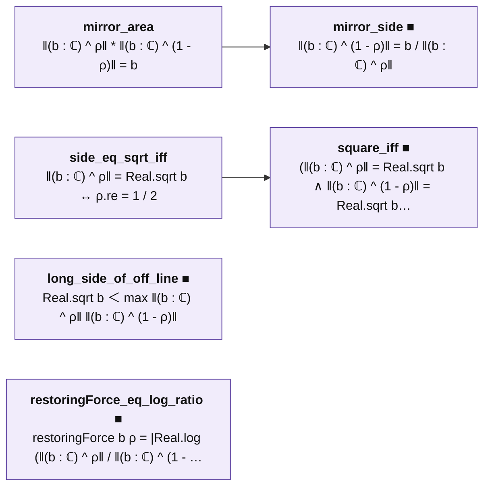

# `lean_stage3/Stage3/MirrorArea.lean`

MirrorArea — block S1 of `lean_stage3/design/joints.md`. 2026-11-22. A mode of the table at base `b` and its mirror, read as the two sides of a rectangle. The sides are `‖b^ρ‖` and `‖b^(1−ρ)‖`. Their product is `b` for every `ρ`: the area is fixed by the base and by nothing else. So one side gives the other at every scale. The rectangle is a square, each side `√b`, exactly when `ρ` is on the line; off the line one side is longer than `√b`. The restoring force of block T4 is the logarithm of the ratio of the sides.

6 theorems, 0 definitions, 116 lines. Arrows are Lean's own record of what each proof uses.

**Imports:** [`StencilWeil`](../lean_stage3/StencilWeil.md)  
**Imported by:** [`Stage3`](../lean_stage3/Stage3.md)

## The picture



An arrow A → B reads "A is used in the proof of B". Green: counting, integers only. Violet: shape, analysis with no ζ. Blue: reads ζ. A name ending in ■ is an end: nothing else uses it. Red: contains `sorry`. Yellow: theorems in another file, counted; a dotted arrow crosses files. Definitions are not drawn; they are listed below the diagram.

## Theorems

<a name="MirrorArea-mirror_area"></a>
### `MirrorArea.mirror_area`

line 32

**Shape.** Uses real or complex analysis; nothing in it or beneath it reads ζ.

**Why.** The area is fixed. A mode and its mirror multiply to the base.

**Proves**

```lean
‖(b : ℂ) ^ ρ‖ * ‖(b : ℂ) ^ (1 - ρ)‖ = b
```

**Needs** (its hypotheses)

  - `` hb : 0 < b ``
  - `` ρ : ℂ ``

**Fed by:** no theorem of this repo; it stands on Mathlib.

**Feeds** (1 that use it)

  - [`MirrorArea.mirror_side`](#MirrorArea-mirror_side) — `` ‖(b : ℂ) ^ (1 - ρ)‖ = b / ‖(b : ℂ) ^ ρ‖ ``

<a name="MirrorArea-mirror_side"></a>
### `MirrorArea.mirror_side`

line 39

**Shape.** Uses real or complex analysis; nothing in it or beneath it reads ζ.

**Why.** One side gives the other, at every base.

**Proves**

```lean
‖(b : ℂ) ^ (1 - ρ)‖ = b / ‖(b : ℂ) ^ ρ‖
```

**Needs** (its hypotheses)

  - `` hb : 0 < b ``
  - `` ρ : ℂ ``

**Fed by** (1 theorem its proof uses)

  - [`MirrorArea.mirror_area`](#MirrorArea-mirror_area) — `` ‖(b : ℂ) ^ ρ‖ * ‖(b : ℂ) ^ (1 - ρ)‖ = b ``

**Feeds:** nothing. It is an end.

<a name="MirrorArea-side_eq_sqrt_iff"></a>
### `MirrorArea.side_eq_sqrt_iff`

line 49

**Shape.** Uses real or complex analysis; nothing in it or beneath it reads ζ.

**Why.** A side is the square root of the base exactly on the line.

**Proves**

```lean
‖(b : ℂ) ^ ρ‖ = Real.sqrt b ↔ ρ.re = 1 / 2
```

**Needs** (its hypotheses)

  - `` hb : 1 < b ``
  - `` ρ : ℂ ``

**Fed by:** no theorem of this repo; it stands on Mathlib.

**Feeds** (1 that use it)

  - [`MirrorArea.square_iff`](#MirrorArea-square_iff) — `` (‖(b : ℂ) ^ ρ‖ = Real.sqrt b ∧ ‖(b : ℂ) ^ (1 - ρ)‖ = Real.sqrt b) ↔ ρ.re = 1 / 2 ``

<a name="MirrorArea-square_iff"></a>
### `MirrorArea.square_iff`

line 63

**Shape.** Uses real or complex analysis; nothing in it or beneath it reads ζ.

**Why.** The square. Both sides are the square root of the base exactly on the line.

**Proves**

```lean
(‖(b : ℂ) ^ ρ‖ = Real.sqrt b ∧ ‖(b : ℂ) ^ (1 - ρ)‖ = Real.sqrt b) ↔ ρ.re = 1 / 2
```

**Needs** (its hypotheses)

  - `` hb : 1 < b ``
  - `` ρ : ℂ ``

**Fed by** (1 theorem its proof uses)

  - [`MirrorArea.side_eq_sqrt_iff`](#MirrorArea-side_eq_sqrt_iff) — `` ‖(b : ℂ) ^ ρ‖ = Real.sqrt b ↔ ρ.re = 1 / 2 ``

**Feeds:** nothing. It is an end.

<a name="MirrorArea-long_side_of_off_line"></a>
### `MirrorArea.long_side_of_off_line`

line 75

**Shape.** Uses real or complex analysis; nothing in it or beneath it reads ζ.

**Why.** Off the line one side is long. A rectangle of the same area that is not the square has a side above the square's.

**Proves**

```lean
Real.sqrt b < max ‖(b : ℂ) ^ ρ‖ ‖(b : ℂ) ^ (1 - ρ)‖
```

**Needs** (its hypotheses)

  - `` hb : 1 < b ``
  - `` h : ρ.re ≠ 1 / 2 ``

**Fed by:** no theorem of this repo; it stands on Mathlib.

**Feeds:** nothing. It connects to nothing.

<a name="MirrorArea-restoringForce_eq_log_ratio"></a>
### `MirrorArea.restoringForce_eq_log_ratio`

line 90

**Shape.** Uses real or complex analysis; nothing in it or beneath it reads ζ.

**Why.** The force is the shape. The restoring force is the logarithm of the ratio of the two sides.

**Proves**

```lean
restoringForce b ρ = |Real.log (‖(b : ℂ) ^ ρ‖ / ‖(b : ℂ) ^ (1 - ρ)‖)|
```

**Needs** (its hypotheses)

  - `` hb : 0 < b ``
  - `` ρ : ℂ ``

**Stated with:** [`StencilWeil.restoringForce`](../lean_stage3/StencilWeil.md#StencilWeil-restoringForce)

**Fed by:** no theorem of this repo; it stands on Mathlib and the definitions below.

**Feeds:** nothing. It is an end.

