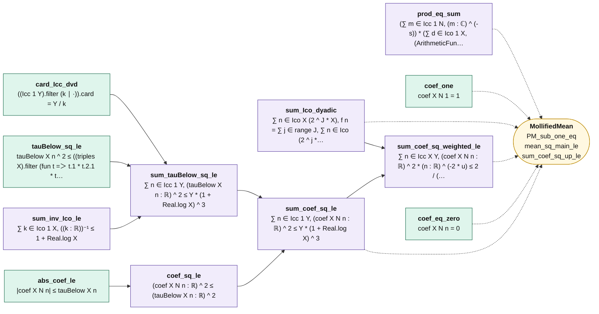

# `lean_stage3/Stage3/Mollified.lean`

Mollified — block C2 of `lean_stage3/design/carlson.md`. 2026-11-23. The product of the finite sum `P_N(s) = Σ_{n ≤ N} n^{-s}` with the short Möbius sum `M_X(s) = Σ_{d < X} μ(d)·d^{-s}` is a finite Dirichlet sum `Σ_n c_n·n^{-s}` with `c_n = Σ_{d | n, d < X, n/d ≤ N} μ(d)`. For `1 < n < X`, `n ≤ N` the coefficient vanishes and `c_1 = 1`. Each `|c_n|` is at most the number of divisors of `n` below `X`. The square of that count is at most the number of triples `(g, a, b)` below `X` with `g·a·b | n` (send a pair of div…

12 theorems, 3 definitions, 312 lines. Arrows are Lean's own record of what each proof uses.

**Imports:** nothing in this tree  
**Imported by:** [`Stage3`](../lean_stage3/Stage3.md), [`MollifiedMean`](../lean_stage3/MollifiedMean.md)

## The picture



An arrow A → B reads "A is used in the proof of B". Green: counting, integers only. Violet: shape, analysis with no ζ. Blue: reads ζ. A name ending in ■ is an end: nothing else uses it. Red: contains `sorry`. Yellow: theorems in another file, counted; a dotted arrow crosses files. Definitions are not drawn; they are listed below the diagram.

## Definitions

<a name="Mollified-tauBelow"></a>
### `Mollified.tauBelow`

def · line 43

The number of divisors of `n` below `X`.

- **Is:** `` tauBelow (X n : ℕ) : ℕ := ((Nat.divisors n).filter (· < X)).card ``
- **Used by 5:** [`Mollified.abs_coef_le`](#Mollified-abs_coef_le), [`Mollified.coef_sq_le`](#Mollified-coef_sq_le), [`Mollified.sum_coef_sq_le`](#Mollified-sum_coef_sq_le), [`Mollified.sum_tauBelow_sq_le`](#Mollified-sum_tauBelow_sq_le), [`Mollified.tauBelow_sq_le`](#Mollified-tauBelow_sq_le)

<a name="Mollified-coef"></a>
### `Mollified.coef`

def · line 46

The coefficient of `n^(−s)` in the product of `Σ_{m ≤ N} m^(−s)` and `Σ_{d < X} μ(d)d^(−s)`.

- **Is:** `` coef (X N n : ℕ) : ℤ := ∑ d ∈ (Nat.divisors n).filter (fun d => d < X ∧ n / d ≤ N), ArithmeticFunction.moebius d ``
- **Used by 12:** [`Mollified.abs_coef_le`](#Mollified-abs_coef_le), [`Mollified.coef_eq_zero`](#Mollified-coef_eq_zero), [`Mollified.coef_one`](#Mollified-coef_one), [`Mollified.coef_sq_le`](#Mollified-coef_sq_le), [`Mollified.prod_eq_sum`](#Mollified-prod_eq_sum), [`Mollified.sum_coef_sq_le`](#Mollified-sum_coef_sq_le), [`Mollified.sum_coef_sq_weighted_le`](#Mollified-sum_coef_sq_weighted_le), [`MollifiedMean.PM_sub_one_eq`](../lean_stage3/MollifiedMean.md#MollifiedMean-PM_sub_one_eq), [`MollifiedMean.b`](../lean_stage3/MollifiedMean.md#MollifiedMean-b), [`MollifiedMean.mean_sq_main_le`](../lean_stage3/MollifiedMean.md#MollifiedMean-mean_sq_main_le), [`MollifiedMean.sum_b_sq_eq`](../lean_stage3/MollifiedMean.md#MollifiedMean-sum_b_sq_eq), [`MollifiedMean.sum_coef_sq_up_le`](../lean_stage3/MollifiedMean.md#MollifiedMean-sum_coef_sq_up_le)

<a name="Mollified-triples"></a>
### `Mollified.triples`

def · line 128

The triples of naturals in `[1, X)`.

- **Is:** `` triples (X : ℕ) : Finset (ℕ × ℕ × ℕ) := Ico 1 X ×ˢ (Ico 1 X ×ˢ Ico 1 X) ``
- **Used by 2:** [`Mollified.sum_tauBelow_sq_le`](#Mollified-sum_tauBelow_sq_le), [`Mollified.tauBelow_sq_le`](#Mollified-tauBelow_sq_le)

## Theorems

<a name="Mollified-prod_eq_sum"></a>
### `Mollified.prod_eq_sum`

line 51

**Shape.** Uses real or complex analysis; nothing in it or beneath it reads ζ.

**Why.** The product of the finite zeta sum up to `N` and the Möbius sum below `X` is the Dirichlet sum over `n ≤ N·X` with coefficients `coef X N n`.

**Proves**

```lean
(∑ m ∈ Icc 1 N, (m : ℂ) ^ (-s)) * (∑ d ∈ Ico 1 X, (ArithmeticFunction.moebius d : ℂ) * (d : ℂ) ^ (-s)) = ∑ n ∈ Icc 1 (N * X), (coef X N n : ℂ) * (n : ℂ) ^ (-s)
```

**Needs** (its hypotheses)

  - `` s : ℂ ``
  - `` N X : ℕ ``

**Stated with:** [`Mollified.coef`](#Mollified-coef)

**Fed by:** no theorem of this repo; it stands on Mathlib and the definitions below.

**Feeds** (1 that use it)

  - [`MollifiedMean.PM_sub_one_eq`](../lean_stage3/MollifiedMean.md#MollifiedMean-PM_sub_one_eq) (MollifiedMean) — `` (∑ m ∈ Icc 1 N, (m : ℂ) ^ (-s)) * M X s - 1 = ∑ n ∈ Icc 1 (N * X), (b X N n : ℂ) * (n : ℂ) ^ (-s) ``

<a name="Mollified-coef_one"></a>
### `Mollified.coef_one`

line 86

**Counting.** Integers only: nothing in its statement or proof, or in anything it rests on, uses analysis or ζ.

**Why.** The coefficient of `1^(−s)` is `1` once `1 < X` and `1 ≤ N`.

**Proves**

```lean
coef X N 1 = 1
```

**Needs** (its hypotheses)

  - `` X N : ℕ ``
  - `` hX : 1 < X ``
  - `` hN : 1 ≤ N ``

**Stated with:** [`Mollified.coef`](#Mollified-coef)

**Fed by:** no theorem of this repo; it stands on Mathlib and the definitions below.

**Feeds** (1 that use it)

  - [`MollifiedMean.PM_sub_one_eq`](../lean_stage3/MollifiedMean.md#MollifiedMean-PM_sub_one_eq) (MollifiedMean) — `` (∑ m ∈ Icc 1 N, (m : ℂ) ^ (-s)) * M X s - 1 = ∑ n ∈ Icc 1 (N * X), (b X N n : ℂ) * (n : ℂ) ^ (-s) ``

<a name="Mollified-coef_eq_zero"></a>
### `Mollified.coef_eq_zero`

line 92

**Counting.** Integers only: nothing in its statement or proof, or in anything it rests on, uses analysis or ζ.

**Why.** For `1 < n < X` with `n ≤ N` every divisor of `n` is allowed, so the coefficient is the full Möbius divisor sum, which is `0`.

**Proves**

```lean
coef X N n = 0
```

**Needs** (its hypotheses)

  - `` X N n : ℕ ``
  - `` h1 : 1 < n ``
  - `` hX : n < X ``
  - `` hN : n ≤ N ``

**Stated with:** [`Mollified.coef`](#Mollified-coef)

**Fed by:** no theorem of this repo; it stands on Mathlib and the definitions below.

**Feeds** (1 that use it)

  - [`MollifiedMean.PM_sub_one_eq`](../lean_stage3/MollifiedMean.md#MollifiedMean-PM_sub_one_eq) (MollifiedMean) — `` (∑ m ∈ Icc 1 N, (m : ℂ) ^ (-s)) * M X s - 1 = ∑ n ∈ Icc 1 (N * X), (b X N n : ℂ) * (n : ℂ) ^ (-s) ``

<a name="Mollified-abs_coef_le"></a>
### `Mollified.abs_coef_le`

line 104

**Counting.** Integers only: nothing in its statement or proof, or in anything it rests on, uses analysis or ζ.

**Why.** The coefficient is at most the number of divisors of `n` below `X` in absolute value.

**Proves**

```lean
|coef X N n| ≤ tauBelow X n
```

**Needs** (its hypotheses)

  - `` X N n : ℕ ``

**Stated with:** [`Mollified.coef`](#Mollified-coef), [`Mollified.tauBelow`](#Mollified-tauBelow)

**Fed by:** no theorem of this repo; it stands on Mathlib and the definitions below.

**Feeds** (1 that use it)

  - [`Mollified.coef_sq_le`](#Mollified-coef_sq_le) — `` (coef X N n : ℝ) ^ 2 ≤ (tauBelow X n : ℝ) ^ 2 ``

<a name="Mollified-card_Icc_dvd"></a>
### `Mollified.card_Icc_dvd`

line 119

**Counting.** Integers only: nothing in its statement or proof, or in anything it rests on, uses analysis or ζ.

**Why.** Exactly `Y / k` of the naturals in `[1, Y]` are multiples of `k`.

**Proves**

```lean
((Icc 1 Y).filter (k ∣ ·)).card = Y / k
```

**Needs** (its hypotheses)

  - `` Y k : ℕ ``

**Fed by:** no theorem of this repo; it stands on Mathlib.

**Feeds** (1 that use it)

  - [`Mollified.sum_tauBelow_sq_le`](#Mollified-sum_tauBelow_sq_le) — `` ∑ n ∈ Icc 1 Y, (tauBelow X n : ℝ) ^ 2 ≤ Y * (1 + Real.log X) ^ 3 ``

<a name="Mollified-tauBelow_sq_le"></a>
### `Mollified.tauBelow_sq_le`

line 132

**Counting.** Integers only: nothing in its statement or proof, or in anything it rests on, uses analysis or ζ.

**Why.** The square of the number of divisors of `n` below `X` is at most the number of triples `(g, a, b)` in `[1, X)³` with `g·a·b` dividing `n`.

**Proves**

```lean
tauBelow X n ^ 2 ≤ ((triples X).filter (fun t => t.1 * t.2.1 * t.2.2 ∣ n)).card
```

**Needs** (its hypotheses)

  - `` X n : ℕ ``

**Stated with:** [`Mollified.tauBelow`](#Mollified-tauBelow), [`Mollified.triples`](#Mollified-triples)

**Fed by:** no theorem of this repo; it stands on Mathlib and the definitions below.

**Feeds** (1 that use it)

  - [`Mollified.sum_tauBelow_sq_le`](#Mollified-sum_tauBelow_sq_le) — `` ∑ n ∈ Icc 1 Y, (tauBelow X n : ℝ) ^ 2 ≤ Y * (1 + Real.log X) ^ 3 ``

<a name="Mollified-sum_inv_Ico_le"></a>
### `Mollified.sum_inv_Ico_le`

line 168

**Shape.** Uses real or complex analysis; nothing in it or beneath it reads ζ.

**Why.** The harmonic sum over `[1, X)` is at most `1 + log X`.

**Proves**

```lean
∑ k ∈ Ico 1 X, ((k : ℝ))⁻¹ ≤ 1 + Real.log X
```

**Needs** (its hypotheses)

  - `` X : ℕ ``

**Fed by:** no theorem of this repo; it stands on Mathlib.

**Feeds** (1 that use it)

  - [`Mollified.sum_tauBelow_sq_le`](#Mollified-sum_tauBelow_sq_le) — `` ∑ n ∈ Icc 1 Y, (tauBelow X n : ℝ) ^ 2 ≤ Y * (1 + Real.log X) ^ 3 ``

<a name="Mollified-sum_tauBelow_sq_le"></a>
### `Mollified.sum_tauBelow_sq_le`

line 176

**Shape.** Uses real or complex analysis; nothing in it or beneath it reads ζ.

**Why.** The sum over `n ≤ Y` of the squared count of divisors of `n` below `X` is at most `Y·(1 + log X)³`.

**Proves**

```lean
∑ n ∈ Icc 1 Y, (tauBelow X n : ℝ) ^ 2 ≤ Y * (1 + Real.log X) ^ 3
```

**Needs** (its hypotheses)

  - `` X Y : ℕ ``

**Stated with:** [`Mollified.tauBelow`](#Mollified-tauBelow)

**Fed by** (3 theorems its proof uses)

  - [`Mollified.card_Icc_dvd`](#Mollified-card_Icc_dvd) — `` ((Icc 1 Y).filter (k ∣ ·)).card = Y / k ``
  - [`Mollified.sum_inv_Ico_le`](#Mollified-sum_inv_Ico_le) — `` ∑ k ∈ Ico 1 X, ((k : ℝ))⁻¹ ≤ 1 + Real.log X ``
  - [`Mollified.tauBelow_sq_le`](#Mollified-tauBelow_sq_le) — `` tauBelow X n ^ 2 ≤ ((triples X).filter (fun t => t.1 * t.2.1 * t.2.2 ∣ n)).card ``

**Definitions its proof touches:** [`Mollified.triples`](#Mollified-triples)

**Feeds** (1 that use it)

  - [`Mollified.sum_coef_sq_le`](#Mollified-sum_coef_sq_le) — `` ∑ n ∈ Icc 1 Y, (coef X N n : ℝ) ^ 2 ≤ Y * (1 + Real.log X) ^ 3 ``

<a name="Mollified-coef_sq_le"></a>
### `Mollified.coef_sq_le`

line 205

**Shape.** Uses real or complex analysis; nothing in it or beneath it reads ζ.

**Why.** The square of the coefficient is at most the square of the divisor count below `X`.

**Proves**

```lean
(coef X N n : ℝ) ^ 2 ≤ (tauBelow X n : ℝ) ^ 2
```

**Needs** (its hypotheses)

  - `` X N n : ℕ ``

**Stated with:** [`Mollified.coef`](#Mollified-coef), [`Mollified.tauBelow`](#Mollified-tauBelow)

**Fed by** (1 theorem its proof uses)

  - [`Mollified.abs_coef_le`](#Mollified-abs_coef_le) — `` |coef X N n| ≤ tauBelow X n ``

**Feeds** (1 that use it)

  - [`Mollified.sum_coef_sq_le`](#Mollified-sum_coef_sq_le) — `` ∑ n ∈ Icc 1 Y, (coef X N n : ℝ) ^ 2 ≤ Y * (1 + Real.log X) ^ 3 ``

<a name="Mollified-sum_coef_sq_le"></a>
### `Mollified.sum_coef_sq_le`

line 211

**Shape.** Uses real or complex analysis; nothing in it or beneath it reads ζ.

**Why.** The sum over `n ≤ Y` of the squared coefficients is at most `Y·(1 + log X)³`.

**Proves**

```lean
∑ n ∈ Icc 1 Y, (coef X N n : ℝ) ^ 2 ≤ Y * (1 + Real.log X) ^ 3
```

**Needs** (its hypotheses)

  - `` X N Y : ℕ ``

**Stated with:** [`Mollified.coef`](#Mollified-coef)

**Fed by** (2 theorems its proof uses)

  - [`Mollified.coef_sq_le`](#Mollified-coef_sq_le) — `` (coef X N n : ℝ) ^ 2 ≤ (tauBelow X n : ℝ) ^ 2 ``
  - [`Mollified.sum_tauBelow_sq_le`](#Mollified-sum_tauBelow_sq_le) — `` ∑ n ∈ Icc 1 Y, (tauBelow X n : ℝ) ^ 2 ≤ Y * (1 + Real.log X) ^ 3 ``

**Definitions its proof touches:** [`Mollified.tauBelow`](#Mollified-tauBelow)

**Feeds** (2 that use it)

  - [`Mollified.sum_coef_sq_weighted_le`](#Mollified-sum_coef_sq_weighted_le) — `` ∑ n ∈ Icc X Y, (coef X N n : ℝ) ^ 2 * (n : ℝ) ^ (-2 * u) ≤ 2 / (1 - (2 : ℝ) ^ (1 - 2 * u)) * (X : ℝ) ^ (1 - 2 * u) * (1 + Real.log X) ^ 3 ``
  - [`MollifiedMean.sum_coef_sq_up_le`](../lean_stage3/MollifiedMean.md#MollifiedMean-sum_coef_sq_up_le) (MollifiedMean) — `` ∑ n ∈ Icc 1 Y, (Mollified.coef X N n : ℝ) ^ 2 * (n : ℝ) ^ (1 - 2 * u) ≤ 4 * (1 + Real.log X) ^ 3 * (1 + Real.log Y) * max 1 ((Y : ℝ) ^ (2 - 2 * u)) ``

<a name="Mollified-sum_Ico_dyadic"></a>
### `Mollified.sum_Ico_dyadic`

line 216

**Shape.** Uses real or complex analysis; nothing in it or beneath it reads ζ.

**Why.** A sum over `[X, 2^J·X)` is the sum of its `J` dyadic blocks `[2^j·X, 2^(j+1)·X)`.

**Proves**

```lean
∑ n ∈ Ico X (2 ^ J * X), f n = ∑ j ∈ range J, ∑ n ∈ Ico (2 ^ j * X) (2 ^ (j + 1) * X), f n
```

**Needs** (its hypotheses)

  - `` f : ℕ → ℝ ``
  - `` X J : ℕ ``

**Fed by:** no theorem of this repo; it stands on Mathlib.

**Feeds** (2 that use it)

  - [`Mollified.sum_coef_sq_weighted_le`](#Mollified-sum_coef_sq_weighted_le) — `` ∑ n ∈ Icc X Y, (coef X N n : ℝ) ^ 2 * (n : ℝ) ^ (-2 * u) ≤ 2 / (1 - (2 : ℝ) ^ (1 - 2 * u)) * (X : ℝ) ^ (1 - 2 * u) * (1 + Real.log X) ^ 3 ``
  - [`MollifiedMean.sum_coef_sq_up_le`](../lean_stage3/MollifiedMean.md#MollifiedMean-sum_coef_sq_up_le) (MollifiedMean) — `` ∑ n ∈ Icc 1 Y, (Mollified.coef X N n : ℝ) ^ 2 * (n : ℝ) ^ (1 - 2 * u) ≤ 4 * (1 + Real.log X) ^ 3 * (1 + Real.log Y) * max 1 ((Y : ℝ) ^ (2 - 2 * u)) ``

<a name="Mollified-sum_coef_sq_weighted_le"></a>
### `Mollified.sum_coef_sq_weighted_le`

line 228

**Shape.** Uses real or complex analysis; nothing in it or beneath it reads ζ.

**Why.** For `u > 1/2` and `1 ≤ X`, the squared coefficients weighted by `n^(−2u)` over `[X, Y]` sum to at most `2/(1 − 2^(1−2u))·X^(1−2u)·(1 + log X)³`, for every `Y`.

**Proves**

```lean
∑ n ∈ Icc X Y, (coef X N n : ℝ) ^ 2 * (n : ℝ) ^ (-2 * u) ≤ 2 / (1 - (2 : ℝ) ^ (1 - 2 * u)) * (X : ℝ) ^ (1 - 2 * u) * (1 + Real.log X) ^ 3
```

**Needs** (its hypotheses)

  - `` u : ℝ ``
  - `` hu : 1 / 2 < u ``
  - `` X N Y : ℕ ``
  - `` hX : 1 ≤ X ``

**Stated with:** [`Mollified.coef`](#Mollified-coef)

**Fed by** (2 theorems its proof uses)

  - [`Mollified.sum_Ico_dyadic`](#Mollified-sum_Ico_dyadic) — `` ∑ n ∈ Ico X (2 ^ J * X), f n = ∑ j ∈ range J, ∑ n ∈ Ico (2 ^ j * X) (2 ^ (j + 1) * X), f n ``
  - [`Mollified.sum_coef_sq_le`](#Mollified-sum_coef_sq_le) — `` ∑ n ∈ Icc 1 Y, (coef X N n : ℝ) ^ 2 ≤ Y * (1 + Real.log X) ^ 3 ``

**Feeds** (1 that use it)

  - [`MollifiedMean.mean_sq_main_le`](../lean_stage3/MollifiedMean.md#MollifiedMean-mean_sq_main_le) (MollifiedMean) — `` ∫ t in (1:ℝ)..T, ‖∑ n ∈ Icc 1 (N * X), (b X N n : ℂ) * (n : ℂ) ^ (-((u : ℂ) + Complex.I * (t : ℂ)))‖ ^ 2 ≤ T * (2 / (1 - (2:ℝ) ^ (1 - 2 * u))) * (X:ℝ)… ``

