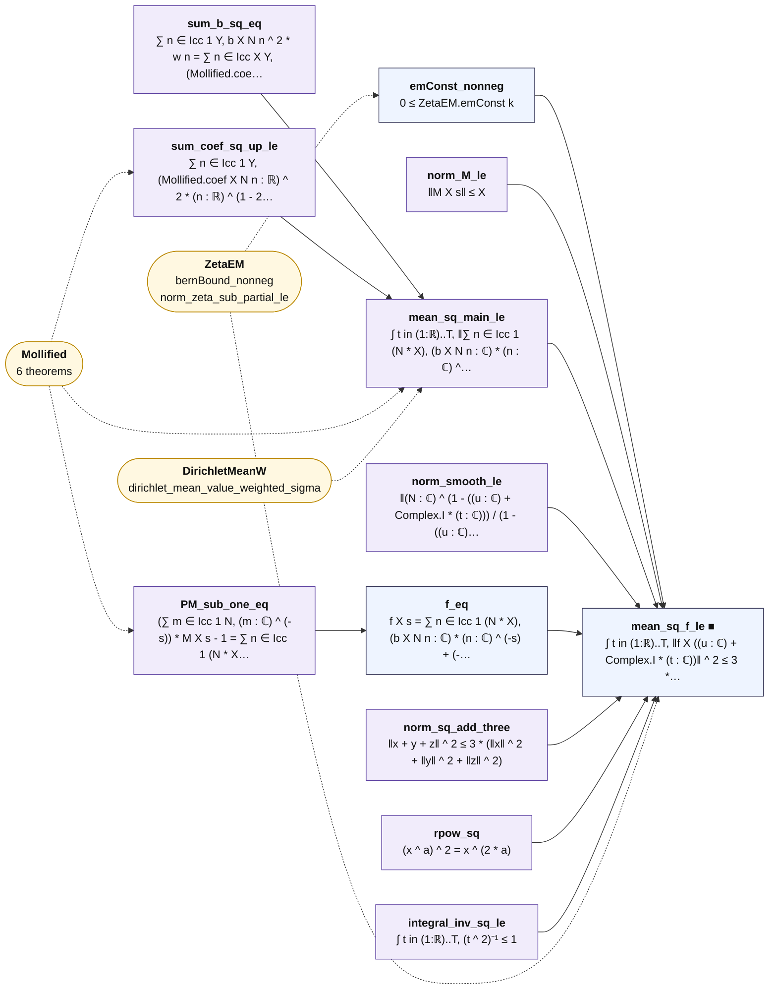

# `lean_stage3/Stage3/MollifiedMean.lean`

MollifiedMean — block C4 of `lean_stage3/design/carlson.md`. 2026-11-23. The mean square of `f_X(s) = ζ(s)·M_X(s) − 1` along `Re s = u`, `1/2 < u ≤ 2`, over `t ∈ [1, T]`. Euler–Maclaurin of order `k` (block C3) writes `ζ = P_N − N^{1−s}/(1−s) + E` with `‖E‖ ≤ A_k N^{−u}(1 + (T+2+k)^k N^{1−k})`. Then `f = (P_N·M_X − 1) − N^{1−s}/(1−s)·M_X + E·M_X`. The first piece is the Dirichlet sum of block C2 with its terms below `X` gone, and the weighted mean value theorem (block C1b) charges it `T·Σ_{n ≥ X} c_n² n^{−2u} + 6 l…

12 theorems, 3 definitions, 486 lines. Arrows are Lean's own record of what each proof uses.

**Imports:** [`DirichletMeanW`](../lean_stage3/DirichletMeanW.md), [`Mollified`](../lean_stage3/Mollified.md), [`ZetaEM`](../lean_stage3/ZetaEM.md)  
**Imported by:** [`Stage3`](../lean_stage3/Stage3.md)

## The picture



An arrow A → B reads "A is used in the proof of B". Green: counting, integers only. Violet: shape, analysis with no ζ. Blue: reads ζ. A name ending in ■ is an end: nothing else uses it. Red: contains `sorry`. Yellow: theorems in another file, counted; a dotted arrow crosses files. Definitions are not drawn; they are listed below the diagram.

## Definitions

<a name="MollifiedMean-M"></a>
### `MollifiedMean.M`

def · line 45

The Möbius sum `M_X(s) = Σ_{1 ≤ d < X} μ(d)·d^(−s)`.

- **Is:** `` M (X : ℕ) (s : ℂ) : ℂ := ∑ d ∈ Ico 1 X, (ArithmeticFunction.moebius d : ℂ) * (d : ℂ) ^ (-s) ``
- **Used by 5:** [`MollifiedMean.PM_sub_one_eq`](#MollifiedMean-PM_sub_one_eq), [`MollifiedMean.f`](#MollifiedMean-f), [`MollifiedMean.f_eq`](#MollifiedMean-f_eq), [`MollifiedMean.mean_sq_f_le`](#MollifiedMean-mean_sq_f_le), [`MollifiedMean.norm_M_le`](#MollifiedMean-norm_M_le)

<a name="MollifiedMean-f"></a>
### `MollifiedMean.f`

def · line 49

The mollified function `f_X(s) = ζ(s)·M_X(s) − 1`.

- **Is:** `` f f (X : ℕ) (s : ℂ) : ℂ := riemannZeta s * M X s - 1 ``
- **Built from:** [`MollifiedMean.M`](#MollifiedMean-M)
- **Used by 2:** [`MollifiedMean.f_eq`](#MollifiedMean-f_eq), [`MollifiedMean.mean_sq_f_le`](#MollifiedMean-mean_sq_f_le)

<a name="MollifiedMean-b"></a>
### `MollifiedMean.b`

def · line 52

The coefficient of `P_N·M_X − 1`: `coef X N n` for `X ≤ n`, and `0` below `X`.

- **Is:** `` b (X N n : ℕ) : ℝ := if X ≤ n then (Mollified.coef X N n : ℝ) else 0 ``
- **Built from:** [`Mollified.coef`](../lean_stage3/Mollified.md#Mollified-coef)
- **Used by 5:** [`MollifiedMean.PM_sub_one_eq`](#MollifiedMean-PM_sub_one_eq), [`MollifiedMean.f_eq`](#MollifiedMean-f_eq), [`MollifiedMean.mean_sq_f_le`](#MollifiedMean-mean_sq_f_le), [`MollifiedMean.mean_sq_main_le`](#MollifiedMean-mean_sq_main_le), [`MollifiedMean.sum_b_sq_eq`](#MollifiedMean-sum_b_sq_eq)

## Theorems

<a name="MollifiedMean-emConst_nonneg"></a>
### `MollifiedMean.emConst_nonneg`

line 55

**Reads ζ.** It, or something it rests on, uses the zeta function, its zeros or the Riemann hypothesis.

**Why.** The Euler–Maclaurin constant `A_k` is nonnegative.

**Proves**

```lean
0 ≤ ZetaEM.emConst k
```

**Needs** (its hypotheses)

  - `` k : ℕ ``

**Stated with:** [`ZetaEM.emConst`](../lean_stage3/ZetaEM.md#ZetaEM-emConst)

**Fed by** (1 theorem its proof uses)

  - [`ZetaEM.bernBound_nonneg`](../lean_stage3/ZetaEM.md#ZetaEM-bernBound_nonneg) (ZetaEM) — `` 0 ≤ bernBound k ``

**Definitions its proof touches:** [`ZetaEM.bernBound`](../lean_stage3/ZetaEM.md#ZetaEM-bernBound)

**Feeds** (1 that use it)

  - [`MollifiedMean.mean_sq_f_le`](#MollifiedMean-mean_sq_f_le) — `` ∫ t in (1:ℝ)..T, ‖f X ((u : ℂ) + Complex.I * (t : ℂ))‖ ^ 2 ≤ 3 * (T * (2 / (1 - (2:ℝ) ^ (1 - 2 * u))) * (X:ℝ) ^ (1 - 2 * u) * (1 + Real.log X) ^ 3 + 2… ``

<a name="MollifiedMean-norm_M_le"></a>
### `MollifiedMean.norm_M_le`

line 65

**Shape.** Uses real or complex analysis; nothing in it or beneath it reads ζ.

**Why.** For `Re s ≥ 0` the Möbius sum has norm at most `X`, each of its terms having norm at most one.

**Proves**

```lean
‖M X s‖ ≤ X
```

**Needs** (its hypotheses)

  - `` X : ℕ ``
  - `` hs : 0 ≤ s.re ``

**Stated with:** [`MollifiedMean.M`](#MollifiedMean-M)

**Fed by:** no theorem of this repo; it stands on Mathlib and the definitions below.

**Feeds** (1 that use it)

  - [`MollifiedMean.mean_sq_f_le`](#MollifiedMean-mean_sq_f_le) — `` ∫ t in (1:ℝ)..T, ‖f X ((u : ℂ) + Complex.I * (t : ℂ))‖ ^ 2 ≤ 3 * (T * (2 / (1 - (2:ℝ) ^ (1 - 2 * u))) * (X:ℝ) ^ (1 - 2 * u) * (1 + Real.log X) ^ 3 + 2… ``

<a name="MollifiedMean-norm_smooth_le"></a>
### `MollifiedMean.norm_smooth_le`

line 85

**Shape.** Uses real or complex analysis; nothing in it or beneath it reads ζ.

**Why.** At `s = u + it` with `t > 0`, the smooth term satisfies `‖N^(1−s)/(1−s)‖ ≤ N^(1−u)/t`, because `|1 − s| ≥ t`.

**Proves**

```lean
‖(N : ℂ) ^ (1 - ((u : ℂ) + Complex.I * (t : ℂ))) / (1 - ((u : ℂ) + Complex.I * (t : ℂ)))‖ ≤ (N : ℝ) ^ (1 - u) / t
```

**Needs** (its hypotheses)

  - `` hN : 0 < N ``
  - `` u : ℝ ``
  - `` ht : 0 < t ``

**Fed by:** no theorem of this repo; it stands on Mathlib.

**Feeds** (1 that use it)

  - [`MollifiedMean.mean_sq_f_le`](#MollifiedMean-mean_sq_f_le) — `` ∫ t in (1:ℝ)..T, ‖f X ((u : ℂ) + Complex.I * (t : ℂ))‖ ^ 2 ≤ 3 * (T * (2 / (1 - (2:ℝ) ^ (1 - 2 * u))) * (X:ℝ) ^ (1 - 2 * u) * (1 + Real.log X) ^ 3 + 2… ``

<a name="MollifiedMean-PM_sub_one_eq"></a>
### `MollifiedMean.PM_sub_one_eq`

line 101

**Shape.** Uses real or complex analysis; nothing in it or beneath it reads ζ.

**Why.** For `2 ≤ X ≤ N`, the product `P_N·M_X` minus one is the Dirichlet sum over `n ≤ N·X` with the coefficients `b`, the terms below `X` other than `n = 1` vanishing and the `n = 1` term being one.

**Proves**

```lean
(∑ m ∈ Icc 1 N, (m : ℂ) ^ (-s)) * M X s - 1 = ∑ n ∈ Icc 1 (N * X), (b X N n : ℂ) * (n : ℂ) ^ (-s)
```

**Needs** (its hypotheses)

  - `` s : ℂ ``
  - `` hX : 2 ≤ X ``
  - `` hXN : X ≤ N ``

**Stated with:** [`MollifiedMean.M`](#MollifiedMean-M), [`MollifiedMean.b`](#MollifiedMean-b)

**Fed by** (3 theorems its proof uses)

  - [`Mollified.coef_eq_zero`](../lean_stage3/Mollified.md#Mollified-coef_eq_zero) (Mollified) — `` coef X N n = 0 ``
  - [`Mollified.coef_one`](../lean_stage3/Mollified.md#Mollified-coef_one) (Mollified) — `` coef X N 1 = 1 ``
  - [`Mollified.prod_eq_sum`](../lean_stage3/Mollified.md#Mollified-prod_eq_sum) (Mollified) — `` (∑ m ∈ Icc 1 N, (m : ℂ) ^ (-s)) * (∑ d ∈ Ico 1 X, (ArithmeticFunction.moebius d : ℂ) * (d : ℂ) ^ (-s)) = ∑ n ∈ Icc 1 (N * X), (coef X N n : ℂ) * (n : … ``

**Definitions its proof touches:** [`Mollified.coef`](../lean_stage3/Mollified.md#Mollified-coef)

**Feeds** (1 that use it)

  - [`MollifiedMean.f_eq`](#MollifiedMean-f_eq) — `` f X s = ∑ n ∈ Icc 1 (N * X), (b X N n : ℂ) * (n : ℂ) ^ (-s) + (-((N : ℂ) ^ (1 - s) / (1 - s))) * M X s + (riemannZeta s - ∑ n ∈ Icc 1 N, (n : ℂ) ^ (-s… ``

<a name="MollifiedMean-f_eq"></a>
### `MollifiedMean.f_eq`

line 129

**Reads ζ.** It, or something it rests on, uses the zeta function, its zeros or the Riemann hypothesis.

**Why.** For `2 ≤ X ≤ N`, `f_X(s)` is the Dirichlet sum of `P_N·M_X − 1`, minus the smooth term times `M_X`, plus the Euler–Maclaurin error `ζ − P_N + N^(1−s)/(1−s)` times `M_X`.

**Proves**

```lean
f X s = ∑ n ∈ Icc 1 (N * X), (b X N n : ℂ) * (n : ℂ) ^ (-s) + (-((N : ℂ) ^ (1 - s) / (1 - s))) * M X s + (riemannZeta s - ∑ n ∈ Icc 1 N, (n : ℂ) ^ (-s) + (N : ℂ) ^ (1 - s) / (1 - s)) * M X s
```

**Needs** (its hypotheses)

  - `` s : ℂ ``
  - `` hX : 2 ≤ X ``
  - `` hXN : X ≤ N ``

**Stated with:** [`MollifiedMean.M`](#MollifiedMean-M), [`MollifiedMean.b`](#MollifiedMean-b), [`MollifiedMean.f`](#MollifiedMean-f)

**Fed by** (1 theorem its proof uses)

  - [`MollifiedMean.PM_sub_one_eq`](#MollifiedMean-PM_sub_one_eq) — `` (∑ m ∈ Icc 1 N, (m : ℂ) ^ (-s)) * M X s - 1 = ∑ n ∈ Icc 1 (N * X), (b X N n : ℂ) * (n : ℂ) ^ (-s) ``

**Feeds** (1 that use it)

  - [`MollifiedMean.mean_sq_f_le`](#MollifiedMean-mean_sq_f_le) — `` ∫ t in (1:ℝ)..T, ‖f X ((u : ℂ) + Complex.I * (t : ℂ))‖ ^ 2 ≤ 3 * (T * (2 / (1 - (2:ℝ) ^ (1 - 2 * u))) * (X:ℝ) ^ (1 - 2 * u) * (1 + Real.log X) ^ 3 + 2… ``

<a name="MollifiedMean-norm_sq_add_three"></a>
### `MollifiedMean.norm_sq_add_three`

line 138

**Shape.** Uses real or complex analysis; nothing in it or beneath it reads ζ.

**Why.** The square of the norm of a sum of three terms is at most three times the sum of their squared norms.

**Proves**

```lean
‖x + y + z‖ ^ 2 ≤ 3 * (‖x‖ ^ 2 + ‖y‖ ^ 2 + ‖z‖ ^ 2)
```

**Needs** (its hypotheses)

  - `` x y z : ℂ ``

**Fed by:** no theorem of this repo; it stands on Mathlib.

**Feeds** (1 that use it)

  - [`MollifiedMean.mean_sq_f_le`](#MollifiedMean-mean_sq_f_le) — `` ∫ t in (1:ℝ)..T, ‖f X ((u : ℂ) + Complex.I * (t : ℂ))‖ ^ 2 ≤ 3 * (T * (2 / (1 - (2:ℝ) ^ (1 - 2 * u))) * (X:ℝ) ^ (1 - 2 * u) * (1 + Real.log X) ^ 3 + 2… ``

<a name="MollifiedMean-rpow_sq"></a>
### `MollifiedMean.rpow_sq`

line 145

**Shape.** Uses real or complex analysis; nothing in it or beneath it reads ζ.

**Why.** For `x ≥ 0`, the square of `x^a` is `x^(2a)`.

**Proves**

```lean
(x ^ a) ^ 2 = x ^ (2 * a)
```

**Needs** (its hypotheses)

  - `` hx : 0 ≤ x ``
  - `` a : ℝ ``

**Fed by:** no theorem of this repo; it stands on Mathlib.

**Feeds** (1 that use it)

  - [`MollifiedMean.mean_sq_f_le`](#MollifiedMean-mean_sq_f_le) — `` ∫ t in (1:ℝ)..T, ‖f X ((u : ℂ) + Complex.I * (t : ℂ))‖ ^ 2 ≤ 3 * (T * (2 / (1 - (2:ℝ) ^ (1 - 2 * u))) * (X:ℝ) ^ (1 - 2 * u) * (1 + Real.log X) ^ 3 + 2… ``

<a name="MollifiedMean-sum_b_sq_eq"></a>
### `MollifiedMean.sum_b_sq_eq`

line 152

**Shape.** Uses real or complex analysis; nothing in it or beneath it reads ζ.

**Why.** For `1 ≤ X`, a sum over `[1, Y]` of `b_n²·w_n` is the sum over `[X, Y]` of `coef²·w_n`.

**Proves**

```lean
∑ n ∈ Icc 1 Y, b X N n ^ 2 * w n = ∑ n ∈ Icc X Y, (Mollified.coef X N n : ℝ) ^ 2 * w n
```

**Needs** (its hypotheses)

  - `` hX : 1 ≤ X ``
  - `` N Y : ℕ ``
  - `` w : ℕ → ℝ ``

**Stated with:** [`Mollified.coef`](../lean_stage3/Mollified.md#Mollified-coef), [`MollifiedMean.b`](#MollifiedMean-b)

**Fed by:** no theorem of this repo; it stands on Mathlib and the definitions below.

**Feeds** (1 that use it)

  - [`MollifiedMean.mean_sq_main_le`](#MollifiedMean-mean_sq_main_le) — `` ∫ t in (1:ℝ)..T, ‖∑ n ∈ Icc 1 (N * X), (b X N n : ℂ) * (n : ℂ) ^ (-((u : ℂ) + Complex.I * (t : ℂ)))‖ ^ 2 ≤ T * (2 / (1 - (2:ℝ) ^ (1 - 2 * u))) * (X:ℝ)… ``

<a name="MollifiedMean-sum_coef_sq_up_le"></a>
### `MollifiedMean.sum_coef_sq_up_le`

line 167

**Shape.** Uses real or complex analysis; nothing in it or beneath it reads ζ.

**Why.** Block C2b: for `u > 1/2`, the squared coefficients weighted upward by `n^(1−2u)` sum over `[1, Y]` to at most `4·(1 + log X)³·(1 + log Y)·max 1 (Y^(2−2u))`.

**Proves**

```lean
∑ n ∈ Icc 1 Y, (Mollified.coef X N n : ℝ) ^ 2 * (n : ℝ) ^ (1 - 2 * u) ≤ 4 * (1 + Real.log X) ^ 3 * (1 + Real.log Y) * max 1 ((Y : ℝ) ^ (2 - 2 * u))
```

**Needs** (its hypotheses)

  - `` u : ℝ ``
  - `` hu : 1 / 2 < u ``
  - `` X N Y : ℕ ``

**Stated with:** [`Mollified.coef`](../lean_stage3/Mollified.md#Mollified-coef)

**Fed by** (2 theorems its proof uses)

  - [`Mollified.sum_Ico_dyadic`](../lean_stage3/Mollified.md#Mollified-sum_Ico_dyadic) (Mollified) — `` ∑ n ∈ Ico X (2 ^ J * X), f n = ∑ j ∈ range J, ∑ n ∈ Ico (2 ^ j * X) (2 ^ (j + 1) * X), f n ``
  - [`Mollified.sum_coef_sq_le`](../lean_stage3/Mollified.md#Mollified-sum_coef_sq_le) (Mollified) — `` ∑ n ∈ Icc 1 Y, (coef X N n : ℝ) ^ 2 ≤ Y * (1 + Real.log X) ^ 3 ``

**Feeds** (1 that use it)

  - [`MollifiedMean.mean_sq_main_le`](#MollifiedMean-mean_sq_main_le) — `` ∫ t in (1:ℝ)..T, ‖∑ n ∈ Icc 1 (N * X), (b X N n : ℂ) * (n : ℂ) ^ (-((u : ℂ) + Complex.I * (t : ℂ)))‖ ^ 2 ≤ T * (2 / (1 - (2:ℝ) ^ (1 - 2 * u))) * (X:ℝ)… ``

<a name="MollifiedMean-integral_inv_sq_le"></a>
### `MollifiedMean.integral_inv_sq_le`

line 258

**Shape.** Uses real or complex analysis; nothing in it or beneath it reads ζ.

**Why.** The integral of `t^(−2)` over `[1, T]` is at most one.

**Proves**

```lean
∫ t in (1:ℝ)..T, (t ^ 2)⁻¹ ≤ 1
```

**Needs** (its hypotheses)

  - `` hT : 1 ≤ T ``

**Fed by:** no theorem of this repo; it stands on Mathlib.

**Feeds** (1 that use it)

  - [`MollifiedMean.mean_sq_f_le`](#MollifiedMean-mean_sq_f_le) — `` ∫ t in (1:ℝ)..T, ‖f X ((u : ℂ) + Complex.I * (t : ℂ))‖ ^ 2 ≤ 3 * (T * (2 / (1 - (2:ℝ) ^ (1 - 2 * u))) * (X:ℝ) ^ (1 - 2 * u) * (1 + Real.log X) ^ 3 + 2… ``

<a name="MollifiedMean-mean_sq_main_le"></a>
### `MollifiedMean.mean_sq_main_le`

line 277

**Shape.** Uses real or complex analysis; nothing in it or beneath it reads ζ.

**Why.** On `[1, T]` along `Re s = u > 1/2`, the mean square of the Dirichlet sum of `P_N·M_X − 1` is at most `T·(2/(1 − 2^(1−2u)))·X^(1−2u)·(1 + log X)³` plus `24·(1 + log NX)²·(1 + log X)³·max 1 ((NX)^(2−2u))`.

**Proves**

```lean
∫ t in (1:ℝ)..T, ‖∑ n ∈ Icc 1 (N * X), (b X N n : ℂ) * (n : ℂ) ^ (-((u : ℂ) + Complex.I * (t : ℂ)))‖ ^ 2 ≤ T * (2 / (1 - (2:ℝ) ^ (1 - 2 * u))) * (X:ℝ) ^ (1 - 2 * u) * (1 + Real.log X) ^ 3 + 24 * (1 + Real.log ((N * X : ℕ) : ℝ)) ^ 2 * (1 + Real.log X) ^ 3 * max 1 (((N * X : ℕ) : ℝ) ^ (2 - 2 * u))
```

**Needs** (its hypotheses)

  - `` hX : 1 ≤ X ``
  - `` hu : 1 / 2 < u ``
  - `` hT : 1 ≤ T ``

**Stated with:** [`MollifiedMean.b`](#MollifiedMean-b)

**Fed by** (4 theorems its proof uses)

  - [`DirichletMeanW.dirichlet_mean_value_weighted_sigma`](../lean_stage3/DirichletMeanW.md#DirichletMeanW-dirichlet_mean_value_weighted_sigma) (DirichletMeanW) — `` ∫ t in T₁..T₂, ‖∑ n ∈ Finset.Icc 1 N, a n * (n : ℂ) ^ (-((σ : ℂ) + Complex.I * (t : ℂ)))‖ ^ 2 ≤ ∑ n ∈ Finset.Icc 1 N, ‖a n‖ ^ 2 * (n : ℝ) ^ (-2 * σ) *… ``
  - [`Mollified.sum_coef_sq_weighted_le`](../lean_stage3/Mollified.md#Mollified-sum_coef_sq_weighted_le) (Mollified) — `` ∑ n ∈ Icc X Y, (coef X N n : ℝ) ^ 2 * (n : ℝ) ^ (-2 * u) ≤ 2 / (1 - (2 : ℝ) ^ (1 - 2 * u)) * (X : ℝ) ^ (1 - 2 * u) * (1 + Real.log X) ^ 3 ``
  - [`MollifiedMean.sum_b_sq_eq`](#MollifiedMean-sum_b_sq_eq) — `` ∑ n ∈ Icc 1 Y, b X N n ^ 2 * w n = ∑ n ∈ Icc X Y, (Mollified.coef X N n : ℝ) ^ 2 * w n ``
  - [`MollifiedMean.sum_coef_sq_up_le`](#MollifiedMean-sum_coef_sq_up_le) — `` ∑ n ∈ Icc 1 Y, (Mollified.coef X N n : ℝ) ^ 2 * (n : ℝ) ^ (1 - 2 * u) ≤ 4 * (1 + Real.log X) ^ 3 * (1 + Real.log Y) * max 1 ((Y : ℝ) ^ (2 - 2 * u)) ``

**Definitions its proof touches:** [`Mollified.coef`](../lean_stage3/Mollified.md#Mollified-coef)

**Feeds** (1 that use it)

  - [`MollifiedMean.mean_sq_f_le`](#MollifiedMean-mean_sq_f_le) — `` ∫ t in (1:ℝ)..T, ‖f X ((u : ℂ) + Complex.I * (t : ℂ))‖ ^ 2 ≤ 3 * (T * (2 / (1 - (2:ℝ) ^ (1 - 2 * u))) * (X:ℝ) ^ (1 - 2 * u) * (1 + Real.log X) ^ 3 + 2… ``

<a name="MollifiedMean-mean_sq_f_le"></a>
### `MollifiedMean.mean_sq_f_le`

line 338

**Reads ζ.** It, or something it rests on, uses the zeta function, its zeros or the Riemann hypothesis.

**Why.** The mean square of `f_X = ζ·M_X − 1` over `t ∈ [1, T]` on the line `Re s = u`, for `1/2 < u ≤ 2`, `k ≥ 2`, `2 ≤ X ≤ N` and `T + 3 + k ≤ N`, is at most three times the sum of the main term `T·X^(1−2u)·logs`, the off-diagonal term `(NX)^(2−2u)·logs`, the smooth term `X²·N^(2−2u)` and the Euler–Maclaurin term `T·X²·A_k²·N^(−2u)·(1 + (T+2+k)^k·N^(1−k))²`.

**Proves**

```lean
∫ t in (1:ℝ)..T, ‖f X ((u : ℂ) + Complex.I * (t : ℂ))‖ ^ 2 ≤ 3 * (T * (2 / (1 - (2:ℝ) ^ (1 - 2 * u))) * (X:ℝ) ^ (1 - 2 * u) * (1 + Real.log X) ^ 3 + 24 * (1 + Real.log ((N * X : ℕ) : ℝ)) ^ 2 * (1 + Real.log X) ^ 3 * max 1 (((N * X : ℕ) : ℝ) ^ (2 - 2 * u)) + (X:ℝ) ^ 2 * (N:ℝ) ^ (2 - 2 * u) + T * (X:ℝ) ^ 2 * ZetaEM.emConst k ^ 2 * (N:ℝ) ^ (-2 * u) * (1 + (T + 2 + k) ^ k * (N:ℝ) ^ (1 - (k:ℝ))) ^ 2)
```

**Needs** (its hypotheses)

  - `` k : ℕ ``
  - `` hk : 2 ≤ k ``
  - `` hX : 2 ≤ X ``
  - `` hXN : X ≤ N ``
  - `` hu : 1 / 2 < u ``
  - `` hu2 : u ≤ 2 ``
  - `` hT : 1 ≤ T ``
  - `` hTN : T + 3 + k ≤ N ``

**Stated with:** [`MollifiedMean.f`](#MollifiedMean-f), [`ZetaEM.emConst`](../lean_stage3/ZetaEM.md#ZetaEM-emConst)

**Fed by** (9 theorems its proof uses)

  - [`MollifiedMean.emConst_nonneg`](#MollifiedMean-emConst_nonneg) — `` 0 ≤ ZetaEM.emConst k ``
  - [`MollifiedMean.f_eq`](#MollifiedMean-f_eq) — `` f X s = ∑ n ∈ Icc 1 (N * X), (b X N n : ℂ) * (n : ℂ) ^ (-s) + (-((N : ℂ) ^ (1 - s) / (1 - s))) * M X s + (riemannZeta s - ∑ n ∈ Icc 1 N, (n : ℂ) ^ (-s… ``
  - [`MollifiedMean.integral_inv_sq_le`](#MollifiedMean-integral_inv_sq_le) — `` ∫ t in (1:ℝ)..T, (t ^ 2)⁻¹ ≤ 1 ``
  - [`MollifiedMean.mean_sq_main_le`](#MollifiedMean-mean_sq_main_le) — `` ∫ t in (1:ℝ)..T, ‖∑ n ∈ Icc 1 (N * X), (b X N n : ℂ) * (n : ℂ) ^ (-((u : ℂ) + Complex.I * (t : ℂ)))‖ ^ 2 ≤ T * (2 / (1 - (2:ℝ) ^ (1 - 2 * u))) * (X:ℝ)… ``
  - [`MollifiedMean.norm_M_le`](#MollifiedMean-norm_M_le) — `` ‖M X s‖ ≤ X ``
  - [`MollifiedMean.norm_smooth_le`](#MollifiedMean-norm_smooth_le) — `` ‖(N : ℂ) ^ (1 - ((u : ℂ) + Complex.I * (t : ℂ))) / (1 - ((u : ℂ) + Complex.I * (t : ℂ)))‖ ≤ (N : ℝ) ^ (1 - u) / t ``
  - [`MollifiedMean.norm_sq_add_three`](#MollifiedMean-norm_sq_add_three) — `` ‖x + y + z‖ ^ 2 ≤ 3 * (‖x‖ ^ 2 + ‖y‖ ^ 2 + ‖z‖ ^ 2) ``
  - [`MollifiedMean.rpow_sq`](#MollifiedMean-rpow_sq) — `` (x ^ a) ^ 2 = x ^ (2 * a) ``
  - [`ZetaEM.norm_zeta_sub_partial_le`](../lean_stage3/ZetaEM.md#ZetaEM-norm_zeta_sub_partial_le) (ZetaEM) — `` ‖riemannZeta s - ∑ n ∈ Finset.Icc 1 N, (n : ℂ) ^ (-s) + (N : ℂ) ^ (1 - s) / (1 - s)‖ ≤ emConst k * (N : ℝ) ^ (-s.re) * (1 + (‖s‖ + k) ^ k * (N : ℝ) ^ … ``

**Definitions its proof touches:** [`MollifiedMean.M`](#MollifiedMean-M), [`MollifiedMean.b`](#MollifiedMean-b)

**Feeds:** nothing. It is an end.

