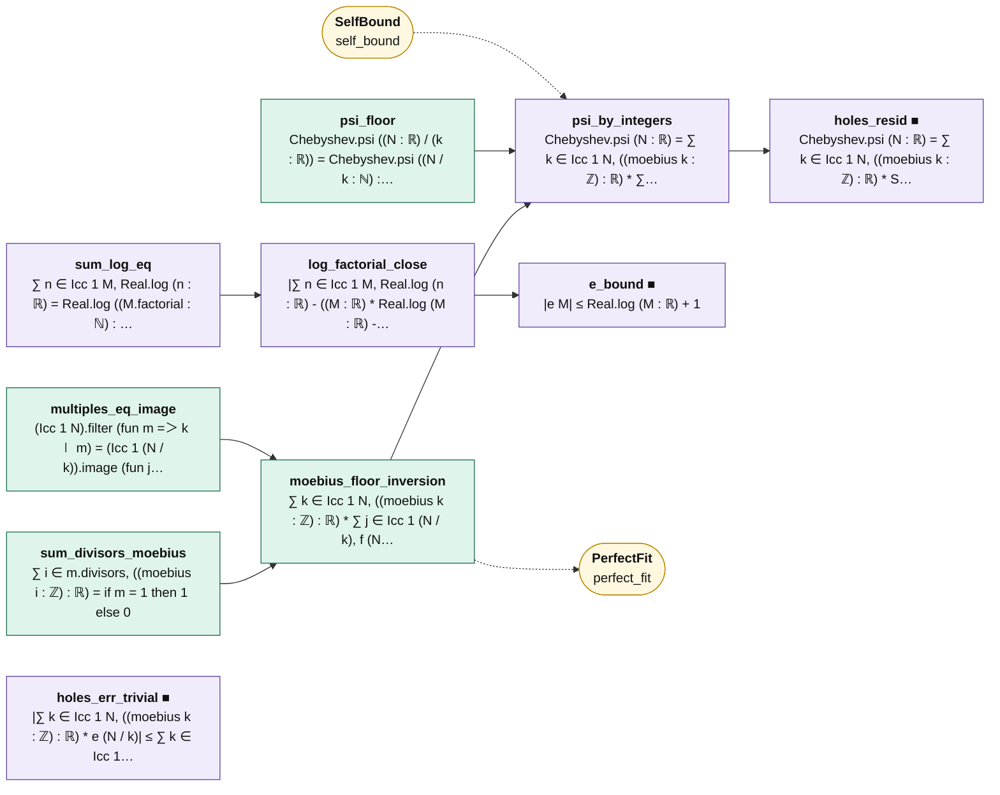

# `lean_stage3/Stage3/NoHoles.lean`

> **Read from the source text.** This file changed after the last `python3 utilities/lean_map.py --dump`, so the arrows on this page are names occurring in each proof and have not been confirmed by Lean.

NoHoles — block R13 of `lean_stage3/design/runs.md`. 2026-11-24. The staircase at `N` read back from the logarithms of the integers alone. Möbius inversion over the scales `N/k` undoes the self-bound of `Stage3.SelfBound`, so `ψ(N)` is a signed sum of the log-sums up to `N/k`. Each log-sum is `M log M − M` up to an error of size `log M + 1`, which splits `ψ(N)` into a smooth part and an error part.

10 theorems, 2 definitions, 199 lines. 

**Imports:** [`SelfBound`](../lean_stage3/SelfBound.md)  
**Imported by:** [`Stage3`](../lean_stage3/Stage3.md), [`PerfectFit`](../lean_stage3/PerfectFit.md)

## The picture



An arrow A → B reads "A is used in the proof of B". Green: counting, integers only. Violet: shape, analysis with no ζ. Blue: reads ζ. A name ending in ■ is an end: nothing else uses it. Red: contains `sorry`. Yellow: theorems in another file, counted; a dotted arrow crosses files. Definitions are not drawn; they are listed below the diagram.

## Definitions

<a name="NoHoles-S"></a>
### `NoHoles.S`

def · line 143

- **Is:** `` S (M : ℕ) : ℝ := (M : ℝ) * Real.log (M : ℝ) - (M : ℝ) noncomputable ``
- **Used by 3:** [`NoHoles.e`](#NoHoles-e), [`NoHoles.e_bound`](#NoHoles-e_bound), [`NoHoles.holes_resid`](#NoHoles-holes_resid)

<a name="NoHoles-e"></a>
### `NoHoles.e`

def · line 147

- **Is:** `` e f e (M : ℕ) : ℝ := ∑ n ∈ Icc 1 M, Real.log (n : ℝ) - S M ``
- **Built from:** [`NoHoles.S`](#NoHoles-S)
- **Used by 3:** [`NoHoles.e_bound`](#NoHoles-e_bound), [`NoHoles.holes_err_trivial`](#NoHoles-holes_err_trivial), [`NoHoles.holes_resid`](#NoHoles-holes_resid)

## Theorems

<a name="NoHoles-sum_divisors_moebius"></a>
### `NoHoles.sum_divisors_moebius`

line 26 · arrows read from text

**Counting.** Integers only: nothing in its statement or proof, or in anything it rests on, uses analysis or ζ.

**Why.** The Möbius function sums to `[m = 1]` over the divisors of `m`.

**Proves**

```lean
∑ i ∈ m.divisors, ((moebius i : ℤ) : ℝ) = if m = 1 then 1 else 0
```

**Needs** (its hypotheses)

  - `` m : ℕ ``

**Fed by:** no theorem of this repo; it stands on Mathlib.

**Feeds** (1 that use it)

  - [`NoHoles.moebius_floor_inversion`](#NoHoles-moebius_floor_inversion) — `` ∑ k ∈ Icc 1 N, ((moebius k : ℤ) : ℝ) * ∑ j ∈ Icc 1 (N / k), f (N / k / j) = f N ``

<a name="NoHoles-multiples_eq_image"></a>
### `NoHoles.multiples_eq_image`

line 33 · arrows read from text

**Counting.** Integers only: nothing in its statement or proof, or in anything it rests on, uses analysis or ζ.

**Why.** The multiples of `k` up to `N`, as the image of `j ↦ k·j` on `1..N/k`.

**Proves**

```lean
(Icc 1 N).filter (fun m => k ∣ m) = (Icc 1 (N / k)).image (fun j => k * j)
```

**Needs** (its hypotheses)

  - `` N : ℕ ``
  - `` hk : 1 ≤ k ``

**Fed by:** no theorem of this repo; it stands on Mathlib.

**Feeds** (1 that use it)

  - [`NoHoles.moebius_floor_inversion`](#NoHoles-moebius_floor_inversion) — `` ∑ k ∈ Icc 1 N, ((moebius k : ℤ) : ℝ) * ∑ j ∈ Icc 1 (N / k), f (N / k / j) = f N ``

<a name="NoHoles-moebius_floor_inversion"></a>
### `NoHoles.moebius_floor_inversion`

line 53 · arrows read from text

**Counting.** Integers only: nothing in its statement or proof, or in anything it rests on, uses analysis or ζ.

**Why.** Möbius inversion over the floors.

**Proves**

```lean
∑ k ∈ Icc 1 N, ((moebius k : ℤ) : ℝ) * ∑ j ∈ Icc 1 (N / k), f (N / k / j) = f N
```

**Needs** (its hypotheses)

  - `` f : ℕ → ℝ ``
  - `` hN : 1 ≤ N ``

**Fed by** (2 theorems its proof uses)

  - [`NoHoles.multiples_eq_image`](#NoHoles-multiples_eq_image) — `` (Icc 1 N).filter (fun m => k ∣ m) = (Icc 1 (N / k)).image (fun j => k * j) ``
  - [`NoHoles.sum_divisors_moebius`](#NoHoles-sum_divisors_moebius) — `` ∑ i ∈ m.divisors, ((moebius i : ℤ) : ℝ) = if m = 1 then 1 else 0 ``

**Feeds** (2 that use it)

  - [`NoHoles.psi_by_integers`](#NoHoles-psi_by_integers) — `` Chebyshev.psi (N : ℝ) = ∑ k ∈ Icc 1 N, ((moebius k : ℤ) : ℝ) * ∑ n ∈ Icc 1 (N / k), Real.log (n : ℝ) ``
  - [`PerfectFit.perfect_fit`](../lean_stage3/PerfectFit.md#PerfectFit-perfect_fit) (PerfectFit) — `` ∑ k ∈ Icc 1 N, ((moebius k : ℤ) : ℝ) * ((N / k : ℕ) : ℝ) = 1 ``

<a name="NoHoles-psi_floor"></a>
### `NoHoles.psi_floor`

line 87 · arrows read from text

**Counting.** Integers only: nothing in its statement or proof, or in anything it rests on, uses analysis or ζ.

**Why.** The staircase depends on the floor of its argument.

**Proves**

```lean
Chebyshev.psi ((N : ℝ) / (k : ℝ)) = Chebyshev.psi ((N / k : ℕ) : ℝ)
```

**Needs** (its hypotheses)

  - `` N k : ℕ ``

**Fed by:** no theorem of this repo; it stands on Mathlib.

**Feeds** (1 that use it)

  - [`NoHoles.psi_by_integers`](#NoHoles-psi_by_integers) — `` Chebyshev.psi (N : ℝ) = ∑ k ∈ Icc 1 N, ((moebius k : ℤ) : ℝ) * ∑ n ∈ Icc 1 (N / k), Real.log (n : ℝ) ``

<a name="NoHoles-psi_by_integers"></a>
### `NoHoles.psi_by_integers`

line 92 · arrows read from text

**Shape.** Uses real or complex analysis; nothing in it or beneath it reads ζ.

**Why.** The staircase from the integers.

**Proves**

```lean
Chebyshev.psi (N : ℝ) = ∑ k ∈ Icc 1 N, ((moebius k : ℤ) : ℝ) * ∑ n ∈ Icc 1 (N / k), Real.log (n : ℝ)
```

**Needs** (its hypotheses)

  - `` N : ℕ ``
  - `` hN : 1 ≤ N ``

**Fed by** (3 theorems its proof uses)

  - [`NoHoles.moebius_floor_inversion`](#NoHoles-moebius_floor_inversion) — `` ∑ k ∈ Icc 1 N, ((moebius k : ℤ) : ℝ) * ∑ j ∈ Icc 1 (N / k), f (N / k / j) = f N ``
  - [`NoHoles.psi_floor`](#NoHoles-psi_floor) — `` Chebyshev.psi ((N : ℝ) / (k : ℝ)) = Chebyshev.psi ((N / k : ℕ) : ℝ) ``
  - [`SelfBound.self_bound`](../lean_stage3/SelfBound.md#SelfBound-self_bound) (SelfBound) — `` ∑ k ∈ Icc 1 N, Chebyshev.psi ((N : ℝ) / (k : ℝ)) = ∑ n ∈ Icc 1 N, Real.log (n : ℝ) ``

**Feeds** (1 that use it)

  - [`NoHoles.holes_resid`](#NoHoles-holes_resid) — `` Chebyshev.psi (N : ℝ) = ∑ k ∈ Icc 1 N, ((moebius k : ℤ) : ℝ) * S (N / k) + ∑ k ∈ Icc 1 N, ((moebius k : ℤ) : ℝ) * e (N / k) ``

<a name="NoHoles-sum_log_eq"></a>
### `NoHoles.sum_log_eq`

line 102 · arrows read from text

**Shape.** Uses real or complex analysis; nothing in it or beneath it reads ζ.

**Why.** The log-sum is the logarithm of the factorial.

**Proves**

```lean
∑ n ∈ Icc 1 M, Real.log (n : ℝ) = Real.log ((M.factorial : ℕ) : ℝ)
```

**Needs** (its hypotheses)

  - `` M : ℕ ``

**Fed by:** no theorem of this repo; it stands on Mathlib.

**Feeds** (1 that use it)

  - [`NoHoles.log_factorial_close`](#NoHoles-log_factorial_close) — `` |∑ n ∈ Icc 1 M, Real.log (n : ℝ) - ((M : ℝ) * Real.log (M : ℝ) - (M : ℝ))| ≤ Real.log (M : ℝ) + 1 ``

<a name="NoHoles-log_factorial_close"></a>
### `NoHoles.log_factorial_close`

line 112 · arrows read from text

**Shape.** Uses real or complex analysis; nothing in it or beneath it reads ζ.

**Why.** The log-sum is `M log M − M` up to `log M + 1`.

**Proves**

```lean
|∑ n ∈ Icc 1 M, Real.log (n : ℝ) - ((M : ℝ) * Real.log (M : ℝ) - (M : ℝ))| ≤ Real.log (M : ℝ) + 1
```

**Needs** (its hypotheses)

  - `` hM : 1 ≤ M ``

**Fed by** (1 theorem its proof uses)

  - [`NoHoles.sum_log_eq`](#NoHoles-sum_log_eq) — `` ∑ n ∈ Icc 1 M, Real.log (n : ℝ) = Real.log ((M.factorial : ℕ) : ℝ) ``

**Feeds** (1 that use it)

  - [`NoHoles.e_bound`](#NoHoles-e_bound) — `` |e M| ≤ Real.log (M : ℝ) + 1 ``

<a name="NoHoles-e_bound"></a>
### `NoHoles.e_bound`

line 150 · arrows read from text

**Shape.** Uses real or complex analysis; nothing in it or beneath it reads ζ.

**Why.** The error at every scale is bounded by `log M + 1`.

**Proves**

```lean
|e M| ≤ Real.log (M : ℝ) + 1
```

**Needs** (its hypotheses)

  - `` hM : 1 ≤ M ``

**Fed by** (1 theorem its proof uses)

  - [`NoHoles.log_factorial_close`](#NoHoles-log_factorial_close) — `` |∑ n ∈ Icc 1 M, Real.log (n : ℝ) - ((M : ℝ) * Real.log (M : ℝ) - (M : ℝ))| ≤ Real.log (M : ℝ) + 1 ``

**Definitions its proof touches:** [`NoHoles.S`](#NoHoles-S), [`NoHoles.e`](#NoHoles-e)

**Feeds:** nothing. It is an end.

<a name="NoHoles-holes_resid"></a>
### `NoHoles.holes_resid`

line 155 · arrows read from text

**Shape.** Uses real or complex analysis; nothing in it or beneath it reads ζ.

**Why.** The staircase split into its smooth part and its error part.

**Proves**

```lean
Chebyshev.psi (N : ℝ) = ∑ k ∈ Icc 1 N, ((moebius k : ℤ) : ℝ) * S (N / k) + ∑ k ∈ Icc 1 N, ((moebius k : ℤ) : ℝ) * e (N / k)
```

**Needs** (its hypotheses)

  - `` N : ℕ ``
  - `` hN : 1 ≤ N ``

**Fed by** (1 theorem its proof uses)

  - [`NoHoles.psi_by_integers`](#NoHoles-psi_by_integers) — `` Chebyshev.psi (N : ℝ) = ∑ k ∈ Icc 1 N, ((moebius k : ℤ) : ℝ) * ∑ n ∈ Icc 1 (N / k), Real.log (n : ℝ) ``

**Definitions its proof touches:** [`NoHoles.S`](#NoHoles-S), [`NoHoles.e`](#NoHoles-e)

**Feeds:** nothing. It is an end.

<a name="NoHoles-holes_err_trivial"></a>
### `NoHoles.holes_err_trivial`

line 165 · arrows read from text

**Shape.** Uses real or complex analysis; nothing in it or beneath it reads ζ.

**Why.** The error part, bounded with `|μ| ≤ 1` alone.

**Proves**

```lean
|∑ k ∈ Icc 1 N, ((moebius k : ℤ) : ℝ) * e (N / k)| ≤ ∑ k ∈ Icc 1 N, |e (N / k)|
```

**Needs** (its hypotheses)

  - `` N : ℕ ``

**Fed by:** no theorem of this repo; it stands on Mathlib and the definitions below.

**Definitions its proof touches:** [`NoHoles.e`](#NoHoles-e)

**Feeds:** nothing. It is an end.

