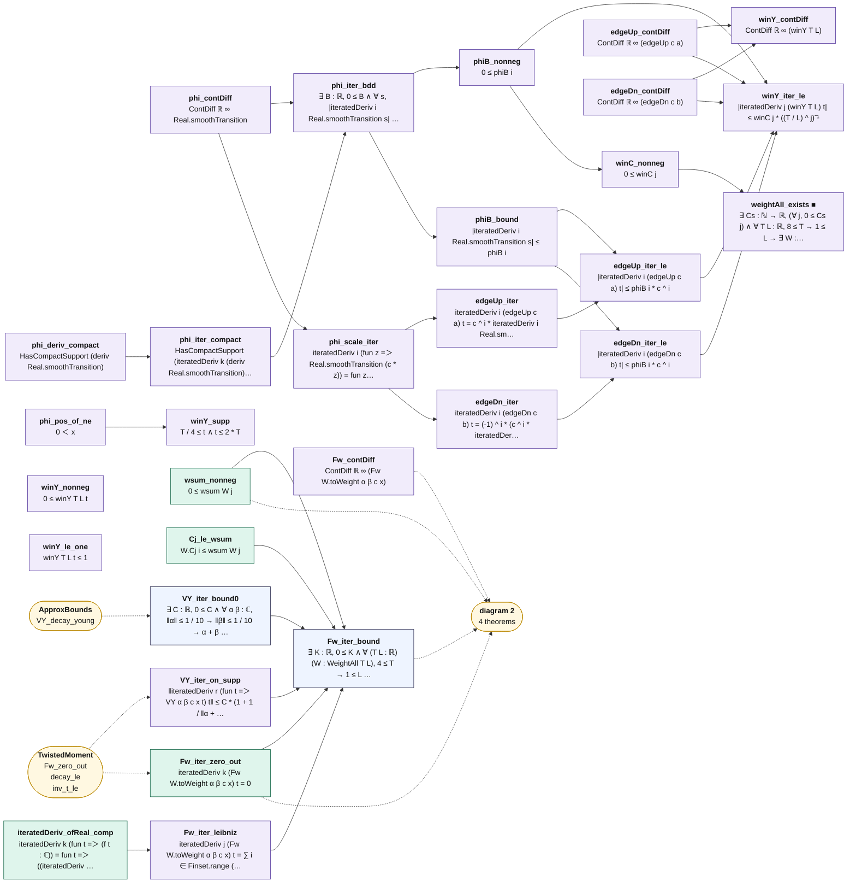
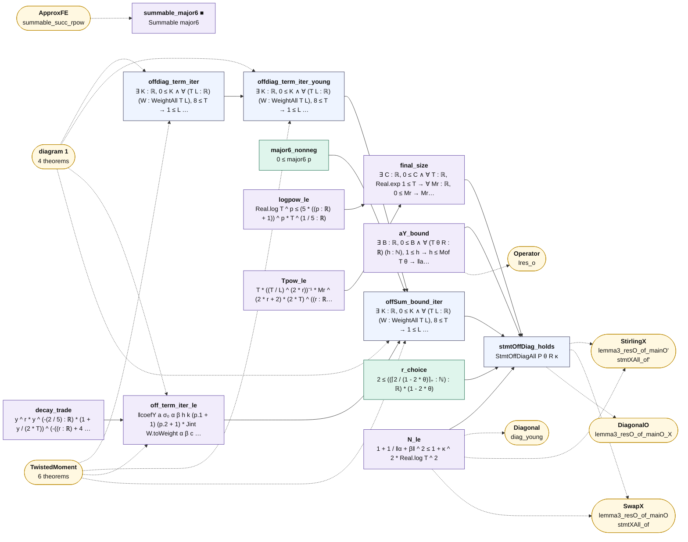

# `lean_stage3/Stage3/OffDiagClose.lean`

> **Read from the source text.** This file changed after the last `python3 utilities/lean_map.py --dump`, so the arrows on this page are names occurring in each proof and have not been confirmed by Lean.

# OffDiagClose — block S12 of `lean_stage3/design/stencil.md`, the window and the off-diagonal. 2026-11-25.

44 theorems, 10 definitions, 1102 lines. 

**Imports:** [`ApproxDerivAll`](../lean_stage3/ApproxDerivAll.md)  
**Imported by:** [`Stage3`](../lean_stage3/Stage3.md), [`Diagonal`](../lean_stage3/Diagonal.md)

## The picture

### Diagram 1 of 2: `phi_contDiff` to `Fw_iter_bound`



### Diagram 2 of 2: `offdiag_term_iter` to `stmtOffDiag_holds`



An arrow A → B reads "A is used in the proof of B". Green: counting, integers only. Violet: shape, analysis with no ζ. Blue: reads ζ. A name ending in ■ is an end: nothing else uses it. Red: contains `sorry`. Yellow: theorems in another file, counted; a dotted arrow crosses files. Definitions are not drawn; they are listed below the diagram.

## Definitions

<a name="OffDiagClose-WeightAll"></a>
### `OffDiagClose.WeightAll`

structure · line 77

Young's admissible weight (2.1)–(2.3) with (2.3) for every `j`: `|w^(j)(t)| ≤ C_j (T/L)^(−j)`.

- **Is:** `` WeightAll (T L : ℝ) extends Weight T L where Cj : ℕ → ℝ Cj_nonneg : ∀ j, 0 ≤ Cj j dj : ∀ j t, |iteratedDeriv j w t| ≤ Cj j * ((T / L) ^ j)⁻¹ ``
- **Built from:** [`TwistedMoment.Weight`](../lean_stage3/TwistedMoment.md#TwistedMoment-Weight)
- **Used by 18:** [`DiagonalO.StmtLemma3resO`](../lean_stage3/DiagonalO.md#DiagonalO-StmtLemma3resO), [`OffDiagClose.Cj_le_wsum`](#OffDiagClose-Cj_le_wsum), [`OffDiagClose.Fw_iter_bound`](#OffDiagClose-Fw_iter_bound), [`OffDiagClose.StmtOffDiagAll`](#OffDiagClose-StmtOffDiagAll), [`OffDiagClose.offSum_bound_iter`](#OffDiagClose-offSum_bound_iter), [`OffDiagClose.off_term_iter_le`](#OffDiagClose-off_term_iter_le), [`OffDiagClose.offdiag_term_iter`](#OffDiagClose-offdiag_term_iter), [`OffDiagClose.offdiag_term_iter_young`](#OffDiagClose-offdiag_term_iter_young), [`OffDiagClose.weightAll_exists`](#OffDiagClose-weightAll_exists), [`OffDiagClose.winW`](#OffDiagClose-winW), [`OffDiagClose.wsum`](#OffDiagClose-wsum), [`OffDiagClose.wsum_nonneg`](#OffDiagClose-wsum_nonneg), [`Operator.StmtMollMeanO`](../lean_stage3/Operator.md#Operator-StmtMollMeanO), [`Stirling.stmtXAll_of'`](../lean_stage3/StirlingX.md#Stirling-stmtXAll_of-), [`SwapX.I1_X_bound`](../lean_stage3/SwapX.md#SwapX-I1_X_bound), [`SwapX.StmtXAll`](../lean_stage3/SwapX.md#SwapX-StmtXAll), [`SwapX.stmtXAll_of`](../lean_stage3/SwapX.md#SwapX-stmtXAll_of), [`SwapX.twist`](../lean_stage3/SwapX.md#SwapX-twist)

<a name="OffDiagClose-phiB"></a>
### `OffDiagClose.phiB`

def · line 130

- **Is:** `` phiB (i : ℕ) : ℝ := Classical.choose (phi_iter_bdd i) ``
- **Built from:** [`OffDiagClose.phi_iter_bdd`](#OffDiagClose-phi_iter_bdd)
- **Used by 6:** [`OffDiagClose.edgeDn_iter_le`](#OffDiagClose-edgeDn_iter_le), [`OffDiagClose.edgeUp_iter_le`](#OffDiagClose-edgeUp_iter_le), [`OffDiagClose.phiB_bound`](#OffDiagClose-phiB_bound), [`OffDiagClose.phiB_nonneg`](#OffDiagClose-phiB_nonneg), [`OffDiagClose.winC`](#OffDiagClose-winC), [`OffDiagClose.winY_iter_le`](#OffDiagClose-winY_iter_le)

<a name="OffDiagClose-winC"></a>
### `OffDiagClose.winC`

def · line 139

- **Is:** `` winC (j : ℕ) : ℝ := ∑ i ∈ Finset.range (j + 1), (j.choose i : ℝ) * phiB i * phiB (j - i) ``
- **Built from:** [`OffDiagClose.phiB`](#OffDiagClose-phiB)
- **Used by 4:** [`OffDiagClose.weightAll_exists`](#OffDiagClose-weightAll_exists), [`OffDiagClose.winC_nonneg`](#OffDiagClose-winC_nonneg), [`OffDiagClose.winW`](#OffDiagClose-winW), [`OffDiagClose.winY_iter_le`](#OffDiagClose-winY_iter_le)

<a name="OffDiagClose-edgeUp"></a>
### `OffDiagClose.edgeUp`

def · line 150

- **Is:** `` edgeUp (c a t : ℝ) : ℝ := Real.smoothTransition (c * (t - a)) noncomputable ``
- **Used by 7:** [`OffDiagClose.edgeUp_contDiff`](#OffDiagClose-edgeUp_contDiff), [`OffDiagClose.edgeUp_iter`](#OffDiagClose-edgeUp_iter), [`OffDiagClose.edgeUp_iter_le`](#OffDiagClose-edgeUp_iter_le), [`OffDiagClose.weightAll_exists`](#OffDiagClose-weightAll_exists), [`OffDiagClose.winY`](#OffDiagClose-winY), [`OffDiagClose.winY_iter_le`](#OffDiagClose-winY_iter_le), [`OffDiagClose.winY_supp`](#OffDiagClose-winY_supp)

<a name="OffDiagClose-edgeDn"></a>
### `OffDiagClose.edgeDn`

def · line 154

- **Is:** `` edgeDn (c b t : ℝ) : ℝ := Real.smoothTransition (c * (b - t)) noncomputable ``
- **Used by 7:** [`OffDiagClose.edgeDn_contDiff`](#OffDiagClose-edgeDn_contDiff), [`OffDiagClose.edgeDn_iter`](#OffDiagClose-edgeDn_iter), [`OffDiagClose.edgeDn_iter_le`](#OffDiagClose-edgeDn_iter_le), [`OffDiagClose.weightAll_exists`](#OffDiagClose-weightAll_exists), [`OffDiagClose.winY`](#OffDiagClose-winY), [`OffDiagClose.winY_iter_le`](#OffDiagClose-winY_iter_le), [`OffDiagClose.winY_supp`](#OffDiagClose-winY_supp)

<a name="OffDiagClose-winY"></a>
### `OffDiagClose.winY`

def · line 158

- **Is:** `` winY (T L t : ℝ) : ℝ := edgeUp (T / L)⁻¹ (T / 4) t * edgeDn (T / L)⁻¹ (2 * T) t ``
- **Built from:** [`OffDiagClose.edgeDn`](#OffDiagClose-edgeDn), [`OffDiagClose.edgeUp`](#OffDiagClose-edgeUp)
- **Used by 7:** [`OffDiagClose.weightAll_exists`](#OffDiagClose-weightAll_exists), [`OffDiagClose.winW`](#OffDiagClose-winW), [`OffDiagClose.winY_contDiff`](#OffDiagClose-winY_contDiff), [`OffDiagClose.winY_iter_le`](#OffDiagClose-winY_iter_le), [`OffDiagClose.winY_le_one`](#OffDiagClose-winY_le_one), [`OffDiagClose.winY_nonneg`](#OffDiagClose-winY_nonneg), [`OffDiagClose.winY_supp`](#OffDiagClose-winY_supp)

<a name="OffDiagClose-winW"></a>
### `OffDiagClose.winW`

def · line 252

- **Is:** `` winW (T L : ℝ) (hΔ : 0 < T / L) : WeightAll T L where w := winY T L smooth := winY_contDiff T L supp := winY_supp hΔ nonneg := winY_nonneg T L le_one := winY_le_one T L C1 := winC 1 C2 := winC 2 C1_nonneg := winC_nonneg 1 C2_nonneg := winC_nonneg 2 d1 t := by have h := winY_iter_le hΔ 1 t rwa [iteratedDeriv_one, pow_one] at h d2 t := by have h := winY_iter_le hΔ 2 t rwa [iteratedDeriv_succ, iteratedDeriv_one] at h Cj… ``
- **Built from:** [`OffDiagClose.WeightAll`](#OffDiagClose-WeightAll), [`OffDiagClose.winC`](#OffDiagClose-winC), [`OffDiagClose.winC_nonneg`](#OffDiagClose-winC_nonneg), [`OffDiagClose.winY`](#OffDiagClose-winY), [`OffDiagClose.winY_contDiff`](#OffDiagClose-winY_contDiff), [`OffDiagClose.winY_iter_le`](#OffDiagClose-winY_iter_le), [`OffDiagClose.winY_le_one`](#OffDiagClose-winY_le_one), [`OffDiagClose.winY_nonneg`](#OffDiagClose-winY_nonneg), [`OffDiagClose.winY_supp`](#OffDiagClose-winY_supp)
- **Used by 1:** [`OffDiagClose.weightAll_exists`](#OffDiagClose-weightAll_exists)

<a name="OffDiagClose-wsum"></a>
### `OffDiagClose.wsum`

def · line 290

- **Is:** `` wsum {T L : ℝ} (W : WeightAll T L) (j : ℕ) : ℝ := 1 + ∑ i ∈ Finset.range (j + 1), W.Cj i ``
- **Built from:** [`OffDiagClose.WeightAll`](#OffDiagClose-WeightAll)
- **Used by 8:** [`OffDiagClose.Cj_le_wsum`](#OffDiagClose-Cj_le_wsum), [`OffDiagClose.Fw_iter_bound`](#OffDiagClose-Fw_iter_bound), [`OffDiagClose.offSum_bound_iter`](#OffDiagClose-offSum_bound_iter), [`OffDiagClose.off_term_iter_le`](#OffDiagClose-off_term_iter_le), [`OffDiagClose.offdiag_term_iter`](#OffDiagClose-offdiag_term_iter), [`OffDiagClose.offdiag_term_iter_young`](#OffDiagClose-offdiag_term_iter_young), [`OffDiagClose.stmtOffDiag_holds`](#OffDiagClose-stmtOffDiag_holds), [`OffDiagClose.wsum_nonneg`](#OffDiagClose-wsum_nonneg)

<a name="OffDiagClose-major6"></a>
### `OffDiagClose.major6`

def · line 578

- **Is:** `` major6 (p : ℕ × ℕ) : ℝ := ((p.1 : ℝ) + 1) ^ (-(6 / 5) : ℝ) * ((p.2 : ℝ) + 1) ^ (-(6 / 5) : ℝ) ``
- **Used by 4:** [`OffDiagClose.major6_nonneg`](#OffDiagClose-major6_nonneg), [`OffDiagClose.offSum_bound_iter`](#OffDiagClose-offSum_bound_iter), [`OffDiagClose.off_term_iter_le`](#OffDiagClose-off_term_iter_le), [`OffDiagClose.summable_major6`](#OffDiagClose-summable_major6)

<a name="OffDiagClose-StmtOffDiagAll"></a>
### `OffDiagClose.StmtOffDiagAll`

def · line 944

- **Is:** `` StmtOffDiagAll (P : Polynomial ℝ) (θ R κ : ℝ) : Prop := ∀ Cs : ℕ → ℝ, ∃ C T₀ : ℝ, 0 ≤ C ∧ ∀ T : ℝ, T₀ ≤ T → ∀ W : WeightAll T (Real.log T), (∀ j, W.Cj j ≤ Cs j) → ∀ α β : ℂ, Regime κ T α β → ‖offSum W.toWeight (Mof T θ) (aY P T θ R) (sig0 T R) α β 1‖ ≤ C * errY W.toWeight ``
- **Built from:** [`OffDiagClose.WeightAll`](#OffDiagClose-WeightAll), [`TwistedMoment.Mof`](../lean_stage3/TwistedMoment.md#TwistedMoment-Mof), [`TwistedMoment.Regime`](../lean_stage3/TwistedMoment.md#TwistedMoment-Regime), [`TwistedMoment.aY`](../lean_stage3/TwistedMoment.md#TwistedMoment-aY), [`TwistedMoment.errY`](../lean_stage3/TwistedMoment.md#TwistedMoment-errY), [`TwistedMoment.offSum`](../lean_stage3/TwistedMoment.md#TwistedMoment-offSum), [`TwistedMoment.sig0`](../lean_stage3/TwistedMoment.md#TwistedMoment-sig0)
- **Used by 3:** [`DiagonalO.lemma3_resO_of_parts`](../lean_stage3/DiagonalO.md#DiagonalO-lemma3_resO_of_parts), [`OffDiagClose.stmtOffDiag_holds`](#OffDiagClose-stmtOffDiag_holds), [`SwapX.lemma3_resO_of_partsAll`](../lean_stage3/SwapX.md#SwapX-lemma3_resO_of_partsAll)

## Theorems

<a name="OffDiagClose-phi_contDiff"></a>
### `OffDiagClose.phi_contDiff`

line 84 · arrows read from text

**Shape.** Uses real or complex analysis; nothing in it or beneath it reads ζ.

**Why.** The smooth step `φ = Real.smoothTransition`: `0` on `(−∞, 0]`, `1` on `[1, ∞)`.

**Proves**

```lean
ContDiff ℝ ∞ Real.smoothTransition
```

**Fed by:** no theorem of this repo; it stands on Mathlib.

**Feeds** (2 that use it)

  - [`OffDiagClose.phi_iter_bdd`](#OffDiagClose-phi_iter_bdd) — `` ∃ B : ℝ, 0 ≤ B ∧ ∀ s, |iteratedDeriv i Real.smoothTransition s| ≤ B ``
  - [`OffDiagClose.phi_scale_iter`](#OffDiagClose-phi_scale_iter) — `` iteratedDeriv i (fun z => Real.smoothTransition (c * z)) = fun z => c ^ i * iteratedDeriv i Real.smoothTransition (c * z) ``

<a name="OffDiagClose-phi_deriv_compact"></a>
### `OffDiagClose.phi_deriv_compact`

line 88 · arrows read from text

**Shape.** Uses real or complex analysis; nothing in it or beneath it reads ζ.

**Why.** `φ'` vanishes off `[0, 1]`.

**Proves**

```lean
HasCompactSupport (deriv Real.smoothTransition)
```

**Fed by:** no theorem of this repo; it stands on Mathlib.

**Feeds** (1 that use it)

  - [`OffDiagClose.phi_iter_compact`](#OffDiagClose-phi_iter_compact) — `` HasCompactSupport (iteratedDeriv k (deriv Real.smoothTransition)) ``

<a name="OffDiagClose-phi_iter_compact"></a>
### `OffDiagClose.phi_iter_compact`

line 103 · arrows read from text

**Shape.** Uses real or complex analysis; nothing in it or beneath it reads ζ.

**Proves**

```lean
HasCompactSupport (iteratedDeriv k (deriv Real.smoothTransition))
```

**Needs** (its hypotheses)

  - `` k : ℕ ``

**Fed by** (1 theorem its proof uses)

  - [`OffDiagClose.phi_deriv_compact`](#OffDiagClose-phi_deriv_compact) — `` HasCompactSupport (deriv Real.smoothTransition) ``

**Feeds** (1 that use it)

  - [`OffDiagClose.phi_iter_bdd`](#OffDiagClose-phi_iter_bdd) — `` ∃ B : ℝ, 0 ≤ B ∧ ∀ s, |iteratedDeriv i Real.smoothTransition s| ≤ B ``

<a name="OffDiagClose-phi_iter_bdd"></a>
### `OffDiagClose.phi_iter_bdd`

line 112 · arrows read from text

**Shape.** Uses real or complex analysis; nothing in it or beneath it reads ζ.

**Why.** Every derivative of `φ` is bounded on `ℝ`.

**Proves**

```lean
∃ B : ℝ, 0 ≤ B ∧ ∀ s, |iteratedDeriv i Real.smoothTransition s| ≤ B
```

**Needs** (its hypotheses)

  - `` i : ℕ ``

**Fed by** (2 theorems its proof uses)

  - [`OffDiagClose.phi_contDiff`](#OffDiagClose-phi_contDiff) — `` ContDiff ℝ ∞ Real.smoothTransition ``
  - [`OffDiagClose.phi_iter_compact`](#OffDiagClose-phi_iter_compact) — `` HasCompactSupport (iteratedDeriv k (deriv Real.smoothTransition)) ``

**Feeds** (3 that use it)

  - [`OffDiagClose.phiB`](#OffDiagClose-phiB) — def
  - [`OffDiagClose.phiB_bound`](#OffDiagClose-phiB_bound) — `` |iteratedDeriv i Real.smoothTransition s| ≤ phiB i ``
  - [`OffDiagClose.phiB_nonneg`](#OffDiagClose-phiB_nonneg) — `` 0 ≤ phiB i ``

<a name="OffDiagClose-phiB_nonneg"></a>
### `OffDiagClose.phiB_nonneg`

line 132 · arrows read from text

**Shape.** Uses real or complex analysis; nothing in it or beneath it reads ζ.

**Proves**

```lean
0 ≤ phiB i
```

**Needs** (its hypotheses)

  - `` i : ℕ ``

**Fed by** (1 theorem its proof uses)

  - [`OffDiagClose.phi_iter_bdd`](#OffDiagClose-phi_iter_bdd) — `` ∃ B : ℝ, 0 ≤ B ∧ ∀ s, |iteratedDeriv i Real.smoothTransition s| ≤ B ``

**Definitions its proof touches:** [`OffDiagClose.phiB`](#OffDiagClose-phiB)

**Feeds** (2 that use it)

  - [`OffDiagClose.winC_nonneg`](#OffDiagClose-winC_nonneg) — `` 0 ≤ winC j ``
  - [`OffDiagClose.winY_iter_le`](#OffDiagClose-winY_iter_le) — `` |iteratedDeriv j (winY T L) t| ≤ winC j * ((T / L) ^ j)⁻¹ ``

<a name="OffDiagClose-phiB_bound"></a>
### `OffDiagClose.phiB_bound`

line 134 · arrows read from text

**Shape.** Uses real or complex analysis; nothing in it or beneath it reads ζ.

**Proves**

```lean
|iteratedDeriv i Real.smoothTransition s| ≤ phiB i
```

**Needs** (its hypotheses)

  - `` i : ℕ ``
  - `` s : ℝ ``

**Fed by** (1 theorem its proof uses)

  - [`OffDiagClose.phi_iter_bdd`](#OffDiagClose-phi_iter_bdd) — `` ∃ B : ℝ, 0 ≤ B ∧ ∀ s, |iteratedDeriv i Real.smoothTransition s| ≤ B ``

**Definitions its proof touches:** [`OffDiagClose.phiB`](#OffDiagClose-phiB)

**Feeds** (2 that use it)

  - [`OffDiagClose.edgeDn_iter_le`](#OffDiagClose-edgeDn_iter_le) — `` |iteratedDeriv i (edgeDn c b) t| ≤ phiB i * c ^ i ``
  - [`OffDiagClose.edgeUp_iter_le`](#OffDiagClose-edgeUp_iter_le) — `` |iteratedDeriv i (edgeUp c a) t| ≤ phiB i * c ^ i ``

<a name="OffDiagClose-winC_nonneg"></a>
### `OffDiagClose.winC_nonneg`

line 141 · arrows read from text

**Shape.** Uses real or complex analysis; nothing in it or beneath it reads ζ.

**Proves**

```lean
0 ≤ winC j
```

**Needs** (its hypotheses)

  - `` j : ℕ ``

**Fed by** (1 theorem its proof uses)

  - [`OffDiagClose.phiB_nonneg`](#OffDiagClose-phiB_nonneg) — `` 0 ≤ phiB i ``

**Definitions its proof touches:** [`OffDiagClose.winC`](#OffDiagClose-winC)

**Feeds** (2 that use it)

  - [`OffDiagClose.weightAll_exists`](#OffDiagClose-weightAll_exists) — `` ∃ Cs : ℕ → ℝ, (∀ j, 0 ≤ Cs j) ∧ ∀ T L : ℝ, 8 ≤ T → 1 ≤ L → ∃ W : WeightAll T L, W.Cj = Cs ∧ W.C1 = Cs 1 ∧ W.C2 = Cs 2 ∧ ∀ t, W.w t = Real.smoothTransi… ``
  - [`OffDiagClose.winW`](#OffDiagClose-winW) — def

<a name="OffDiagClose-edgeUp_contDiff"></a>
### `OffDiagClose.edgeUp_contDiff`

line 160 · arrows read from text

**Shape.** Uses real or complex analysis; nothing in it or beneath it reads ζ.

**Proves**

```lean
ContDiff ℝ ∞ (edgeUp c a)
```

**Needs** (its hypotheses)

  - `` c a : ℝ ``

**Fed by:** no theorem of this repo; it stands on Mathlib and the definitions below.

**Definitions its proof touches:** [`OffDiagClose.edgeUp`](#OffDiagClose-edgeUp)

**Feeds** (2 that use it)

  - [`OffDiagClose.winY_contDiff`](#OffDiagClose-winY_contDiff) — `` ContDiff ℝ ∞ (winY T L) ``
  - [`OffDiagClose.winY_iter_le`](#OffDiagClose-winY_iter_le) — `` |iteratedDeriv j (winY T L) t| ≤ winC j * ((T / L) ^ j)⁻¹ ``

<a name="OffDiagClose-edgeDn_contDiff"></a>
### `OffDiagClose.edgeDn_contDiff`

line 163 · arrows read from text

**Shape.** Uses real or complex analysis; nothing in it or beneath it reads ζ.

**Proves**

```lean
ContDiff ℝ ∞ (edgeDn c b)
```

**Needs** (its hypotheses)

  - `` c b : ℝ ``

**Fed by:** no theorem of this repo; it stands on Mathlib and the definitions below.

**Definitions its proof touches:** [`OffDiagClose.edgeDn`](#OffDiagClose-edgeDn)

**Feeds** (2 that use it)

  - [`OffDiagClose.winY_contDiff`](#OffDiagClose-winY_contDiff) — `` ContDiff ℝ ∞ (winY T L) ``
  - [`OffDiagClose.winY_iter_le`](#OffDiagClose-winY_iter_le) — `` |iteratedDeriv j (winY T L) t| ≤ winC j * ((T / L) ^ j)⁻¹ ``

<a name="OffDiagClose-phi_scale_iter"></a>
### `OffDiagClose.phi_scale_iter`

line 166 · arrows read from text

**Shape.** Uses real or complex analysis; nothing in it or beneath it reads ζ.

**Proves**

```lean
iteratedDeriv i (fun z => Real.smoothTransition (c * z)) = fun z => c ^ i * iteratedDeriv i Real.smoothTransition (c * z)
```

**Needs** (its hypotheses)

  - `` c : ℝ ``
  - `` i : ℕ ``

**Fed by** (1 theorem its proof uses)

  - [`OffDiagClose.phi_contDiff`](#OffDiagClose-phi_contDiff) — `` ContDiff ℝ ∞ Real.smoothTransition ``

**Feeds** (2 that use it)

  - [`OffDiagClose.edgeDn_iter`](#OffDiagClose-edgeDn_iter) — `` iteratedDeriv i (edgeDn c b) t = (-1) ^ i * (c ^ i * iteratedDeriv i Real.smoothTransition (c * (b - t))) ``
  - [`OffDiagClose.edgeUp_iter`](#OffDiagClose-edgeUp_iter) — `` iteratedDeriv i (edgeUp c a) t = c ^ i * iteratedDeriv i Real.smoothTransition (c * (t - a)) ``

<a name="OffDiagClose-edgeUp_iter"></a>
### `OffDiagClose.edgeUp_iter`

line 171 · arrows read from text

**Shape.** Uses real or complex analysis; nothing in it or beneath it reads ζ.

**Proves**

```lean
iteratedDeriv i (edgeUp c a) t = c ^ i * iteratedDeriv i Real.smoothTransition (c * (t - a))
```

**Needs** (its hypotheses)

  - `` c a : ℝ ``
  - `` i : ℕ ``
  - `` t : ℝ ``

**Fed by** (1 theorem its proof uses)

  - [`OffDiagClose.phi_scale_iter`](#OffDiagClose-phi_scale_iter) — `` iteratedDeriv i (fun z => Real.smoothTransition (c * z)) = fun z => c ^ i * iteratedDeriv i Real.smoothTransition (c * z) ``

**Definitions its proof touches:** [`OffDiagClose.edgeUp`](#OffDiagClose-edgeUp)

**Feeds** (1 that use it)

  - [`OffDiagClose.edgeUp_iter_le`](#OffDiagClose-edgeUp_iter_le) — `` |iteratedDeriv i (edgeUp c a) t| ≤ phiB i * c ^ i ``

<a name="OffDiagClose-edgeDn_iter"></a>
### `OffDiagClose.edgeDn_iter`

line 177 · arrows read from text

**Shape.** Uses real or complex analysis; nothing in it or beneath it reads ζ.

**Proves**

```lean
iteratedDeriv i (edgeDn c b) t = (-1) ^ i * (c ^ i * iteratedDeriv i Real.smoothTransition (c * (b - t)))
```

**Needs** (its hypotheses)

  - `` c b : ℝ ``
  - `` i : ℕ ``
  - `` t : ℝ ``

**Fed by** (1 theorem its proof uses)

  - [`OffDiagClose.phi_scale_iter`](#OffDiagClose-phi_scale_iter) — `` iteratedDeriv i (fun z => Real.smoothTransition (c * z)) = fun z => c ^ i * iteratedDeriv i Real.smoothTransition (c * z) ``

**Definitions its proof touches:** [`OffDiagClose.edgeDn`](#OffDiagClose-edgeDn)

**Feeds** (1 that use it)

  - [`OffDiagClose.edgeDn_iter_le`](#OffDiagClose-edgeDn_iter_le) — `` |iteratedDeriv i (edgeDn c b) t| ≤ phiB i * c ^ i ``

<a name="OffDiagClose-edgeUp_iter_le"></a>
### `OffDiagClose.edgeUp_iter_le`

line 184 · arrows read from text

**Shape.** Uses real or complex analysis; nothing in it or beneath it reads ζ.

**Proves**

```lean
|iteratedDeriv i (edgeUp c a) t| ≤ phiB i * c ^ i
```

**Needs** (its hypotheses)

  - `` hc : 0 ≤ c ``
  - `` a : ℝ ``
  - `` i : ℕ ``
  - `` t : ℝ ``

**Fed by** (2 theorems its proof uses)

  - [`OffDiagClose.edgeUp_iter`](#OffDiagClose-edgeUp_iter) — `` iteratedDeriv i (edgeUp c a) t = c ^ i * iteratedDeriv i Real.smoothTransition (c * (t - a)) ``
  - [`OffDiagClose.phiB_bound`](#OffDiagClose-phiB_bound) — `` |iteratedDeriv i Real.smoothTransition s| ≤ phiB i ``

**Definitions its proof touches:** [`OffDiagClose.edgeUp`](#OffDiagClose-edgeUp), [`OffDiagClose.phiB`](#OffDiagClose-phiB)

**Feeds** (1 that use it)

  - [`OffDiagClose.winY_iter_le`](#OffDiagClose-winY_iter_le) — `` |iteratedDeriv j (winY T L) t| ≤ winC j * ((T / L) ^ j)⁻¹ ``

<a name="OffDiagClose-edgeDn_iter_le"></a>
### `OffDiagClose.edgeDn_iter_le`

line 189 · arrows read from text

**Shape.** Uses real or complex analysis; nothing in it or beneath it reads ζ.

**Proves**

```lean
|iteratedDeriv i (edgeDn c b) t| ≤ phiB i * c ^ i
```

**Needs** (its hypotheses)

  - `` hc : 0 ≤ c ``
  - `` b : ℝ ``
  - `` i : ℕ ``
  - `` t : ℝ ``

**Fed by** (2 theorems its proof uses)

  - [`OffDiagClose.edgeDn_iter`](#OffDiagClose-edgeDn_iter) — `` iteratedDeriv i (edgeDn c b) t = (-1) ^ i * (c ^ i * iteratedDeriv i Real.smoothTransition (c * (b - t))) ``
  - [`OffDiagClose.phiB_bound`](#OffDiagClose-phiB_bound) — `` |iteratedDeriv i Real.smoothTransition s| ≤ phiB i ``

**Definitions its proof touches:** [`OffDiagClose.edgeDn`](#OffDiagClose-edgeDn), [`OffDiagClose.phiB`](#OffDiagClose-phiB)

**Feeds** (1 that use it)

  - [`OffDiagClose.winY_iter_le`](#OffDiagClose-winY_iter_le) — `` |iteratedDeriv j (winY T L) t| ≤ winC j * ((T / L) ^ j)⁻¹ ``

<a name="OffDiagClose-winY_contDiff"></a>
### `OffDiagClose.winY_contDiff`

line 195 · arrows read from text

**Shape.** Uses real or complex analysis; nothing in it or beneath it reads ζ.

**Proves**

```lean
ContDiff ℝ ∞ (winY T L)
```

**Needs** (its hypotheses)

  - `` T L : ℝ ``

**Fed by** (2 theorems its proof uses)

  - [`OffDiagClose.edgeDn_contDiff`](#OffDiagClose-edgeDn_contDiff) — `` ContDiff ℝ ∞ (edgeDn c b) ``
  - [`OffDiagClose.edgeUp_contDiff`](#OffDiagClose-edgeUp_contDiff) — `` ContDiff ℝ ∞ (edgeUp c a) ``

**Definitions its proof touches:** [`OffDiagClose.winY`](#OffDiagClose-winY)

**Feeds** (1 that use it)

  - [`OffDiagClose.winW`](#OffDiagClose-winW) — def

<a name="OffDiagClose-winY_iter_le"></a>
### `OffDiagClose.winY_iter_le`

line 199 · arrows read from text

**Shape.** Uses real or complex analysis; nothing in it or beneath it reads ζ.

**Why.** (2.3) for the window, every `j`: `|w^(j)| ≤ C_j Δ^(−j)`, for `Δ = T/L > 0`.

**Proves**

```lean
|iteratedDeriv j (winY T L) t| ≤ winC j * ((T / L) ^ j)⁻¹
```

**Needs** (its hypotheses)

  - `` hΔ : 0 < T / L ``
  - `` j : ℕ ``
  - `` t : ℝ ``

**Fed by** (5 theorems its proof uses)

  - [`OffDiagClose.edgeDn_contDiff`](#OffDiagClose-edgeDn_contDiff) — `` ContDiff ℝ ∞ (edgeDn c b) ``
  - [`OffDiagClose.edgeDn_iter_le`](#OffDiagClose-edgeDn_iter_le) — `` |iteratedDeriv i (edgeDn c b) t| ≤ phiB i * c ^ i ``
  - [`OffDiagClose.edgeUp_contDiff`](#OffDiagClose-edgeUp_contDiff) — `` ContDiff ℝ ∞ (edgeUp c a) ``
  - [`OffDiagClose.edgeUp_iter_le`](#OffDiagClose-edgeUp_iter_le) — `` |iteratedDeriv i (edgeUp c a) t| ≤ phiB i * c ^ i ``
  - [`OffDiagClose.phiB_nonneg`](#OffDiagClose-phiB_nonneg) — `` 0 ≤ phiB i ``

**Definitions its proof touches:** [`OffDiagClose.edgeDn`](#OffDiagClose-edgeDn), [`OffDiagClose.edgeUp`](#OffDiagClose-edgeUp), [`OffDiagClose.phiB`](#OffDiagClose-phiB), [`OffDiagClose.winC`](#OffDiagClose-winC), [`OffDiagClose.winY`](#OffDiagClose-winY)

**Feeds** (1 that use it)

  - [`OffDiagClose.winW`](#OffDiagClose-winW) — def

<a name="OffDiagClose-phi_pos_of_ne"></a>
### `OffDiagClose.phi_pos_of_ne`

line 229 · arrows read from text

**Shape.** Uses real or complex analysis; nothing in it or beneath it reads ζ.

**Proves**

```lean
0 < x
```

**Needs** (its hypotheses)

  - `` h : Real.smoothTransition x ≠ 0 ``

**Fed by:** no theorem of this repo; it stands on Mathlib.

**Feeds** (1 that use it)

  - [`OffDiagClose.winY_supp`](#OffDiagClose-winY_supp) — `` T / 4 ≤ t ∧ t ≤ 2 * T ``

<a name="OffDiagClose-winY_supp"></a>
### `OffDiagClose.winY_supp`

line 233 · arrows read from text

**Shape.** Uses real or complex analysis; nothing in it or beneath it reads ζ.

**Proves**

```lean
T / 4 ≤ t ∧ t ≤ 2 * T
```

**Needs** (its hypotheses)

  - `` hΔ : 0 < T / L ``
  - `` t : ℝ ``
  - `` h : winY T L t ≠ 0 ``

**Fed by** (1 theorem its proof uses)

  - [`OffDiagClose.phi_pos_of_ne`](#OffDiagClose-phi_pos_of_ne) — `` 0 < x ``

**Definitions its proof touches:** [`OffDiagClose.edgeDn`](#OffDiagClose-edgeDn), [`OffDiagClose.edgeUp`](#OffDiagClose-edgeUp), [`OffDiagClose.winY`](#OffDiagClose-winY)

**Feeds** (1 that use it)

  - [`OffDiagClose.winW`](#OffDiagClose-winW) — def

<a name="OffDiagClose-winY_nonneg"></a>
### `OffDiagClose.winY_nonneg`

line 243 · arrows read from text

**Shape.** Uses real or complex analysis; nothing in it or beneath it reads ζ.

**Proves**

```lean
0 ≤ winY T L t
```

**Needs** (its hypotheses)

  - `` T L t : ℝ ``

**Fed by:** no theorem of this repo; it stands on Mathlib and the definitions below.

**Definitions its proof touches:** [`OffDiagClose.winY`](#OffDiagClose-winY)

**Feeds** (1 that use it)

  - [`OffDiagClose.winW`](#OffDiagClose-winW) — def

<a name="OffDiagClose-winY_le_one"></a>
### `OffDiagClose.winY_le_one`

line 246 · arrows read from text

**Shape.** Uses real or complex analysis; nothing in it or beneath it reads ζ.

**Proves**

```lean
winY T L t ≤ 1
```

**Needs** (its hypotheses)

  - `` T L t : ℝ ``

**Fed by:** no theorem of this repo; it stands on Mathlib and the definitions below.

**Definitions its proof touches:** [`OffDiagClose.winY`](#OffDiagClose-winY)

**Feeds** (1 that use it)

  - [`OffDiagClose.winW`](#OffDiagClose-winW) — def

<a name="OffDiagClose-weightAll_exists"></a>
### `OffDiagClose.weightAll_exists`

line 275 · arrows read from text

**Shape.** Uses real or complex analysis; nothing in it or beneath it reads ζ.

**Why.** Existence of the window. There are constants `C_j ≥ 0`, independent of `T` and `L`, such that for every `T ≥ 8`, `L ≥ 1` there is a `WeightAll T L` with these constants (and `C₁ = C_1`, `C₂ = C_2`), namely `w(t) = φ((t − T/4)/Δ) φ((2T − t)/Δ)`, `Δ = T/L`, `φ = smoothTransition`.

**Proves**

```lean
∃ Cs : ℕ → ℝ, (∀ j, 0 ≤ Cs j) ∧ ∀ T L : ℝ, 8 ≤ T → 1 ≤ L → ∃ W : WeightAll T L, W.Cj = Cs ∧ W.C1 = Cs 1 ∧ W.C2 = Cs 2 ∧ ∀ t, W.w t = Real.smoothTransition ((t - T / 4) / (T / L)) * Real.smoothTransition ((2 * T - t) / (T / L))
```

**Fed by** (1 theorem its proof uses)

  - [`OffDiagClose.winC_nonneg`](#OffDiagClose-winC_nonneg) — `` 0 ≤ winC j ``

**Definitions its proof touches:** [`OffDiagClose.WeightAll`](#OffDiagClose-WeightAll), [`OffDiagClose.edgeDn`](#OffDiagClose-edgeDn), [`OffDiagClose.edgeUp`](#OffDiagClose-edgeUp), [`OffDiagClose.winC`](#OffDiagClose-winC), [`OffDiagClose.winW`](#OffDiagClose-winW), [`OffDiagClose.winY`](#OffDiagClose-winY)

**Feeds:** nothing. It is an end.

<a name="OffDiagClose-wsum_nonneg"></a>
### `OffDiagClose.wsum_nonneg`

line 292 · arrows read from text

**Counting.** Integers only: nothing in its statement or proof, or in anything it rests on, uses analysis or ζ.

**Proves**

```lean
0 ≤ wsum W j
```

**Needs** (its hypotheses)

  - `` W : WeightAll T L ``
  - `` j : ℕ ``

**Fed by:** no theorem of this repo; it stands on Mathlib and the definitions below.

**Definitions its proof touches:** [`OffDiagClose.WeightAll`](#OffDiagClose-WeightAll), [`OffDiagClose.wsum`](#OffDiagClose-wsum)

**Feeds** (5 that use it)

  - [`OffDiagClose.Fw_iter_bound`](#OffDiagClose-Fw_iter_bound) — `` ∃ K : ℝ, 0 ≤ K ∧ ∀ (T L : ℝ) (W : WeightAll T L), 4 ≤ T → 1 ≤ L → ∀ α β : ℂ, ‖α‖ ≤ 1 / 10 → ‖β‖ ≤ 1 / 10 → α + β ≠ 0 → ∀ x : ℝ, 0 < x → ∀ c : ℝ, 0 < c… ``
  - [`OffDiagClose.offSum_bound_iter`](#OffDiagClose-offSum_bound_iter) — `` ∃ K : ℝ, 0 ≤ K ∧ ∀ (T L : ℝ) (W : WeightAll T L), 8 ≤ T → 1 ≤ L → ∀ (M : ℕ) (a : ℕ → ℂ) (σ₀ B : ℝ), 0 ≤ B → (∀ h : ℕ, 1 ≤ h → h ≤ M → ‖a h‖ * (h : ℝ) … ``
  - [`OffDiagClose.off_term_iter_le`](#OffDiagClose-off_term_iter_le) — `` ‖coefY a σ₀ α β h k (p.1 + 1) (p.2 + 1) * Jint W.toWeight α β c h k (p.1 + 1) (p.2 + 1)‖ ≤ (K * wsum W (2 * r) * (1 + 1 / ‖α + β‖ ^ 2) * T * ((T / L) … ``
  - [`OffDiagClose.offdiag_term_iter`](#OffDiagClose-offdiag_term_iter) — `` ∃ K : ℝ, 0 ≤ K ∧ ∀ (T L : ℝ) (W : WeightAll T L), 8 ≤ T → 1 ≤ L → ∀ α β : ℂ, ‖α‖ ≤ 1 / 10 → ‖β‖ ≤ 1 / 10 → α + β ≠ 0 → ∀ x : ℝ, 0 < x → ∀ c : ℝ, 0 < c… ``
  - [`OffDiagClose.offdiag_term_iter_young`](#OffDiagClose-offdiag_term_iter_young) — `` ∃ K : ℝ, 0 ≤ K ∧ ∀ (T L : ℝ) (W : WeightAll T L), 8 ≤ T → 1 ≤ L → ∀ α β : ℂ, ‖α‖ ≤ 1 / 10 → ‖β‖ ≤ 1 / 10 → α + β ≠ 0 → ∀ c : ℝ, 0 < c → ∀ h k m n : ℕ,… ``

<a name="OffDiagClose-Cj_le_wsum"></a>
### `OffDiagClose.Cj_le_wsum`

line 297 · arrows read from text

**Counting.** Integers only: nothing in its statement or proof, or in anything it rests on, uses analysis or ζ.

**Proves**

```lean
W.Cj i ≤ wsum W j
```

**Needs** (its hypotheses)

  - `` W : WeightAll T L ``
  - `` hij : i ≤ j ``

**Fed by:** no theorem of this repo; it stands on Mathlib and the definitions below.

**Definitions its proof touches:** [`OffDiagClose.WeightAll`](#OffDiagClose-WeightAll), [`OffDiagClose.wsum`](#OffDiagClose-wsum)

**Feeds** (1 that use it)

  - [`OffDiagClose.Fw_iter_bound`](#OffDiagClose-Fw_iter_bound) — `` ∃ K : ℝ, 0 ≤ K ∧ ∀ (T L : ℝ) (W : WeightAll T L), 4 ≤ T → 1 ≤ L → ∀ α β : ℂ, ‖α‖ ≤ 1 / 10 → ‖β‖ ≤ 1 / 10 → α + β ≠ 0 → ∀ x : ℝ, 0 < x → ∀ c : ℝ, 0 < c… ``

<a name="OffDiagClose-iteratedDeriv_ofReal_comp"></a>
### `OffDiagClose.iteratedDeriv_ofReal_comp`

line 304 · arrows read from text

**Counting.** Integers only: nothing in its statement or proof, or in anything it rests on, uses analysis or ζ.

**Why.** `∂ᵏ (t ↦ (f t : ℂ)) = (∂ᵏ f : ℂ)` for smooth real `f`.

**Proves**

```lean
iteratedDeriv k (fun t => (f t : ℂ)) = fun t => ((iteratedDeriv k f t : ℝ) : ℂ)
```

**Needs** (its hypotheses)

  - `` hf : ContDiff ℝ ∞ f ``
  - `` k : ℕ ``

**Fed by:** no theorem of this repo; it stands on Mathlib.

**Feeds** (1 that use it)

  - [`OffDiagClose.Fw_iter_leibniz`](#OffDiagClose-Fw_iter_leibniz) — `` iteratedDeriv j (Fw W.toWeight α β c x) t = ∑ i ∈ Finset.range (j + 1), (j.choose i : ℂ) * ((iteratedDeriv i W.w t : ℝ) : ℂ) * iteratedDeriv (j - i) (… ``

<a name="OffDiagClose-VY_iter_bound0"></a>
### `OffDiagClose.VY_iter_bound0`

line 316 · arrows read from text

**Reads ζ.** It, or something it rests on, uses the zeta function, its zeros or the Riemann hypothesis.

**Why.** Young's (4.3) for every `j ≥ 0` (`j = 0` is `VY_decay_young`).

**Proves**

```lean
∃ C : ℝ, 0 ≤ C ∧ ∀ α β : ℂ, ‖α‖ ≤ 1 / 10 → ‖β‖ ≤ 1 / 10 → α + β ≠ 0 → ∀ t : ℝ, 1 ≤ t → ∀ x : ℝ, 0 < x → ∀ c : ℝ, 0 < c → ‖(t : ℂ) ^ r * iteratedDeriv r (fun t => VY α β c x t) t‖ ≤ C * (1 + 1 / ‖α + β‖ ^ 2) * (1 + x / t) ^ (-A)
```

**Needs** (its hypotheses)

  - `` r : ℕ ``
  - `` hA : 0 < A ``

**Fed by** (1 theorem its proof uses)

  - [`ApproxBounds.VY_decay_young`](../lean_stage3/ApproxBounds.md#ApproxBounds-VY_decay_young) (ApproxBounds) — `` ∃ C : ℝ, 0 ≤ C ∧ ∀ α β : ℂ, ‖α‖ ≤ 1 / 10 → ‖β‖ ≤ 1 / 10 → α + β ≠ 0 → ∀ t : ℝ, 1 ≤ t → ∀ x : ℝ, 0 < x → ∀ c : ℝ, 0 < c → ‖VY α β c x t‖ ≤ C * (1 + 1 /… ``

**Definitions its proof touches:** [`ApproxFE.VY`](../lean_stage3/ApproxFE.md#ApproxFE-VY)

**Feeds** (1 that use it)

  - [`OffDiagClose.Fw_iter_bound`](#OffDiagClose-Fw_iter_bound) — `` ∃ K : ℝ, 0 ≤ K ∧ ∀ (T L : ℝ) (W : WeightAll T L), 4 ≤ T → 1 ≤ L → ∀ α β : ℂ, ‖α‖ ≤ 1 / 10 → ‖β‖ ≤ 1 / 10 → α + β ≠ 0 → ∀ x : ℝ, 0 < x → ∀ c : ℝ, 0 < c… ``

<a name="OffDiagClose-VY_iter_on_supp"></a>
### `OffDiagClose.VY_iter_on_supp`

line 330 · arrows read from text

**Shape.** Uses real or complex analysis; nothing in it or beneath it reads ζ.

**Why.** On the support: `‖∂ʳ V(t)‖ ≤ C N (4/Δ)^r (1 + x/(2T))^(−A)`, `T/4 ≤ t ≤ 2T`, `T ≥ 4`.

**Proves**

```lean
‖iteratedDeriv r (fun t => VY α β c x t) t‖ ≤ C * (1 + 1 / ‖α + β‖ ^ 2) * (4 * (T / L)⁻¹) ^ r * (1 + x / (2 * T)) ^ (-A)
```

**Needs** (its hypotheses)

  - `` hA : 0 < A ``
  - `` hC0 : 0 ≤ C ``
  - `` hC : ∀ α β : ℂ, ‖α‖ ≤ 1 / 10 → ‖β‖ ≤ 1 / 10 → α + β ≠ 0 → ∀ t : ℝ, 1 ≤ t → ∀ x : ℝ, 0 < x → ∀ c : ℝ, 0 < c → ‖(t : ℂ) ^ r * iteratedDeriv r (fun t => VY α β c x t) t‖ ≤ C * (1 + 1 / ‖α + β‖ ^ 2) * (1 + x / t) ^ (-A) ``
  - `` hT : 4 ≤ T ``
  - `` hL : 1 ≤ L ``
  - `` hα : ‖α‖ ≤ 1 / 10 ``
  - `` hβ : ‖β‖ ≤ 1 / 10 ``
  - `` hαβ : α + β ≠ 0 ``
  - `` hx : 0 < x ``
  - `` hc : 0 < c ``
  - `` ht : t ∈ Set.Icc (T / 4) (2 * T) ``

**Fed by** (2 theorems its proof uses)

  - [`TwistedMoment.decay_le`](../lean_stage3/TwistedMoment.md#TwistedMoment-decay_le) (TwistedMoment) — `` (1 + x / t) ^ (-A) ≤ (1 + x / (2 * T)) ^ (-A) ``
  - [`TwistedMoment.inv_t_le`](../lean_stage3/TwistedMoment.md#TwistedMoment-inv_t_le) (TwistedMoment) — `` t⁻¹ ≤ 4 * (T / L)⁻¹ ``

**Definitions its proof touches:** [`ApproxFE.VY`](../lean_stage3/ApproxFE.md#ApproxFE-VY)

**Feeds** (1 that use it)

  - [`OffDiagClose.Fw_iter_bound`](#OffDiagClose-Fw_iter_bound) — `` ∃ K : ℝ, 0 ≤ K ∧ ∀ (T L : ℝ) (W : WeightAll T L), 4 ≤ T → 1 ≤ L → ∀ α β : ℂ, ‖α‖ ≤ 1 / 10 → ‖β‖ ≤ 1 / 10 → α + β ≠ 0 → ∀ x : ℝ, 0 < x → ∀ c : ℝ, 0 < c… ``

<a name="OffDiagClose-Fw_contDiff"></a>
### `OffDiagClose.Fw_contDiff`

line 365 · arrows read from text

**Shape.** Uses real or complex analysis; nothing in it or beneath it reads ζ.

**Proves**

```lean
ContDiff ℝ ∞ (Fw W.toWeight α β c x)
```

**Needs** (its hypotheses)

  - `` hα : ‖α‖ ≤ 1 / 10 ``
  - `` hβ : ‖β‖ ≤ 1 / 10 ``
  - `` hx : 0 < x ``
  - `` hc : 0 < c ``

**Fed by:** no theorem of this repo; it stands on Mathlib and the definitions below.

**Definitions its proof touches:** [`TwistedMoment.Fw`](../lean_stage3/TwistedMoment.md#TwistedMoment-Fw)

**Feeds** (1 that use it)

  - [`OffDiagClose.offdiag_term_iter`](#OffDiagClose-offdiag_term_iter) — `` ∃ K : ℝ, 0 ≤ K ∧ ∀ (T L : ℝ) (W : WeightAll T L), 8 ≤ T → 1 ≤ L → ∀ α β : ℂ, ‖α‖ ≤ 1 / 10 → ‖β‖ ≤ 1 / 10 → α + β ≠ 0 → ∀ x : ℝ, 0 < x → ∀ c : ℝ, 0 < c… ``

<a name="OffDiagClose-Fw_iter_zero_out"></a>
### `OffDiagClose.Fw_iter_zero_out`

line 370 · arrows read from text

**Counting.** Integers only: nothing in its statement or proof, or in anything it rests on, uses analysis or ζ.

**Why.** Off the support every derivative of `F = wV` vanishes.

**Proves**

```lean
iteratedDeriv k (Fw W.toWeight α β c x) t = 0
```

**Needs** (its hypotheses)

  - `` k : ℕ ``
  - `` ht : t ∉ Set.Icc (T / 4) (2 * T) ``

**Fed by** (1 theorem its proof uses)

  - [`TwistedMoment.Fw_zero_out`](../lean_stage3/TwistedMoment.md#TwistedMoment-Fw_zero_out) (TwistedMoment) — `` Fw W α β c x t = 0 ∧ Fw1 W α β c x t = 0 ∧ Fw2 W α β c x t = 0 ``

**Definitions its proof touches:** [`TwistedMoment.Fw`](../lean_stage3/TwistedMoment.md#TwistedMoment-Fw)

**Feeds** (2 that use it)

  - [`OffDiagClose.Fw_iter_bound`](#OffDiagClose-Fw_iter_bound) — `` ∃ K : ℝ, 0 ≤ K ∧ ∀ (T L : ℝ) (W : WeightAll T L), 4 ≤ T → 1 ≤ L → ∀ α β : ℂ, ‖α‖ ≤ 1 / 10 → ‖β‖ ≤ 1 / 10 → α + β ≠ 0 → ∀ x : ℝ, 0 < x → ∀ c : ℝ, 0 < c… ``
  - [`OffDiagClose.offdiag_term_iter`](#OffDiagClose-offdiag_term_iter) — `` ∃ K : ℝ, 0 ≤ K ∧ ∀ (T L : ℝ) (W : WeightAll T L), 8 ≤ T → 1 ≤ L → ∀ α β : ℂ, ‖α‖ ≤ 1 / 10 → ‖β‖ ≤ 1 / 10 → α + β ≠ 0 → ∀ x : ℝ, 0 < x → ∀ c : ℝ, 0 < c… ``

<a name="OffDiagClose-Fw_iter_leibniz"></a>
### `OffDiagClose.Fw_iter_leibniz`

line 379 · arrows read from text

**Shape.** Uses real or complex analysis; nothing in it or beneath it reads ζ.

**Why.** Leibniz for `F = wV`.

**Proves**

```lean
iteratedDeriv j (Fw W.toWeight α β c x) t = ∑ i ∈ Finset.range (j + 1), (j.choose i : ℂ) * ((iteratedDeriv i W.w t : ℝ) : ℂ) * iteratedDeriv (j - i) (fun t => VY α β c x t) t
```

**Needs** (its hypotheses)

  - `` hα : ‖α‖ ≤ 1 / 10 ``
  - `` hβ : ‖β‖ ≤ 1 / 10 ``
  - `` hx : 0 < x ``
  - `` hc : 0 < c ``
  - `` j : ℕ ``
  - `` t : ℝ ``

**Fed by** (1 theorem its proof uses)

  - [`OffDiagClose.iteratedDeriv_ofReal_comp`](#OffDiagClose-iteratedDeriv_ofReal_comp) — `` iteratedDeriv k (fun t => (f t : ℂ)) = fun t => ((iteratedDeriv k f t : ℝ) : ℂ) ``

**Definitions its proof touches:** [`ApproxFE.VY`](../lean_stage3/ApproxFE.md#ApproxFE-VY), [`TwistedMoment.Fw`](../lean_stage3/TwistedMoment.md#TwistedMoment-Fw)

**Feeds** (1 that use it)

  - [`OffDiagClose.Fw_iter_bound`](#OffDiagClose-Fw_iter_bound) — `` ∃ K : ℝ, 0 ≤ K ∧ ∀ (T L : ℝ) (W : WeightAll T L), 4 ≤ T → 1 ≤ L → ∀ α β : ℂ, ‖α‖ ≤ 1 / 10 → ‖β‖ ≤ 1 / 10 → α + β ≠ 0 → ∀ x : ℝ, 0 < x → ∀ c : ℝ, 0 < c… ``

<a name="OffDiagClose-Fw_iter_bound"></a>
### `OffDiagClose.Fw_iter_bound`

line 398 · arrows read from text

**Reads ζ.** It, or something it rests on, uses the zeta function, its zeros or the Riemann hypothesis.

**Why.** The pointwise bound on `F^(j)`, `F = wV`: `‖(wV)^(j)(t)‖ ≤ K (1 + Σ_{i ≤ j} C_i) N Δ^(−j) (1 + x/(2T))^(−A)`, every `t`, `T ≥ 4`, `L ≥ 1`.

**Proves**

```lean
∃ K : ℝ, 0 ≤ K ∧ ∀ (T L : ℝ) (W : WeightAll T L), 4 ≤ T → 1 ≤ L → ∀ α β : ℂ, ‖α‖ ≤ 1 / 10 → ‖β‖ ≤ 1 / 10 → α + β ≠ 0 → ∀ x : ℝ, 0 < x → ∀ c : ℝ, 0 < c → ∀ t : ℝ, ‖iteratedDeriv j (Fw W.toWeight α β c x) t‖ ≤ K * wsum W j * (1 + 1 / ‖α + β‖ ^ 2) * ((T / L) ^ j)⁻¹ * (1 + x / (2 * T)) ^ (-A)
```

**Needs** (its hypotheses)

  - `` j : ℕ ``
  - `` hA : 0 < A ``

**Fed by** (6 theorems its proof uses)

  - [`OffDiagClose.Cj_le_wsum`](#OffDiagClose-Cj_le_wsum) — `` W.Cj i ≤ wsum W j ``
  - [`OffDiagClose.Fw_iter_leibniz`](#OffDiagClose-Fw_iter_leibniz) — `` iteratedDeriv j (Fw W.toWeight α β c x) t = ∑ i ∈ Finset.range (j + 1), (j.choose i : ℂ) * ((iteratedDeriv i W.w t : ℝ) : ℂ) * iteratedDeriv (j - i) (… ``
  - [`OffDiagClose.Fw_iter_zero_out`](#OffDiagClose-Fw_iter_zero_out) — `` iteratedDeriv k (Fw W.toWeight α β c x) t = 0 ``
  - [`OffDiagClose.VY_iter_bound0`](#OffDiagClose-VY_iter_bound0) — `` ∃ C : ℝ, 0 ≤ C ∧ ∀ α β : ℂ, ‖α‖ ≤ 1 / 10 → ‖β‖ ≤ 1 / 10 → α + β ≠ 0 → ∀ t : ℝ, 1 ≤ t → ∀ x : ℝ, 0 < x → ∀ c : ℝ, 0 < c → ‖(t : ℂ) ^ r * iteratedDeriv … ``
  - [`OffDiagClose.VY_iter_on_supp`](#OffDiagClose-VY_iter_on_supp) — `` ‖iteratedDeriv r (fun t => VY α β c x t) t‖ ≤ C * (1 + 1 / ‖α + β‖ ^ 2) * (4 * (T / L)⁻¹) ^ r * (1 + x / (2 * T)) ^ (-A) ``
  - [`OffDiagClose.wsum_nonneg`](#OffDiagClose-wsum_nonneg) — `` 0 ≤ wsum W j ``

**Definitions its proof touches:** [`ApproxFE.VY`](../lean_stage3/ApproxFE.md#ApproxFE-VY), [`OffDiagClose.WeightAll`](#OffDiagClose-WeightAll), [`OffDiagClose.wsum`](#OffDiagClose-wsum), [`TwistedMoment.Fw`](../lean_stage3/TwistedMoment.md#TwistedMoment-Fw)

**Feeds** (1 that use it)

  - [`OffDiagClose.offdiag_term_iter`](#OffDiagClose-offdiag_term_iter) — `` ∃ K : ℝ, 0 ≤ K ∧ ∀ (T L : ℝ) (W : WeightAll T L), 8 ≤ T → 1 ≤ L → ∀ α β : ℂ, ‖α‖ ≤ 1 / 10 → ‖β‖ ≤ 1 / 10 → α + β ≠ 0 → ∀ x : ℝ, 0 < x → ∀ c : ℝ, 0 < c… ``

<a name="OffDiagClose-offdiag_term_iter"></a>
### `OffDiagClose.offdiag_term_iter`

line 458 · arrows read from text

**Reads ζ.** It, or something it rests on, uses the zeta function, its zeros or the Riemann hypothesis.

**Why.** The off-diagonal integral, `j` integrations by parts. For every `j` and `A > 0` there is `K` with `‖∫ w(t) V_{α,β}(x,t) e^(−iλt) dt‖ ≤ K (1 + Σ_{i≤j} C_i) N T (Δ|λ|)^(−j) (1 + x/(2T))^(−A)`, `Δ = T/L`, uniformly in the weight, `‖α‖, ‖β‖ ≤ 1/10`, `α + β ≠ 0`, `x > 0`, `λ ≠ 0`, `c > 0`, `T ≥ 8`, `L ≥ 1`. Young §4, Lemma 5's proof.

**Proves**

```lean
∃ K : ℝ, 0 ≤ K ∧ ∀ (T L : ℝ) (W : WeightAll T L), 8 ≤ T → 1 ≤ L → ∀ α β : ℂ, ‖α‖ ≤ 1 / 10 → ‖β‖ ≤ 1 / 10 → α + β ≠ 0 → ∀ x : ℝ, 0 < x → ∀ c : ℝ, 0 < c → ∀ l : ℝ, l ≠ 0 → ‖∫ t, (W.w t : ℂ) * VY α β c x t * eL l t‖ ≤ K * wsum W j * (1 + 1 / ‖α + β‖ ^ 2) * T * ((T / L) ^ j)⁻¹ * (|l| ^ j)⁻¹ * (1 + x / (2 * T)) ^ (-A)
```

**Needs** (its hypotheses)

  - `` j : ℕ ``
  - `` hA : 0 < A ``

**Fed by** (6 theorems its proof uses)

  - [`OffDiagClose.Fw_contDiff`](#OffDiagClose-Fw_contDiff) — `` ContDiff ℝ ∞ (Fw W.toWeight α β c x) ``
  - [`OffDiagClose.Fw_iter_bound`](#OffDiagClose-Fw_iter_bound) — `` ∃ K : ℝ, 0 ≤ K ∧ ∀ (T L : ℝ) (W : WeightAll T L), 4 ≤ T → 1 ≤ L → ∀ α β : ℂ, ‖α‖ ≤ 1 / 10 → ‖β‖ ≤ 1 / 10 → α + β ≠ 0 → ∀ x : ℝ, 0 < x → ∀ c : ℝ, 0 < c… ``
  - [`OffDiagClose.Fw_iter_zero_out`](#OffDiagClose-Fw_iter_zero_out) — `` iteratedDeriv k (Fw W.toWeight α β c x) t = 0 ``
  - [`OffDiagClose.wsum_nonneg`](#OffDiagClose-wsum_nonneg) — `` 0 ≤ wsum W j ``
  - [`TwistedMoment.Fw_zero_out`](../lean_stage3/TwistedMoment.md#TwistedMoment-Fw_zero_out) (TwistedMoment) — `` Fw W α β c x t = 0 ∧ Fw1 W α β c x t = 0 ∧ Fw2 W α β c x t = 0 ``
  - [`TwistedMoment.norm_eL`](../lean_stage3/TwistedMoment.md#TwistedMoment-norm_eL) (TwistedMoment) — `` ‖eL l t‖ = 1 ``

**Definitions its proof touches:** [`ApproxFE.VY`](../lean_stage3/ApproxFE.md#ApproxFE-VY), [`OffDiagClose.WeightAll`](#OffDiagClose-WeightAll), [`OffDiagClose.wsum`](#OffDiagClose-wsum), [`TwistedMoment.Fw`](../lean_stage3/TwistedMoment.md#TwistedMoment-Fw), [`TwistedMoment.eL`](../lean_stage3/TwistedMoment.md#TwistedMoment-eL)

**Feeds** (1 that use it)

  - [`OffDiagClose.offdiag_term_iter_young`](#OffDiagClose-offdiag_term_iter_young) — `` ∃ K : ℝ, 0 ≤ K ∧ ∀ (T L : ℝ) (W : WeightAll T L), 8 ≤ T → 1 ≤ L → ∀ α β : ℂ, ‖α‖ ≤ 1 / 10 → ‖β‖ ≤ 1 / 10 → α + β ≠ 0 → ∀ c : ℝ, 0 < c → ∀ h k m n : ℕ,… ``

<a name="OffDiagClose-offdiag_term_iter_young"></a>
### `OffDiagClose.offdiag_term_iter_young`

line 513 · arrows read from text

**Reads ζ.** It, or something it rests on, uses the zeta function, its zeros or the Riemann hypothesis.

**Why.** The off-diagonal term in Young's form, `2r` integrations. For every `r` and `A > 0` there is `K` with, for integers `h, k, m, n ≥ 1`, `hm ≠ kn`, `‖Jint‖ ≤ K (1 + Σ_{i≤2r} C_i) N T Δ^(−2r) (4hm·kn)^r (1 + mn/(2T))^(−A)`; the gap `|log(hm/kn)|^(−2) ≤ 4hm·kn` (`inv_log_sq_le`) is used `r` times.

**Proves**

```lean
∃ K : ℝ, 0 ≤ K ∧ ∀ (T L : ℝ) (W : WeightAll T L), 8 ≤ T → 1 ≤ L → ∀ α β : ℂ, ‖α‖ ≤ 1 / 10 → ‖β‖ ≤ 1 / 10 → α + β ≠ 0 → ∀ c : ℝ, 0 < c → ∀ h k m n : ℕ, 1 ≤ h → 1 ≤ k → 1 ≤ m → 1 ≤ n → h * m ≠ k * n → ‖Jint W.toWeight α β c h k m n‖ ≤ K * wsum W (2 * r) * (1 + 1 / ‖α + β‖ ^ 2) * T * ((T / L) ^ (2 * r))⁻¹ * (4 * ((h : ℝ) * m) * ((k : ℝ) * n)) ^ r * (1 + (m : ℝ) * n / (2 * T)) ^ (-A)
```

**Needs** (its hypotheses)

  - `` r : ℕ ``
  - `` hA : 0 < A ``

**Fed by** (4 theorems its proof uses)

  - [`OffDiagClose.offdiag_term_iter`](#OffDiagClose-offdiag_term_iter) — `` ∃ K : ℝ, 0 ≤ K ∧ ∀ (T L : ℝ) (W : WeightAll T L), 8 ≤ T → 1 ≤ L → ∀ α β : ℂ, ‖α‖ ≤ 1 / 10 → ‖β‖ ≤ 1 / 10 → α + β ≠ 0 → ∀ x : ℝ, 0 < x → ∀ c : ℝ, 0 < c… ``
  - [`OffDiagClose.wsum_nonneg`](#OffDiagClose-wsum_nonneg) — `` 0 ≤ wsum W j ``
  - [`TwistedMoment.inv_log_sq_le`](../lean_stage3/TwistedMoment.md#TwistedMoment-inv_log_sq_le) (TwistedMoment) — `` ((Real.log ((P : ℝ) / Q)) ^ 2)⁻¹ ≤ 4 * (P : ℝ) * Q ``
  - [`TwistedMoment.ratio_cpow_eq`](../lean_stage3/TwistedMoment.md#TwistedMoment-ratio_cpow_eq) (TwistedMoment) — `` ((p : ℂ) / (q : ℂ)) ^ (-((t : ℂ) * I)) = eL (Real.log (p / q)) t ``

**Definitions its proof touches:** [`OffDiagClose.WeightAll`](#OffDiagClose-WeightAll), [`OffDiagClose.wsum`](#OffDiagClose-wsum), [`TwistedMoment.Jint`](../lean_stage3/TwistedMoment.md#TwistedMoment-Jint)

**Feeds** (1 that use it)

  - [`OffDiagClose.offSum_bound_iter`](#OffDiagClose-offSum_bound_iter) — `` ∃ K : ℝ, 0 ≤ K ∧ ∀ (T L : ℝ) (W : WeightAll T L), 8 ≤ T → 1 ≤ L → ∀ (M : ℕ) (a : ℕ → ℂ) (σ₀ B : ℝ), 0 ≤ B → (∀ h : ℕ, 1 ≤ h → h ≤ M → ‖a h‖ * (h : ℝ) … ``

<a name="OffDiagClose-major6_nonneg"></a>
### `OffDiagClose.major6_nonneg`

line 580 · arrows read from text

**Counting.** Integers only: nothing in its statement or proof, or in anything it rests on, uses analysis or ζ.

**Proves**

```lean
0 ≤ major6 p
```

**Needs** (its hypotheses)

  - `` p : ℕ × ℕ ``

**Fed by:** no theorem of this repo; it stands on Mathlib and the definitions below.

**Definitions its proof touches:** [`OffDiagClose.major6`](#OffDiagClose-major6)

**Feeds** (1 that use it)

  - [`OffDiagClose.offSum_bound_iter`](#OffDiagClose-offSum_bound_iter) — `` ∃ K : ℝ, 0 ≤ K ∧ ∀ (T L : ℝ) (W : WeightAll T L), 8 ≤ T → 1 ≤ L → ∀ (M : ℕ) (a : ℕ → ℂ) (σ₀ B : ℝ), 0 ≤ B → (∀ h : ℕ, 1 ≤ h → h ≤ M → ‖a h‖ * (h : ℝ) … ``

<a name="OffDiagClose-summable_major6"></a>
### `OffDiagClose.summable_major6`

line 584 · arrows read from text

**Shape.** Uses real or complex analysis; nothing in it or beneath it reads ζ.

**Proves**

```lean
Summable major6
```

**Fed by** (1 theorem its proof uses)

  - [`ApproxFE.summable_succ_rpow`](../lean_stage3/ApproxFE.md#ApproxFE-summable_succ_rpow) (ApproxFE) — `` Summable fun m : ℕ => ((m : ℝ) + 1) ^ r ``

**Definitions its proof touches:** [`OffDiagClose.major6`](#OffDiagClose-major6)

**Feeds:** nothing. It is an end.

<a name="OffDiagClose-decay_trade"></a>
### `OffDiagClose.decay_trade`

line 591 · arrows read from text

**Shape.** Uses real or complex analysis; nothing in it or beneath it reads ζ.

**Why.** The decay traded for convergence: `y^r y^(−2/5) (1 + y/(2T))^(−(r+4/5)) ≤ (2T)^(r+4/5) y^(−6/5)`.

**Proves**

```lean
y ^ r * y ^ (-(2 / 5) : ℝ) * (1 + y / (2 * T)) ^ (-((r : ℝ) + 4 / 5)) ≤ (2 * T) ^ ((r : ℝ) + 4 / 5) * y ^ (-(6 / 5) : ℝ)
```

**Needs** (its hypotheses)

  - `` hy : 0 < y ``
  - `` hT : 0 < T ``
  - `` r : ℕ ``

**Fed by:** no theorem of this repo; it stands on Mathlib.

**Feeds** (1 that use it)

  - [`OffDiagClose.off_term_iter_le`](#OffDiagClose-off_term_iter_le) — `` ‖coefY a σ₀ α β h k (p.1 + 1) (p.2 + 1) * Jint W.toWeight α β c h k (p.1 + 1) (p.2 + 1)‖ ≤ (K * wsum W (2 * r) * (1 + 1 / ‖α + β‖ ^ 2) * T * ((T / L) … ``

<a name="OffDiagClose-off_term_iter_le"></a>
### `OffDiagClose.off_term_iter_le`

line 615 · arrows read from text

**Shape.** Uses real or complex analysis; nothing in it or beneath it reads ζ.

**Why.** One off-diagonal term with `2r` integrations: `‖coefY · Jint‖ ≤ P B² 4^r M^(2r) (2T)^(r+4/5) (mn)^(−6/5)`, for `‖a_h‖ h^(−σ₀) ≤ B` on `1 ≤ h ≤ M`; `P` is the prefactor of `offdiag_term_iter_young` at `A = r + 4/5`.

**Proves**

```lean
‖coefY a σ₀ α β h k (p.1 + 1) (p.2 + 1) * Jint W.toWeight α β c h k (p.1 + 1) (p.2 + 1)‖ ≤ (K * wsum W (2 * r) * (1 + 1 / ‖α + β‖ ^ 2) * T * ((T / L) ^ (2 * r))⁻¹) * B ^ 2 * 4 ^ r * (M : ℝ) ^ (2 * r) * ((2 * T) ^ ((r : ℝ) + 4 / 5) * major6 p)
```

**Needs** (its hypotheses)

  - `` r : ℕ ``
  - `` hK : ∀ (T L : ℝ) (W : WeightAll T L), 8 ≤ T → 1 ≤ L → ∀ α β : ℂ, ‖α‖ ≤ 1 / 10 → ‖β‖ ≤ 1 / 10 → α + β ≠ 0 → ∀ c : ℝ, 0 < c → ∀ h k m n : ℕ, 1 ≤ h → 1 ≤ k → 1 ≤ m → 1 ≤ n → h * m ≠ k * n → ‖Jint W.toWeight α β c h k m n‖ ≤ K * wsum W (2 * r) * (1 + 1 / ‖α + β‖ ^ 2) * T * ((T / L) ^ (2 * r))⁻¹ * (4 * (… ``
  - `` hK0 : 0 ≤ K ``
  - `` W : WeightAll T L ``
  - `` hT : 8 ≤ T ``
  - `` hL : 1 ≤ L ``
  - `` M : ℕ ``
  - `` a : ℕ → ℂ ``
  - `` σ₀ B : ℝ ``
  - `` hB0 : 0 ≤ B ``
  - `` hB : ∀ h : ℕ, 1 ≤ h → h ≤ M → ‖a h‖ * (h : ℝ) ^ (-σ₀) ≤ B ``
  - `` hα : ‖α‖ ≤ 1 / 10 ``
  - `` hβ : ‖β‖ ≤ 1 / 10 ``
  - `` hαβ : α + β ≠ 0 ``
  - `` hc : 0 < c ``
  - `` hh : 1 ≤ h ``
  - `` hhM : h ≤ M ``
  - `` hk : 1 ≤ k ``
  - `` hkM : k ≤ M ``
  - `` p : ℕ × ℕ ``
  - `` hd : h * (p.1 + 1) ≠ k * (p.2 + 1) ``

**Fed by** (3 theorems its proof uses)

  - [`OffDiagClose.decay_trade`](#OffDiagClose-decay_trade) — `` y ^ r * y ^ (-(2 / 5) : ℝ) * (1 + y / (2 * T)) ^ (-((r : ℝ) + 4 / 5)) ≤ (2 * T) ^ ((r : ℝ) + 4 / 5) * y ^ (-(6 / 5) : ℝ) ``
  - [`OffDiagClose.wsum_nonneg`](#OffDiagClose-wsum_nonneg) — `` 0 ≤ wsum W j ``
  - [`TwistedMoment.re_small`](../lean_stage3/TwistedMoment.md#TwistedMoment-re_small) (TwistedMoment) — `` -(1 / 10) ≤ α.re ∧ α.re ≤ 1 / 10 ``

**Definitions its proof touches:** [`OffDiagClose.WeightAll`](#OffDiagClose-WeightAll), [`OffDiagClose.major6`](#OffDiagClose-major6), [`OffDiagClose.wsum`](#OffDiagClose-wsum), [`TwistedMoment.Jint`](../lean_stage3/TwistedMoment.md#TwistedMoment-Jint), [`TwistedMoment.coefY`](../lean_stage3/TwistedMoment.md#TwistedMoment-coefY)

**Feeds** (1 that use it)

  - [`OffDiagClose.offSum_bound_iter`](#OffDiagClose-offSum_bound_iter) — `` ∃ K : ℝ, 0 ≤ K ∧ ∀ (T L : ℝ) (W : WeightAll T L), 8 ≤ T → 1 ≤ L → ∀ (M : ℕ) (a : ℕ → ℂ) (σ₀ B : ℝ), 0 ≤ B → (∀ h : ℕ, 1 ≤ h → h ≤ M → ‖a h‖ * (h : ℝ) … ``

<a name="OffDiagClose-offSum_bound_iter"></a>
### `OffDiagClose.offSum_bound_iter`

line 724 · arrows read from text

**Reads ζ.** It, or something it rests on, uses the zeta function, its zeros or the Riemann hypothesis.

**Why.** The off-diagonal, summed, with `2r` integrations by parts. For every `r` there is `K` with `‖offSum‖ ≤ K (1 + Σ_{i≤2r} C_i) N T Δ^(−2r) B² M^(2r+2) (2T)^(r+4/5)`, for any coefficients with `‖a_h‖ h^(−σ₀) ≤ B` on `1 ≤ h ≤ M`, `T ≥ 8`, `L ≥ 1`, `‖α‖, ‖β‖ ≤ 1/10`, `α + β ≠ 0`, `c > 0`.

**Proves**

```lean
∃ K : ℝ, 0 ≤ K ∧ ∀ (T L : ℝ) (W : WeightAll T L), 8 ≤ T → 1 ≤ L → ∀ (M : ℕ) (a : ℕ → ℂ) (σ₀ B : ℝ), 0 ≤ B → (∀ h : ℕ, 1 ≤ h → h ≤ M → ‖a h‖ * (h : ℝ) ^ (-σ₀) ≤ B) → ∀ α β : ℂ, ‖α‖ ≤ 1 / 10 → ‖β‖ ≤ 1 / 10 → α + β ≠ 0 → ∀ c : ℝ, 0 < c → ‖offSum W.toWeight M a σ₀ α β c‖ ≤ K * wsum W (2 * r) * (1 + 1 / ‖α + β‖ ^ 2) * T * ((T / L) ^ (2 * r))⁻¹ * B ^ 2 * (M : ℝ) ^ (2 * r + 2) * (2 * T) ^ ((r : ℝ) + 4 / 5)
```

**Needs** (its hypotheses)

  - `` r : ℕ ``

**Fed by** (5 theorems its proof uses)

  - [`OffDiagClose.major6_nonneg`](#OffDiagClose-major6_nonneg) — `` 0 ≤ major6 p ``
  - [`OffDiagClose.off_term_iter_le`](#OffDiagClose-off_term_iter_le) — `` ‖coefY a σ₀ α β h k (p.1 + 1) (p.2 + 1) * Jint W.toWeight α β c h k (p.1 + 1) (p.2 + 1)‖ ≤ (K * wsum W (2 * r) * (1 + 1 / ‖α + β‖ ^ 2) * T * ((T / L) … ``
  - [`OffDiagClose.offdiag_term_iter_young`](#OffDiagClose-offdiag_term_iter_young) — `` ∃ K : ℝ, 0 ≤ K ∧ ∀ (T L : ℝ) (W : WeightAll T L), 8 ≤ T → 1 ≤ L → ∀ α β : ℂ, ‖α‖ ≤ 1 / 10 → ‖β‖ ≤ 1 / 10 → α + β ≠ 0 → ∀ c : ℝ, 0 < c → ∀ h k m n : ℕ,… ``
  - [`OffDiagClose.wsum_nonneg`](#OffDiagClose-wsum_nonneg) — `` 0 ≤ wsum W j ``
  - [`TwistedMoment.summable_hk`](../lean_stage3/TwistedMoment.md#TwistedMoment-summable_hk) (TwistedMoment) — `` Summable fun p : ℕ × ℕ => ‖coefY a σ₀ α β h k (p.1 + 1) (p.2 + 1) * Jint W α β c h k (p.1 + 1) (p.2 + 1)‖ ``

**Definitions its proof touches:** [`OffDiagClose.WeightAll`](#OffDiagClose-WeightAll), [`OffDiagClose.major6`](#OffDiagClose-major6), [`OffDiagClose.wsum`](#OffDiagClose-wsum), [`TwistedMoment.Jint`](../lean_stage3/TwistedMoment.md#TwistedMoment-Jint), [`TwistedMoment.coefY`](../lean_stage3/TwistedMoment.md#TwistedMoment-coefY), [`TwistedMoment.offSum`](../lean_stage3/TwistedMoment.md#TwistedMoment-offSum)

**Feeds** (1 that use it)

  - [`OffDiagClose.stmtOffDiag_holds`](#OffDiagClose-stmtOffDiag_holds) — `` StmtOffDiagAll P θ R κ ``

<a name="OffDiagClose-aY_bound"></a>
### `OffDiagClose.aY_bound`

line 791 · arrows read from text

**Shape.** Uses real or complex analysis; nothing in it or beneath it reads ζ.

**Why.** Young's coefficients: `‖a_h‖ h^(−σ₀) ≤ B` on `1 ≤ h ≤ M`, `B = sup_{[0,1]} |P|` (`|μ| ≤ 1`, `h^(σ₀−1/2) h^(−σ₀) = h^(−1/2) ≤ 1`).

**Proves**

```lean
∃ B : ℝ, 0 ≤ B ∧ ∀ (T θ R : ℝ) (h : ℕ), 1 ≤ h → h ≤ Mof T θ → ‖aY P T θ R h‖ * (h : ℝ) ^ (-sig0 T R) ≤ B
```

**Needs** (its hypotheses)

  - `` P : Polynomial ℝ ``

**Fed by:** no theorem of this repo; it stands on Mathlib and the definitions below.

**Definitions its proof touches:** [`TwistedMoment.Mof`](../lean_stage3/TwistedMoment.md#TwistedMoment-Mof), [`TwistedMoment.aY`](../lean_stage3/TwistedMoment.md#TwistedMoment-aY), [`TwistedMoment.sig0`](../lean_stage3/TwistedMoment.md#TwistedMoment-sig0)

**Feeds** (2 that use it)

  - [`OffDiagClose.stmtOffDiag_holds`](#OffDiagClose-stmtOffDiag_holds) — `` StmtOffDiagAll P θ R κ ``
  - [`Operator.Ires_o`](../lean_stage3/Operator.md#Operator-Ires_o) (Operator) — `` ∀ ε : ℝ, 0 < ε → ∃ T₀ : ℝ, ∀ T : ℝ, T₀ ≤ T → ∀ W : Weight T (Real.log T), ∀ α β : ℂ, Regime κ T α β → ‖Ires W (Mof T θ) (aY P T θ R) (sig0 T R) α β‖ ≤… ``

<a name="OffDiagClose-logpow_le"></a>
### `OffDiagClose.logpow_le`

line 836 · arrows read from text

**Shape.** Uses real or complex analysis; nothing in it or beneath it reads ζ.

**Why.** `(log T)^p ≤ (5(p+1))^p T^(1/5)` for `T ≥ 1`.

**Proves**

```lean
Real.log T ^ p ≤ (5 * ((p : ℝ) + 1)) ^ p * T ^ (1 / 5 : ℝ)
```

**Needs** (its hypotheses)

  - `` p : ℕ ``
  - `` hT : 1 ≤ T ``

**Fed by:** no theorem of this repo; it stands on Mathlib.

**Feeds** (1 that use it)

  - [`OffDiagClose.final_size`](#OffDiagClose-final_size) — `` ∃ C : ℝ, 0 ≤ C ∧ ∀ T : ℝ, Real.exp 1 ≤ T → ∀ Mr : ℝ, 0 ≤ Mr → Mr ≤ T ^ θ → (1 + κ ^ 2 * Real.log T ^ 2) * T * ((T / Real.log T) ^ (2 * r))⁻¹ * Mr ^ (2… ``

<a name="OffDiagClose-Tpow_le"></a>
### `OffDiagClose.Tpow_le`

line 858 · arrows read from text

**Shape.** Uses real or complex analysis; nothing in it or beneath it reads ζ.

**Why.** The powers of `T`: `T Δ^(−2r) (T^θ)^(2r+2) (2T)^(r+4/5) ≤ 2^(r+4/5) L^(2r) T^(4/5)`, `Δ = T/L`, when `r(1 − 2θ) ≥ 2` and `θ < 1/2`.

**Proves**

```lean
T * ((T / L) ^ (2 * r))⁻¹ * Mr ^ (2 * r + 2) * (2 * T) ^ ((r : ℝ) + 4 / 5) ≤ (2 : ℝ) ^ ((r : ℝ) + 4 / 5) * L ^ (2 * r) * T ^ (4 / 5 : ℝ)
```

**Needs** (its hypotheses)

  - `` hθ : θ < 1 / 2 ``
  - `` hr : 2 ≤ (r : ℝ) * (1 - 2 * θ) ``
  - `` hT : 1 ≤ T ``
  - `` hL : 0 < L ``
  - `` hM0 : 0 ≤ Mr ``
  - `` hM : Mr ≤ T ^ θ ``

**Fed by:** no theorem of this repo; it stands on Mathlib.

**Feeds** (1 that use it)

  - [`OffDiagClose.final_size`](#OffDiagClose-final_size) — `` ∃ C : ℝ, 0 ≤ C ∧ ∀ T : ℝ, Real.exp 1 ≤ T → ∀ Mr : ℝ, 0 ≤ Mr → Mr ≤ T ^ θ → (1 + κ ^ 2 * Real.log T ^ 2) * T * ((T / Real.log T) ^ (2 * r))⁻¹ * Mr ^ (2… ``

<a name="OffDiagClose-final_size"></a>
### `OffDiagClose.final_size`

line 899 · arrows read from text

**Shape.** Uses real or complex analysis; nothing in it or beneath it reads ζ.

**Why.** The size of the summed bound. For `θ < 1/2` and `r(1 − 2θ) ≥ 2` there is `C` with `(1 + κ²L²) T Δ^(−2r) M^(2r+2) (2T)^(r+4/5) ≤ C T/L` for `T ≥ e`, `0 ≤ M ≤ T^θ`, `L = log T`, `Δ = T/L`.

**Proves**

```lean
∃ C : ℝ, 0 ≤ C ∧ ∀ T : ℝ, Real.exp 1 ≤ T → ∀ Mr : ℝ, 0 ≤ Mr → Mr ≤ T ^ θ → (1 + κ ^ 2 * Real.log T ^ 2) * T * ((T / Real.log T) ^ (2 * r))⁻¹ * Mr ^ (2 * r + 2) * (2 * T) ^ ((r : ℝ) + 4 / 5) ≤ C * (T / Real.log T)
```

**Needs** (its hypotheses)

  - `` hθ : θ < 1 / 2 ``
  - `` hr : 2 ≤ (r : ℝ) * (1 - 2 * θ) ``
  - `` κ : ℝ ``

**Fed by** (2 theorems its proof uses)

  - [`OffDiagClose.Tpow_le`](#OffDiagClose-Tpow_le) — `` T * ((T / L) ^ (2 * r))⁻¹ * Mr ^ (2 * r + 2) * (2 * T) ^ ((r : ℝ) + 4 / 5) ≤ (2 : ℝ) ^ ((r : ℝ) + 4 / 5) * L ^ (2 * r) * T ^ (4 / 5 : ℝ) ``
  - [`OffDiagClose.logpow_le`](#OffDiagClose-logpow_le) — `` Real.log T ^ p ≤ (5 * ((p : ℝ) + 1)) ^ p * T ^ (1 / 5 : ℝ) ``

**Feeds** (1 that use it)

  - [`OffDiagClose.stmtOffDiag_holds`](#OffDiagClose-stmtOffDiag_holds) — `` StmtOffDiagAll P θ R κ ``

<a name="OffDiagClose-r_choice"></a>
### `OffDiagClose.r_choice`

line 950 · arrows read from text

**Counting.** Integers only: nothing in its statement or proof, or in anything it rests on, uses analysis or ζ.

**Why.** The number of integrations by parts: `r = ⌈2/(1 − 2θ)⌉₊`, so `r(1 − 2θ) ≥ 2`.

**Proves**

```lean
2 ≤ ((⌈2 / (1 - 2 * θ)⌉₊ : ℕ) : ℝ) * (1 - 2 * θ)
```

**Needs** (its hypotheses)

  - `` hθ : θ < 1 / 2 ``

**Fed by:** no theorem of this repo; it stands on Mathlib.

**Feeds** (1 that use it)

  - [`OffDiagClose.stmtOffDiag_holds`](#OffDiagClose-stmtOffDiag_holds) — `` StmtOffDiagAll P θ R κ ``

<a name="OffDiagClose-N_le"></a>
### `OffDiagClose.N_le`

line 960 · arrows read from text

**Shape.** Uses real or complex analysis; nothing in it or beneath it reads ζ.

**Why.** `N = 1 + ‖α+β‖^(−2) ≤ 1 + κ² L²` on the range.

**Proves**

```lean
1 + 1 / ‖α + β‖ ^ 2 ≤ 1 + κ ^ 2 * Real.log T ^ 2
```

**Needs** (its hypotheses)

  - `` hκ : 0 < κ ``
  - `` hL : 0 < Real.log T ``
  - `` h : Regime κ T α β ``

**Fed by:** no theorem of this repo; it stands on Mathlib and the definitions below.

**Definitions its proof touches:** [`TwistedMoment.Regime`](../lean_stage3/TwistedMoment.md#TwistedMoment-Regime)

**Feeds** (4 that use it)

  - [`Diagonal.diag_young`](../lean_stage3/Diagonal.md#Diagonal-diag_young) (Diagonal) — `` ∃ C T₀ : ℝ, 0 ≤ C ∧ ∀ T : ℝ, T₀ ≤ T → ∀ W : Weight T (Real.log T), ∀ α β : ℂ, Regime κ T α β → ‖diagSum W (Mof T θ) (aY P T θ R) (sig0 T R) α β 1 - (w… ``
  - [`OffDiagClose.stmtOffDiag_holds`](#OffDiagClose-stmtOffDiag_holds) — `` StmtOffDiagAll P θ R κ ``
  - [`Stirling.stmtXAll_of'`](../lean_stage3/StirlingX.md#Stirling-stmtXAll_of-) (StirlingX) — `` StmtXAll P θ R κ ``
  - [`SwapX.stmtXAll_of`](../lean_stage3/SwapX.md#SwapX-stmtXAll_of) (SwapX) — `` StmtXAll P θ R κ ``

<a name="OffDiagClose-stmtOffDiag_holds"></a>
### `OffDiagClose.stmtOffDiag_holds`

line 975 · arrows read from text

**Reads ζ.** It, or something it rests on, uses the zeta function, its zeros or the Riemann hypothesis.

**Why.** `StmtOffDiag` closed, every `θ < 1/2`, in the `WeightAll` form: Young's off-diagonal `offSum = O(T/L)` with `j = 2r`, `r = ⌈2/(1−2θ)⌉₊`, integrations by parts.

**Proves**

```lean
StmtOffDiagAll P θ R κ
```

**Needs** (its hypotheses)

  - `` P : Polynomial ℝ ``
  - `` hθ : θ < 1 / 2 ``
  - `` R : ℝ ``
  - `` hκ : 0 < κ ``

**Fed by** (5 theorems its proof uses)

  - [`OffDiagClose.N_le`](#OffDiagClose-N_le) — `` 1 + 1 / ‖α + β‖ ^ 2 ≤ 1 + κ ^ 2 * Real.log T ^ 2 ``
  - [`OffDiagClose.aY_bound`](#OffDiagClose-aY_bound) — `` ∃ B : ℝ, 0 ≤ B ∧ ∀ (T θ R : ℝ) (h : ℕ), 1 ≤ h → h ≤ Mof T θ → ‖aY P T θ R h‖ * (h : ℝ) ^ (-sig0 T R) ≤ B ``
  - [`OffDiagClose.final_size`](#OffDiagClose-final_size) — `` ∃ C : ℝ, 0 ≤ C ∧ ∀ T : ℝ, Real.exp 1 ≤ T → ∀ Mr : ℝ, 0 ≤ Mr → Mr ≤ T ^ θ → (1 + κ ^ 2 * Real.log T ^ 2) * T * ((T / Real.log T) ^ (2 * r))⁻¹ * Mr ^ (2… ``
  - [`OffDiagClose.offSum_bound_iter`](#OffDiagClose-offSum_bound_iter) — `` ∃ K : ℝ, 0 ≤ K ∧ ∀ (T L : ℝ) (W : WeightAll T L), 8 ≤ T → 1 ≤ L → ∀ (M : ℕ) (a : ℕ → ℂ) (σ₀ B : ℝ), 0 ≤ B → (∀ h : ℕ, 1 ≤ h → h ≤ M → ‖a h‖ * (h : ℝ) … ``
  - [`OffDiagClose.r_choice`](#OffDiagClose-r_choice) — `` 2 ≤ ((⌈2 / (1 - 2 * θ)⌉₊ : ℕ) : ℝ) * (1 - 2 * θ) ``

**Definitions its proof touches:** [`OffDiagClose.StmtOffDiagAll`](#OffDiagClose-StmtOffDiagAll), [`OffDiagClose.wsum`](#OffDiagClose-wsum), [`TwistedMoment.Mof`](../lean_stage3/TwistedMoment.md#TwistedMoment-Mof), [`TwistedMoment.aY`](../lean_stage3/TwistedMoment.md#TwistedMoment-aY), [`TwistedMoment.errY`](../lean_stage3/TwistedMoment.md#TwistedMoment-errY), [`TwistedMoment.offSum`](../lean_stage3/TwistedMoment.md#TwistedMoment-offSum), [`TwistedMoment.sig0`](../lean_stage3/TwistedMoment.md#TwistedMoment-sig0)

**Feeds** (5 that use it)

  - [`DiagonalO.lemma3_resO_of_mainO_X`](../lean_stage3/DiagonalO.md#DiagonalO-lemma3_resO_of_mainO_X) (DiagonalO) — `` StmtLemma3resO P θ R κ ``
  - [`Stirling.lemma3_resO_of_mainO'`](../lean_stage3/StirlingX.md#Stirling-lemma3_resO_of_mainO-) (StirlingX) — `` StmtLemma3resO P θ R κ ``
  - [`Stirling.stmtXAll_of'`](../lean_stage3/StirlingX.md#Stirling-stmtXAll_of-) (StirlingX) — `` StmtXAll P θ R κ ``
  - [`SwapX.lemma3_resO_of_mainO`](../lean_stage3/SwapX.md#SwapX-lemma3_resO_of_mainO) (SwapX) — `` StmtLemma3resO P θ R κ ``
  - [`SwapX.stmtXAll_of`](../lean_stage3/SwapX.md#SwapX-stmtXAll_of) (SwapX) — `` StmtXAll P θ R κ ``

