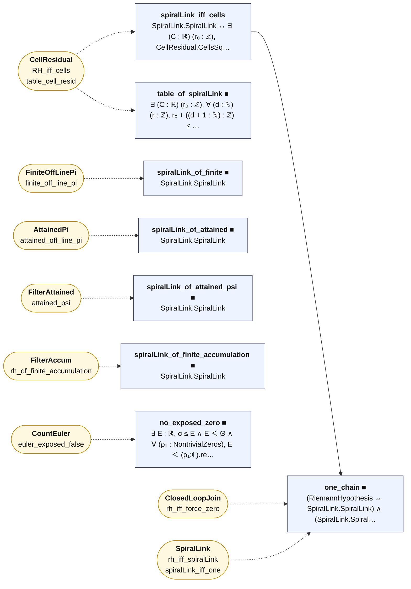

# `lean_stage3/Stage3/OneChain.lean`

> **Read from the source text.** This file changed after the last `python3 utilities/lean_map.py --dump`, so the arrows on this page are names occurring in each proof and have not been confirmed by Lean.

OneChain — block J4 of `lean_stage3/design/closedloop.md`. 2026-11-23. The capstone: Julian's closed loop tied to the tree's main theorems, so that the loop and the tree are one chain of theorems.

8 theorems, 0 definitions, 154 lines. 

**Imports:** [`AttainedPi`](../lean_stage3/AttainedPi.md), [`CellResidual`](../lean_stage3/CellResidual.md), [`ClosedLoopChain`](../lean_stage3/ClosedLoopChain.md), [`CountEuler`](../lean_stage3/CountEuler.md), [`FilterAccum`](../lean_stage3/FilterAccum.md)  
**Imported by:** [`Stage3`](../lean_stage3/Stage3.md), [`HalfSieve`](../lean_stage3/HalfSieve.md), [`RunTheorems`](../lean_stage3/RunTheorems.md)

## The picture



An arrow A → B reads "A is used in the proof of B". Green: counting, integers only. Violet: shape, analysis with no ζ. Blue: reads ζ. A name ending in ■ is an end: nothing else uses it. Red: contains `sorry`. Yellow: theorems in another file, counted; a dotted arrow crosses files. Definitions are not drawn; they are listed below the diagram.

## Theorems

<a name="OneChain-spiralLink_iff_cells"></a>
### `OneChain.spiralLink_iff_cells`

line 54 · arrows read from text

**Reads ζ.** It, or something it rests on, uses the zeta function, its zeros or the Riemann hypothesis.

**Why.** The loop and the table. The spiral link holds exactly when every cell of every dyadic ladder stays at square-root size: a statement about the count of primes with no zero in it.

**Proves**

```lean
SpiralLink.SpiralLink ↔ ∃ (C : ℝ) (r₀ : ℤ), CellResidual.CellsSqrt C r₀
```

**Fed by** (1 theorem its proof uses)

  - [`CellResidual.RH_iff_cells`](../lean_stage3/CellResidual.md#CellResidual-RH_iff_cells) (CellResidual) — `` RiemannHypothesis ↔ ∃ (C : ℝ) (r₀ : ℤ), CellsSqrt C r₀ ``

**Definitions its proof touches:** [`CellResidual.CellsSqrt`](../lean_stage3/CellResidual.md#CellResidual-CellsSqrt), [`SpiralLink.SpiralLink`](../lean_stage3/SpiralLink.md#SpiralLink-SpiralLink)

**Feeds** (1 that use it)

  - [`OneChain.one_chain`](#OneChain-one_chain) — `` (RiemannHypothesis ↔ SpiralLink.SpiralLink) ∧ (SpiralLink.SpiralLink ↔ OneAtEachHeight) ∧ (SpiralLink.SpiralLink ↔ ∀ ρ : NontrivialZeros, restoringFor… ``

<a name="OneChain-one_chain"></a>
### `OneChain.one_chain`

line 61 · arrows read from text

**Reads ζ.** It, or something it rests on, uses the zeta function, its zeros or the Riemann hypothesis.

**Why.** One chain. The Riemann hypothesis, the spiral link, one zero at each height, the restoring force at rest at every zero, and every cell of every dyadic ladder at square-root size are one statement.

**Proves**

```lean
(RiemannHypothesis ↔ SpiralLink.SpiralLink) ∧ (SpiralLink.SpiralLink ↔ OneAtEachHeight) ∧ (SpiralLink.SpiralLink ↔ ∀ ρ : NontrivialZeros, restoringForce (ρ : ℂ).re = 0) ∧ (SpiralLink.SpiralLink ↔ ∃ (C : ℝ) (r₀ : ℤ), CellResidual.CellsSqrt C r₀)
```

**Fed by** (4 theorems its proof uses)

  - [`ClosedLoopJoin.rh_iff_force_zero`](../lean_stage3/ClosedLoopJoin.md#ClosedLoopJoin-rh_iff_force_zero) (ClosedLoopJoin) — `` RiemannHypothesis ↔ ∀ ρ : NontrivialZeros, restoringForce (ρ : ℂ).re = 0 ``
  - [`OneChain.spiralLink_iff_cells`](#OneChain-spiralLink_iff_cells) — `` SpiralLink.SpiralLink ↔ ∃ (C : ℝ) (r₀ : ℤ), CellResidual.CellsSqrt C r₀ ``
  - [`SpiralLink.rh_iff_spiralLink`](../lean_stage3/SpiralLink.md#SpiralLink-rh_iff_spiralLink) (SpiralLink) — `` RiemannHypothesis ↔ SpiralLink ``
  - [`SpiralLink.spiralLink_iff_one`](../lean_stage3/SpiralLink.md#SpiralLink-spiralLink_iff_one) (SpiralLink) — `` SpiralLink ↔ OneAtEachHeight ``

**Definitions its proof touches:** [`CellResidual.CellsSqrt`](../lean_stage3/CellResidual.md#CellResidual-CellsSqrt), [`ClosedLoopJoin.restoringForce`](../lean_stage3/ClosedLoopJoin.md#ClosedLoopJoin-restoringForce), [`SpiralLink.OneAtEachHeight`](../lean_stage3/SpiralLink.md#SpiralLink-OneAtEachHeight), [`SpiralLink.SpiralLink`](../lean_stage3/SpiralLink.md#SpiralLink-SpiralLink)

**Feeds:** nothing. It is an end.

<a name="OneChain-table_of_spiralLink"></a>
### `OneChain.table_of_spiralLink`

line 71 · arrows read from text

**Reads ζ.** It, or something it rests on, uses the zeta function, its zeros or the Riemann hypothesis.

**Why.** From the loop to the integer table. If the spiral link holds, every cell of the integer table stays within square-root size of the smooth cell.

**Proves**

```lean
∃ (C : ℝ) (r₀ : ℤ), ∀ (d : ℕ) (r : ℤ), r₀ + ((d + 1 : ℕ) : ℤ) ≤ r → |((Construction.tableFrom TableRoute.rowN r d : ℤ) : ℝ) - Nonvanishing.stencilR (d + 1) (fun m : ℤ => Stage3.Li ((2 : ℝ) ^ (m : ℝ))) r| ≤ C * CellResidual.cellSize r d
```

**Needs** (its hypotheses)

  - `` h : SpiralLink.SpiralLink ``

**Fed by** (1 theorem its proof uses)

  - [`CellResidual.table_cell_resid`](../lean_stage3/CellResidual.md#CellResidual-table_cell_resid) (CellResidual) — `` ∃ (C : ℝ) (r₀ : ℤ), ∀ (d : ℕ) (r : ℤ), r₀ + ((d + 1 : ℕ) : ℤ) ≤ r → |((Construction.tableFrom TableRoute.rowN r d : ℤ) : ℝ) - stencilR (d + 1) (fun m … ``

**Definitions its proof touches:** [`Construction.tableFrom`](../lean/Construction.md#Construction-tableFrom), [`Nonvanishing.stencilR`](../lean/Nonvanishing.md#Nonvanishing-stencilR), [`CellResidual.cellSize`](../lean_stage3/CellResidual.md#CellResidual-cellSize), [`Stage3.Li`](../lean_stage3/PsiToPi.md#Stage3-Li), [`SpiralLink.SpiralLink`](../lean_stage3/SpiralLink.md#SpiralLink-SpiralLink), [`TableRoute.rowN`](../lean_stage3/TableRoute.md#TableRoute-rowN)

**Feeds:** nothing. It is an end.

<a name="OneChain-spiralLink_of_finite"></a>
### `OneChain.spiralLink_of_finite`

line 79 · arrows read from text

**Reads ζ.** It, or something it rests on, uses the zeta function, its zeros or the Riemann hypothesis.

**Why.** From the count's ladder to the loop, finitely many zeros off the line.

**Proves**

```lean
SpiralLink.SpiralLink
```

**Needs** (its hypotheses)

  - `` F : Finset NontrivialZeros ``
  - `` hF : ∀ ρ : NontrivialZeros, (ρ : ℂ).re ≠ 1 / 2 → ρ ∈ F ``
  - `` C : ℝ ``
  - `` hrows : ∀ᶠ r : ℕ in Filter.atTop, |(Nat.primeCounting ⌊(2:ℝ) ^ r⌋₊ : ℝ) - Stage3.Li ((2:ℝ) ^ r)| ≤ C * (r : ℝ) ^ 2 * Real.sqrt 2 ^ r ``

**Fed by** (1 theorem its proof uses)

  - [`FiniteOffLinePi.finite_off_line_pi`](../lean_stage3/FiniteOffLinePi.md#FiniteOffLinePi-finite_off_line_pi) (FiniteOffLinePi) — `` RiemannHypothesis ``

**Definitions its proof touches:** [`Stage3.Li`](../lean_stage3/PsiToPi.md#Stage3-Li), [`SpiralLink.SpiralLink`](../lean_stage3/SpiralLink.md#SpiralLink-SpiralLink)

**Feeds:** nothing. It is an end.

<a name="OneChain-spiralLink_of_attained"></a>
### `OneChain.spiralLink_of_attained`

line 87 · arrows read from text

**Reads ζ.** It, or something it rests on, uses the zeta function, its zeros or the Riemann hypothesis.

**Why.** From the count's ladder to the loop, a largest real part attained.

**Proves**

```lean
SpiralLink.SpiralLink
```

**Needs** (its hypotheses)

  - `` ρ₀ : NontrivialZeros ``
  - `` hmax : ∀ ρ : NontrivialZeros, (ρ : ℂ).re ≤ (ρ₀ : ℂ).re ``
  - `` C : ℝ ``
  - `` hrows : ∀ᶠ r : ℕ in Filter.atTop, |(Nat.primeCounting ⌊(2:ℝ) ^ r⌋₊ : ℝ) - Stage3.Li ((2:ℝ) ^ r)| ≤ C * (r : ℝ) ^ 2 * Real.sqrt 2 ^ r ``

**Fed by** (1 theorem its proof uses)

  - [`AttainedPi.attained_off_line_pi`](../lean_stage3/AttainedPi.md#AttainedPi-attained_off_line_pi) (AttainedPi) — `` RiemannHypothesis ``

**Definitions its proof touches:** [`Stage3.Li`](../lean_stage3/PsiToPi.md#Stage3-Li), [`SpiralLink.SpiralLink`](../lean_stage3/SpiralLink.md#SpiralLink-SpiralLink)

**Feeds:** nothing. It is an end.

<a name="OneChain-spiralLink_of_attained_psi"></a>
### `OneChain.spiralLink_of_attained_psi`

line 95 · arrows read from text

**Reads ζ.** It, or something it rests on, uses the zeta function, its zeros or the Riemann hypothesis.

**Why.** From ψ's ladder to the loop, a largest real part attained.

**Proves**

```lean
SpiralLink.SpiralLink
```

**Needs** (its hypotheses)

  - `` hH : ∀ k : ℕ, 1 ≤ k → ‖(Chebyshev.psi ((2:ℝ)^k) : ℂ) - (((2:ℝ)^k : ℝ) : ℂ)‖ ≤ C * (k:ℝ)^2 * Real.sqrt 2 ^ k ``
  - `` ρ₀ : NontrivialZeros ``
  - `` hmax : ∀ ρ : NontrivialZeros, (ρ : ℂ).re ≤ (ρ₀ : ℂ).re ``

**Fed by** (1 theorem its proof uses)

  - [`FilterAttained.attained_psi`](../lean_stage3/FilterAttained.md#FilterAttained-attained_psi) (FilterAttained) — `` RiemannHypothesis ``

**Definitions its proof touches:** [`SpiralLink.SpiralLink`](../lean_stage3/SpiralLink.md#SpiralLink-SpiralLink)

**Feeds:** nothing. It is an end.

<a name="OneChain-spiralLink_of_finite_accumulation"></a>
### `OneChain.spiralLink_of_finite_accumulation`

line 103 · arrows read from text

**Reads ζ.** It, or something it rests on, uses the zeta function, its zeros or the Riemann hypothesis.

**Why.** From ψ's ladder to the loop, modes accumulating at finitely many points.

**Proves**

```lean
SpiralLink.SpiralLink
```

**Needs** (its hypotheses)

  - `` hH : ∀ k : ℕ, 1 ≤ k → ‖(Chebyshev.psi ((2:ℝ)^k) : ℂ) - (((2:ℝ)^k : ℝ) : ℂ)‖ ≤ C * (k:ℝ)^2 * Real.sqrt 2 ^ k ``
  - `` hfin : ∀ σ : ℝ, 1/2 < σ → ∃ P : Finset ℂ, (∀ p ∈ P, p ≠ 0) ∧ (∀ ε : ℝ, 0 < ε → {z : ℂ | ∃ ρ : NontrivialZeros, σ ≤ (ρ : ℂ).re ∧ (2:ℂ) ^ (ρ : ℂ) = z ∧ ∀ p ∈ P, ε ≤ ‖z - p‖}.Finite) ∧ (∀ ρ : NontrivialZeros, σ < (ρ : ℂ).re → (2:ℂ) ^ (ρ : ℂ) ∉ P) ``

**Fed by** (1 theorem its proof uses)

  - [`FilterAccum.rh_of_finite_accumulation`](../lean_stage3/FilterAccum.md#FilterAccum-rh_of_finite_accumulation) (FilterAccum) — `` RiemannHypothesis ``

**Definitions its proof touches:** [`SpiralLink.SpiralLink`](../lean_stage3/SpiralLink.md#SpiralLink-SpiralLink)

**Feeds:** nothing. It is an end.

<a name="OneChain-no_exposed_zero"></a>
### `OneChain.no_exposed_zero`

line 118 · arrows read from text

**Reads ζ.** It, or something it rests on, uses the zeta function, its zeros or the Riemann hypothesis.

**Why.** The count's ladder excludes an exposed zero. Under the square-root bound on the count at the doublings there is an exponent below the bound on the real parts such that no zero right of it has its mode strictly outside a disc, centred on the ray opposite to it, that holds the mode of every other zero right of the line.

**Proves**

```lean
∃ E : ℝ, σ ≤ E ∧ E < Θ ∧ ∀ (ρ₁ : NontrivialZeros), E < (ρ₁:ℂ).re → ∀ κ r₀ : ℝ, 0 ≤ κ → r₀ < ‖(2:ℂ)^(ρ₁:ℂ)‖ + κ → (∀ ρ : NontrivialZeros, σ ≤ (ρ:ℂ).re → (2:ℂ)^(ρ:ℂ) ≠ (2:ℂ)^(ρ₁:ℂ) → ‖(2:ℂ)^(ρ:ℂ) + (κ:ℂ) * ((2:ℂ)^(ρ₁:ℂ) / ‖(2:ℂ)^(ρ₁:ℂ)‖)‖ ≤ r₀) → False
```

**Needs** (its hypotheses)

  - `` hH : ∀ k : ℕ, 1 ≤ k → |(Nat.primeCounting ⌊(2:ℝ)^k⌋₊ : ℝ) - Stage3.Li ((2:ℝ)^k)| ≤ C * (k:ℝ)^2 * Real.sqrt 2 ^ k ``
  - `` hσ : 1/2 < σ ``
  - `` hσΘ : σ < Θ ``
  - `` hΘ1 : Θ ≤ 1 ``
  - `` hΘ : ∀ ρ : NontrivialZeros, (ρ:ℂ).re ≤ Θ ``

**Fed by** (1 theorem its proof uses)

  - [`CountEuler.euler_exposed_false`](../lean_stage3/CountEuler.md#CountEuler-euler_exposed_false) (CountEuler) — `` ∃ E : ℝ, σ ≤ E ∧ E < Θ ∧ ∀ (ρ₁ : Kadiri.NontrivialZeros), E < (ρ₁:ℂ).re → ∀ κ r₀ : ℝ, 0 ≤ κ → r₀ < ‖(2:ℂ)^(ρ₁:ℂ)‖ + κ → (∀ ρ : Kadiri.NontrivialZeros,… ``

**Definitions its proof touches:** [`Stage3.Li`](../lean_stage3/PsiToPi.md#Stage3-Li)

**Feeds:** nothing. It is an end.

