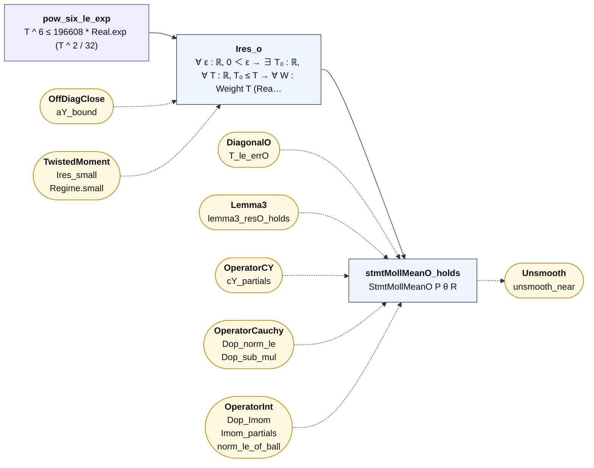

# `lean_stage3/Stage3/Operator.lean`

> **Read from the source text.** This file changed after the last `python3 utilities/lean_map.py --dump`, so the arrows on this page are names occurring in each proof and have not been confirmed by Lean.

# Operator — block S12 of `lean_stage3/design/stencil.md`, piece 3, the operator: the mollified mean of Levinson's `G`. 2026-11-25.

3 theorems, 1 definition, 311 lines. 

**Imports:** [`Lemma3`](../lean_stage3/Lemma3.md), [`OperatorCY`](../lean_stage3/OperatorCY.md), [`OperatorInt`](../lean_stage3/OperatorInt.md)  
**Imported by:** [`Stage3`](../lean_stage3/Stage3.md), [`UnsmoothCY`](../lean_stage3/UnsmoothCY.md)

## The picture



An arrow A → B reads "A is used in the proof of B". Green: counting, integers only. Violet: shape, analysis with no ζ. Blue: reads ζ. A name ending in ■ is an end: nothing else uses it. Red: contains `sorry`. Yellow: theorems in another file, counted; a dotted arrow crosses files. Definitions are not drawn; they are listed below the diagram.

## Definitions

<a name="Operator-StmtMollMeanO"></a>
### `Operator.StmtMollMeanO`

def · line 48

- **Is:** `` StmtMollMeanO (P : Polynomial ℝ) (θ R : ℝ) : Prop := ∀ Cs : ℕ → ℝ, ∀ ε : ℝ, 0 < ε → ∃ T₀ : ℝ, ∀ T : ℝ, T₀ ≤ T → ∀ W : WeightAll T (Real.log T), (∀ j, W.Cj j ≤ Cs j) → ‖mollMean W.toWeight (Mof T θ) (aY P T θ R) (sig0 T R) (Real.log T) - Dop (Real.log T) (cY P (Mof T θ) T) ((-(R / Real.log T) : ℝ) : ℂ) ((-(R / Real.log T) : ℝ) : ℂ) * (what0 W.toWeight : ℂ)‖ ≤ ε * errO W.toWeight ``
- **Built from:** [`DiagMainStmt.errO`](../lean_stage3/DiagMainStmt.md#DiagMainStmt-errO), [`OffDiagClose.WeightAll`](../lean_stage3/OffDiagClose.md#OffDiagClose-WeightAll), [`Operator.Dop`](../lean_stage3/OperatorCauchy.md#Operator-Dop), [`Operator.mollMean`](../lean_stage3/OperatorInt.md#Operator-mollMean), [`TwistedMoment.Mof`](../lean_stage3/TwistedMoment.md#TwistedMoment-Mof), [`TwistedMoment.aY`](../lean_stage3/TwistedMoment.md#TwistedMoment-aY), [`TwistedMoment.cY`](../lean_stage3/TwistedMoment.md#TwistedMoment-cY), [`TwistedMoment.sig0`](../lean_stage3/TwistedMoment.md#TwistedMoment-sig0), [`TwistedMoment.what0`](../lean_stage3/TwistedMoment.md#TwistedMoment-what0)
- **Used by 3:** [`FloorLong.floor_of_long`](../lean_stage3/FloorLong.md#FloorLong-floor_of_long), [`FloorLong.floor_step_long`](../lean_stage3/FloorLongStep.md#FloorLong-floor_step_long), [`Operator.stmtMollMeanO_holds`](#Operator-stmtMollMeanO_holds)

## Theorems

<a name="Operator-pow_six_le_exp"></a>
### `Operator.pow_six_le_exp`

line 57 · arrows read from text

**Shape.** Uses real or complex analysis; nothing in it or beneath it reads ζ.

**Why.** `T⁶ ≤ 196608 e^(T²/32)`, from `x³/3! ≤ eˣ`.

**Proves**

```lean
T ^ 6 ≤ 196608 * Real.exp (T ^ 2 / 32)
```

**Needs** (its hypotheses)

  - `` T : ℝ ``

**Fed by:** no theorem of this repo; it stands on Mathlib.

**Feeds** (1 that use it)

  - [`Operator.Ires_o`](#Operator-Ires_o) — `` ∀ ε : ℝ, 0 < ε → ∃ T₀ : ℝ, ∀ T : ℝ, T₀ ≤ T → ∀ W : Weight T (Real.log T), ∀ α β : ℂ, Regime κ T α β → ‖Ires W (Mof T θ) (aY P T θ R) (sig0 T R) α β‖ ≤… ``

<a name="Operator-Ires_o"></a>
### `Operator.Ires_o`

line 66 · arrows read from text

**Reads ζ.** It, or something it rests on, uses the zeta function, its zeros or the Riemann hypothesis.

**Why.** The remainder is `o(T)`, uniformly on `Regime κ T`.

**Proves**

```lean
∀ ε : ℝ, 0 < ε → ∃ T₀ : ℝ, ∀ T : ℝ, T₀ ≤ T → ∀ W : Weight T (Real.log T), ∀ α β : ℂ, Regime κ T α β → ‖Ires W (Mof T θ) (aY P T θ R) (sig0 T R) α β‖ ≤ ε * T
```

**Needs** (its hypotheses)

  - `` P : Polynomial ℝ ``
  - `` hθ1 : θ ≤ 1 ``
  - `` R : ℝ ``
  - `` hκ : 0 < κ ``

**Fed by** (4 theorems its proof uses)

  - [`OffDiagClose.aY_bound`](../lean_stage3/OffDiagClose.md#OffDiagClose-aY_bound) (OffDiagClose) — `` ∃ B : ℝ, 0 ≤ B ∧ ∀ (T θ R : ℝ) (h : ℕ), 1 ≤ h → h ≤ Mof T θ → ‖aY P T θ R h‖ * (h : ℝ) ^ (-sig0 T R) ≤ B ``
  - [`Operator.pow_six_le_exp`](#Operator-pow_six_le_exp) — `` T ^ 6 ≤ 196608 * Real.exp (T ^ 2 / 32) ``
  - [`TwistedMoment.Ires_small`](../lean_stage3/TwistedMoment.md#TwistedMoment-Ires_small) (TwistedMoment) — `` ∃ C : ℝ, 0 ≤ C ∧ ∀ (T L : ℝ) (W : Weight T L), 4 ≤ T → ∀ (M : ℕ) (a : ℕ → ℂ) (σ₀ : ℝ) (α β : ℂ), ‖α‖ ≤ 1 / 10 → ‖β‖ ≤ 1 / 10 → ‖Ires W M a σ₀ α β‖ ≤ C… ``
  - [`TwistedMoment.Regime.small`](../lean_stage3/TwistedMoment.md#TwistedMoment-Regime-small) (TwistedMoment) — `` ‖α‖ ≤ 1 / 10 ∧ ‖β‖ ≤ 1 / 10 ∧ α + β ≠ 0 ∧ 0 < Real.log T ``

**Definitions its proof touches:** [`TwistedMoment.Ires`](../lean_stage3/TwistedMoment.md#TwistedMoment-Ires), [`TwistedMoment.Mof`](../lean_stage3/TwistedMoment.md#TwistedMoment-Mof), [`TwistedMoment.Regime`](../lean_stage3/TwistedMoment.md#TwistedMoment-Regime), [`TwistedMoment.Weight`](../lean_stage3/TwistedMoment.md#TwistedMoment-Weight), [`TwistedMoment.aY`](../lean_stage3/TwistedMoment.md#TwistedMoment-aY), [`TwistedMoment.sig0`](../lean_stage3/TwistedMoment.md#TwistedMoment-sig0)

**Feeds** (1 that use it)

  - [`Operator.stmtMollMeanO_holds`](#Operator-stmtMollMeanO_holds) — `` StmtMollMeanO P θ R ``

<a name="Operator-stmtMollMeanO_holds"></a>
### `Operator.stmtMollMeanO_holds`

line 143 · arrows read from text

**Reads ζ.** It, or something it rests on, uses the zeta function, its zeros or the Riemann hypothesis.

**Why.** The mollified mean of Levinson's `G`, `o(T)`, unconditional: Lemma 3 at `o(T)` and Cauchy's estimate on circles of radius `R/(2L)`.

**Proves**

```lean
StmtMollMeanO P θ R
```

**Needs** (its hypotheses)

  - `` P : Polynomial ℝ ``
  - `` hP0 : P.eval 0 = 0 ``
  - `` hθ0 : 0 < θ ``
  - `` hθ : θ < 1 / 2 ``
  - `` hR : 0 < R ``

**Fed by** (9 theorems its proof uses)

  - [`DiagonalO.T_le_errO`](../lean_stage3/DiagonalO.md#DiagonalO-T_le_errO) (DiagonalO) — `` T ≤ errO W ``
  - [`Lemma3.lemma3_resO_holds`](../lean_stage3/Lemma3.md#Lemma3-lemma3_resO_holds) (Lemma3) — `` StmtLemma3resO P θ R κ ``
  - [`Operator.Ires_o`](#Operator-Ires_o) — `` ∀ ε : ℝ, 0 < ε → ∃ T₀ : ℝ, ∀ T : ℝ, T₀ ≤ T → ∀ W : Weight T (Real.log T), ∀ α β : ℂ, Regime κ T α β → ‖Ires W (Mof T θ) (aY P T θ R) (sig0 T R) α β‖ ≤… ``
  - [`Operator.cY_partials`](../lean_stage3/OperatorCY.md#Operator-cY_partials) (OperatorCY) — `` DifferentiableAt ℂ (fun x => cY P M T x y) x ∧ DifferentiableAt ℂ (fun y => cY P M T x y) y ∧ DifferentiableAt ℂ (fun y => pa (cY P M T) x y) y ``
  - [`Operator.Dop_norm_le`](../lean_stage3/OperatorCauchy.md#Operator-Dop_norm_le) (OperatorCauchy) — `` ‖Dop L F α₀ β₀‖ ≤ S * (1 + 2 / r + 1 / r ^ 2) ``
  - [`Operator.Dop_sub_mul`](../lean_stage3/OperatorCauchy.md#Operator-Dop_sub_mul) (OperatorCauchy) — `` Dop L (fun x y => A x y - B x y * c) α₀ β₀ = Dop L A α₀ β₀ - Dop L B α₀ β₀ * c ``
  - [`Operator.Dop_Imom`](../lean_stage3/OperatorInt.md#Operator-Dop_Imom) (OperatorInt) — `` Dop L' (Imom W M a σ₀) ((σ₀ - 1 / 2 : ℝ) : ℂ) ((σ₀ - 1 / 2 : ℝ) : ℂ) = mollMean W M a σ₀ L' ``
  - [`Operator.Imom_partials`](../lean_stage3/OperatorInt.md#Operator-Imom_partials) (OperatorInt) — `` DifferentiableAt ℂ (fun x => Imom W M a σ₀ x y) x ∧ DifferentiableAt ℂ (fun y => Imom W M a σ₀ x y) y ∧ pa (Imom W M a σ₀) x y = Jfg (deriv riemannZet… ``
  - [`Operator.norm_le_of_ball`](../lean_stage3/OperatorInt.md#Operator-norm_le_of_ball) (OperatorInt) — `` ‖x‖ ≤ ‖x₀‖ + δ ``

**Definitions its proof touches:** [`DiagMainStmt.errO`](../lean_stage3/DiagMainStmt.md#DiagMainStmt-errO), [`Operator.StmtMollMeanO`](#Operator-StmtMollMeanO), [`Operator.Dop`](../lean_stage3/OperatorCauchy.md#Operator-Dop), [`Operator.pa`](../lean_stage3/OperatorCauchy.md#Operator-pa), [`Operator.mollMean`](../lean_stage3/OperatorInt.md#Operator-mollMean), [`TwistedMoment.Imom`](../lean_stage3/TwistedMoment.md#TwistedMoment-Imom), [`TwistedMoment.Mof`](../lean_stage3/TwistedMoment.md#TwistedMoment-Mof), [`TwistedMoment.Regime`](../lean_stage3/TwistedMoment.md#TwistedMoment-Regime), [`TwistedMoment.aY`](../lean_stage3/TwistedMoment.md#TwistedMoment-aY), [`TwistedMoment.cY`](../lean_stage3/TwistedMoment.md#TwistedMoment-cY), [`TwistedMoment.sig0`](../lean_stage3/TwistedMoment.md#TwistedMoment-sig0), [`TwistedMoment.what0`](../lean_stage3/TwistedMoment.md#TwistedMoment-what0)

**Feeds** (1 that use it)

  - [`Unsmooth.unsmooth_near`](../lean_stage3/Unsmooth.md#Unsmooth-unsmooth_near) (Unsmooth) — `` ∀ ε : ℝ, 0 < ε → ∃ T₀ : ℝ, ∀ T : ℝ, T₀ ≤ T → ∀ a' b' : ℝ, T / 2 ≤ a' → a' ≤ T / 2 + 1 → T - 1 ≤ b' → b' ≤ T → (1 / (b' - a')) * ∫ t in a'..b', ‖Gl (Re… ``

