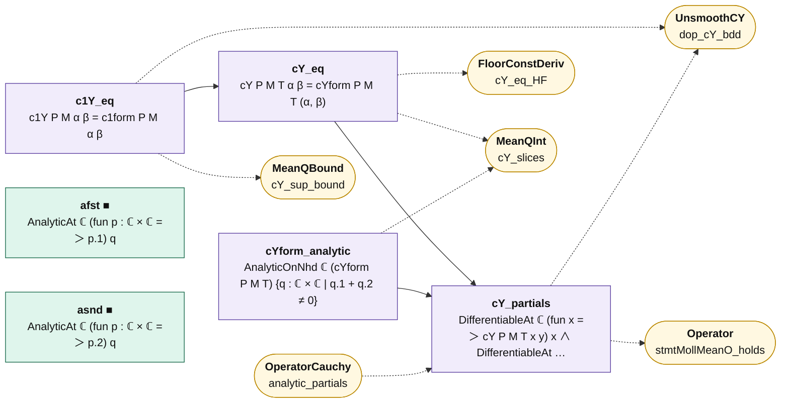

# `lean_stage3/Stage3/OperatorCY.lean`

> **Read from the source text.** This file changed after the last `python3 utilities/lean_map.py --dump`, so the arrows on this page are names occurring in each proof and have not been confirmed by Lean.

# OperatorCY — block S12 of `lean_stage3/design/stencil.md`, piece 3, the operator: `c(α,β)` is analytic. 2026-11-25.

6 theorems, 5 definitions, 128 lines. 

**Imports:** [`OperatorCauchy`](../lean_stage3/OperatorCauchy.md), [`TwistedMoment`](../lean_stage3/TwistedMoment.md)  
**Imported by:** [`FloorConstDeriv`](../lean_stage3/FloorConstDeriv.md), [`MeanQInt`](../lean_stage3/MeanQInt.md), [`Operator`](../lean_stage3/Operator.md)

## The picture



An arrow A → B reads "A is used in the proof of B". Green: counting, integers only. Violet: shape, analysis with no ζ. Blue: reads ζ. A name ending in ■ is an end: nothing else uses it. Red: contains `sorry`. Yellow: theorems in another file, counted; a dotted arrow crosses files. Definitions are not drawn; they are listed below the diagram.

## Definitions

<a name="Operator-Aq"></a>
### `Operator.Aq`

def · line 29

`A = ∫₀¹ P′(u)² du`.

- **Is:** `` Aq (P : Polynomial ℝ) : ℂ := ∫ u in (0 : ℝ)..1, ((P.derivative.eval u : ℝ) : ℂ) * ((P.derivative.eval u : ℝ) : ℂ) ``
- **Used by 12:** [`FloorConst.cY_eq_HF`](../lean_stage3/FloorConstDeriv.md#FloorConst-cY_eq_HF), [`FloorConst.pa_cY`](../lean_stage3/FloorConstDeriv.md#FloorConst-pa_cY), [`FloorConst.pab_cY`](../lean_stage3/FloorConstDeriv.md#FloorConst-pab_cY), [`FloorConst.pb_cY`](../lean_stage3/FloorConstDeriv.md#FloorConst-pb_cY), [`FloorConst.Aq_eq`](../lean_stage3/FloorConstLimit.md#FloorConst-Aq_eq), [`FloorConstQ.cY_eq_FF`](../lean_stage3/FloorConstQLimit.md#FloorConstQ-cY_eq_FF), [`FloorConstQ.dopQ_cY_eq`](../lean_stage3/FloorConstQLimit.md#FloorConstQ-dopQ_cY_eq), [`MeanQ.cY_sup_bound`](../lean_stage3/MeanQBound.md#MeanQ-cY_sup_bound), [`Operator.c1Y_eq`](#Operator-c1Y_eq), [`Operator.c1form`](#Operator-c1form), [`Unsmooth.c1form_norm_le`](../lean_stage3/UnsmoothCY.md#Unsmooth-c1form_norm_le), [`Unsmooth.dop_cY_bdd`](../lean_stage3/UnsmoothCY.md#Unsmooth-dop_cY_bdd)

<a name="Operator-Bq"></a>
### `Operator.Bq`

def · line 33

`B = ∫₀¹ P′(u) P(u) du`.

- **Is:** `` Bq (P : Polynomial ℝ) : ℂ := ∫ u in (0 : ℝ)..1, ((P.derivative.eval u : ℝ) : ℂ) * ((P.eval u : ℝ) : ℂ) ``
- **Used by 12:** [`FloorConst.cY_eq_HF`](../lean_stage3/FloorConstDeriv.md#FloorConst-cY_eq_HF), [`FloorConst.pa_cY`](../lean_stage3/FloorConstDeriv.md#FloorConst-pa_cY), [`FloorConst.pab_cY`](../lean_stage3/FloorConstDeriv.md#FloorConst-pab_cY), [`FloorConst.pb_cY`](../lean_stage3/FloorConstDeriv.md#FloorConst-pb_cY), [`FloorConst.Bq_eq`](../lean_stage3/FloorConstLimit.md#FloorConst-Bq_eq), [`FloorConstQ.cY_eq_FF`](../lean_stage3/FloorConstQLimit.md#FloorConstQ-cY_eq_FF), [`FloorConstQ.dopQ_cY_eq`](../lean_stage3/FloorConstQLimit.md#FloorConstQ-dopQ_cY_eq), [`MeanQ.cY_sup_bound`](../lean_stage3/MeanQBound.md#MeanQ-cY_sup_bound), [`Operator.c1Y_eq`](#Operator-c1Y_eq), [`Operator.c1form`](#Operator-c1form), [`Unsmooth.c1form_norm_le`](../lean_stage3/UnsmoothCY.md#Unsmooth-c1form_norm_le), [`Unsmooth.dop_cY_bdd`](../lean_stage3/UnsmoothCY.md#Unsmooth-dop_cY_bdd)

<a name="Operator-Cq"></a>
### `Operator.Cq`

def · line 37

`C = ∫₀¹ P(u)² du`.

- **Is:** `` Cq (P : Polynomial ℝ) : ℂ := ∫ u in (0 : ℝ)..1, ((P.eval u : ℝ) : ℂ) * ((P.eval u : ℝ) : ℂ) ``
- **Used by 12:** [`FloorConst.cY_eq_HF`](../lean_stage3/FloorConstDeriv.md#FloorConst-cY_eq_HF), [`FloorConst.pa_cY`](../lean_stage3/FloorConstDeriv.md#FloorConst-pa_cY), [`FloorConst.pab_cY`](../lean_stage3/FloorConstDeriv.md#FloorConst-pab_cY), [`FloorConst.pb_cY`](../lean_stage3/FloorConstDeriv.md#FloorConst-pb_cY), [`FloorConst.Cq_eq`](../lean_stage3/FloorConstLimit.md#FloorConst-Cq_eq), [`FloorConstQ.cY_eq_FF`](../lean_stage3/FloorConstQLimit.md#FloorConstQ-cY_eq_FF), [`FloorConstQ.dopQ_cY_eq`](../lean_stage3/FloorConstQLimit.md#FloorConstQ-dopQ_cY_eq), [`MeanQ.cY_sup_bound`](../lean_stage3/MeanQBound.md#MeanQ-cY_sup_bound), [`Operator.c1Y_eq`](#Operator-c1Y_eq), [`Operator.c1form`](#Operator-c1form), [`Unsmooth.c1form_norm_le`](../lean_stage3/UnsmoothCY.md#Unsmooth-c1form_norm_le), [`Unsmooth.dop_cY_bdd`](../lean_stage3/UnsmoothCY.md#Unsmooth-dop_cY_bdd)

<a name="Operator-c1form"></a>
### `Operator.c1form`

def · line 41

The closed form of `c₁(α,β)`, `ℓ = log M`.

- **Is:** `` c1form (P : Polynomial ℝ) (M : ℕ) (α β : ℂ) : ℂ := (α + β)⁻¹ * ((Real.log M : ℝ) : ℂ)⁻¹ * (Aq P + (α + β) * ((Real.log M : ℝ) : ℂ) * Bq P + α * β * ((Real.log M : ℝ) : ℂ) ^ 2 * Cq P) ``
- **Built from:** [`Operator.Aq`](#Operator-Aq), [`Operator.Bq`](#Operator-Bq), [`Operator.Cq`](#Operator-Cq)
- **Used by 5:** [`FloorConst.cY_eq_HF`](../lean_stage3/FloorConstDeriv.md#FloorConst-cY_eq_HF), [`Operator.c1Y_eq`](#Operator-c1Y_eq), [`Operator.cYform`](#Operator-cYform), [`Operator.cYform_analytic`](#Operator-cYform_analytic), [`Unsmooth.c1form_norm_le`](../lean_stage3/UnsmoothCY.md#Unsmooth-c1form_norm_le)

<a name="Operator-cYform"></a>
### `Operator.cYform`

def · line 47

The closed form of `c(α,β)` on `ℂ × ℂ`, with `T^(−α−β) = exp(log T · (−(α+β)))`.

- **Is:** `` cYform (P : Polynomial ℝ) (M : ℕ) (T : ℝ) (q : ℂ × ℂ) : ℂ := c1form P M q.1 q.2 + cexp (Complex.log (T : ℂ) * (-(q.1 + q.2))) * c1form P M (-q.2) (-q.1) ``
- **Built from:** [`Operator.c1form`](#Operator-c1form)
- **Used by 5:** [`FloorConst.cY_eq_HF`](../lean_stage3/FloorConstDeriv.md#FloorConst-cY_eq_HF), [`MeanQ.cY_slices`](../lean_stage3/MeanQInt.md#MeanQ-cY_slices), [`Operator.cY_eq`](#Operator-cY_eq), [`Operator.cY_partials`](#Operator-cY_partials), [`Operator.cYform_analytic`](#Operator-cYform_analytic)

## Theorems

<a name="Operator-c1Y_eq"></a>
### `Operator.c1Y_eq`

line 53 · arrows read from text

**Shape.** Uses real or complex analysis; nothing in it or beneath it reads ζ.

**Why.** `c₁` in closed form.

**Proves**

```lean
c1Y P M α β = c1form P M α β
```

**Needs** (its hypotheses)

  - `` P : Polynomial ℝ ``
  - `` M : ℕ ``
  - `` α β : ℂ ``

**Fed by:** no theorem of this repo; it stands on Mathlib and the definitions below.

**Definitions its proof touches:** [`Operator.Aq`](#Operator-Aq), [`Operator.Bq`](#Operator-Bq), [`Operator.Cq`](#Operator-Cq), [`Operator.c1form`](#Operator-c1form), [`TwistedMoment.c1Y`](../lean_stage3/TwistedMoment.md#TwistedMoment-c1Y)

**Feeds** (3 that use it)

  - [`MeanQ.cY_sup_bound`](../lean_stage3/MeanQBound.md#MeanQ-cY_sup_bound) (MeanQBound) — `` ∃ K : ℝ, 0 ≤ K ∧ ∃ T₀ : ℝ, ∀ T : ℝ, T₀ ≤ T → ∀ x ∈ closedBall (((-(R / Real.log T) : ℝ) : ℂ)) (R / 2 / Real.log T), ∀ y ∈ closedBall (((-(R / Real.log… ``
  - [`Operator.cY_eq`](#Operator-cY_eq) — `` cY P M T α β = cYform P M T (α, β) ``
  - [`Unsmooth.dop_cY_bdd`](../lean_stage3/UnsmoothCY.md#Unsmooth-dop_cY_bdd) (UnsmoothCY) — `` ∃ K : ℝ, 0 ≤ K ∧ ∃ T₀ : ℝ, ∀ T : ℝ, T₀ ≤ T → ‖Dop (Real.log T) (cY P (Mof T θ) T) ((-(R / Real.log T) : ℝ) : ℂ) ((-(R / Real.log T) : ℝ) : ℂ)‖ ≤ K ``

<a name="Operator-cY_eq"></a>
### `Operator.cY_eq`

line 82 · arrows read from text

**Shape.** Uses real or complex analysis; nothing in it or beneath it reads ζ.

**Why.** `c` in closed form.

**Proves**

```lean
cY P M T α β = cYform P M T (α, β)
```

**Needs** (its hypotheses)

  - `` P : Polynomial ℝ ``
  - `` M : ℕ ``
  - `` hT : T ≠ 0 ``
  - `` α β : ℂ ``

**Fed by** (1 theorem its proof uses)

  - [`Operator.c1Y_eq`](#Operator-c1Y_eq) — `` c1Y P M α β = c1form P M α β ``

**Definitions its proof touches:** [`Operator.cYform`](#Operator-cYform), [`TwistedMoment.cY`](../lean_stage3/TwistedMoment.md#TwistedMoment-cY)

**Feeds** (3 that use it)

  - [`FloorConst.cY_eq_HF`](../lean_stage3/FloorConstDeriv.md#FloorConst-cY_eq_HF) (FloorConstDeriv) — `` cY P M T x y = HF (Aq P) (Bq P) (Cq P) ((Real.log M : ℝ) : ℂ) (Complex.log (T : ℂ)) x y ``
  - [`MeanQ.cY_slices`](../lean_stage3/MeanQInt.md#MeanQ-cY_slices) (MeanQInt) — `` (∀ᶠ y' in 𝓝 y, AnalyticAt ℂ (fun x => cY P M T x y') x) ∧ ∀ k, AnalyticAt ℂ (fun y => iteratedDeriv k (fun x => cY P M T x y) x) y ``
  - [`Operator.cY_partials`](#Operator-cY_partials) — `` DifferentiableAt ℂ (fun x => cY P M T x y) x ∧ DifferentiableAt ℂ (fun y => cY P M T x y) y ∧ DifferentiableAt ℂ (fun y => pa (cY P M T) x y) y ``

<a name="Operator-afst"></a>
### `Operator.afst`

line 87 · arrows read from text

**Counting.** Integers only: nothing in its statement or proof, or in anything it rests on, uses analysis or ζ.

**Proves**

```lean
AnalyticAt ℂ (fun p : ℂ × ℂ => p.1) q
```

**Fed by:** no theorem of this repo; it stands on Mathlib.

**Feeds:** nothing. It connects to nothing.

<a name="Operator-asnd"></a>
### `Operator.asnd`

line 89 · arrows read from text

**Counting.** Integers only: nothing in its statement or proof, or in anything it rests on, uses analysis or ζ.

**Proves**

```lean
AnalyticAt ℂ (fun p : ℂ × ℂ => p.2) q
```

**Fed by:** no theorem of this repo; it stands on Mathlib.

**Feeds:** nothing. It connects to nothing.

<a name="Operator-cYform_analytic"></a>
### `Operator.cYform_analytic`

line 94 · arrows read from text

**Shape.** Uses real or complex analysis; nothing in it or beneath it reads ζ.

**Why.** `cYform` is analytic off `α + β = 0`.

**Proves**

```lean
AnalyticOnNhd ℂ (cYform P M T) {q : ℂ × ℂ | q.1 + q.2 ≠ 0}
```

**Needs** (its hypotheses)

  - `` P : Polynomial ℝ ``
  - `` M : ℕ ``
  - `` T : ℝ ``

**Fed by:** no theorem of this repo; it stands on Mathlib and the definitions below.

**Definitions its proof touches:** [`Operator.c1form`](#Operator-c1form), [`Operator.cYform`](#Operator-cYform)

**Feeds** (2 that use it)

  - [`MeanQ.cY_slices`](../lean_stage3/MeanQInt.md#MeanQ-cY_slices) (MeanQInt) — `` (∀ᶠ y' in 𝓝 y, AnalyticAt ℂ (fun x => cY P M T x y') x) ∧ ∀ k, AnalyticAt ℂ (fun y => iteratedDeriv k (fun x => cY P M T x y) x) y ``
  - [`Operator.cY_partials`](#Operator-cY_partials) — `` DifferentiableAt ℂ (fun x => cY P M T x y) x ∧ DifferentiableAt ℂ (fun y => cY P M T x y) y ∧ DifferentiableAt ℂ (fun y => pa (cY P M T) x y) y ``

<a name="Operator-cY_partials"></a>
### `Operator.cY_partials`

line 106 · arrows read from text

**Shape.** Uses real or complex analysis; nothing in it or beneath it reads ζ.

**Why.** The partials of `c(α,β)`, at `α + β ≠ 0`.

**Proves**

```lean
DifferentiableAt ℂ (fun x => cY P M T x y) x ∧ DifferentiableAt ℂ (fun y => cY P M T x y) y ∧ DifferentiableAt ℂ (fun y => pa (cY P M T) x y) y
```

**Needs** (its hypotheses)

  - `` P : Polynomial ℝ ``
  - `` M : ℕ ``
  - `` hT : T ≠ 0 ``
  - `` hxy : x + y ≠ 0 ``

**Fed by** (3 theorems its proof uses)

  - [`Operator.cY_eq`](#Operator-cY_eq) — `` cY P M T α β = cYform P M T (α, β) ``
  - [`Operator.cYform_analytic`](#Operator-cYform_analytic) — `` AnalyticOnNhd ℂ (cYform P M T) {q : ℂ × ℂ | q.1 + q.2 ≠ 0} ``
  - [`Operator.analytic_partials`](../lean_stage3/OperatorCauchy.md#Operator-analytic_partials) (OperatorCauchy) — `` (∀ p ∈ U, DifferentiableAt ℂ (fun x => f (x, p.2)) p.1) ∧ (∀ p ∈ U, DifferentiableAt ℂ (fun y => f (p.1, y)) p.2) ∧ (∀ p ∈ U, DifferentiableAt ℂ (fun … ``

**Definitions its proof touches:** [`Operator.cYform`](#Operator-cYform), [`Operator.pa`](../lean_stage3/OperatorCauchy.md#Operator-pa), [`TwistedMoment.cY`](../lean_stage3/TwistedMoment.md#TwistedMoment-cY)

**Feeds** (2 that use it)

  - [`Operator.stmtMollMeanO_holds`](../lean_stage3/Operator.md#Operator-stmtMollMeanO_holds) (Operator) — `` StmtMollMeanO P θ R ``
  - [`Unsmooth.dop_cY_bdd`](../lean_stage3/UnsmoothCY.md#Unsmooth-dop_cY_bdd) (UnsmoothCY) — `` ∃ K : ℝ, 0 ≤ K ∧ ∃ T₀ : ℝ, ∀ T : ℝ, T₀ ≤ T → ‖Dop (Real.log T) (cY P (Mof T θ) T) ((-(R / Real.log T) : ℝ) : ℂ) ((-(R / Real.log T) : ℝ) : ℂ)‖ ≤ K ``

