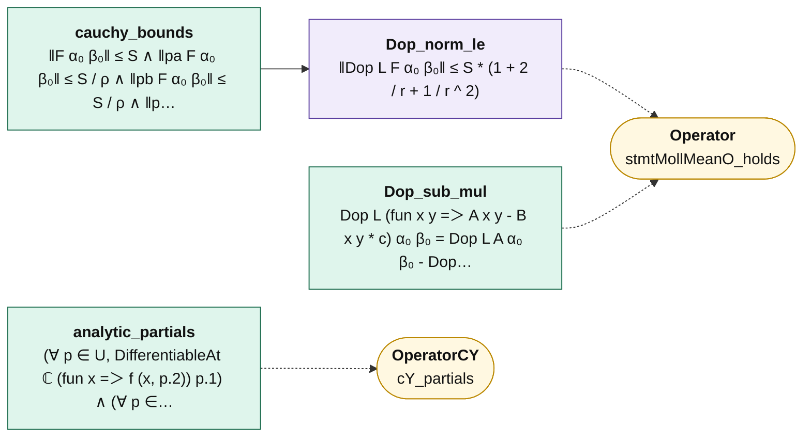

# `lean_stage3/Stage3/OperatorCauchy.lean`

> **Read from the source text.** This file changed after the last `python3 utilities/lean_map.py --dump`, so the arrows on this page are names occurring in each proof and have not been confirmed by Lean.

# OperatorCauchy — block S12 of `lean_stage3/design/stencil.md`, piece 3, the operator: Cauchy's estimate. 2026-11-25.

4 theorems, 4 definitions, 197 lines. 

**Imports:** nothing in this tree  
**Imported by:** [`OperatorCY`](../lean_stage3/OperatorCY.md), [`OperatorInt`](../lean_stage3/OperatorInt.md)

## The picture



An arrow A → B reads "A is used in the proof of B". Green: counting, integers only. Violet: shape, analysis with no ζ. Blue: reads ζ. A name ending in ■ is an end: nothing else uses it. Red: contains `sorry`. Yellow: theorems in another file, counted; a dotted arrow crosses files. Definitions are not drawn; they are listed below the diagram.

## Definitions

<a name="Operator-pa"></a>
### `Operator.pa`

def · line 31

`∂α f (α, β)`.

- **Is:** `` pa (f : ℂ → ℂ → ℂ) (α β : ℂ) : ℂ := deriv (fun x => f x β) α ``
- **Used by 9:** [`Operator.stmtMollMeanO_holds`](../lean_stage3/Operator.md#Operator-stmtMollMeanO_holds), [`Operator.cY_partials`](../lean_stage3/OperatorCY.md#Operator-cY_partials), [`Operator.Dop`](#Operator-Dop), [`Operator.Dop_norm_le`](#Operator-Dop_norm_le), [`Operator.Dop_sub_mul`](#Operator-Dop_sub_mul), [`Operator.analytic_partials`](#Operator-analytic_partials), [`Operator.cauchy_bounds`](#Operator-cauchy_bounds), [`Operator.pab`](#Operator-pab), [`Operator.Imom_partials`](../lean_stage3/OperatorInt.md#Operator-Imom_partials)

<a name="Operator-pb"></a>
### `Operator.pb`

def · line 34

`∂β f (α, β)`.

- **Is:** `` pb (f : ℂ → ℂ → ℂ) (α β : ℂ) : ℂ := deriv (fun y => f α y) β ``
- **Used by 5:** [`Operator.Dop`](#Operator-Dop), [`Operator.Dop_norm_le`](#Operator-Dop_norm_le), [`Operator.Dop_sub_mul`](#Operator-Dop_sub_mul), [`Operator.cauchy_bounds`](#Operator-cauchy_bounds), [`Operator.Imom_partials`](../lean_stage3/OperatorInt.md#Operator-Imom_partials)

<a name="Operator-pab"></a>
### `Operator.pab`

def · line 37

`∂β ∂α f (α, β)`.

- **Is:** `` pab (f : ℂ → ℂ → ℂ) (α β : ℂ) : ℂ := deriv (fun y => pa f α y) β ``
- **Built from:** [`Operator.pa`](#Operator-pa)
- **Used by 5:** [`Operator.Dop`](#Operator-Dop), [`Operator.Dop_norm_le`](#Operator-Dop_norm_le), [`Operator.Dop_sub_mul`](#Operator-Dop_sub_mul), [`Operator.cauchy_bounds`](#Operator-cauchy_bounds), [`Operator.Imom_partials`](../lean_stage3/OperatorInt.md#Operator-Imom_partials)

<a name="Operator-Dop"></a>
### `Operator.Dop`

def · line 41

Levinson's operator with `Q(x) = 1 − x`: `D f = (1 + (1/L)∂α)(1 + (1/L)∂β) f = f + (1/L)(∂α f + ∂β f) + (1/L²) ∂α∂β f`.

- **Is:** `` Dop (L : ℝ) (f : ℂ → ℂ → ℂ) (α β : ℂ) : ℂ := f α β + 1 / (L : ℂ) * (pa f α β + pb f α β) + 1 / (L : ℂ) ^ 2 * pab f α β ``
- **Built from:** [`Operator.pa`](#Operator-pa), [`Operator.pab`](#Operator-pab), [`Operator.pb`](#Operator-pb)
- **Used by 5:** [`Operator.StmtMollMeanO`](../lean_stage3/Operator.md#Operator-StmtMollMeanO), [`Operator.stmtMollMeanO_holds`](../lean_stage3/Operator.md#Operator-stmtMollMeanO_holds), [`Operator.Dop_norm_le`](#Operator-Dop_norm_le), [`Operator.Dop_sub_mul`](#Operator-Dop_sub_mul), [`Operator.Dop_Imom`](../lean_stage3/OperatorInt.md#Operator-Dop_Imom)

## Theorems

<a name="Operator-cauchy_bounds"></a>
### `Operator.cauchy_bounds`

line 47 · arrows read from text

**Counting.** Integers only: nothing in its statement or proof, or in anything it rests on, uses analysis or ζ.

**Why.** Cauchy's estimate, one variable at a time, on the closed polydisc of radius `ρ`.

**Proves**

```lean
‖F α₀ β₀‖ ≤ S ∧ ‖pa F α₀ β₀‖ ≤ S / ρ ∧ ‖pb F α₀ β₀‖ ≤ S / ρ ∧ ‖pab F α₀ β₀‖ ≤ S / ρ / ρ
```

**Needs** (its hypotheses)

  - `` hρ : 0 < ρ ``
  - `` hFa : ∀ y ∈ closedBall β₀ ρ, ∀ x ∈ closedBall α₀ ρ, DifferentiableAt ℂ (fun x => F x y) x ``
  - `` hFb : ∀ y ∈ closedBall β₀ ρ, DifferentiableAt ℂ (fun y => F α₀ y) y ``
  - `` hg : ∀ y ∈ closedBall β₀ ρ, DifferentiableAt ℂ (fun y => pa F α₀ y) y ``
  - `` hS : ∀ x ∈ closedBall α₀ ρ, ∀ y ∈ closedBall β₀ ρ, ‖F x y‖ ≤ S ``

**Fed by:** no theorem of this repo; it stands on Mathlib and the definitions below.

**Definitions its proof touches:** [`Operator.pa`](#Operator-pa), [`Operator.pab`](#Operator-pab), [`Operator.pb`](#Operator-pb)

**Feeds** (1 that use it)

  - [`Operator.Dop_norm_le`](#Operator-Dop_norm_le) — `` ‖Dop L F α₀ β₀‖ ≤ S * (1 + 2 / r + 1 / r ^ 2) ``

<a name="Operator-Dop_norm_le"></a>
### `Operator.Dop_norm_le`

line 88 · arrows read from text

**Shape.** Uses real or complex analysis; nothing in it or beneath it reads ζ.

**Why.** The size of `D f` at the radius `ρ = r/L`: `‖D f‖ ≤ S (1 + 2/r + 1/r²)`. The `1/L` of each derivative cancels the `L` of Cauchy's `1/ρ`; nothing grows with `L`.

**Proves**

```lean
‖Dop L F α₀ β₀‖ ≤ S * (1 + 2 / r + 1 / r ^ 2)
```

**Needs** (its hypotheses)

  - `` hL : 0 < L ``
  - `` hr : 0 < r ``
  - `` hFa : ∀ y ∈ closedBall β₀ (r / L), ∀ x ∈ closedBall α₀ (r / L), DifferentiableAt ℂ (fun x => F x y) x ``
  - `` hFb : ∀ y ∈ closedBall β₀ (r / L), DifferentiableAt ℂ (fun y => F α₀ y) y ``
  - `` hg : ∀ y ∈ closedBall β₀ (r / L), DifferentiableAt ℂ (fun y => pa F α₀ y) y ``
  - `` hS : ∀ x ∈ closedBall α₀ (r / L), ∀ y ∈ closedBall β₀ (r / L), ‖F x y‖ ≤ S ``

**Fed by** (1 theorem its proof uses)

  - [`Operator.cauchy_bounds`](#Operator-cauchy_bounds) — `` ‖F α₀ β₀‖ ≤ S ∧ ‖pa F α₀ β₀‖ ≤ S / ρ ∧ ‖pb F α₀ β₀‖ ≤ S / ρ ∧ ‖pab F α₀ β₀‖ ≤ S / ρ / ρ ``

**Definitions its proof touches:** [`Operator.Dop`](#Operator-Dop), [`Operator.pa`](#Operator-pa), [`Operator.pab`](#Operator-pab), [`Operator.pb`](#Operator-pb)

**Feeds** (1 that use it)

  - [`Operator.stmtMollMeanO_holds`](../lean_stage3/Operator.md#Operator-stmtMollMeanO_holds) (Operator) — `` StmtMollMeanO P θ R ``

<a name="Operator-Dop_sub_mul"></a>
### `Operator.Dop_sub_mul`

line 123 · arrows read from text

**Counting.** Integers only: nothing in its statement or proof, or in anything it rests on, uses analysis or ζ.

**Why.** `D` is linear: `D (A − B·c) = D A − (D B)·c`, given the partials it uses.

**Proves**

```lean
Dop L (fun x y => A x y - B x y * c) α₀ β₀ = Dop L A α₀ β₀ - Dop L B α₀ β₀ * c
```

**Needs** (its hypotheses)

  - `` L : ℝ ``
  - `` hAa : ∀ᶠ y in 𝓝 β₀, DifferentiableAt ℂ (fun x => A x y) α₀ ``
  - `` hBa : ∀ᶠ y in 𝓝 β₀, DifferentiableAt ℂ (fun x => B x y) α₀ ``
  - `` hAb : DifferentiableAt ℂ (fun y => A α₀ y) β₀ ``
  - `` hBb : DifferentiableAt ℂ (fun y => B α₀ y) β₀ ``
  - `` hAg : DifferentiableAt ℂ (fun y => pa A α₀ y) β₀ ``
  - `` hBg : DifferentiableAt ℂ (fun y => pa B α₀ y) β₀ ``

**Fed by:** no theorem of this repo; it stands on Mathlib and the definitions below.

**Definitions its proof touches:** [`Operator.Dop`](#Operator-Dop), [`Operator.pa`](#Operator-pa), [`Operator.pab`](#Operator-pab), [`Operator.pb`](#Operator-pb)

**Feeds** (1 that use it)

  - [`Operator.stmtMollMeanO_holds`](../lean_stage3/Operator.md#Operator-stmtMollMeanO_holds) (Operator) — `` StmtMollMeanO P θ R ``

<a name="Operator-analytic_partials"></a>
### `Operator.analytic_partials`

line 153 · arrows read from text

**Counting.** Integers only: nothing in its statement or proof, or in anything it rests on, uses analysis or ζ.

**Why.** Partials of an analytic function of two variables. For `f` analytic on an open `U ⊆ ℂ × ℂ`: at every point of `U` the partials in each variable exist, and the partial in the first variable is differentiable in the second.

**Proves**

```lean
(∀ p ∈ U, DifferentiableAt ℂ (fun x => f (x, p.2)) p.1) ∧ (∀ p ∈ U, DifferentiableAt ℂ (fun y => f (p.1, y)) p.2) ∧ (∀ p ∈ U, DifferentiableAt ℂ (fun y => pa (fun x y => f (x, y)) p.1 y) p.2)
```

**Needs** (its hypotheses)

  - `` hU : IsOpen U ``
  - `` hf : AnalyticOnNhd ℂ f U ``

**Fed by:** no theorem of this repo; it stands on Mathlib and the definitions below.

**Definitions its proof touches:** [`Operator.pa`](#Operator-pa)

**Feeds** (1 that use it)

  - [`Operator.cY_partials`](../lean_stage3/OperatorCY.md#Operator-cY_partials) (OperatorCY) — `` DifferentiableAt ℂ (fun x => cY P M T x y) x ∧ DifferentiableAt ℂ (fun y => cY P M T x y) y ∧ DifferentiableAt ℂ (fun y => pa (cY P M T) x y) y ``

