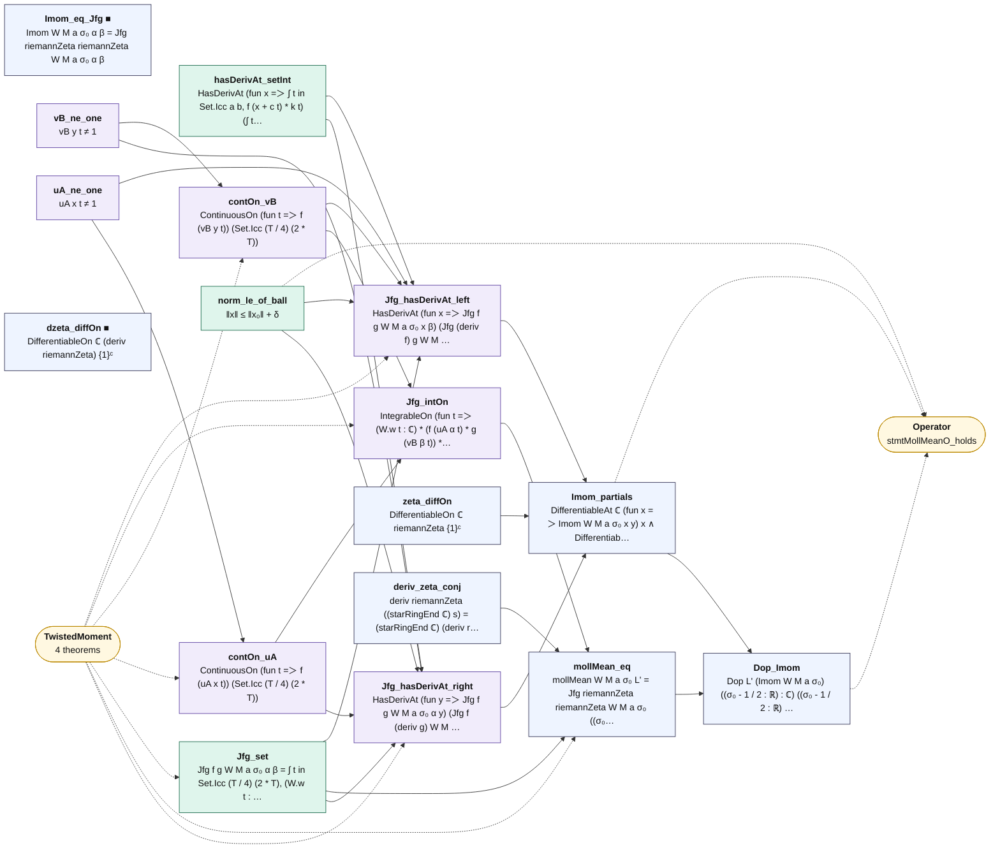

# `lean_stage3/Stage3/OperatorInt.lean`

> **Read from the source text.** This file changed after the last `python3 utilities/lean_map.py --dump`, so the arrows on this page are names occurring in each proof and have not been confirmed by Lean.

# OperatorInt — block S12 of `lean_stage3/design/stencil.md`, piece 3, the operator: the mean as `D` of the moment. 2026-11-25.

17 theorems, 3 definitions, 345 lines. 

**Imports:** [`OperatorCauchy`](../lean_stage3/OperatorCauchy.md), [`TwistedMoment`](../lean_stage3/TwistedMoment.md)  
**Imported by:** [`Operator`](../lean_stage3/Operator.md)

## The picture



An arrow A → B reads "A is used in the proof of B". Green: counting, integers only. Violet: shape, analysis with no ζ. Blue: reads ζ. A name ending in ■ is an end: nothing else uses it. Red: contains `sorry`. Yellow: theorems in another file, counted; a dotted arrow crosses files. Definitions are not drawn; they are listed below the diagram.

## Definitions

<a name="Operator-Jfg"></a>
### `Operator.Jfg`

def · line 74

`J_{f,g}(α,β) = ∫ w(t) f(1/2+α+it) g(1/2+β−it) |ψ(σ₀+it)|² dt`.

- **Is:** `` Jfg (f g : ℂ → ℂ) {T L : ℝ} (W : Weight T L) (M : ℕ) (a : ℕ → ℂ) (σ₀ : ℝ) (α β : ℂ) : ℂ := ∫ t, (W.w t : ℂ) * (f (uA α t) * g (vB β t)) * (msq M a σ₀ t : ℂ) ``
- **Built from:** [`ApproxFE.uA`](../lean_stage3/ApproxFE.md#ApproxFE-uA), [`ApproxFE.vB`](../lean_stage3/ApproxFE.md#ApproxFE-vB), [`TwistedMoment.Weight`](../lean_stage3/TwistedMoment.md#TwistedMoment-Weight), [`TwistedMoment.msq`](../lean_stage3/TwistedMoment.md#TwistedMoment-msq)
- **Used by 6:** [`Operator.Imom_eq_Jfg`](#Operator-Imom_eq_Jfg), [`Operator.Imom_partials`](#Operator-Imom_partials), [`Operator.Jfg_hasDerivAt_left`](#Operator-Jfg_hasDerivAt_left), [`Operator.Jfg_hasDerivAt_right`](#Operator-Jfg_hasDerivAt_right), [`Operator.Jfg_set`](#Operator-Jfg_set), [`Operator.mollMean_eq`](#Operator-mollMean_eq)

<a name="Operator-Gl"></a>
### `Operator.Gl`

def · line 78

Levinson's `G(s) = ζ(s) + ζ′(s)/L`, i.e. `Q(−(1/L) d/ds)` with `Q(x) = 1 − x`.

- **Is:** `` Gl (L : ℝ) (s : ℂ) : ℂ := riemannZeta s + deriv riemannZeta s / (L : ℂ) ``
- **Used by 2:** [`Operator.mollMean`](#Operator-mollMean), [`Operator.mollMean_eq`](#Operator-mollMean_eq)

<a name="Operator-mollMean"></a>
### `Operator.mollMean`

def · line 81

The mollified mean `∫ w(t) |G(σ₀+it)|² |ψ(σ₀+it)|² dt`.

- **Is:** `` mollMean {T L : ℝ} (W : Weight T L) (M : ℕ) (a : ℕ → ℂ) (σ₀ L' : ℝ) : ℂ := ∫ t, (W.w t : ℂ) * ((‖Gl L' ((σ₀ : ℂ) + t * I)‖ ^ 2 : ℝ) : ℂ) * (msq M a σ₀ t : ℂ) ``
- **Built from:** [`Operator.Gl`](#Operator-Gl), [`TwistedMoment.Weight`](../lean_stage3/TwistedMoment.md#TwistedMoment-Weight), [`TwistedMoment.msq`](../lean_stage3/TwistedMoment.md#TwistedMoment-msq)
- **Used by 4:** [`Operator.StmtMollMeanO`](../lean_stage3/Operator.md#Operator-StmtMollMeanO), [`Operator.stmtMollMeanO_holds`](../lean_stage3/Operator.md#Operator-stmtMollMeanO_holds), [`Operator.Dop_Imom`](#Operator-Dop_Imom), [`Operator.mollMean_eq`](#Operator-mollMean_eq)

## Theorems

<a name="Operator-hasDerivAt_setInt"></a>
### `Operator.hasDerivAt_setInt`

line 29 · arrows read from text

**Counting.** Integers only: nothing in its statement or proof, or in anything it rests on, uses analysis or ζ.

**Why.** Differentiation under a compact integral.

**Proves**

```lean
HasDerivAt (fun x => ∫ t in Set.Icc a b, f (x + c t) * k t) (∫ t in Set.Icc a b, deriv f (x₀ + c t) * k t) x₀
```

**Needs** (its hypotheses)

  - `` hU : IsOpen U ``
  - `` hf : DifferentiableOn ℂ f U ``
  - `` hc : Continuous c ``
  - `` hk : ContinuousOn k (Set.Icc a b) ``
  - `` hδ : 0 < δ ``
  - `` hmaps : ∀ x ∈ closedBall x₀ δ, ∀ t ∈ Set.Icc a b, x + c t ∈ U ``

**Fed by:** no theorem of this repo; it stands on Mathlib.

**Feeds** (2 that use it)

  - [`Operator.Jfg_hasDerivAt_left`](#Operator-Jfg_hasDerivAt_left) — `` HasDerivAt (fun x => Jfg f g W M a σ₀ x β) (Jfg (deriv f) g W M a σ₀ x₀ β) x₀ ``
  - [`Operator.Jfg_hasDerivAt_right`](#Operator-Jfg_hasDerivAt_right) — `` HasDerivAt (fun y => Jfg f g W M a σ₀ α y) (Jfg f (deriv g) W M a σ₀ α y₀) y₀ ``

<a name="Operator-Imom_eq_Jfg"></a>
### `Operator.Imom_eq_Jfg`

line 90 · arrows read from text

**Reads ζ.** It, or something it rests on, uses the zeta function, its zeros or the Riemann hypothesis.

**Proves**

```lean
Imom W M a σ₀ α β = Jfg riemannZeta riemannZeta W M a σ₀ α β
```

**Needs** (its hypotheses)

  - `` α β : ℂ ``

**Fed by:** no theorem of this repo; it stands on Mathlib and the definitions below.

**Definitions its proof touches:** [`Operator.Jfg`](#Operator-Jfg), [`TwistedMoment.Imom`](../lean_stage3/TwistedMoment.md#TwistedMoment-Imom)

**Feeds:** nothing. It is an end.

<a name="Operator-Jfg_set"></a>
### `Operator.Jfg_set`

line 93 · arrows read from text

**Counting.** Integers only: nothing in its statement or proof, or in anything it rests on, uses analysis or ζ.

**Proves**

```lean
Jfg f g W M a σ₀ α β = ∫ t in Set.Icc (T / 4) (2 * T), (W.w t : ℂ) * (f (uA α t) * g (vB β t)) * (msq M a σ₀ t : ℂ)
```

**Needs** (its hypotheses)

  - `` f g : ℂ → ℂ ``
  - `` α β : ℂ ``

**Fed by** (1 theorem its proof uses)

  - [`TwistedMoment.w_zero_mul`](../lean_stage3/TwistedMoment.md#TwistedMoment-w_zero_mul) (TwistedMoment) — `` (W.w t : ℂ) * F * G = 0 ``

**Definitions its proof touches:** [`ApproxFE.uA`](../lean_stage3/ApproxFE.md#ApproxFE-uA), [`ApproxFE.vB`](../lean_stage3/ApproxFE.md#ApproxFE-vB), [`Operator.Jfg`](#Operator-Jfg), [`TwistedMoment.msq`](../lean_stage3/TwistedMoment.md#TwistedMoment-msq)

**Feeds** (3 that use it)

  - [`Operator.Jfg_hasDerivAt_left`](#Operator-Jfg_hasDerivAt_left) — `` HasDerivAt (fun x => Jfg f g W M a σ₀ x β) (Jfg (deriv f) g W M a σ₀ x₀ β) x₀ ``
  - [`Operator.Jfg_hasDerivAt_right`](#Operator-Jfg_hasDerivAt_right) — `` HasDerivAt (fun y => Jfg f g W M a σ₀ α y) (Jfg f (deriv g) W M a σ₀ α y₀) y₀ ``
  - [`Operator.mollMean_eq`](#Operator-mollMean_eq) — `` mollMean W M a σ₀ L' = Jfg riemannZeta riemannZeta W M a σ₀ ((σ₀ - 1 / 2 : ℝ) : ℂ) ((σ₀ - 1 / 2 : ℝ) : ℂ) + 1 / (L' : ℂ) * (Jfg (deriv riemannZeta) ri… ``

<a name="Operator-uA_ne_one"></a>
### `Operator.uA_ne_one`

line 98 · arrows read from text

**Shape.** Uses real or complex analysis; nothing in it or beneath it reads ζ.

**Proves**

```lean
uA x t ≠ 1
```

**Needs** (its hypotheses)

  - `` hx : ‖x‖ < 1 ``
  - `` ht : 1 ≤ t ``

**Fed by:** no theorem of this repo; it stands on Mathlib and the definitions below.

**Definitions its proof touches:** [`ApproxFE.uA`](../lean_stage3/ApproxFE.md#ApproxFE-uA)

**Feeds** (2 that use it)

  - [`Operator.Jfg_hasDerivAt_left`](#Operator-Jfg_hasDerivAt_left) — `` HasDerivAt (fun x => Jfg f g W M a σ₀ x β) (Jfg (deriv f) g W M a σ₀ x₀ β) x₀ ``
  - [`Operator.contOn_uA`](#Operator-contOn_uA) — `` ContinuousOn (fun t => f (uA x t)) (Set.Icc (T / 4) (2 * T)) ``

<a name="Operator-vB_ne_one"></a>
### `Operator.vB_ne_one`

line 104 · arrows read from text

**Shape.** Uses real or complex analysis; nothing in it or beneath it reads ζ.

**Proves**

```lean
vB y t ≠ 1
```

**Needs** (its hypotheses)

  - `` hy : ‖y‖ < 1 ``
  - `` ht : 1 ≤ t ``

**Fed by:** no theorem of this repo; it stands on Mathlib and the definitions below.

**Definitions its proof touches:** [`ApproxFE.vB`](../lean_stage3/ApproxFE.md#ApproxFE-vB)

**Feeds** (2 that use it)

  - [`Operator.Jfg_hasDerivAt_right`](#Operator-Jfg_hasDerivAt_right) — `` HasDerivAt (fun y => Jfg f g W M a σ₀ α y) (Jfg f (deriv g) W M a σ₀ α y₀) y₀ ``
  - [`Operator.contOn_vB`](#Operator-contOn_vB) — `` ContinuousOn (fun t => f (vB y t)) (Set.Icc (T / 4) (2 * T)) ``

<a name="Operator-contOn_uA"></a>
### `Operator.contOn_uA`

line 110 · arrows read from text

**Shape.** Uses real or complex analysis; nothing in it or beneath it reads ζ.

**Proves**

```lean
ContinuousOn (fun t => f (uA x t)) (Set.Icc (T / 4) (2 * T))
```

**Needs** (its hypotheses)

  - `` hf : ContinuousOn f {1}ᶜ ``
  - `` hx : ‖x‖ < 1 ``
  - `` hT : 4 ≤ T ``

**Fed by** (2 theorems its proof uses)

  - [`Operator.uA_ne_one`](#Operator-uA_ne_one) — `` uA x t ≠ 1 ``
  - [`TwistedMoment.continuous_uA`](../lean_stage3/TwistedMoment.md#TwistedMoment-continuous_uA) (TwistedMoment) — `` Continuous fun t : ℝ => uA α t ``

**Definitions its proof touches:** [`ApproxFE.uA`](../lean_stage3/ApproxFE.md#ApproxFE-uA)

**Feeds** (2 that use it)

  - [`Operator.Jfg_hasDerivAt_right`](#Operator-Jfg_hasDerivAt_right) — `` HasDerivAt (fun y => Jfg f g W M a σ₀ α y) (Jfg f (deriv g) W M a σ₀ α y₀) y₀ ``
  - [`Operator.Jfg_intOn`](#Operator-Jfg_intOn) — `` IntegrableOn (fun t => (W.w t : ℂ) * (f (uA α t) * g (vB β t)) * (msq M a σ₀ t : ℂ)) (Set.Icc (T / 4) (2 * T)) ``

<a name="Operator-contOn_vB"></a>
### `Operator.contOn_vB`

line 115 · arrows read from text

**Shape.** Uses real or complex analysis; nothing in it or beneath it reads ζ.

**Proves**

```lean
ContinuousOn (fun t => f (vB y t)) (Set.Icc (T / 4) (2 * T))
```

**Needs** (its hypotheses)

  - `` hf : ContinuousOn f {1}ᶜ ``
  - `` hy : ‖y‖ < 1 ``
  - `` hT : 4 ≤ T ``

**Fed by** (2 theorems its proof uses)

  - [`Operator.vB_ne_one`](#Operator-vB_ne_one) — `` vB y t ≠ 1 ``
  - [`TwistedMoment.continuous_vB`](../lean_stage3/TwistedMoment.md#TwistedMoment-continuous_vB) (TwistedMoment) — `` Continuous fun t : ℝ => vB β t ``

**Definitions its proof touches:** [`ApproxFE.vB`](../lean_stage3/ApproxFE.md#ApproxFE-vB)

**Feeds** (2 that use it)

  - [`Operator.Jfg_hasDerivAt_left`](#Operator-Jfg_hasDerivAt_left) — `` HasDerivAt (fun x => Jfg f g W M a σ₀ x β) (Jfg (deriv f) g W M a σ₀ x₀ β) x₀ ``
  - [`Operator.Jfg_intOn`](#Operator-Jfg_intOn) — `` IntegrableOn (fun t => (W.w t : ℂ) * (f (uA α t) * g (vB β t)) * (msq M a σ₀ t : ℂ)) (Set.Icc (T / 4) (2 * T)) ``

<a name="Operator-Jfg_intOn"></a>
### `Operator.Jfg_intOn`

line 120 · arrows read from text

**Shape.** Uses real or complex analysis; nothing in it or beneath it reads ζ.

**Proves**

```lean
IntegrableOn (fun t => (W.w t : ℂ) * (f (uA α t) * g (vB β t)) * (msq M a σ₀ t : ℂ)) (Set.Icc (T / 4) (2 * T))
```

**Needs** (its hypotheses)

  - `` hf : ContinuousOn f {1}ᶜ ``
  - `` hg : ContinuousOn g {1}ᶜ ``
  - `` hα : ‖α‖ < 1 ``
  - `` hβ : ‖β‖ < 1 ``
  - `` hT : 4 ≤ T ``

**Fed by** (3 theorems its proof uses)

  - [`Operator.contOn_uA`](#Operator-contOn_uA) — `` ContinuousOn (fun t => f (uA x t)) (Set.Icc (T / 4) (2 * T)) ``
  - [`Operator.contOn_vB`](#Operator-contOn_vB) — `` ContinuousOn (fun t => f (vB y t)) (Set.Icc (T / 4) (2 * T)) ``
  - [`TwistedMoment.continuous_msq`](../lean_stage3/TwistedMoment.md#TwistedMoment-continuous_msq) (TwistedMoment) — `` Continuous (msq M a σ₀) ``

**Definitions its proof touches:** [`ApproxFE.uA`](../lean_stage3/ApproxFE.md#ApproxFE-uA), [`ApproxFE.vB`](../lean_stage3/ApproxFE.md#ApproxFE-vB), [`TwistedMoment.msq`](../lean_stage3/TwistedMoment.md#TwistedMoment-msq)

**Feeds** (1 that use it)

  - [`Operator.mollMean_eq`](#Operator-mollMean_eq) — `` mollMean W M a σ₀ L' = Jfg riemannZeta riemannZeta W M a σ₀ ((σ₀ - 1 / 2 : ℝ) : ℂ) ((σ₀ - 1 / 2 : ℝ) : ℂ) + 1 / (L' : ℂ) * (Jfg (deriv riemannZeta) ri… ``

<a name="Operator-norm_le_of_ball"></a>
### `Operator.norm_le_of_ball`

line 130 · arrows read from text

**Counting.** Integers only: nothing in its statement or proof, or in anything it rests on, uses analysis or ζ.

**Proves**

```lean
‖x‖ ≤ ‖x₀‖ + δ
```

**Needs** (its hypotheses)

  - `` hx : x ∈ closedBall x₀ δ ``

**Fed by:** no theorem of this repo; it stands on Mathlib.

**Feeds** (3 that use it)

  - [`Operator.stmtMollMeanO_holds`](../lean_stage3/Operator.md#Operator-stmtMollMeanO_holds) (Operator) — `` StmtMollMeanO P θ R ``
  - [`Operator.Jfg_hasDerivAt_left`](#Operator-Jfg_hasDerivAt_left) — `` HasDerivAt (fun x => Jfg f g W M a σ₀ x β) (Jfg (deriv f) g W M a σ₀ x₀ β) x₀ ``
  - [`Operator.Jfg_hasDerivAt_right`](#Operator-Jfg_hasDerivAt_right) — `` HasDerivAt (fun y => Jfg f g W M a σ₀ α y) (Jfg f (deriv g) W M a σ₀ α y₀) y₀ ``

<a name="Operator-Jfg_hasDerivAt_left"></a>
### `Operator.Jfg_hasDerivAt_left`

line 137 · arrows read from text

**Shape.** Uses real or complex analysis; nothing in it or beneath it reads ζ.

**Why.** `∂α J_{f,g} = J_{f′,g}`.

**Proves**

```lean
HasDerivAt (fun x => Jfg f g W M a σ₀ x β) (Jfg (deriv f) g W M a σ₀ x₀ β) x₀
```

**Needs** (its hypotheses)

  - `` hf : DifferentiableOn ℂ f {1}ᶜ ``
  - `` hg : ContinuousOn g {1}ᶜ ``
  - `` hx₀ : ‖x₀‖ ≤ 1 / 2 ``
  - `` hβ : ‖β‖ < 1 ``
  - `` hT : 4 ≤ T ``

**Fed by** (6 theorems its proof uses)

  - [`Operator.Jfg_set`](#Operator-Jfg_set) — `` Jfg f g W M a σ₀ α β = ∫ t in Set.Icc (T / 4) (2 * T), (W.w t : ℂ) * (f (uA α t) * g (vB β t)) * (msq M a σ₀ t : ℂ) ``
  - [`Operator.contOn_vB`](#Operator-contOn_vB) — `` ContinuousOn (fun t => f (vB y t)) (Set.Icc (T / 4) (2 * T)) ``
  - [`Operator.hasDerivAt_setInt`](#Operator-hasDerivAt_setInt) — `` HasDerivAt (fun x => ∫ t in Set.Icc a b, f (x + c t) * k t) (∫ t in Set.Icc a b, deriv f (x₀ + c t) * k t) x₀ ``
  - [`Operator.norm_le_of_ball`](#Operator-norm_le_of_ball) — `` ‖x‖ ≤ ‖x₀‖ + δ ``
  - [`Operator.uA_ne_one`](#Operator-uA_ne_one) — `` uA x t ≠ 1 ``
  - [`TwistedMoment.continuous_msq`](../lean_stage3/TwistedMoment.md#TwistedMoment-continuous_msq) (TwistedMoment) — `` Continuous (msq M a σ₀) ``

**Definitions its proof touches:** [`ApproxFE.uA`](../lean_stage3/ApproxFE.md#ApproxFE-uA), [`ApproxFE.vB`](../lean_stage3/ApproxFE.md#ApproxFE-vB), [`Operator.Jfg`](#Operator-Jfg), [`TwistedMoment.msq`](../lean_stage3/TwistedMoment.md#TwistedMoment-msq)

**Feeds** (1 that use it)

  - [`Operator.Imom_partials`](#Operator-Imom_partials) — `` DifferentiableAt ℂ (fun x => Imom W M a σ₀ x y) x ∧ DifferentiableAt ℂ (fun y => Imom W M a σ₀ x y) y ∧ pa (Imom W M a σ₀) x y = Jfg (deriv riemannZet… ``

<a name="Operator-Jfg_hasDerivAt_right"></a>
### `Operator.Jfg_hasDerivAt_right`

line 165 · arrows read from text

**Shape.** Uses real or complex analysis; nothing in it or beneath it reads ζ.

**Why.** `∂β J_{f,g} = J_{f,g′}`.

**Proves**

```lean
HasDerivAt (fun y => Jfg f g W M a σ₀ α y) (Jfg f (deriv g) W M a σ₀ α y₀) y₀
```

**Needs** (its hypotheses)

  - `` hf : ContinuousOn f {1}ᶜ ``
  - `` hg : DifferentiableOn ℂ g {1}ᶜ ``
  - `` hα : ‖α‖ < 1 ``
  - `` hy₀ : ‖y₀‖ ≤ 1 / 2 ``
  - `` hT : 4 ≤ T ``

**Fed by** (6 theorems its proof uses)

  - [`Operator.Jfg_set`](#Operator-Jfg_set) — `` Jfg f g W M a σ₀ α β = ∫ t in Set.Icc (T / 4) (2 * T), (W.w t : ℂ) * (f (uA α t) * g (vB β t)) * (msq M a σ₀ t : ℂ) ``
  - [`Operator.contOn_uA`](#Operator-contOn_uA) — `` ContinuousOn (fun t => f (uA x t)) (Set.Icc (T / 4) (2 * T)) ``
  - [`Operator.hasDerivAt_setInt`](#Operator-hasDerivAt_setInt) — `` HasDerivAt (fun x => ∫ t in Set.Icc a b, f (x + c t) * k t) (∫ t in Set.Icc a b, deriv f (x₀ + c t) * k t) x₀ ``
  - [`Operator.norm_le_of_ball`](#Operator-norm_le_of_ball) — `` ‖x‖ ≤ ‖x₀‖ + δ ``
  - [`Operator.vB_ne_one`](#Operator-vB_ne_one) — `` vB y t ≠ 1 ``
  - [`TwistedMoment.continuous_msq`](../lean_stage3/TwistedMoment.md#TwistedMoment-continuous_msq) (TwistedMoment) — `` Continuous (msq M a σ₀) ``

**Definitions its proof touches:** [`ApproxFE.uA`](../lean_stage3/ApproxFE.md#ApproxFE-uA), [`ApproxFE.vB`](../lean_stage3/ApproxFE.md#ApproxFE-vB), [`Operator.Jfg`](#Operator-Jfg), [`TwistedMoment.msq`](../lean_stage3/TwistedMoment.md#TwistedMoment-msq)

**Feeds** (1 that use it)

  - [`Operator.Imom_partials`](#Operator-Imom_partials) — `` DifferentiableAt ℂ (fun x => Imom W M a σ₀ x y) x ∧ DifferentiableAt ℂ (fun y => Imom W M a σ₀ x y) y ∧ pa (Imom W M a σ₀) x y = Jfg (deriv riemannZet… ``

<a name="Operator-zeta_diffOn"></a>
### `Operator.zeta_diffOn`

line 194 · arrows read from text

**Reads ζ.** It, or something it rests on, uses the zeta function, its zeros or the Riemann hypothesis.

**Proves**

```lean
DifferentiableOn ℂ riemannZeta {1}ᶜ
```

**Fed by:** no theorem of this repo; it stands on Mathlib.

**Feeds** (1 that use it)

  - [`Operator.Imom_partials`](#Operator-Imom_partials) — `` DifferentiableAt ℂ (fun x => Imom W M a σ₀ x y) x ∧ DifferentiableAt ℂ (fun y => Imom W M a σ₀ x y) y ∧ pa (Imom W M a σ₀) x y = Jfg (deriv riemannZet… ``

<a name="Operator-dzeta_diffOn"></a>
### `Operator.dzeta_diffOn`

line 197 · arrows read from text

**Reads ζ.** It, or something it rests on, uses the zeta function, its zeros or the Riemann hypothesis.

**Proves**

```lean
DifferentiableOn ℂ (deriv riemannZeta) {1}ᶜ
```

**Fed by:** no theorem of this repo; it stands on Mathlib.

**Feeds:** nothing. It connects to nothing.

<a name="Operator-deriv_zeta_conj"></a>
### `Operator.deriv_zeta_conj`

line 201 · arrows read from text

**Reads ζ.** It, or something it rests on, uses the zeta function, its zeros or the Riemann hypothesis.

**Why.** `ζ′(s̄) = conj ζ′(s)`.

**Proves**

```lean
deriv riemannZeta ((starRingEnd ℂ) s) = (starRingEnd ℂ) (deriv riemannZeta s)
```

**Needs** (its hypotheses)

  - `` s : ℂ ``

**Fed by:** no theorem of this repo; it stands on Mathlib.

**Feeds** (1 that use it)

  - [`Operator.mollMean_eq`](#Operator-mollMean_eq) — `` mollMean W M a σ₀ L' = Jfg riemannZeta riemannZeta W M a σ₀ ((σ₀ - 1 / 2 : ℝ) : ℂ) ((σ₀ - 1 / 2 : ℝ) : ℂ) + 1 / (L' : ℂ) * (Jfg (deriv riemannZeta) ri… ``

<a name="Operator-mollMean_eq"></a>
### `Operator.mollMean_eq`

line 217 · arrows read from text

**Reads ζ.** It, or something it rests on, uses the zeta function, its zeros or the Riemann hypothesis.

**Why.** The mean, expanded: at `α = β = σ₀ − 1/2`, `∫ w |G|² |ψ|² = Jζζ + (1/L)(Jζ′ζ + Jζζ′) + (1/L²) Jζ′ζ′`.

**Proves**

```lean
mollMean W M a σ₀ L' = Jfg riemannZeta riemannZeta W M a σ₀ ((σ₀ - 1 / 2 : ℝ) : ℂ) ((σ₀ - 1 / 2 : ℝ) : ℂ) + 1 / (L' : ℂ) * (Jfg (deriv riemannZeta) riemannZeta W M a σ₀ ((σ₀ - 1 / 2 : ℝ) : ℂ) ((σ₀ - 1 / 2 : ℝ) : ℂ) + Jfg riemannZeta (deriv riemannZeta) W M a σ₀ ((σ₀ - 1 / 2 : ℝ) : ℂ) ((σ₀ - 1 / 2 : ℝ) : ℂ)) + 1 / (L' : ℂ) ^ 2 * Jfg (deriv riemannZeta) (deriv riemannZeta) W M a σ₀ ((σ₀ - 1 / 2 : ℝ) : ℂ) ((σ₀ - 1 / 2 : ℝ) : ℂ)
```

**Needs** (its hypotheses)

  - `` L' : ℝ ``
  - `` hT : 4 ≤ T ``
  - `` hσ : ‖(((σ₀ - 1 / 2 : ℝ)) : ℂ)‖ < 1 ``

**Fed by** (4 theorems its proof uses)

  - [`Operator.Jfg_intOn`](#Operator-Jfg_intOn) — `` IntegrableOn (fun t => (W.w t : ℂ) * (f (uA α t) * g (vB β t)) * (msq M a σ₀ t : ℂ)) (Set.Icc (T / 4) (2 * T)) ``
  - [`Operator.Jfg_set`](#Operator-Jfg_set) — `` Jfg f g W M a σ₀ α β = ∫ t in Set.Icc (T / 4) (2 * T), (W.w t : ℂ) * (f (uA α t) * g (vB β t)) * (msq M a σ₀ t : ℂ) ``
  - [`Operator.deriv_zeta_conj`](#Operator-deriv_zeta_conj) — `` deriv riemannZeta ((starRingEnd ℂ) s) = (starRingEnd ℂ) (deriv riemannZeta s) ``
  - [`TwistedMoment.w_zero_mul`](../lean_stage3/TwistedMoment.md#TwistedMoment-w_zero_mul) (TwistedMoment) — `` (W.w t : ℂ) * F * G = 0 ``

**Definitions its proof touches:** [`ApproxFE.uA`](../lean_stage3/ApproxFE.md#ApproxFE-uA), [`ApproxFE.vB`](../lean_stage3/ApproxFE.md#ApproxFE-vB), [`Operator.Gl`](#Operator-Gl), [`Operator.Jfg`](#Operator-Jfg), [`Operator.mollMean`](#Operator-mollMean), [`TwistedMoment.msq`](../lean_stage3/TwistedMoment.md#TwistedMoment-msq)

**Feeds** (1 that use it)

  - [`Operator.Dop_Imom`](#Operator-Dop_Imom) — `` Dop L' (Imom W M a σ₀) ((σ₀ - 1 / 2 : ℝ) : ℂ) ((σ₀ - 1 / 2 : ℝ) : ℂ) = mollMean W M a σ₀ L' ``

<a name="Operator-Imom_partials"></a>
### `Operator.Imom_partials`

line 289 · arrows read from text

**Reads ζ.** It, or something it rests on, uses the zeta function, its zeros or the Riemann hypothesis.

**Why.** The partials of `Imom` on `‖α‖, ‖β‖ < 1/2`.

**Proves**

```lean
DifferentiableAt ℂ (fun x => Imom W M a σ₀ x y) x ∧ DifferentiableAt ℂ (fun y => Imom W M a σ₀ x y) y ∧ pa (Imom W M a σ₀) x y = Jfg (deriv riemannZeta) riemannZeta W M a σ₀ x y ∧ pb (Imom W M a σ₀) x y = Jfg riemannZeta (deriv riemannZeta) W M a σ₀ x y ∧ DifferentiableAt ℂ (fun y => pa (Imom W M a σ₀) x y) y ∧ pab (Imom W M a σ₀) x y = Jfg (deriv riemannZeta) (deriv riemannZeta) W M a σ₀ x y
```

**Needs** (its hypotheses)

  - `` hT : 4 ≤ T ``
  - `` hx : ‖x‖ < 1 / 2 ``
  - `` hy : ‖y‖ < 1 / 2 ``

**Fed by** (3 theorems its proof uses)

  - [`Operator.Jfg_hasDerivAt_left`](#Operator-Jfg_hasDerivAt_left) — `` HasDerivAt (fun x => Jfg f g W M a σ₀ x β) (Jfg (deriv f) g W M a σ₀ x₀ β) x₀ ``
  - [`Operator.Jfg_hasDerivAt_right`](#Operator-Jfg_hasDerivAt_right) — `` HasDerivAt (fun y => Jfg f g W M a σ₀ α y) (Jfg f (deriv g) W M a σ₀ α y₀) y₀ ``
  - [`Operator.zeta_diffOn`](#Operator-zeta_diffOn) — `` DifferentiableOn ℂ riemannZeta {1}ᶜ ``

**Definitions its proof touches:** [`Operator.pa`](../lean_stage3/OperatorCauchy.md#Operator-pa), [`Operator.pab`](../lean_stage3/OperatorCauchy.md#Operator-pab), [`Operator.pb`](../lean_stage3/OperatorCauchy.md#Operator-pb), [`Operator.Jfg`](#Operator-Jfg), [`TwistedMoment.Imom`](../lean_stage3/TwistedMoment.md#TwistedMoment-Imom)

**Feeds** (2 that use it)

  - [`Operator.stmtMollMeanO_holds`](../lean_stage3/Operator.md#Operator-stmtMollMeanO_holds) (Operator) — `` StmtMollMeanO P θ R ``
  - [`Operator.Dop_Imom`](#Operator-Dop_Imom) — `` Dop L' (Imom W M a σ₀) ((σ₀ - 1 / 2 : ℝ) : ℂ) ((σ₀ - 1 / 2 : ℝ) : ℂ) = mollMean W M a σ₀ L' ``

<a name="Operator-Dop_Imom"></a>
### `Operator.Dop_Imom`

line 319 · arrows read from text

**Reads ζ.** It, or something it rests on, uses the zeta function, its zeros or the Riemann hypothesis.

**Why.** `D` of the moment is the mean: at `α₀ = σ₀ − 1/2`, `‖α₀‖ < 1/2`, `D Imom (α₀, α₀) = ∫ w |G(σ₀+it)|² |ψ(σ₀+it)|²`.

**Proves**

```lean
Dop L' (Imom W M a σ₀) ((σ₀ - 1 / 2 : ℝ) : ℂ) ((σ₀ - 1 / 2 : ℝ) : ℂ) = mollMean W M a σ₀ L'
```

**Needs** (its hypotheses)

  - `` L' : ℝ ``
  - `` hT : 4 ≤ T ``
  - `` hσ : ‖(((σ₀ - 1 / 2 : ℝ)) : ℂ)‖ < 1 / 2 ``

**Fed by** (2 theorems its proof uses)

  - [`Operator.Imom_partials`](#Operator-Imom_partials) — `` DifferentiableAt ℂ (fun x => Imom W M a σ₀ x y) x ∧ DifferentiableAt ℂ (fun y => Imom W M a σ₀ x y) y ∧ pa (Imom W M a σ₀) x y = Jfg (deriv riemannZet… ``
  - [`Operator.mollMean_eq`](#Operator-mollMean_eq) — `` mollMean W M a σ₀ L' = Jfg riemannZeta riemannZeta W M a σ₀ ((σ₀ - 1 / 2 : ℝ) : ℂ) ((σ₀ - 1 / 2 : ℝ) : ℂ) + 1 / (L' : ℂ) * (Jfg (deriv riemannZeta) ri… ``

**Definitions its proof touches:** [`Operator.Dop`](../lean_stage3/OperatorCauchy.md#Operator-Dop), [`Operator.mollMean`](#Operator-mollMean), [`TwistedMoment.Imom`](../lean_stage3/TwistedMoment.md#TwistedMoment-Imom)

**Feeds** (1 that use it)

  - [`Operator.stmtMollMeanO_holds`](../lean_stage3/Operator.md#Operator-stmtMollMeanO_holds) (Operator) — `` StmtMollMeanO P θ R ``

