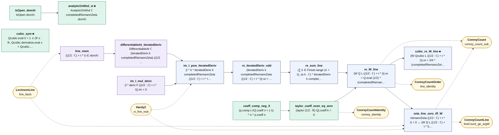

# `lean_stage3/Stage3/OperatorQ.lean`

> **Read from the source text.** This file changed after the last `python3 utilities/lean_map.py --dump`, so the arrows on this page are names occurring in each proof and have not been confirmed by Lean.

OperatorQ — block S13 of `lean_stage3/design/stencil.md`, B4, the operator with a general Q. 2026-11-25.

14 theorems, 3 definitions, 307 lines. 

**Imports:** [`LevinsonLine`](../lean_stage3/LevinsonLine.md)  
**Imported by:** [`Stage3`](../lean_stage3/Stage3.md), [`ConreyCountIdentity`](../lean_stage3/ConreyCountIdentity.md)

## The picture



An arrow A → B reads "A is used in the proof of B". Green: counting, integers only. Violet: shape, analysis with no ζ. Blue: reads ζ. A name ending in ■ is an end: nothing else uses it. Red: contains `sorry`. Yellow: theorems in another file, counted; a dotted arrow crosses files. Definitions are not drawn; they are listed below the diagram.

## Definitions

<a name="OperatorQ-domXi"></a>
### `OperatorQ.domXi`

def · line 54

The domain of `Λ`: away from `0` and `1`.

- **Is:** `` domXi : Set ℂ := {z | z ≠ 0 ∧ z ≠ 1} ``
- **Used by 3:** [`OperatorQ.analyticOnNhd_xi`](#OperatorQ-analyticOnNhd_xi), [`OperatorQ.isOpen_domXi`](#OperatorQ-isOpen_domXi), [`OperatorQ.line_mem`](#OperatorQ-line_mem)

<a name="OperatorQ-W"></a>
### `OperatorQ.W`

def · line 206

`W = Q(1/2 − (1/L) d/ds) Λ`: the Taylor coefficients `b_k` of `Q` at `1/2`, against `(−1/L)^k Λ^{(k)}`.

- **Is:** `` W (Q : ℝ[X]) (L : ℝ) (s : ℂ) : ℂ := ∑ k ∈ Finset.range (Q.natDegree + 1), (((taylor (1/2 : ℝ) Q).coeff k * (-1 / L) ^ k : ℝ) : ℂ) * iteratedDeriv k completedRiemannZeta s ``
- **Used by 15:** [`ConreyCount.conrey_identity`](../lean_stage3/ConreyCountIdentity.md#ConreyCount-conrey_identity), [`ConreyCount.conrey_identity_K`](../lean_stage3/ConreyCountIdentity.md#ConreyCount-conrey_identity_K), [`ConreyCount.V`](../lean_stage3/ConreyCountLine.md#ConreyCount-V), [`ConreyCount.W_eq_gammaR_mul_V`](../lean_stage3/ConreyCountLine.md#ConreyCount-W_eq_gammaR_mul_V), [`ConreyCount.analyticAt_W`](../lean_stage3/ConreyCountLine.md#ConreyCount-analyticAt_W), [`ConreyCount.analyticAt_W_line`](../lean_stage3/ConreyCountLine.md#ConreyCount-analyticAt_W_line), [`ConreyCount.continuous_lineW`](../lean_stage3/ConreyCountLine.md#ConreyCount-continuous_lineW), [`ConreyCount.lineW`](../lean_stage3/ConreyCountLine.md#ConreyCount-lineW), [`ConreyCount.lineW_turn_eq`](../lean_stage3/ConreyCountLine.md#ConreyCount-lineW_turn_eq), [`ConreyCount.logDeriv_W_eq`](../lean_stage3/ConreyCountLine.md#ConreyCount-logDeriv_W_eq), [`ConreyCount.line_identity`](../lean_stage3/ConreyCountOrder.md#ConreyCount-line_identity), [`DigammaBound.V_eq_sum_H`](../lean_stage3/DigammaBoundIdentity.md#DigammaBound-V_eq_sum_H), [`OperatorQ.cubic_re_W_line`](#OperatorQ-cubic_re_W_line), [`OperatorQ.re_W_line`](#OperatorQ-re_W_line), [`OperatorQ.zeta_line_zero_iff_W`](#OperatorQ-zeta_line_zero_iff_W)

<a name="OperatorQ-Qcubic"></a>
### `OperatorQ.Qcubic`

def · line 245

The cubic of the numerical check, `Q = 1 + x/2 − 3x² + 2x³ = 1 − x + 2((x − 1/2)³ + 1/8)`.

- **Is:** `` Qcubic : ℝ[X] := 1 + C (1/2) * X - C 3 * X ^ 2 + C 2 * X ^ 3 ``
- **Used by 2:** [`OperatorQ.cubic_re_W_line`](#OperatorQ-cubic_re_W_line), [`OperatorQ.cubic_sym`](#OperatorQ-cubic_sym)

## Theorems

<a name="OperatorQ-isOpen_domXi"></a>
### `OperatorQ.isOpen_domXi`

line 56 · arrows read from text

**Counting.** Integers only: nothing in its statement or proof, or in anything it rests on, uses analysis or ζ.

**Proves**

```lean
IsOpen domXi
```

**Fed by:** no theorem of this repo; it stands on Mathlib and the definitions below.

**Definitions its proof touches:** [`OperatorQ.domXi`](#OperatorQ-domXi)

**Feeds** (1 that use it)

  - [`OperatorQ.analyticOnNhd_xi`](#OperatorQ-analyticOnNhd_xi) — `` AnalyticOnNhd ℂ completedRiemannZeta domXi ``

<a name="OperatorQ-analyticOnNhd_xi"></a>
### `OperatorQ.analyticOnNhd_xi`

line 62 · arrows read from text

**Counting.** Integers only: nothing in its statement or proof, or in anything it rests on, uses analysis or ζ.

**Proves**

```lean
AnalyticOnNhd ℂ completedRiemannZeta domXi
```

**Fed by** (1 theorem its proof uses)

  - [`OperatorQ.isOpen_domXi`](#OperatorQ-isOpen_domXi) — `` IsOpen domXi ``

**Definitions its proof touches:** [`OperatorQ.domXi`](#OperatorQ-domXi)

**Feeds:** nothing. It is an end.

<a name="OperatorQ-line_mem"></a>
### `OperatorQ.line_mem`

line 67 · arrows read from text

**Shape.** Uses real or complex analysis; nothing in it or beneath it reads ζ.

**Proves**

```lean
((1/2 : ℂ) + t * I) ∈ domXi
```

**Needs** (its hypotheses)

  - `` t : ℝ ``

**Fed by** (1 theorem its proof uses)

  - [`LevinsonLine.line_facts`](../lean_stage3/LevinsonLine.md#LevinsonLine-line_facts) (LevinsonLine) — `` ((1/2 : ℂ) + t * I) ≠ 0 ∧ ((1/2 : ℂ) + t * I) ≠ 1 ∧ 0 < ((1/2 : ℂ) + t * I).re ``

**Definitions its proof touches:** [`OperatorQ.domXi`](#OperatorQ-domXi)

**Feeds** (1 that use it)

  - [`OperatorQ.differentiableAt_iteratedDeriv`](#OperatorQ-differentiableAt_iteratedDeriv) — `` DifferentiableAt ℂ (iteratedDeriv k completedRiemannZeta) ((1/2 : ℂ) + t * I) ``

<a name="OperatorQ-differentiableAt_iteratedDeriv"></a>
### `OperatorQ.differentiableAt_iteratedDeriv`

line 72 · arrows read from text

**Shape.** Uses real or complex analysis; nothing in it or beneath it reads ζ.

**Why.** Every iterated derivative of `Λ` is complex-differentiable on the line.

**Proves**

```lean
DifferentiableAt ℂ (iteratedDeriv k completedRiemannZeta) ((1/2 : ℂ) + t * I)
```

**Needs** (its hypotheses)

  - `` k : ℕ ``
  - `` t : ℝ ``

**Fed by** (1 theorem its proof uses)

  - [`OperatorQ.line_mem`](#OperatorQ-line_mem) — `` ((1/2 : ℂ) + t * I) ∈ domXi ``

**Feeds** (1 that use it)

  - [`OperatorQ.im_I_pow_iteratedDeriv`](#OperatorQ-im_I_pow_iteratedDeriv) — `` (I ^ k * iteratedDeriv k completedRiemannZeta ((1/2 : ℂ) + t * I)).im = 0 ``

<a name="OperatorQ-im_I_mul_deriv"></a>
### `OperatorQ.im_I_mul_deriv`

line 78 · arrows read from text

**Shape.** Uses real or complex analysis; nothing in it or beneath it reads ζ.

**Why.** A function differentiable on the line and real there has `I · F'` real there.

**Proves**

```lean
(I * deriv F ((1/2 : ℂ) + t * I)).im = 0
```

**Needs** (its hypotheses)

  - `` hF : ∀ t : ℝ, DifferentiableAt ℂ F ((1/2 : ℂ) + t * I) ``
  - `` hr : ∀ t : ℝ, (F ((1/2 : ℂ) + t * I)).im = 0 ``
  - `` t : ℝ ``

**Fed by:** no theorem of this repo; it stands on Mathlib.

**Feeds** (1 that use it)

  - [`OperatorQ.im_I_pow_iteratedDeriv`](#OperatorQ-im_I_pow_iteratedDeriv) — `` (I ^ k * iteratedDeriv k completedRiemannZeta ((1/2 : ℂ) + t * I)).im = 0 ``

<a name="OperatorQ-im_I_pow_iteratedDeriv"></a>
### `OperatorQ.im_I_pow_iteratedDeriv`

line 107 · arrows read from text

**Reads ζ.** It, or something it rests on, uses the zeta function, its zeros or the Riemann hypothesis.

**Why.** Target 1. On the line, `I^k · Λ^{(k)}` is real.

**Proves**

```lean
(I ^ k * iteratedDeriv k completedRiemannZeta ((1/2 : ℂ) + t * I)).im = 0
```

**Needs** (its hypotheses)

  - `` k : ℕ ``
  - `` t : ℝ ``

**Fed by** (3 theorems its proof uses)

  - [`HardyZ.xi_line_real`](../lean_stage3/HardyZ.md#HardyZ-xi_line_real) (HardyZ) — `` (completedRiemannZeta (1/2 + t * Complex.I)).im = 0 ``
  - [`OperatorQ.differentiableAt_iteratedDeriv`](#OperatorQ-differentiableAt_iteratedDeriv) — `` DifferentiableAt ℂ (iteratedDeriv k completedRiemannZeta) ((1/2 : ℂ) + t * I) ``
  - [`OperatorQ.im_I_mul_deriv`](#OperatorQ-im_I_mul_deriv) — `` (I * deriv F ((1/2 : ℂ) + t * I)).im = 0 ``

**Feeds** (1 that use it)

  - [`OperatorQ.re_iteratedDeriv_odd`](#OperatorQ-re_iteratedDeriv_odd) — `` (iteratedDeriv k completedRiemannZeta ((1/2 : ℂ) + t * I)).re = 0 ``

<a name="OperatorQ-re_iteratedDeriv_odd"></a>
### `OperatorQ.re_iteratedDeriv_odd`

line 127 · arrows read from text

**Reads ζ.** It, or something it rests on, uses the zeta function, its zeros or the Riemann hypothesis.

**Why.** Target 2. On the line, an odd derivative of `Λ` is purely imaginary.

**Proves**

```lean
(iteratedDeriv k completedRiemannZeta ((1/2 : ℂ) + t * I)).re = 0
```

**Needs** (its hypotheses)

  - `` hk : Odd k ``
  - `` t : ℝ ``

**Fed by** (1 theorem its proof uses)

  - [`OperatorQ.im_I_pow_iteratedDeriv`](#OperatorQ-im_I_pow_iteratedDeriv) — `` (I ^ k * iteratedDeriv k completedRiemannZeta ((1/2 : ℂ) + t * I)).im = 0 ``

**Feeds** (1 that use it)

  - [`OperatorQ.re_sum_line`](#OperatorQ-re_sum_line) — `` (∑ k ∈ Finset.range (n + 1), (a k : ℂ) * iteratedDeriv k completedRiemannZeta ((1/2 : ℂ) + t * I)).re = a 0 * (completedRiemannZeta ((1/2 : ℂ) + t * I… ``

<a name="OperatorQ-re_sum_line"></a>
### `OperatorQ.re_sum_line`

line 144 · arrows read from text

**Reads ζ.** It, or something it rests on, uses the zeta function, its zeros or the Riemann hypothesis.

**Why.** Target 3. A real combination of derivatives of `Λ` with no even derivative past the zeroth has real part `a₀ · Λ` on the line.

**Proves**

```lean
(∑ k ∈ Finset.range (n + 1), (a k : ℂ) * iteratedDeriv k completedRiemannZeta ((1/2 : ℂ) + t * I)).re = a 0 * (completedRiemannZeta ((1/2 : ℂ) + t * I)).re
```

**Needs** (its hypotheses)

  - `` a : ℕ → ℝ ``
  - `` n : ℕ ``
  - `` ha : ∀ k, Even k → k ≠ 0 → a k = 0 ``
  - `` t : ℝ ``

**Fed by** (1 theorem its proof uses)

  - [`OperatorQ.re_iteratedDeriv_odd`](#OperatorQ-re_iteratedDeriv_odd) — `` (iteratedDeriv k completedRiemannZeta ((1/2 : ℂ) + t * I)).re = 0 ``

**Feeds** (1 that use it)

  - [`OperatorQ.re_W_line`](#OperatorQ-re_W_line) — `` (W Q L ((1/2 : ℂ) + t * I)).re = Q.eval (1/2) * (completedRiemannZeta ((1/2 : ℂ) + t * I)).re ``

<a name="OperatorQ-coeff_comp_neg_X"></a>
### `OperatorQ.coeff_comp_neg_X`

line 160 · arrows read from text

**Counting.** Integers only: nothing in its statement or proof, or in anything it rests on, uses analysis or ζ.

**Why.** The coefficients of `p.comp (−X)` are those of `p` times `(−1)^n`.

**Proves**

```lean
(p.comp (-X)).coeff n = (-1) ^ n * p.coeff n
```

**Needs** (its hypotheses)

  - `` p : ℝ[X] ``
  - `` n : ℕ ``

**Fed by:** no theorem of this repo; it stands on Mathlib.

**Feeds** (1 that use it)

  - [`OperatorQ.taylor_coeff_even_eq_zero`](#OperatorQ-taylor_coeff_even_eq_zero) — `` (taylor (1/2 : ℝ) Q).coeff k = 0 ``

<a name="OperatorQ-taylor_coeff_even_eq_zero"></a>
### `OperatorQ.taylor_coeff_even_eq_zero`

line 175 · arrows read from text

**Counting.** Integers only: nothing in its statement or proof, or in anything it rests on, uses analysis or ζ.

**Why.** Target 4. `Q'(x) = Q'(1 − x)` makes the even Taylor coefficients of `Q` at `1/2` vanish past the zeroth.

**Proves**

```lean
(taylor (1/2 : ℝ) Q).coeff k = 0
```

**Needs** (its hypotheses)

  - `` Q : ℝ[X] ``
  - `` hQ : ∀ x : ℝ, Q.derivative.eval x = Q.derivative.eval (1 - x) ``
  - `` hk : Even k ``
  - `` hk0 : k ≠ 0 ``

**Fed by** (1 theorem its proof uses)

  - [`OperatorQ.coeff_comp_neg_X`](#OperatorQ-coeff_comp_neg_X) — `` (p.comp (-X)).coeff n = (-1) ^ n * p.coeff n ``

**Feeds** (2 that use it)

  - [`ConreyCount.conrey_identity`](../lean_stage3/ConreyCountIdentity.md#ConreyCount-conrey_identity) (ConreyCountIdentity) — `` OperatorQ.W Q L s + OperatorQ.W Q L (1 - s) = 2 * ((Q.eval (1/2 : ℝ) : ℝ) : ℂ) * completedRiemannZeta s ``
  - [`OperatorQ.re_W_line`](#OperatorQ-re_W_line) — `` (W Q L ((1/2 : ℂ) + t * I)).re = Q.eval (1/2) * (completedRiemannZeta ((1/2 : ℂ) + t * I)).re ``

<a name="OperatorQ-re_W_line"></a>
### `OperatorQ.re_W_line`

line 212 · arrows read from text

**Reads ζ.** It, or something it rests on, uses the zeta function, its zeros or the Riemann hypothesis.

**Why.** Target 5. On the line, `Re W = Q(1/2) · Λ`.

**Proves**

```lean
(W Q L ((1/2 : ℂ) + t * I)).re = Q.eval (1/2) * (completedRiemannZeta ((1/2 : ℂ) + t * I)).re
```

**Needs** (its hypotheses)

  - `` Q : ℝ[X] ``
  - `` hQ : ∀ x : ℝ, Q.derivative.eval x = Q.derivative.eval (1 - x) ``
  - `` L t : ℝ ``

**Fed by** (2 theorems its proof uses)

  - [`OperatorQ.re_sum_line`](#OperatorQ-re_sum_line) — `` (∑ k ∈ Finset.range (n + 1), (a k : ℂ) * iteratedDeriv k completedRiemannZeta ((1/2 : ℂ) + t * I)).re = a 0 * (completedRiemannZeta ((1/2 : ℂ) + t * I… ``
  - [`OperatorQ.taylor_coeff_even_eq_zero`](#OperatorQ-taylor_coeff_even_eq_zero) — `` (taylor (1/2 : ℝ) Q).coeff k = 0 ``

**Definitions its proof touches:** [`OperatorQ.W`](#OperatorQ-W)

**Feeds** (4 that use it)

  - [`ConreyCount.conrey_count_sub`](../lean_stage3/ConreyCount.md#ConreyCount-conrey_count_sub) (ConreyCount) — `` (riemannZeta.N b - riemannZeta.N a) - 2 * Littlewood.countRight (V Q L) ((1/2 : ℂ) + a * I) ((3 : ℂ) + b * I) (1/2) - (30 * Real.log b + 42 * Real.log… ``
  - [`ConreyCount.line_identity`](../lean_stage3/ConreyCountOrder.md#ConreyCount-line_identity) (ConreyCountOrder) — `` ((Q.eval (1/2 : ℝ) : ℝ) : ℂ) * completedRiemannZeta (1/2 + t * I) = (((∏ ρ ∈ D, (t - ρ.im) ^ n ρ) * (I ^ (∑ ρ ∈ D, n ρ) * (Gammaℝ (1/2 + t * I) * H (1… ``
  - [`OperatorQ.cubic_re_W_line`](#OperatorQ-cubic_re_W_line) — `` (W Qcubic L ((1/2 : ℂ) + t * I)).re = 3/4 * (completedRiemannZeta ((1/2 : ℂ) + t * I)).re ``
  - [`OperatorQ.zeta_line_zero_iff_W`](#OperatorQ-zeta_line_zero_iff_W) — `` riemannZeta ((1/2 : ℂ) + t * I) = 0 ↔ (W Q L ((1/2 : ℂ) + t * I)).re = 0 ``

<a name="OperatorQ-zeta_line_zero_iff_W"></a>
### `OperatorQ.zeta_line_zero_iff_W`

line 225 · arrows read from text

**Reads ζ.** It, or something it rests on, uses the zeta function, its zeros or the Riemann hypothesis.

**Why.** Target 6. Where `Q(1/2) ≠ 0`, the zeros of `ζ` on the line are exactly the zeros of `Re W`.

**Proves**

```lean
riemannZeta ((1/2 : ℂ) + t * I) = 0 ↔ (W Q L ((1/2 : ℂ) + t * I)).re = 0
```

**Needs** (its hypotheses)

  - `` Q : ℝ[X] ``
  - `` hQ : ∀ x : ℝ, Q.derivative.eval x = Q.derivative.eval (1 - x) ``
  - `` hQh : Q.eval (1/2) ≠ 0 ``
  - `` L t : ℝ ``

**Fed by** (3 theorems its proof uses)

  - [`HardyZ.xi_line_real`](../lean_stage3/HardyZ.md#HardyZ-xi_line_real) (HardyZ) — `` (completedRiemannZeta (1/2 + t * Complex.I)).im = 0 ``
  - [`LevinsonLine.line_facts`](../lean_stage3/LevinsonLine.md#LevinsonLine-line_facts) (LevinsonLine) — `` ((1/2 : ℂ) + t * I) ≠ 0 ∧ ((1/2 : ℂ) + t * I) ≠ 1 ∧ 0 < ((1/2 : ℂ) + t * I).re ``
  - [`OperatorQ.re_W_line`](#OperatorQ-re_W_line) — `` (W Q L ((1/2 : ℂ) + t * I)).re = Q.eval (1/2) * (completedRiemannZeta ((1/2 : ℂ) + t * I)).re ``

**Definitions its proof touches:** [`OperatorQ.W`](#OperatorQ-W)

**Feeds** (2 that use it)

  - [`ConreyCount.conrey_count_sub`](../lean_stage3/ConreyCount.md#ConreyCount-conrey_count_sub) (ConreyCount) — `` (riemannZeta.N b - riemannZeta.N a) - 2 * Littlewood.countRight (V Q L) ((1/2 : ℂ) + a * I) ((3 : ℂ) + b * I) (1/2) - (30 * Real.log b + 42 * Real.log… ``
  - [`ConreyCount.lineCount_ge_argW`](../lean_stage3/ConreyCountLine.md#ConreyCount-lineCount_ge_argW) (ConreyCountLine) — `` (k : ℤ) ≤ lineCount T ``

<a name="OperatorQ-cubic_sym"></a>
### `OperatorQ.cubic_sym`

line 249 · arrows read from text

**Counting.** Integers only: nothing in its statement or proof, or in anything it rests on, uses analysis or ζ.

**Why.** Target 7. The hypotheses hold for a nonlinear `Q`: `Qcubic` has `Q(0) = 1`, `Q'(x) = Q'(1 − x)` and `Q(1/2) = 3/4`.

**Proves**

```lean
Qcubic.eval 0 = 1 ∧ (∀ x : ℝ, Qcubic.derivative.eval x = Qcubic.derivative.eval (1 - x)) ∧ Qcubic.eval (1/2) = 3/4
```

**Fed by:** no theorem of this repo; it stands on Mathlib and the definitions below.

**Definitions its proof touches:** [`OperatorQ.Qcubic`](#OperatorQ-Qcubic)

**Feeds:** nothing. It is an end.

<a name="OperatorQ-cubic_re_W_line"></a>
### `OperatorQ.cubic_re_W_line`

line 263 · arrows read from text

**Reads ζ.** It, or something it rests on, uses the zeta function, its zeros or the Riemann hypothesis.

**Why.** Target 8. For `Qcubic`, `Re W = (3/4) · Λ` on the line, for every `L`.

**Proves**

```lean
(W Qcubic L ((1/2 : ℂ) + t * I)).re = 3/4 * (completedRiemannZeta ((1/2 : ℂ) + t * I)).re
```

**Needs** (its hypotheses)

  - `` L t : ℝ ``

**Fed by** (1 theorem its proof uses)

  - [`OperatorQ.re_W_line`](#OperatorQ-re_W_line) — `` (W Q L ((1/2 : ℂ) + t * I)).re = Q.eval (1/2) * (completedRiemannZeta ((1/2 : ℂ) + t * I)).re ``

**Definitions its proof touches:** [`OperatorQ.Qcubic`](#OperatorQ-Qcubic), [`OperatorQ.W`](#OperatorQ-W)

**Feeds:** nothing. It is an end.

