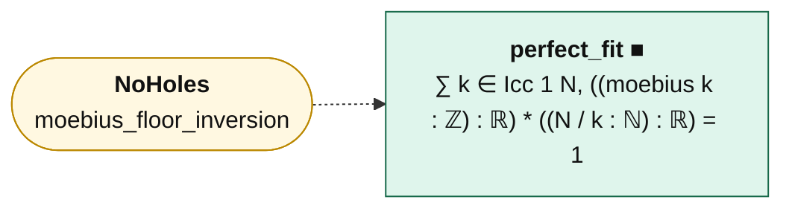

# `lean_stage3/Stage3/PerfectFit.lean`

> **Read from the source text.** This file changed after the last `python3 utilities/lean_map.py --dump`, so the arrows on this page are names occurring in each proof and have not been confirmed by Lean.

PerfectFit — block R14 of `lean_stage3/design/runs.md`. 2026-11-24. Julian, 2026-11-24: the harmonic of the integers absorbs the primes' signs as a perfect fit. For the counts it is exact: at every `N`, the counts `⌊N/k⌋` of the integers with nothing missing, signed by `μ(k)`, add up to exactly one.

1 theorem, 0 definitions, 40 lines. 

**Imports:** [`NoHoles`](../lean_stage3/NoHoles.md)  
**Imported by:** [`Stage3`](../lean_stage3/Stage3.md)

## The picture



An arrow A → B reads "A is used in the proof of B". Green: counting, integers only. Violet: shape, analysis with no ζ. Blue: reads ζ. A name ending in ■ is an end: nothing else uses it. Red: contains `sorry`. Yellow: theorems in another file, counted; a dotted arrow crosses files. Definitions are not drawn; they are listed below the diagram.

## Theorems

<a name="PerfectFit-perfect_fit"></a>
### `PerfectFit.perfect_fit`

line 20 · arrows read from text

**Counting.** Integers only: nothing in its statement or proof, or in anything it rests on, uses analysis or ζ.

**Why.** The perfect fit. The counts of the integers at every scale, signed by the Möbius function, add up to exactly one.

**Proves**

```lean
∑ k ∈ Icc 1 N, ((moebius k : ℤ) : ℝ) * ((N / k : ℕ) : ℝ) = 1
```

**Needs** (its hypotheses)

  - `` hN : 1 ≤ N ``

**Fed by** (1 theorem its proof uses)

  - [`NoHoles.moebius_floor_inversion`](../lean_stage3/NoHoles.md#NoHoles-moebius_floor_inversion) (NoHoles) — `` ∑ k ∈ Icc 1 N, ((moebius k : ℤ) : ℝ) * ∑ j ∈ Icc 1 (N / k), f (N / k / j) = f N ``

**Feeds:** nothing. It is an end.

