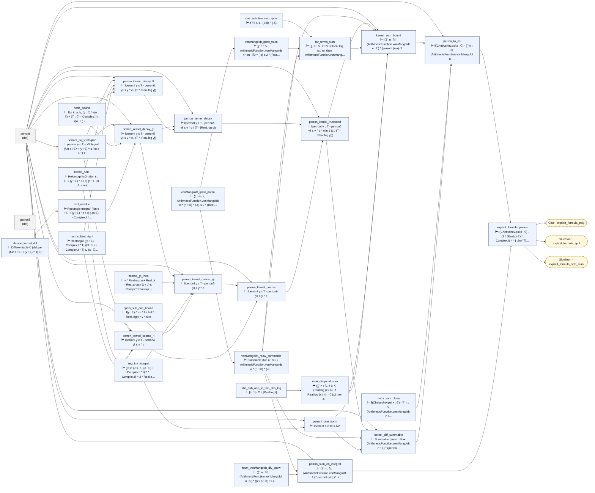

# `lean_stage3/Stage3/PerronKernel.lean`

**What it does** (its own header): # Slice 1a — the truncated Perron kernel bound (hEF's entry point) COMPLETE, 2026-08-29: every branch proved, no sorry. `perron_kernel_truncated` sits at `[propext, Classical.choice, Quot.sound]`. (Build order: entry 257; ledger: CONTEXT.md § hEF, roadmap D. This was hEF's load-bearing unknown — the piece both MediumPNT and StrongPNT were designed to avoid.)

**Imports:** nothing in this tree.
**Imported by:** [`Stage3`](../lean_stage3/Stage3.md), [`ContourShift`](../lean_stage3/ContourShift.md).

Blue: theorem. Green: a theorem nothing else uses (an end). Dashed white: connects to nothing. Grey: definition. Red: contains `sorry`. Yellow: in another file. An arrow A → B reads "A is used by B".

## Every declaration

| declaration | proves (output) | needs (input) | why (its own docstring) | uses | used by |
|---|---|---|---|---|---|
| `PerronKernel.perronI` def, line 46 | ℂ | y c T : ℝ | The truncated Perron integral `(2πi)⁻¹ ∫_{c-iT}^{c+iT} y^s/s ds`, parametrised on the vertical segment. | — | `PerronKernel.kernel_diff_summable`, `PerronKernel.kernel_sum_bound`, `PerronKernel.perronI_eq_VIntegral'`, `PerronKernel.perronI_one_norm`, `PerronKernel.perron_kernel_coarse`, `PerronKernel.perron_kernel_coarse_gt`, `PerronKernel.perron_kernel_coarse_lt`, `PerronKernel.perron_kernel_decay`, `PerronKernel.perron_kernel_decay_gt`, `PerronKernel.perron_kernel_decay_lt`, `PerronKernel.perron_kernel_truncated`, `PerronKernel.perron_sum_eq_integral`, `PerronKernel.perron_to_psi` |
| `PerronKernel.perronδ` def, line 52 | ℂ | y : ℝ | The target of the kernel: the indicator of `1 &lt; y`. | — | — |
| `PerronKernel.perronI_eq_VIntegral'` theorem, line 55 | perronI y c T = VIntegral' (fun s : ℂ ↦ (y : ℂ) ^ s / s) c (-T) T | y c T : ℝ | `perronI` is PNT+'s right-edge `VIntegral'` of the kernel. | `PerronKernel.perronI` | `PerronKernel.perron_kernel_coarse_lt`, `PerronKernel.perron_kernel_decay_gt`, `PerronKernel.perron_kernel_decay_lt` |
| `PerronKernel.kernel_holo` theorem, line 69 | HolomorphicOn (fun s : ℂ ↦ (y : ℂ) ^ s / s) {s : ℂ \| 0 &lt; s.re} | hy : 0 &lt; y | The kernel is holomorphic on the open right half-plane. | — | `PerronKernel.perron_kernel_coarse_lt`, `PerronKernel.perron_kernel_decay_lt` |
| `PerronKernel.rect_subset_right` theorem, line 81 | Rectangle ((c : ℂ) - Complex.I * T) ((X : ℂ) + Complex.I * T) ⊆ {s : ℂ \| 0 &lt; s.re} | hc : 0 &lt; c; hcX : c ≤ X | A rectangle with left edge at `c &gt; 0` sits in the right half-plane. | — | `PerronKernel.perron_kernel_coarse_lt`, `PerronKernel.perron_kernel_decay_lt` |
| `PerronKernel.perron_kernel_coarse_lt` theorem, line 96 | ‖perronI y c T - perronδ y‖ ≤ y ^ c | hy : 0 &lt; y; hylt : y &lt; 1; hc : 0 &lt; c; hT : 1 ≤ T | K1, case `y &lt; 1`. A single finite rectangle of width `T`: crude endpoint bounds on all three far edges give `(2/π)·y^c` — no limits. | `PerronKernel.kernel_holo`, `PerronKernel.perronI`, `PerronKernel.perronI_eq_VIntegral'`, `PerronKernel.rect_subset_right` | `PerronKernel.perron_kernel_coarse` |
| `PerronKernel.horiz_bound` theorem, line 211 | ‖∫ σ in a..b, (y : ℂ) ^ ((σ : ℂ) + (T' : ℂ) * Complex.I) / ((σ : ℂ) + (T' : ℂ) * Complex.I)‖ ≤ max (y ^ a) (y ^ b) / (\|T'\| * \|Real.log y\|) | hy : 0 &lt; y; hy1 : y ≠ 1; hT : 1 ≤ \|T'\|; hab : a ≤ b | The shared horizontal-edge estimate: along `Im s = T'` with `\|T'\| ≥ 1`, the kernel's horizontal integral is controlled by the endpoint powers over `\|T'\|·\|log y\|`. Every rectangle in both decay cases consumes this. | — | `PerronKernel.perron_kernel_decay_gt`, `PerronKernel.perron_kernel_decay_lt` |
| `PerronKernel.perron_kernel_decay_lt` theorem, line 299 | ‖perronI y c T - perronδ y‖ ≤ y ^ c / (T * \|Real.log y\|) | hy : 0 &lt; y; hylt : y &lt; 1; hc : 0 &lt; c; hT : 1 ≤ T | K2, case `y &lt; 1`. No pole; rectangles to `+∞` along the naturals, `horiz_bound` on both edges, the far vertical vanishes in the limit. | `PerronKernel.horiz_bound`, `PerronKernel.kernel_holo`, `PerronKernel.perronI`, `PerronKernel.perronI_eq_VIntegral'`, `PerronKernel.rect_subset_right` | `PerronKernel.perron_kernel_decay` |
| `PerronKernel.dslope_kernel_diff` theorem, line 409 | Differentiable ℂ (dslope (fun s : ℂ ↦ (y : ℂ) ^ s) 0) | hy : 0 &lt; y | The kernel's regular part at the pole: `dslope` of `y^s` at `0` is entire. | — | `PerronKernel.rect_residue` |
| `PerronKernel.rect_residue` theorem, line 428 | RectangleIntegral' (fun s : ℂ ↦ (y : ℂ) ^ s / s) (-(X:ℂ) - Complex.I * T) ((c:ℂ) + Complex.I * T) = 1 | hy : 0 &lt; y; hc : 0 &lt; c; hT : 0 &lt; T; hX : 0 &lt; X | The pole, crossed once: the rectangle boundary integral of the kernel around `0` is `1` after `(2πi)⁻¹` normalisation. | `PerronKernel.dslope_kernel_diff` | `PerronKernel.perron_kernel_decay_gt` |
| `PerronKernel.perron_kernel_decay_gt` theorem, line 461 | ‖perronI y c T - perronδ y‖ ≤ y ^ c / (T * \|Real.log y\|) | hygt : 1 &lt; y; hc : 0 &lt; c; hT : 1 ≤ T | K2, case `y &gt; 1`. The rectangle to `−∞` collects the residue `1 = perronδ y`; `horiz_bound` on both edges, far vertical dies. | `PerronKernel.horiz_bound`, `PerronKernel.perronI`, `PerronKernel.perronI_eq_VIntegral'`, `PerronKernel.rect_residue` | `PerronKernel.perron_kernel_coarse_gt`, `PerronKernel.perron_kernel_decay` |
| `PerronKernel.perron_kernel_decay` theorem, line 585 | ‖perronI y c T - perronδ y‖ ≤ y ^ c / (T * \|Real.log y\|) | hy : 0 &lt; y; hy1 : y ≠ 1; hc : 0 &lt; c; hT : 1 ≤ T | K2 — the decay branch, assembled from its two cases. | `PerronKernel.perronI`, `PerronKernel.perron_kernel_decay_gt`, `PerronKernel.perron_kernel_decay_lt` | `PerronKernel.perron_kernel_truncated` |
| `PerronKernel.coarse_gt_ineq` theorem, line 595 | v * Real.exp u + Real.pi - Real.arctan (v / u) ≤ Real.pi * Real.exp u | hu : 0 &lt; u; hv0 : 0 &lt; v; hv1 : v ≤ 1 | The elementary two-variable inequality behind K1's `y &gt; 1` case, in multiplied (division-free) form: for `u = c·log y &gt; 0`, `v = T·log y ∈ (0,1]`, `v·e^u + π − arctan(v/u) ≤ π·e^u`. | — | `PerronKernel.perron_kernel_coarse_gt` |
| `PerronKernel.seg_inv_integral` theorem, line 639 | (∫ t in (-T)..T, ((c : ℂ) + Complex.I * t)⁻¹ * Complex.I) = 2 * Real.arctan (T / c) * Complex.I | hc : 0 &lt; c | The segment integral of `1/s`: pure real calculus — the odd part cancels by its antiderivative, the even part is the arctan derivative. | — | `PerronKernel.perronI_one_norm`, `PerronKernel.perron_kernel_coarse_gt` |
| `PerronKernel.cpow_sub_one_bound` theorem, line 716 | ‖(y : ℂ) ^ s - 1‖ ≤ ‖s‖ * Real.log y * y ^ s.re | hygt : 1 &lt; y; hre : 0 ≤ s.re | Mean-value bound: `‖y^s − 1‖ ≤ ‖s‖·log y·y^(re s)` for `y &gt; 1`. | — | `PerronKernel.perron_kernel_coarse_gt` |
| `PerronKernel.perron_kernel_coarse_gt` theorem, line 770 | ‖perronI y c T - perronδ y‖ ≤ y ^ c | hygt : 1 &lt; y; hc : 0 &lt; c; hT : 1 ≤ T | K1, case `y &gt; 1`. For `T·log y ≥ 1` this is the decay branch; below that, split off the exact `∫ ds/s`, mean-value the rest, and close with `coarse_gt_ineq`. | `PerronKernel.coarse_gt_ineq`, `PerronKernel.cpow_sub_one_bound`, `PerronKernel.perronI`, `PerronKernel.perron_kernel_decay_gt`, `PerronKernel.seg_inv_integral` | `PerronKernel.perron_kernel_coarse` |
| `PerronKernel.perron_kernel_coarse` theorem, line 921 | ‖perronI y c T - perronδ y‖ ≤ y ^ c | hy : 0 &lt; y; hy1 : y ≠ 1; hc : 0 &lt; c; hT : 1 ≤ T | K1 — the coarse branch, assembled from its two cases. | `PerronKernel.perronI`, `PerronKernel.perron_kernel_coarse_gt`, `PerronKernel.perron_kernel_coarse_lt` | `PerronKernel.perron_kernel_truncated` |
| `PerronKernel.perron_kernel_truncated` theorem, line 930 | ‖perronI y c T - perronδ y‖ ≤ y ^ c * min 1 (1 / (T * \|Real.log y\|)) | hy : 0 &lt; y; hy1 : y ≠ 1; hc : 0 &lt; c; hT : 1 ≤ T | Slice 1a — the truncated Perron kernel bound. Assembled from K1 and K2; the two branches are the whole of the missing mathematics. | `PerronKernel.perronI`, `PerronKernel.perron_kernel_coarse`, `PerronKernel.perron_kernel_decay` | `PerronKernel.kernel_diff_summable`, `PerronKernel.kernel_sum_bound` |
| `PerronKernel.one_sub_two_neg_rpow` theorem, line 950 | δ / 5 ≤ 1 - (2:ℝ) ^ (-δ) | h0 : 0 &lt; δ; h1 : δ ≤ 1 | Geometric-denominator bound: `δ/5 ≤ 1 − 2^(−δ)` for `0 &lt; δ ≤ 1`. | — | `PerronKernel.far_terms_sum` |
| `PerronKernel.vonMangoldt_rpow_partial` theorem, line 977 | ∑ n ∈ s, ArithmeticFunction.vonMangoldt n * (n : ℝ) ^ (-c) ≤ 2 * (Real.log 4 + 4) / (1 - (2:ℝ) ^ (1 - c)) | hc1 : 1 &lt; c; s : Finset ℕ | The dyadic partial-sum bound: any finite piece of `Σ Λ(n)·n^(−c)` sits under `2(log 4 + 4)/(1 − 2^(1−c))`. | — | `PerronKernel.vonMangoldt_rpow_summable`, `PerronKernel.vonMangoldt_rpow_tsum` |
| `PerronKernel.vonMangoldt_rpow_tsum` theorem, line 1082 | ∑' n : ℕ, ArithmeticFunction.vonMangoldt n * (n : ℝ) ^ (-c) ≤ 2 * (Real.log 4 + 4) / (1 - (2:ℝ) ^ (1 - c)) | hc1 : 1 &lt; c | The full sum, as a tsum. | `PerronKernel.vonMangoldt_rpow_partial` | `PerronKernel.far_terms_sum` |
| `PerronKernel.vonMangoldt_rpow_summable` theorem, line 1090 | Summable (fun n : ℕ ↦ ArithmeticFunction.vonMangoldt n * (n : ℝ) ^ (-c)) | hc1 : 1 &lt; c | — | `PerronKernel.vonMangoldt_rpow_partial` | `PerronKernel.far_terms_sum`, `PerronKernel.kernel_diff_summable`, `PerronKernel.kernel_sum_bound`, `PerronKernel.perron_sum_eq_integral` |
| `PerronKernel.far_terms_sum` theorem, line 1098 | (∑' n : ℕ, if 1/2 ≤ \|Real.log (x / n)\| then ArithmeticFunction.vonMangoldt n * (x / n) ^ (1 + 1/Real.log x) / (T * \|Real.log (x / n)\|) else 0) ≤ 300 * x * Real.log (x * T) ^ 2 / T | hx : 16 ≤ x; hT : 1 ≤ T | Slice 1b — the far-terms sum. | `PerronKernel.one_sub_two_neg_rpow`, `PerronKernel.vonMangoldt_rpow_summable`, `PerronKernel.vonMangoldt_rpow_tsum` | `PerronKernel.kernel_sum_bound` |
| `PerronKernel.abs_sub_one_le_two_abs_log` theorem, line 1238 | \|t - 1\| / 2 ≤ \|Real.log t\| | h1 : 1/2 ≤ t; h2 : t ≤ 2 | `\|t − 1\|/2 ≤ \|log t\|` on `[1/2, 2]`. | — | `PerronKernel.near_diagonal_sum` |
| `PerronKernel.near_diagonal_sum` theorem, line 1261 | (∑' n : ℕ, if 0 &lt; \|Real.log (x / n)\| ∧ \|Real.log (x / n)\| &lt; 1/2 then ArithmeticFunction.vonMangoldt n * min 1 (1/(T * \|Real.log (x / n)\|)) else 0) ≤ 100 * x * Real.log (x * T) ^ 2 / T + 4 * Real.log x | hx : 16 ≤ x; hT : 1 ≤ T | Slice 1c — the near-diagonal sum. | `PerronKernel.abs_sub_one_le_two_abs_log` | `PerronKernel.kernel_sum_bound` |
| `PerronKernel.perronI_one_norm` theorem, line 1560 | ‖perronI 1 c T‖ ≤ 1/2 | hc : 0 &lt; c | The kernel at `y = 1`, directly: `‖perronI 1 c T‖ ≤ 1/2`. | `PerronKernel.perronI`, `PerronKernel.seg_inv_integral` | `PerronKernel.kernel_diff_summable`, `PerronKernel.kernel_sum_bound` |
| `PerronKernel.kernel_sum_bound` theorem, line 1595 | ‖(∑' n : ℕ, (ArithmeticFunction.vonMangoldt n : ℂ) * (perronI (x/n) (1 + 1/Real.log x) T - perronδ (x/n)))‖ ≤ 600 * x * Real.log (x * T) ^ 2 / T + 12 * Real.log x | hx : 16 ≤ x; hT : 1 ≤ T | Slice 1's analytic composition. The summed kernel error. | `PerronKernel.far_terms_sum`, `PerronKernel.near_diagonal_sum`, `PerronKernel.perronI`, `PerronKernel.perronI_one_norm`, `PerronKernel.perron_kernel_truncated`, `PerronKernel.vonMangoldt_rpow_summable` | `PerronKernel.perron_to_psi` |
| `PerronKernel.delta_sum_close` theorem, line 1895 | ‖(Chebyshev.psi x : ℂ) - ∑' n : ℕ, (ArithmeticFunction.vonMangoldt n : ℂ) * perronδ (x / n)‖ ≤ Real.log x | hx : 16 ≤ x | The δ-side of the composition: the indicator sum is `ψ` up to one von Mangoldt value at the possible integer point. | — | `PerronKernel.perron_to_psi` |
| `PerronKernel.kernel_diff_summable` theorem, line 2012 | Summable (fun n : ℕ ↦ (ArithmeticFunction.vonMangoldt n : ℂ) * (perronI (x/n) (1 + 1/Real.log x) T - perronδ (x/n))) | hx : 16 ≤ x; hT : 1 ≤ T | Summability of the kernel differences, via the crude majorant `Λ(n)·(x/n)^c` — sharp enough for convergence, everywhere. | `PerronKernel.perronI`, `PerronKernel.perronI_one_norm`, `PerronKernel.perron_kernel_truncated`, `PerronKernel.vonMangoldt_rpow_summable` | `PerronKernel.perron_to_psi` |
| `PerronKernel.perron_to_psi` theorem, line 2071 | ‖(Chebyshev.psi x : ℂ) - ∑' n : ℕ, (ArithmeticFunction.vonMangoldt n : ℂ) * perronI (x/n) (1 + 1/Real.log x) T‖ ≤ 600 * x * Real.log (x * T) ^ 2 / T + 13 * Real.log x | hx : 16 ≤ x; hT : 1 ≤ T | Slice 1 — the Perron-to-ψ bound. The truncated Perron sum of the von Mangoldt function misses `ψ` by at most `600·x·log(xT)²/T + 13·log x`. | `PerronKernel.delta_sum_close`, `PerronKernel.kernel_diff_summable`, `PerronKernel.kernel_sum_bound`, `PerronKernel.perronI` | `PerronKernel.explicit_formula_perron` |
| `PerronKernel.tsum_vonMangoldt_div_cpow` theorem, line 2120 | (∑' n : ℕ, (ArithmeticFunction.vonMangoldt n : ℂ) * ((x / n : ℝ) : ℂ) ^ s) = (- deriv riemannZeta s / riemannZeta s) * ((x:ℝ):ℂ) ^ s | hx0 : 0 &lt; x; hs : 1 &lt; s.re | The Dirichlet-series identity under the integral: at `re s = c &gt; 1`, `Σ Λ(n)·(x/n)^s = (−ζ′/ζ)(s)·x^s`. | — | `PerronKernel.perron_sum_eq_integral` |
| `PerronKernel.perron_sum_eq_integral` theorem, line 2171 | (∑' n : ℕ, (ArithmeticFunction.vonMangoldt n : ℂ) * perronI (x/n) (1 + 1/Real.log x) T) = (2 * (Real.pi:ℂ) * Complex.I)⁻¹ * ∫ t in (-T)..T, (- deriv riemannZeta (((1 + 1/Real.log x : ℝ):ℂ) + Complex.I * t) / riemannZeta (((1 + 1/Real.log x : ℝ):ℂ) + Complex.I * t)) * ((x:ℝ):ℂ) ^ (((1 + 1/Real.log x : ℝ):ℂ) + Complex.I * t) / (((1 + 1/Real.log x : ℝ):ℂ) + Complex.I * t) * Complex.I | hx : 16 ≤ x; hT : 1 ≤ T | The Fubini. The kernel sum IS the truncated `−ζ′/ζ` contour integral. | `PerronKernel.perronI`, `PerronKernel.tsum_vonMangoldt_div_cpow`, `PerronKernel.vonMangoldt_rpow_summable` | `PerronKernel.explicit_formula_perron` |
| `PerronKernel.explicit_formula_perron` theorem, line 2340 | ‖(Chebyshev.psi x : ℂ) - (2 * (Real.pi:ℂ) * Complex.I)⁻¹ * ∫ t in (-T)..T, (- deriv riemannZeta (((1 + 1/Real.log x : ℝ):ℂ) + Complex.I * t) / riemannZeta (((1 + 1/Real.log x : ℝ):ℂ) + Complex.I * t)) * ((x:ℝ):ℂ) ^ (((1 + 1/Real.log x : ℝ):ℂ) + Complex.I * t) / (((1 + 1/Real.log x : ℝ):ℂ) + Complex.I * t) * Complex.I‖ ≤ 600 * x * Real.log (x * T) ^ 2 / T + 13 * Real.log x | hx : 16 ≤ x; hT : 1 ≤ T | hEF, Perron form — the truncated explicit formula at the line `re = c`. `ψ` misses the truncated `−ζ′/ζ` integral by `600·x·log(xT)²/T + 13·log x`. | `PerronKernel.perron_sum_eq_integral`, `PerronKernel.perron_to_psi` | `Glue.explicit_formula_poly`, `Glue.explicit_formula_split`, `Glue.explicit_formula_split_num` |
