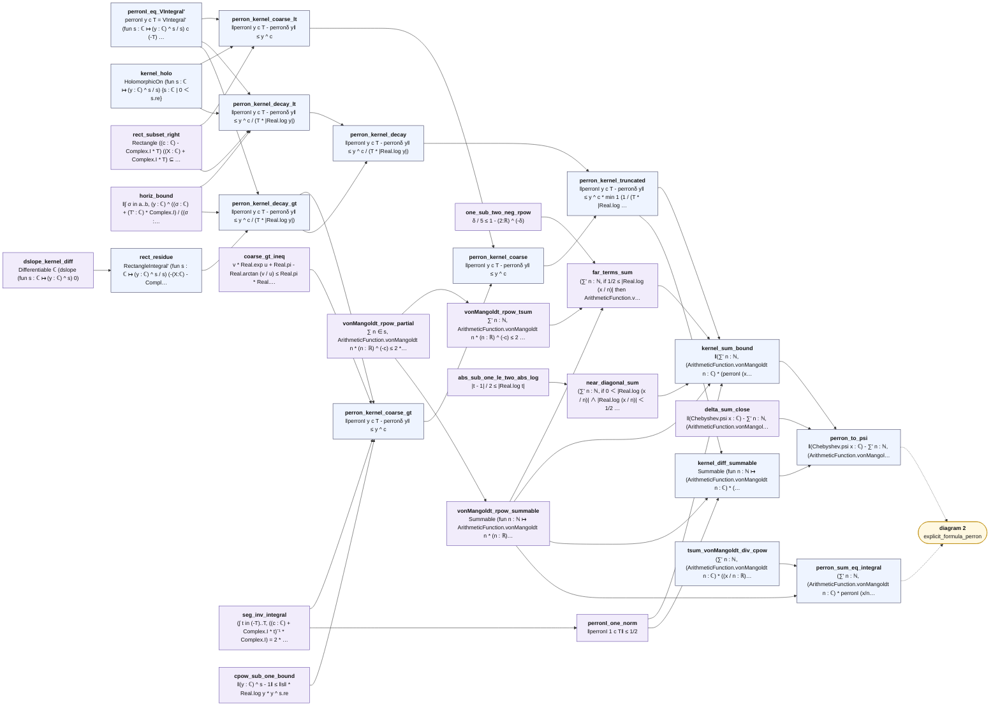
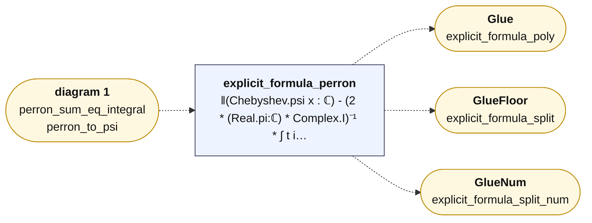

# `lean_stage3/Stage3/PerronKernel.lean`

# Slice 1a — the truncated Perron kernel bound (hEF's entry point) COMPLETE, 2026-08-29: every branch proved, no sorry. `perron_kernel_truncated` sits at `[propext, Classical.choice, Quot.sound]`. (Build order: entry 257; ledger: CONTEXT.md § hEF, roadmap D. This was hEF's load-bearing unknown — the piece both MediumPNT and StrongPNT were designed to avoid.)

31 theorems, 2 definitions, 2365 lines. Arrows are Lean's own record of what each proof uses.

**Imports:** nothing in this tree  
**Imported by:** [`Stage3`](../lean_stage3/Stage3.md), [`ContourShift`](../lean_stage3/ContourShift.md)

## The picture

### Diagram 1 of 2: `perronI_eq_VIntegral'` to `perron_sum_eq_integral`



### Diagram 2 of 2: `explicit_formula_perron` to `explicit_formula_perron`



An arrow A → B reads "A is used in the proof of B". Green: counting, integers only. Violet: shape, analysis with no ζ. Blue: reads ζ. A name ending in ■ is an end: nothing else uses it. Red: contains `sorry`. Yellow: theorems in another file, counted; a dotted arrow crosses files. Definitions are not drawn; they are listed below the diagram.

## Definitions

<a name="PerronKernel-perronI"></a>
### `PerronKernel.perronI`

def · line 46

The truncated Perron integral `(2πi)⁻¹ ∫_{c-iT}^{c+iT} y^s/s ds`, parametrised on the vertical segment.

- **Is:** `` perronI (y c T : ℝ) : ℂ := (2 * Real.pi * Complex.I)⁻¹ * ∫ t in (-T)..T, (y : ℂ) ^ ((c : ℂ) + Complex.I * t) / ((c : ℂ) + Complex.I * t) * Complex.I ``
- **Used by 14:** [`PerronKernel.explicit_formula_perron`](#PerronKernel-explicit_formula_perron), [`PerronKernel.kernel_diff_summable`](#PerronKernel-kernel_diff_summable), [`PerronKernel.kernel_sum_bound`](#PerronKernel-kernel_sum_bound), [`PerronKernel.perronI_eq_VIntegral'`](#PerronKernel-perronI_eq_VIntegral-), [`PerronKernel.perronI_one_norm`](#PerronKernel-perronI_one_norm), [`PerronKernel.perron_kernel_coarse`](#PerronKernel-perron_kernel_coarse), [`PerronKernel.perron_kernel_coarse_gt`](#PerronKernel-perron_kernel_coarse_gt), [`PerronKernel.perron_kernel_coarse_lt`](#PerronKernel-perron_kernel_coarse_lt), [`PerronKernel.perron_kernel_decay`](#PerronKernel-perron_kernel_decay), [`PerronKernel.perron_kernel_decay_gt`](#PerronKernel-perron_kernel_decay_gt), [`PerronKernel.perron_kernel_decay_lt`](#PerronKernel-perron_kernel_decay_lt), [`PerronKernel.perron_kernel_truncated`](#PerronKernel-perron_kernel_truncated), [`PerronKernel.perron_sum_eq_integral`](#PerronKernel-perron_sum_eq_integral), [`PerronKernel.perron_to_psi`](#PerronKernel-perron_to_psi)

<a name="PerronKernel-perron-"></a>
### `PerronKernel.perronδ`

def · line 52

The target of the kernel: the indicator of `1 < y`.

- **Is:** `` perronδ (y : ℝ) : ℂ := if 1 < y then 1 else 0 ``
- **Used by 11:** [`PerronKernel.delta_sum_close`](#PerronKernel-delta_sum_close), [`PerronKernel.kernel_diff_summable`](#PerronKernel-kernel_diff_summable), [`PerronKernel.kernel_sum_bound`](#PerronKernel-kernel_sum_bound), [`PerronKernel.perron_kernel_coarse`](#PerronKernel-perron_kernel_coarse), [`PerronKernel.perron_kernel_coarse_gt`](#PerronKernel-perron_kernel_coarse_gt), [`PerronKernel.perron_kernel_coarse_lt`](#PerronKernel-perron_kernel_coarse_lt), [`PerronKernel.perron_kernel_decay`](#PerronKernel-perron_kernel_decay), [`PerronKernel.perron_kernel_decay_gt`](#PerronKernel-perron_kernel_decay_gt), [`PerronKernel.perron_kernel_decay_lt`](#PerronKernel-perron_kernel_decay_lt), [`PerronKernel.perron_kernel_truncated`](#PerronKernel-perron_kernel_truncated), [`PerronKernel.perron_to_psi`](#PerronKernel-perron_to_psi)

## Theorems

<a name="PerronKernel-perronI_eq_VIntegral-"></a>
### `PerronKernel.perronI_eq_VIntegral'`

line 55

**Reads ζ.** It, or something it rests on, uses the zeta function, its zeros or the Riemann hypothesis.

**Why.** `perronI` is PNT+'s right-edge `VIntegral'` of the kernel.

**Proves**

```lean
perronI y c T = VIntegral' (fun s : ℂ ↦ (y : ℂ) ^ s / s) c (-T) T
```

**Needs** (its hypotheses)

  - `` y c T : ℝ ``

**Stated with:** [`PerronKernel.perronI`](#PerronKernel-perronI)

**Fed by:** no theorem of this repo; it stands on Mathlib and the definitions below.

**Feeds** (3 that use it)

  - [`PerronKernel.perron_kernel_coarse_lt`](#PerronKernel-perron_kernel_coarse_lt) — `` ‖perronI y c T - perronδ y‖ ≤ y ^ c ``
  - [`PerronKernel.perron_kernel_decay_gt`](#PerronKernel-perron_kernel_decay_gt) — `` ‖perronI y c T - perronδ y‖ ≤ y ^ c / (T * |Real.log y|) ``
  - [`PerronKernel.perron_kernel_decay_lt`](#PerronKernel-perron_kernel_decay_lt) — `` ‖perronI y c T - perronδ y‖ ≤ y ^ c / (T * |Real.log y|) ``

<a name="PerronKernel-kernel_holo"></a>
### `PerronKernel.kernel_holo`

line 69

**Reads ζ.** It, or something it rests on, uses the zeta function, its zeros or the Riemann hypothesis.

**Why.** The kernel is holomorphic on the open right half-plane.

**Proves**

```lean
HolomorphicOn (fun s : ℂ ↦ (y : ℂ) ^ s / s) {s : ℂ | 0 < s.re}
```

**Needs** (its hypotheses)

  - `` hy : 0 < y ``

**Fed by:** no theorem of this repo; it stands on Mathlib.

**Feeds** (2 that use it)

  - [`PerronKernel.perron_kernel_coarse_lt`](#PerronKernel-perron_kernel_coarse_lt) — `` ‖perronI y c T - perronδ y‖ ≤ y ^ c ``
  - [`PerronKernel.perron_kernel_decay_lt`](#PerronKernel-perron_kernel_decay_lt) — `` ‖perronI y c T - perronδ y‖ ≤ y ^ c / (T * |Real.log y|) ``

<a name="PerronKernel-rect_subset_right"></a>
### `PerronKernel.rect_subset_right`

line 81

**Shape.** Uses real or complex analysis; nothing in it or beneath it reads ζ.

**Why.** A rectangle with left edge at `c > 0` sits in the right half-plane.

**Proves**

```lean
Rectangle ((c : ℂ) - Complex.I * T) ((X : ℂ) + Complex.I * T) ⊆ {s : ℂ | 0 < s.re}
```

**Needs** (its hypotheses)

  - `` hc : 0 < c ``
  - `` hcX : c ≤ X ``

**Fed by:** no theorem of this repo; it stands on Mathlib.

**Feeds** (2 that use it)

  - [`PerronKernel.perron_kernel_coarse_lt`](#PerronKernel-perron_kernel_coarse_lt) — `` ‖perronI y c T - perronδ y‖ ≤ y ^ c ``
  - [`PerronKernel.perron_kernel_decay_lt`](#PerronKernel-perron_kernel_decay_lt) — `` ‖perronI y c T - perronδ y‖ ≤ y ^ c / (T * |Real.log y|) ``

<a name="PerronKernel-perron_kernel_coarse_lt"></a>
### `PerronKernel.perron_kernel_coarse_lt`

line 96

**Reads ζ.** It, or something it rests on, uses the zeta function, its zeros or the Riemann hypothesis.

**Why.** K1, case `y < 1`. A single finite rectangle of width `T`: crude endpoint bounds on all three far edges give `(2/π)·y^c` — no limits.

**Proves**

```lean
‖perronI y c T - perronδ y‖ ≤ y ^ c
```

**Needs** (its hypotheses)

  - `` hy : 0 < y ``
  - `` hylt : y < 1 ``
  - `` hc : 0 < c ``
  - `` hT : 1 ≤ T ``

**Stated with:** [`PerronKernel.perronI`](#PerronKernel-perronI), [`PerronKernel.perronδ`](#PerronKernel-perron-)

**Fed by** (3 theorems its proof uses)

  - [`PerronKernel.kernel_holo`](#PerronKernel-kernel_holo) — `` HolomorphicOn (fun s : ℂ ↦ (y : ℂ) ^ s / s) {s : ℂ | 0 < s.re} ``
  - [`PerronKernel.perronI_eq_VIntegral'`](#PerronKernel-perronI_eq_VIntegral-) — `` perronI y c T = VIntegral' (fun s : ℂ ↦ (y : ℂ) ^ s / s) c (-T) T ``
  - [`PerronKernel.rect_subset_right`](#PerronKernel-rect_subset_right) — `` Rectangle ((c : ℂ) - Complex.I * T) ((X : ℂ) + Complex.I * T) ⊆ {s : ℂ | 0 < s.re} ``

**Feeds** (1 that use it)

  - [`PerronKernel.perron_kernel_coarse`](#PerronKernel-perron_kernel_coarse) — `` ‖perronI y c T - perronδ y‖ ≤ y ^ c ``

<a name="PerronKernel-horiz_bound"></a>
### `PerronKernel.horiz_bound`

line 211

**Shape.** Uses real or complex analysis; nothing in it or beneath it reads ζ.

**Why.** The shared horizontal-edge estimate: along `Im s = T'` with `|T'| ≥ 1`, the kernel's horizontal integral is controlled by the endpoint powers over `|T'|·|log y|`. Every rectangle in both decay cases consumes this.

**Proves**

```lean
‖∫ σ in a..b, (y : ℂ) ^ ((σ : ℂ) + (T' : ℂ) * Complex.I) / ((σ : ℂ) + (T' : ℂ) * Complex.I)‖ ≤ max (y ^ a) (y ^ b) / (|T'| * |Real.log y|)
```

**Needs** (its hypotheses)

  - `` hy : 0 < y ``
  - `` hy1 : y ≠ 1 ``
  - `` hT : 1 ≤ |T'| ``
  - `` hab : a ≤ b ``

**Fed by:** no theorem of this repo; it stands on Mathlib.

**Feeds** (2 that use it)

  - [`PerronKernel.perron_kernel_decay_gt`](#PerronKernel-perron_kernel_decay_gt) — `` ‖perronI y c T - perronδ y‖ ≤ y ^ c / (T * |Real.log y|) ``
  - [`PerronKernel.perron_kernel_decay_lt`](#PerronKernel-perron_kernel_decay_lt) — `` ‖perronI y c T - perronδ y‖ ≤ y ^ c / (T * |Real.log y|) ``

<a name="PerronKernel-perron_kernel_decay_lt"></a>
### `PerronKernel.perron_kernel_decay_lt`

line 299

**Reads ζ.** It, or something it rests on, uses the zeta function, its zeros or the Riemann hypothesis.

**Why.** K2, case `y < 1`. No pole; rectangles to `+∞` along the naturals, `horiz_bound` on both edges, the far vertical vanishes in the limit.

**Proves**

```lean
‖perronI y c T - perronδ y‖ ≤ y ^ c / (T * |Real.log y|)
```

**Needs** (its hypotheses)

  - `` hy : 0 < y ``
  - `` hylt : y < 1 ``
  - `` hc : 0 < c ``
  - `` hT : 1 ≤ T ``

**Stated with:** [`PerronKernel.perronI`](#PerronKernel-perronI), [`PerronKernel.perronδ`](#PerronKernel-perron-)

**Fed by** (4 theorems its proof uses)

  - [`PerronKernel.horiz_bound`](#PerronKernel-horiz_bound) — `` ‖∫ σ in a..b, (y : ℂ) ^ ((σ : ℂ) + (T' : ℂ) * Complex.I) / ((σ : ℂ) + (T' : ℂ) * Complex.I)‖ ≤ max (y ^ a) (y ^ b) / (|T'| * |Real.log y|) ``
  - [`PerronKernel.kernel_holo`](#PerronKernel-kernel_holo) — `` HolomorphicOn (fun s : ℂ ↦ (y : ℂ) ^ s / s) {s : ℂ | 0 < s.re} ``
  - [`PerronKernel.perronI_eq_VIntegral'`](#PerronKernel-perronI_eq_VIntegral-) — `` perronI y c T = VIntegral' (fun s : ℂ ↦ (y : ℂ) ^ s / s) c (-T) T ``
  - [`PerronKernel.rect_subset_right`](#PerronKernel-rect_subset_right) — `` Rectangle ((c : ℂ) - Complex.I * T) ((X : ℂ) + Complex.I * T) ⊆ {s : ℂ | 0 < s.re} ``

**Feeds** (1 that use it)

  - [`PerronKernel.perron_kernel_decay`](#PerronKernel-perron_kernel_decay) — `` ‖perronI y c T - perronδ y‖ ≤ y ^ c / (T * |Real.log y|) ``

<a name="PerronKernel-dslope_kernel_diff"></a>
### `PerronKernel.dslope_kernel_diff`

line 409

**Shape.** Uses real or complex analysis; nothing in it or beneath it reads ζ.

**Why.** The kernel's regular part at the pole: `dslope` of `y^s` at `0` is entire.

**Proves**

```lean
Differentiable ℂ (dslope (fun s : ℂ ↦ (y : ℂ) ^ s) 0)
```

**Needs** (its hypotheses)

  - `` hy : 0 < y ``

**Fed by:** no theorem of this repo; it stands on Mathlib.

**Feeds** (1 that use it)

  - [`PerronKernel.rect_residue`](#PerronKernel-rect_residue) — `` RectangleIntegral' (fun s : ℂ ↦ (y : ℂ) ^ s / s) (-(X:ℂ) - Complex.I * T) ((c:ℂ) + Complex.I * T) = 1 ``

<a name="PerronKernel-rect_residue"></a>
### `PerronKernel.rect_residue`

line 428

**Reads ζ.** It, or something it rests on, uses the zeta function, its zeros or the Riemann hypothesis.

**Why.** The pole, crossed once: the rectangle boundary integral of the kernel around `0` is `1` after `(2πi)⁻¹` normalisation.

**Proves**

```lean
RectangleIntegral' (fun s : ℂ ↦ (y : ℂ) ^ s / s) (-(X:ℂ) - Complex.I * T) ((c:ℂ) + Complex.I * T) = 1
```

**Needs** (its hypotheses)

  - `` hy : 0 < y ``
  - `` hc : 0 < c ``
  - `` hT : 0 < T ``
  - `` hX : 0 < X ``

**Fed by** (1 theorem its proof uses)

  - [`PerronKernel.dslope_kernel_diff`](#PerronKernel-dslope_kernel_diff) — `` Differentiable ℂ (dslope (fun s : ℂ ↦ (y : ℂ) ^ s) 0) ``

**Feeds** (1 that use it)

  - [`PerronKernel.perron_kernel_decay_gt`](#PerronKernel-perron_kernel_decay_gt) — `` ‖perronI y c T - perronδ y‖ ≤ y ^ c / (T * |Real.log y|) ``

<a name="PerronKernel-perron_kernel_decay_gt"></a>
### `PerronKernel.perron_kernel_decay_gt`

line 461

**Reads ζ.** It, or something it rests on, uses the zeta function, its zeros or the Riemann hypothesis.

**Why.** K2, case `y > 1`. The rectangle to `−∞` collects the residue `1 = perronδ y`; `horiz_bound` on both edges, far vertical dies.

**Proves**

```lean
‖perronI y c T - perronδ y‖ ≤ y ^ c / (T * |Real.log y|)
```

**Needs** (its hypotheses)

  - `` hygt : 1 < y ``
  - `` hc : 0 < c ``
  - `` hT : 1 ≤ T ``

**Stated with:** [`PerronKernel.perronI`](#PerronKernel-perronI), [`PerronKernel.perronδ`](#PerronKernel-perron-)

**Fed by** (3 theorems its proof uses)

  - [`PerronKernel.horiz_bound`](#PerronKernel-horiz_bound) — `` ‖∫ σ in a..b, (y : ℂ) ^ ((σ : ℂ) + (T' : ℂ) * Complex.I) / ((σ : ℂ) + (T' : ℂ) * Complex.I)‖ ≤ max (y ^ a) (y ^ b) / (|T'| * |Real.log y|) ``
  - [`PerronKernel.perronI_eq_VIntegral'`](#PerronKernel-perronI_eq_VIntegral-) — `` perronI y c T = VIntegral' (fun s : ℂ ↦ (y : ℂ) ^ s / s) c (-T) T ``
  - [`PerronKernel.rect_residue`](#PerronKernel-rect_residue) — `` RectangleIntegral' (fun s : ℂ ↦ (y : ℂ) ^ s / s) (-(X:ℂ) - Complex.I * T) ((c:ℂ) + Complex.I * T) = 1 ``

**Feeds** (2 that use it)

  - [`PerronKernel.perron_kernel_coarse_gt`](#PerronKernel-perron_kernel_coarse_gt) — `` ‖perronI y c T - perronδ y‖ ≤ y ^ c ``
  - [`PerronKernel.perron_kernel_decay`](#PerronKernel-perron_kernel_decay) — `` ‖perronI y c T - perronδ y‖ ≤ y ^ c / (T * |Real.log y|) ``

<a name="PerronKernel-perron_kernel_decay"></a>
### `PerronKernel.perron_kernel_decay`

line 585

**Reads ζ.** It, or something it rests on, uses the zeta function, its zeros or the Riemann hypothesis.

**Why.** K2 — the decay branch, assembled from its two cases.

**Proves**

```lean
‖perronI y c T - perronδ y‖ ≤ y ^ c / (T * |Real.log y|)
```

**Needs** (its hypotheses)

  - `` hy : 0 < y ``
  - `` hy1 : y ≠ 1 ``
  - `` hc : 0 < c ``
  - `` hT : 1 ≤ T ``

**Stated with:** [`PerronKernel.perronI`](#PerronKernel-perronI), [`PerronKernel.perronδ`](#PerronKernel-perron-)

**Fed by** (2 theorems its proof uses)

  - [`PerronKernel.perron_kernel_decay_gt`](#PerronKernel-perron_kernel_decay_gt) — `` ‖perronI y c T - perronδ y‖ ≤ y ^ c / (T * |Real.log y|) ``
  - [`PerronKernel.perron_kernel_decay_lt`](#PerronKernel-perron_kernel_decay_lt) — `` ‖perronI y c T - perronδ y‖ ≤ y ^ c / (T * |Real.log y|) ``

**Feeds** (1 that use it)

  - [`PerronKernel.perron_kernel_truncated`](#PerronKernel-perron_kernel_truncated) — `` ‖perronI y c T - perronδ y‖ ≤ y ^ c * min 1 (1 / (T * |Real.log y|)) ``

<a name="PerronKernel-coarse_gt_ineq"></a>
### `PerronKernel.coarse_gt_ineq`

line 595

**Shape.** Uses real or complex analysis; nothing in it or beneath it reads ζ.

**Why.** The elementary two-variable inequality behind K1's `y > 1` case, in multiplied (division-free) form: for `u = c·log y > 0`, `v = T·log y ∈ (0,1]`, `v·e^u + π − arctan(v/u) ≤ π·e^u`.

**Proves**

```lean
v * Real.exp u + Real.pi - Real.arctan (v / u) ≤ Real.pi * Real.exp u
```

**Needs** (its hypotheses)

  - `` hu : 0 < u ``
  - `` hv0 : 0 < v ``
  - `` hv1 : v ≤ 1 ``

**Fed by:** no theorem of this repo; it stands on Mathlib.

**Feeds** (1 that use it)

  - [`PerronKernel.perron_kernel_coarse_gt`](#PerronKernel-perron_kernel_coarse_gt) — `` ‖perronI y c T - perronδ y‖ ≤ y ^ c ``

<a name="PerronKernel-seg_inv_integral"></a>
### `PerronKernel.seg_inv_integral`

line 639

**Shape.** Uses real or complex analysis; nothing in it or beneath it reads ζ.

**Why.** The segment integral of `1/s`: pure real calculus — the odd part cancels by its antiderivative, the even part is the arctan derivative.

**Proves**

```lean
(∫ t in (-T)..T, ((c : ℂ) + Complex.I * t)⁻¹ * Complex.I) = 2 * Real.arctan (T / c) * Complex.I
```

**Needs** (its hypotheses)

  - `` hc : 0 < c ``

**Fed by:** no theorem of this repo; it stands on Mathlib.

**Feeds** (2 that use it)

  - [`PerronKernel.perronI_one_norm`](#PerronKernel-perronI_one_norm) — `` ‖perronI 1 c T‖ ≤ 1/2 ``
  - [`PerronKernel.perron_kernel_coarse_gt`](#PerronKernel-perron_kernel_coarse_gt) — `` ‖perronI y c T - perronδ y‖ ≤ y ^ c ``

<a name="PerronKernel-cpow_sub_one_bound"></a>
### `PerronKernel.cpow_sub_one_bound`

line 716

**Shape.** Uses real or complex analysis; nothing in it or beneath it reads ζ.

**Why.** Mean-value bound: `‖y^s − 1‖ ≤ ‖s‖·log y·y^(re s)` for `y > 1`.

**Proves**

```lean
‖(y : ℂ) ^ s - 1‖ ≤ ‖s‖ * Real.log y * y ^ s.re
```

**Needs** (its hypotheses)

  - `` hygt : 1 < y ``
  - `` hre : 0 ≤ s.re ``

**Fed by:** no theorem of this repo; it stands on Mathlib.

**Feeds** (1 that use it)

  - [`PerronKernel.perron_kernel_coarse_gt`](#PerronKernel-perron_kernel_coarse_gt) — `` ‖perronI y c T - perronδ y‖ ≤ y ^ c ``

<a name="PerronKernel-perron_kernel_coarse_gt"></a>
### `PerronKernel.perron_kernel_coarse_gt`

line 770

**Reads ζ.** It, or something it rests on, uses the zeta function, its zeros or the Riemann hypothesis.

**Why.** K1, case `y > 1`. For `T·log y ≥ 1` this is the decay branch; below that, split off the exact `∫ ds/s`, mean-value the rest, and close with `coarse_gt_ineq`.

**Proves**

```lean
‖perronI y c T - perronδ y‖ ≤ y ^ c
```

**Needs** (its hypotheses)

  - `` hygt : 1 < y ``
  - `` hc : 0 < c ``
  - `` hT : 1 ≤ T ``

**Stated with:** [`PerronKernel.perronI`](#PerronKernel-perronI), [`PerronKernel.perronδ`](#PerronKernel-perron-)

**Fed by** (4 theorems its proof uses)

  - [`PerronKernel.coarse_gt_ineq`](#PerronKernel-coarse_gt_ineq) — `` v * Real.exp u + Real.pi - Real.arctan (v / u) ≤ Real.pi * Real.exp u ``
  - [`PerronKernel.cpow_sub_one_bound`](#PerronKernel-cpow_sub_one_bound) — `` ‖(y : ℂ) ^ s - 1‖ ≤ ‖s‖ * Real.log y * y ^ s.re ``
  - [`PerronKernel.perron_kernel_decay_gt`](#PerronKernel-perron_kernel_decay_gt) — `` ‖perronI y c T - perronδ y‖ ≤ y ^ c / (T * |Real.log y|) ``
  - [`PerronKernel.seg_inv_integral`](#PerronKernel-seg_inv_integral) — `` (∫ t in (-T)..T, ((c : ℂ) + Complex.I * t)⁻¹ * Complex.I) = 2 * Real.arctan (T / c) * Complex.I ``

**Feeds** (1 that use it)

  - [`PerronKernel.perron_kernel_coarse`](#PerronKernel-perron_kernel_coarse) — `` ‖perronI y c T - perronδ y‖ ≤ y ^ c ``

<a name="PerronKernel-perron_kernel_coarse"></a>
### `PerronKernel.perron_kernel_coarse`

line 921

**Reads ζ.** It, or something it rests on, uses the zeta function, its zeros or the Riemann hypothesis.

**Why.** K1 — the coarse branch, assembled from its two cases.

**Proves**

```lean
‖perronI y c T - perronδ y‖ ≤ y ^ c
```

**Needs** (its hypotheses)

  - `` hy : 0 < y ``
  - `` hy1 : y ≠ 1 ``
  - `` hc : 0 < c ``
  - `` hT : 1 ≤ T ``

**Stated with:** [`PerronKernel.perronI`](#PerronKernel-perronI), [`PerronKernel.perronδ`](#PerronKernel-perron-)

**Fed by** (2 theorems its proof uses)

  - [`PerronKernel.perron_kernel_coarse_gt`](#PerronKernel-perron_kernel_coarse_gt) — `` ‖perronI y c T - perronδ y‖ ≤ y ^ c ``
  - [`PerronKernel.perron_kernel_coarse_lt`](#PerronKernel-perron_kernel_coarse_lt) — `` ‖perronI y c T - perronδ y‖ ≤ y ^ c ``

**Feeds** (1 that use it)

  - [`PerronKernel.perron_kernel_truncated`](#PerronKernel-perron_kernel_truncated) — `` ‖perronI y c T - perronδ y‖ ≤ y ^ c * min 1 (1 / (T * |Real.log y|)) ``

<a name="PerronKernel-perron_kernel_truncated"></a>
### `PerronKernel.perron_kernel_truncated`

line 930

**Reads ζ.** It, or something it rests on, uses the zeta function, its zeros or the Riemann hypothesis.

**Why.** Slice 1a — the truncated Perron kernel bound. Assembled from K1 and K2; the two branches are the whole of the missing mathematics.

**Proves**

```lean
‖perronI y c T - perronδ y‖ ≤ y ^ c * min 1 (1 / (T * |Real.log y|))
```

**Needs** (its hypotheses)

  - `` hy : 0 < y ``
  - `` hy1 : y ≠ 1 ``
  - `` hc : 0 < c ``
  - `` hT : 1 ≤ T ``

**Stated with:** [`PerronKernel.perronI`](#PerronKernel-perronI), [`PerronKernel.perronδ`](#PerronKernel-perron-)

**Fed by** (2 theorems its proof uses)

  - [`PerronKernel.perron_kernel_coarse`](#PerronKernel-perron_kernel_coarse) — `` ‖perronI y c T - perronδ y‖ ≤ y ^ c ``
  - [`PerronKernel.perron_kernel_decay`](#PerronKernel-perron_kernel_decay) — `` ‖perronI y c T - perronδ y‖ ≤ y ^ c / (T * |Real.log y|) ``

**Feeds** (2 that use it)

  - [`PerronKernel.kernel_diff_summable`](#PerronKernel-kernel_diff_summable) — `` Summable (fun n : ℕ ↦ (ArithmeticFunction.vonMangoldt n : ℂ) * (perronI (x/n) (1 + 1/Real.log x) T - perronδ (x/n))) ``
  - [`PerronKernel.kernel_sum_bound`](#PerronKernel-kernel_sum_bound) — `` ‖(∑' n : ℕ, (ArithmeticFunction.vonMangoldt n : ℂ) * (perronI (x/n) (1 + 1/Real.log x) T - perronδ (x/n)))‖ ≤ 600 * x * Real.log (x * T) ^ 2 / T + 12 … ``

<a name="PerronKernel-one_sub_two_neg_rpow"></a>
### `PerronKernel.one_sub_two_neg_rpow`

line 950

**Shape.** Uses real or complex analysis; nothing in it or beneath it reads ζ.

**Why.** Geometric-denominator bound: `δ/5 ≤ 1 − 2^(−δ)` for `0 < δ ≤ 1`.

**Proves**

```lean
δ / 5 ≤ 1 - (2:ℝ) ^ (-δ)
```

**Needs** (its hypotheses)

  - `` h0 : 0 < δ ``
  - `` h1 : δ ≤ 1 ``

**Fed by:** no theorem of this repo; it stands on Mathlib.

**Feeds** (1 that use it)

  - [`PerronKernel.far_terms_sum`](#PerronKernel-far_terms_sum) — `` (∑' n : ℕ, if 1/2 ≤ |Real.log (x / n)| then ArithmeticFunction.vonMangoldt n * (x / n) ^ (1 + 1/Real.log x) / (T * |Real.log (x / n)|) else 0) ≤ 300 *… ``

<a name="PerronKernel-vonMangoldt_rpow_partial"></a>
### `PerronKernel.vonMangoldt_rpow_partial`

line 977

**Shape.** Uses real or complex analysis; nothing in it or beneath it reads ζ.

**Why.** The dyadic partial-sum bound: any finite piece of `Σ Λ(n)·n^(−c)` sits under `2(log 4 + 4)/(1 − 2^(1−c))`.

**Proves**

```lean
∑ n ∈ s, ArithmeticFunction.vonMangoldt n * (n : ℝ) ^ (-c) ≤ 2 * (Real.log 4 + 4) / (1 - (2:ℝ) ^ (1 - c))
```

**Needs** (its hypotheses)

  - `` hc1 : 1 < c ``
  - `` s : Finset ℕ ``

**Fed by:** no theorem of this repo; it stands on Mathlib.

**Feeds** (2 that use it)

  - [`PerronKernel.vonMangoldt_rpow_summable`](#PerronKernel-vonMangoldt_rpow_summable) — `` Summable (fun n : ℕ ↦ ArithmeticFunction.vonMangoldt n * (n : ℝ) ^ (-c)) ``
  - [`PerronKernel.vonMangoldt_rpow_tsum`](#PerronKernel-vonMangoldt_rpow_tsum) — `` ∑' n : ℕ, ArithmeticFunction.vonMangoldt n * (n : ℝ) ^ (-c) ≤ 2 * (Real.log 4 + 4) / (1 - (2:ℝ) ^ (1 - c)) ``

<a name="PerronKernel-vonMangoldt_rpow_tsum"></a>
### `PerronKernel.vonMangoldt_rpow_tsum`

line 1082

**Shape.** Uses real or complex analysis; nothing in it or beneath it reads ζ.

**Why.** The full sum, as a tsum.

**Proves**

```lean
∑' n : ℕ, ArithmeticFunction.vonMangoldt n * (n : ℝ) ^ (-c) ≤ 2 * (Real.log 4 + 4) / (1 - (2:ℝ) ^ (1 - c))
```

**Needs** (its hypotheses)

  - `` hc1 : 1 < c ``

**Fed by** (1 theorem its proof uses)

  - [`PerronKernel.vonMangoldt_rpow_partial`](#PerronKernel-vonMangoldt_rpow_partial) — `` ∑ n ∈ s, ArithmeticFunction.vonMangoldt n * (n : ℝ) ^ (-c) ≤ 2 * (Real.log 4 + 4) / (1 - (2:ℝ) ^ (1 - c)) ``

**Feeds** (1 that use it)

  - [`PerronKernel.far_terms_sum`](#PerronKernel-far_terms_sum) — `` (∑' n : ℕ, if 1/2 ≤ |Real.log (x / n)| then ArithmeticFunction.vonMangoldt n * (x / n) ^ (1 + 1/Real.log x) / (T * |Real.log (x / n)|) else 0) ≤ 300 *… ``

<a name="PerronKernel-vonMangoldt_rpow_summable"></a>
### `PerronKernel.vonMangoldt_rpow_summable`

line 1090

**Shape.** Uses real or complex analysis; nothing in it or beneath it reads ζ.

**Proves**

```lean
Summable (fun n : ℕ ↦ ArithmeticFunction.vonMangoldt n * (n : ℝ) ^ (-c))
```

**Needs** (its hypotheses)

  - `` hc1 : 1 < c ``

**Fed by** (1 theorem its proof uses)

  - [`PerronKernel.vonMangoldt_rpow_partial`](#PerronKernel-vonMangoldt_rpow_partial) — `` ∑ n ∈ s, ArithmeticFunction.vonMangoldt n * (n : ℝ) ^ (-c) ≤ 2 * (Real.log 4 + 4) / (1 - (2:ℝ) ^ (1 - c)) ``

**Feeds** (4 that use it)

  - [`PerronKernel.far_terms_sum`](#PerronKernel-far_terms_sum) — `` (∑' n : ℕ, if 1/2 ≤ |Real.log (x / n)| then ArithmeticFunction.vonMangoldt n * (x / n) ^ (1 + 1/Real.log x) / (T * |Real.log (x / n)|) else 0) ≤ 300 *… ``
  - [`PerronKernel.kernel_diff_summable`](#PerronKernel-kernel_diff_summable) — `` Summable (fun n : ℕ ↦ (ArithmeticFunction.vonMangoldt n : ℂ) * (perronI (x/n) (1 + 1/Real.log x) T - perronδ (x/n))) ``
  - [`PerronKernel.kernel_sum_bound`](#PerronKernel-kernel_sum_bound) — `` ‖(∑' n : ℕ, (ArithmeticFunction.vonMangoldt n : ℂ) * (perronI (x/n) (1 + 1/Real.log x) T - perronδ (x/n)))‖ ≤ 600 * x * Real.log (x * T) ^ 2 / T + 12 … ``
  - [`PerronKernel.perron_sum_eq_integral`](#PerronKernel-perron_sum_eq_integral) — `` (∑' n : ℕ, (ArithmeticFunction.vonMangoldt n : ℂ) * perronI (x/n) (1 + 1/Real.log x) T) = (2 * (Real.pi:ℂ) * Complex.I)⁻¹ * ∫ t in (-T)..T, (- deriv r… ``

<a name="PerronKernel-far_terms_sum"></a>
### `PerronKernel.far_terms_sum`

line 1098

**Shape.** Uses real or complex analysis; nothing in it or beneath it reads ζ.

**Why.** Slice 1b — the far-terms sum.

**Proves**

```lean
(∑' n : ℕ, if 1/2 ≤ |Real.log (x / n)| then ArithmeticFunction.vonMangoldt n * (x / n) ^ (1 + 1/Real.log x) / (T * |Real.log (x / n)|) else 0) ≤ 300 * x * Real.log (x * T) ^ 2 / T
```

**Needs** (its hypotheses)

  - `` hx : 16 ≤ x ``
  - `` hT : 1 ≤ T ``

**Fed by** (3 theorems its proof uses)

  - [`PerronKernel.one_sub_two_neg_rpow`](#PerronKernel-one_sub_two_neg_rpow) — `` δ / 5 ≤ 1 - (2:ℝ) ^ (-δ) ``
  - [`PerronKernel.vonMangoldt_rpow_summable`](#PerronKernel-vonMangoldt_rpow_summable) — `` Summable (fun n : ℕ ↦ ArithmeticFunction.vonMangoldt n * (n : ℝ) ^ (-c)) ``
  - [`PerronKernel.vonMangoldt_rpow_tsum`](#PerronKernel-vonMangoldt_rpow_tsum) — `` ∑' n : ℕ, ArithmeticFunction.vonMangoldt n * (n : ℝ) ^ (-c) ≤ 2 * (Real.log 4 + 4) / (1 - (2:ℝ) ^ (1 - c)) ``

**Feeds** (1 that use it)

  - [`PerronKernel.kernel_sum_bound`](#PerronKernel-kernel_sum_bound) — `` ‖(∑' n : ℕ, (ArithmeticFunction.vonMangoldt n : ℂ) * (perronI (x/n) (1 + 1/Real.log x) T - perronδ (x/n)))‖ ≤ 600 * x * Real.log (x * T) ^ 2 / T + 12 … ``

<a name="PerronKernel-abs_sub_one_le_two_abs_log"></a>
### `PerronKernel.abs_sub_one_le_two_abs_log`

line 1238

**Shape.** Uses real or complex analysis; nothing in it or beneath it reads ζ.

**Why.** `|t − 1|/2 ≤ |log t|` on `[1/2, 2]`.

**Proves**

```lean
|t - 1| / 2 ≤ |Real.log t|
```

**Needs** (its hypotheses)

  - `` h1 : 1/2 ≤ t ``
  - `` h2 : t ≤ 2 ``

**Fed by:** no theorem of this repo; it stands on Mathlib.

**Feeds** (1 that use it)

  - [`PerronKernel.near_diagonal_sum`](#PerronKernel-near_diagonal_sum) — `` (∑' n : ℕ, if 0 < |Real.log (x / n)| ∧ |Real.log (x / n)| < 1/2 then ArithmeticFunction.vonMangoldt n * min 1 (1/(T * |Real.log (x / n)|)) else 0) ≤ 1… ``

<a name="PerronKernel-near_diagonal_sum"></a>
### `PerronKernel.near_diagonal_sum`

line 1261

**Shape.** Uses real or complex analysis; nothing in it or beneath it reads ζ.

**Why.** Slice 1c — the near-diagonal sum.

**Proves**

```lean
(∑' n : ℕ, if 0 < |Real.log (x / n)| ∧ |Real.log (x / n)| < 1/2 then ArithmeticFunction.vonMangoldt n * min 1 (1/(T * |Real.log (x / n)|)) else 0) ≤ 100 * x * Real.log (x * T) ^ 2 / T + 4 * Real.log x
```

**Needs** (its hypotheses)

  - `` hx : 16 ≤ x ``
  - `` hT : 1 ≤ T ``

**Fed by** (1 theorem its proof uses)

  - [`PerronKernel.abs_sub_one_le_two_abs_log`](#PerronKernel-abs_sub_one_le_two_abs_log) — `` |t - 1| / 2 ≤ |Real.log t| ``

**Feeds** (1 that use it)

  - [`PerronKernel.kernel_sum_bound`](#PerronKernel-kernel_sum_bound) — `` ‖(∑' n : ℕ, (ArithmeticFunction.vonMangoldt n : ℂ) * (perronI (x/n) (1 + 1/Real.log x) T - perronδ (x/n)))‖ ≤ 600 * x * Real.log (x * T) ^ 2 / T + 12 … ``

<a name="PerronKernel-perronI_one_norm"></a>
### `PerronKernel.perronI_one_norm`

line 1560

**Shape.** Uses real or complex analysis; nothing in it or beneath it reads ζ.

**Why.** The kernel at `y = 1`, directly: `‖perronI 1 c T‖ ≤ 1/2`.

**Proves**

```lean
‖perronI 1 c T‖ ≤ 1/2
```

**Needs** (its hypotheses)

  - `` hc : 0 < c ``

**Stated with:** [`PerronKernel.perronI`](#PerronKernel-perronI)

**Fed by** (1 theorem its proof uses)

  - [`PerronKernel.seg_inv_integral`](#PerronKernel-seg_inv_integral) — `` (∫ t in (-T)..T, ((c : ℂ) + Complex.I * t)⁻¹ * Complex.I) = 2 * Real.arctan (T / c) * Complex.I ``

**Feeds** (2 that use it)

  - [`PerronKernel.kernel_diff_summable`](#PerronKernel-kernel_diff_summable) — `` Summable (fun n : ℕ ↦ (ArithmeticFunction.vonMangoldt n : ℂ) * (perronI (x/n) (1 + 1/Real.log x) T - perronδ (x/n))) ``
  - [`PerronKernel.kernel_sum_bound`](#PerronKernel-kernel_sum_bound) — `` ‖(∑' n : ℕ, (ArithmeticFunction.vonMangoldt n : ℂ) * (perronI (x/n) (1 + 1/Real.log x) T - perronδ (x/n)))‖ ≤ 600 * x * Real.log (x * T) ^ 2 / T + 12 … ``

<a name="PerronKernel-kernel_sum_bound"></a>
### `PerronKernel.kernel_sum_bound`

line 1595

**Reads ζ.** It, or something it rests on, uses the zeta function, its zeros or the Riemann hypothesis.

**Why.** Slice 1's analytic composition. The summed kernel error.

**Proves**

```lean
‖(∑' n : ℕ, (ArithmeticFunction.vonMangoldt n : ℂ) * (perronI (x/n) (1 + 1/Real.log x) T - perronδ (x/n)))‖ ≤ 600 * x * Real.log (x * T) ^ 2 / T + 12 * Real.log x
```

**Needs** (its hypotheses)

  - `` hx : 16 ≤ x ``
  - `` hT : 1 ≤ T ``

**Stated with:** [`PerronKernel.perronI`](#PerronKernel-perronI), [`PerronKernel.perronδ`](#PerronKernel-perron-)

**Fed by** (5 theorems its proof uses)

  - [`PerronKernel.far_terms_sum`](#PerronKernel-far_terms_sum) — `` (∑' n : ℕ, if 1/2 ≤ |Real.log (x / n)| then ArithmeticFunction.vonMangoldt n * (x / n) ^ (1 + 1/Real.log x) / (T * |Real.log (x / n)|) else 0) ≤ 300 *… ``
  - [`PerronKernel.near_diagonal_sum`](#PerronKernel-near_diagonal_sum) — `` (∑' n : ℕ, if 0 < |Real.log (x / n)| ∧ |Real.log (x / n)| < 1/2 then ArithmeticFunction.vonMangoldt n * min 1 (1/(T * |Real.log (x / n)|)) else 0) ≤ 1… ``
  - [`PerronKernel.perronI_one_norm`](#PerronKernel-perronI_one_norm) — `` ‖perronI 1 c T‖ ≤ 1/2 ``
  - [`PerronKernel.perron_kernel_truncated`](#PerronKernel-perron_kernel_truncated) — `` ‖perronI y c T - perronδ y‖ ≤ y ^ c * min 1 (1 / (T * |Real.log y|)) ``
  - [`PerronKernel.vonMangoldt_rpow_summable`](#PerronKernel-vonMangoldt_rpow_summable) — `` Summable (fun n : ℕ ↦ ArithmeticFunction.vonMangoldt n * (n : ℝ) ^ (-c)) ``

**Feeds** (1 that use it)

  - [`PerronKernel.perron_to_psi`](#PerronKernel-perron_to_psi) — `` ‖(Chebyshev.psi x : ℂ) - ∑' n : ℕ, (ArithmeticFunction.vonMangoldt n : ℂ) * perronI (x/n) (1 + 1/Real.log x) T‖ ≤ 600 * x * Real.log (x * T) ^ 2 / T +… ``

<a name="PerronKernel-delta_sum_close"></a>
### `PerronKernel.delta_sum_close`

line 1895

**Shape.** Uses real or complex analysis; nothing in it or beneath it reads ζ.

**Why.** The δ-side of the composition: the indicator sum is `ψ` up to one von Mangoldt value at the possible integer point.

**Proves**

```lean
‖(Chebyshev.psi x : ℂ) - ∑' n : ℕ, (ArithmeticFunction.vonMangoldt n : ℂ) * perronδ (x / n)‖ ≤ Real.log x
```

**Needs** (its hypotheses)

  - `` hx : 16 ≤ x ``

**Stated with:** [`PerronKernel.perronδ`](#PerronKernel-perron-)

**Fed by:** no theorem of this repo; it stands on Mathlib and the definitions below.

**Feeds** (1 that use it)

  - [`PerronKernel.perron_to_psi`](#PerronKernel-perron_to_psi) — `` ‖(Chebyshev.psi x : ℂ) - ∑' n : ℕ, (ArithmeticFunction.vonMangoldt n : ℂ) * perronI (x/n) (1 + 1/Real.log x) T‖ ≤ 600 * x * Real.log (x * T) ^ 2 / T +… ``

<a name="PerronKernel-kernel_diff_summable"></a>
### `PerronKernel.kernel_diff_summable`

line 2012

**Reads ζ.** It, or something it rests on, uses the zeta function, its zeros or the Riemann hypothesis.

**Why.** Summability of the kernel differences, via the crude majorant `Λ(n)·(x/n)^c` — sharp enough for convergence, everywhere.

**Proves**

```lean
Summable (fun n : ℕ ↦ (ArithmeticFunction.vonMangoldt n : ℂ) * (perronI (x/n) (1 + 1/Real.log x) T - perronδ (x/n)))
```

**Needs** (its hypotheses)

  - `` hx : 16 ≤ x ``
  - `` hT : 1 ≤ T ``

**Stated with:** [`PerronKernel.perronI`](#PerronKernel-perronI), [`PerronKernel.perronδ`](#PerronKernel-perron-)

**Fed by** (3 theorems its proof uses)

  - [`PerronKernel.perronI_one_norm`](#PerronKernel-perronI_one_norm) — `` ‖perronI 1 c T‖ ≤ 1/2 ``
  - [`PerronKernel.perron_kernel_truncated`](#PerronKernel-perron_kernel_truncated) — `` ‖perronI y c T - perronδ y‖ ≤ y ^ c * min 1 (1 / (T * |Real.log y|)) ``
  - [`PerronKernel.vonMangoldt_rpow_summable`](#PerronKernel-vonMangoldt_rpow_summable) — `` Summable (fun n : ℕ ↦ ArithmeticFunction.vonMangoldt n * (n : ℝ) ^ (-c)) ``

**Feeds** (1 that use it)

  - [`PerronKernel.perron_to_psi`](#PerronKernel-perron_to_psi) — `` ‖(Chebyshev.psi x : ℂ) - ∑' n : ℕ, (ArithmeticFunction.vonMangoldt n : ℂ) * perronI (x/n) (1 + 1/Real.log x) T‖ ≤ 600 * x * Real.log (x * T) ^ 2 / T +… ``

<a name="PerronKernel-perron_to_psi"></a>
### `PerronKernel.perron_to_psi`

line 2071

**Reads ζ.** It, or something it rests on, uses the zeta function, its zeros or the Riemann hypothesis.

**Why.** Slice 1 — the Perron-to-ψ bound. The truncated Perron sum of the von Mangoldt function misses `ψ` by at most `600·x·log(xT)²/T + 13·log x`.

**Proves**

```lean
‖(Chebyshev.psi x : ℂ) - ∑' n : ℕ, (ArithmeticFunction.vonMangoldt n : ℂ) * perronI (x/n) (1 + 1/Real.log x) T‖ ≤ 600 * x * Real.log (x * T) ^ 2 / T + 13 * Real.log x
```

**Needs** (its hypotheses)

  - `` hx : 16 ≤ x ``
  - `` hT : 1 ≤ T ``

**Stated with:** [`PerronKernel.perronI`](#PerronKernel-perronI)

**Fed by** (3 theorems its proof uses)

  - [`PerronKernel.delta_sum_close`](#PerronKernel-delta_sum_close) — `` ‖(Chebyshev.psi x : ℂ) - ∑' n : ℕ, (ArithmeticFunction.vonMangoldt n : ℂ) * perronδ (x / n)‖ ≤ Real.log x ``
  - [`PerronKernel.kernel_diff_summable`](#PerronKernel-kernel_diff_summable) — `` Summable (fun n : ℕ ↦ (ArithmeticFunction.vonMangoldt n : ℂ) * (perronI (x/n) (1 + 1/Real.log x) T - perronδ (x/n))) ``
  - [`PerronKernel.kernel_sum_bound`](#PerronKernel-kernel_sum_bound) — `` ‖(∑' n : ℕ, (ArithmeticFunction.vonMangoldt n : ℂ) * (perronI (x/n) (1 + 1/Real.log x) T - perronδ (x/n)))‖ ≤ 600 * x * Real.log (x * T) ^ 2 / T + 12 … ``

**Definitions its proof touches:** [`PerronKernel.perronδ`](#PerronKernel-perron-)

**Feeds** (1 that use it)

  - [`PerronKernel.explicit_formula_perron`](#PerronKernel-explicit_formula_perron) — `` ‖(Chebyshev.psi x : ℂ) - (2 * (Real.pi:ℂ) * Complex.I)⁻¹ * ∫ t in (-T)..T, (- deriv riemannZeta (((1 + 1/Real.log x : ℝ):ℂ) + Complex.I * t) / riemann… ``

<a name="PerronKernel-tsum_vonMangoldt_div_cpow"></a>
### `PerronKernel.tsum_vonMangoldt_div_cpow`

line 2120

**Reads ζ.** It, or something it rests on, uses the zeta function, its zeros or the Riemann hypothesis.

**Why.** The Dirichlet-series identity under the integral: at `re s = c > 1`, `Σ Λ(n)·(x/n)^s = (−ζ′/ζ)(s)·x^s`.

**Proves**

```lean
(∑' n : ℕ, (ArithmeticFunction.vonMangoldt n : ℂ) * ((x / n : ℝ) : ℂ) ^ s) = (- deriv riemannZeta s / riemannZeta s) * ((x:ℝ):ℂ) ^ s
```

**Needs** (its hypotheses)

  - `` hx0 : 0 < x ``
  - `` hs : 1 < s.re ``

**Fed by:** no theorem of this repo; it stands on Mathlib.

**Feeds** (1 that use it)

  - [`PerronKernel.perron_sum_eq_integral`](#PerronKernel-perron_sum_eq_integral) — `` (∑' n : ℕ, (ArithmeticFunction.vonMangoldt n : ℂ) * perronI (x/n) (1 + 1/Real.log x) T) = (2 * (Real.pi:ℂ) * Complex.I)⁻¹ * ∫ t in (-T)..T, (- deriv r… ``

<a name="PerronKernel-perron_sum_eq_integral"></a>
### `PerronKernel.perron_sum_eq_integral`

line 2171

**Reads ζ.** It, or something it rests on, uses the zeta function, its zeros or the Riemann hypothesis.

**Why.** The Fubini. The kernel sum IS the truncated `−ζ′/ζ` contour integral.

**Proves**

```lean
(∑' n : ℕ, (ArithmeticFunction.vonMangoldt n : ℂ) * perronI (x/n) (1 + 1/Real.log x) T) = (2 * (Real.pi:ℂ) * Complex.I)⁻¹ * ∫ t in (-T)..T, (- deriv riemannZeta (((1 + 1/Real.log x : ℝ):ℂ) + Complex.I * t) / riemannZeta (((1 + 1/Real.log x : ℝ):ℂ) + Complex.I * t)) * ((x:ℝ):ℂ) ^ (((1 + 1/Real.log x : ℝ):ℂ) + Complex.I * t) / (((1 + 1/Real.log x : ℝ):ℂ) + Complex.I * t) * Complex.I
```

**Needs** (its hypotheses)

  - `` hx : 16 ≤ x ``
  - `` hT : 1 ≤ T ``

**Stated with:** [`PerronKernel.perronI`](#PerronKernel-perronI)

**Fed by** (2 theorems its proof uses)

  - [`PerronKernel.tsum_vonMangoldt_div_cpow`](#PerronKernel-tsum_vonMangoldt_div_cpow) — `` (∑' n : ℕ, (ArithmeticFunction.vonMangoldt n : ℂ) * ((x / n : ℝ) : ℂ) ^ s) = (- deriv riemannZeta s / riemannZeta s) * ((x:ℝ):ℂ) ^ s ``
  - [`PerronKernel.vonMangoldt_rpow_summable`](#PerronKernel-vonMangoldt_rpow_summable) — `` Summable (fun n : ℕ ↦ ArithmeticFunction.vonMangoldt n * (n : ℝ) ^ (-c)) ``

**Feeds** (1 that use it)

  - [`PerronKernel.explicit_formula_perron`](#PerronKernel-explicit_formula_perron) — `` ‖(Chebyshev.psi x : ℂ) - (2 * (Real.pi:ℂ) * Complex.I)⁻¹ * ∫ t in (-T)..T, (- deriv riemannZeta (((1 + 1/Real.log x : ℝ):ℂ) + Complex.I * t) / riemann… ``

<a name="PerronKernel-explicit_formula_perron"></a>
### `PerronKernel.explicit_formula_perron`

line 2340

**Reads ζ.** It, or something it rests on, uses the zeta function, its zeros or the Riemann hypothesis.

**Why.** hEF, Perron form — the truncated explicit formula at the line `re = c`. `ψ` misses the truncated `−ζ′/ζ` integral by `600·x·log(xT)²/T + 13·log x`.

**Proves**

```lean
‖(Chebyshev.psi x : ℂ) - (2 * (Real.pi:ℂ) * Complex.I)⁻¹ * ∫ t in (-T)..T, (- deriv riemannZeta (((1 + 1/Real.log x : ℝ):ℂ) + Complex.I * t) / riemannZeta (((1 + 1/Real.log x : ℝ):ℂ) + Complex.I * t)) * ((x:ℝ):ℂ) ^ (((1 + 1/Real.log x : ℝ):ℂ) + Complex.I * t) / (((1 + 1/Real.log x : ℝ):ℂ) + Complex.I * t) * Complex.I‖ ≤ 600 * x * Real.log (x * T) ^ 2 / T + 13 * Real.log x
```

**Needs** (its hypotheses)

  - `` hx : 16 ≤ x ``
  - `` hT : 1 ≤ T ``

**Fed by** (2 theorems its proof uses)

  - [`PerronKernel.perron_sum_eq_integral`](#PerronKernel-perron_sum_eq_integral) — `` (∑' n : ℕ, (ArithmeticFunction.vonMangoldt n : ℂ) * perronI (x/n) (1 + 1/Real.log x) T) = (2 * (Real.pi:ℂ) * Complex.I)⁻¹ * ∫ t in (-T)..T, (- deriv r… ``
  - [`PerronKernel.perron_to_psi`](#PerronKernel-perron_to_psi) — `` ‖(Chebyshev.psi x : ℂ) - ∑' n : ℕ, (ArithmeticFunction.vonMangoldt n : ℂ) * perronI (x/n) (1 + 1/Real.log x) T‖ ≤ 600 * x * Real.log (x * T) ^ 2 / T +… ``

**Definitions its proof touches:** [`PerronKernel.perronI`](#PerronKernel-perronI)

**Feeds** (3 that use it)

  - [`Glue.explicit_formula_poly`](../lean_stage3/Glue.md#Glue-explicit_formula_poly) (Glue) — `` ∃ c₁ c₂ : ℝ, 0 ≤ c₁ ∧ 0 ≤ c₂ ∧ ∀ x T : ℝ, 16 ≤ x → 2 ≤ T → T ≤ x^2 → ‖(Chebyshev.psi x : ℂ) - (x:ℂ) + Stage3.zeroPartialSum x T‖ ≤ c₁ * x * Real.log (… ``
  - [`Glue.explicit_formula_split`](../lean_stage3/GlueFloor.md#Glue-explicit_formula_split) (GlueFloor) — `` ∃ c₁ c₃ c₄ : ℝ, 0 ≤ c₁ ∧ 0 ≤ c₃ ∧ 0 ≤ c₄ ∧ ∀ x T : ℝ, 16 ≤ x → 2 ≤ T → T ≤ x^2 → ‖(Chebyshev.psi x : ℂ) - (x:ℂ) + Stage3.zeroPartialSum x T‖ ≤ c₁ * x … ``
  - [`Glue.explicit_formula_split_num`](../lean_stage3/GlueNum.md#Glue-explicit_formula_split_num) (GlueNum) — `` ∀ x T : ℝ, 16 ≤ x → 2 ≤ T → T ≤ x^2 → ‖(Chebyshev.psi x : ℂ) - (x:ℂ) + Stage3.zeroPartialSum x T‖ ≤ c1n * x * Real.log (x*T)^2 / T + c3n * Real.log x … ``

