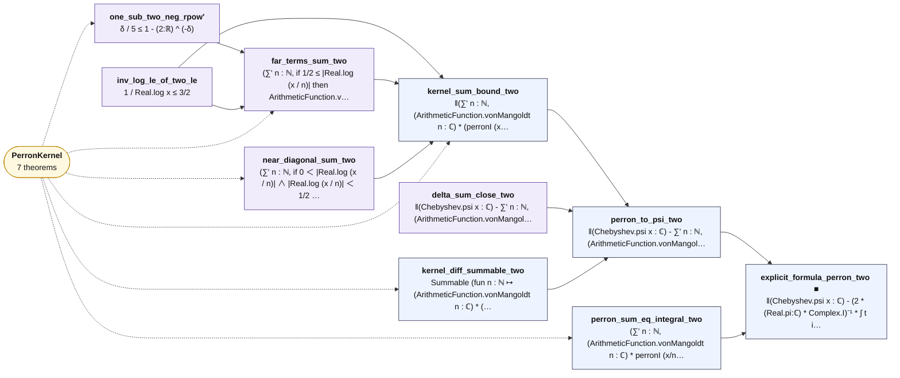

# `lean_stage3/Stage3/PerronTwo.lean`

> **Read from the source text.** This file changed after the last `python3 utilities/lean_map.py --dump`, so the arrows on this page are names occurring in each proof and have not been confirmed by Lean.

PerronTwo — block G1 of `lean_stage3/design/floor.md`. 2026-11-23. `PerronKernel.explicit_formula_perron` with the floor lowered from `16 ≤ x` to `2 ≤ x`. Every `x`-free helper of `PerronKernel` is reused unchanged; the lemmas below are copies of the originals with the lines that used the floor rewritten. `PerronKernel.lean` is untouched.

10 theorems, 0 definitions, 1158 lines. 

**Imports:** [`PerronKernel`](../lean_stage3/PerronKernel.md)  
**Imported by:** [`Stage3`](../lean_stage3/Stage3.md)

## The picture



An arrow A → B reads "A is used in the proof of B". Green: counting, integers only. Violet: shape, analysis with no ζ. Blue: reads ζ. A name ending in ■ is an end: nothing else uses it. Red: contains `sorry`. Yellow: theorems in another file, counted; a dotted arrow crosses files. Definitions are not drawn; they are listed below the diagram.

## Theorems

<a name="PerronTwo-one_sub_two_neg_rpow-"></a>
### `PerronTwo.one_sub_two_neg_rpow'`

line 36 · arrows read from text

**Shape.** Uses real or complex analysis; nothing in it or beneath it reads ζ.

**Why.** Geometric-denominator bound on the wider range: `δ/5 ≤ 1 − 2^(−δ)` for `0 < δ ≤ 5/2`. Below `1` it is `PerronKernel.one_sub_two_neg_rpow`; above, `2^(−δ) ≤ 1/2`.

**Proves**

```lean
δ / 5 ≤ 1 - (2:ℝ) ^ (-δ)
```

**Needs** (its hypotheses)

  - `` h0 : 0 < δ ``
  - `` h1 : δ ≤ 5/2 ``

**Fed by** (1 theorem its proof uses)

  - [`PerronKernel.one_sub_two_neg_rpow`](../lean_stage3/PerronKernel.md#PerronKernel-one_sub_two_neg_rpow) (PerronKernel) — `` δ / 5 ≤ 1 - (2:ℝ) ^ (-δ) ``

**Feeds** (1 that use it)

  - [`PerronTwo.far_terms_sum_two`](#PerronTwo-far_terms_sum_two) — `` (∑' n : ℕ, if 1/2 ≤ |Real.log (x / n)| then ArithmeticFunction.vonMangoldt n * (x / n) ^ (1 + 1/Real.log x) / (T * |Real.log (x / n)|) else 0) ≤ 300 *… ``

<a name="PerronTwo-inv_log_le_of_two_le"></a>
### `PerronTwo.inv_log_le_of_two_le`

line 50 · arrows read from text

**Shape.** Uses real or complex analysis; nothing in it or beneath it reads ζ.

**Why.** `1/log x ≤ 3/2` from `x ≥ 2` (`1/log 2 < 3/2`): the abscissa `c = 1 + 1/log x` sits at most `5/2`.

**Proves**

```lean
1 / Real.log x ≤ 3/2
```

**Needs** (its hypotheses)

  - `` hx : 2 ≤ x ``

**Fed by:** no theorem of this repo; it stands on Mathlib.

**Feeds** (2 that use it)

  - [`PerronTwo.far_terms_sum_two`](#PerronTwo-far_terms_sum_two) — `` (∑' n : ℕ, if 1/2 ≤ |Real.log (x / n)| then ArithmeticFunction.vonMangoldt n * (x / n) ^ (1 + 1/Real.log x) / (T * |Real.log (x / n)|) else 0) ≤ 300 *… ``
  - [`PerronTwo.kernel_sum_bound_two`](#PerronTwo-kernel_sum_bound_two) — `` ‖(∑' n : ℕ, (ArithmeticFunction.vonMangoldt n : ℂ) * (perronI (x/n) (1 + 1/Real.log x) T - perronδ (x/n)))‖ ≤ 700 * x * Real.log (x * T) ^ 2 / T + 17 … ``

<a name="PerronTwo-far_terms_sum_two"></a>
### `PerronTwo.far_terms_sum_two`

line 59 · arrows read from text

**Shape.** Uses real or complex analysis; nothing in it or beneath it reads ζ.

**Why.** Slice 1b from `x = 2` — the far-terms sum. The terms with `|log(x/n)| ≥ 1/2` sum to at most `300·x·log(xT)²/T`, for `x ≥ 2`, `T ≥ 2`.

**Proves**

```lean
(∑' n : ℕ, if 1/2 ≤ |Real.log (x / n)| then ArithmeticFunction.vonMangoldt n * (x / n) ^ (1 + 1/Real.log x) / (T * |Real.log (x / n)|) else 0) ≤ 300 * x * Real.log (x * T) ^ 2 / T
```

**Needs** (its hypotheses)

  - `` hx : 2 ≤ x ``
  - `` hT : 2 ≤ T ``

**Fed by** (4 theorems its proof uses)

  - [`PerronKernel.vonMangoldt_rpow_summable`](../lean_stage3/PerronKernel.md#PerronKernel-vonMangoldt_rpow_summable) (PerronKernel) — `` Summable (fun n : ℕ ↦ ArithmeticFunction.vonMangoldt n * (n : ℝ) ^ (-c)) ``
  - [`PerronKernel.vonMangoldt_rpow_tsum`](../lean_stage3/PerronKernel.md#PerronKernel-vonMangoldt_rpow_tsum) (PerronKernel) — `` ∑' n : ℕ, ArithmeticFunction.vonMangoldt n * (n : ℝ) ^ (-c) ≤ 2 * (Real.log 4 + 4) / (1 - (2:ℝ) ^ (1 - c)) ``
  - [`PerronTwo.inv_log_le_of_two_le`](#PerronTwo-inv_log_le_of_two_le) — `` 1 / Real.log x ≤ 3/2 ``
  - [`PerronTwo.one_sub_two_neg_rpow'`](#PerronTwo-one_sub_two_neg_rpow-) — `` δ / 5 ≤ 1 - (2:ℝ) ^ (-δ) ``

**Feeds** (1 that use it)

  - [`PerronTwo.kernel_sum_bound_two`](#PerronTwo-kernel_sum_bound_two) — `` ‖(∑' n : ℕ, (ArithmeticFunction.vonMangoldt n : ℂ) * (perronI (x/n) (1 + 1/Real.log x) T - perronδ (x/n)))‖ ≤ 700 * x * Real.log (x * T) ^ 2 / T + 17 … ``

<a name="PerronTwo-near_diagonal_sum_two"></a>
### `PerronTwo.near_diagonal_sum_two`

line 185 · arrows read from text

**Shape.** Uses real or complex analysis; nothing in it or beneath it reads ζ.

**Why.** Slice 1c from `x = 2` — the near-diagonal sum. The terms with `0 < |log(x/n)| < 1/2`, each weighted by `min(1, 1/(T·|log(x/n)|))`, sum to at most `100·x·log(xT)²/T + 4·log x`, for `x ≥ 2`.

**Proves**

```lean
(∑' n : ℕ, if 0 < |Real.log (x / n)| ∧ |Real.log (x / n)| < 1/2 then ArithmeticFunction.vonMangoldt n * min 1 (1/(T * |Real.log (x / n)|)) else 0) ≤ 100 * x * Real.log (x * T) ^ 2 / T + 4 * Real.log x
```

**Needs** (its hypotheses)

  - `` hx : 2 ≤ x ``
  - `` hT : 1 ≤ T ``

**Fed by** (1 theorem its proof uses)

  - [`PerronKernel.abs_sub_one_le_two_abs_log`](../lean_stage3/PerronKernel.md#PerronKernel-abs_sub_one_le_two_abs_log) (PerronKernel) — `` |t - 1| / 2 ≤ |Real.log t| ``

**Feeds** (1 that use it)

  - [`PerronTwo.kernel_sum_bound_two`](#PerronTwo-kernel_sum_bound_two) — `` ‖(∑' n : ℕ, (ArithmeticFunction.vonMangoldt n : ℂ) * (perronI (x/n) (1 + 1/Real.log x) T - perronδ (x/n)))‖ ≤ 700 * x * Real.log (x * T) ^ 2 / T + 17 … ``

<a name="PerronTwo-kernel_sum_bound_two"></a>
### `PerronTwo.kernel_sum_bound_two`

line 478 · arrows read from text

**Reads ζ.** It, or something it rests on, uses the zeta function, its zeros or the Riemann hypothesis.

**Why.** Slice 1's analytic composition from `x = 2`. The summed kernel error `‖Σ Λ(n)·(perronI(x/n) − δ(x/n))‖` is at most `700·x·log(xT)²/T + 17·log x`, for `x ≥ 2`, `T ≥ 2`. The near-diagonal factor is `(x/n)^c ≤ e^(5/4) ≤ 4`.

**Proves**

```lean
‖(∑' n : ℕ, (ArithmeticFunction.vonMangoldt n : ℂ) * (perronI (x/n) (1 + 1/Real.log x) T - perronδ (x/n)))‖ ≤ 700 * x * Real.log (x * T) ^ 2 / T + 17 * Real.log x
```

**Needs** (its hypotheses)

  - `` hx : 2 ≤ x ``
  - `` hT : 2 ≤ T ``

**Fed by** (6 theorems its proof uses)

  - [`PerronKernel.perronI_one_norm`](../lean_stage3/PerronKernel.md#PerronKernel-perronI_one_norm) (PerronKernel) — `` ‖perronI 1 c T‖ ≤ 1/2 ``
  - [`PerronKernel.perron_kernel_truncated`](../lean_stage3/PerronKernel.md#PerronKernel-perron_kernel_truncated) (PerronKernel) — `` ‖perronI y c T - perronδ y‖ ≤ y ^ c * min 1 (1 / (T * |Real.log y|)) ``
  - [`PerronKernel.vonMangoldt_rpow_summable`](../lean_stage3/PerronKernel.md#PerronKernel-vonMangoldt_rpow_summable) (PerronKernel) — `` Summable (fun n : ℕ ↦ ArithmeticFunction.vonMangoldt n * (n : ℝ) ^ (-c)) ``
  - [`PerronTwo.far_terms_sum_two`](#PerronTwo-far_terms_sum_two) — `` (∑' n : ℕ, if 1/2 ≤ |Real.log (x / n)| then ArithmeticFunction.vonMangoldt n * (x / n) ^ (1 + 1/Real.log x) / (T * |Real.log (x / n)|) else 0) ≤ 300 *… ``
  - [`PerronTwo.inv_log_le_of_two_le`](#PerronTwo-inv_log_le_of_two_le) — `` 1 / Real.log x ≤ 3/2 ``
  - [`PerronTwo.near_diagonal_sum_two`](#PerronTwo-near_diagonal_sum_two) — `` (∑' n : ℕ, if 0 < |Real.log (x / n)| ∧ |Real.log (x / n)| < 1/2 then ArithmeticFunction.vonMangoldt n * min 1 (1/(T * |Real.log (x / n)|)) else 0) ≤ 1… ``

**Definitions its proof touches:** [`PerronKernel.perronI`](../lean_stage3/PerronKernel.md#PerronKernel-perronI)

**Feeds** (1 that use it)

  - [`PerronTwo.perron_to_psi_two`](#PerronTwo-perron_to_psi_two) — `` ‖(Chebyshev.psi x : ℂ) - ∑' n : ℕ, (ArithmeticFunction.vonMangoldt n : ℂ) * perronI (x/n) (1 + 1/Real.log x) T‖ ≤ 700 * x * Real.log (x * T) ^ 2 / T +… ``

<a name="PerronTwo-delta_sum_close_two"></a>
### `PerronTwo.delta_sum_close_two`

line 761 · arrows read from text

**Shape.** Uses real or complex analysis; nothing in it or beneath it reads ζ.

**Why.** The δ-side of the composition from `x > 1`: the indicator sum is `ψ` up to one von Mangoldt value at the possible integer point.

**Proves**

```lean
‖(Chebyshev.psi x : ℂ) - ∑' n : ℕ, (ArithmeticFunction.vonMangoldt n : ℂ) * perronδ (x / n)‖ ≤ Real.log x
```

**Needs** (its hypotheses)

  - `` hx : 1 < x ``

**Fed by:** no theorem of this repo; it stands on Mathlib.

**Feeds** (1 that use it)

  - [`PerronTwo.perron_to_psi_two`](#PerronTwo-perron_to_psi_two) — `` ‖(Chebyshev.psi x : ℂ) - ∑' n : ℕ, (ArithmeticFunction.vonMangoldt n : ℂ) * perronI (x/n) (1 + 1/Real.log x) T‖ ≤ 700 * x * Real.log (x * T) ^ 2 / T +… ``

<a name="PerronTwo-kernel_diff_summable_two"></a>
### `PerronTwo.kernel_diff_summable_two`

line 875 · arrows read from text

**Reads ζ.** It, or something it rests on, uses the zeta function, its zeros or the Riemann hypothesis.

**Why.** Summability of the kernel differences from `x > 1`, via the crude majorant `Λ(n)·(x/n)^c` — sharp enough for convergence, everywhere.

**Proves**

```lean
Summable (fun n : ℕ ↦ (ArithmeticFunction.vonMangoldt n : ℂ) * (perronI (x/n) (1 + 1/Real.log x) T - perronδ (x/n)))
```

**Needs** (its hypotheses)

  - `` hx : 1 < x ``
  - `` hT : 1 ≤ T ``

**Fed by** (3 theorems its proof uses)

  - [`PerronKernel.perronI_one_norm`](../lean_stage3/PerronKernel.md#PerronKernel-perronI_one_norm) (PerronKernel) — `` ‖perronI 1 c T‖ ≤ 1/2 ``
  - [`PerronKernel.perron_kernel_truncated`](../lean_stage3/PerronKernel.md#PerronKernel-perron_kernel_truncated) (PerronKernel) — `` ‖perronI y c T - perronδ y‖ ≤ y ^ c * min 1 (1 / (T * |Real.log y|)) ``
  - [`PerronKernel.vonMangoldt_rpow_summable`](../lean_stage3/PerronKernel.md#PerronKernel-vonMangoldt_rpow_summable) (PerronKernel) — `` Summable (fun n : ℕ ↦ ArithmeticFunction.vonMangoldt n * (n : ℝ) ^ (-c)) ``

**Definitions its proof touches:** [`PerronKernel.perronI`](../lean_stage3/PerronKernel.md#PerronKernel-perronI)

**Feeds** (1 that use it)

  - [`PerronTwo.perron_to_psi_two`](#PerronTwo-perron_to_psi_two) — `` ‖(Chebyshev.psi x : ℂ) - ∑' n : ℕ, (ArithmeticFunction.vonMangoldt n : ℂ) * perronI (x/n) (1 + 1/Real.log x) T‖ ≤ 700 * x * Real.log (x * T) ^ 2 / T +… ``

<a name="PerronTwo-perron_to_psi_two"></a>
### `PerronTwo.perron_to_psi_two`

line 930 · arrows read from text

**Reads ζ.** It, or something it rests on, uses the zeta function, its zeros or the Riemann hypothesis.

**Why.** Slice 1 from `x = 2` — the Perron-to-ψ bound. The truncated Perron sum of the von Mangoldt function misses `ψ` by at most `700·x·log(xT)²/T + 18·log x`, for `x ≥ 2`, `T ≥ 2`.

**Proves**

```lean
‖(Chebyshev.psi x : ℂ) - ∑' n : ℕ, (ArithmeticFunction.vonMangoldt n : ℂ) * perronI (x/n) (1 + 1/Real.log x) T‖ ≤ 700 * x * Real.log (x * T) ^ 2 / T + 18 * Real.log x
```

**Needs** (its hypotheses)

  - `` hx : 2 ≤ x ``
  - `` hT : 2 ≤ T ``

**Fed by** (3 theorems its proof uses)

  - [`PerronTwo.delta_sum_close_two`](#PerronTwo-delta_sum_close_two) — `` ‖(Chebyshev.psi x : ℂ) - ∑' n : ℕ, (ArithmeticFunction.vonMangoldt n : ℂ) * perronδ (x / n)‖ ≤ Real.log x ``
  - [`PerronTwo.kernel_diff_summable_two`](#PerronTwo-kernel_diff_summable_two) — `` Summable (fun n : ℕ ↦ (ArithmeticFunction.vonMangoldt n : ℂ) * (perronI (x/n) (1 + 1/Real.log x) T - perronδ (x/n))) ``
  - [`PerronTwo.kernel_sum_bound_two`](#PerronTwo-kernel_sum_bound_two) — `` ‖(∑' n : ℕ, (ArithmeticFunction.vonMangoldt n : ℂ) * (perronI (x/n) (1 + 1/Real.log x) T - perronδ (x/n)))‖ ≤ 700 * x * Real.log (x * T) ^ 2 / T + 17 … ``

**Definitions its proof touches:** [`PerronKernel.perronI`](../lean_stage3/PerronKernel.md#PerronKernel-perronI)

**Feeds** (1 that use it)

  - [`PerronTwo.explicit_formula_perron_two`](#PerronTwo-explicit_formula_perron_two) — `` ‖(Chebyshev.psi x : ℂ) - (2 * (Real.pi:ℂ) * Complex.I)⁻¹ * ∫ t in (-T)..T, (- deriv riemannZeta (((1 + 1/Real.log x : ℝ):ℂ) + Complex.I * t) / riemann… ``

<a name="PerronTwo-perron_sum_eq_integral_two"></a>
### `PerronTwo.perron_sum_eq_integral_two`

line 976 · arrows read from text

**Reads ζ.** It, or something it rests on, uses the zeta function, its zeros or the Riemann hypothesis.

**Why.** The Fubini from `x > 1`. The kernel sum is the truncated `−ζ′/ζ` contour integral on the line `re s = 1 + 1/log x`.

**Proves**

```lean
(∑' n : ℕ, (ArithmeticFunction.vonMangoldt n : ℂ) * perronI (x/n) (1 + 1/Real.log x) T) = (2 * (Real.pi:ℂ) * Complex.I)⁻¹ * ∫ t in (-T)..T, (- deriv riemannZeta (((1 + 1/Real.log x : ℝ):ℂ) + Complex.I * t) / riemannZeta (((1 + 1/Real.log x : ℝ):ℂ) + Complex.I * t)) * ((x:ℝ):ℂ) ^ (((1 + 1/Real.log x : ℝ):ℂ) + Complex.I * t) / (((1 + 1/Real.log x : ℝ):ℂ) + Complex.I * t) * Complex.I
```

**Needs** (its hypotheses)

  - `` hx : 1 < x ``
  - `` hT : 1 ≤ T ``

**Fed by** (2 theorems its proof uses)

  - [`PerronKernel.tsum_vonMangoldt_div_cpow`](../lean_stage3/PerronKernel.md#PerronKernel-tsum_vonMangoldt_div_cpow) (PerronKernel) — `` (∑' n : ℕ, (ArithmeticFunction.vonMangoldt n : ℂ) * ((x / n : ℝ) : ℂ) ^ s) = (- deriv riemannZeta s / riemannZeta s) * ((x:ℝ):ℂ) ^ s ``
  - [`PerronKernel.vonMangoldt_rpow_summable`](../lean_stage3/PerronKernel.md#PerronKernel-vonMangoldt_rpow_summable) (PerronKernel) — `` Summable (fun n : ℕ ↦ ArithmeticFunction.vonMangoldt n * (n : ℝ) ^ (-c)) ``

**Definitions its proof touches:** [`PerronKernel.perronI`](../lean_stage3/PerronKernel.md#PerronKernel-perronI)

**Feeds** (1 that use it)

  - [`PerronTwo.explicit_formula_perron_two`](#PerronTwo-explicit_formula_perron_two) — `` ‖(Chebyshev.psi x : ℂ) - (2 * (Real.pi:ℂ) * Complex.I)⁻¹ * ∫ t in (-T)..T, (- deriv riemannZeta (((1 + 1/Real.log x : ℝ):ℂ) + Complex.I * t) / riemann… ``

<a name="PerronTwo-explicit_formula_perron_two"></a>
### `PerronTwo.explicit_formula_perron_two`

line 1141 · arrows read from text

**Reads ζ.** It, or something it rests on, uses the zeta function, its zeros or the Riemann hypothesis.

**Why.** hEF, Perron form from `x = 2` — the truncated explicit formula at the line `re = c`, `c = 1 + 1/log x`. For `x ≥ 2`, `T ≥ 2`, `ψ` misses the truncated `−ζ′/ζ` integral by at most `700·x·log(xT)²/T + 18·log x`.

**Proves**

```lean
‖(Chebyshev.psi x : ℂ) - (2 * (Real.pi:ℂ) * Complex.I)⁻¹ * ∫ t in (-T)..T, (- deriv riemannZeta (((1 + 1/Real.log x : ℝ):ℂ) + Complex.I * t) / riemannZeta (((1 + 1/Real.log x : ℝ):ℂ) + Complex.I * t)) * ((x:ℝ):ℂ) ^ (((1 + 1/Real.log x : ℝ):ℂ) + Complex.I * t) / (((1 + 1/Real.log x : ℝ):ℂ) + Complex.I * t) * Complex.I‖ ≤ 700 * x * Real.log (x * T) ^ 2 / T + 18 * Real.log x
```

**Needs** (its hypotheses)

  - `` hx : 2 ≤ x ``
  - `` hT : 2 ≤ T ``

**Fed by** (2 theorems its proof uses)

  - [`PerronTwo.perron_sum_eq_integral_two`](#PerronTwo-perron_sum_eq_integral_two) — `` (∑' n : ℕ, (ArithmeticFunction.vonMangoldt n : ℂ) * perronI (x/n) (1 + 1/Real.log x) T) = (2 * (Real.pi:ℂ) * Complex.I)⁻¹ * ∫ t in (-T)..T, (- deriv r… ``
  - [`PerronTwo.perron_to_psi_two`](#PerronTwo-perron_to_psi_two) — `` ‖(Chebyshev.psi x : ℂ) - ∑' n : ℕ, (ArithmeticFunction.vonMangoldt n : ℂ) * perronI (x/n) (1 + 1/Real.log x) T‖ ≤ 700 * x * Real.log (x * T) ^ 2 / T +… ``

**Feeds:** nothing. It is an end.

