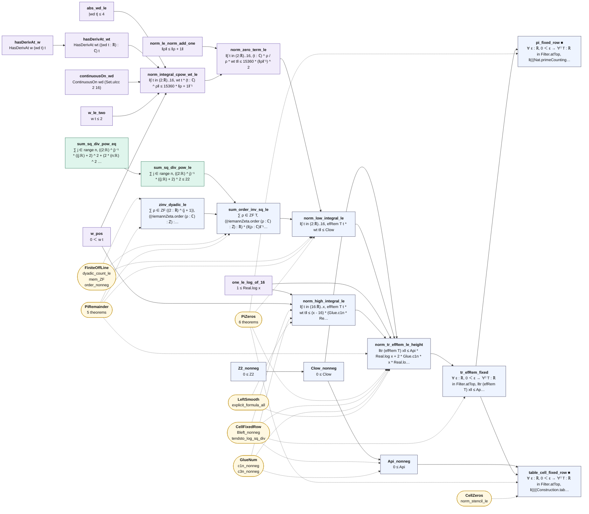

# `lean_stage3/Stage3/PiFixedRow.lean`

> **Read from the source text.** This file changed after the last `python3 utilities/lean_map.py --dump`, so the arrows on this page are names occurring in each proof and have not been confirmed by Lean.

PiFixedRow — block F4 of `lean_stage3/design/leftedge.md`. 2026-11-23. The integer count at a fixed `x` with the height of the zero sum taken to infinity. `PiZeros.pi_eq_zero_sum` is an identity at every height; what has to be bounded free of the height is `tr (efRem T) x`, the passage of the explicit formula's remainder. Above `16` the explicit formula at every height does it. On `[2, 16]` each zero is integrated by parts in `t`, which gains a factor `1/|ρ+1|`, and the zeros weighted by `m/|ρ|²` have a sum bounded…

23 theorems, 5 definitions, 717 lines. 

**Imports:** [`CellFixedRow`](../lean_stage3/CellFixedRow.md), [`PiRemainder`](../lean_stage3/PiRemainder.md)  
**Imported by:** [`Stage3`](../lean_stage3/Stage3.md)

## The picture



An arrow A → B reads "A is used in the proof of B". Green: counting, integers only. Violet: shape, analysis with no ζ. Blue: reads ζ. A name ending in ■ is an end: nothing else uses it. Red: contains `sorry`. Yellow: theorems in another file, counted; a dotted arrow crosses files. Definitions are not drawn; they are listed below the diagram.

## Definitions

<a name="PiFixedRow-Z2"></a>
### `PiFixedRow.Z2`

def · line 59

The constant bounding the zeros weighted by `m/|ρ|²`: `66000·Mlow²`.

- **Is:** `` Z2 : ℝ := 66000 * Mlow ^ 2 ``
- **Built from:** [`PiRemainder.Mlow`](../lean_stage3/PiRemainder.md#PiRemainder-Mlow)
- **Used by 4:** [`PiFixedRow.Clow`](#PiFixedRow-Clow), [`PiFixedRow.Z2_nonneg`](#PiFixedRow-Z2_nonneg), [`PiFixedRow.norm_low_integral_le`](#PiFixedRow-norm_low_integral_le), [`PiFixedRow.sum_order_inv_sq_le`](#PiFixedRow-sum_order_inv_sq_le)

<a name="PiFixedRow-w"></a>
### `PiFixedRow.w`

def · line 147

The weight `1/(t·log²t)` as a real function.

- **Is:** `` w (t : ℝ) : ℝ := (t * Real.log t ^ 2)⁻¹ ``
- **Used by 5:** [`PiFixedRow.hasDerivAt_w`](#PiFixedRow-hasDerivAt_w), [`PiFixedRow.norm_high_integral_le`](#PiFixedRow-norm_high_integral_le), [`PiFixedRow.norm_integral_cpow_wt_le`](#PiFixedRow-norm_integral_cpow_wt_le), [`PiFixedRow.w_le_two`](#PiFixedRow-w_le_two), [`PiFixedRow.w_pos`](#PiFixedRow-w_pos)

<a name="PiFixedRow-wd"></a>
### `PiFixedRow.wd`

def · line 150

The derivative of the real weight: `−(log t + 2)/(t²·log³t)`.

- **Is:** `` wd (t : ℝ) : ℝ := -(Real.log t + 2) / (t ^ 2 * Real.log t ^ 3) ``
- **Used by 5:** [`PiFixedRow.abs_wd_le`](#PiFixedRow-abs_wd_le), [`PiFixedRow.continuousOn_wd`](#PiFixedRow-continuousOn_wd), [`PiFixedRow.hasDerivAt_w`](#PiFixedRow-hasDerivAt_w), [`PiFixedRow.hasDerivAt_wt`](#PiFixedRow-hasDerivAt_wt), [`PiFixedRow.norm_integral_cpow_wt_le`](#PiFixedRow-norm_integral_cpow_wt_le)

<a name="PiFixedRow-Clow"></a>
### `PiFixedRow.Clow`

def · line 334

The constant bounding the low integral: `294 + 15360·Z2`.

- **Is:** `` Clow : ℝ := 294 + 15360 * Z2 ``
- **Built from:** [`PiFixedRow.Z2`](#PiFixedRow-Z2)
- **Used by 4:** [`PiFixedRow.Api`](#PiFixedRow-Api), [`PiFixedRow.Clow_nonneg`](#PiFixedRow-Clow_nonneg), [`PiFixedRow.norm_low_integral_le`](#PiFixedRow-norm_low_integral_le), [`PiFixedRow.norm_tr_efRem_le_height`](#PiFixedRow-norm_tr_efRem_le_height)

<a name="PiFixedRow-Api"></a>
### `PiFixedRow.Api`

def · line 435

The constant of the count at a fixed row: `2·(c3n + Bleft) + Clow`.

- **Is:** `` Api : ℝ := 2 * (Glue.c3n + LeftSmooth.Bleft) + Clow ``
- **Built from:** [`Glue.c3n`](../lean_stage3/GlueNum.md#Glue-c3n), [`LeftSmooth.Bleft`](../lean_stage3/LeftSmooth.md#LeftSmooth-Bleft), [`PiFixedRow.Clow`](#PiFixedRow-Clow)
- **Used by 5:** [`PiFixedRow.Api_nonneg`](#PiFixedRow-Api_nonneg), [`PiFixedRow.norm_tr_efRem_le_height`](#PiFixedRow-norm_tr_efRem_le_height), [`PiFixedRow.pi_fixed_row`](#PiFixedRow-pi_fixed_row), [`PiFixedRow.table_cell_fixed_row`](#PiFixedRow-table_cell_fixed_row), [`PiFixedRow.tr_efRem_fixed`](#PiFixedRow-tr_efRem_fixed)

## Theorems

<a name="PiFixedRow-sum_sq_div_pow_eq"></a>
### `PiFixedRow.sum_sq_div_pow_eq`

line 31 · arrows read from text

**Counting.** Integers only: nothing in its statement or proof, or in anything it rests on, uses analysis or ζ.

**Why.** The closed form behind `Σ_j (j+2)²/2^j ≤ 22`: the partial sum plus a vanishing tail is exactly `22`.

**Proves**

```lean
∑ j ∈ range n, ((2:ℝ) ^ j)⁻¹ * ((j:ℝ) + 2) ^ 2 + (2 * (n:ℝ) ^ 2 + 12 * n + 22) * ((2:ℝ) ^ n)⁻¹ = 22
```

**Needs** (its hypotheses)

  - `` n : ℕ ``

**Fed by:** no theorem of this repo; it stands on Mathlib.

**Feeds** (1 that use it)

  - [`PiFixedRow.sum_sq_div_pow_le`](#PiFixedRow-sum_sq_div_pow_le) — `` ∑ j ∈ range n, ((2:ℝ) ^ j)⁻¹ * ((j:ℝ) + 2) ^ 2 ≤ 22 ``

<a name="PiFixedRow-sum_sq_div_pow_le"></a>
### `PiFixedRow.sum_sq_div_pow_le`

line 45 · arrows read from text

**Counting.** Integers only: nothing in its statement or proof, or in anything it rests on, uses analysis or ζ.

**Why.** The partial sums of `(j+2)²/2^j` are at most `22`.

**Proves**

```lean
∑ j ∈ range n, ((2:ℝ) ^ j)⁻¹ * ((j:ℝ) + 2) ^ 2 ≤ 22
```

**Needs** (its hypotheses)

  - `` n : ℕ ``

**Fed by** (1 theorem its proof uses)

  - [`PiFixedRow.sum_sq_div_pow_eq`](#PiFixedRow-sum_sq_div_pow_eq) — `` ∑ j ∈ range n, ((2:ℝ) ^ j)⁻¹ * ((j:ℝ) + 2) ^ 2 + (2 * (n:ℝ) ^ 2 + 12 * n + 22) * ((2:ℝ) ^ n)⁻¹ = 22 ``

**Feeds** (1 that use it)

  - [`PiFixedRow.sum_order_inv_sq_le`](#PiFixedRow-sum_order_inv_sq_le) — `` ∑ ρ ∈ ZF T, ((riemannZeta.order (ρ : ℂ) : ℤ) : ℝ) * (‖(ρ : ℂ)‖⁻¹) ^ 2 ≤ Z2 ``

<a name="PiFixedRow-zinv_dyadic_le"></a>
### `PiFixedRow.zinv_dyadic_le`

line 52 · arrows read from text

**Reads ζ.** It, or something it rests on, uses the zeta function, its zeros or the Riemann hypothesis.

**Why.** The sum of `m(ρ)/|ρ|` over the zeros below `2^(j+1)` is at most `Mlow·3000·(j+2)²`.

**Proves**

```lean
∑ ρ ∈ ZF ((2 : ℝ) ^ (j + 1)), ((riemannZeta.order (ρ : ℂ) : ℤ) : ℝ) * ‖(ρ : ℂ)‖⁻¹ ≤ Mlow * (3000 * ((j : ℝ) + 2) ^ 2)
```

**Needs** (its hypotheses)

  - `` j : ℕ ``

**Fed by** (3 theorems its proof uses)

  - [`FiniteOffLine.dyadic_count_le`](../lean_stage3/FiniteOffLine.md#FiniteOffLine-dyadic_count_le) (FiniteOffLine) — `` ∑ j ∈ range (K + 1), ((2 : ℝ) ^ j)⁻¹ * (2 * |riemannZeta.N ((2 : ℝ) ^ (j + 1))| + weightedZeroHeightBucket) ≤ 3000 * ((K : ℝ) + 2) ^ 2 ``
  - [`PiRemainder.sum_order_inv_le`](../lean_stage3/PiRemainder.md#PiRemainder-sum_order_inv_le) (PiRemainder) — `` ∑ ρ ∈ ZF ((2 : ℝ) ^ (K + 1)), ((riemannZeta.order (ρ : ℂ) : ℤ) : ℝ) * ‖(ρ : ℂ)‖⁻¹ ≤ Mlow * ∑ j ∈ range (K + 1), ((2 : ℝ) ^ j)⁻¹ * (2 * |riemannZeta.N … ``
  - [`PiRemainder.two_le_Mlow`](../lean_stage3/PiRemainder.md#PiRemainder-two_le_Mlow) (PiRemainder) — `` 2 ≤ Mlow ``

**Definitions its proof touches:** [`FiniteOffLine.ZF`](../lean_stage3/FiniteOffLine.md#FiniteOffLine-ZF), [`PiRemainder.Mlow`](../lean_stage3/PiRemainder.md#PiRemainder-Mlow)

**Feeds** (1 that use it)

  - [`PiFixedRow.sum_order_inv_sq_le`](#PiFixedRow-sum_order_inv_sq_le) — `` ∑ ρ ∈ ZF T, ((riemannZeta.order (ρ : ℂ) : ℤ) : ℝ) * (‖(ρ : ℂ)‖⁻¹) ^ 2 ≤ Z2 ``

<a name="PiFixedRow-Z2_nonneg"></a>
### `PiFixedRow.Z2_nonneg`

line 62 · arrows read from text

**Reads ζ.** It, or something it rests on, uses the zeta function, its zeros or the Riemann hypothesis.

**Why.** The constant `Z2` is nonnegative.

**Proves**

```lean
0 ≤ Z2
```

**Fed by:** no theorem of this repo; it stands on Mathlib and the definitions below.

**Definitions its proof touches:** [`PiFixedRow.Z2`](#PiFixedRow-Z2)

**Feeds** (1 that use it)

  - [`PiFixedRow.Clow_nonneg`](#PiFixedRow-Clow_nonneg) — `` 0 ≤ Clow ``

<a name="PiFixedRow-sum_order_inv_sq_le"></a>
### `PiFixedRow.sum_order_inv_sq_le`

line 66 · arrows read from text

**Reads ζ.** It, or something it rests on, uses the zeta function, its zeros or the Riemann hypothesis.

**Why.** The zeros weighted by `m/|ρ|²` are bounded free of the height. For every `T`, the sum over the zeros below `T` of `m(ρ)·(1/|ρ|)²` is at most `Z2`.

**Proves**

```lean
∑ ρ ∈ ZF T, ((riemannZeta.order (ρ : ℂ) : ℤ) : ℝ) * (‖(ρ : ℂ)‖⁻¹) ^ 2 ≤ Z2
```

**Needs** (its hypotheses)

  - `` T : ℝ ``

**Fed by** (6 theorems its proof uses)

  - [`FiniteOffLine.mem_ZF`](../lean_stage3/FiniteOffLine.md#FiniteOffLine-mem_ZF) (FiniteOffLine) — `` ρ ∈ ZF T ↔ |(ρ : ℂ).im| < T ``
  - [`FiniteOffLine.order_nonneg`](../lean_stage3/FiniteOffLine.md#FiniteOffLine-order_nonneg) (FiniteOffLine) — `` (0 : ℝ) ≤ ((riemannZeta.order (ρ : ℂ) : ℤ) : ℝ) ``
  - [`PiFixedRow.sum_sq_div_pow_le`](#PiFixedRow-sum_sq_div_pow_le) — `` ∑ j ∈ range n, ((2:ℝ) ^ j)⁻¹ * ((j:ℝ) + 2) ^ 2 ≤ 22 ``
  - [`PiFixedRow.zinv_dyadic_le`](#PiFixedRow-zinv_dyadic_le) — `` ∑ ρ ∈ ZF ((2 : ℝ) ^ (j + 1)), ((riemannZeta.order (ρ : ℂ) : ℤ) : ℝ) * ‖(ρ : ℂ)‖⁻¹ ≤ Mlow * (3000 * ((j : ℝ) + 2) ^ 2) ``
  - [`PiRemainder.inv_norm_le_dyadic`](../lean_stage3/PiRemainder.md#PiRemainder-inv_norm_le_dyadic) (PiRemainder) — `` ‖(ρ : ℂ)‖⁻¹ ≤ Mlow * ∑ j ∈ range (K + 1), ((2 : ℝ) ^ j)⁻¹ * (if |(ρ : ℂ).im| < 2 ^ (j + 1) then 1 else 0) ``
  - [`PiRemainder.two_le_Mlow`](../lean_stage3/PiRemainder.md#PiRemainder-two_le_Mlow) (PiRemainder) — `` 2 ≤ Mlow ``

**Definitions its proof touches:** [`FiniteOffLine.ZF`](../lean_stage3/FiniteOffLine.md#FiniteOffLine-ZF), [`PiFixedRow.Z2`](#PiFixedRow-Z2), [`PiRemainder.Mlow`](../lean_stage3/PiRemainder.md#PiRemainder-Mlow)

**Feeds** (1 that use it)

  - [`PiFixedRow.norm_low_integral_le`](#PiFixedRow-norm_low_integral_le) — `` ‖∫ t in (2:ℝ)..16, efRem T t * wt t‖ ≤ Clow ``

<a name="PiFixedRow-hasDerivAt_w"></a>
### `PiFixedRow.hasDerivAt_w`

line 153 · arrows read from text

**Shape.** Uses real or complex analysis; nothing in it or beneath it reads ζ.

**Why.** For `t > 1` the real weight has derivative `wd t`.

**Proves**

```lean
HasDerivAt w (wd t) t
```

**Needs** (its hypotheses)

  - `` ht : 1 < t ``

**Fed by:** no theorem of this repo; it stands on Mathlib and the definitions below.

**Definitions its proof touches:** [`PiFixedRow.w`](#PiFixedRow-w), [`PiFixedRow.wd`](#PiFixedRow-wd)

**Feeds** (1 that use it)

  - [`PiFixedRow.hasDerivAt_wt`](#PiFixedRow-hasDerivAt_wt) — `` HasDerivAt wt ((wd t : ℝ) : ℂ) t ``

<a name="PiFixedRow-hasDerivAt_wt"></a>
### `PiFixedRow.hasDerivAt_wt`

line 171 · arrows read from text

**Shape.** Uses real or complex analysis; nothing in it or beneath it reads ζ.

**Why.** For `t > 1` the weight, read as complex, has derivative `wd t`.

**Proves**

```lean
HasDerivAt wt ((wd t : ℝ) : ℂ) t
```

**Needs** (its hypotheses)

  - `` ht : 1 < t ``

**Fed by** (1 theorem its proof uses)

  - [`PiFixedRow.hasDerivAt_w`](#PiFixedRow-hasDerivAt_w) — `` HasDerivAt w (wd t) t ``

**Definitions its proof touches:** [`PiFixedRow.wd`](#PiFixedRow-wd), [`PiZeros.wt`](../lean_stage3/PiZeros.md#PiZeros-wt)

**Feeds** (1 that use it)

  - [`PiFixedRow.norm_integral_cpow_wt_le`](#PiFixedRow-norm_integral_cpow_wt_le) — `` ‖∫ t in (2:ℝ)..16, wt t * (t : ℂ) ^ ρ‖ ≤ 15360 * ‖ρ + 1‖⁻¹ ``

<a name="PiFixedRow-continuousOn_wd"></a>
### `PiFixedRow.continuousOn_wd`

line 175 · arrows read from text

**Shape.** Uses real or complex analysis; nothing in it or beneath it reads ζ.

**Why.** On `[2, 16]` the derivative of the weight is continuous.

**Proves**

```lean
ContinuousOn wd (Set.uIcc 2 16)
```

**Fed by:** no theorem of this repo; it stands on Mathlib and the definitions below.

**Definitions its proof touches:** [`PiFixedRow.wd`](#PiFixedRow-wd)

**Feeds** (1 that use it)

  - [`PiFixedRow.norm_integral_cpow_wt_le`](#PiFixedRow-norm_integral_cpow_wt_le) — `` ‖∫ t in (2:ℝ)..16, wt t * (t : ℂ) ^ ρ‖ ≤ 15360 * ‖ρ + 1‖⁻¹ ``

<a name="PiFixedRow-w_le_two"></a>
### `PiFixedRow.w_le_two`

line 191 · arrows read from text

**Shape.** Uses real or complex analysis; nothing in it or beneath it reads ζ.

**Why.** For `t ≥ 2` the weight is at most `2`.

**Proves**

```lean
w t ≤ 2
```

**Needs** (its hypotheses)

  - `` ht : 2 ≤ t ``

**Fed by:** no theorem of this repo; it stands on Mathlib and the definitions below.

**Definitions its proof touches:** [`PiFixedRow.w`](#PiFixedRow-w)

**Feeds** (1 that use it)

  - [`PiFixedRow.norm_integral_cpow_wt_le`](#PiFixedRow-norm_integral_cpow_wt_le) — `` ‖∫ t in (2:ℝ)..16, wt t * (t : ℂ) ^ ρ‖ ≤ 15360 * ‖ρ + 1‖⁻¹ ``

<a name="PiFixedRow-w_pos"></a>
### `PiFixedRow.w_pos`

line 203 · arrows read from text

**Shape.** Uses real or complex analysis; nothing in it or beneath it reads ζ.

**Why.** For `t ≥ 2` the weight is positive.

**Proves**

```lean
0 < w t
```

**Needs** (its hypotheses)

  - `` ht : 2 ≤ t ``

**Fed by:** no theorem of this repo; it stands on Mathlib and the definitions below.

**Definitions its proof touches:** [`PiFixedRow.w`](#PiFixedRow-w)

**Feeds** (2 that use it)

  - [`PiFixedRow.norm_high_integral_le`](#PiFixedRow-norm_high_integral_le) — `` ‖∫ t in (16:ℝ)..x, efRem T t * wt t‖ ≤ (x - 16) * (Glue.c1n * Real.log (x * T) ^ 2 / T) + (Glue.c3n + LeftSmooth.Bleft) * Real.log (x / 16) ``
  - [`PiFixedRow.norm_integral_cpow_wt_le`](#PiFixedRow-norm_integral_cpow_wt_le) — `` ‖∫ t in (2:ℝ)..16, wt t * (t : ℂ) ^ ρ‖ ≤ 15360 * ‖ρ + 1‖⁻¹ ``

<a name="PiFixedRow-abs_wd_le"></a>
### `PiFixedRow.abs_wd_le`

line 210 · arrows read from text

**Shape.** Uses real or complex analysis; nothing in it or beneath it reads ζ.

**Why.** On `[2, 16]` the derivative of the weight is at most `4` in size.

**Proves**

```lean
|wd t| ≤ 4
```

**Needs** (its hypotheses)

  - `` ht : 2 ≤ t ``
  - `` ht' : t ≤ 16 ``

**Fed by:** no theorem of this repo; it stands on Mathlib and the definitions below.

**Definitions its proof touches:** [`PiFixedRow.wd`](#PiFixedRow-wd)

**Feeds** (1 that use it)

  - [`PiFixedRow.norm_integral_cpow_wt_le`](#PiFixedRow-norm_integral_cpow_wt_le) — `` ‖∫ t in (2:ℝ)..16, wt t * (t : ℂ) ^ ρ‖ ≤ 15360 * ‖ρ + 1‖⁻¹ ``

<a name="PiFixedRow-norm_le_norm_add_one"></a>
### `PiFixedRow.norm_le_norm_add_one`

line 233 · arrows read from text

**Shape.** Uses real or complex analysis; nothing in it or beneath it reads ζ.

**Why.** For `ρ` with `0 < Re ρ`, `|ρ| ≤ |ρ + 1|`.

**Proves**

```lean
‖ρ‖ ≤ ‖ρ + 1‖
```

**Needs** (its hypotheses)

  - `` h : 0 < ρ.re ``

**Fed by:** no theorem of this repo; it stands on Mathlib.

**Feeds** (1 that use it)

  - [`PiFixedRow.norm_zero_term_le`](#PiFixedRow-norm_zero_term_le) — `` ‖∫ t in (2:ℝ)..16, (t : ℂ) ^ ρ / ρ * wt t‖ ≤ 15360 * (‖ρ‖⁻¹) ^ 2 ``

<a name="PiFixedRow-norm_integral_cpow_wt_le"></a>
### `PiFixedRow.norm_integral_cpow_wt_le`

line 242 · arrows read from text

**Shape.** Uses real or complex analysis; nothing in it or beneath it reads ζ.

**Why.** One zero on `[2, 16]`, integrated by parts. For `0 < Re ρ < 1`, the integral of `t^ρ` against the weight over `[2, 16]` is at most `15360/|ρ + 1|`.

**Proves**

```lean
‖∫ t in (2:ℝ)..16, wt t * (t : ℂ) ^ ρ‖ ≤ 15360 * ‖ρ + 1‖⁻¹
```

**Needs** (its hypotheses)

  - `` h0 : 0 < ρ.re ``
  - `` h1 : ρ.re < 1 ``

**Fed by** (5 theorems its proof uses)

  - [`PiFixedRow.abs_wd_le`](#PiFixedRow-abs_wd_le) — `` |wd t| ≤ 4 ``
  - [`PiFixedRow.continuousOn_wd`](#PiFixedRow-continuousOn_wd) — `` ContinuousOn wd (Set.uIcc 2 16) ``
  - [`PiFixedRow.hasDerivAt_wt`](#PiFixedRow-hasDerivAt_wt) — `` HasDerivAt wt ((wd t : ℝ) : ℂ) t ``
  - [`PiFixedRow.w_le_two`](#PiFixedRow-w_le_two) — `` w t ≤ 2 ``
  - [`PiFixedRow.w_pos`](#PiFixedRow-w_pos) — `` 0 < w t ``

**Definitions its proof touches:** [`PiFixedRow.w`](#PiFixedRow-w), [`PiFixedRow.wd`](#PiFixedRow-wd), [`PiZeros.wt`](../lean_stage3/PiZeros.md#PiZeros-wt)

**Feeds** (1 that use it)

  - [`PiFixedRow.norm_zero_term_le`](#PiFixedRow-norm_zero_term_le) — `` ‖∫ t in (2:ℝ)..16, (t : ℂ) ^ ρ / ρ * wt t‖ ≤ 15360 * (‖ρ‖⁻¹) ^ 2 ``

<a name="PiFixedRow-norm_zero_term_le"></a>
### `PiFixedRow.norm_zero_term_le`

line 313 · arrows read from text

**Shape.** Uses real or complex analysis; nothing in it or beneath it reads ζ.

**Why.** One zero's term on `[2, 16]`: for `0 < Re ρ < 1`, the integral of `t^ρ/ρ` against the weight is at most `15360/|ρ|²`.

**Proves**

```lean
‖∫ t in (2:ℝ)..16, (t : ℂ) ^ ρ / ρ * wt t‖ ≤ 15360 * (‖ρ‖⁻¹) ^ 2
```

**Needs** (its hypotheses)

  - `` h0 : 0 < ρ.re ``
  - `` h1 : ρ.re < 1 ``

**Fed by** (2 theorems its proof uses)

  - [`PiFixedRow.norm_integral_cpow_wt_le`](#PiFixedRow-norm_integral_cpow_wt_le) — `` ‖∫ t in (2:ℝ)..16, wt t * (t : ℂ) ^ ρ‖ ≤ 15360 * ‖ρ + 1‖⁻¹ ``
  - [`PiFixedRow.norm_le_norm_add_one`](#PiFixedRow-norm_le_norm_add_one) — `` ‖ρ‖ ≤ ‖ρ + 1‖ ``

**Definitions its proof touches:** [`PiZeros.wt`](../lean_stage3/PiZeros.md#PiZeros-wt)

**Feeds** (1 that use it)

  - [`PiFixedRow.norm_low_integral_le`](#PiFixedRow-norm_low_integral_le) — `` ‖∫ t in (2:ℝ)..16, efRem T t * wt t‖ ≤ Clow ``

<a name="PiFixedRow-Clow_nonneg"></a>
### `PiFixedRow.Clow_nonneg`

line 337 · arrows read from text

**Reads ζ.** It, or something it rests on, uses the zeta function, its zeros or the Riemann hypothesis.

**Why.** The constant `Clow` is nonnegative.

**Proves**

```lean
0 ≤ Clow
```

**Fed by** (1 theorem its proof uses)

  - [`PiFixedRow.Z2_nonneg`](#PiFixedRow-Z2_nonneg) — `` 0 ≤ Z2 ``

**Definitions its proof touches:** [`PiFixedRow.Clow`](#PiFixedRow-Clow)

**Feeds** (2 that use it)

  - [`PiFixedRow.Api_nonneg`](#PiFixedRow-Api_nonneg) — `` 0 ≤ Api ``
  - [`PiFixedRow.norm_tr_efRem_le_height`](#PiFixedRow-norm_tr_efRem_le_height) — `` ‖tr (efRem T) x‖ ≤ Api * Real.log x + 2 * Glue.c1n * x * Real.log (x * T) ^ 2 / T ``

<a name="PiFixedRow-norm_low_integral_le"></a>
### `PiFixedRow.norm_low_integral_le`

line 345 · arrows read from text

**Reads ζ.** It, or something it rests on, uses the zeta function, its zeros or the Riemann hypothesis.

**Why.** The low integral is bounded free of the height. For every `T`, the integral of the explicit formula's remainder against the weight over `[2, 16]` is at most `Clow`.

**Proves**

```lean
‖∫ t in (2:ℝ)..16, efRem T t * wt t‖ ≤ Clow
```

**Needs** (its hypotheses)

  - `` T : ℝ ``

**Fed by** (8 theorems its proof uses)

  - [`FiniteOffLine.order_nonneg`](../lean_stage3/FiniteOffLine.md#FiniteOffLine-order_nonneg) (FiniteOffLine) — `` (0 : ℝ) ≤ ((riemannZeta.order (ρ : ℂ) : ℤ) : ℝ) ``
  - [`PiFixedRow.norm_zero_term_le`](#PiFixedRow-norm_zero_term_le) — `` ‖∫ t in (2:ℝ)..16, (t : ℂ) ^ ρ / ρ * wt t‖ ≤ 15360 * (‖ρ‖⁻¹) ^ 2 ``
  - [`PiFixedRow.sum_order_inv_sq_le`](#PiFixedRow-sum_order_inv_sq_le) — `` ∑ ρ ∈ ZF T, ((riemannZeta.order (ρ : ℂ) : ℤ) : ℝ) * (‖(ρ : ℂ)‖⁻¹) ^ 2 ≤ Z2 ``
  - [`PiRemainder.norm_psi_sub_le`](../lean_stage3/PiRemainder.md#PiRemainder-norm_psi_sub_le) (PiRemainder) — `` ‖((ψ t : ℝ) : ℂ) - (t : ℂ)‖ ≤ 7 * t ``
  - [`PiZeros.integrable_cpow`](../lean_stage3/PiZeros.md#PiZeros-integrable_cpow) (PiZeros) — `` IntervalIntegrable (fun t : ℝ => (t : ℂ) ^ ρ / ρ) volume 2 x ``
  - [`PiZeros.integrable_mul_wt`](../lean_stage3/PiZeros.md#PiZeros-integrable_mul_wt) (PiZeros) — `` IntervalIntegrable (fun t => f t * wt t) volume 2 x ``
  - [`PiZeros.integrable_ofReal_of_monotone`](../lean_stage3/PiZeros.md#PiZeros-integrable_ofReal_of_monotone) (PiZeros) — `` IntervalIntegrable (fun t => ((f t : ℝ) : ℂ)) volume 2 x ``
  - [`PiZeros.zeroPartialSum_eq_sum`](../lean_stage3/PiZeros.md#PiZeros-zeroPartialSum_eq_sum) (PiZeros) — `` Stage3.zeroPartialSum t T = ∑ ρ ∈ ZF T, ((riemannZeta.order (ρ : ℂ) : ℤ) : ℂ) * ((t : ℂ) ^ (ρ : ℂ) / (ρ : ℂ)) ``

**Definitions its proof touches:** [`FiniteOffLine.ZF`](../lean_stage3/FiniteOffLine.md#FiniteOffLine-ZF), [`PiFixedRow.Clow`](#PiFixedRow-Clow), [`PiFixedRow.Z2`](#PiFixedRow-Z2), [`PiZeros.efRem`](../lean_stage3/PiZeros.md#PiZeros-efRem), [`PiZeros.wt`](../lean_stage3/PiZeros.md#PiZeros-wt)

**Feeds** (1 that use it)

  - [`PiFixedRow.norm_tr_efRem_le_height`](#PiFixedRow-norm_tr_efRem_le_height) — `` ‖tr (efRem T) x‖ ≤ Api * Real.log x + 2 * Glue.c1n * x * Real.log (x * T) ^ 2 / T ``

<a name="PiFixedRow-Api_nonneg"></a>
### `PiFixedRow.Api_nonneg`

line 438 · arrows read from text

**Reads ζ.** It, or something it rests on, uses the zeta function, its zeros or the Riemann hypothesis.

**Why.** The constant `Api` is nonnegative.

**Proves**

```lean
0 ≤ Api
```

**Fed by** (3 theorems its proof uses)

  - [`CellFixedRow.Bleft_nonneg`](../lean_stage3/CellFixedRow.md#CellFixedRow-Bleft_nonneg) (CellFixedRow) — `` 0 ≤ LeftSmooth.Bleft ``
  - [`Glue.c3n_nonneg`](../lean_stage3/GlueNum.md#Glue-c3n_nonneg) (GlueNum) — `` 0 ≤ c3n ``
  - [`PiFixedRow.Clow_nonneg`](#PiFixedRow-Clow_nonneg) — `` 0 ≤ Clow ``

**Definitions its proof touches:** [`PiFixedRow.Api`](#PiFixedRow-Api)

**Feeds** (1 that use it)

  - [`PiFixedRow.table_cell_fixed_row`](#PiFixedRow-table_cell_fixed_row) — `` ∀ ε : ℝ, 0 < ε → ∀ᶠ T : ℝ in Filter.atTop, ‖((((Construction.tableFrom TableRoute.rowN (r : ℤ) d : ℤ) : ℝ) - Nonvanishing.stencilR (d + 1) (fun m : ℤ … ``

<a name="PiFixedRow-one_le_log_of_16"></a>
### `PiFixedRow.one_le_log_of_16`

line 446 · arrows read from text

**Shape.** Uses real or complex analysis; nothing in it or beneath it reads ζ.

**Why.** For `x ≥ 16`, `log x ≥ 1`.

**Proves**

```lean
1 ≤ Real.log x
```

**Needs** (its hypotheses)

  - `` hx : 16 ≤ x ``

**Fed by:** no theorem of this repo; it stands on Mathlib.

**Feeds** (2 that use it)

  - [`PiFixedRow.norm_high_integral_le`](#PiFixedRow-norm_high_integral_le) — `` ‖∫ t in (16:ℝ)..x, efRem T t * wt t‖ ≤ (x - 16) * (Glue.c1n * Real.log (x * T) ^ 2 / T) + (Glue.c3n + LeftSmooth.Bleft) * Real.log (x / 16) ``
  - [`PiFixedRow.norm_tr_efRem_le_height`](#PiFixedRow-norm_tr_efRem_le_height) — `` ‖tr (efRem T) x‖ ≤ Api * Real.log x + 2 * Glue.c1n * x * Real.log (x * T) ^ 2 / T ``

<a name="PiFixedRow-norm_high_integral_le"></a>
### `PiFixedRow.norm_high_integral_le`

line 460 · arrows read from text

**Reads ζ.** It, or something it rests on, uses the zeta function, its zeros or the Riemann hypothesis.

**Why.** The high integral at a fixed height. For `16 ≤ x` and `T ≥ 2`, the integral of the remainder against the weight over `[16, x]` is at most `c1n·(x − 16)·log²(xT)/T + (c3n + Bleft)·log(x/16)`.

**Proves**

```lean
‖∫ t in (16:ℝ)..x, efRem T t * wt t‖ ≤ (x - 16) * (Glue.c1n * Real.log (x * T) ^ 2 / T) + (Glue.c3n + LeftSmooth.Bleft) * Real.log (x / 16)
```

**Needs** (its hypotheses)

  - `` hx : 16 ≤ x ``
  - `` hT : 2 ≤ T ``

**Fed by** (6 theorems its proof uses)

  - [`CellFixedRow.Bleft_nonneg`](../lean_stage3/CellFixedRow.md#CellFixedRow-Bleft_nonneg) (CellFixedRow) — `` 0 ≤ LeftSmooth.Bleft ``
  - [`Glue.c1n_nonneg`](../lean_stage3/GlueNum.md#Glue-c1n_nonneg) (GlueNum) — `` 0 ≤ c1n ``
  - [`Glue.c3n_nonneg`](../lean_stage3/GlueNum.md#Glue-c3n_nonneg) (GlueNum) — `` 0 ≤ c3n ``
  - [`LeftSmooth.explicit_formula_all`](../lean_stage3/LeftSmooth.md#LeftSmooth-explicit_formula_all) (LeftSmooth) — `` ‖(Chebyshev.psi x : ℂ) - (x:ℂ) + Stage3.zeroPartialSum x T‖ ≤ Glue.c1n * x * Real.log (x*T)^2 / T + Glue.c3n * Real.log x + Bleft * x ^ (-(1:ℝ)/4) ``
  - [`PiFixedRow.one_le_log_of_16`](#PiFixedRow-one_le_log_of_16) — `` 1 ≤ Real.log x ``
  - [`PiFixedRow.w_pos`](#PiFixedRow-w_pos) — `` 0 < w t ``

**Definitions its proof touches:** [`Glue.c1n`](../lean_stage3/GlueNum.md#Glue-c1n), [`Glue.c3n`](../lean_stage3/GlueNum.md#Glue-c3n), [`LeftSmooth.Bleft`](../lean_stage3/LeftSmooth.md#LeftSmooth-Bleft), [`PiFixedRow.w`](#PiFixedRow-w), [`PiZeros.efRem`](../lean_stage3/PiZeros.md#PiZeros-efRem), [`PiZeros.wt`](../lean_stage3/PiZeros.md#PiZeros-wt)

**Feeds** (1 that use it)

  - [`PiFixedRow.norm_tr_efRem_le_height`](#PiFixedRow-norm_tr_efRem_le_height) — `` ‖tr (efRem T) x‖ ≤ Api * Real.log x + 2 * Glue.c1n * x * Real.log (x * T) ^ 2 / T ``

<a name="PiFixedRow-norm_tr_efRem_le_height"></a>
### `PiFixedRow.norm_tr_efRem_le_height`

line 552 · arrows read from text

**Reads ζ.** It, or something it rests on, uses the zeta function, its zeros or the Riemann hypothesis.

**Why.** The passage of the remainder at a fixed row and a finite height. For `16 ≤ x` and `T ≥ 2`, `‖tr (efRem T) x‖ ≤ Api·log x + 2·c1n·x·log²(xT)/T`.

**Proves**

```lean
‖tr (efRem T) x‖ ≤ Api * Real.log x + 2 * Glue.c1n * x * Real.log (x * T) ^ 2 / T
```

**Needs** (its hypotheses)

  - `` hx : 16 ≤ x ``
  - `` hT : 2 ≤ T ``

**Fed by** (10 theorems its proof uses)

  - [`CellFixedRow.Bleft_nonneg`](../lean_stage3/CellFixedRow.md#CellFixedRow-Bleft_nonneg) (CellFixedRow) — `` 0 ≤ LeftSmooth.Bleft ``
  - [`Glue.c1n_nonneg`](../lean_stage3/GlueNum.md#Glue-c1n_nonneg) (GlueNum) — `` 0 ≤ c1n ``
  - [`Glue.c3n_nonneg`](../lean_stage3/GlueNum.md#Glue-c3n_nonneg) (GlueNum) — `` 0 ≤ c3n ``
  - [`LeftSmooth.explicit_formula_all`](../lean_stage3/LeftSmooth.md#LeftSmooth-explicit_formula_all) (LeftSmooth) — `` ‖(Chebyshev.psi x : ℂ) - (x:ℂ) + Stage3.zeroPartialSum x T‖ ≤ Glue.c1n * x * Real.log (x*T)^2 / T + Glue.c3n * Real.log x + Bleft * x ^ (-(1:ℝ)/4) ``
  - [`PiFixedRow.Clow_nonneg`](#PiFixedRow-Clow_nonneg) — `` 0 ≤ Clow ``
  - [`PiFixedRow.norm_high_integral_le`](#PiFixedRow-norm_high_integral_le) — `` ‖∫ t in (16:ℝ)..x, efRem T t * wt t‖ ≤ (x - 16) * (Glue.c1n * Real.log (x * T) ^ 2 / T) + (Glue.c3n + LeftSmooth.Bleft) * Real.log (x / 16) ``
  - [`PiFixedRow.norm_low_integral_le`](#PiFixedRow-norm_low_integral_le) — `` ‖∫ t in (2:ℝ)..16, efRem T t * wt t‖ ≤ Clow ``
  - [`PiFixedRow.one_le_log_of_16`](#PiFixedRow-one_le_log_of_16) — `` 1 ≤ Real.log x ``
  - [`PiRemainder.integrable_efRem`](../lean_stage3/PiRemainder.md#PiRemainder-integrable_efRem) (PiRemainder) — `` IntervalIntegrable (efRem T) volume 2 x ``
  - [`PiZeros.integrable_mul_wt`](../lean_stage3/PiZeros.md#PiZeros-integrable_mul_wt) (PiZeros) — `` IntervalIntegrable (fun t => f t * wt t) volume 2 x ``

**Definitions its proof touches:** [`Glue.c1n`](../lean_stage3/GlueNum.md#Glue-c1n), [`Glue.c3n`](../lean_stage3/GlueNum.md#Glue-c3n), [`LeftSmooth.Bleft`](../lean_stage3/LeftSmooth.md#LeftSmooth-Bleft), [`PiFixedRow.Api`](#PiFixedRow-Api), [`PiFixedRow.Clow`](#PiFixedRow-Clow), [`PiZeros.efRem`](../lean_stage3/PiZeros.md#PiZeros-efRem), [`PiZeros.tr`](../lean_stage3/PiZeros.md#PiZeros-tr), [`PiZeros.wt`](../lean_stage3/PiZeros.md#PiZeros-wt)

**Feeds** (1 that use it)

  - [`PiFixedRow.tr_efRem_fixed`](#PiFixedRow-tr_efRem_fixed) — `` ∀ ε : ℝ, 0 < ε → ∀ᶠ T : ℝ in Filter.atTop, ‖tr (efRem T) x‖ ≤ Api * Real.log x + ε ``

<a name="PiFixedRow-tr_efRem_fixed"></a>
### `PiFixedRow.tr_efRem_fixed`

line 624 · arrows read from text

**Reads ζ.** It, or something it rests on, uses the zeta function, its zeros or the Riemann hypothesis.

**Why.** The passage of the remainder at a fixed row, the height to infinity. For `16 ≤ x` and every `ε > 0`, for all large heights `T`, `‖tr (efRem T) x‖ ≤ Api·log x + ε`.

**Proves**

```lean
∀ ε : ℝ, 0 < ε → ∀ᶠ T : ℝ in Filter.atTop, ‖tr (efRem T) x‖ ≤ Api * Real.log x + ε
```

**Needs** (its hypotheses)

  - `` hx : 16 ≤ x ``

**Fed by** (2 theorems its proof uses)

  - [`CellFixedRow.tendsto_log_sq_div`](../lean_stage3/CellFixedRow.md#CellFixedRow-tendsto_log_sq_div) (CellFixedRow) — `` Tendsto (fun T : ℝ => a * c * Real.log (c * T) ^ 2 / T) atTop (𝓝 0) ``
  - [`PiFixedRow.norm_tr_efRem_le_height`](#PiFixedRow-norm_tr_efRem_le_height) — `` ‖tr (efRem T) x‖ ≤ Api * Real.log x + 2 * Glue.c1n * x * Real.log (x * T) ^ 2 / T ``

**Definitions its proof touches:** [`Glue.c1n`](../lean_stage3/GlueNum.md#Glue-c1n), [`PiFixedRow.Api`](#PiFixedRow-Api), [`PiZeros.efRem`](../lean_stage3/PiZeros.md#PiZeros-efRem), [`PiZeros.tr`](../lean_stage3/PiZeros.md#PiZeros-tr)

**Feeds** (2 that use it)

  - [`PiFixedRow.pi_fixed_row`](#PiFixedRow-pi_fixed_row) — `` ∀ ε : ℝ, 0 < ε → ∀ᶠ T : ℝ in Filter.atTop, ‖(((Nat.primeCounting ⌊x⌋₊ : ℝ) - Stage3.Li x : ℝ) : ℂ) + ∑ ρ ∈ ZF T, ((riemannZeta.order (ρ : ℂ) : ℤ) : ℂ)… ``
  - [`PiFixedRow.table_cell_fixed_row`](#PiFixedRow-table_cell_fixed_row) — `` ∀ ε : ℝ, 0 < ε → ∀ᶠ T : ℝ in Filter.atTop, ‖((((Construction.tableFrom TableRoute.rowN (r : ℤ) d : ℤ) : ℝ) - Nonvanishing.stencilR (d + 1) (fun m : ℤ … ``

<a name="PiFixedRow-pi_fixed_row"></a>
### `PiFixedRow.pi_fixed_row`

line 641 · arrows read from text

**Reads ζ.** It, or something it rests on, uses the zeta function, its zeros or the Riemann hypothesis.

**Why.** The count at a fixed row, the height to infinity. For `16 ≤ x` and every `ε > 0`, for all large heights `T`, the count minus `Li`, plus each zero's part below `T`, plus the higher prime powers, is at most `Api·log x + ε`.

**Proves**

```lean
∀ ε : ℝ, 0 < ε → ∀ᶠ T : ℝ in Filter.atTop, ‖(((Nat.primeCounting ⌊x⌋₊ : ℝ) - Stage3.Li x : ℝ) : ℂ) + ∑ ρ ∈ ZF T, ((riemannZeta.order (ρ : ℂ) : ℤ) : ℂ) * piMode (ρ : ℂ) x + tr psiTheta x‖ ≤ Api * Real.log x + ε
```

**Needs** (its hypotheses)

  - `` hx : 16 ≤ x ``

**Fed by** (2 theorems its proof uses)

  - [`PiFixedRow.tr_efRem_fixed`](#PiFixedRow-tr_efRem_fixed) — `` ∀ ε : ℝ, 0 < ε → ∀ᶠ T : ℝ in Filter.atTop, ‖tr (efRem T) x‖ ≤ Api * Real.log x + ε ``
  - [`PiZeros.pi_eq_zero_sum`](../lean_stage3/PiZeros.md#PiZeros-pi_eq_zero_sum) (PiZeros) — `` (((Nat.primeCounting ⌊x⌋₊ : ℝ) - Stage3.Li x : ℝ) : ℂ) = -∑ ρ ∈ ZF T, ((riemannZeta.order (ρ : ℂ) : ℤ) : ℂ) * piMode (ρ : ℂ) x + tr (efRem T) x - tr p… ``

**Definitions its proof touches:** [`FiniteOffLine.ZF`](../lean_stage3/FiniteOffLine.md#FiniteOffLine-ZF), [`PiFixedRow.Api`](#PiFixedRow-Api), [`PiZeros.piMode`](../lean_stage3/PiZeros.md#PiZeros-piMode), [`PiZeros.psiTheta`](../lean_stage3/PiZeros.md#PiZeros-psiTheta), [`PiZeros.tr`](../lean_stage3/PiZeros.md#PiZeros-tr), [`Stage3.Li`](../lean_stage3/PsiToPi.md#Stage3-Li)

**Feeds:** nothing. It is an end.

<a name="PiFixedRow-table_cell_fixed_row"></a>
### `PiFixedRow.table_cell_fixed_row`

line 662 · arrows read from text

**Reads ζ.** It, or something it rests on, uses the zeta function, its zeros or the Riemann hypothesis.

**Why.** The integer table's cell at a fixed row, the height to infinity. For `d + 6 ≤ r` and every `ε > 0`, for all large heights `T`, the cell `(r, d)` of the table of the prime count along the doublings, less the smooth cell, plus each zero's part below `T` under the stencil, plus the stencil of the higher prime powers, is at most `2^(d+1)·(Api·log 2·r) + ε`.

**Proves**

```lean
∀ ε : ℝ, 0 < ε → ∀ᶠ T : ℝ in Filter.atTop, ‖((((Construction.tableFrom TableRoute.rowN (r : ℤ) d : ℤ) : ℝ) - Nonvanishing.stencilR (d + 1) (fun m : ℤ => Stage3.Li ((2 : ℝ) ^ (m : ℝ))) (r : ℤ) : ℝ) : ℂ) + ∑ ρ ∈ ZF T, ((riemannZeta.order (ρ : ℂ) : ℤ) : ℂ) * CellZeros.stencil (d + 1) (fun m : ℤ => piMode (ρ : ℂ) ((2:ℝ) ^ (m : ℝ))) (r : ℤ) + CellZeros.stencil (d + 1) (fun m : ℤ => tr psiTheta ((2:ℝ) ^ (m : ℝ))) (r : ℤ)‖ ≤ 2 ^ (d + 1) * (Api * Real.log 2 * r) + ε
```

**Needs** (its hypotheses)

  - `` r : ℕ ``
  - `` d : ℕ ``
  - `` hr : d + 6 ≤ r ``

**Fed by** (4 theorems its proof uses)

  - [`CellZeros.norm_stencil_le`](../lean_stage3/CellZeros.md#CellZeros-norm_stencil_le) (CellZeros) — `` ‖stencil d a r‖ ≤ ∑ j ∈ range (d + 1), (d.choose j : ℝ) * B j ``
  - [`PiFixedRow.Api_nonneg`](#PiFixedRow-Api_nonneg) — `` 0 ≤ Api ``
  - [`PiFixedRow.tr_efRem_fixed`](#PiFixedRow-tr_efRem_fixed) — `` ∀ ε : ℝ, 0 < ε → ∀ᶠ T : ℝ in Filter.atTop, ‖tr (efRem T) x‖ ≤ Api * Real.log x + ε ``
  - [`PiZeros.table_cell_eq_zero_sum`](../lean_stage3/PiZeros.md#PiZeros-table_cell_eq_zero_sum) (PiZeros) — `` ((((Construction.tableFrom TableRoute.rowN r d : ℤ) : ℝ) - Nonvanishing.stencilR (d + 1) (fun m : ℤ => Stage3.Li ((2 : ℝ) ^ (m : ℝ))) r : ℝ) : ℂ) = -∑… ``

**Definitions its proof touches:** [`Construction.tableFrom`](../lean/Construction.md#Construction-tableFrom), [`Nonvanishing.stencilR`](../lean/Nonvanishing.md#Nonvanishing-stencilR), [`CellZeros.stencil`](../lean_stage3/CellZeros.md#CellZeros-stencil), [`FiniteOffLine.ZF`](../lean_stage3/FiniteOffLine.md#FiniteOffLine-ZF), [`PiFixedRow.Api`](#PiFixedRow-Api), [`PiZeros.efRem`](../lean_stage3/PiZeros.md#PiZeros-efRem), [`PiZeros.piMode`](../lean_stage3/PiZeros.md#PiZeros-piMode), [`PiZeros.psiTheta`](../lean_stage3/PiZeros.md#PiZeros-psiTheta), [`PiZeros.tr`](../lean_stage3/PiZeros.md#PiZeros-tr), [`Stage3.Li`](../lean_stage3/PsiToPi.md#Stage3-Li), [`TableRoute.rowN`](../lean_stage3/TableRoute.md#TableRoute-rowN)

**Feeds:** nothing. It is an end.

