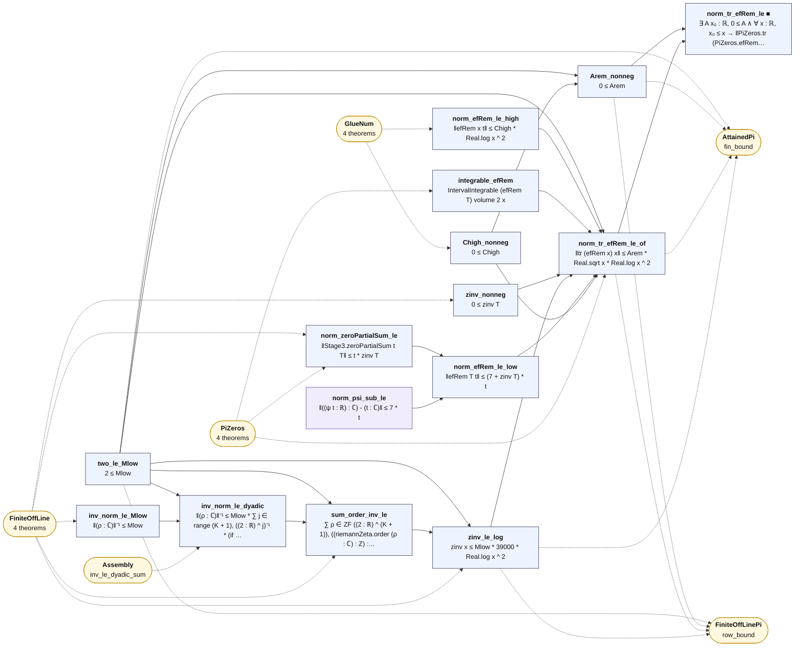

# `lean_stage3/Stage3/PiRemainder.lean`

PiRemainder — block T2b of `lean_stage3/design/joints.md`. 2026-11-23. The passage of the explicit formula's remainder is of square-root size, with no hypothesis on the zeros. Take the height equal to `x` and split the integral in `tr (efRem x) x` at `√x`. Above `√x` the explicit formula holds and bounds the remainder by a constant times `log²x`; against the weight this is at most a constant times `√x`. Below `√x` the remainder is at most `(7 + W)·t`, where `W` is the sum of `m(ρ)/|ρ|` over the zeros below `x`; aga…

15 theorems, 4 definitions, 522 lines. Arrows are Lean's own record of what each proof uses.

**Imports:** [`PiZeros`](../lean_stage3/PiZeros.md)  
**Imported by:** [`Stage3`](../lean_stage3/Stage3.md), [`FiniteOffLinePi`](../lean_stage3/FiniteOffLinePi.md)

## The picture



An arrow A → B reads "A is used in the proof of B". Green: counting, integers only. Violet: shape, analysis with no ζ. Blue: reads ζ. A name ending in ■ is an end: nothing else uses it. Red: contains `sorry`. Yellow: theorems in another file, counted; a dotted arrow crosses files. Definitions are not drawn; they are listed below the diagram.

## Definitions

<a name="PiRemainder-Mlow"></a>
### `PiRemainder.Mlow`

def · line 44

A constant that is at least `2` and at least the reciprocal size of every zero of height below one.

- **Is:** `` Mlow : ℝ := 2 + ∑ ρ ∈ ZF (1 : ℝ), ‖(ρ : ℂ)‖⁻¹ ``
- **Built from:** [`FiniteOffLine.ZF`](../lean_stage3/FiniteOffLine.md#FiniteOffLine-ZF)
- **Used by 14:** [`AttainedPi.fin_bound`](../lean_stage3/AttainedPi.md#AttainedPi-fin_bound), [`AttainedPi.slack`](../lean_stage3/AttainedPi.md#AttainedPi-slack), [`AttainedPi.slack_isLittleO`](../lean_stage3/AttainedPi.md#AttainedPi-slack_isLittleO), [`FiniteOffLinePi.rowBound`](../lean_stage3/FiniteOffLinePi.md#FiniteOffLinePi-rowBound), [`FiniteOffLinePi.rowBound_isLittleO`](../lean_stage3/FiniteOffLinePi.md#FiniteOffLinePi-rowBound_isLittleO), [`FiniteOffLinePi.row_bound`](../lean_stage3/FiniteOffLinePi.md#FiniteOffLinePi-row_bound), [`PiRemainder.Arem`](#PiRemainder-Arem), [`PiRemainder.Arem_nonneg`](#PiRemainder-Arem_nonneg), [`PiRemainder.inv_norm_le_Mlow`](#PiRemainder-inv_norm_le_Mlow), [`PiRemainder.inv_norm_le_dyadic`](#PiRemainder-inv_norm_le_dyadic), [`PiRemainder.norm_tr_efRem_le_of`](#PiRemainder-norm_tr_efRem_le_of), [`PiRemainder.sum_order_inv_le`](#PiRemainder-sum_order_inv_le), [`PiRemainder.two_le_Mlow`](#PiRemainder-two_le_Mlow), [`PiRemainder.zinv_le_log`](#PiRemainder-zinv_le_log)

<a name="PiRemainder-zinv"></a>
### `PiRemainder.zinv`

def · line 165

The sum of `m(ρ)/|ρ|` over the zeros below a height.

- **Is:** `` zinv (T : ℝ) : ℝ := ∑ ρ ∈ ZF T, ((riemannZeta.order (ρ : ℂ) : ℤ) : ℝ) * ‖(ρ : ℂ)‖⁻¹ ``
- **Built from:** [`FiniteOffLine.ZF`](../lean_stage3/FiniteOffLine.md#FiniteOffLine-ZF)
- **Used by 7:** [`AttainedPi.fin_bound`](../lean_stage3/AttainedPi.md#AttainedPi-fin_bound), [`FiniteOffLinePi.row_bound`](../lean_stage3/FiniteOffLinePi.md#FiniteOffLinePi-row_bound), [`PiRemainder.norm_efRem_le_low`](#PiRemainder-norm_efRem_le_low), [`PiRemainder.norm_tr_efRem_le_of`](#PiRemainder-norm_tr_efRem_le_of), [`PiRemainder.norm_zeroPartialSum_le`](#PiRemainder-norm_zeroPartialSum_le), [`PiRemainder.zinv_le_log`](#PiRemainder-zinv_le_log), [`PiRemainder.zinv_nonneg`](#PiRemainder-zinv_nonneg)

<a name="PiRemainder-Chigh"></a>
### `PiRemainder.Chigh`

def · line 270

The constant of the remainder inside the explicit formula's range.

- **Is:** `` Chigh : ℝ := 4 * Glue.c1n + Glue.c3n + Glue.c4n ``
- **Built from:** [`Glue.c1n`](../lean_stage3/GlueNum.md#Glue-c1n), [`Glue.c3n`](../lean_stage3/GlueNum.md#Glue-c3n), [`Glue.c4n`](../lean_stage3/GlueNum.md#Glue-c4n)
- **Used by 5:** [`PiRemainder.Arem`](#PiRemainder-Arem), [`PiRemainder.Arem_nonneg`](#PiRemainder-Arem_nonneg), [`PiRemainder.Chigh_nonneg`](#PiRemainder-Chigh_nonneg), [`PiRemainder.norm_efRem_le_high`](#PiRemainder-norm_efRem_le_high), [`PiRemainder.norm_tr_efRem_le_of`](#PiRemainder-norm_tr_efRem_le_of)

<a name="PiRemainder-Arem"></a>
### `PiRemainder.Arem`

def · line 345

The constant of the main bound.

- **Is:** `` Arem : ℝ := 5 * Chigh + 21 + 3 * (Mlow * 39000) ``
- **Built from:** [`PiRemainder.Chigh`](#PiRemainder-Chigh), [`PiRemainder.Mlow`](#PiRemainder-Mlow)
- **Used by 9:** [`AttainedPi.fin_bound`](../lean_stage3/AttainedPi.md#AttainedPi-fin_bound), [`AttainedPi.slack`](../lean_stage3/AttainedPi.md#AttainedPi-slack), [`AttainedPi.slack_isLittleO`](../lean_stage3/AttainedPi.md#AttainedPi-slack_isLittleO), [`FiniteOffLinePi.rowBound`](../lean_stage3/FiniteOffLinePi.md#FiniteOffLinePi-rowBound), [`FiniteOffLinePi.rowBound_isLittleO`](../lean_stage3/FiniteOffLinePi.md#FiniteOffLinePi-rowBound_isLittleO), [`FiniteOffLinePi.row_bound`](../lean_stage3/FiniteOffLinePi.md#FiniteOffLinePi-row_bound), [`PiRemainder.Arem_nonneg`](#PiRemainder-Arem_nonneg), [`PiRemainder.norm_tr_efRem_le`](#PiRemainder-norm_tr_efRem_le), [`PiRemainder.norm_tr_efRem_le_of`](#PiRemainder-norm_tr_efRem_le_of)

## Theorems

<a name="PiRemainder-two_le_Mlow"></a>
### `PiRemainder.two_le_Mlow`

line 47

**Reads ζ.** It, or something it rests on, uses the zeta function, its zeros or the Riemann hypothesis.

**Why.** The constant `Mlow` is at least `2`.

**Proves**

```lean
2 ≤ Mlow
```

**Stated with:** [`PiRemainder.Mlow`](#PiRemainder-Mlow)

**Fed by:** no theorem of this repo; it stands on Mathlib and the definitions below.

**Definitions its proof touches:** [`FiniteOffLine.ZF`](../lean_stage3/FiniteOffLine.md#FiniteOffLine-ZF)

**Feeds** (7 that use it)

  - [`AttainedPi.fin_bound`](../lean_stage3/AttainedPi.md#AttainedPi-fin_bound) (AttainedPi) — `` ‖∑ ρ ∈ topRow Θ r, LadderMean.coef ρ * ((2:ℂ) ^ (ρ : ℂ)) ^ r‖ ≤ slack Θ θ₁ C M ε r + 2 * ε * ((2:ℝ) ^ Θ) ^ r ``
  - [`FiniteOffLinePi.row_bound`](../lean_stage3/FiniteOffLinePi.md#FiniteOffLinePi-row_bound) (FiniteOffLinePi) — `` ‖∑ ρ ∈ S, ((riemannZeta.order (ρ : ℂ) : ℤ) : ℂ) * (((2:ℂ) ^ (ρ : ℂ)) ^ r / (ρ : ℂ))‖ ≤ rowBound F S β C r ``
  - [`PiRemainder.Arem_nonneg`](#PiRemainder-Arem_nonneg) — `` 0 ≤ Arem ``
  - [`PiRemainder.inv_norm_le_dyadic`](#PiRemainder-inv_norm_le_dyadic) — `` ‖(ρ : ℂ)‖⁻¹ ≤ Mlow * ∑ j ∈ range (K + 1), ((2 : ℝ) ^ j)⁻¹ * (if |(ρ : ℂ).im| < 2 ^ (j + 1) then 1 else 0) ``
  - [`PiRemainder.norm_tr_efRem_le_of`](#PiRemainder-norm_tr_efRem_le_of) — `` ‖tr (efRem x) x‖ ≤ Arem * Real.sqrt x * Real.log x ^ 2 ``
  - [`PiRemainder.sum_order_inv_le`](#PiRemainder-sum_order_inv_le) — `` ∑ ρ ∈ ZF ((2 : ℝ) ^ (K + 1)), ((riemannZeta.order (ρ : ℂ) : ℤ) : ℝ) * ‖(ρ : ℂ)‖⁻¹ ≤ Mlow * ∑ j ∈ range (K + 1), ((2 : ℝ) ^ j)⁻¹ * (2 * |riemannZeta.N … ``
  - [`PiRemainder.zinv_le_log`](#PiRemainder-zinv_le_log) — `` zinv x ≤ Mlow * 39000 * Real.log x ^ 2 ``

<a name="PiRemainder-inv_norm_le_Mlow"></a>
### `PiRemainder.inv_norm_le_Mlow`

line 53

**Reads ζ.** It, or something it rests on, uses the zeta function, its zeros or the Riemann hypothesis.

**Why.** A zero of height below one has reciprocal size at most `Mlow`.

**Proves**

```lean
‖(ρ : ℂ)‖⁻¹ ≤ Mlow
```

**Needs** (its hypotheses)

  - `` h : |(ρ : ℂ).im| < 1 ``

**Stated with:** [`PiRemainder.Mlow`](#PiRemainder-Mlow)

**Fed by** (1 theorem its proof uses)

  - [`FiniteOffLine.mem_ZF`](../lean_stage3/FiniteOffLine.md#FiniteOffLine-mem_ZF) (FiniteOffLine) — `` ρ ∈ ZF T ↔ |(ρ : ℂ).im| < T ``

**Definitions its proof touches:** [`FiniteOffLine.ZF`](../lean_stage3/FiniteOffLine.md#FiniteOffLine-ZF)

**Feeds** (1 that use it)

  - [`PiRemainder.inv_norm_le_dyadic`](#PiRemainder-inv_norm_le_dyadic) — `` ‖(ρ : ℂ)‖⁻¹ ≤ Mlow * ∑ j ∈ range (K + 1), ((2 : ℝ) ^ j)⁻¹ * (if |(ρ : ℂ).im| < 2 ^ (j + 1) then 1 else 0) ``

<a name="PiRemainder-inv_norm_le_dyadic"></a>
### `PiRemainder.inv_norm_le_dyadic`

line 63

**Reads ζ.** It, or something it rests on, uses the zeta function, its zeros or the Riemann hypothesis.

**Why.** Any zero below `2^(K+1)` has reciprocal size at most `Mlow` times the dyadic weights.

**Proves**

```lean
‖(ρ : ℂ)‖⁻¹ ≤ Mlow * ∑ j ∈ range (K + 1), ((2 : ℝ) ^ j)⁻¹ * (if |(ρ : ℂ).im| < 2 ^ (j + 1) then 1 else 0)
```

**Needs** (its hypotheses)

  - `` ρ : NontrivialZeros ``
  - `` K : ℕ ``
  - `` him : |(ρ : ℂ).im| < 2 ^ (K + 1) ``

**Stated with:** [`PiRemainder.Mlow`](#PiRemainder-Mlow)

**Fed by** (3 theorems its proof uses)

  - [`Stage3.inv_le_dyadic_sum`](../lean_stage3/Assembly.md#Stage3-inv_le_dyadic_sum) (Assembly) — `` ∀ γ : ℝ, 1 ≤ γ → γ < 2 ^ (K + 1) → γ⁻¹ ≤ ∑ j ∈ Finset.range (K + 1), ((2 : ℝ) ^ j)⁻¹ * (if γ < 2 ^ (j + 1) then 1 else 0) ``
  - [`PiRemainder.inv_norm_le_Mlow`](#PiRemainder-inv_norm_le_Mlow) — `` ‖(ρ : ℂ)‖⁻¹ ≤ Mlow ``
  - [`PiRemainder.two_le_Mlow`](#PiRemainder-two_le_Mlow) — `` 2 ≤ Mlow ``

**Feeds** (1 that use it)

  - [`PiRemainder.sum_order_inv_le`](#PiRemainder-sum_order_inv_le) — `` ∑ ρ ∈ ZF ((2 : ℝ) ^ (K + 1)), ((riemannZeta.order (ρ : ℂ) : ℤ) : ℝ) * ‖(ρ : ℂ)‖⁻¹ ≤ Mlow * ∑ j ∈ range (K + 1), ((2 : ℝ) ^ j)⁻¹ * (2 * |riemannZeta.N … ``

<a name="PiRemainder-sum_order_inv_le"></a>
### `PiRemainder.sum_order_inv_le`

line 109

**Reads ζ.** It, or something it rests on, uses the zeta function, its zeros or the Riemann hypothesis.

**Why.** All the zeros, weighted by reciprocal size, below a height. The sum of `m(ρ)/|ρ|` over the zeros below `2^(K+1)` is at most `Mlow` times the dyadic count.

**Proves**

```lean
∑ ρ ∈ ZF ((2 : ℝ) ^ (K + 1)), ((riemannZeta.order (ρ : ℂ) : ℤ) : ℝ) * ‖(ρ : ℂ)‖⁻¹ ≤ Mlow * ∑ j ∈ range (K + 1), ((2 : ℝ) ^ j)⁻¹ * (2 * |riemannZeta.N ((2 : ℝ) ^ (j + 1))| + weightedZeroHeightBucket)
```

**Needs** (its hypotheses)

  - `` K : ℕ ``

**Stated with:** [`FiniteOffLine.ZF`](../lean_stage3/FiniteOffLine.md#FiniteOffLine-ZF), [`PiRemainder.Mlow`](#PiRemainder-Mlow)

**Fed by** (5 theorems its proof uses)

  - [`FiniteOffLine.mem_ZF`](../lean_stage3/FiniteOffLine.md#FiniteOffLine-mem_ZF) (FiniteOffLine) — `` ρ ∈ ZF T ↔ |(ρ : ℂ).im| < T ``
  - [`FiniteOffLine.order_nonneg`](../lean_stage3/FiniteOffLine.md#FiniteOffLine-order_nonneg) (FiniteOffLine) — `` (0 : ℝ) ≤ ((riemannZeta.order (ρ : ℂ) : ℤ) : ℝ) ``
  - [`FiniteOffLine.tsum_sub_eq_sum`](../lean_stage3/FiniteOffLine.md#FiniteOffLine-tsum_sub_eq_sum) (FiniteOffLine) — `` ∑' σ : {ρ : NontrivialZeros // |(ρ : ℂ).im| < T}, f σ.1 = ∑ ρ ∈ ZF T, f ρ ``
  - [`PiRemainder.inv_norm_le_dyadic`](#PiRemainder-inv_norm_le_dyadic) — `` ‖(ρ : ℂ)‖⁻¹ ≤ Mlow * ∑ j ∈ range (K + 1), ((2 : ℝ) ^ j)⁻¹ * (if |(ρ : ℂ).im| < 2 ^ (j + 1) then 1 else 0) ``
  - [`PiRemainder.two_le_Mlow`](#PiRemainder-two_le_Mlow) — `` 2 ≤ Mlow ``

**Feeds** (1 that use it)

  - [`PiRemainder.zinv_le_log`](#PiRemainder-zinv_le_log) — `` zinv x ≤ Mlow * 39000 * Real.log x ^ 2 ``

<a name="PiRemainder-zinv_nonneg"></a>
### `PiRemainder.zinv_nonneg`

line 168

**Reads ζ.** It, or something it rests on, uses the zeta function, its zeros or the Riemann hypothesis.

**Why.** The sum `zinv T` is nonnegative.

**Proves**

```lean
0 ≤ zinv T
```

**Needs** (its hypotheses)

  - `` T : ℝ ``

**Stated with:** [`PiRemainder.zinv`](#PiRemainder-zinv)

**Fed by** (1 theorem its proof uses)

  - [`FiniteOffLine.order_nonneg`](../lean_stage3/FiniteOffLine.md#FiniteOffLine-order_nonneg) (FiniteOffLine) — `` (0 : ℝ) ≤ ((riemannZeta.order (ρ : ℂ) : ℤ) : ℝ) ``

**Definitions its proof touches:** [`FiniteOffLine.ZF`](../lean_stage3/FiniteOffLine.md#FiniteOffLine-ZF)

**Feeds** (1 that use it)

  - [`PiRemainder.norm_tr_efRem_le_of`](#PiRemainder-norm_tr_efRem_le_of) — `` ‖tr (efRem x) x‖ ≤ Arem * Real.sqrt x * Real.log x ^ 2 ``

<a name="PiRemainder-zinv_le_log"></a>
### `PiRemainder.zinv_le_log`

line 173

**Reads ζ.** It, or something it rests on, uses the zeta function, its zeros or the Riemann hypothesis.

**Why.** The zeros below `x`, weighted by reciprocal size, are at most a constant times `log²x`. For `x ≥ 4` the constant is `39000·Mlow`.

**Proves**

```lean
zinv x ≤ Mlow * 39000 * Real.log x ^ 2
```

**Needs** (its hypotheses)

  - `` hx : 4 ≤ x ``

**Stated with:** [`PiRemainder.Mlow`](#PiRemainder-Mlow), [`PiRemainder.zinv`](#PiRemainder-zinv)

**Fed by** (5 theorems its proof uses)

  - [`FiniteOffLine.dyadic_count_le`](../lean_stage3/FiniteOffLine.md#FiniteOffLine-dyadic_count_le) (FiniteOffLine) — `` ∑ j ∈ range (K + 1), ((2 : ℝ) ^ j)⁻¹ * (2 * |riemannZeta.N ((2 : ℝ) ^ (j + 1))| + weightedZeroHeightBucket) ≤ 3000 * ((K : ℝ) + 2) ^ 2 ``
  - [`FiniteOffLine.mem_ZF`](../lean_stage3/FiniteOffLine.md#FiniteOffLine-mem_ZF) (FiniteOffLine) — `` ρ ∈ ZF T ↔ |(ρ : ℂ).im| < T ``
  - [`FiniteOffLine.order_nonneg`](../lean_stage3/FiniteOffLine.md#FiniteOffLine-order_nonneg) (FiniteOffLine) — `` (0 : ℝ) ≤ ((riemannZeta.order (ρ : ℂ) : ℤ) : ℝ) ``
  - [`PiRemainder.sum_order_inv_le`](#PiRemainder-sum_order_inv_le) — `` ∑ ρ ∈ ZF ((2 : ℝ) ^ (K + 1)), ((riemannZeta.order (ρ : ℂ) : ℤ) : ℝ) * ‖(ρ : ℂ)‖⁻¹ ≤ Mlow * ∑ j ∈ range (K + 1), ((2 : ℝ) ^ j)⁻¹ * (2 * |riemannZeta.N … ``
  - [`PiRemainder.two_le_Mlow`](#PiRemainder-two_le_Mlow) — `` 2 ≤ Mlow ``

**Definitions its proof touches:** [`FiniteOffLine.ZF`](../lean_stage3/FiniteOffLine.md#FiniteOffLine-ZF)

**Feeds** (3 that use it)

  - [`AttainedPi.fin_bound`](../lean_stage3/AttainedPi.md#AttainedPi-fin_bound) (AttainedPi) — `` ‖∑ ρ ∈ topRow Θ r, LadderMean.coef ρ * ((2:ℂ) ^ (ρ : ℂ)) ^ r‖ ≤ slack Θ θ₁ C M ε r + 2 * ε * ((2:ℝ) ^ Θ) ^ r ``
  - [`FiniteOffLinePi.row_bound`](../lean_stage3/FiniteOffLinePi.md#FiniteOffLinePi-row_bound) (FiniteOffLinePi) — `` ‖∑ ρ ∈ S, ((riemannZeta.order (ρ : ℂ) : ℤ) : ℂ) * (((2:ℂ) ^ (ρ : ℂ)) ^ r / (ρ : ℂ))‖ ≤ rowBound F S β C r ``
  - [`PiRemainder.norm_tr_efRem_le_of`](#PiRemainder-norm_tr_efRem_le_of) — `` ‖tr (efRem x) x‖ ≤ Arem * Real.sqrt x * Real.log x ^ 2 ``

<a name="PiRemainder-norm_zeroPartialSum_le"></a>
### `PiRemainder.norm_zeroPartialSum_le`

line 223

**Reads ζ.** It, or something it rests on, uses the zeta function, its zeros or the Riemann hypothesis.

**Why.** For `t ≥ 1` the zero sum below any height is at most `t` times `zinv` of that height.

**Proves**

```lean
‖Stage3.zeroPartialSum t T‖ ≤ t * zinv T
```

**Needs** (its hypotheses)

  - `` ht : 1 ≤ t ``
  - `` T : ℝ ``

**Stated with:** [`Stage3.zeroPartialSum`](../lean_stage3/Assembly.md#Stage3-zeroPartialSum), [`PiRemainder.zinv`](#PiRemainder-zinv)

**Fed by** (2 theorems its proof uses)

  - [`FiniteOffLine.order_nonneg`](../lean_stage3/FiniteOffLine.md#FiniteOffLine-order_nonneg) (FiniteOffLine) — `` (0 : ℝ) ≤ ((riemannZeta.order (ρ : ℂ) : ℤ) : ℝ) ``
  - [`PiZeros.zeroPartialSum_eq_sum`](../lean_stage3/PiZeros.md#PiZeros-zeroPartialSum_eq_sum) (PiZeros) — `` Stage3.zeroPartialSum t T = ∑ ρ ∈ ZF T, ((riemannZeta.order (ρ : ℂ) : ℤ) : ℂ) * ((t : ℂ) ^ (ρ : ℂ) / (ρ : ℂ)) ``

**Definitions its proof touches:** [`FiniteOffLine.ZF`](../lean_stage3/FiniteOffLine.md#FiniteOffLine-ZF)

**Feeds** (1 that use it)

  - [`PiRemainder.norm_efRem_le_low`](#PiRemainder-norm_efRem_le_low) — `` ‖efRem T t‖ ≤ (7 + zinv T) * t ``

<a name="PiRemainder-norm_psi_sub_le"></a>
### `PiRemainder.norm_psi_sub_le`

line 245

**Shape.** Uses real or complex analysis; nothing in it or beneath it reads ζ.

**Why.** For `t ≥ 0`, Chebyshev's bound gives `|ψ t − t| ≤ 7·t`.

**Proves**

```lean
‖((ψ t : ℝ) : ℂ) - (t : ℂ)‖ ≤ 7 * t
```

**Needs** (its hypotheses)

  - `` ht : 0 ≤ t ``

**Fed by:** no theorem of this repo; it stands on Mathlib.

**Feeds** (1 that use it)

  - [`PiRemainder.norm_efRem_le_low`](#PiRemainder-norm_efRem_le_low) — `` ‖efRem T t‖ ≤ (7 + zinv T) * t ``

<a name="PiRemainder-norm_efRem_le_low"></a>
### `PiRemainder.norm_efRem_le_low`

line 259

**Reads ζ.** It, or something it rests on, uses the zeta function, its zeros or the Riemann hypothesis.

**Why.** The remainder below the explicit formula's range. For `t ≥ 1` the remainder at any height `T` is at most `(7 + zinv T)·t`.

**Proves**

```lean
‖efRem T t‖ ≤ (7 + zinv T) * t
```

**Needs** (its hypotheses)

  - `` ht : 1 ≤ t ``
  - `` T : ℝ ``

**Stated with:** [`PiRemainder.zinv`](#PiRemainder-zinv), [`PiZeros.efRem`](../lean_stage3/PiZeros.md#PiZeros-efRem)

**Fed by** (2 theorems its proof uses)

  - [`PiRemainder.norm_psi_sub_le`](#PiRemainder-norm_psi_sub_le) — `` ‖((ψ t : ℝ) : ℂ) - (t : ℂ)‖ ≤ 7 * t ``
  - [`PiRemainder.norm_zeroPartialSum_le`](#PiRemainder-norm_zeroPartialSum_le) — `` ‖Stage3.zeroPartialSum t T‖ ≤ t * zinv T ``

**Definitions its proof touches:** [`Stage3.zeroPartialSum`](../lean_stage3/Assembly.md#Stage3-zeroPartialSum)

**Feeds** (1 that use it)

  - [`PiRemainder.norm_tr_efRem_le_of`](#PiRemainder-norm_tr_efRem_le_of) — `` ‖tr (efRem x) x‖ ≤ Arem * Real.sqrt x * Real.log x ^ 2 ``

<a name="PiRemainder-Chigh_nonneg"></a>
### `PiRemainder.Chigh_nonneg`

line 273

**Reads ζ.** It, or something it rests on, uses the zeta function, its zeros or the Riemann hypothesis.

**Why.** The constant `Chigh` is nonnegative.

**Proves**

```lean
0 ≤ Chigh
```

**Stated with:** [`PiRemainder.Chigh`](#PiRemainder-Chigh)

**Fed by** (3 theorems its proof uses)

  - [`Glue.c1n_nonneg`](../lean_stage3/GlueNum.md#Glue-c1n_nonneg) (GlueNum) — `` 0 ≤ c1n ``
  - [`Glue.c3n_nonneg`](../lean_stage3/GlueNum.md#Glue-c3n_nonneg) (GlueNum) — `` 0 ≤ c3n ``
  - [`Glue.c4n_nonneg`](../lean_stage3/GlueNum.md#Glue-c4n_nonneg) (GlueNum) — `` 0 ≤ c4n ``

**Definitions its proof touches:** [`Glue.c1n`](../lean_stage3/GlueNum.md#Glue-c1n), [`Glue.c3n`](../lean_stage3/GlueNum.md#Glue-c3n), [`Glue.c4n`](../lean_stage3/GlueNum.md#Glue-c4n)

**Feeds** (2 that use it)

  - [`PiRemainder.Arem_nonneg`](#PiRemainder-Arem_nonneg) — `` 0 ≤ Arem ``
  - [`PiRemainder.norm_tr_efRem_le_of`](#PiRemainder-norm_tr_efRem_le_of) — `` ‖tr (efRem x) x‖ ≤ Arem * Real.sqrt x * Real.log x ^ 2 ``

<a name="PiRemainder-norm_efRem_le_high"></a>
### `PiRemainder.norm_efRem_le_high`

line 282

**Reads ζ.** It, or something it rests on, uses the zeta function, its zeros or the Riemann hypothesis.

**Why.** The remainder inside the explicit formula's range. For `16 ≤ t ≤ x ≤ t²` and `log x ≥ 1`, the remainder at height `x` is at most `Chigh·log²x`.

**Proves**

```lean
‖efRem x t‖ ≤ Chigh * Real.log x ^ 2
```

**Needs** (its hypotheses)

  - `` h16 : 16 ≤ t ``
  - `` hxt : x ≤ t ^ 2 ``
  - `` htx : t ≤ x ``
  - `` hL : 1 ≤ Real.log x ``

**Stated with:** [`PiRemainder.Chigh`](#PiRemainder-Chigh), [`PiZeros.efRem`](../lean_stage3/PiZeros.md#PiZeros-efRem)

**Fed by** (4 theorems its proof uses)

  - [`Glue.c1n_nonneg`](../lean_stage3/GlueNum.md#Glue-c1n_nonneg) (GlueNum) — `` 0 ≤ c1n ``
  - [`Glue.c3n_nonneg`](../lean_stage3/GlueNum.md#Glue-c3n_nonneg) (GlueNum) — `` 0 ≤ c3n ``
  - [`Glue.c4n_nonneg`](../lean_stage3/GlueNum.md#Glue-c4n_nonneg) (GlueNum) — `` 0 ≤ c4n ``
  - [`Glue.explicit_formula_split_num`](../lean_stage3/GlueNum.md#Glue-explicit_formula_split_num) (GlueNum) — `` ∀ x T : ℝ, 16 ≤ x → 2 ≤ T → T ≤ x^2 → ‖(Chebyshev.psi x : ℂ) - (x:ℂ) + Stage3.zeroPartialSum x T‖ ≤ c1n * x * Real.log (x*T)^2 / T + c3n * Real.log x … ``

**Definitions its proof touches:** [`Stage3.zeroPartialSum`](../lean_stage3/Assembly.md#Stage3-zeroPartialSum), [`Glue.c1n`](../lean_stage3/GlueNum.md#Glue-c1n), [`Glue.c3n`](../lean_stage3/GlueNum.md#Glue-c3n), [`Glue.c4n`](../lean_stage3/GlueNum.md#Glue-c4n)

**Feeds** (1 that use it)

  - [`PiRemainder.norm_tr_efRem_le_of`](#PiRemainder-norm_tr_efRem_le_of) — `` ‖tr (efRem x) x‖ ≤ Arem * Real.sqrt x * Real.log x ^ 2 ``

<a name="PiRemainder-integrable_efRem"></a>
### `PiRemainder.integrable_efRem`

line 319

**Reads ζ.** It, or something it rests on, uses the zeta function, its zeros or the Riemann hypothesis.

**Why.** For `x ≥ 2` the remainder of the explicit formula at any height is integrable on `[2, x]`.

**Proves**

```lean
IntervalIntegrable (efRem T) volume 2 x
```

**Needs** (its hypotheses)

  - `` T : ℝ ``
  - `` hx : 2 ≤ x ``

**Stated with:** [`PiZeros.efRem`](../lean_stage3/PiZeros.md#PiZeros-efRem)

**Fed by** (3 theorems its proof uses)

  - [`PiZeros.integrable_cpow`](../lean_stage3/PiZeros.md#PiZeros-integrable_cpow) (PiZeros) — `` IntervalIntegrable (fun t : ℝ => (t : ℂ) ^ ρ / ρ) volume 2 x ``
  - [`PiZeros.integrable_ofReal_of_monotone`](../lean_stage3/PiZeros.md#PiZeros-integrable_ofReal_of_monotone) (PiZeros) — `` IntervalIntegrable (fun t => ((f t : ℝ) : ℂ)) volume 2 x ``
  - [`PiZeros.zeroPartialSum_eq_sum`](../lean_stage3/PiZeros.md#PiZeros-zeroPartialSum_eq_sum) (PiZeros) — `` Stage3.zeroPartialSum t T = ∑ ρ ∈ ZF T, ((riemannZeta.order (ρ : ℂ) : ℤ) : ℂ) * ((t : ℂ) ^ (ρ : ℂ) / (ρ : ℂ)) ``

**Definitions its proof touches:** [`Stage3.zeroPartialSum`](../lean_stage3/Assembly.md#Stage3-zeroPartialSum), [`FiniteOffLine.ZF`](../lean_stage3/FiniteOffLine.md#FiniteOffLine-ZF)

**Feeds** (1 that use it)

  - [`PiRemainder.norm_tr_efRem_le_of`](#PiRemainder-norm_tr_efRem_le_of) — `` ‖tr (efRem x) x‖ ≤ Arem * Real.sqrt x * Real.log x ^ 2 ``

<a name="PiRemainder-Arem_nonneg"></a>
### `PiRemainder.Arem_nonneg`

line 348

**Reads ζ.** It, or something it rests on, uses the zeta function, its zeros or the Riemann hypothesis.

**Why.** The constant `Arem` is nonnegative.

**Proves**

```lean
0 ≤ Arem
```

**Stated with:** [`PiRemainder.Arem`](#PiRemainder-Arem)

**Fed by** (2 theorems its proof uses)

  - [`PiRemainder.Chigh_nonneg`](#PiRemainder-Chigh_nonneg) — `` 0 ≤ Chigh ``
  - [`PiRemainder.two_le_Mlow`](#PiRemainder-two_le_Mlow) — `` 2 ≤ Mlow ``

**Definitions its proof touches:** [`PiRemainder.Chigh`](#PiRemainder-Chigh), [`PiRemainder.Mlow`](#PiRemainder-Mlow)

**Feeds** (3 that use it)

  - [`AttainedPi.fin_bound`](../lean_stage3/AttainedPi.md#AttainedPi-fin_bound) (AttainedPi) — `` ‖∑ ρ ∈ topRow Θ r, LadderMean.coef ρ * ((2:ℂ) ^ (ρ : ℂ)) ^ r‖ ≤ slack Θ θ₁ C M ε r + 2 * ε * ((2:ℝ) ^ Θ) ^ r ``
  - [`FiniteOffLinePi.row_bound`](../lean_stage3/FiniteOffLinePi.md#FiniteOffLinePi-row_bound) (FiniteOffLinePi) — `` ‖∑ ρ ∈ S, ((riemannZeta.order (ρ : ℂ) : ℤ) : ℂ) * (((2:ℂ) ^ (ρ : ℂ)) ^ r / (ρ : ℂ))‖ ≤ rowBound F S β C r ``
  - [`PiRemainder.norm_tr_efRem_le`](#PiRemainder-norm_tr_efRem_le) — `` ∃ A x₀ : ℝ, 0 ≤ A ∧ ∀ x : ℝ, x₀ ≤ x → ‖PiZeros.tr (PiZeros.efRem x) x‖ ≤ A * Real.sqrt x * Real.log x ^ 2 ``

<a name="PiRemainder-norm_tr_efRem_le_of"></a>
### `PiRemainder.norm_tr_efRem_le_of`

line 357

**Reads ζ.** It, or something it rests on, uses the zeta function, its zeros or the Riemann hypothesis.

**Why.** The passage of the remainder is of square-root size, explicitly. For `x ≥ 256`, with the height equal to `x`, the passage of the explicit formula's remainder is at most `Arem·√x·log²x`.

**Proves**

```lean
‖tr (efRem x) x‖ ≤ Arem * Real.sqrt x * Real.log x ^ 2
```

**Needs** (its hypotheses)

  - `` hx : 256 ≤ x ``

**Stated with:** [`PiRemainder.Arem`](#PiRemainder-Arem), [`PiZeros.efRem`](../lean_stage3/PiZeros.md#PiZeros-efRem), [`PiZeros.tr`](../lean_stage3/PiZeros.md#PiZeros-tr)

**Fed by** (8 theorems its proof uses)

  - [`PiRemainder.Chigh_nonneg`](#PiRemainder-Chigh_nonneg) — `` 0 ≤ Chigh ``
  - [`PiRemainder.integrable_efRem`](#PiRemainder-integrable_efRem) — `` IntervalIntegrable (efRem T) volume 2 x ``
  - [`PiRemainder.norm_efRem_le_high`](#PiRemainder-norm_efRem_le_high) — `` ‖efRem x t‖ ≤ Chigh * Real.log x ^ 2 ``
  - [`PiRemainder.norm_efRem_le_low`](#PiRemainder-norm_efRem_le_low) — `` ‖efRem T t‖ ≤ (7 + zinv T) * t ``
  - [`PiRemainder.two_le_Mlow`](#PiRemainder-two_le_Mlow) — `` 2 ≤ Mlow ``
  - [`PiRemainder.zinv_le_log`](#PiRemainder-zinv_le_log) — `` zinv x ≤ Mlow * 39000 * Real.log x ^ 2 ``
  - [`PiRemainder.zinv_nonneg`](#PiRemainder-zinv_nonneg) — `` 0 ≤ zinv T ``
  - [`PiZeros.integrable_mul_wt`](../lean_stage3/PiZeros.md#PiZeros-integrable_mul_wt) (PiZeros) — `` IntervalIntegrable (fun t => f t * wt t) volume 2 x ``

**Definitions its proof touches:** [`PiRemainder.Chigh`](#PiRemainder-Chigh), [`PiRemainder.Mlow`](#PiRemainder-Mlow), [`PiRemainder.zinv`](#PiRemainder-zinv), [`PiZeros.wt`](../lean_stage3/PiZeros.md#PiZeros-wt)

**Feeds** (3 that use it)

  - [`AttainedPi.fin_bound`](../lean_stage3/AttainedPi.md#AttainedPi-fin_bound) (AttainedPi) — `` ‖∑ ρ ∈ topRow Θ r, LadderMean.coef ρ * ((2:ℂ) ^ (ρ : ℂ)) ^ r‖ ≤ slack Θ θ₁ C M ε r + 2 * ε * ((2:ℝ) ^ Θ) ^ r ``
  - [`FiniteOffLinePi.row_bound`](../lean_stage3/FiniteOffLinePi.md#FiniteOffLinePi-row_bound) (FiniteOffLinePi) — `` ‖∑ ρ ∈ S, ((riemannZeta.order (ρ : ℂ) : ℤ) : ℂ) * (((2:ℂ) ^ (ρ : ℂ)) ^ r / (ρ : ℂ))‖ ≤ rowBound F S β C r ``
  - [`PiRemainder.norm_tr_efRem_le`](#PiRemainder-norm_tr_efRem_le) — `` ∃ A x₀ : ℝ, 0 ≤ A ∧ ∀ x : ℝ, x₀ ≤ x → ‖PiZeros.tr (PiZeros.efRem x) x‖ ≤ A * Real.sqrt x * Real.log x ^ 2 ``

<a name="PiRemainder-norm_tr_efRem_le"></a>
### `PiRemainder.norm_tr_efRem_le`

line 502

**Reads ζ.** It, or something it rests on, uses the zeta function, its zeros or the Riemann hypothesis.

**Why.** The passage of the explicit formula's remainder is of square-root size. There are constants `A ≥ 0` and `x₀` such that for every `x ≥ x₀`, with the height equal to `x`, the passage of the remainder is at most `A·√x·log²x`. No hypothesis on the zeros of ζ is made.

**Proves**

```lean
∃ A x₀ : ℝ, 0 ≤ A ∧ ∀ x : ℝ, x₀ ≤ x → ‖PiZeros.tr (PiZeros.efRem x) x‖ ≤ A * Real.sqrt x * Real.log x ^ 2
```

**Stated with:** [`PiZeros.efRem`](../lean_stage3/PiZeros.md#PiZeros-efRem), [`PiZeros.tr`](../lean_stage3/PiZeros.md#PiZeros-tr)

**Fed by** (2 theorems its proof uses)

  - [`PiRemainder.Arem_nonneg`](#PiRemainder-Arem_nonneg) — `` 0 ≤ Arem ``
  - [`PiRemainder.norm_tr_efRem_le_of`](#PiRemainder-norm_tr_efRem_le_of) — `` ‖tr (efRem x) x‖ ≤ Arem * Real.sqrt x * Real.log x ^ 2 ``

**Definitions its proof touches:** [`PiRemainder.Arem`](#PiRemainder-Arem)

**Feeds:** nothing. It is an end.

