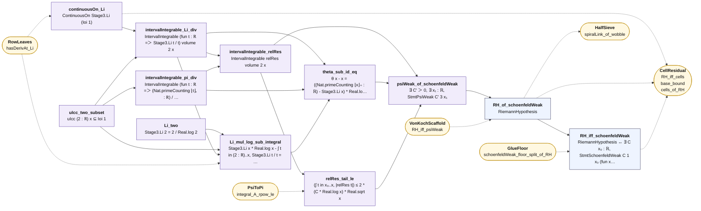

# `lean_stage3/Stage3/PiToPsi.lean`

PiToPsi — block T5 of `lean_stage3/design/joints.md`, first part. 2026-11-22. From the count `π` back to `ψ`. `PsiToPi` carries a bound on `ψ` to a bound on `π − Li`; this module carries it back, by upstream's Abel summation `Chebyshev.theta_eq_primeCounting_mul_log_sub_integral` and the matching identity for `Li`. With `VonKoch.RH_iff_psiWeak` the Riemann hypothesis is then equivalent to the square-root bound on `π − Li` itself.

12 theorems, 1 definition, 321 lines. Arrows are Lean's own record of what each proof uses.

**Imports:** [`GlueFloor`](../lean_stage3/GlueFloor.md), [`RowLeaves`](../lean_stage3/RowLeaves.md), [`VonKochScaffold`](../lean_stage3/VonKochScaffold.md)  
**Imported by:** [`Stage3`](../lean_stage3/Stage3.md), [`CellResidual`](../lean_stage3/CellResidual.md), [`HalfSieve`](../lean_stage3/HalfSieve.md)

## The picture



An arrow A → B reads "A is used in the proof of B". Green: counting, integers only. Violet: shape, analysis with no ζ. Blue: reads ζ. A name ending in ■ is an end: nothing else uses it. Red: contains `sorry`. Yellow: theorems in another file, counted; a dotted arrow crosses files. Definitions are not drawn; they are listed below the diagram.

## Definitions

<a name="PiToPsi-relRes"></a>
### `PiToPsi.relRes`

def · line 109

The residual of the count against `Stage3.Li`, relative to `t`.

- **Is:** `` relRes (t : ℝ) : ℝ := ((Nat.primeCounting ⌊t⌋₊ : ℝ) - Stage3.Li t) / t ``
- **Built from:** [`Stage3.Li`](../lean_stage3/PsiToPi.md#Stage3-Li)
- **Used by 4:** [`PiToPsi.intervalIntegrable_relRes`](#PiToPsi-intervalIntegrable_relRes), [`PiToPsi.psiWeak_of_schoenfeldWeak`](#PiToPsi-psiWeak_of_schoenfeldWeak), [`PiToPsi.relRes_tail_le`](#PiToPsi-relRes_tail_le), [`PiToPsi.theta_sub_id_eq`](#PiToPsi-theta_sub_id_eq)

## Theorems

<a name="PiToPsi-Li_two"></a>
### `PiToPsi.Li_two`

line 44

**Shape.** Uses real or complex analysis; nothing in it or beneath it reads ζ.

**Why.** At two the smooth count is `2 / log 2`: its integral part is empty there.

**Proves**

```lean
Stage3.Li 2 = 2 / Real.log 2
```

**Stated with:** [`Stage3.Li`](../lean_stage3/PsiToPi.md#Stage3-Li)

**Fed by:** no theorem of this repo; it stands on Mathlib and the definitions below.

**Feeds** (1 that use it)

  - [`PiToPsi.Li_mul_log_sub_integral`](#PiToPsi-Li_mul_log_sub_integral) — `` Stage3.Li x * Real.log x - ∫ t in (2 : ℝ)..x, Stage3.Li t / t = x ``

<a name="PiToPsi-continuousOn_Li"></a>
### `PiToPsi.continuousOn_Li`

line 49

**Shape.** Uses real or complex analysis; nothing in it or beneath it reads ζ.

**Why.** The smooth count `Li` is continuous past one, because it has a derivative there.

**Proves**

```lean
ContinuousOn Stage3.Li (Ioi 1)
```

**Stated with:** [`Stage3.Li`](../lean_stage3/PsiToPi.md#Stage3-Li)

**Fed by** (1 theorem its proof uses)

  - [`Stage3.hasDerivAt_Li`](../lean_stage3/RowLeaves.md#Stage3-hasDerivAt_Li) (RowLeaves) — `` HasDerivAt Li (1 / Real.log y) y ``

**Feeds** (2 that use it)

  - [`CellResidual.base_bound`](../lean_stage3/CellResidual.md#CellResidual-base_bound) (CellResidual) — `` ∃ M : ℝ, ∀ a ∈ Set.Icc (1 : ℝ) 2, |resid a r₀| ≤ M ``
  - [`PiToPsi.intervalIntegrable_Li_div`](#PiToPsi-intervalIntegrable_Li_div) — `` IntervalIntegrable (fun t : ℝ => Stage3.Li t / t) volume 2 x ``

<a name="PiToPsi-uIcc_two_subset"></a>
### `PiToPsi.uIcc_two_subset`

line 53

**Shape.** Uses real or complex analysis; nothing in it or beneath it reads ζ.

**Why.** Every point between two and `x` is past one, where `Li` and `log` behave.

**Proves**

```lean
uIcc (2 : ℝ) x ⊆ Ioi 1
```

**Needs** (its hypotheses)

  - `` hx : 2 ≤ x ``

**Fed by:** no theorem of this repo; it stands on Mathlib.

**Feeds** (3 that use it)

  - [`PiToPsi.Li_mul_log_sub_integral`](#PiToPsi-Li_mul_log_sub_integral) — `` Stage3.Li x * Real.log x - ∫ t in (2 : ℝ)..x, Stage3.Li t / t = x ``
  - [`PiToPsi.intervalIntegrable_Li_div`](#PiToPsi-intervalIntegrable_Li_div) — `` IntervalIntegrable (fun t : ℝ => Stage3.Li t / t) volume 2 x ``
  - [`PiToPsi.intervalIntegrable_pi_div`](#PiToPsi-intervalIntegrable_pi_div) — `` IntervalIntegrable (fun t : ℝ => (Nat.primeCounting ⌊t⌋₊ : ℝ) / t) volume 2 x ``

<a name="PiToPsi-intervalIntegrable_Li_div"></a>
### `PiToPsi.intervalIntegrable_Li_div`

line 59

**Shape.** Uses real or complex analysis; nothing in it or beneath it reads ζ.

**Why.** `Li t / t` can be integrated from two to `x`.

**Proves**

```lean
IntervalIntegrable (fun t : ℝ => Stage3.Li t / t) volume 2 x
```

**Needs** (its hypotheses)

  - `` hx : 2 ≤ x ``

**Stated with:** [`Stage3.Li`](../lean_stage3/PsiToPi.md#Stage3-Li)

**Fed by** (2 theorems its proof uses)

  - [`PiToPsi.continuousOn_Li`](#PiToPsi-continuousOn_Li) — `` ContinuousOn Stage3.Li (Ioi 1) ``
  - [`PiToPsi.uIcc_two_subset`](#PiToPsi-uIcc_two_subset) — `` uIcc (2 : ℝ) x ⊆ Ioi 1 ``

**Feeds** (3 that use it)

  - [`PiToPsi.Li_mul_log_sub_integral`](#PiToPsi-Li_mul_log_sub_integral) — `` Stage3.Li x * Real.log x - ∫ t in (2 : ℝ)..x, Stage3.Li t / t = x ``
  - [`PiToPsi.intervalIntegrable_relRes`](#PiToPsi-intervalIntegrable_relRes) — `` IntervalIntegrable relRes volume 2 x ``
  - [`PiToPsi.theta_sub_id_eq`](#PiToPsi-theta_sub_id_eq) — `` θ x - x = ((Nat.primeCounting ⌊x⌋₊ : ℝ) - Stage3.Li x) * Real.log x - ∫ t in (2 : ℝ)..x, relRes t ``

<a name="PiToPsi-intervalIntegrable_pi_div"></a>
### `PiToPsi.intervalIntegrable_pi_div`

line 68

**Shape.** Uses real or complex analysis; nothing in it or beneath it reads ζ.

**Why.** The count over `t` can be integrated from two to `x`: the count only steps upward.

**Proves**

```lean
IntervalIntegrable (fun t : ℝ => (Nat.primeCounting ⌊t⌋₊ : ℝ) / t) volume 2 x
```

**Needs** (its hypotheses)

  - `` hx : 2 ≤ x ``

**Fed by** (1 theorem its proof uses)

  - [`PiToPsi.uIcc_two_subset`](#PiToPsi-uIcc_two_subset) — `` uIcc (2 : ℝ) x ⊆ Ioi 1 ``

**Feeds** (2 that use it)

  - [`PiToPsi.intervalIntegrable_relRes`](#PiToPsi-intervalIntegrable_relRes) — `` IntervalIntegrable relRes volume 2 x ``
  - [`PiToPsi.theta_sub_id_eq`](#PiToPsi-theta_sub_id_eq) — `` θ x - x = ((Nat.primeCounting ⌊x⌋₊ : ℝ) - Stage3.Li x) * Real.log x - ∫ t in (2 : ℝ)..x, relRes t ``

<a name="PiToPsi-Li_mul_log_sub_integral"></a>
### `PiToPsi.Li_mul_log_sub_integral`

line 86

**Shape.** Uses real or complex analysis; nothing in it or beneath it reads ζ.

**Why.** `Li` undone. `Li x · log x` minus the integral of `Li t / t` from two is exactly `x`. This is the smooth side of the passage from the count back to `θ`.

**Proves**

```lean
Stage3.Li x * Real.log x - ∫ t in (2 : ℝ)..x, Stage3.Li t / t = x
```

**Needs** (its hypotheses)

  - `` hx : 2 ≤ x ``

**Stated with:** [`Stage3.Li`](../lean_stage3/PsiToPi.md#Stage3-Li)

**Fed by** (4 theorems its proof uses)

  - [`PiToPsi.Li_two`](#PiToPsi-Li_two) — `` Stage3.Li 2 = 2 / Real.log 2 ``
  - [`PiToPsi.intervalIntegrable_Li_div`](#PiToPsi-intervalIntegrable_Li_div) — `` IntervalIntegrable (fun t : ℝ => Stage3.Li t / t) volume 2 x ``
  - [`PiToPsi.uIcc_two_subset`](#PiToPsi-uIcc_two_subset) — `` uIcc (2 : ℝ) x ⊆ Ioi 1 ``
  - [`Stage3.hasDerivAt_Li`](../lean_stage3/RowLeaves.md#Stage3-hasDerivAt_Li) (RowLeaves) — `` HasDerivAt Li (1 / Real.log y) y ``

**Feeds** (1 that use it)

  - [`PiToPsi.theta_sub_id_eq`](#PiToPsi-theta_sub_id_eq) — `` θ x - x = ((Nat.primeCounting ⌊x⌋₊ : ℝ) - Stage3.Li x) * Real.log x - ∫ t in (2 : ℝ)..x, relRes t ``

<a name="PiToPsi-intervalIntegrable_relRes"></a>
### `PiToPsi.intervalIntegrable_relRes`

line 112

**Shape.** Uses real or complex analysis; nothing in it or beneath it reads ζ.

**Why.** The relative residual can be integrated from two to `x`.

**Proves**

```lean
IntervalIntegrable relRes volume 2 x
```

**Needs** (its hypotheses)

  - `` hx : 2 ≤ x ``

**Stated with:** [`PiToPsi.relRes`](#PiToPsi-relRes)

**Fed by** (2 theorems its proof uses)

  - [`PiToPsi.intervalIntegrable_Li_div`](#PiToPsi-intervalIntegrable_Li_div) — `` IntervalIntegrable (fun t : ℝ => Stage3.Li t / t) volume 2 x ``
  - [`PiToPsi.intervalIntegrable_pi_div`](#PiToPsi-intervalIntegrable_pi_div) — `` IntervalIntegrable (fun t : ℝ => (Nat.primeCounting ⌊t⌋₊ : ℝ) / t) volume 2 x ``

**Definitions its proof touches:** [`Stage3.Li`](../lean_stage3/PsiToPi.md#Stage3-Li)

**Feeds** (2 that use it)

  - [`PiToPsi.psiWeak_of_schoenfeldWeak`](#PiToPsi-psiWeak_of_schoenfeldWeak) — `` ∃ C' > 0, ∃ x₁ : ℝ, StmtPsiWeak C' 3 x₁ ``
  - [`PiToPsi.relRes_tail_le`](#PiToPsi-relRes_tail_le) — `` (∫ t in x₀..x, |relRes t|) ≤ 2 * (C * Real.log x) * Real.sqrt x ``

<a name="PiToPsi-theta_sub_id_eq"></a>
### `PiToPsi.theta_sub_id_eq`

line 122

**Shape.** Uses real or complex analysis; nothing in it or beneath it reads ζ.

**Why.** `θ` from `π`, with `Stage3.Li` taken off both sides.

**Proves**

```lean
θ x - x = ((Nat.primeCounting ⌊x⌋₊ : ℝ) - Stage3.Li x) * Real.log x - ∫ t in (2 : ℝ)..x, relRes t
```

**Needs** (its hypotheses)

  - `` hx : 2 ≤ x ``

**Stated with:** [`PiToPsi.relRes`](#PiToPsi-relRes), [`Stage3.Li`](../lean_stage3/PsiToPi.md#Stage3-Li)

**Fed by** (3 theorems its proof uses)

  - [`PiToPsi.Li_mul_log_sub_integral`](#PiToPsi-Li_mul_log_sub_integral) — `` Stage3.Li x * Real.log x - ∫ t in (2 : ℝ)..x, Stage3.Li t / t = x ``
  - [`PiToPsi.intervalIntegrable_Li_div`](#PiToPsi-intervalIntegrable_Li_div) — `` IntervalIntegrable (fun t : ℝ => Stage3.Li t / t) volume 2 x ``
  - [`PiToPsi.intervalIntegrable_pi_div`](#PiToPsi-intervalIntegrable_pi_div) — `` IntervalIntegrable (fun t : ℝ => (Nat.primeCounting ⌊t⌋₊ : ℝ) / t) volume 2 x ``

**Feeds** (1 that use it)

  - [`PiToPsi.psiWeak_of_schoenfeldWeak`](#PiToPsi-psiWeak_of_schoenfeldWeak) — `` ∃ C' > 0, ∃ x₁ : ℝ, StmtPsiWeak C' 3 x₁ ``

<a name="PiToPsi-relRes_tail_le"></a>
### `PiToPsi.relRes_tail_le`

line 139

**Shape.** Uses real or complex analysis; nothing in it or beneath it reads ζ.

**Why.** The tail of `∫ |relRes|` under the `π`-side bound.

**Proves**

```lean
(∫ t in x₀..x, |relRes t|) ≤ 2 * (C * Real.log x) * Real.sqrt x
```

**Needs** (its hypotheses)

  - `` hC : 0 ≤ C ``
  - `` hx₀ : 2 ≤ x₀ ``
  - `` hx : x₀ ≤ x ``
  - `` h : StmtSchoenfeldWeak C 1 x₀ (fun x => (Nat.primeCounting ⌊x⌋₊ : ℝ)) Stage3.Li ``

**Stated with:** [`PiToPsi.relRes`](#PiToPsi-relRes), [`Stage3.Li`](../lean_stage3/PsiToPi.md#Stage3-Li), [`Stage3.StmtSchoenfeldWeak`](../lean_stage3/Statement.md#Stage3-StmtSchoenfeldWeak)

**Fed by** (2 theorems its proof uses)

  - [`PiToPsi.intervalIntegrable_relRes`](#PiToPsi-intervalIntegrable_relRes) — `` IntervalIntegrable relRes volume 2 x ``
  - [`Stage3.integral_A_rpow_le`](../lean_stage3/PsiToPi.md#Stage3-integral_A_rpow_le) (PsiToPi) — `` (∫ t in a..x, A * t ^ (-(1 : ℝ) / 2)) ≤ 2 * A * Real.sqrt x ``

**Feeds** (1 that use it)

  - [`PiToPsi.psiWeak_of_schoenfeldWeak`](#PiToPsi-psiWeak_of_schoenfeldWeak) — `` ∃ C' > 0, ∃ x₁ : ℝ, StmtPsiWeak C' 3 x₁ ``

<a name="PiToPsi-psiWeak_of_schoenfeldWeak"></a>
### `PiToPsi.psiWeak_of_schoenfeldWeak`

line 185

**Shape.** Uses real or complex analysis; nothing in it or beneath it reads ζ.

**Why.** From the count to `ψ`. The square-root bound on `π − Stage3.Li` gives the bound on `ψ` at two more logarithms.

**Proves**

```lean
∃ C' > 0, ∃ x₁ : ℝ, StmtPsiWeak C' 3 x₁
```

**Needs** (its hypotheses)

  - `` hC : 0 ≤ C ``
  - `` hx₀ : 2 ≤ x₀ ``
  - `` h : StmtSchoenfeldWeak C 1 x₀ (fun x => (Nat.primeCounting ⌊x⌋₊ : ℝ)) Stage3.Li ``

**Stated with:** [`Stage3.Li`](../lean_stage3/PsiToPi.md#Stage3-Li), [`Stage3.StmtPsiWeak`](../lean_stage3/PsiToPi.md#Stage3-StmtPsiWeak), [`Stage3.StmtSchoenfeldWeak`](../lean_stage3/Statement.md#Stage3-StmtSchoenfeldWeak)

**Fed by** (3 theorems its proof uses)

  - [`PiToPsi.intervalIntegrable_relRes`](#PiToPsi-intervalIntegrable_relRes) — `` IntervalIntegrable relRes volume 2 x ``
  - [`PiToPsi.relRes_tail_le`](#PiToPsi-relRes_tail_le) — `` (∫ t in x₀..x, |relRes t|) ≤ 2 * (C * Real.log x) * Real.sqrt x ``
  - [`PiToPsi.theta_sub_id_eq`](#PiToPsi-theta_sub_id_eq) — `` θ x - x = ((Nat.primeCounting ⌊x⌋₊ : ℝ) - Stage3.Li x) * Real.log x - ∫ t in (2 : ℝ)..x, relRes t ``

**Definitions its proof touches:** [`PiToPsi.relRes`](#PiToPsi-relRes)

**Feeds** (1 that use it)

  - [`PiToPsi.RH_of_schoenfeldWeak`](#PiToPsi-RH_of_schoenfeldWeak) — `` RiemannHypothesis ``

<a name="PiToPsi-RH_of_schoenfeldWeak"></a>
### `PiToPsi.RH_of_schoenfeldWeak`

line 271

**Reads ζ.** It, or something it rests on, uses the zeta function, its zeros or the Riemann hypothesis.

**Why.** The square-root bound on the count gives the Riemann hypothesis.

**Proves**

```lean
RiemannHypothesis
```

**Needs** (its hypotheses)

  - `` h : StmtSchoenfeldWeak C 1 x₀ (fun x => (Nat.primeCounting ⌊x⌋₊ : ℝ)) Stage3.Li ``

**Stated with:** [`Stage3.Li`](../lean_stage3/PsiToPi.md#Stage3-Li), [`Stage3.StmtSchoenfeldWeak`](../lean_stage3/Statement.md#Stage3-StmtSchoenfeldWeak)

**Fed by** (2 theorems its proof uses)

  - [`PiToPsi.psiWeak_of_schoenfeldWeak`](#PiToPsi-psiWeak_of_schoenfeldWeak) — `` ∃ C' > 0, ∃ x₁ : ℝ, StmtPsiWeak C' 3 x₁ ``
  - [`VonKoch.RH_iff_psiWeak`](../lean_stage3/VonKochScaffold.md#VonKoch-RH_iff_psiWeak) (VonKochScaffold) — `` RiemannHypothesis ↔ ∃ C > 0, ∃ x₀ : ℝ, Stage3.StmtPsiWeak C 3 x₀ ``

**Definitions its proof touches:** [`Stage3.StmtPsiWeak`](../lean_stage3/PsiToPi.md#Stage3-StmtPsiWeak)

**Feeds** (3 that use it)

  - [`CellResidual.RH_iff_cells`](../lean_stage3/CellResidual.md#CellResidual-RH_iff_cells) (CellResidual) — `` RiemannHypothesis ↔ ∃ (C : ℝ) (r₀ : ℤ), CellsSqrt C r₀ ``
  - [`HalfSieve.spiralLink_of_wobble`](../lean_stage3/HalfSieve.md#HalfSieve-spiralLink_of_wobble) (HalfSieve) — `` SpiralLink.SpiralLink ``
  - [`PiToPsi.RH_iff_schoenfeldWeak`](#PiToPsi-RH_iff_schoenfeldWeak) — `` RiemannHypothesis ↔ ∃ C x₀ : ℝ, StmtSchoenfeldWeak C 1 x₀ (fun x => (Nat.primeCounting ⌊x⌋₊ : ℝ)) Stage3.Li ``

<a name="PiToPsi-RH_iff_schoenfeldWeak"></a>
### `PiToPsi.RH_iff_schoenfeldWeak`

line 288

**Reads ζ.** It, or something it rests on, uses the zeta function, its zeros or the Riemann hypothesis.

**Why.** The Riemann hypothesis is the square-root bound on the count.

**Proves**

```lean
RiemannHypothesis ↔ ∃ C x₀ : ℝ, StmtSchoenfeldWeak C 1 x₀ (fun x => (Nat.primeCounting ⌊x⌋₊ : ℝ)) Stage3.Li
```

**Stated with:** [`Stage3.Li`](../lean_stage3/PsiToPi.md#Stage3-Li), [`Stage3.StmtSchoenfeldWeak`](../lean_stage3/Statement.md#Stage3-StmtSchoenfeldWeak)

**Fed by** (2 theorems its proof uses)

  - [`Stage3.schoenfeldWeak_floor_split_of_RH`](../lean_stage3/GlueFloor.md#Stage3-schoenfeldWeak_floor_split_of_RH) (GlueFloor) — `` ∃ c₁ c₃ c₄ : ℝ, 0 ≤ c₁ ∧ 0 ≤ c₃ ∧ 0 ≤ c₄ ∧ ∀ x₀ : ℝ, 16 ≤ x₀ → StmtSchoenfeldWeak (3 * floorConstSplit c₁ c₃ c₄ 112 0 698 weightedZeroHeightBucket x₀ … ``
  - [`PiToPsi.RH_of_schoenfeldWeak`](#PiToPsi-RH_of_schoenfeldWeak) — `` RiemannHypothesis ``

**Definitions its proof touches:** [`Stage3.floorConstSplit`](../lean_stage3/GlueFloor.md#Stage3-floorConstSplit)

**Feeds** (1 that use it)

  - [`CellResidual.cells_of_RH`](../lean_stage3/CellResidual.md#CellResidual-cells_of_RH) (CellResidual) — `` ∃ (C : ℝ) (r₀ : ℤ), CellsSqrt C r₀ ``

