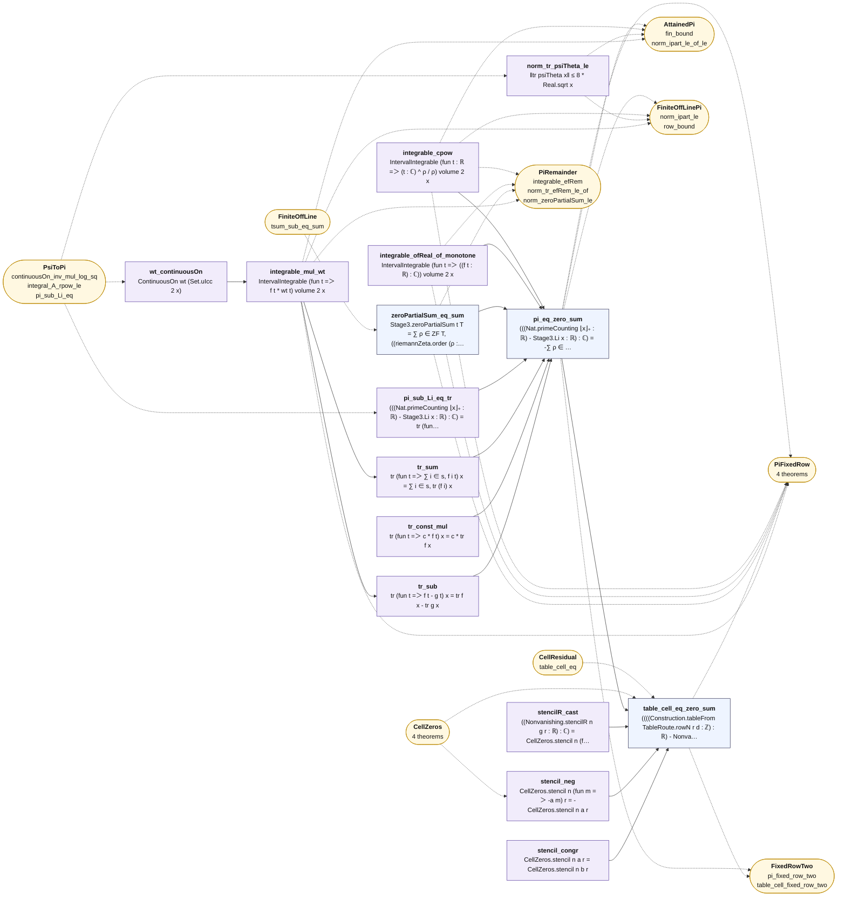

# `lean_stage3/Stage3/PiZeros.lean`

PiZeros — block T2 of `lean_stage3/design/joints.md`. 2026-11-22. Joint T1 in the integer table: the count of primes in place of the log-weighted count, zero by zero. The passage from one to the other is linear: `tr f x` is `f x / log x` plus the integral of `f` against `1/(t·log²t)` from `2`, and `Stage3.pi_sub_Li_eq` says the count minus its smooth part is `tr (θ − id)`. Write `θ − id` as the explicit formula's remainder at a height, minus the sum over the zeros below it, minus the higher prime powers `ψ − θ`. Th…

15 theorems, 5 definitions, 333 lines. Arrows are Lean's own record of what each proof uses.

**Imports:** [`CellResidual`](../lean_stage3/CellResidual.md), [`FiniteOffLine`](../lean_stage3/FiniteOffLine.md)  
**Imported by:** [`Stage3`](../lean_stage3/Stage3.md), [`PiRemainder`](../lean_stage3/PiRemainder.md)

## The picture



An arrow A → B reads "A is used in the proof of B". Green: counting, integers only. Violet: shape, analysis with no ζ. Blue: reads ζ. A name ending in ■ is an end: nothing else uses it. Red: contains `sorry`. Yellow: theorems in another file, counted; a dotted arrow crosses files. Definitions are not drawn; they are listed below the diagram.

## Definitions

<a name="PiZeros-wt"></a>
### `PiZeros.wt`

def · line 41

The weight of the passage from the log-weighted count to the count.

- **Is:** `` wt (t : ℝ) : ℂ := (((t * Real.log t ^ 2)⁻¹ : ℝ) : ℂ) ``
- **Used by 22:** [`AttainedPi.norm_ipart_le_of_le`](../lean_stage3/AttainedPi.md#AttainedPi-norm_ipart_le_of_le), [`FiniteOffLinePi.ipart`](../lean_stage3/FiniteOffLinePi.md#FiniteOffLinePi-ipart), [`FiniteOffLinePi.norm_integrand`](../lean_stage3/FiniteOffLinePi.md#FiniteOffLinePi-norm_integrand), [`FiniteOffLinePi.norm_ipart_le`](../lean_stage3/FiniteOffLinePi.md#FiniteOffLinePi-norm_ipart_le), [`FixedRowTwo.norm_integral_two_le`](../lean_stage3/FixedRowTwo.md#FixedRowTwo-norm_integral_two_le), [`FixedRowTwo.norm_integrand_two_le`](../lean_stage3/FixedRowTwo.md#FixedRowTwo-norm_integrand_two_le), [`FixedRowTwo.norm_tr_efRem_le_height_two`](../lean_stage3/FixedRowTwo.md#FixedRowTwo-norm_tr_efRem_le_height_two), [`PiFixedRow.hasDerivAt_wt`](../lean_stage3/PiFixedRow.md#PiFixedRow-hasDerivAt_wt), [`PiFixedRow.norm_high_integral_le`](../lean_stage3/PiFixedRow.md#PiFixedRow-norm_high_integral_le), [`PiFixedRow.norm_integral_cpow_wt_le`](../lean_stage3/PiFixedRow.md#PiFixedRow-norm_integral_cpow_wt_le), [`PiFixedRow.norm_low_integral_le`](../lean_stage3/PiFixedRow.md#PiFixedRow-norm_low_integral_le), [`PiFixedRow.norm_tr_efRem_le_height`](../lean_stage3/PiFixedRow.md#PiFixedRow-norm_tr_efRem_le_height), [`PiFixedRow.norm_zero_term_le`](../lean_stage3/PiFixedRow.md#PiFixedRow-norm_zero_term_le), [`PiRemainder.norm_tr_efRem_le_of`](../lean_stage3/PiRemainder.md#PiRemainder-norm_tr_efRem_le_of), [`PiZeros.integrable_mul_wt`](#PiZeros-integrable_mul_wt), [`PiZeros.norm_tr_psiTheta_le`](#PiZeros-norm_tr_psiTheta_le), [`PiZeros.pi_sub_Li_eq_tr`](#PiZeros-pi_sub_Li_eq_tr), [`PiZeros.tr`](#PiZeros-tr), [`PiZeros.tr_const_mul`](#PiZeros-tr_const_mul), [`PiZeros.tr_sub`](#PiZeros-tr_sub), [`PiZeros.tr_sum`](#PiZeros-tr_sum), [`PiZeros.wt_continuousOn`](#PiZeros-wt_continuousOn)

<a name="PiZeros-tr"></a>
### `PiZeros.tr`

def · line 45

The passage from the log-weighted count to the count, applied to any function: its value over the logarithm, plus its integral against the weight.

- **Is:** `` tr (f : ℝ → ℂ) (x : ℝ) : ℂ := f x / (Real.log x : ℂ) + ∫ t in (2:ℝ)..x, f t * wt t ``
- **Built from:** [`PiZeros.wt`](#PiZeros-wt)
- **Used by 20:** [`AttainedPi.fin_bound`](../lean_stage3/AttainedPi.md#AttainedPi-fin_bound), [`FiniteOffLinePi.row_bound`](../lean_stage3/FiniteOffLinePi.md#FiniteOffLinePi-row_bound), [`FixedRowTwo.norm_tr_efRem_le_height_two`](../lean_stage3/FixedRowTwo.md#FixedRowTwo-norm_tr_efRem_le_height_two), [`FixedRowTwo.pi_fixed_row_two`](../lean_stage3/FixedRowTwo.md#FixedRowTwo-pi_fixed_row_two), [`FixedRowTwo.table_cell_fixed_row_two`](../lean_stage3/FixedRowTwo.md#FixedRowTwo-table_cell_fixed_row_two), [`FixedRowTwo.tr_efRem_fixed_two`](../lean_stage3/FixedRowTwo.md#FixedRowTwo-tr_efRem_fixed_two), [`PiFixedRow.norm_tr_efRem_le_height`](../lean_stage3/PiFixedRow.md#PiFixedRow-norm_tr_efRem_le_height), [`PiFixedRow.pi_fixed_row`](../lean_stage3/PiFixedRow.md#PiFixedRow-pi_fixed_row), [`PiFixedRow.table_cell_fixed_row`](../lean_stage3/PiFixedRow.md#PiFixedRow-table_cell_fixed_row), [`PiFixedRow.tr_efRem_fixed`](../lean_stage3/PiFixedRow.md#PiFixedRow-tr_efRem_fixed), [`PiRemainder.norm_tr_efRem_le`](../lean_stage3/PiRemainder.md#PiRemainder-norm_tr_efRem_le), [`PiRemainder.norm_tr_efRem_le_of`](../lean_stage3/PiRemainder.md#PiRemainder-norm_tr_efRem_le_of), [`PiZeros.norm_tr_psiTheta_le`](#PiZeros-norm_tr_psiTheta_le), [`PiZeros.piMode`](#PiZeros-piMode), [`PiZeros.pi_eq_zero_sum`](#PiZeros-pi_eq_zero_sum), [`PiZeros.pi_sub_Li_eq_tr`](#PiZeros-pi_sub_Li_eq_tr), [`PiZeros.table_cell_eq_zero_sum`](#PiZeros-table_cell_eq_zero_sum), [`PiZeros.tr_const_mul`](#PiZeros-tr_const_mul), [`PiZeros.tr_sub`](#PiZeros-tr_sub), [`PiZeros.tr_sum`](#PiZeros-tr_sum)

<a name="PiZeros-piMode"></a>
### `PiZeros.piMode`

def · line 107

One zero's part of the count: the passage applied to `t^ρ/ρ`.

- **Is:** `` piMode (ρ : ℂ) (x : ℝ) : ℂ := tr (fun t => (t : ℂ) ^ ρ / ρ) x ``
- **Built from:** [`PiZeros.tr`](#PiZeros-tr)
- **Used by 14:** [`AttainedPi.fin_bound`](../lean_stage3/AttainedPi.md#AttainedPi-fin_bound), [`AttainedPi.norm_log_piMode_band`](../lean_stage3/AttainedPi.md#AttainedPi-norm_log_piMode_band), [`AttainedPi.norm_log_piMode_le`](../lean_stage3/AttainedPi.md#AttainedPi-norm_log_piMode_le), [`AttainedPi.norm_log_piMode_low`](../lean_stage3/AttainedPi.md#AttainedPi-norm_log_piMode_low), [`FiniteOffLinePi.norm_piMode_half`](../lean_stage3/FiniteOffLinePi.md#FiniteOffLinePi-norm_piMode_half), [`FiniteOffLinePi.norm_piMode_le`](../lean_stage3/FiniteOffLinePi.md#FiniteOffLinePi-norm_piMode_le), [`FiniteOffLinePi.piMode_eq`](../lean_stage3/FiniteOffLinePi.md#FiniteOffLinePi-piMode_eq), [`FiniteOffLinePi.row_bound`](../lean_stage3/FiniteOffLinePi.md#FiniteOffLinePi-row_bound), [`FixedRowTwo.pi_fixed_row_two`](../lean_stage3/FixedRowTwo.md#FixedRowTwo-pi_fixed_row_two), [`FixedRowTwo.table_cell_fixed_row_two`](../lean_stage3/FixedRowTwo.md#FixedRowTwo-table_cell_fixed_row_two), [`PiFixedRow.pi_fixed_row`](../lean_stage3/PiFixedRow.md#PiFixedRow-pi_fixed_row), [`PiFixedRow.table_cell_fixed_row`](../lean_stage3/PiFixedRow.md#PiFixedRow-table_cell_fixed_row), [`PiZeros.pi_eq_zero_sum`](#PiZeros-pi_eq_zero_sum), [`PiZeros.table_cell_eq_zero_sum`](#PiZeros-table_cell_eq_zero_sum)

<a name="PiZeros-efRem"></a>
### `PiZeros.efRem`

def · line 110

The remainder of the explicit formula at a height.

- **Is:** `` efRem (T : ℝ) (t : ℝ) : ℂ := ((ψ t : ℝ) : ℂ) - (t : ℂ) + Stage3.zeroPartialSum t T ``
- **Built from:** [`Stage3.zeroPartialSum`](../lean_stage3/Assembly.md#Stage3-zeroPartialSum)
- **Used by 19:** [`AttainedPi.fin_bound`](../lean_stage3/AttainedPi.md#AttainedPi-fin_bound), [`FiniteOffLinePi.row_bound`](../lean_stage3/FiniteOffLinePi.md#FiniteOffLinePi-row_bound), [`FixedRowTwo.norm_integral_two_le`](../lean_stage3/FixedRowTwo.md#FixedRowTwo-norm_integral_two_le), [`FixedRowTwo.norm_integrand_two_le`](../lean_stage3/FixedRowTwo.md#FixedRowTwo-norm_integrand_two_le), [`FixedRowTwo.norm_tr_efRem_le_height_two`](../lean_stage3/FixedRowTwo.md#FixedRowTwo-norm_tr_efRem_le_height_two), [`FixedRowTwo.table_cell_fixed_row_two`](../lean_stage3/FixedRowTwo.md#FixedRowTwo-table_cell_fixed_row_two), [`FixedRowTwo.tr_efRem_fixed_two`](../lean_stage3/FixedRowTwo.md#FixedRowTwo-tr_efRem_fixed_two), [`PiFixedRow.norm_high_integral_le`](../lean_stage3/PiFixedRow.md#PiFixedRow-norm_high_integral_le), [`PiFixedRow.norm_low_integral_le`](../lean_stage3/PiFixedRow.md#PiFixedRow-norm_low_integral_le), [`PiFixedRow.norm_tr_efRem_le_height`](../lean_stage3/PiFixedRow.md#PiFixedRow-norm_tr_efRem_le_height), [`PiFixedRow.table_cell_fixed_row`](../lean_stage3/PiFixedRow.md#PiFixedRow-table_cell_fixed_row), [`PiFixedRow.tr_efRem_fixed`](../lean_stage3/PiFixedRow.md#PiFixedRow-tr_efRem_fixed), [`PiRemainder.integrable_efRem`](../lean_stage3/PiRemainder.md#PiRemainder-integrable_efRem), [`PiRemainder.norm_efRem_le_high`](../lean_stage3/PiRemainder.md#PiRemainder-norm_efRem_le_high), [`PiRemainder.norm_efRem_le_low`](../lean_stage3/PiRemainder.md#PiRemainder-norm_efRem_le_low), [`PiRemainder.norm_tr_efRem_le`](../lean_stage3/PiRemainder.md#PiRemainder-norm_tr_efRem_le), [`PiRemainder.norm_tr_efRem_le_of`](../lean_stage3/PiRemainder.md#PiRemainder-norm_tr_efRem_le_of), [`PiZeros.pi_eq_zero_sum`](#PiZeros-pi_eq_zero_sum), [`PiZeros.table_cell_eq_zero_sum`](#PiZeros-table_cell_eq_zero_sum)

<a name="PiZeros-psiTheta"></a>
### `PiZeros.psiTheta`

def · line 113

The prime powers above the first: `ψ − θ`.

- **Is:** `` psiTheta (t : ℝ) : ℂ := ((ψ t - θ t : ℝ) : ℂ) ``
- **Used by 9:** [`AttainedPi.fin_bound`](../lean_stage3/AttainedPi.md#AttainedPi-fin_bound), [`FiniteOffLinePi.row_bound`](../lean_stage3/FiniteOffLinePi.md#FiniteOffLinePi-row_bound), [`FixedRowTwo.pi_fixed_row_two`](../lean_stage3/FixedRowTwo.md#FixedRowTwo-pi_fixed_row_two), [`FixedRowTwo.table_cell_fixed_row_two`](../lean_stage3/FixedRowTwo.md#FixedRowTwo-table_cell_fixed_row_two), [`PiFixedRow.pi_fixed_row`](../lean_stage3/PiFixedRow.md#PiFixedRow-pi_fixed_row), [`PiFixedRow.table_cell_fixed_row`](../lean_stage3/PiFixedRow.md#PiFixedRow-table_cell_fixed_row), [`PiZeros.norm_tr_psiTheta_le`](#PiZeros-norm_tr_psiTheta_le), [`PiZeros.pi_eq_zero_sum`](#PiZeros-pi_eq_zero_sum), [`PiZeros.table_cell_eq_zero_sum`](#PiZeros-table_cell_eq_zero_sum)

## Theorems

<a name="PiZeros-wt_continuousOn"></a>
### `PiZeros.wt_continuousOn`

line 49

**Shape.** Uses real or complex analysis; nothing in it or beneath it reads ζ.

**Why.** For `x ≥ 2` the weight is continuous on `[2, x]`.

**Proves**

```lean
ContinuousOn wt (Set.uIcc 2 x)
```

**Needs** (its hypotheses)

  - `` hx : 2 ≤ x ``

**Stated with:** [`PiZeros.wt`](#PiZeros-wt)

**Fed by** (1 theorem its proof uses)

  - [`Stage3.continuousOn_inv_mul_log_sq`](../lean_stage3/PsiToPi.md#Stage3-continuousOn_inv_mul_log_sq) (PsiToPi) — `` ContinuousOn (fun t : ℝ => (t * Real.log t ^ 2)⁻¹) (Set.uIcc a x) ``

**Feeds** (1 that use it)

  - [`PiZeros.integrable_mul_wt`](#PiZeros-integrable_mul_wt) — `` IntervalIntegrable (fun t => f t * wt t) volume 2 x ``

<a name="PiZeros-integrable_mul_wt"></a>
### `PiZeros.integrable_mul_wt`

line 53

**Shape.** Uses real or complex analysis; nothing in it or beneath it reads ζ.

**Why.** For `x ≥ 2`, a function integrable on `[2, x]` stays integrable when multiplied by the weight.

**Proves**

```lean
IntervalIntegrable (fun t => f t * wt t) volume 2 x
```

**Needs** (its hypotheses)

  - `` hx : 2 ≤ x ``
  - `` hf : IntervalIntegrable f volume 2 x ``

**Stated with:** [`PiZeros.wt`](#PiZeros-wt)

**Fed by** (1 theorem its proof uses)

  - [`PiZeros.wt_continuousOn`](#PiZeros-wt_continuousOn) — `` ContinuousOn wt (Set.uIcc 2 x) ``

**Feeds** (7 that use it)

  - [`AttainedPi.norm_ipart_le_of_le`](../lean_stage3/AttainedPi.md#AttainedPi-norm_ipart_le_of_le) (AttainedPi) — `` ‖ipart ρ x‖ ≤ ‖ρ‖⁻¹ * (3 * Real.sqrt x + 4 * x ^ c / (c * Real.log x ^ 2)) ``
  - [`FiniteOffLinePi.norm_ipart_le`](../lean_stage3/FiniteOffLinePi.md#FiniteOffLinePi-norm_ipart_le) (FiniteOffLinePi) — `` ‖ipart ρ x‖ ≤ ‖ρ‖⁻¹ * (3 * Real.sqrt x + 4 * x ^ ρ.re / (ρ.re * Real.log x ^ 2)) ``
  - [`PiFixedRow.norm_low_integral_le`](../lean_stage3/PiFixedRow.md#PiFixedRow-norm_low_integral_le) (PiFixedRow) — `` ‖∫ t in (2:ℝ)..16, efRem T t * wt t‖ ≤ Clow ``
  - [`PiFixedRow.norm_tr_efRem_le_height`](../lean_stage3/PiFixedRow.md#PiFixedRow-norm_tr_efRem_le_height) (PiFixedRow) — `` ‖tr (efRem T) x‖ ≤ Api * Real.log x + 2 * Glue.c1n * x * Real.log (x * T) ^ 2 / T ``
  - [`PiRemainder.norm_tr_efRem_le_of`](../lean_stage3/PiRemainder.md#PiRemainder-norm_tr_efRem_le_of) (PiRemainder) — `` ‖tr (efRem x) x‖ ≤ Arem * Real.sqrt x * Real.log x ^ 2 ``
  - [`PiZeros.tr_sub`](#PiZeros-tr_sub) — `` tr (fun t => f t - g t) x = tr f x - tr g x ``
  - [`PiZeros.tr_sum`](#PiZeros-tr_sum) — `` tr (fun t => ∑ i ∈ s, f i t) x = ∑ i ∈ s, tr (f i) x ``

<a name="PiZeros-tr_sub"></a>
### `PiZeros.tr_sub`

line 59

**Shape.** Uses real or complex analysis; nothing in it or beneath it reads ζ.

**Why.** The passage of a difference of two integrable functions is the difference of their passages.

**Proves**

```lean
tr (fun t => f t - g t) x = tr f x - tr g x
```

**Needs** (its hypotheses)

  - `` hx : 2 ≤ x ``
  - `` hf : IntervalIntegrable f volume 2 x ``
  - `` hg : IntervalIntegrable g volume 2 x ``

**Stated with:** [`PiZeros.tr`](#PiZeros-tr)

**Fed by** (1 theorem its proof uses)

  - [`PiZeros.integrable_mul_wt`](#PiZeros-integrable_mul_wt) — `` IntervalIntegrable (fun t => f t * wt t) volume 2 x ``

**Definitions its proof touches:** [`PiZeros.wt`](#PiZeros-wt)

**Feeds** (1 that use it)

  - [`PiZeros.pi_eq_zero_sum`](#PiZeros-pi_eq_zero_sum) — `` (((Nat.primeCounting ⌊x⌋₊ : ℝ) - Stage3.Li x : ℝ) : ℂ) = -∑ ρ ∈ ZF T, ((riemannZeta.order (ρ : ℂ) : ℤ) : ℂ) * piMode (ρ : ℂ) x + tr (efRem T) x - tr p… ``

<a name="PiZeros-tr_const_mul"></a>
### `PiZeros.tr_const_mul`

line 70

**Shape.** Uses real or complex analysis; nothing in it or beneath it reads ζ.

**Why.** A constant factor passes through the passage.

**Proves**

```lean
tr (fun t => c * f t) x = c * tr f x
```

**Needs** (its hypotheses)

  - `` c : ℂ ``
  - `` f : ℝ → ℂ ``
  - `` x : ℝ ``

**Stated with:** [`PiZeros.tr`](#PiZeros-tr)

**Fed by:** no theorem of this repo; it stands on Mathlib and the definitions below.

**Definitions its proof touches:** [`PiZeros.wt`](#PiZeros-wt)

**Feeds** (1 that use it)

  - [`PiZeros.pi_eq_zero_sum`](#PiZeros-pi_eq_zero_sum) — `` (((Nat.primeCounting ⌊x⌋₊ : ℝ) - Stage3.Li x : ℝ) : ℂ) = -∑ ρ ∈ ZF T, ((riemannZeta.order (ρ : ℂ) : ℤ) : ℂ) * piMode (ρ : ℂ) x + tr (efRem T) x - tr p… ``

<a name="PiZeros-tr_sum"></a>
### `PiZeros.tr_sum`

line 80

**Shape.** Uses real or complex analysis; nothing in it or beneath it reads ζ.

**Why.** The passage of a finite sum of integrable functions is the sum of their passages.

**Proves**

```lean
tr (fun t => ∑ i ∈ s, f i t) x = ∑ i ∈ s, tr (f i) x
```

**Needs** (its hypotheses)

  - `` s : Finset ι ``
  - `` f : ι → ℝ → ℂ ``
  - `` hx : 2 ≤ x ``
  - `` hf : ∀ i ∈ s, IntervalIntegrable (f i) volume 2 x ``

**Stated with:** [`PiZeros.tr`](#PiZeros-tr)

**Fed by** (1 theorem its proof uses)

  - [`PiZeros.integrable_mul_wt`](#PiZeros-integrable_mul_wt) — `` IntervalIntegrable (fun t => f t * wt t) volume 2 x ``

**Definitions its proof touches:** [`PiZeros.wt`](#PiZeros-wt)

**Feeds** (1 that use it)

  - [`PiZeros.pi_eq_zero_sum`](#PiZeros-pi_eq_zero_sum) — `` (((Nat.primeCounting ⌊x⌋₊ : ℝ) - Stage3.Li x : ℝ) : ℂ) = -∑ ρ ∈ ZF T, ((riemannZeta.order (ρ : ℂ) : ℤ) : ℂ) * piMode (ρ : ℂ) x + tr (efRem T) x - tr p… ``

<a name="PiZeros-pi_sub_Li_eq_tr"></a>
### `PiZeros.pi_sub_Li_eq_tr`

line 91

**Shape.** Uses real or complex analysis; nothing in it or beneath it reads ζ.

**Why.** The count minus its smooth part is the passage applied to `θ − id`.

**Proves**

```lean
(((Nat.primeCounting ⌊x⌋₊ : ℝ) - Stage3.Li x : ℝ) : ℂ) = tr (fun t => ((θ t - t : ℝ) : ℂ)) x
```

**Needs** (its hypotheses)

  - `` hx : 2 ≤ x ``

**Stated with:** [`PiZeros.tr`](#PiZeros-tr), [`Stage3.Li`](../lean_stage3/PsiToPi.md#Stage3-Li)

**Fed by** (1 theorem its proof uses)

  - [`Stage3.pi_sub_Li_eq`](../lean_stage3/PsiToPi.md#Stage3-pi_sub_Li_eq) (PsiToPi) — `` (Nat.primeCounting ⌊x⌋₊ : ℝ) - Li x = (θ x - x) / Real.log x + ∫ t in (2 : ℝ)..x, (θ t - t) / (t * Real.log t ^ 2) ``

**Definitions its proof touches:** [`PiZeros.wt`](#PiZeros-wt)

**Feeds** (1 that use it)

  - [`PiZeros.pi_eq_zero_sum`](#PiZeros-pi_eq_zero_sum) — `` (((Nat.primeCounting ⌊x⌋₊ : ℝ) - Stage3.Li x : ℝ) : ℂ) = -∑ ρ ∈ ZF T, ((riemannZeta.order (ρ : ℂ) : ℤ) : ℂ) * piMode (ρ : ℂ) x + tr (efRem T) x - tr p… ``

<a name="PiZeros-zeroPartialSum_eq_sum"></a>
### `PiZeros.zeroPartialSum_eq_sum`

line 116

**Reads ζ.** It, or something it rests on, uses the zeta function, its zeros or the Riemann hypothesis.

**Why.** The zero sum below a height, written as a sum over the finite set of zeros below it.

**Proves**

```lean
Stage3.zeroPartialSum t T = ∑ ρ ∈ ZF T, ((riemannZeta.order (ρ : ℂ) : ℤ) : ℂ) * ((t : ℂ) ^ (ρ : ℂ) / (ρ : ℂ))
```

**Needs** (its hypotheses)

  - `` t T : ℝ ``

**Stated with:** [`Stage3.zeroPartialSum`](../lean_stage3/Assembly.md#Stage3-zeroPartialSum), [`FiniteOffLine.ZF`](../lean_stage3/FiniteOffLine.md#FiniteOffLine-ZF)

**Fed by** (1 theorem its proof uses)

  - [`FiniteOffLine.tsum_sub_eq_sum`](../lean_stage3/FiniteOffLine.md#FiniteOffLine-tsum_sub_eq_sum) (FiniteOffLine) — `` ∑' σ : {ρ : NontrivialZeros // |(ρ : ℂ).im| < T}, f σ.1 = ∑ ρ ∈ ZF T, f ρ ``

**Feeds** (4 that use it)

  - [`PiFixedRow.norm_low_integral_le`](../lean_stage3/PiFixedRow.md#PiFixedRow-norm_low_integral_le) (PiFixedRow) — `` ‖∫ t in (2:ℝ)..16, efRem T t * wt t‖ ≤ Clow ``
  - [`PiRemainder.integrable_efRem`](../lean_stage3/PiRemainder.md#PiRemainder-integrable_efRem) (PiRemainder) — `` IntervalIntegrable (efRem T) volume 2 x ``
  - [`PiRemainder.norm_zeroPartialSum_le`](../lean_stage3/PiRemainder.md#PiRemainder-norm_zeroPartialSum_le) (PiRemainder) — `` ‖Stage3.zeroPartialSum t T‖ ≤ t * zinv T ``
  - [`PiZeros.pi_eq_zero_sum`](#PiZeros-pi_eq_zero_sum) — `` (((Nat.primeCounting ⌊x⌋₊ : ℝ) - Stage3.Li x : ℝ) : ℂ) = -∑ ρ ∈ ZF T, ((riemannZeta.order (ρ : ℂ) : ℤ) : ℂ) * piMode (ρ : ℂ) x + tr (efRem T) x - tr p… ``

<a name="PiZeros-integrable_ofReal_of_monotone"></a>
### `PiZeros.integrable_ofReal_of_monotone`

line 125

**Shape.** Uses real or complex analysis; nothing in it or beneath it reads ζ.

**Why.** A monotone real function, read as complex, is integrable on `[2, x]`.

**Proves**

```lean
IntervalIntegrable (fun t => ((f t : ℝ) : ℂ)) volume 2 x
```

**Needs** (its hypotheses)

  - `` hf : Monotone f ``
  - `` x : ℝ ``

**Fed by:** no theorem of this repo; it stands on Mathlib.

**Feeds** (3 that use it)

  - [`PiFixedRow.norm_low_integral_le`](../lean_stage3/PiFixedRow.md#PiFixedRow-norm_low_integral_le) (PiFixedRow) — `` ‖∫ t in (2:ℝ)..16, efRem T t * wt t‖ ≤ Clow ``
  - [`PiRemainder.integrable_efRem`](../lean_stage3/PiRemainder.md#PiRemainder-integrable_efRem) (PiRemainder) — `` IntervalIntegrable (efRem T) volume 2 x ``
  - [`PiZeros.pi_eq_zero_sum`](#PiZeros-pi_eq_zero_sum) — `` (((Nat.primeCounting ⌊x⌋₊ : ℝ) - Stage3.Li x : ℝ) : ℂ) = -∑ ρ ∈ ZF T, ((riemannZeta.order (ρ : ℂ) : ℤ) : ℂ) * piMode (ρ : ℂ) x + tr (efRem T) x - tr p… ``

<a name="PiZeros-integrable_cpow"></a>
### `PiZeros.integrable_cpow`

line 131

**Shape.** Uses real or complex analysis; nothing in it or beneath it reads ζ.

**Why.** For `x ≥ 2` the function `t ↦ t^ρ/ρ` is integrable on `[2, x]`.

**Proves**

```lean
IntervalIntegrable (fun t : ℝ => (t : ℂ) ^ ρ / ρ) volume 2 x
```

**Needs** (its hypotheses)

  - `` hx : 2 ≤ x ``
  - `` ρ : ℂ ``

**Fed by:** no theorem of this repo; it stands on Mathlib.

**Feeds** (5 that use it)

  - [`AttainedPi.norm_ipart_le_of_le`](../lean_stage3/AttainedPi.md#AttainedPi-norm_ipart_le_of_le) (AttainedPi) — `` ‖ipart ρ x‖ ≤ ‖ρ‖⁻¹ * (3 * Real.sqrt x + 4 * x ^ c / (c * Real.log x ^ 2)) ``
  - [`FiniteOffLinePi.norm_ipart_le`](../lean_stage3/FiniteOffLinePi.md#FiniteOffLinePi-norm_ipart_le) (FiniteOffLinePi) — `` ‖ipart ρ x‖ ≤ ‖ρ‖⁻¹ * (3 * Real.sqrt x + 4 * x ^ ρ.re / (ρ.re * Real.log x ^ 2)) ``
  - [`PiFixedRow.norm_low_integral_le`](../lean_stage3/PiFixedRow.md#PiFixedRow-norm_low_integral_le) (PiFixedRow) — `` ‖∫ t in (2:ℝ)..16, efRem T t * wt t‖ ≤ Clow ``
  - [`PiRemainder.integrable_efRem`](../lean_stage3/PiRemainder.md#PiRemainder-integrable_efRem) (PiRemainder) — `` IntervalIntegrable (efRem T) volume 2 x ``
  - [`PiZeros.pi_eq_zero_sum`](#PiZeros-pi_eq_zero_sum) — `` (((Nat.primeCounting ⌊x⌋₊ : ℝ) - Stage3.Li x : ℝ) : ℂ) = -∑ ρ ∈ ZF T, ((riemannZeta.order (ρ : ℂ) : ℤ) : ℂ) * piMode (ρ : ℂ) x + tr (efRem T) x - tr p… ``

<a name="PiZeros-pi_eq_zero_sum"></a>
### `PiZeros.pi_eq_zero_sum`

line 143

**Reads ζ.** It, or something it rests on, uses the zeta function, its zeros or the Riemann hypothesis.

**Why.** The count as a sum over the zeros, exactly. For every `x ≥ 2` and every height `T`: the count minus its smooth part is minus the sum over the zeros below `T` of each zero's part, plus the passage of the explicit formula's remainder, minus the passage of the higher prime powers.

**Proves**

```lean
(((Nat.primeCounting ⌊x⌋₊ : ℝ) - Stage3.Li x : ℝ) : ℂ) = -∑ ρ ∈ ZF T, ((riemannZeta.order (ρ : ℂ) : ℤ) : ℂ) * piMode (ρ : ℂ) x + tr (efRem T) x - tr psiTheta x
```

**Needs** (its hypotheses)

  - `` hx : 2 ≤ x ``
  - `` T : ℝ ``

**Stated with:** [`FiniteOffLine.ZF`](../lean_stage3/FiniteOffLine.md#FiniteOffLine-ZF), [`PiZeros.efRem`](#PiZeros-efRem), [`PiZeros.piMode`](#PiZeros-piMode), [`PiZeros.psiTheta`](#PiZeros-psiTheta), [`PiZeros.tr`](#PiZeros-tr), [`Stage3.Li`](../lean_stage3/PsiToPi.md#Stage3-Li)

**Fed by** (7 theorems its proof uses)

  - [`PiZeros.integrable_cpow`](#PiZeros-integrable_cpow) — `` IntervalIntegrable (fun t : ℝ => (t : ℂ) ^ ρ / ρ) volume 2 x ``
  - [`PiZeros.integrable_ofReal_of_monotone`](#PiZeros-integrable_ofReal_of_monotone) — `` IntervalIntegrable (fun t => ((f t : ℝ) : ℂ)) volume 2 x ``
  - [`PiZeros.pi_sub_Li_eq_tr`](#PiZeros-pi_sub_Li_eq_tr) — `` (((Nat.primeCounting ⌊x⌋₊ : ℝ) - Stage3.Li x : ℝ) : ℂ) = tr (fun t => ((θ t - t : ℝ) : ℂ)) x ``
  - [`PiZeros.tr_const_mul`](#PiZeros-tr_const_mul) — `` tr (fun t => c * f t) x = c * tr f x ``
  - [`PiZeros.tr_sub`](#PiZeros-tr_sub) — `` tr (fun t => f t - g t) x = tr f x - tr g x ``
  - [`PiZeros.tr_sum`](#PiZeros-tr_sum) — `` tr (fun t => ∑ i ∈ s, f i t) x = ∑ i ∈ s, tr (f i) x ``
  - [`PiZeros.zeroPartialSum_eq_sum`](#PiZeros-zeroPartialSum_eq_sum) — `` Stage3.zeroPartialSum t T = ∑ ρ ∈ ZF T, ((riemannZeta.order (ρ : ℂ) : ℤ) : ℂ) * ((t : ℂ) ^ (ρ : ℂ) / (ρ : ℂ)) ``

**Definitions its proof touches:** [`Stage3.zeroPartialSum`](../lean_stage3/Assembly.md#Stage3-zeroPartialSum)

**Feeds** (5 that use it)

  - [`AttainedPi.fin_bound`](../lean_stage3/AttainedPi.md#AttainedPi-fin_bound) (AttainedPi) — `` ‖∑ ρ ∈ topRow Θ r, LadderMean.coef ρ * ((2:ℂ) ^ (ρ : ℂ)) ^ r‖ ≤ slack Θ θ₁ C M ε r + 2 * ε * ((2:ℝ) ^ Θ) ^ r ``
  - [`FiniteOffLinePi.row_bound`](../lean_stage3/FiniteOffLinePi.md#FiniteOffLinePi-row_bound) (FiniteOffLinePi) — `` ‖∑ ρ ∈ S, ((riemannZeta.order (ρ : ℂ) : ℤ) : ℂ) * (((2:ℂ) ^ (ρ : ℂ)) ^ r / (ρ : ℂ))‖ ≤ rowBound F S β C r ``
  - [`FixedRowTwo.pi_fixed_row_two`](../lean_stage3/FixedRowTwo.md#FixedRowTwo-pi_fixed_row_two) (FixedRowTwo) — `` ∀ ε : ℝ, 0 < ε → ∀ᶠ T : ℝ in Filter.atTop, ‖(((Nat.primeCounting ⌊x⌋₊ : ℝ) - Stage3.Li x : ℝ) : ℂ) + ∑ ρ ∈ ZF T, ((riemannZeta.order (ρ : ℂ) : ℤ) : ℂ)… ``
  - [`PiFixedRow.pi_fixed_row`](../lean_stage3/PiFixedRow.md#PiFixedRow-pi_fixed_row) (PiFixedRow) — `` ∀ ε : ℝ, 0 < ε → ∀ᶠ T : ℝ in Filter.atTop, ‖(((Nat.primeCounting ⌊x⌋₊ : ℝ) - Stage3.Li x : ℝ) : ℂ) + ∑ ρ ∈ ZF T, ((riemannZeta.order (ρ : ℂ) : ℤ) : ℂ)… ``
  - [`PiZeros.table_cell_eq_zero_sum`](#PiZeros-table_cell_eq_zero_sum) — `` ((((Construction.tableFrom TableRoute.rowN r d : ℤ) : ℝ) - Nonvanishing.stencilR (d + 1) (fun m : ℤ => Stage3.Li ((2 : ℝ) ^ (m : ℝ))) r : ℝ) : ℂ) = -∑… ``

<a name="PiZeros-norm_tr_psiTheta_le"></a>
### `PiZeros.norm_tr_psiTheta_le`

line 197

**Shape.** Uses real or complex analysis; nothing in it or beneath it reads ζ.

**Why.** The higher prime powers are of square-root size.

**Proves**

```lean
‖tr psiTheta x‖ ≤ 8 * Real.sqrt x
```

**Needs** (its hypotheses)

  - `` hx : 2 ≤ x ``

**Stated with:** [`PiZeros.psiTheta`](#PiZeros-psiTheta), [`PiZeros.tr`](#PiZeros-tr)

**Fed by** (1 theorem its proof uses)

  - [`Stage3.integral_A_rpow_le`](../lean_stage3/PsiToPi.md#Stage3-integral_A_rpow_le) (PsiToPi) — `` (∫ t in a..x, A * t ^ (-(1 : ℝ) / 2)) ≤ 2 * A * Real.sqrt x ``

**Definitions its proof touches:** [`PiZeros.wt`](#PiZeros-wt)

**Feeds** (2 that use it)

  - [`AttainedPi.fin_bound`](../lean_stage3/AttainedPi.md#AttainedPi-fin_bound) (AttainedPi) — `` ‖∑ ρ ∈ topRow Θ r, LadderMean.coef ρ * ((2:ℂ) ^ (ρ : ℂ)) ^ r‖ ≤ slack Θ θ₁ C M ε r + 2 * ε * ((2:ℝ) ^ Θ) ^ r ``
  - [`FiniteOffLinePi.row_bound`](../lean_stage3/FiniteOffLinePi.md#FiniteOffLinePi-row_bound) (FiniteOffLinePi) — `` ‖∑ ρ ∈ S, ((riemannZeta.order (ρ : ℂ) : ℤ) : ℂ) * (((2:ℂ) ^ (ρ : ℂ)) ^ r / (ρ : ℂ))‖ ≤ rowBound F S β C r ``

<a name="PiZeros-stencil_congr"></a>
### `PiZeros.stencil_congr`

line 259

**Shape.** Uses real or complex analysis; nothing in it or beneath it reads ζ.

**Why.** Two rows that agree on the entries a stencil reads have the same stencil.

**Proves**

```lean
CellZeros.stencil n a r = CellZeros.stencil n b r
```

**Needs** (its hypotheses)

  - `` n : ℕ ``
  - `` h : ∀ j ∈ range (n + 1), a (r - j) = b (r - j) ``

**Stated with:** [`CellZeros.stencil`](../lean_stage3/CellZeros.md#CellZeros-stencil)

**Fed by:** no theorem of this repo; it stands on Mathlib and the definitions below.

**Feeds** (1 that use it)

  - [`PiZeros.table_cell_eq_zero_sum`](#PiZeros-table_cell_eq_zero_sum) — `` ((((Construction.tableFrom TableRoute.rowN r d : ℤ) : ℝ) - Nonvanishing.stencilR (d + 1) (fun m : ℤ => Stage3.Li ((2 : ℝ) ^ (m : ℝ))) r : ℝ) : ℂ) = -∑… ``

<a name="PiZeros-stencil_neg"></a>
### `PiZeros.stencil_neg`

line 266

**Shape.** Uses real or complex analysis; nothing in it or beneath it reads ζ.

**Why.** The stencil of the negative of a row is the negative of its stencil.

**Proves**

```lean
CellZeros.stencil n (fun m => -a m) r = -CellZeros.stencil n a r
```

**Needs** (its hypotheses)

  - `` n : ℕ ``
  - `` a : ℤ → ℂ ``
  - `` r : ℤ ``

**Stated with:** [`CellZeros.stencil`](../lean_stage3/CellZeros.md#CellZeros-stencil)

**Fed by** (1 theorem its proof uses)

  - [`CellZeros.stencil_const_mul`](../lean_stage3/CellZeros.md#CellZeros-stencil_const_mul) (CellZeros) — `` stencil d (fun n => c * a n) r = c * stencil d a r ``

**Feeds** (1 that use it)

  - [`PiZeros.table_cell_eq_zero_sum`](#PiZeros-table_cell_eq_zero_sum) — `` ((((Construction.tableFrom TableRoute.rowN r d : ℤ) : ℝ) - Nonvanishing.stencilR (d + 1) (fun m : ℤ => Stage3.Li ((2 : ℝ) ^ (m : ℝ))) r : ℝ) : ℂ) = -∑… ``

<a name="PiZeros-stencilR_cast"></a>
### `PiZeros.stencilR_cast`

line 272

**Shape.** Uses real or complex analysis; nothing in it or beneath it reads ζ.

**Why.** The real stencil of a row, read as complex, is the complex stencil of the row read as complex.

**Proves**

```lean
((Nonvanishing.stencilR n g r : ℝ) : ℂ) = CellZeros.stencil n (fun m => ((g m : ℝ) : ℂ)) r
```

**Needs** (its hypotheses)

  - `` n : ℕ ``
  - `` g : ℤ → ℝ ``
  - `` r : ℤ ``

**Stated with:** [`Nonvanishing.stencilR`](../lean/Nonvanishing.md#Nonvanishing-stencilR), [`CellZeros.stencil`](../lean_stage3/CellZeros.md#CellZeros-stencil)

**Fed by:** no theorem of this repo; it stands on Mathlib and the definitions below.

**Feeds** (1 that use it)

  - [`PiZeros.table_cell_eq_zero_sum`](#PiZeros-table_cell_eq_zero_sum) — `` ((((Construction.tableFrom TableRoute.rowN r d : ℤ) : ℝ) - Nonvanishing.stencilR (d + 1) (fun m : ℤ => Stage3.Li ((2 : ℝ) ^ (m : ℝ))) r : ℝ) : ℂ) = -∑… ``

<a name="PiZeros-table_cell_eq_zero_sum"></a>
### `PiZeros.table_cell_eq_zero_sum`

line 284

**Reads ζ.** It, or something it rests on, uses the zeta function, its zeros or the Riemann hypothesis.

**Why.** The integer table's cell as a sum over the zeros, exactly. The cell `(r, d)` of the table of the prime count along the doublings, less the smooth cell, is minus the sum over the zeros below any height of each zero's part under the stencil, plus the stencil of the explicit formula's remainder passed to the count, minus the stencil of the higher prime powers.

**Proves**

```lean
((((Construction.tableFrom TableRoute.rowN r d : ℤ) : ℝ) - Nonvanishing.stencilR (d + 1) (fun m : ℤ => Stage3.Li ((2 : ℝ) ^ (m : ℝ))) r : ℝ) : ℂ) = -∑ ρ ∈ ZF T, ((riemannZeta.order (ρ : ℂ) : ℤ) : ℂ) * CellZeros.stencil (d + 1) (fun m : ℤ => piMode (ρ : ℂ) ((2:ℝ) ^ (m : ℝ))) r + CellZeros.stencil (d + 1) (fun m : ℤ => tr (efRem T) ((2:ℝ) ^ (m : ℝ))) r - CellZeros.stencil (d + 1) (fun m : ℤ => tr psiTheta ((2:ℝ) ^ (m : ℝ))) r
```

**Needs** (its hypotheses)

  - `` r : ℤ ``
  - `` d : ℕ ``
  - `` hr : (d : ℤ) + 2 ≤ r ``
  - `` T : ℝ ``

**Stated with:** [`Construction.tableFrom`](../lean/Construction.md#Construction-tableFrom), [`Nonvanishing.stencilR`](../lean/Nonvanishing.md#Nonvanishing-stencilR), [`CellZeros.stencil`](../lean_stage3/CellZeros.md#CellZeros-stencil), [`FiniteOffLine.ZF`](../lean_stage3/FiniteOffLine.md#FiniteOffLine-ZF), [`PiZeros.efRem`](#PiZeros-efRem), [`PiZeros.piMode`](#PiZeros-piMode), [`PiZeros.psiTheta`](#PiZeros-psiTheta), [`PiZeros.tr`](#PiZeros-tr), [`Stage3.Li`](../lean_stage3/PsiToPi.md#Stage3-Li), [`TableRoute.rowN`](../lean_stage3/TableRoute.md#TableRoute-rowN)

**Fed by** (9 theorems its proof uses)

  - [`CellResidual.table_cell_eq`](../lean_stage3/CellResidual.md#CellResidual-table_cell_eq) (CellResidual) — `` ((Construction.tableFrom TableRoute.rowN r d : ℤ) : ℝ) - stencilR (d + 1) (fun m : ℤ => Stage3.Li ((2 : ℝ) ^ (m : ℝ))) r = cellResid 1 r d ``
  - [`CellZeros.stencil_add`](../lean_stage3/CellZeros.md#CellZeros-stencil_add) (CellZeros) — `` stencil d (fun n => a n + b n) r = stencil d a r + stencil d b r ``
  - [`CellZeros.stencil_const_mul`](../lean_stage3/CellZeros.md#CellZeros-stencil_const_mul) (CellZeros) — `` stencil d (fun n => c * a n) r = c * stencil d a r ``
  - [`CellZeros.stencil_sub`](../lean_stage3/CellZeros.md#CellZeros-stencil_sub) (CellZeros) — `` stencil d (fun n => a n - b n) r = stencil d a r - stencil d b r ``
  - [`CellZeros.stencil_sum`](../lean_stage3/CellZeros.md#CellZeros-stencil_sum) (CellZeros) — `` stencil d (fun n => ∑ i ∈ s, f i n) r = ∑ i ∈ s, stencil d (f i) r ``
  - [`PiZeros.pi_eq_zero_sum`](#PiZeros-pi_eq_zero_sum) — `` (((Nat.primeCounting ⌊x⌋₊ : ℝ) - Stage3.Li x : ℝ) : ℂ) = -∑ ρ ∈ ZF T, ((riemannZeta.order (ρ : ℂ) : ℤ) : ℂ) * piMode (ρ : ℂ) x + tr (efRem T) x - tr p… ``
  - [`PiZeros.stencilR_cast`](#PiZeros-stencilR_cast) — `` ((Nonvanishing.stencilR n g r : ℝ) : ℂ) = CellZeros.stencil n (fun m => ((g m : ℝ) : ℂ)) r ``
  - [`PiZeros.stencil_congr`](#PiZeros-stencil_congr) — `` CellZeros.stencil n a r = CellZeros.stencil n b r ``
  - [`PiZeros.stencil_neg`](#PiZeros-stencil_neg) — `` CellZeros.stencil n (fun m => -a m) r = -CellZeros.stencil n a r ``

**Definitions its proof touches:** [`CellResidual.cellResid`](../lean_stage3/CellResidual.md#CellResidual-cellResid), [`CellResidual.resid`](../lean_stage3/CellResidual.md#CellResidual-resid)

**Feeds** (2 that use it)

  - [`FixedRowTwo.table_cell_fixed_row_two`](../lean_stage3/FixedRowTwo.md#FixedRowTwo-table_cell_fixed_row_two) (FixedRowTwo) — `` ∀ ε : ℝ, 0 < ε → ∀ᶠ T : ℝ in Filter.atTop, ‖((((Construction.tableFrom TableRoute.rowN (r : ℤ) d : ℤ) : ℝ) - Nonvanishing.stencilR (d + 1) (fun m : ℤ … ``
  - [`PiFixedRow.table_cell_fixed_row`](../lean_stage3/PiFixedRow.md#PiFixedRow-table_cell_fixed_row) (PiFixedRow) — `` ∀ ε : ℝ, 0 < ε → ∀ᶠ T : ℝ in Filter.atTop, ‖((((Construction.tableFrom TableRoute.rowN (r : ℤ) d : ℤ) : ℝ) - Nonvanishing.stencilR (d + 1) (fun m : ℤ … ``

