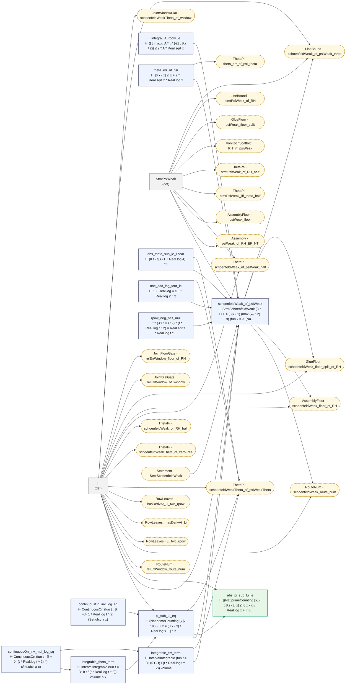

# `lean_stage3/Stage3/PsiToPi.lean`

**What it does** (its own header): PsiToPi — step 3: the transfer from ψ-error to π−Li error. The classical chain: Mathlib's Abel-summation bridge (`Chebyshev.primeCounting_eq_theta_div_log_add_integral`) writes π(⌊x⌋) = θ(x)/log x + ∫₂ˣ θ(t)/(t·log²t) dt, and the same identity for the logarithmic integral turns any bound on |θ − id| into a bound on |π − Li|. Mathlib carries no li, so this module defines its own:

**Imports:** [`Statement`](../lean_stage3/Statement.md).
**Imported by:** [`Stage3`](../lean_stage3/Stage3.md), [`Assembly`](../lean_stage3/Assembly.md), [`RowLeaves`](../lean_stage3/RowLeaves.md), [`ThetaPi`](../lean_stage3/ThetaPi.md).

Blue: theorem. Green: a theorem nothing else uses (an end). Dashed white: connects to nothing. Grey: definition. Red: contains `sorry`. Yellow: in another file. An arrow A → B reads "A is used by B".

## Every declaration

| declaration | proves (output) | needs (input) | why (its own docstring) | uses | used by |
|---|---|---|---|---|---|
| `Stage3.Li` def, line 43 | ℝ | x : ℝ | The offset logarithmic integral: `Li x = x/log x + ∫₂ˣ dt/log²t`. Differs from the literature's `li` by the constant `2/log 2 − li(2) ≈ 1.840`. | — | `Stage3.schoenfeldWeak_floor_of_RH`, `Stage3.schoenfeldWeak_floor_split_of_RH`, `JointDialGate.relErrWindow_of_window`, `JointFloorGate.relErrWindow_floor_of_RH`, `JointWindowDial.schoenfeldWeakTheta_of_window`, `Slice8.schoenfeldWeak_of_psiWeak_three`, `Stage3.abs_pi_sub_Li_le`, `Stage3.pi_sub_Li_eq`, `Stage3.schoenfeldWeak_of_psiWeak`, `RouteNum.relErrWindow_route_num`, `Stage3.schoenfeldWeak_route_num`, `Stage3.Li_two_rpow`, `Stage3.hasDerivAt_Li`, `Stage3.hasDerivAt_Li_two_rpow`, `Stage3.schoenfeldWeakTheta_of_psiWeakTheta`, `Stage3.schoenfeldWeakTheta_of_zeroFree`, `Stage3.schoenfeldWeak_of_RH_half`, `Stage3.schoenfeldWeak_of_psiWeak_half` |
| `Stage3.continuousOn_inv_log_sq` theorem, line 46 | ContinuousOn (fun t : ℝ =&gt; 1 / Real.log t ^ 2) (Set.uIcc a x) | ha : 2 ≤ a; hx : a ≤ x | `1/log²t` is continuous on any interval right of `2`. | — | `Stage3.pi_sub_Li_eq` |
| `Stage3.continuousOn_inv_mul_log_sq` theorem, line 57 | ContinuousOn (fun t : ℝ =&gt; (t * Real.log t ^ 2)⁻¹) (Set.uIcc a x) | ha : 2 ≤ a; hx : a ≤ x | `(t·log²t)⁻¹` is continuous on any interval right of `2`. | — | `Stage3.integrable_err_term`, `Stage3.integrable_theta_term` |
| `Stage3.integrable_theta_term` theorem, line 70 | IntervalIntegrable (fun t =&gt; θ t / (t * Real.log t ^ 2)) volume a x | ha : 2 ≤ a; hx : a ≤ x | `θ(t)/(t·log²t)` is interval integrable on `[2, x]`: `θ` is monotone, the cofactor is continuous. | `Stage3.continuousOn_inv_mul_log_sq` | `Stage3.pi_sub_Li_eq` |
| `Stage3.integrable_err_term` theorem, line 78 | IntervalIntegrable (fun t =&gt; (θ t - t) / (t * Real.log t ^ 2)) volume a x | ha : 2 ≤ a; hx : a ≤ x | `(θ(t) − t)/(t·log²t)` is interval integrable on `[2, x]`. | `Stage3.continuousOn_inv_mul_log_sq` | `Stage3.schoenfeldWeak_of_psiWeak`, `Stage3.schoenfeldWeakTheta_of_psiWeakTheta` |
| `Stage3.pi_sub_Li_eq` theorem, line 90 | (Nat.primeCounting ⌊x⌋₊ : ℝ) - Li x = (θ x - x) / Real.log x + ∫ t in (2 : ℝ)..x, (θ t - t) / (t * Real.log t ^ 2) | hx : 2 ≤ x | The exact decomposition — an identity, from Mathlib's Abel-summation bridge and the definition of `Li`: `π(⌊x⌋) − Li x = (θx − x)/log x + ∫₂ˣ (θt − t)/(t·log²t) dt`. | `Stage3.Li`, `Stage3.continuousOn_inv_log_sq`, `Stage3.integrable_theta_term` | `Stage3.abs_pi_sub_Li_le`, `Stage3.schoenfeldWeak_of_psiWeak`, `Stage3.schoenfeldWeakTheta_of_psiWeakTheta` |
| `Stage3.abs_pi_sub_Li_le` theorem, line 112 | \|(Nat.primeCounting ⌊x⌋₊ : ℝ) - Li x\| ≤ \|θ x - x\| / Real.log x + ∫ t in (2 : ℝ)..x, env t / (t * Real.log t ^ 2) | hx : 2 ≤ x; hEnv : ∀ t ∈ Set.Icc (2 : ℝ) x, \|θ t - t\| ≤ env t; hEnvInt : IntervalIntegrable (fun t =&gt; env t / (t * Real.log t ^ 2)) volume 2 x | The envelope transfer: a pointwise bound on `\|θ − id\|` becomes a bound on `\|π − Li\|`, top term plus envelope integral. | `Stage3.Li`, `Stage3.pi_sub_Li_eq` | — |
| `Stage3.integral_A_rpow_le` theorem, line 136 | (∫ t in a..x, A * t ^ (-(1 : ℝ) / 2)) ≤ 2 * A * Real.sqrt x | ha : 0 &lt; a; hx : a ≤ x; hA : 0 ≤ A | The workhorse envelope integral: `∫₂ˣ A·t^(−1/2) dt ≤ 2A·√x`. | — | `Stage3.schoenfeldWeak_of_psiWeak` |
| `Stage3.theta_err_of_psi` theorem, line 157 | \|θ x - x\| ≤ E + 2 * Real.sqrt x * Real.log x | hx : 1 ≤ x; hψ : \|ψ x - x\| ≤ E | `θ`-error from `ψ`-error, by Mathlib's `\|ψ − θ\| ≤ 2√x·log x`. | — | `Stage3.schoenfeldWeak_of_psiWeak`, `Stage3.theta_err_of_psi_theta` |
| `Stage3.StmtPsiWeak` def, line 167 | Prop | C : ℝ; k : ℕ; x₀ : ℝ | The ψ-side of the weak family: what stage 5's assembly (hRH + hEF + hNT) delivers. `ψ` is Mathlib's Chebyshev function. | — | `Stage3.psiWeak_of_RH_EF_NT`, `Stage3.psiWeak_floor`, `Stage3.psiWeak_floor_split`, `RHPull.stmtPsiWeak_of_RH`, `Slice8.schoenfeldWeak_of_psiWeak_three`, `Stage3.schoenfeldWeak_of_psiWeak`, `Stage3.schoenfeldWeak_of_psiWeak_half`, `Stage3.stmtPsiWeak_iff_theta_half`, `Stage3.stmtPsiWeak_of_RH_half`, `VonKoch.RH_iff_psiWeak` |
| `Stage3.abs_theta_sub_le_linear` theorem, line 172 | \|θ t - t\| ≤ (1 + Real.log 4) * t | ht : 0 ≤ t | Crude linear bound below the family floor: `\|θ − id\| ≤ (1 + log 4)·t`, from `0 ≤ θ t ≤ log 4 · t`. | — | `Stage3.schoenfeldWeak_of_psiWeak`, `Stage3.schoenfeldWeakTheta_of_psiWeakTheta` |
| `Stage3.one_add_log_four_le` theorem, line 182 | 1 + Real.log 4 ≤ 5 * Real.log 2 ^ 2 | — | The numeric fact carrying the low-range constant: `1 + log 4 ≤ 5·log²2`, i.e. `(1 + log 4)/log²2 ≤ 5`. | — | `Stage3.schoenfeldWeak_of_psiWeak`, `Stage3.schoenfeldWeakTheta_of_psiWeakTheta` |
| `Stage3.rpow_neg_half_mul` theorem, line 193 | t ^ (-(1 : ℝ) / 2) * (t * Real.log t ^ 2) = Real.sqrt t * Real.log t ^ 2 | ht : 0 &lt; t | `t^(−1/2)` times the denominator is the √t envelope: `t^(−1/2)·(t·log²t) = √t·log²t` on `t &gt; 0`. | — | `Stage3.schoenfeldWeak_of_psiWeak` |
| `Stage3.schoenfeldWeak_of_psiWeak` theorem, line 207 | StmtSchoenfeldWeak (3 * C + 13) (k - 1) (max (x₀ ^ 2) 9) (fun x =&gt; (Nat.primeCounting ⌊x⌋₊ : ℝ)) Li | hk : 2 ≤ k; hx₀ : 2 ≤ x₀; hC : 0 ≤ C; h : StmtPsiWeak C k x₀ | The capstone of step 3: the transfer. A ψ-side weak bound `(C, k, x₀)` with `k ≥ 2, x₀ ≥ 2` delivers the π-side weak bound with `C′ = 3C + 13`, exponent `k − 1`, floor `max(x₀², 9)` — one log dropped, the constant inflated explicitly — and the conclusion is literally `StmtSchoenfeldWeak`, so Statement.lean's window bridge applies to it. | `Stage3.Li`, `Stage3.StmtPsiWeak`, `Stage3.abs_theta_sub_le_linear`, `Stage3.integrable_err_term`, `Stage3.integral_A_rpow_le`, `Stage3.one_add_log_four_le`, `Stage3.pi_sub_Li_eq`, `Stage3.rpow_neg_half_mul`, `Stage3.theta_err_of_psi`, `Stage3.StmtSchoenfeldWeak` | `Stage3.schoenfeldWeak_floor_of_RH`, `Stage3.schoenfeldWeak_floor_split_of_RH`, `Slice8.schoenfeldWeak_of_psiWeak_three`, `Stage3.schoenfeldWeak_route_num` |
