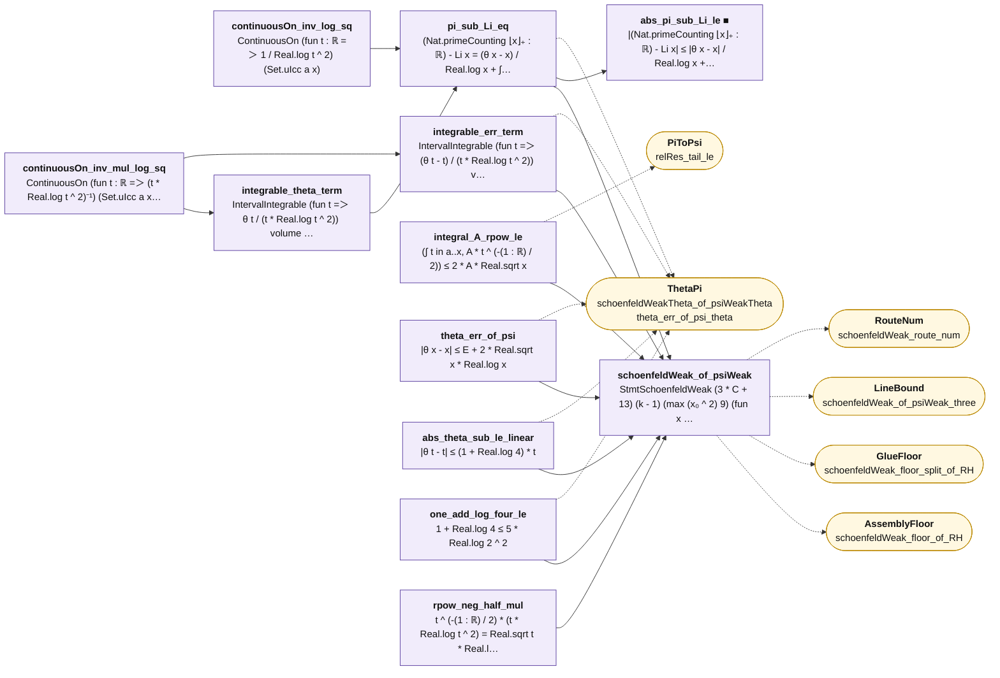

# `lean_stage3/Stage3/PsiToPi.lean`

PsiToPi — step 3: the transfer from ψ-error to π−Li error. The classical chain: Mathlib's Abel-summation bridge (`Chebyshev.primeCounting_eq_theta_div_log_add_integral`) writes π(⌊x⌋) = θ(x)/log x + ∫₂ˣ θ(t)/(t·log²t) dt, and the same identity for the logarithmic integral turns any bound on |θ − id| into a bound on |π − Li|. Mathlib carries no li, so this module defines its own:

12 theorems, 2 definitions, 418 lines. Arrows are Lean's own record of what each proof uses.

**Imports:** [`Statement`](../lean_stage3/Statement.md)  
**Imported by:** [`Stage3`](../lean_stage3/Stage3.md), [`Assembly`](../lean_stage3/Assembly.md), [`RowLeaves`](../lean_stage3/RowLeaves.md), [`ThetaPi`](../lean_stage3/ThetaPi.md)

## The picture



An arrow A → B reads "A is used in the proof of B". Green: counting, integers only. Violet: shape, analysis with no ζ. Blue: reads ζ. A name ending in ■ is an end: nothing else uses it. Red: contains `sorry`. Yellow: theorems in another file, counted; a dotted arrow crosses files. Definitions are not drawn; they are listed below the diagram.

## Definitions

<a name="Stage3-Li"></a>
### `Stage3.Li`

def · line 43

The offset logarithmic integral: `Li x = x/log x + ∫₂ˣ dt/log²t`. Differs from the literature's `li` by the constant `2/log 2 − li(2) ≈ 1.840`.

- **Is:** `` Li (x : ℝ) : ℝ := x / Real.log x + ∫ t in (2 : ℝ)..x, 1 / Real.log t ^ 2 ``
- **Used by 40:** [`Stage3.schoenfeldWeak_floor_of_RH`](../lean_stage3/AssemblyFloor.md#Stage3-schoenfeldWeak_floor_of_RH), [`CellResidual.RH_iff_cells`](../lean_stage3/CellResidual.md#CellResidual-RH_iff_cells), [`CellResidual.base_bound`](../lean_stage3/CellResidual.md#CellResidual-base_bound), [`CellResidual.cells_of_RH`](../lean_stage3/CellResidual.md#CellResidual-cells_of_RH), [`CellResidual.cells_of_schoenfeldWeak`](../lean_stage3/CellResidual.md#CellResidual-cells_of_schoenfeldWeak), [`CellResidual.resid`](../lean_stage3/CellResidual.md#CellResidual-resid), [`CellResidual.resid_le`](../lean_stage3/CellResidual.md#CellResidual-resid_le), [`CellResidual.schoenfeldWeak_of_cells`](../lean_stage3/CellResidual.md#CellResidual-schoenfeldWeak_of_cells), [`CellResidual.table_cell_eq`](../lean_stage3/CellResidual.md#CellResidual-table_cell_eq), [`CellResidual.table_cell_resid`](../lean_stage3/CellResidual.md#CellResidual-table_cell_resid), [`CellResidual.weak_nonneg`](../lean_stage3/CellResidual.md#CellResidual-weak_nonneg), [`Stage3.schoenfeldWeak_floor_split_of_RH`](../lean_stage3/GlueFloor.md#Stage3-schoenfeldWeak_floor_split_of_RH), [`JointDialGate.relErrWindow_of_window`](../lean_stage3/JointDialGate.md#JointDialGate-relErrWindow_of_window), [`JointFloorGate.relErrWindow_floor_of_RH`](../lean_stage3/JointFloorGate.md#JointFloorGate-relErrWindow_floor_of_RH), [`JointWindowDial.schoenfeldWeakTheta_of_window`](../lean_stage3/JointWindowDial.md#JointWindowDial-schoenfeldWeakTheta_of_window), [`Slice8.schoenfeldWeak_of_psiWeak_three`](../lean_stage3/LineBound.md#Slice8-schoenfeldWeak_of_psiWeak_three), [`PiToPsi.Li_mul_log_sub_integral`](../lean_stage3/PiToPsi.md#PiToPsi-Li_mul_log_sub_integral), [`PiToPsi.Li_two`](../lean_stage3/PiToPsi.md#PiToPsi-Li_two), [`PiToPsi.RH_iff_schoenfeldWeak`](../lean_stage3/PiToPsi.md#PiToPsi-RH_iff_schoenfeldWeak), [`PiToPsi.RH_of_schoenfeldWeak`](../lean_stage3/PiToPsi.md#PiToPsi-RH_of_schoenfeldWeak), [`PiToPsi.continuousOn_Li`](../lean_stage3/PiToPsi.md#PiToPsi-continuousOn_Li), [`PiToPsi.intervalIntegrable_Li_div`](../lean_stage3/PiToPsi.md#PiToPsi-intervalIntegrable_Li_div), [`PiToPsi.intervalIntegrable_relRes`](../lean_stage3/PiToPsi.md#PiToPsi-intervalIntegrable_relRes), [`PiToPsi.psiWeak_of_schoenfeldWeak`](../lean_stage3/PiToPsi.md#PiToPsi-psiWeak_of_schoenfeldWeak), [`PiToPsi.relRes`](../lean_stage3/PiToPsi.md#PiToPsi-relRes), [`PiToPsi.relRes_tail_le`](../lean_stage3/PiToPsi.md#PiToPsi-relRes_tail_le), [`PiToPsi.theta_sub_id_eq`](../lean_stage3/PiToPsi.md#PiToPsi-theta_sub_id_eq), [`Stage3.abs_pi_sub_Li_le`](#Stage3-abs_pi_sub_Li_le), [`Stage3.pi_sub_Li_eq`](#Stage3-pi_sub_Li_eq), [`Stage3.schoenfeldWeak_of_psiWeak`](#Stage3-schoenfeldWeak_of_psiWeak), [`RouteGate.relErrWindow_route`](../lean_stage3/RouteGate.md#RouteGate-relErrWindow_route), [`RouteNum.relErrWindow_route_num`](../lean_stage3/RouteNum.md#RouteNum-relErrWindow_route_num), [`Stage3.schoenfeldWeak_route_num`](../lean_stage3/RouteNum.md#Stage3-schoenfeldWeak_route_num), [`Stage3.Li_two_rpow`](../lean_stage3/RowLeaves.md#Stage3-Li_two_rpow), [`Stage3.hasDerivAt_Li`](../lean_stage3/RowLeaves.md#Stage3-hasDerivAt_Li), [`Stage3.hasDerivAt_Li_two_rpow`](../lean_stage3/RowLeaves.md#Stage3-hasDerivAt_Li_two_rpow), [`Stage3.schoenfeldWeakTheta_of_psiWeakTheta`](../lean_stage3/ThetaPi.md#Stage3-schoenfeldWeakTheta_of_psiWeakTheta), [`Stage3.schoenfeldWeakTheta_of_zeroFree`](../lean_stage3/ThetaPi.md#Stage3-schoenfeldWeakTheta_of_zeroFree), [`Stage3.schoenfeldWeak_of_RH_half`](../lean_stage3/ThetaPi.md#Stage3-schoenfeldWeak_of_RH_half), [`Stage3.schoenfeldWeak_of_psiWeak_half`](../lean_stage3/ThetaPi.md#Stage3-schoenfeldWeak_of_psiWeak_half)

<a name="Stage3-StmtPsiWeak"></a>
### `Stage3.StmtPsiWeak`

def · line 167

The ψ-side of the weak family: what stage 5's assembly (hRH + hEF + hNT) delivers. `ψ` is Mathlib's Chebyshev function.

- **Is:** `` StmtPsiWeak (C : ℝ) (k : ℕ) (x₀ : ℝ) : Prop := ∀ t : ℝ, x₀ ≤ t → |ψ t - t| ≤ C * Real.sqrt t * Real.log t ^ k ``
- **Used by 15:** [`Stage3.psiWeak_of_RH_EF_NT`](../lean_stage3/Assembly.md#Stage3-psiWeak_of_RH_EF_NT), [`Stage3.psiWeak_floor`](../lean_stage3/AssemblyFloor.md#Stage3-psiWeak_floor), [`Stage3.schoenfeldWeak_floor_of_RH`](../lean_stage3/AssemblyFloor.md#Stage3-schoenfeldWeak_floor_of_RH), [`Stage3.psiWeak_floor_split`](../lean_stage3/GlueFloor.md#Stage3-psiWeak_floor_split), [`Stage3.schoenfeldWeak_floor_split_of_RH`](../lean_stage3/GlueFloor.md#Stage3-schoenfeldWeak_floor_split_of_RH), [`RHPull.stmtPsiWeak_of_RH`](../lean_stage3/LineBound.md#RHPull-stmtPsiWeak_of_RH), [`Slice8.schoenfeldWeak_of_psiWeak_three`](../lean_stage3/LineBound.md#Slice8-schoenfeldWeak_of_psiWeak_three), [`PiToPsi.RH_of_schoenfeldWeak`](../lean_stage3/PiToPsi.md#PiToPsi-RH_of_schoenfeldWeak), [`PiToPsi.psiWeak_of_schoenfeldWeak`](../lean_stage3/PiToPsi.md#PiToPsi-psiWeak_of_schoenfeldWeak), [`Stage3.schoenfeldWeak_of_psiWeak`](#Stage3-schoenfeldWeak_of_psiWeak), [`Stage3.schoenfeldWeak_route_num`](../lean_stage3/RouteNum.md#Stage3-schoenfeldWeak_route_num), [`Stage3.schoenfeldWeak_of_psiWeak_half`](../lean_stage3/ThetaPi.md#Stage3-schoenfeldWeak_of_psiWeak_half), [`Stage3.stmtPsiWeak_iff_theta_half`](../lean_stage3/ThetaPi.md#Stage3-stmtPsiWeak_iff_theta_half), [`Stage3.stmtPsiWeak_of_RH_half`](../lean_stage3/ThetaPsi.md#Stage3-stmtPsiWeak_of_RH_half), [`VonKoch.RH_iff_psiWeak`](../lean_stage3/VonKochScaffold.md#VonKoch-RH_iff_psiWeak)

## Theorems

<a name="Stage3-continuousOn_inv_log_sq"></a>
### `Stage3.continuousOn_inv_log_sq`

line 46

**Shape.** Uses real or complex analysis; nothing in it or beneath it reads ζ.

**Why.** `1/log²t` is continuous on any interval right of `2`.

**Proves**

```lean
ContinuousOn (fun t : ℝ => 1 / Real.log t ^ 2) (Set.uIcc a x)
```

**Needs** (its hypotheses)

  - `` ha : 2 ≤ a ``
  - `` hx : a ≤ x ``

**Fed by:** no theorem of this repo; it stands on Mathlib.

**Feeds** (1 that use it)

  - [`Stage3.pi_sub_Li_eq`](#Stage3-pi_sub_Li_eq) — `` (Nat.primeCounting ⌊x⌋₊ : ℝ) - Li x = (θ x - x) / Real.log x + ∫ t in (2 : ℝ)..x, (θ t - t) / (t * Real.log t ^ 2) ``

<a name="Stage3-continuousOn_inv_mul_log_sq"></a>
### `Stage3.continuousOn_inv_mul_log_sq`

line 57

**Shape.** Uses real or complex analysis; nothing in it or beneath it reads ζ.

**Why.** `(t·log²t)⁻¹` is continuous on any interval right of `2`.

**Proves**

```lean
ContinuousOn (fun t : ℝ => (t * Real.log t ^ 2)⁻¹) (Set.uIcc a x)
```

**Needs** (its hypotheses)

  - `` ha : 2 ≤ a ``
  - `` hx : a ≤ x ``

**Fed by:** no theorem of this repo; it stands on Mathlib.

**Feeds** (2 that use it)

  - [`Stage3.integrable_err_term`](#Stage3-integrable_err_term) — `` IntervalIntegrable (fun t => (θ t - t) / (t * Real.log t ^ 2)) volume a x ``
  - [`Stage3.integrable_theta_term`](#Stage3-integrable_theta_term) — `` IntervalIntegrable (fun t => θ t / (t * Real.log t ^ 2)) volume a x ``

<a name="Stage3-integrable_theta_term"></a>
### `Stage3.integrable_theta_term`

line 70

**Shape.** Uses real or complex analysis; nothing in it or beneath it reads ζ.

**Why.** `θ(t)/(t·log²t)` is interval integrable on `[2, x]`: `θ` is monotone, the cofactor is continuous.

**Proves**

```lean
IntervalIntegrable (fun t => θ t / (t * Real.log t ^ 2)) volume a x
```

**Needs** (its hypotheses)

  - `` ha : 2 ≤ a ``
  - `` hx : a ≤ x ``

**Fed by** (1 theorem its proof uses)

  - [`Stage3.continuousOn_inv_mul_log_sq`](#Stage3-continuousOn_inv_mul_log_sq) — `` ContinuousOn (fun t : ℝ => (t * Real.log t ^ 2)⁻¹) (Set.uIcc a x) ``

**Feeds** (1 that use it)

  - [`Stage3.pi_sub_Li_eq`](#Stage3-pi_sub_Li_eq) — `` (Nat.primeCounting ⌊x⌋₊ : ℝ) - Li x = (θ x - x) / Real.log x + ∫ t in (2 : ℝ)..x, (θ t - t) / (t * Real.log t ^ 2) ``

<a name="Stage3-integrable_err_term"></a>
### `Stage3.integrable_err_term`

line 78

**Shape.** Uses real or complex analysis; nothing in it or beneath it reads ζ.

**Why.** `(θ(t) − t)/(t·log²t)` is interval integrable on `[2, x]`.

**Proves**

```lean
IntervalIntegrable (fun t => (θ t - t) / (t * Real.log t ^ 2)) volume a x
```

**Needs** (its hypotheses)

  - `` ha : 2 ≤ a ``
  - `` hx : a ≤ x ``

**Fed by** (1 theorem its proof uses)

  - [`Stage3.continuousOn_inv_mul_log_sq`](#Stage3-continuousOn_inv_mul_log_sq) — `` ContinuousOn (fun t : ℝ => (t * Real.log t ^ 2)⁻¹) (Set.uIcc a x) ``

**Feeds** (2 that use it)

  - [`Stage3.schoenfeldWeak_of_psiWeak`](#Stage3-schoenfeldWeak_of_psiWeak) — `` StmtSchoenfeldWeak (3 * C + 13) (k - 1) (max (x₀ ^ 2) 9) (fun x => (Nat.primeCounting ⌊x⌋₊ : ℝ)) Li ``
  - [`Stage3.schoenfeldWeakTheta_of_psiWeakTheta`](../lean_stage3/ThetaPi.md#Stage3-schoenfeldWeakTheta_of_psiWeakTheta) (ThetaPi) — `` StmtSchoenfeldWeakTheta θ (3 * C + 13) (k - 1) (max (x₀ ^ 2) 9) (fun x => (Nat.primeCounting ⌊x⌋₊ : ℝ)) Li ``

<a name="Stage3-pi_sub_Li_eq"></a>
### `Stage3.pi_sub_Li_eq`

line 90

**Shape.** Uses real or complex analysis; nothing in it or beneath it reads ζ.

**Why.** The exact decomposition — an identity, from Mathlib's Abel-summation bridge and the definition of `Li`: `π(⌊x⌋) − Li x = (θx − x)/log x + ∫₂ˣ (θt − t)/(t·log²t) dt`.

**Proves**

```lean
(Nat.primeCounting ⌊x⌋₊ : ℝ) - Li x = (θ x - x) / Real.log x + ∫ t in (2 : ℝ)..x, (θ t - t) / (t * Real.log t ^ 2)
```

**Needs** (its hypotheses)

  - `` hx : 2 ≤ x ``

**Stated with:** [`Stage3.Li`](#Stage3-Li)

**Fed by** (2 theorems its proof uses)

  - [`Stage3.continuousOn_inv_log_sq`](#Stage3-continuousOn_inv_log_sq) — `` ContinuousOn (fun t : ℝ => 1 / Real.log t ^ 2) (Set.uIcc a x) ``
  - [`Stage3.integrable_theta_term`](#Stage3-integrable_theta_term) — `` IntervalIntegrable (fun t => θ t / (t * Real.log t ^ 2)) volume a x ``

**Feeds** (3 that use it)

  - [`Stage3.abs_pi_sub_Li_le`](#Stage3-abs_pi_sub_Li_le) — `` |(Nat.primeCounting ⌊x⌋₊ : ℝ) - Li x| ≤ |θ x - x| / Real.log x + ∫ t in (2 : ℝ)..x, env t / (t * Real.log t ^ 2) ``
  - [`Stage3.schoenfeldWeak_of_psiWeak`](#Stage3-schoenfeldWeak_of_psiWeak) — `` StmtSchoenfeldWeak (3 * C + 13) (k - 1) (max (x₀ ^ 2) 9) (fun x => (Nat.primeCounting ⌊x⌋₊ : ℝ)) Li ``
  - [`Stage3.schoenfeldWeakTheta_of_psiWeakTheta`](../lean_stage3/ThetaPi.md#Stage3-schoenfeldWeakTheta_of_psiWeakTheta) (ThetaPi) — `` StmtSchoenfeldWeakTheta θ (3 * C + 13) (k - 1) (max (x₀ ^ 2) 9) (fun x => (Nat.primeCounting ⌊x⌋₊ : ℝ)) Li ``

<a name="Stage3-abs_pi_sub_Li_le"></a>
### `Stage3.abs_pi_sub_Li_le`

line 112

**Shape.** Uses real or complex analysis; nothing in it or beneath it reads ζ.

**Why.** The envelope transfer: a pointwise bound on `|θ − id|` becomes a bound on `|π − Li|`, top term plus envelope integral.

**Proves**

```lean
|(Nat.primeCounting ⌊x⌋₊ : ℝ) - Li x| ≤ |θ x - x| / Real.log x + ∫ t in (2 : ℝ)..x, env t / (t * Real.log t ^ 2)
```

**Needs** (its hypotheses)

  - `` hx : 2 ≤ x ``
  - `` hEnv : ∀ t ∈ Set.Icc (2 : ℝ) x, |θ t - t| ≤ env t ``
  - `` hEnvInt : IntervalIntegrable (fun t => env t / (t * Real.log t ^ 2)) volume 2 x ``

**Stated with:** [`Stage3.Li`](#Stage3-Li)

**Fed by** (1 theorem its proof uses)

  - [`Stage3.pi_sub_Li_eq`](#Stage3-pi_sub_Li_eq) — `` (Nat.primeCounting ⌊x⌋₊ : ℝ) - Li x = (θ x - x) / Real.log x + ∫ t in (2 : ℝ)..x, (θ t - t) / (t * Real.log t ^ 2) ``

**Feeds:** nothing. It is an end.

<a name="Stage3-integral_A_rpow_le"></a>
### `Stage3.integral_A_rpow_le`

line 136

**Shape.** Uses real or complex analysis; nothing in it or beneath it reads ζ.

**Why.** The workhorse envelope integral: `∫₂ˣ A·t^(−1/2) dt ≤ 2A·√x`.

**Proves**

```lean
(∫ t in a..x, A * t ^ (-(1 : ℝ) / 2)) ≤ 2 * A * Real.sqrt x
```

**Needs** (its hypotheses)

  - `` ha : 0 < a ``
  - `` hx : a ≤ x ``
  - `` hA : 0 ≤ A ``

**Fed by:** no theorem of this repo; it stands on Mathlib.

**Feeds** (2 that use it)

  - [`PiToPsi.relRes_tail_le`](../lean_stage3/PiToPsi.md#PiToPsi-relRes_tail_le) (PiToPsi) — `` (∫ t in x₀..x, |relRes t|) ≤ 2 * (C * Real.log x) * Real.sqrt x ``
  - [`Stage3.schoenfeldWeak_of_psiWeak`](#Stage3-schoenfeldWeak_of_psiWeak) — `` StmtSchoenfeldWeak (3 * C + 13) (k - 1) (max (x₀ ^ 2) 9) (fun x => (Nat.primeCounting ⌊x⌋₊ : ℝ)) Li ``

<a name="Stage3-theta_err_of_psi"></a>
### `Stage3.theta_err_of_psi`

line 157

**Shape.** Uses real or complex analysis; nothing in it or beneath it reads ζ.

**Why.** `θ`-error from `ψ`-error, by Mathlib's `|ψ − θ| ≤ 2√x·log x`.

**Proves**

```lean
|θ x - x| ≤ E + 2 * Real.sqrt x * Real.log x
```

**Needs** (its hypotheses)

  - `` hx : 1 ≤ x ``
  - `` hψ : |ψ x - x| ≤ E ``

**Fed by:** no theorem of this repo; it stands on Mathlib.

**Feeds** (2 that use it)

  - [`Stage3.schoenfeldWeak_of_psiWeak`](#Stage3-schoenfeldWeak_of_psiWeak) — `` StmtSchoenfeldWeak (3 * C + 13) (k - 1) (max (x₀ ^ 2) 9) (fun x => (Nat.primeCounting ⌊x⌋₊ : ℝ)) Li ``
  - [`Stage3.theta_err_of_psi_theta`](../lean_stage3/ThetaPi.md#Stage3-theta_err_of_psi_theta) (ThetaPi) — `` |ϑ x - x| ≤ E + 2 * x ^ θ * Real.log x ``

<a name="Stage3-abs_theta_sub_le_linear"></a>
### `Stage3.abs_theta_sub_le_linear`

line 172

**Shape.** Uses real or complex analysis; nothing in it or beneath it reads ζ.

**Why.** Crude linear bound below the family floor: `|θ − id| ≤ (1 + log 4)·t`, from `0 ≤ θ t ≤ log 4 · t`.

**Proves**

```lean
|θ t - t| ≤ (1 + Real.log 4) * t
```

**Needs** (its hypotheses)

  - `` ht : 0 ≤ t ``

**Fed by:** no theorem of this repo; it stands on Mathlib.

**Feeds** (2 that use it)

  - [`Stage3.schoenfeldWeak_of_psiWeak`](#Stage3-schoenfeldWeak_of_psiWeak) — `` StmtSchoenfeldWeak (3 * C + 13) (k - 1) (max (x₀ ^ 2) 9) (fun x => (Nat.primeCounting ⌊x⌋₊ : ℝ)) Li ``
  - [`Stage3.schoenfeldWeakTheta_of_psiWeakTheta`](../lean_stage3/ThetaPi.md#Stage3-schoenfeldWeakTheta_of_psiWeakTheta) (ThetaPi) — `` StmtSchoenfeldWeakTheta θ (3 * C + 13) (k - 1) (max (x₀ ^ 2) 9) (fun x => (Nat.primeCounting ⌊x⌋₊ : ℝ)) Li ``

<a name="Stage3-one_add_log_four_le"></a>
### `Stage3.one_add_log_four_le`

line 182

**Shape.** Uses real or complex analysis; nothing in it or beneath it reads ζ.

**Why.** The numeric fact carrying the low-range constant: `1 + log 4 ≤ 5·log²2`, i.e. `(1 + log 4)/log²2 ≤ 5`.

**Proves**

```lean
1 + Real.log 4 ≤ 5 * Real.log 2 ^ 2
```

**Fed by:** no theorem of this repo; it stands on Mathlib.

**Feeds** (2 that use it)

  - [`Stage3.schoenfeldWeak_of_psiWeak`](#Stage3-schoenfeldWeak_of_psiWeak) — `` StmtSchoenfeldWeak (3 * C + 13) (k - 1) (max (x₀ ^ 2) 9) (fun x => (Nat.primeCounting ⌊x⌋₊ : ℝ)) Li ``
  - [`Stage3.schoenfeldWeakTheta_of_psiWeakTheta`](../lean_stage3/ThetaPi.md#Stage3-schoenfeldWeakTheta_of_psiWeakTheta) (ThetaPi) — `` StmtSchoenfeldWeakTheta θ (3 * C + 13) (k - 1) (max (x₀ ^ 2) 9) (fun x => (Nat.primeCounting ⌊x⌋₊ : ℝ)) Li ``

<a name="Stage3-rpow_neg_half_mul"></a>
### `Stage3.rpow_neg_half_mul`

line 193

**Shape.** Uses real or complex analysis; nothing in it or beneath it reads ζ.

**Why.** `t^(−1/2)` times the denominator is the √t envelope: `t^(−1/2)·(t·log²t) = √t·log²t` on `t > 0`.

**Proves**

```lean
t ^ (-(1 : ℝ) / 2) * (t * Real.log t ^ 2) = Real.sqrt t * Real.log t ^ 2
```

**Needs** (its hypotheses)

  - `` ht : 0 < t ``

**Fed by:** no theorem of this repo; it stands on Mathlib.

**Feeds** (1 that use it)

  - [`Stage3.schoenfeldWeak_of_psiWeak`](#Stage3-schoenfeldWeak_of_psiWeak) — `` StmtSchoenfeldWeak (3 * C + 13) (k - 1) (max (x₀ ^ 2) 9) (fun x => (Nat.primeCounting ⌊x⌋₊ : ℝ)) Li ``

<a name="Stage3-schoenfeldWeak_of_psiWeak"></a>
### `Stage3.schoenfeldWeak_of_psiWeak`

line 207

**Shape.** Uses real or complex analysis; nothing in it or beneath it reads ζ.

**Why.** The capstone of step 3: the transfer. A ψ-side weak bound `(C, k, x₀)` with `k ≥ 2, x₀ ≥ 2` delivers the π-side weak bound with `C′ = 3C + 13`, exponent `k − 1`, floor `max(x₀², 9)` — one log dropped, the constant inflated explicitly — and the conclusion is literally `StmtSchoenfeldWeak`, so Statement.lean's window bridge applies to it.

**Proves**

```lean
StmtSchoenfeldWeak (3 * C + 13) (k - 1) (max (x₀ ^ 2) 9) (fun x => (Nat.primeCounting ⌊x⌋₊ : ℝ)) Li
```

**Needs** (its hypotheses)

  - `` hk : 2 ≤ k ``
  - `` hx₀ : 2 ≤ x₀ ``
  - `` hC : 0 ≤ C ``
  - `` h : StmtPsiWeak C k x₀ ``

**Stated with:** [`Stage3.Li`](#Stage3-Li), [`Stage3.StmtPsiWeak`](#Stage3-StmtPsiWeak), [`Stage3.StmtSchoenfeldWeak`](../lean_stage3/Statement.md#Stage3-StmtSchoenfeldWeak)

**Fed by** (7 theorems its proof uses)

  - [`Stage3.abs_theta_sub_le_linear`](#Stage3-abs_theta_sub_le_linear) — `` |θ t - t| ≤ (1 + Real.log 4) * t ``
  - [`Stage3.integrable_err_term`](#Stage3-integrable_err_term) — `` IntervalIntegrable (fun t => (θ t - t) / (t * Real.log t ^ 2)) volume a x ``
  - [`Stage3.integral_A_rpow_le`](#Stage3-integral_A_rpow_le) — `` (∫ t in a..x, A * t ^ (-(1 : ℝ) / 2)) ≤ 2 * A * Real.sqrt x ``
  - [`Stage3.one_add_log_four_le`](#Stage3-one_add_log_four_le) — `` 1 + Real.log 4 ≤ 5 * Real.log 2 ^ 2 ``
  - [`Stage3.pi_sub_Li_eq`](#Stage3-pi_sub_Li_eq) — `` (Nat.primeCounting ⌊x⌋₊ : ℝ) - Li x = (θ x - x) / Real.log x + ∫ t in (2 : ℝ)..x, (θ t - t) / (t * Real.log t ^ 2) ``
  - [`Stage3.rpow_neg_half_mul`](#Stage3-rpow_neg_half_mul) — `` t ^ (-(1 : ℝ) / 2) * (t * Real.log t ^ 2) = Real.sqrt t * Real.log t ^ 2 ``
  - [`Stage3.theta_err_of_psi`](#Stage3-theta_err_of_psi) — `` |θ x - x| ≤ E + 2 * Real.sqrt x * Real.log x ``

**Feeds** (4 that use it)

  - [`Stage3.schoenfeldWeak_floor_of_RH`](../lean_stage3/AssemblyFloor.md#Stage3-schoenfeldWeak_floor_of_RH) (AssemblyFloor) — `` ∃ c₁ c₂ : ℝ, 0 ≤ c₁ ∧ 0 ≤ c₂ ∧ ∀ x₀ : ℝ, 16 ≤ x₀ → StmtSchoenfeldWeak (3 * floorConst c₁ c₂ 112 0 698 weightedZeroHeightBucket x₀ + 13) 1 (max (x₀ ^ 2… ``
  - [`Stage3.schoenfeldWeak_floor_split_of_RH`](../lean_stage3/GlueFloor.md#Stage3-schoenfeldWeak_floor_split_of_RH) (GlueFloor) — `` ∃ c₁ c₃ c₄ : ℝ, 0 ≤ c₁ ∧ 0 ≤ c₃ ∧ 0 ≤ c₄ ∧ ∀ x₀ : ℝ, 16 ≤ x₀ → StmtSchoenfeldWeak (3 * floorConstSplit c₁ c₃ c₄ 112 0 698 weightedZeroHeightBucket x₀ … ``
  - [`Slice8.schoenfeldWeak_of_psiWeak_three`](../lean_stage3/LineBound.md#Slice8-schoenfeldWeak_of_psiWeak_three) (LineBound) — `` Stage3.StmtSchoenfeldWeak (3 * C + 13) 2 (max (x₀ ^ 2) 9) (fun x => (Nat.primeCounting ⌊x⌋₊ : ℝ)) Stage3.Li ``
  - [`Stage3.schoenfeldWeak_route_num`](../lean_stage3/RouteNum.md#Stage3-schoenfeldWeak_route_num) (RouteNum) — `` StmtSchoenfeldWeak (routeConst x₀) 1 (max (x₀ ^ 2) 9) (fun x => (Nat.primeCounting ⌊x⌋₊ : ℝ)) Li ``

